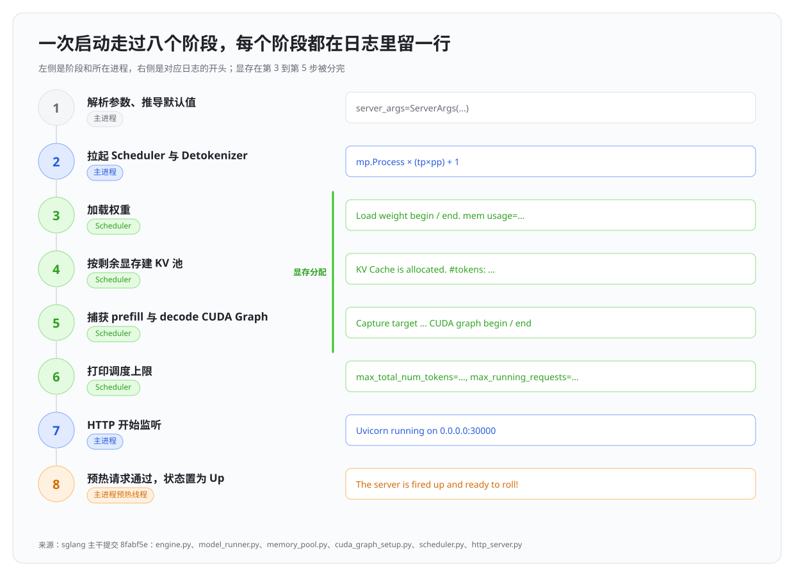
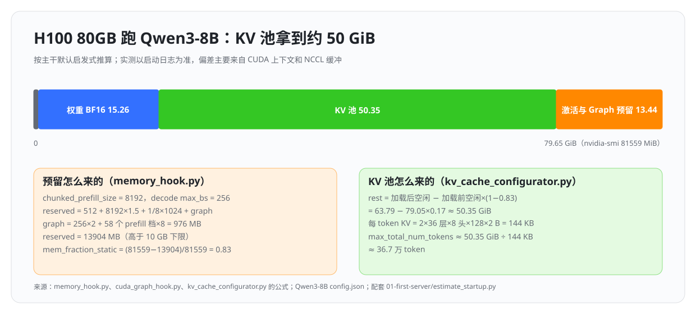
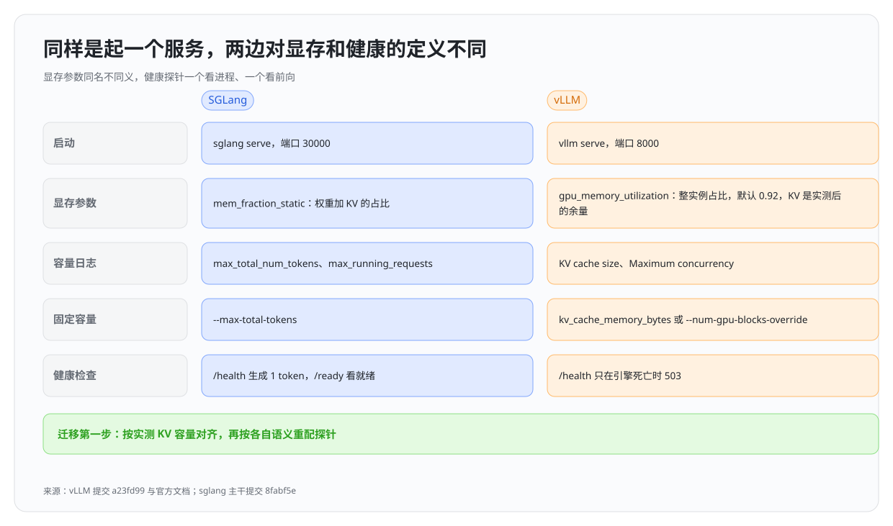
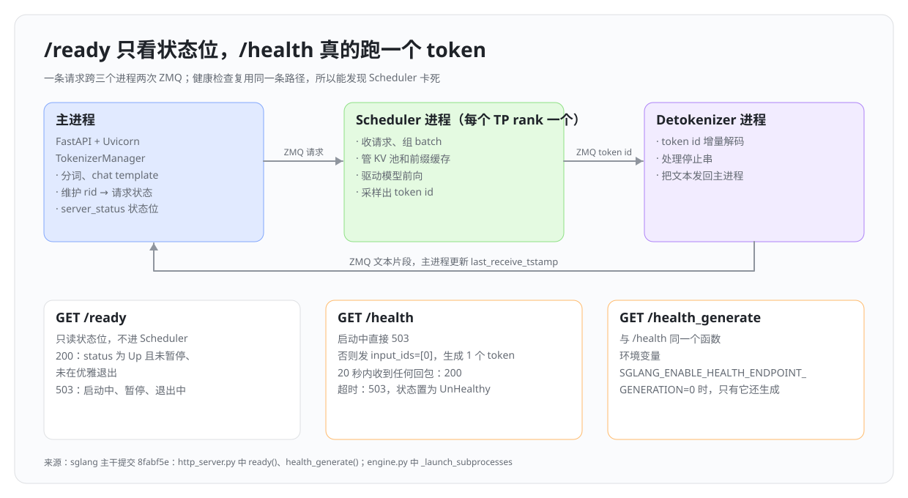

# SGL-01｜上手｜第一个服务：安装、启动、发请求和读懂启动日志

> 🎯 **遇到的问题**：这一篇在一张 GPU 上把 SGLang 服务起来，用 OpenAI 兼容接口和原生接口各发一次请求。更要紧的是，启动之前就算出日志里 KV 池的 token 数、mem_fraction_static 和最大并发请求数。算得出、对得上，后面的调参和排障才有依据。
>
> **主线**：启动日志里的每一行，都是显存账本里的一个数；读懂日志，就能在启动前算出服务能接多少并发。
>
> **读完这一篇**：能手算启动参数，和日志的偏差在 2% 以内。能读懂启动和运行期日志的每个字段，分清 /ready 和 /health，知道哪些默认值会改变线上行为。
>
> **代码**：[zero-to-sglang/01-first-server](../01-first-server)。预测和日志解析脚本在 CPU 上就能跑，起服务和冒烟测试要 GPU。基线是主干 8fabf5e 和 v0.5.22，数字核对于 2026 年 10 月 28 日。

# 导读 · 结论先行

1. **启动日志是一份显存账单，先预测再启动。**日志里的 KV 池大小由一条确定的公式算出：显存档位决定 chunked prefill 和 CUDA Graph 的规模，规模决定预留，预留决定 mem_fraction_static，再从加载权重后的空闲显存里扣掉预留，剩下的全给 KV。H100 跑 Qwen3-8B，公式预测约 36.7 万 token，构造日志里是 36.5 万[[1]](https://github.com/sgl-project/sglang)。
2. **8 个阶段，每个阶段都在日志里留一行。**解析参数、拉起子进程、加载权重、建 KV 池、捕获 CUDA Graph、打印调度上限、HTTP 监听、预热通过。卡在哪一步，就去查那一步的日志。
3. **/ready 和 /health 是两种语义。**/ready 只读状态位，/health 会真的生成 1 个 token，20 秒内收不到 Scheduler 的回包就返回 503，同时把状态位置为 UnHealthy，连带 /ready 也变成 503。探针配错，最常见的后果是服务在大流量下被反复重启[[2]](https://kubernetes.io/docs/concepts/configuration/liveness-readiness-startup-probes/)。
4. **采样参数默认取模型自带的 generation_config.json。**客户端不传 temperature 时，服务端用的是模型推荐值，不一定是 1.0。跨引擎对比时，两边不显式对齐采样参数，结果就不可比[[3]](https://docs.sglang.io/docs/advanced_features/server_arguments)。
5. **原生 /generate 的流式输出默认每条返回累计文本。**OpenAI 接口返回增量 delta，原生接口返回从头到当前的全文。客户端照搬 OpenAI 的拼接逻辑会得到重复文本。



**📎 与系列其他文档的分工**：本篇只讲单卡单实例：装好、起服务、发出第一条请求、读懂启动日志。多卡部署留给 [SGL-11｜原理｜并行：TP、DP Attention、EP 怎么组合](./11-parallelism.md)，账本的完整推导留给 [SGL-02｜上手｜推理账本：显存、KV 与 Roofline](./02-ledger.md)，压测方法留给 [SGL-03｜上手｜指标与压测：TTFT、TPOT、ITL 与 goodput](./03-bench.md)，请求在三个进程之间的完整路径留给 [SGL-04｜原理｜请求旅程：从 HTTP 到流式返回](./04-request-path.md)。

# 第 1 章 · 问题：服务起来了，然后呢

按官方快速上手，一条命令就能把服务拉起来[[4]](https://docs.sglang.io/docs/get-started/quickstart)。麻烦在后面：KV 池为什么只有这么多 token，并发上不去是显存不够还是参数没调，模型输出为什么和本地 transformers 不一样，Kubernetes 为什么把刚起来的 Pod 杀掉。这些问题的答案都在启动日志里，只是大多数人只看最后一行 fired up。

我们把第一次启动当成一次实验来做：

1. **预测**：在 CPU 上按主干的默认启发式算出启动日志里的关键数字。
2. **启动**：用固定参数起服务，日志落盘。
3. **对账**：从日志抽数字和预测比较，偏差超过 2% 就去找原因。
4. **冒烟**：从健康检查到流式生成过一遍六个接口，任何一步失败即非零退出，可以直接放进 CI。

预测和实测对不上往往比服务起不来更值得查。起不来会报错，对不上说明我们对显存怎么分配的理解有偏差，这个偏差会在后面每一次调参里放大。

| 线上现象 | 根因通常在 | 本篇对应位置 |
|-|-|-|
| 启动时报错，提示增大 --mem-fraction-static | 权重加载后的剩余显存不够扣预留，KV 预算算出来是负数 | 2.2 显存方程 |
| CUDA Graph 捕获阶段 OOM | 预留给激活和 Graph 的空间不够 | 2.2、5.1 |
| 并发上不去，#queue-req 一直涨 | KV 池太小，或者 max_running_requests 被压低 | 4.4 运行期日志 |
| Pod 启动几分钟后被杀 | 探针在加载权重期间就开始检查 | 5.3 探针 |
| 同一个 prompt 和本地推理结果不同 | 服务端用了模型推荐的采样参数 | 5.2 默认值 |
| 流式文本重复 | 原生接口默认返回累计文本 | 4.3 发请求 |

# 第 2 章 · 原理：启动链路与显存方程

## 2.1 三个进程，八个阶段

SGLang Runtime 启动后是三类进程：主进程跑 FastAPI 和 TokenizerManager，负责接入、分词和请求状态。每个 TP rank 一个 Scheduler 进程，负责组 batch、管 KV 和驱动前向。一个 Detokenizer 进程，把 token id 转回文本。进程之间用 ZMQ 通信[[5]](https://arxiv.org/abs/2312.07104)。用 ps 看到的进程名是 sglang::scheduler_TP0 和 sglang::detokenizer，这两个名字是源码里用 setproctitle 设置的，排查僵尸进程时按名字找最快。

开头的时间线图把启动拆成 8 步。第 1、2、7、8 步在主进程，第 3 到 6 步在 Scheduler 进程。显存只在第 3 到第 5 步被分配：先加载权重，再按剩余显存一次性建好 KV 池，最后捕获 CUDA Graph。KV 池建好后大小就固定了，运行期间不会再扩。这是 SGLang 和 vLLM 共同的设计，来自 PagedAttention 预分配块池的思路，好处是运行期没有显存分配开销，代价是启动时必须猜准留多少给激活{r("vllm")}。

## 2.2 显存方程

下面的公式逐行对应 [memory_hook.py](https://github.com/sgl-project/sglang/blob/8fabf5e/python/sglang/srt/arg_groups/memory_hook.py) 的 handle_gpu_memory_settings 和 [kv_cache_configurator.py](https://github.com/sgl-project/sglang/blob/8fabf5e/python/sglang/srt/mem_cache/kv_cache_configurator.py) 的 \_profile_available_bytes。只在没有手动传 --mem-fraction-static 时生效。

**第一步，按显存档位定规模。**G 是 GPU 总显存。G 小于 20 GB 时 chunked_prefill_size 取 2048、decode Graph 最大 batch 取 8。小于 35 GB 取 4096 和 48。小于 60 GB 取 4096 和 32。小于 160 GB 取 8192 和 256。更大取 16384 和 512。TP 大于等于 4 时 batch 上限会再放大。

**第二步，算预留 R（单位 MB）。**

$$R = 512 + 1.5\times\max(C, 2048) + \frac{tp\times pp}{8}\times 1024 + R_{graph}$$

C 是 chunked_prefill_size，1.5 MB/token 是 prefill 激活的经验系数。R_graph 是 CUDA Graph 预留：非 MLA 模型取 decode 最大 batch × 2 MB 加上 prefill 捕获档数 × 8 MB，MLA 模型的 prefill 部分固定 1.5 GB。G 大于 60 GB 时 R 至少 10 GB。

**第三步，得到 mem_fraction_static。**

$$f = \mathrm{round}\left(\frac{G - R}{G}, 3\right)$$

**第四步，加载权重后算 KV 预算。**F${}_{0}$ 是加载权重前的空闲显存，F${}_{1}$ 是加载后的空闲显存：

$$B_{KV} = F_1 - F_0\times(1 - f)$$

F${}_{0}$×(1−f) 是留给激活、CUDA Graph、NCCL 缓冲和碎片的余量。权重已经在 F${}_{1}$ 里扣过，所以 f 管的是静态部分（权重加 KV）占加载前空闲显存的比例。它和 KV 占总显存的比例是两回事，把它当成 KV 占总显存的比例，是调这个参数最常见的错误。

**第五步，换算成 token 数。**非 MLA 模型每 token 每卡的 KV 字节数是：

$$b_{tok} = 2\times L\times \frac{H_{kv}}{tp}\times d_{head}\times s$$

L 是层数，H${}_{kv}$ 是 KV 头数，s 是元素字节数（BF16 为 2）。Qwen3-8B 是 36 层、8 个 KV 头、head_dim 128[[6]](https://huggingface.co/Qwen/Qwen3-8B/blob/main/config.json)[[7]](https://arxiv.org/abs/2505.09388)，每 token 144 KB。max_total_num_tokens 约等于 B${}_{KV}$ 除以 b${}_{tok}$，再扣掉池子内部少量固定开销。GQA 把 KV 头从 32 压到 8，KV 体积就降到 MHA 的四分之一，单卡能放下的 token 数也翻了两番[[8]](https://arxiv.org/abs/2305.13245)。MLA 和滑窗层的算法不同，见 [SGL-02｜上手｜推理账本：显存、KV 与 Roofline](./02-ledger.md)。



**第六步，最大并发请求数。**没有手动指定时取 max_total_num_tokens ÷ context_len × 512，夹在 2048 和 4096 之间，且不超过 token 数的一半。所以日志里的 max_running_requests 几乎总是 2048 或 4096，它只是请求槽位上限。真正限制并发的是 KV 池：Qwen3-8B 的 context_len 是 40960，36.7 万 token 只够 9 条满长请求同时在跑。

| 模型 / GPU | chunk | decode max_bs | f | KV token 数 | 满长请求数 |
|-|-|-|-|-|-|
| Qwen3-0.6B / RTX 4090 | 4096 | 48 | 0.704 | 14.4 万 | 3.5 |
| Qwen3-8B / L40S | 4096 | 32 | 0.843 | 16.1 万 | 3.9 |
| Qwen3-8B / A100 80GB | 8192 | 256 | 0.830 | 36.9 万 | 9.0 |
| Qwen3-8B / H100 SXM | 8192 | 256 | 0.830 | 36.7 万 | 9.0 |
| Qwen3-8B / H100 SXM，FP8 KV | 8192 | 256 | 0.830 | 73.3 万 | 17.9 |
| Qwen3-8B / H200 | 8192 | 256 | 0.903 | 80.8 万 | 19.7 |
| Llama-3.1-70B / 4×H100 | 8192 | 512 | 0.819 | 41.8 万 | 3.2 |

表中数字由 [estimate_startup.py](../01-first-server/estimate_startup.py) 算出。几个规律：H100 和 A100 80GB 的 KV 容量几乎一样，H100 的优势在算力和带宽，容量上没有。H200 多出的 61 GB 全部进了 KV 池，容量翻倍还多。FP8 KV 让 token 数直接翻倍，代价是精度，见 [SGL-12｜原理｜量化：FP8、INT4 与 KV 量化怎么选](./12-quantization.md)。70B 在 4 卡上每卡 KV 头只剩 2 个，单 token 只占 80 KB，但满长 128K 的请求也只能放 3 条。

## 2.3 为什么要捕获 CUDA Graph

decode 每一步只为每条请求算 1 个 token，GPU 上的计算很少，但一次前向要发射几百个 kernel。每次发射在 CPU 侧要几微秒，几百次加起来是毫秒级，和 H100 上 8B 模型单步约 5 ms 的读权重时间在同一量级。CUDA Graph 把一整串 kernel 录制成一张图，之后一次提交就能重放，CPU 开销几乎归零[[9]](https://developer.nvidia.com/blog/cuda-graphs/)。

代价有三个。形状固定：图只能按预先捕获的 batch 档位重放，实际 batch 会被补齐到最近的档位，超过最大档位就退回 eager 模式，运行期日志里的 cuda graph: False 就是这种情况。显存：每个档位都要占一块，H100 上 decode 和 prefill 两组图合计约 1 GB。捕获耗时：构造日志里两组合计约 20 秒，占启动时间的四成左右。

> 💡 **踩过的坑**：我们为了加快启动加上 --disable-cuda-graph。结果小 batch 的 decode 退回 eager，单请求 ITL 变成原来的一倍以上，这个开关只适合调试。后来改用 --cuda-graph-max-bs-decode 少捕获几档，或者用 SGL-17 里讲的缓存与预热手段缩短启动。

## 2.4 vLLM 怎么做

vLLM 起服务的命令是 vllm serve 加模型名，默认监听 8000 端口，SGLang 默认是 30000[[10]](https://docs.vllm.ai/en/latest/getting_started/quickstart.html)。显存预算的思路相反。vLLM 用 gpu_memory_utilization 表示这个实例最多占整卡多少，默认 0.92；启动时先跑一次 profile_run 测出激活峰值，再估出 CUDA Graph 要的显存，预算减去这两项和权重，剩下的才分给 KV[[11]](https://github.com/vllm-project/vllm/blob/a23fd9903418de0e1d3757bb23e2f1697eb066f3/vllm/config/cache.py)。SGLang 的 mem_fraction_static 管的是权重加 KV 这块静态占用，剩余部分留给激活和图，不在启动时实测。

KV 能装多少，两边的启动日志里都有。vLLM 打印 KV cache size 和 Maximum concurrency 两行，KV cache size 是总 token 数，Maximum concurrency 是按 max_model_len 折算的满长请求并发数，它们对应 SGLang 的 max_total_num_tokens 和 max_running_requests。

想跳过实测直接定容量，vLLM 用 kv_cache_memory_bytes 给字节数，或用 --num-gpu-blocks-override 给块数[[12]](https://docs.vllm.ai/en/latest/configuration/engine_args.html)；SGLang 用 --max-total-tokens。

健康检查的语义差得最多。vLLM 的 /health 只在引擎进程已经死掉时返回 503，平时不跑任何前向。SGLang 的 /health 会真正生成 1 个 token，服务忙时跳过；另有 /ready 只看 tokenizer manager 是否就绪。拿 vLLM 的探针习惯配 SGLang，或者反过来，都会在负载高时得到意外结果：照 vLLM 配可能把卡住的实例判成健康，照 SGLang 配到 vLLM 上可能在探针上多花一次前向。

| 维度 | SGLang | vLLM | 差异的代价 |
|-|-|-|-|
| 启动 | sglang serve，端口 30000 | vllm serve，端口 8000 | 网关和探针配置不能照抄 |
| 显存参数 | mem_fraction_static：权重加 KV 的占比 | gpu_memory_utilization：整实例占比，默认 0.92，KV 是实测后的余量 | 同一个数字含义不同，0.9 在两边分到的 KV 不一样 |
| 容量日志 | max_total_num_tokens、max_running_requests | KV cache size、Maximum concurrency | 对比容量时要换算到同一单位 |
| 固定容量 | --max-total-tokens | kv_cache_memory_bytes 或 --num-gpu-blocks-override | vLLM 跳过实测后要自己留够激活空间 |
| 健康检查 | /health 生成 1 token，/ready 看就绪 | /health 只在引擎死亡时 503 | vLLM 探针发现不了卡死但未崩溃的引擎 |



# 第 3 章 · 源码走读：从 sglang serve 到 fired up

下面按调用顺序列出文件和函数。正文不写行号，读源码时用函数名 grep。先看 mini-sglang 的 [launch.py](https://github.com/sgl-project/mini-sglang/blob/main/python/minisgl/server/launch.py)，117 行就能看完整个拓扑：每个 TP rank 起一个 Scheduler 进程，起 1 个 Detokenizer 和 N 个 Tokenizer，然后在一个 ack 队列上等 N+2 个就绪信号[[13]](https://github.com/sgl-project/mini-sglang)。主干做的是同一件事，只是多了几十种部署模式的分支。

## 3.1 主进程：解析参数、拉起子进程

| 顺序 | 位置 | 做什么 |
|-|-|-|
| 1 | [serve.py](https://github.com/sgl-project/sglang/blob/8fabf5e/python/sglang/cli/serve.py) serve → \_run_llm | 判断是 LLM 还是扩散模型，调用 prepare_server_args 解析命令行，交给 run_server |
| 2 | [launch_server.py](https://github.com/sgl-project/sglang/blob/8fabf5e/python/sglang/launch_server.py) run_server | resolve_once() 一次性推导所有默认值，上面的显存启发式就在这里跑；然后按 gRPC 或 HTTP 模式分发 |
| 3 | [memory_hook.py](https://github.com/sgl-project/sglang/blob/8fabf5e/python/sglang/srt/arg_groups/memory_hook.py) handle_gpu_memory_settings | 按显存档位定 chunked_prefill_size、CUDA Graph 档位，算出 mem_fraction_static |
| 4 | [http_server.py](https://github.com/sgl-project/sglang/blob/8fabf5e/python/sglang/srt/entrypoints/http_server.py) launch_server | 调用 Engine.\_launch_subprocesses，再启动 uvicorn |
| 5 | [engine.py](https://github.com/sgl-project/sglang/blob/8fabf5e/python/sglang/srt/entrypoints/engine.py) \_launch_subprocesses | PortArgs.init_new 分配 ZMQ 地址。\_launch_scheduler_processes 按 tp×pp 起 Scheduler。起 Detokenizer。在主进程里构造 TokenizerManager。wait_for_ready 阻塞到所有 Scheduler 初始化完 |

## 3.2 Scheduler 进程：显存在这里被分完

| 阶段 | 位置 | 日志 |
|-|-|-|
| 加载权重 | [model_runner.py](https://github.com/sgl-project/sglang/blob/8fabf5e/python/sglang/srt/model_executor/model_runner.py) load_model | Load weight begin. avail mem=… / Load weight end. … mem usage=… |
| 算 KV 预算 | [kv_cache_configurator.py](https://github.com/sgl-project/sglang/blob/8fabf5e/python/sglang/srt/mem_cache/kv_cache_configurator.py) \_profile_available_bytes | 无单独日志，结果体现在下一行 |
| 建 KV 池 | [memory_pool.py](https://github.com/sgl-project/sglang/blob/8fabf5e/python/sglang/srt/mem_cache/memory_pool.py) 中 MHATokenToKVPool | KV Cache is allocated. dtype: …, #tokens: …, K size: …, V size: … |
| 池子建完 | kv_cache_configurator.py | Memory pool end. avail mem=… |
| 捕获 Graph | [cuda_graph_setup.py](https://github.com/sgl-project/sglang/blob/8fabf5e/python/sglang/srt/model_executor/model_runner_components/cuda_graph_setup.py) | Capture target prefill / decode CUDA graph begin / end |
| 算并发上限 | kv_cache_configurator.py resolve_max_num_reqs | 无单独日志 |
| 汇报调度上限 | [scheduler.py](https://github.com/sgl-project/sglang/blob/8fabf5e/python/sglang/srt/managers/scheduler.py) | max_total_num_tokens=…, chunked_prefill_size=…, max_running_requests=…, context_len=… |

日志里的 GB 实际按 2 的 30 次方字节计算，也就是 GiB。拿 nvidia-smi 的 MiB 对账时除以 1024，按 1000 换算就会差出一截。

## 3.3 主进程：预热与就绪

uvicorn 启动时，FastAPI 的 lifespan 钩子起一个线程跑 \_wait_and_warmup，逻辑在 [http_server.py](https://github.com/sgl-project/sglang/blob/8fabf5e/python/sglang/srt/entrypoints/http_server.py)：

1. 每秒轮询一次 /model_info，最多 120 次。两分钟内 HTTP 层起不来，直接杀掉整个进程树。
2. 生成模型发一条 /generate，文本是 The capital city of France is，temperature 0，max_new_tokens 8；多模态模型改发带图片的 chat 请求。超时默认 600 秒，可用环境变量 SGLANG_WARMUP_TIMEOUT 调整。
3. 预热成功后把 server_status 置为 Up，冻结 GC，打印 The server is fired up and ready to roll!。失败则杀掉进程树。

预热请求本身也会出现在运行期日志里：fired up 之前那一行 #new-token: 6 的 Prefill batch 就是它。加了 --skip-server-warmup 会跳过这一步直接置 Up，第一个真实请求要承担所有冷启动开销，只适合开发环境。



/ready 和 /health 的差别见上图。/health 发出的请求是 input_ids=[0]、生成 1 个 token，之后每秒检查一次主进程最近收到 Detokenizer 回包的时间戳。只要回包时间晚于检查开始时间就算健康，不要求回的是这条请求，所以服务在满载时 /health 也能在一秒左右返回，不会排队。20 秒内没有任何回包才判定不健康，超时时间由环境变量 SGLANG_HEALTH_CHECK_TIMEOUT 控制。另外，SageMaker 用的 /ping 只读状态位、不检查暂停，权重同步期间仍然返回 200。

# 第 4 章 · 实验：预测、启动、对账、冒烟

## 4.1 安装

官方镜像和 wheel 只发 CUDA 13 版本，v0.5.19 是最后一个带 CUDA 12 的发行版，旧驱动要先升级[[14]](https://docs.sglang.io/docs/get-started/install)。两种方式任选：

```bash
# 方式一：Docker。生产环境把 latest 换成具体发行版标签
docker run -it --gpus all --shm-size 32g --ipc=host -p 30000:30000 \
  -v "$HOME/.cache/huggingface:/root/.cache/huggingface" \
  lmsysorg/sglang:latest bash

# 方式二：uv，Python 3.11 及以上
pip install uv
uv venv --python 3.12 && source .venv/bin/activate
uv pip install --prerelease=allow sglang
python -c "import sglang; print(sglang.__version__)"
```

--prerelease=allow 不能省。部分依赖只在 PyPI 上发预发布版本，uv 0.12.0 以前的版本不加这个参数会静默装上 0.5.9，装完能跑，但和本系列对照的主干差了十几个版本。装完第一件事是打印版本号。

## 4.2 预测，然后启动

第一步在任意机器上跑 [estimate_startup.py](../01-first-server/estimate_startup.py)：

```bash
$ python3 estimate_startup.py --model qwen3-8b --gpu h100-sxm
Qwen3-8B on 1 x H100 SXM（nvidia-smi 81559 MiB）
[参数推导]
  chunked_prefill_size      8192
  decode cuda graph max_bs  256（36 个捕获档）
  prefill cuda graph 档数   58
  graph 预留                976 MB
  reserved_mem              13904 MB
  mem_fraction_static       0.83
[预测日志]
  Load weight begin. avail mem=79.05 GB
  Load weight end. ... avail mem=63.79 GB, mem usage=15.26 GB.
  KV Cache is allocated. #tokens: 366669, K size: 25.18 GB, V size: 25.18 GB
  max_total_num_tokens=366669, chunked_prefill_size=8192, max_running_requests=4096, context_len=40960
```

第二步在 GPU 机器上用 [serve.sh](../01-first-server/serve.sh) 启动。脚本固定了几个和线上行为有关的参数，日志同时落到 logs/ 目录：

```bash
sglang serve Qwen/Qwen3-8B \
  --host 0.0.0.0 --port 30000 --tp-size 1 \
  --reasoning-parser qwen3 \
  --tool-call-parser qwen \
  --served-model-name qwen3 \
  --enable-metrics 2>&1 | tee logs/serve-$(date +%Y%m%d-%H%M%S).log
```

- **--reasoning-parser qwen3**：把模型输出里的思考段拆到 reasoning_content 字段，content 里只留最终回答[[15]](https://docs.sglang.io/docs/advanced_features/separate_reasoning)。
- **--tool-call-parser qwen**：解析工具调用。旧名 qwen25 在主干已改成 qwen，旧名仍能用，但会打弃用告警；两个 parser 都接受 auto，按 chat template 自动识别[[16]](https://docs.sglang.io/docs/advanced_features/tool_parser)。
- **--served-model-name qwen3**：对外暴露的模型名。客户端写死这个名字，换模型版本时不用改客户端。
- **--enable-metrics**：打开 /metrics，Prometheus 格式，SGL-18 会用到。

24 GB 的卡放不下 8B 的 BF16 权重加上像样的 KV 池，先用 MODEL=Qwen/Qwen3-0.6B bash serve.sh 跑通流程。

## 4.3 对账

看到 fired up 之后，用 [parse_startup_log.py](../01-first-server/parse_startup_log.py) 从日志里抽数字和预测比较。它先用日志里的 Load weight begin 反推 CUDA 上下文占用，再用 server_args 行里实际生效的 mem_fraction_static 重算一遍，剩下的偏差只来自权重实际大小和池子内部开销。没有 GPU 时，先用仓库里的构造日志 [sample_startup.log](../01-first-server/sample_startup.log) 先跑一遍：

```text
$ python3 parse_startup_log.py sample_startup.log --model qwen3-8b --gpu h100-sxm
[启动阶段]
  加载前空闲                  78.93 GB
  权重占用                    15.31 GB
  权重加载耗时                5.3 s
  KV 池 token 数              365312
  prefill graph 耗时/显存     12.0 s / 0.41 GB
  decode graph 耗时/显存      7.9 s / 0.63 GB
  启动完成后空闲              12.17 GB
[对账]
  CUDA 上下文等（反推）       0.72 GiB
  mem_fraction_static         0.83（取自 server_args 行）
  权重 预测 15.26 GB，实际 15.31 GB
  max_total_num_tokens 预测 365959，实际 365312，偏差 +0.2%
```

构造日志按主干的真实日志格式写，数值是推算量级，不是实机录制。拿到实机日志后以实机为准。实机偏差在 2% 以内算正常，超过 10% 通常是以下几种情况：

- 手动传了 --max-total-tokens、--max-running-requests 之类的容量参数。
- 开了投机解码（draft 模型和它的 KV 池也要显存）、DP Attention 或多模态。
- 模型是 MLA（DeepSeek 系）或带滑窗层（Gemma、gpt-oss），每 token KV 的算法不同。
- 同一张卡上还有别的进程，加载前空闲显存比预期少。

> 💡 **实验记录**：我们把 --mem-fraction-static 分别设为 0.80 和 0.88 各起一次，记下 KV token 数和启动完成后的空闲显存，验证 B = F1 − F0×(1−f)：f 每提高 0.01，KV 预算大约多出 F0 的 1%，也就是 0.79 GiB，约 5700 个 token。0.88 那一次还要看捕获 Graph 时会不会 OOM。

## 4.4 发请求

OpenAI 兼容接口覆盖 chat、completions、embeddings 和 models[[17]](https://docs.sglang.io/docs/basic_usage/openai_api)：

```bash
curl -s http://127.0.0.1:30000/v1/chat/completions \
  -H 'Content-Type: application/json' \
  -d '{"model": "qwen3", "max_tokens": 256,
       "messages": [{"role": "user", "content": "用一句话解释 KV cache。"}]}' \
  | jq '.choices[0].message | {reasoning_content, content}, .usage'

# 关闭 Qwen3 的思考模式
curl -s http://127.0.0.1:30000/v1/chat/completions \
  -H 'Content-Type: application/json' \
  -d '{"model": "qwen3", "max_tokens": 64,
       "chat_template_kwargs": {"enable_thinking": false},
       "messages": [{"role": "user", "content": "1+1=?"}]}' | jq -r '.choices[0].message.content'
```

原生接口 /generate 直接收文本或 token id，返回的 meta_info 里有 prompt_tokens、cached_tokens、e2e_latency 和 finish_reason，排查问题比 OpenAI 接口方便[[18]](https://docs.sglang.io/docs/basic_usage/native_api)：

```bash
curl -s http://127.0.0.1:30000/generate -H 'Content-Type: application/json' \
  -d '{"text": "The capital of France is",
       "sampling_params": {"max_new_tokens": 16, "temperature": 0},
       "return_logprob": true}' | jq '.meta_info | del(.output_token_logprobs)'

curl -s http://127.0.0.1:30000/server_info | jq '{max_total_num_tokens, chunked_prefill_size}'
curl -s -X POST http://127.0.0.1:30000/flush_cache     # 清空前缀缓存，做对照实验前用
curl -s http://127.0.0.1:30000/metrics | grep -E '^sglang:(num_running_reqs|token_usage)'
```

同一个 prompt 连发两次，第二次 meta_info 里的 cached_tokens 会接近 prompt_tokens，这就是 RadixAttention 的前缀复用，原理见 SGL-08。做性能对照实验前先 /flush_cache，否则第二组数据会沾上第一组的缓存命中。

最后用 [smoke_test.py](../01-first-server/smoke_test.py) 把六个接口过一遍。脚本只依赖标准库，可以直接放进部署流水线：

```text
$ python3 smoke_test.py --base http://127.0.0.1:30000
[OK] 就绪检查  /ready=200 /health=200
[OK] 模型信息  model=qwen3 is_generation=True reasoning_parser=qwen3 tool_call_parser=qwen
[OK] OpenAI chat 非流式  finish=stop prompt=... completion=... reasoning[:30]='...' content[:40]='...'
[OK] OpenAI chat 流式  TTFT=... ms  平均 ITL=... ms  chunks=... completion_tokens=...
[OK] 原生 /generate 流式  chunks=16 累计文本=True（默认 incremental_streaming_output=False）
[OK] 原生 /generate logprob  finish={'type': 'length', 'length': 4} ...
```

流式那一步测出的 ITL 可以和理论下限对一下：单请求 decode 每步要把约 16.4 GB 权重读一遍，H100 带宽 3.35 TB/s，下限约 4.9 ms。实测落在 6 到 8 ms 属于正常，差的部分是 attention、采样和调度开销。超过 15 ms 先看日志里 decode 是否走了 CUDA Graph。这只是量级检查，正经测性能用 SGL-03 的压测流程。

不需要 HTTP 时可以用离线引擎，在同一个 Python 进程里直接调用[[19]](https://docs.sglang.io/docs/basic_usage/offline_engine_api)。子进程用 spawn 方式启动，入口必须放在 main 保护下面：

```python
import sglang as sgl

if __name__ == "__main__":
    llm = sgl.Engine(model_path="Qwen/Qwen3-0.6B")
    out = llm.generate(["The capital of France is"], {"temperature": 0, "max_new_tokens": 16})
    print(out[0]["text"], out[0]["meta_info"]["cached_tokens"])
    llm.shutdown()
```

## 4.5 读运行期日志

服务跑起来后，Scheduler 每处理一个 prefill batch 打一行，decode 默认每 40 步打一行（--decode-log-interval），格式定义在 [metrics_reporter.py](https://github.com/sgl-project/sglang/blob/8fabf5e/python/sglang/srt/managers/scheduler_components/metrics_reporter.py)。这两行是线上排障时最先看的东西：

```text
Prefill batch, #new-seq: 32, #new-token: 6144, #cached-token: 26624, token usage: 0.09,
  #running-req: 0, #queue-req: 96, #pending-token: 98304, cuda graph: True, input throughput (token/s): 41230.77
Decode batch, #running-req: 300, #token: 310000, token usage: 0.85, cuda graph: False,
  gen throughput (token/s): 8120.06, #queue-req: 12
```

| 字段 | 含义 | 看到什么要警觉 |
|-|-|-|
| #new-token / #cached-token | 本批新算的 token 和命中前缀缓存的 token | 共享 system prompt 的业务命中率长期低于预期，查 prompt 拼接顺序（SGL-08） |
| token usage | KV 池占用比例 | 长期高于 0.9：即将触发 retract，请求被踢回队列重算（SGL-05） |
| #running-req | 正在 decode 的请求数 | 远低于 max_running_requests 但 token usage 已满：被 KV 容量卡住，不是槽位 |
| #queue-req | 等待队列长度 | 持续上涨：容量不够，加卡或限流 |
| #pending-token | 队列里还没算的 prompt token 总数 | 除以 input throughput 就是排队请求的大致等待秒数 |
| cuda graph | 这一步是否走 CUDA Graph | decode 出现 False：batch 超过了捕获的最大档位，上例 300 大于 256 |
| gen throughput | 最近一个区间的生成速度 | 和 #running-req 一起看，batch 涨了吞吐没涨，说明到了算力或带宽上限 |

[parse_startup_log.py](../01-first-server/parse_startup_log.py) 也会统计运行期这两类日志：构造日志里 4 个 prefill 批次的缓存命中率是 81.2%，token usage 峰值 0.85，有 1 条 decode 没走 CUDA Graph，排队峰值 12。这几个数是 SGL-17 调参时的基线。

# 第 5 章 · 调过的参数和踩过的坑

## 5.1 第一次部署会碰到的参数

| 参数 | 默认 | 什么时候改它 |
|-|-|-|
| --mem-fraction-static | 按 2.2 节公式算 | 启动报 KV 预算为负时调高；捕获 Graph 或运行期 OOM 时调低。每次改 0.01 到 0.02，改完对账 |
| --context-length | 取 config.json | Qwen3-8B 的 config 写 40960。模型卡说明原生支持 32K，用 YaRN 可扩到 131K，扩之前要用 --json-model-override-args 配好 rope_scaling；超过 config 的值还要设环境变量 SGLANG_ALLOW_OVERWRITE_LONGER_CONTEXT_LEN=1 |
| --max-running-requests | 2048 或 4096 | 想压低尾延迟时设小，用排队换每条请求的 ITL |
| --chunked-prefill-size | 按显存档位 | 长 prompt 拖慢在跑请求的 ITL 时调小，代价是 TTFT 变长，见 SGL-06 |
| --cuda-graph-max-bs-decode | 按显存档位 | 日志常见 decode cuda graph: False 时调大；捕获 OOM 或想缩短启动时调小。主干已拆成 -decode 和 -prefill 两个参数，旧名 --cuda-graph-max-bs 因前缀歧义会被拒绝 |
| --kv-cache-dtype | auto（跟模型） | fp8_e4m3 让 KV 容量翻倍，上线前用业务评测集验精度，见 SGL-12 |
| --api-key | 无 | 对外暴露时必须设；预热请求会自动带上 |
| --watchdog-timeout | 300 秒 | 单个 forward 超过这个时间进程直接退出，防止卡死。超长 prefill 场景可调大 |
| --sampling-defaults | model | 设为 openai 则不读 generation_config.json，temperature 等默认 1.0 |
| --incremental-streaming-output | 关 | 原生 /generate 流式改为只返回增量片段 |

参数全集以官方 Server Arguments 页面为准[[3]](https://docs.sglang.io/docs/advanced_features/server_arguments)。我们第一次部署时只动了前五个，剩下的都是等指标暴露出问题才去碰。

## 5.2 默认值带来的意外

> 💡 **踩过的坑**：拿服务输出和本地 transformers 推理逐字对比，发现不一样就认定引擎有 bug。后来才查到是两边采样参数不一致：服务端默认取 generation_config.json，Qwen3 的推荐 temperature 是 0.6，本地脚本多半用的是贪心或 1.0。对比正确性时改成显式传 temperature=0，即便如此，batch 组成不同也会让浮点累加顺序不同，长输出出现分叉是正常的。需要逐位一致时，改用确定性推理模式，见 SGL-17。

> 💡 **踩过的坑**：把 mem_fraction_static 当成 KV 占总显存的比例。读了源码才知道，它是静态部分（权重加 KV）占加载前空闲显存的比例，0.83 时 KV 实际只占 H100 的 63%。另外，只有不手动传这个参数时，改 --chunked-prefill-size 才会自动重算预留；手动固定了 f 再调大 chunk，激活空间不会跟着变大，就在长 prompt 上 OOM 过一次。

> 💡 **踩过的坑**：我们照着旧教程用 python -m sglang.launch_server、--enable-dp-attention、sglang.bench_serving。这些入口在主干仍可用，但有的已标记弃用，有的参数被拆分改名。现在一律以 sglang serve --help 的输出为准。

## 5.3 探针怎么配

Kubernetes 的三种探针各管一件事：startupProbe 管启动期，readinessProbe 决定是否接流量，livenessProbe 决定是否重启[[2]](https://kubernetes.io/docs/concepts/configuration/liveness-readiness-startup-probes/)。对应到 SGLang：

```yaml
startupProbe:            # 加载权重加捕获 Graph，大模型可能要十几分钟
  httpGet: {path: /ready, port: 30000}
  periodSeconds: 10
  failureThreshold: 90   # 最多等 15 分钟
readinessProbe:          # 只读状态位，开销为零；暂停和优雅退出时摘流量
  httpGet: {path: /ready, port: 30000}
  periodSeconds: 5
livenessProbe:           # 真的生成 1 个 token，能发现 Scheduler 卡死
  httpGet: {path: /health, port: 30000}
  periodSeconds: 30
  timeoutSeconds: 25     # 必须大于服务端 20 秒的判定窗口
  failureThreshold: 3
```

两个容易出错的地方。livenessProbe 的 timeoutSeconds 小于 20 秒时，Scheduler 只是慢、还没有卡死，探针就先超时了，Pod 会在流量高峰被反复重启，而重启本身要十几分钟，雪崩就是这么来的。另一个是状态位：一次 /health 失败会把状态位置为 UnHealthy，readiness 跟着失败，流量被摘掉；下一次 /health 成功会把状态恢复成 Up。所以偶发的一次失败只会短暂摘流量，不会让实例永久下线。

## 5.4 我们的看法

启动日志里的数字，是这套系统对这台机器做的第一次承诺。我们回头看上线后碰到的显存问题，追根溯源都是第一次部署时没对账：不知道 KV 池为什么是这个大小，就只能靠试错改 mem_fraction_static，每次改完都要等十几分钟重启。后来我们花半小时把 2.2 节的公式和自己的日志对上，省下的时间远不止半小时。

# 第 6 章 · 上线核对和下一步

> 📌 **上线前逐条核对**
> - 记录了 sglang 版本号和镜像标签，生产环境不用 latest
> - 启动前用 estimate_startup.py 预测，启动后用 parse_startup_log.py 对账，偏差在 2% 以内，或者能解释偏差来源
> - 日志里 decode 和 prefill 的 CUDA Graph 都捕获成功，记下了捕获的最大档位
> - 记下了 max_total_num_tokens，算出满长请求能同时跑几条，和业务的典型请求长度对照
> - 确认了采样默认值的来源（model 还是 openai），客户端是否显式传参也和业务方对齐过
> - 核对过 reasoning parser 和 tool call parser 与模型匹配，smoke_test.py 六步全绿
> - 探针按 5.3 节配置，liveness 的超时大于 20 秒
> - 对外暴露时设了 --api-key，开了 --enable-metrics 并接入监控
> - 和原生接口的客户端确认过，流式文本是累计还是增量

> 🔑 **学到的**：SGLang 的启动是一个确定的过程：显存档位定规模，规模定预留，预留定 mem_fraction_static，再从加载权重后的空闲显存里扣掉预留，剩下的给 KV。先预测、再启动、再对账，是我们从这一章带走的习惯。/ready 看状态位，/health 跑一个真实 token，所以两个探针要分开配。

下一步：[SGL-02｜上手｜推理账本：显存、KV 与 Roofline](./02-ledger.md) 把本章只用到的 KV 公式扩展成完整的推理账本，覆盖 MLA、滑窗、MoE 和多卡切分，并用 Roofline 解释 prefill 和 decode 分别受什么限制。

# 参考文献

按正文首次引用顺序编号，资料截至 2026 年 10 月底。源码以 sgl-project/sglang 主干提交 8fabf5e（2026 年 10 月 28 日）和 v0.5.22 发行版为准。

[1] sgl-project. SGLang 源码仓库. GitHub [https://github.com/sgl-project/sglang](https://github.com/sgl-project/sglang)

[2] Kubernetes 文档. Liveness, Readiness, and Startup Probes [https://kubernetes.io/docs/concepts/configuration/liveness-readiness-startup-probes/](https://kubernetes.io/docs/concepts/configuration/liveness-readiness-startup-probes/)

[3] SGLang 文档. Server Arguments [https://docs.sglang.io/docs/advanced_features/server_arguments](https://docs.sglang.io/docs/advanced_features/server_arguments)

[4] SGLang 文档. Quick Start [https://docs.sglang.io/docs/get-started/quickstart](https://docs.sglang.io/docs/get-started/quickstart)

[5] Zheng L, et al. SGLang: Efficient Execution of Structured Language Model Programs. NeurIPS (2024) [https://arxiv.org/abs/2312.07104](https://arxiv.org/abs/2312.07104)

[6] Qwen. Qwen3-8B config.json. Hugging Face [https://huggingface.co/Qwen/Qwen3-8B/blob/main/config.json](https://huggingface.co/Qwen/Qwen3-8B/blob/main/config.json)

[7] Yang A, et al. Qwen3 Technical Report. arXiv (2025) [https://arxiv.org/abs/2505.09388](https://arxiv.org/abs/2505.09388)

[8] Ainslie J, et al. GQA: Training Generalized Multi-Query Transformer Models from Multi-Head Checkpoints. EMNLP (2023) [https://arxiv.org/abs/2305.13245](https://arxiv.org/abs/2305.13245)

[9] Gray A. Getting Started with CUDA Graphs. NVIDIA Technical Blog (2019) [https://developer.nvidia.com/blog/cuda-graphs/](https://developer.nvidia.com/blog/cuda-graphs/)

[10] vLLM Docs. Quickstart [https://docs.vllm.ai/en/latest/getting_started/quickstart.html](https://docs.vllm.ai/en/latest/getting_started/quickstart.html)

[11] vllm-project/vllm. vllm/config/cache.py（a23fd99） [https://github.com/vllm-project/vllm/blob/a23fd9903418de0e1d3757bb23e2f1697eb066f3/vllm/config/cache.py](https://github.com/vllm-project/vllm/blob/a23fd9903418de0e1d3757bb23e2f1697eb066f3/vllm/config/cache.py)

[12] vLLM Docs. Engine Arguments [https://docs.vllm.ai/en/latest/configuration/engine_args.html](https://docs.vllm.ai/en/latest/configuration/engine_args.html)

[13] sgl-project. Mini-SGLang. GitHub [https://github.com/sgl-project/mini-sglang](https://github.com/sgl-project/mini-sglang)

[14] SGLang 文档. Install [https://docs.sglang.io/docs/get-started/install](https://docs.sglang.io/docs/get-started/install)

[15] SGLang 文档. Reasoning Parser [https://docs.sglang.io/docs/advanced_features/separate_reasoning](https://docs.sglang.io/docs/advanced_features/separate_reasoning)

[16] SGLang 文档. Tool Parser [https://docs.sglang.io/docs/advanced_features/tool_parser](https://docs.sglang.io/docs/advanced_features/tool_parser)

[17] SGLang 文档. OpenAI APIs [https://docs.sglang.io/docs/basic_usage/openai_api](https://docs.sglang.io/docs/basic_usage/openai_api)

[18] SGLang 文档. Native APIs [https://docs.sglang.io/docs/basic_usage/native_api](https://docs.sglang.io/docs/basic_usage/native_api)

[19] SGLang 文档. Offline Engine API [https://docs.sglang.io/docs/basic_usage/offline_engine_api](https://docs.sglang.io/docs/basic_usage/offline_engine_api)

---

[目录](./README.md) · 下一章：[SGL-02｜上手｜推理账本：显存、KV 与 Roofline](./02-ledger.md)
