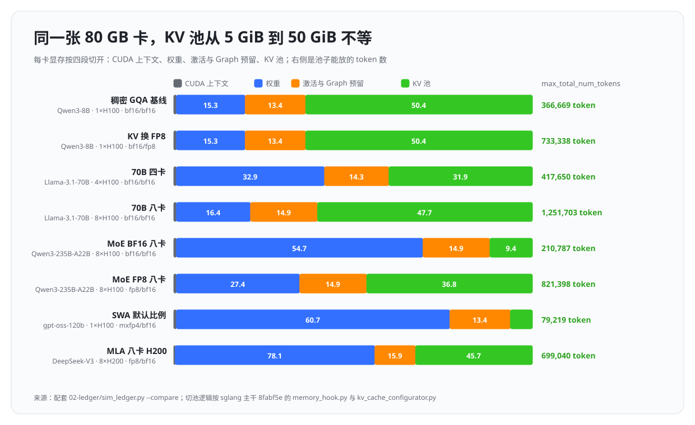
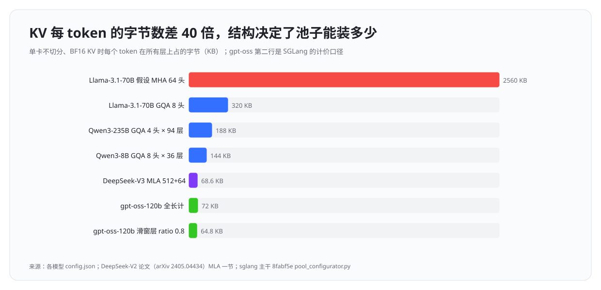
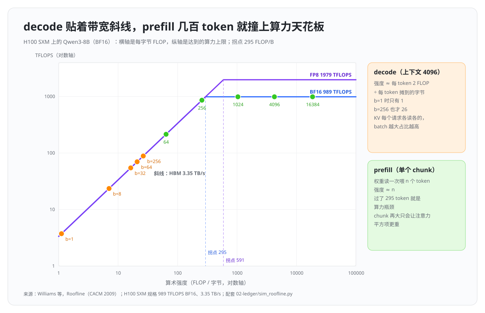
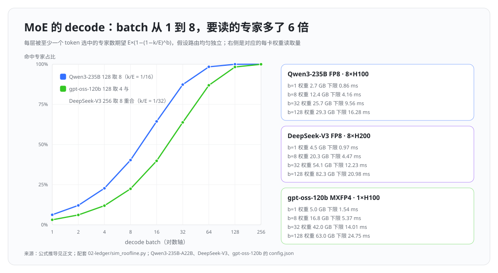
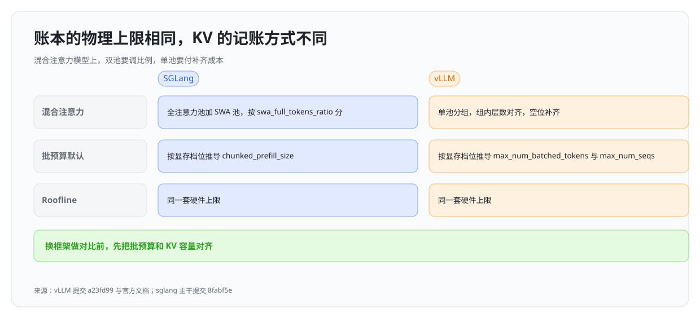

# SGL-02｜上手｜推理账本：显存、KV 与 Roofline

> 🎯 **遇到的问题**：给定模型、显卡和并行方式，这一篇不碰 GPU，先算三本账：显存怎么分（权重、预留、KV 池各多少），KV 池装得下多少 token、多少条请求，装进去以后 decode 一步和 prefill 一个 chunk 最快多快。上卡之后用实测除以下限，得到带宽利用率和算力利用率。
>
> **主线**：显存决定能同时挂住多少请求，带宽和算力决定每一步跑多快；三本账算清楚，容量和速度的上限就定了。
>
> **读完这一篇**：拿到新模型，十分钟内判断能不能跑、能跑多大并发、卡在带宽还是算力。能说清 GQA、MLA、滑窗对 KV 容量的影响，以及 TP 加卡什么时候省 KV。能用 one_batch 的结果算出 MBU 和 MFU。
>
> **代码**：[zero-to-sglang/02-ledger](../02-ledger)。sim_ledger.py 和 sim_roofline.py 只用标准库，CPU 上能跑。切池逻辑按主干 8fabf5e 逐行核对，模型结构取自各家 config.json。

# 导读 · 结论先行

1. **同一张 80 GB 卡，KV 池能差 10 倍。**Qwen3-8B 单卡有 50 GiB 的 KV 池，gpt-oss-120b 单卡只剩 4.9 GiB，连一条 131K 的满长请求都放不下。差别全在权重占了多少，以及每个 token 的 KV 有多大。
2. **每 token 的 KV 字节由注意力结构决定，差距可达 40 倍。**Llama-3.1-70B 如果用 MHA 是每 token 2.5 MB，GQA 压到 320 KB；DeepSeek-V3 的 MLA 只存 576 维 latent，每 token 68.6 KB[[1]](https://arxiv.org/abs/2305.13245)[[2]](https://arxiv.org/abs/2405.04434)。选模型的时候就已经决定了池子能装多少。
3. **TP 加卡不一定省 KV。**KV 头按 TP 切分，切到每卡 1 个头就切不动了，再加卡只是重复存。Qwen3-235B 只有 4 个 KV 头，TP4 和 TP8 每卡每 token 都是 47 KB。MLA 更彻底，每张卡都存完整一份 latent。
4. **decode 在任何 batch 下都受带宽限制。**权重可以被 batch 摊薄，KV 不行，每个请求读自己的上下文。Qwen3-8B 在 4096 上下文下，算术强度的上限约 29 FLOP/B，离 H100 的拐点 295 差一个数量级[[3]](https://dl.acm.org/doi/10.1145/1498765.1498785)[[4]](https://arxiv.org/abs/2211.05102)。所以想提高 decode 吞吐，只能减少每 token 要读的字节，或者让更多请求共享读到的字节。
5. **MoE 的小 batch decode 对 batch 特别敏感。**batch 从 1 涨到 8，Qwen3-235B 每层要读的专家从 8 个涨到 52 个，单步下限从 0.86 ms 涨到 4.16 ms。稠密模型同样的变化只多读一点 KV。



**📎 与系列其他文档的分工**：本篇把模型结构换算成 SGLang 启动日志里的数字：权重多大，每 token 的 KV 多少字节，一张卡能放多少 token，decode 一步要读多少字节。注意力和 MoE 的结构只讲到能算账为止。启动链路和 mem_fraction_static 的推导在 [SGL-01｜上手｜第一个服务：安装、启动、发请求和读懂启动日志](./01-first-server.md) 已经讲过，这里直接用结论；账本里的 KV 池怎么被切成页、怎么分配给请求，留给 [SGL-07｜原理｜内存池与页表：req_to_token、token_to_kv 与 page size](./07-memory-pool.md)。

# 第 1 章 · 问题：一张卡能装多少，装进去跑多快

[SGL-01｜上手｜第一个服务：安装、启动、发请求和读懂启动日志](./01-first-server.md) 用 Qwen3-8B 走通了启动，日志里的 36.7 万 token 和公式对上了。换一个模型，问题马上变复杂：

- gpt-oss-120b 单卡能起，启动日志却多出一行 swa_layer_tokens，两个数字哪个才是容量？
- Qwen3-235B 从 4 卡扩到 8 卡，KV 池变大了，每 token 的 KV 却没变小，为什么？
- DeepSeek-V3 用 8 张 H200，每卡 KV 池 45 GiB，可 MLA 的 latent 那么小，为什么只装得下 70 万 token？
- 同一张卡上 decode 从 batch 32 加到 64，吞吐只涨了 28%，是调度没做好，还是物理上限？
- one_batch 测出 decode 一步 6.2 ms，这算快还是慢？

前三个是容量问题，答案在显存账本里；后两个是速度问题，答案在 Roofline 里。两本账都能在 CPU 上算出来，算出来的数是下限或上限，实测只会更差。拿实测去比这个界，才知道该不该继续优化、往哪个方向优化。

| 现象 | 先查哪本账 | 本篇位置 |
|-|-|-|
| KV 池远小于预期，并发上不去 | 显存账本：权重占比、每 token 字节 | 2.1、2.2 |
| 多出 swa_layer_tokens，不知道看哪个 | 滑窗池的计价口径 | 2.3 |
| 加卡后每 token KV 不降 | KV 头数和 TP 的关系 | 2.2 |
| batch 加大吞吐不涨 | Roofline：KV 读取占比 | 2.5 |
| MoE 小 batch 延迟抖得厉害 | 命中专家数随 batch 的变化 | 2.6 |
| 不知道实测离上限多远 | MBU、MFU | 2.7、4.4 |

# 第 2 章 · 原理：显存账本与 Roofline

## 2.1 每卡显存分四段

模型加载完、KV 池建好之后，一张卡的显存可以切成四段：CUDA 上下文和 NCCL 等固定开销，权重，留给激活和 CUDA Graph 的预留，以及 KV 池。[SGL-01｜上手｜第一个服务：安装、启动、发请求和读懂启动日志](./01-first-server.md) 推导过 KV 预算：

$$B_{KV} = F_1 - F_0\times(1 - f)$$

F${}_{0}$ 是加载权重前的空闲显存，F${}_{1}$ 是加载后的空闲显存，f 是 mem_fraction_static。换个写法更直观：KV 池等于加载前空闲显存乘以 f，再减去权重。权重每多 1 GiB，KV 池就少 1 GiB，预留那一段不受影响。

开头的堆叠图把八个典型场景摆在一起。Qwen3-8B 单卡权重 15 GiB，KV 池 50 GiB；同一张卡跑 gpt-oss-120b，MXFP4 权重仍有 60.7 GiB，KV 只剩 4.9 GiB。Qwen3-235B 八卡，BF16 权重每卡 54.7 GiB，换成 FP8 降到 27.4 GiB，KV 池从 9.45 GiB 涨到 36.82 GiB。权重量化对 KV 容量的影响，往往比 KV 量化本身更大，这一点在 [SGL-12｜原理｜量化：FP8、INT4 与 KV 量化怎么选](./12-quantization.md) 会再回来。

## 2.2 每 token 的 KV 字节

池子的 GiB 数除以每 token 的字节数，就是 max_total_num_tokens。每 token 字节数由注意力结构决定，SGLang 在主干里按三种结构分别计价。

**MHA 和 GQA。**每层存 K、V 两份，每份是 KV 头数乘以 head_dim。TP 切分时 KV 头平均分到各卡，但每卡至少保留 1 个：

$$b_{tok} = 2\times L\times \max\left(1, \left\lfloor\frac{H_{kv}}{tp}\right\rfloor\right)\times d_{head}\times s$$

这条下限来自 [model_config.py 的 get_num_kv_heads](https://github.com/sgl-project/sglang/blob/8fabf5e/python/sglang/srt/configs/model_config.py#L1718)，注释原话是头数比 TP 组少时每卡保留一个。MQA 把 KV 头压到 1 个[[5]](https://arxiv.org/abs/1911.02150)，GQA 取中间值，Llama-3.1-70B 和 Qwen3-8B 都是 8 个头[[1]](https://arxiv.org/abs/2305.13245)[[6]](https://huggingface.co/Qwen/Qwen3-8B/blob/main/config.json)。Llama-3.1-70B 假如保留 64 个 KV 头，每 token 是 2560 KB，GQA 后是 320 KB，正好八分之一。

**MLA。**DeepSeek-V2 引入的 MLA 把 K、V 压成一个 512 维的 latent，再加 64 维单独存的 RoPE 分量，推理时把上投影矩阵吸收进 Q 和输出投影，KV cache 里只存这 576 维[[2]](https://arxiv.org/abs/2405.04434)[[7]](https://arxiv.org/abs/2412.19437)：

$$b_{tok} = (d_c + d_{rope})\times L\times s = (512 + 64)\times 61\times 2 \approx 68.6\ \mathrm{KB}$$

latent 不分头，没法按 TP 切，所以每张卡都存完整一份。8 卡 TP 时，整机存了 8 份同样的 KV。DeepSeek-V3 的配置是 61 层[[8]](https://huggingface.co/deepseek-ai/DeepSeek-V3/blob/main/config.json)，单看每 token 只有 Llama-70B GQA 的五分之一，但 8 卡加起来，存储效率并不占优。这就是 MLA 模型在 SGLang 里通常配 DP Attention 的原因：每张卡只服务自己那份请求，KV 不再重复，见 [SGL-11｜原理｜并行：TP、DP Attention、EP 怎么组合](./11-parallelism.md)。



图里有两个对比，我们印象很深。同为 GQA，Qwen3-235B 每 token 188 KB，比 Llama-70B 的 320 KB 小，可它在 TP8 下每卡仍是 47 KB，因为 4 个 KV 头切到 8 卡只能各存一份完整的头，一半的卡在存重复数据。Llama-70B 有 8 个头，TP8 时每卡 1 个头、40 KB，从 TP4 到 TP8，权重减半让 KV 池从 31.86 涨到 47.75 GiB，每 token 字节也减半，token 数是原来的 3 倍。

## 2.3 滑窗层：两个池，一个比例

滑窗注意力让每个 token 只看最近 W 个 token，Longformer 和 Mistral 7B 都用过[[9]](https://arxiv.org/abs/2004.05150)[[10]](https://arxiv.org/abs/2310.06825)。gpt-oss-120b 是 36 层，全注意力层和窗口 128 的滑窗层各 18 层交替，8 个 KV 头、head_dim 64[[11]](https://arxiv.org/abs/2508.10925)[[12]](https://huggingface.co/openai/gpt-oss-120b/blob/main/config.json)。滑窗层理论上每个请求最多只存 128 个 token，全长计价每 token 72 KB 显然高估了。

SGLang 的做法是开两个池：全注意力层一个，滑窗层一个，滑窗池的 token 数按全注意力池的固定比例开。计价公式在 [HybridSWAPoolConfigurator](https://github.com/sgl-project/sglang/blob/8fabf5e/python/sglang/srt/model_executor/pool_configurator.py#L656)：

$$b_{tok} = b_{full} + \rho\times b_{swa},\quad N_{swa} = \rho\times N_{full}$$

ρ 就是 --swa-full-tokens-ratio，没设时回落到 0.8，取值必须在 0 到 1 之间[[13]](https://docs.sglang.io/docs/advanced_features/server_arguments)。gpt-oss 两类层每 token 都是 36 KB，所以 SGLang 口径下每 token 是 36 + 0.8 × 36 = 64.8 KB。启动日志会多一行：

```text
Use sliding window memory pool. full_layer_tokens=79219, swa_layer_tokens=63375
```

full_layer_tokens 才是 max_total_num_tokens，决定能驻留多少上下文。swa_layer_tokens 只要够所有在跑请求的窗口用就行。按每个请求平均 4096 token 算，单卡能驻留 19 条，每条在滑窗池里只占窗口 128 加驱逐间隔 128 再加两页，外加 overlap 调度下两个在途的 prefill chunk，总共约 2.1 万 token，只用了 63,375 的三分之一。剩下三分之二是白白开出来的。

把 ρ 降到 0.25，每 token 计价变成 45 KB，同样的池子多装 44% 的 token。再把 mem_fraction_static 提到 0.9、max_running_requests 压到 256，req_to_token 表从 1.00 GiB 降到 0.13 GiB，KV 池涨到 10.4 GiB，max_total_num_tokens 变成 24.3 万，满长请求能装 1.9 条。代价和边界放在 5.2 节讲。

## 2.4 最大请求数和满长请求数

max_running_requests 没指定时由 [resolve_max_num_reqs](https://github.com/sgl-project/sglang/blob/8fabf5e/python/sglang/srt/mem_cache/kv_cache_configurator.py#L3119) 给出：token 数除以 context_len 再乘 512，夹在 2048 到 4096 之间，再和 token 数的一半取小。日志里看到的几乎总是 2048 或 4096，它只决定 req_to_token 表开多大，表的大小是（请求数 + 1）×（context_len + 4）× 4 字节。

决定并发的是 KV 池能驻留的上下文总量。账本里给两个数：满长请求能装几条，平均长度的请求能同时驻留几条。下表是十个典型场景，全部用默认 mem_fraction_static：

| 场景 | 卡 | 权重 / KV | f | 权重 GiB | KV 池 GiB | KB / token | token 数 | 满长条数 |
|-|-|-|-|-|-|-|-|-|
| Qwen3-8B 基线 | 1×H100 | BF16 / BF16 | 0.830 | 15.26 | 50.35 | 144.0 | 366,669 | 9.0 |
| Qwen3-8B KV 换 FP8 | 1×H100 | BF16 / FP8 | 0.830 | 15.26 | 50.35 | 72.0 | 733,338 | 17.9 |
| Llama-3.1-70B | 4×H100 | BF16 / BF16 | 0.819 | 32.88 | 31.86 | 80.0 | 417,650 | 3.2 |
| Llama-3.1-70B | 8×H100 | BF16 / BF16 | 0.812 | 16.44 | 47.75 | 40.0 | 1,251,703 | 9.5 |
| Qwen3-235B-A22B | 8×H100 | BF16 / BF16 | 0.812 | 54.74 | 9.45 | 47.0 | 210,787 | 5.1 |
| Qwen3-235B-A22B | 8×H100 | FP8 / BF16 | 0.812 | 27.37 | 36.82 | 47.0 | 821,398 | 20.1 |
| Qwen3-235B-A22B | 4×H100 | FP8 / BF16 | 0.819 | 54.74 | 10.00 | 47.0 | 223,132 | 5.4 |
| gpt-oss-120b ρ=0.8 | 1×H100 | MXFP4 / BF16 | 0.830 | 60.71 | 4.90 | 64.8 | 79,219 | 0.6 |
| gpt-oss-120b ρ=0.25 | 1×H100 | MXFP4 / BF16 | 0.830 | 60.71 | 4.90 | 45.0 | 114,075 | 0.9 |
| DeepSeek-V3 | 8×H200 | FP8 / BF16 | 0.886 | 78.11 | 45.75 | 68.6 | 699,040 | 4.3 |

满长条数用的是 config.json 里的 context_len：Qwen3-8B 是 40960，Llama-3.1-70B 和 gpt-oss 是 131072，Qwen3-235B 是 40960，DeepSeek-V3 是 163840[[14]](https://huggingface.co/Qwen/Qwen3-235B-A22B/blob/main/config.json)[[8]](https://huggingface.co/deepseek-ai/DeepSeek-V3/blob/main/config.json)。业务里大多数请求远短于满长，所以第二个数，平均长度下能驻留几条，更接近真实并发。账本脚本默认按 4096 算，可以用 --avg-ctx 改。

## 2.5 Roofline：一步最快多快

池子装满之后，下一个问题是一步前向要多久。Roofline 模型给出一个简单的下限[[3]](https://dl.acm.org/doi/10.1145/1498765.1498785)：

$$t \ge \max\left(\frac{\mathrm{FLOP}}{P_{peak}}, \frac{\mathrm{Bytes}}{B_{HBM}}\right),\qquad I = \frac{\mathrm{FLOP}}{\mathrm{Bytes}}$$

H100 SXM 的 BF16 稠密峰值是 989 TFLOPS，HBM 带宽 3.35 TB/s[[15]](https://www.nvidia.com/en-us/data-center/h100/)，两者之比 295 FLOP/B 就是拐点。算术强度 I 低于拐点，时间由搬字节决定；高于拐点，由算力决定。FP8 峰值翻倍，拐点移到 591。H200 算力不变、带宽升到 4.8 TB/s，拐点降到 412。

**decode 一步。**batch 为 b、每个请求上下文为 c 时，要读的字节是全部权重加上 b 个请求各自的 KV，FLOP 约是每 token 2 倍激活参数量乘以 b，再加注意力：

$$I_{decode} \approx \frac{2N\cdot b + F_{attn}(b,c)}{s_w N + b\cdot c\cdot b_{tok}}$$

b 小的时候分母被权重主导，强度约等于 b；b 大了以后分母被 KV 主导，强度趋向每个请求的 FLOP 除以它的 KV 字节，这个值和 b 无关。Qwen3-8B 在 4096 上下文、BF16 KV 下，这个极限约是 29。所以 decode 永远到不了拐点，batch 加到 512 也只有 28。Pope 等人在 PaLM 推理上得出过同样的结论：decode 的延迟由读权重和 KV 的时间决定，batch 只能摊薄权重那一部分[[4]](https://arxiv.org/abs/2211.05102)。



图里橙色点是 decode。batch 1 到 64，强度从 1 涨到 21；继续加 batch，点几乎不再右移，单步时间随 batch 线性增长，吞吐的增速越来越慢：batch 64 是 3986 tok/s，batch 256 是 5052 tok/s，batch 翻 4 倍，吞吐只涨 27%。

要让 decode 吞吐继续涨，我们只找到两条路。第一条路是减少每个 token 要读的 KV 字节：上下文缩到 1024、KV 换 FP8 之后，强度极限从 29 升到约 208，batch 512 的下限是 16.06 ms，吞吐 31,887 tok/s，是 4096 上下文 BF16 KV 时 batch 64 的 8 倍。第二条路是让多个请求共享同一段 KV 的读取，共享前缀的注意力 kernel 就是这个思路，见 [SGL-08｜原理｜RadixAttention：基数树的匹配、插入、加锁与驱逐](./08-radix-attention.md)。

**prefill 一个 chunk。**n 个 token 共享一次权重读取，强度约等于 n。Qwen3-8B 从 295 个 token 起转为算力瓶颈。chunk 继续加大，tok/s 反而下降：1024 时 64,063 tok/s，16384 时 49,530 tok/s，因为注意力 FLOP 随 chunk 长度平方增长。这也是 chunked prefill 默认切到 8192 或 16384 的部分原因，切块对算力利用率几乎无损，具体权衡见 [SGL-06｜原理｜Chunked prefill：切块大小、mixed chunk 与 TTFT / ITL 的取舍](./06-chunked-prefill.md)。

## 2.6 MoE：batch 决定读多少专家

MoE 模型每个 token 只激活 k 个专家，可 decode 一步要读的是这一批 token 选中的所有专家的并集。假设路由均匀且相互独立，b 个 token 时每层被至少选中一次的专家数期望是：

$$E_{hit}(b) = E\times\left(1 - \left(1 - \frac{k}{E}\right)^b\right)$$



曲线只取决于 k/E。Qwen3-235B 是 128 选 8，k/E 是 1/16；DeepSeek-V3 是 256 选 8，gpt-oss-120b 是 128 选 4，k/E 都是 1/32，两条曲线完全重合[[14]](https://huggingface.co/Qwen/Qwen3-235B-A22B/blob/main/config.json)[[8]](https://huggingface.co/deepseek-ai/DeepSeek-V3/blob/main/config.json)[[12]](https://huggingface.co/openai/gpt-oss-120b/blob/main/config.json)。Qwen3-235B 在 batch 8 时每层已经要读 51.6 个专家，batch 64 基本读满 128 个。

换成时间更直观。Qwen3-235B FP8 在 8 卡 H100 上，batch 1 每卡读 2.7 GB 权重，单步下限 0.86 ms。batch 8 读 12.4 GB，4.16 ms。batch 32 读 25.7 GB，9.56 ms。稠密模型从 batch 1 到 8 单步时间只多 27%，MoE 翻了将近 5 倍。所以 MoE 的交互式场景里，小 batch 时 TPOT 对并发数特别敏感，压测时要按 1、2、4、8 细扫。等到 batch 过了 64，专家基本读满，MoE 就和一个总参数量那么大的稠密模型一样，按带宽算账。

这个公式是上界。真实路由有偏，热门专家被反复选中，命中数比公式少，实际读取量也更少。DeepSeek-V3 的技术报告和 SGLang 的大规模 EP 实践都在利用这一点，专家负载不均衡反过来又会影响 EP 下的通信，见 [SGL-11｜原理｜并行：TP、DP Attention、EP 怎么组合](./11-parallelism.md)[[7]](https://arxiv.org/abs/2412.19437)[[16]](https://www.lmsys.org/blog/2025-05-05-large-scale-ep/)。

## 2.7 MBU 和 MFU

Roofline 给的是下限，实测一定更慢。两者之比就是利用率[[17]](https://www.databricks.com/blog/llm-inference-performance-engineering-best-practices)：

$$\mathrm{MBU} = \frac{\mathrm{Bytes}_{step}/\mathrm{TPOT}}{B_{HBM}},\qquad \mathrm{MFU} = \frac{\mathrm{FLOP}_{prefill}}{t_{prefill}\times P_{peak}}$$

decode 看 MBU，因为它受带宽限制；prefill 看 MFU，因为它受算力限制。反过来算没有意义：decode 的 MFU 天然只有百分之几，拿它说 GPU 闲着是误读。H100 上稠密模型 decode MBU 在 60% 到 80%、prefill MFU 在 40% 到 60%，属于正常水平。明显偏低时，按顺序查三件事：CUDA Graph 是否生效，注意力后端是否走了慢路径，GPU 是否降频。

这套算法只计 HBM 读写和矩阵乘，不计 kernel launch、TP 通信、采样和调度。它是一个刻意简化的模型，好处是能在启动之前算出来，并且给出一个可以对比的标尺。完整的端到端延迟分析和压测方法在 [SGL-03｜上手｜指标与压测：TTFT、TPOT、ITL 与 goodput](./03-bench.md)，kernel 级的 profile 在 [SGL-18｜实战｜可观测与 profiling：从指标到 kernel](./18-observability.md)。

## 2.8 vLLM 怎么做

账本的物理部分两边一样：权重、KV、激活三项加起来不能超过显存，decode 受带宽限制，prefill 受算力限制，Roofline 的拐点由硬件决定，与框架无关。差别在 KV 那一项怎么记账。vLLM 的 Hybrid KV Cache Manager 把全注意力层和滑窗层分成若干组，每组层数相同，所有组共用一个块池、一个块大小，层数凑不齐的组用空位补齐[[18]](https://docs.vllm.ai/en/latest/design/hybrid_kv_cache_manager.html)。SGLang 对滑窗模型开两个池，全注意力池和 SWA 池按 swa_full_tokens_ratio 分显存。

单池的好处是不用预先猜两类层的比例，坏处是补齐的空位白占显存，且块大小必须对所有组一致。双池能按模型精确分配，但比例设错时一个池先满，另一个池还有空余。批大小的默认值也是按显存推导的：vLLM 的 API server 在 160 GB 以上的卡给 16384 token 和 1024 条序列，70 GB 以上的非 A100 卡给 8192 和 1024，其余给 2048 和 256；离线 LLM 类的 token 预算更大[[19]](https://github.com/vllm-project/vllm/blob/a23fd9903418de0e1d3757bb23e2f1697eb066f3/vllm/engine/arg_utils.py)。SGLang 同样按显存档位推导 chunked_prefill_size 和 max_running_requests。

| 维度 | SGLang | vLLM | 差异的代价 |
|-|-|-|-|
| 混合注意力 | 全注意力池加 SWA 池，按 swa_full_tokens_ratio 分 | 单池分组，组内层数对齐，空位补齐 | 双池要调比例；单池有补齐浪费 |
| 批预算默认 | 按显存档位推导 chunked_prefill_size | 按显存档位推导 max_num_batched_tokens 与 max_num_seqs | 换框架时默认批大小会变，吞吐对比要先对齐 |
| Roofline | 同一套硬件上限 | 同一套硬件上限 | 框架只能逼近，不能越过 |



# 第 3 章 · 源码走读：账本在主干的哪几行

按 KV 池从算预算到切成两个池的顺序读。行号对应主干 8fabf5e。

| 顺序 | 位置 | 做什么 |
|-|-|-|
| 1 | [memory_hook.py:47 handle_gpu_memory_settings](https://github.com/sgl-project/sglang/blob/8fabf5e/python/sglang/srt/arg_groups/memory_hook.py#L47) | 没传 --mem-fraction-static 时按显存档位算预留和 f，推导见 SGL-01 |
| 2 | [kv_cache_configurator.py:2990 \_profile_available_bytes](https://github.com/sgl-project/sglang/blob/8fabf5e/python/sglang/srt/mem_cache/kv_cache_configurator.py#L2990) | 加载权重后算 KV 预算 B${}_{KV}$ |
| 3 | [pool_configurator.py:1715 create_memory_pool_configurator](https://github.com/sgl-project/sglang/blob/8fabf5e/python/sglang/srt/model_executor/pool_configurator.py#L1715) | 四选一：DeepSeek-V4 专用、按请求上限切滑窗池、按比例切滑窗池、普通模型 |
| 4 | [pool_configurator.py:219 DefaultPoolConfigurator](https://github.com/sgl-project/sglang/blob/8fabf5e/python/sglang/srt/model_executor/pool_configurator.py#L219) | MHA、GQA、MLA 的每 token 字节；MLA 分支在第 359 行起，按 latent 维度计 |
| 5 | [model_config.py:1718 get_num_kv_heads](https://github.com/sgl-project/sglang/blob/8fabf5e/python/sglang/srt/configs/model_config.py#L1718) | KV 头按 TP 切，头数少于 TP 组时每卡保留 1 个 |
| 6 | [pool_configurator.py:656 HybridSWAPoolConfigurator](https://github.com/sgl-project/sglang/blob/8fabf5e/python/sglang/srt/model_executor/pool_configurator.py#L656) | 滑窗模型的两个池按 ρ 切；第 889 行打印 full_layer_tokens 和 swa_layer_tokens |
| 7 | [fields/schedule.py:150](https://github.com/sgl-project/sglang/blob/8fabf5e/python/sglang/srt/arg_groups/fields/schedule.py#L150) | --swa-full-tokens-ratio 的定义，回落值 0.8 |
| 8 | [kv_cache_hook.py:427](https://github.com/sgl-project/sglang/blob/8fabf5e/python/sglang/srt/arg_groups/kv_cache_hook.py#L427) | 校验 ρ 必须在 (0, 1] 之间 |
| 9 | [pool_configurator.py:924 compute_swa_request_cap](https://github.com/sgl-project/sglang/blob/8fabf5e/python/sglang/srt/model_executor/pool_configurator.py#L924) | 按最坏情况算滑窗池需要多少：每请求窗口加驱逐间隔加两页，再加在途 chunk |
| 10 | [pool_configurator.py:987 SWARequestCapPoolConfigurator.is_applicable](https://github.com/sgl-project/sglang/blob/8fabf5e/python/sglang/srt/model_executor/pool_configurator.py#L987) | 同时满足显式 max_running_requests、关闭 radix cache、开着 chunked prefill 时，滑窗池按上限精确开，余下全给全注意力池 |
| 11 | [kv_cache_configurator.py:3119 resolve_max_num_reqs](https://github.com/sgl-project/sglang/blob/8fabf5e/python/sglang/srt/mem_cache/kv_cache_configurator.py#L3119) | 默认最大请求数 |
| 12 | [schedule_batch.py:4075 maybe_evict_swa](https://github.com/sgl-project/sglang/blob/8fabf5e/python/sglang/srt/managers/schedule_batch.py#L4075) | 运行期每隔 SGLANG_SWA_EVICTION_INTERVAL（默认 128）个 token 释放窗口外的滑窗 KV |

几处值得多看一眼的细节：

- ρ 的回落值写在字段定义里，不同模型可以覆盖。[deepseek_v4.py](https://github.com/sgl-project/sglang/blob/8fabf5e/python/sglang/srt/arg_groups/model_overrides/deepseek_v4.py#L48) 和 inkling 设成 0.1，[overrides.py:355](https://github.com/sgl-project/sglang/blob/8fabf5e/python/sglang/srt/arg_groups/overrides.py#L355) 在 Step3p5 开 HiCache 时设成 1.0。日志里的 ρ 不一定是 0.8，要看启动参数打印。
- [gpt_oss.py](https://github.com/sgl-project/sglang/blob/8fabf5e/python/sglang/srt/arg_groups/model_overrides/gpt_oss.py) 在 Hopper 上默认把注意力后端设为 fa3，MXFP4 权重时把 dtype 强制为 bfloat16。所以 gpt-oss 的 KV 默认是 BF16，账本里按 2 字节算。
- 运行期日志里有 swa token usage 一项，定义在 [pool_stats_observer.py:109](https://github.com/sgl-project/sglang/blob/8fabf5e/python/sglang/srt/managers/scheduler_components/pool_stats_observer.py#L109)。整体 token usage 取全注意力池和滑窗池两者的较大值，所以滑窗池开小了也会让 token usage 先顶到 1。

实测工具是 [benchmark/one_batch.py](https://github.com/sgl-project/sglang/blob/8fabf5e/python/sglang/benchmark/one_batch.py)。它不起服务，直接用底层 ModelRunner 跑一个静态 batch：先 prefill，再 decode 若干步，从第二个输出 token 起取中位数作为 median_decode_latency（第 880 行）。--result-filename 默认是 result.jsonl，结果按行追加（第 1004 行），多次运行会叠在同一个文件里，我们吃过一次亏以后，换场景前都会换文件名或用 --run-name 区分。--load-format dummy 用随机权重，不用下载 checkpoint 就能测速度[[20]](https://docs.sglang.io/docs/developer_guide/benchmark_and_profiling)。

# 第 4 章 · 实验：算账、对账、测利用率

## 4.1 十个场景的对照

```bash
git clone https://github.com/chenziyaos/zero-to-sglang.git && cd zero-to-sglang/02-ledger
python3 sim_ledger.py --compare
```

输出就是 2.4 节的表。先挑一行和自己线上配置最接近的，看 KV 池和 token 数是不是和启动日志对得上。

## 4.2 单个场景的完整账本

```bash
python3 sim_ledger.py --model gpt-oss-120b --gpu h100-sxm
```

```text
gpt-oss-120b on 1 x H100 SXM  weight=mxfp4 kv=bf16
  mem_fraction_static    0.83
[每卡账本，GiB]
  可见显存                 79.65
  CUDA 上下文等             0.60
  权重                     60.71
  激活与 Graph 预留        13.44   其中 req_to_token 表 1.00
  KV 池                     4.90
[KV 池]
  每卡 KV 头 8（共 8）
  全注意力层 18 层 36.0 KB/token，滑窗层 18 层 36.0 KB/token，ratio 0.8
  每 token 计价             64.8 KB
  max_total_num_tokens      79,219
  swa_layer_tokens          63,375   按平均 4096 token 驻留时实际要用约 21,286（34%）
  max_running_requests       2,048
  满上下文 131072 的请求能装 0.6 条，单条长请求会被截断或拒绝
  平均 4096 token 的请求能同时驻留 19 条
```

最后两行是结论：这台机器不适合跑 131K 的长请求，平均 4K 的业务能驻留 19 条。调参后的版本：

```bash
python3 sim_ledger.py --model gpt-oss-120b --gpu h100-sxm \
    --swa-ratio 0.25 --mem-fraction-static 0.9 --max-running-requests 256
```

```text
  每 token 计价             45.0 KB
  max_total_num_tokens     243,011
  swa_layer_tokens          60,752   按平均 4096 token 驻留时实际要用约 31,606（52%）
  max_running_requests         256
  满上下文 131072 的请求能装 1.9 条
  平均 4096 token 的请求能同时驻留 59 条
```

对应的启动命令：

```bash
sglang serve --model-path openai/gpt-oss-120b \
    --swa-full-tokens-ratio 0.25 --mem-fraction-static 0.9 \
    --max-running-requests 256 --enable-metrics
```

启动后对两行日志：full_layer_tokens 对 max_total_num_tokens，swa_layer_tokens 对同名一行。偏差 2% 以内正常，超过 10% 先查 mem_fraction_static 是不是被别的参数覆盖了、权重 dtype 是不是和账本假设一致。

## 4.3 Roofline 表

```bash
python3 sim_roofline.py --model qwen3-8b --gpu h100-sxm
python3 sim_roofline.py --model qwen3-8b --gpu h100-sxm --ctx 1024 --kv-dtype fp8
python3 sim_roofline.py --model qwen3-235b-a22b --gpu h100-sxm --tp 8 --weight-dtype fp8
python3 sim_roofline.py --model deepseek-v3 --gpu h200 --tp 8 --ctx 2048
```

Qwen3-8B 的 decode 部分：

```text
    batch   权重GB    KV GB   强度   下限ms   tok/s      瓶颈
        1    15.14     0.60      1     4.70      213      带宽
        8    15.14     4.83      7     5.96     1342      带宽
       32    15.14    19.33     16    10.29     3111      带宽
       64    15.14    38.65     21    16.06     3986      带宽
      128    15.14    77.31     24    27.60     4638      带宽  超出 KV 池
      256    15.14   154.62     26    50.67     5052      带宽  超出 KV 池
```

超出 KV 池的行说明：在 4096 上下文下，这张卡物理上最多驻留 89 个请求，batch 128 根本组不起来。吞吐上限由 KV 池和带宽共同决定，Qwen3-8B 单卡 4096 上下文的 decode 天花板大约就是 4000 tok/s。

DeepSeek-V3 在 8 卡 H200 上 prefill 从 2870 token 起才转为算力瓶颈，比稠密模型晚一个数量级。原因是每次 prefill 都要读一遍全部 256 个专家的权重，chunk 太小时这些字节摊不开。MoE 模型的 chunked prefill 不宜切得太细。

## 4.4 上卡实测，算利用率

```bash
python -m sglang.benchmark.one_batch --model-path Qwen/Qwen3-8B \
    --batch-size 1 8 32 64 --input-len 1024 --output-len 32 \
    --result-filename result.jsonl
python3 sim_roofline.py --model qwen3-8b --gpu h100-sxm --jsonl result.jsonl
```

手边没卡，可以先用仓库里的夹具 [sample_one_batch.jsonl](../02-ledger/sample_one_batch.jsonl) 看算法。夹具的数值是按量级推算的，不是实机录制：

```text
 batch     in   out  decode ms    下限 ms    MBU  prefill s    MFU
     1   1024    32       6.20     4.56    74%     0.0291    55%
     8   1024    32       6.60     4.88    74%     0.2153    59%
    32   1024    32       8.10     5.98    74%     0.8604    59%
    64   1024    32      10.20     7.45    73%     1.7215    59%
```

decode 的下限按平均上下文 input + output/2 算。MBU 稳定在 74% 说明 decode 路径没有明显浪费；如果 batch 1 的 MBU 明显低于 batch 32，多半是 CUDA Graph 没生效，小 batch 被 kernel launch 开销拖住了。

> 💡 **实验记录**：我们用线上的模型和卡跑了一遍：先 sim_ledger 预测 token 数，启动后和日志对账；再用 one_batch 扫 batch 1、2、4、8、16、32、64，算出每档 MBU，画出 decode 吞吐随 batch 的曲线，标出 KV 池能驻留的上限。MoE 模型重点看 1 到 8 之间单步时间涨了几倍，再和 2.6 节的公式对比，差得越多说明路由越偏。代码在 [README.md](../02-ledger/README.md)。

# 第 5 章 · 调过的参数和踩过的坑

## 5.1 影响账本的参数

| 参数 | 影响哪一项 | 什么时候改它 |
|-|-|-|
| --mem-fraction-static | KV 池大小 | 想多要 KV 时调高，每次 0.01 到 0.02；前提是 Graph 捕获和最长 prefill 不 OOM |
| --kv-cache-dtype | 每 token 字节 | fp8_e4m3 让 token 数翻倍，decode 强度极限也翻倍；上线前用业务评测集验精度，见 SGL-12 |
| --quantization 或 FP8 checkpoint | 权重 GiB | 大模型单卡或少卡部署时，权重量化腾出的 KV 往往比 KV 量化更多 |
| --tp-size | 权重和 KV 头切分 | KV 头数是上限；超过以后 KV 不再省，只换来更多的权重带宽 |
| --swa-full-tokens-ratio | 滑窗池大小和每 token 计价 | 窗口远小于平均上下文时调低；短请求多、并发高时不能调太低 |
| --max-running-requests | req_to_token 表大小 | 长 context_len 模型上这张表能占到 1 GiB；业务并发有上限时显式设小 |
| --context-length | 满长条数、req_to_token 表 | 业务用不到模型最大长度时调小，省表空间，也避免一条长请求占满池子 |

## 5.2 踩过的坑

> 💡 **踩过的坑**：我们曾把 mem_fraction_static 当成 KV 占显存的比例。Qwen3-8B 在 H100 上 f 是 0.83，KV 池只占 79.65 GiB 的 63%。另外 f 调高拿走的是激活余量，KV 池涨了，能跑的最大 chunk 和 Graph 档位没变，最长输入一来就可能 OOM。现在每次改完都用最长输入跑一次。

> 💡 **踩过的坑**：部署滑窗模型时，我们只看了 max_total_num_tokens，忽略了 swa token usage。ρ 调低后滑窗池变小，短请求多、并发高时滑窗池先满，整体 token usage 顶到 1，调度器开始排队，可全注意力池还有大量空间。按 compute_swa_request_cap 的口径，gpt-oss 在 256 条并发、page_size 为 1 时滑窗池最坏要约 8.2 万 token，ρ=0.25 只给了 6.1 万。后来上线后都盯着运行日志里的 swa token usage，持续高于 full 就把 ρ 调回去一点。

> 💡 **踩过的坑**：以为显式设了 max_running_requests 就会按请求上限精确切滑窗池。这条路径还要求关闭 radix cache 并开着 chunked prefill，三个条件缺一个就仍按 ρ 切。关 radix cache 意味着放弃前缀复用，对多轮对话和共享系统提示词的业务通常不划算。

> 💡 **踩过的坑**：我们为了多装 KV 继续加 TP。Qwen3-235B 有 4 个 KV 头，TP8 时每卡每 token 仍是 47 KB，多出来的 KV 空间全部来自权重被切得更薄。MLA 模型加 TP 完全不省 KV。这类模型想扩容量，看 DP Attention 或 PD 分离，见 SGL-11 和 SGL-15。

> 💡 **踩过的坑**：用 decode 的 MFU 判断 GPU 闲不闲。decode 受带宽限制，MFU 天然只有个位数，该看的是 MBU。反过来，prefill 的 MBU 低也很正常。

> 💡 **踩过的坑**：拿稠密模型的经验压测 MoE。MoE 的 TPOT 在 batch 1 到 8 之间变化最剧烈，只测 batch 1 和 batch 64 会漏掉交互式场景最真实的区间。

## 5.3 我们的看法

账本和 Roofline 都是粗模型，误差来自很多被忽略的东西：kernel launch、通信、调度、碎片、路由偏斜。它们的价值在于便宜和可证伪。启动前算一遍，十分钟就能排除掉明显不可行的配置；上卡后实测和下限一比，差 20% 和差 3 倍是两种完全不同的问题，差 20% 去调参，差 3 倍先查是不是哪条路径走错了。

看新模型时，第一眼看三个数：KV 头数（或者是不是 MLA）、有没有滑窗层、k/E 是多少。这三个数基本决定了它在 SGLang 里的容量曲线和小 batch 延迟曲线，比参数量本身更能说明部署难度。

# 第 6 章 · 上线核对和下一步

> 📌 **上线前逐条核对**
> - 用 sim_ledger.py 预测 max_total_num_tokens，和启动日志偏差在 2% 以内
> - 滑窗模型我们同时核对了 full_layer_tokens 和 swa_layer_tokens，确认了启动参数里实际生效的 ρ
> - 算出了满长请求能装几条、业务平均长度下能驻留几条，和预期并发对照
> - 确认每卡 KV 头数：TP 超过 KV 头数时，加卡不再省 KV；MLA 每卡完整一份
> - 用 sim_roofline.py 给出 decode 各 batch 的下限，标出 KV 池能支撑的最大 batch
> - MoE 模型我们按 batch 1、2、4、8 细扫过 TPOT
> - 用 one_batch 实测，decode MBU 和 prefill MFU 落在正常区间，偏低时已排查 CUDA Graph、注意力后端和频率
> - 调高 mem_fraction_static 之后用最长输入跑过一次，没有 OOM

> 🔑 **学到的**：一张卡的容量由权重 GiB 和每 token KV 字节两件事决定，每 token KV 字节由 KV 头数、MLA、滑窗结构决定，和 TP 的关系有上限。速度由 Roofline 决定：decode 受带宽限制，强度上不去，只能减少每 token 要读的字节；prefill 几百 token 就受算力限制。MoE 在小 batch 下按命中专家数读权重，延迟对 batch 很敏感。我们的顺序是先算账、再上卡，最后用 MBU 和 MFU 判断离上限多远。

下一步：[SGL-03｜上手｜指标与压测：TTFT、TPOT、ITL 与 goodput](./03-bench.md) 从单步走到整个服务，讲 TTFT、TPOT、ITL 和 goodput 怎么定义、怎么压测、怎么读百分位，把本章的下限放到真实负载里去检验。

# 参考文献

按正文首次引用顺序编号，资料截至 2026 年 10 月底。源码以 sgl-project/sglang 主干提交 8fabf5e（2026 年 10 月 28 日）和 v0.5.22 发行版为准。

[1] Ainslie J, et al. GQA: Training Generalized Multi-Query Transformer Models from Multi-Head Checkpoints. EMNLP (2023) [https://arxiv.org/abs/2305.13245](https://arxiv.org/abs/2305.13245)

[2] DeepSeek-AI. DeepSeek-V2: A Strong, Economical, and Efficient Mixture-of-Experts Language Model. arXiv (2024) [https://arxiv.org/abs/2405.04434](https://arxiv.org/abs/2405.04434)

[3] Williams S, Waterman A, Patterson D. Roofline: An Insightful Visual Performance Model for Multicore Architectures. CACM (2009) [https://dl.acm.org/doi/10.1145/1498765.1498785](https://dl.acm.org/doi/10.1145/1498765.1498785)

[4] Pope R, et al. Efficiently Scaling Transformer Inference. MLSys (2023) [https://arxiv.org/abs/2211.05102](https://arxiv.org/abs/2211.05102)

[5] Shazeer N. Fast Transformer Decoding: One Write-Head is All You Need. arXiv (2019) [https://arxiv.org/abs/1911.02150](https://arxiv.org/abs/1911.02150)

[6] Qwen. Qwen3-8B config.json. Hugging Face [https://huggingface.co/Qwen/Qwen3-8B/blob/main/config.json](https://huggingface.co/Qwen/Qwen3-8B/blob/main/config.json)

[7] DeepSeek-AI. DeepSeek-V3 Technical Report. arXiv (2024) [https://arxiv.org/abs/2412.19437](https://arxiv.org/abs/2412.19437)

[8] deepseek-ai. DeepSeek-V3 config.json. Hugging Face [https://huggingface.co/deepseek-ai/DeepSeek-V3/blob/main/config.json](https://huggingface.co/deepseek-ai/DeepSeek-V3/blob/main/config.json)

[9] Beltagy I, et al. Longformer: The Long-Document Transformer. arXiv (2020) [https://arxiv.org/abs/2004.05150](https://arxiv.org/abs/2004.05150)

[10] Jiang A Q, et al. Mistral 7B. arXiv (2023) [https://arxiv.org/abs/2310.06825](https://arxiv.org/abs/2310.06825)

[11] OpenAI. gpt-oss-120b & gpt-oss-20b Model Card. arXiv (2025) [https://arxiv.org/abs/2508.10925](https://arxiv.org/abs/2508.10925)

[12] OpenAI. gpt-oss-120b config.json. Hugging Face [https://huggingface.co/openai/gpt-oss-120b/blob/main/config.json](https://huggingface.co/openai/gpt-oss-120b/blob/main/config.json)

[13] SGLang 文档. Server Arguments [https://docs.sglang.io/docs/advanced_features/server_arguments](https://docs.sglang.io/docs/advanced_features/server_arguments)

[14] Qwen. Qwen3-235B-A22B config.json. Hugging Face [https://huggingface.co/Qwen/Qwen3-235B-A22B/blob/main/config.json](https://huggingface.co/Qwen/Qwen3-235B-A22B/blob/main/config.json)

[15] NVIDIA. H100 Tensor Core GPU 规格页 [https://www.nvidia.com/en-us/data-center/h100/](https://www.nvidia.com/en-us/data-center/h100/)

[16] LMSYS. Deploying DeepSeek with PD Disaggregation and Large-Scale Expert Parallelism on 96 H100 GPUs. LMSYS Blog (2025-05-05) [https://www.lmsys.org/blog/2025-05-05-large-scale-ep/](https://www.lmsys.org/blog/2025-05-05-large-scale-ep/)

[17] Databricks. LLM Inference Performance Engineering: Best Practices (2023) [https://www.databricks.com/blog/llm-inference-performance-engineering-best-practices](https://www.databricks.com/blog/llm-inference-performance-engineering-best-practices)

[18] vLLM Docs. Hybrid KV Cache Manager [https://docs.vllm.ai/en/latest/design/hybrid_kv_cache_manager.html](https://docs.vllm.ai/en/latest/design/hybrid_kv_cache_manager.html)

[19] vllm-project/vllm. vllm/engine/arg_utils.py（a23fd99） [https://github.com/vllm-project/vllm/blob/a23fd9903418de0e1d3757bb23e2f1697eb066f3/vllm/engine/arg_utils.py](https://github.com/vllm-project/vllm/blob/a23fd9903418de0e1d3757bb23e2f1697eb066f3/vllm/engine/arg_utils.py)

[20] SGLang 文档. Benchmark and Profiling [https://docs.sglang.io/docs/developer_guide/benchmark_and_profiling](https://docs.sglang.io/docs/developer_guide/benchmark_and_profiling)

---

[在 Colab 里跑本章 CPU 练习](https://colab.research.google.com/github/chenziyaos/zero-to-sglang/blob/main/colab/02-ledger.ipynb) · 上一章：[SGL-01｜上手｜第一个服务：安装、启动、发请求和读懂启动日志](./01-first-server.md) · [目录](./README.md) · 下一章：[SGL-03｜上手｜指标与压测：TTFT、TPOT、ITL 与 goodput](./03-bench.md)
