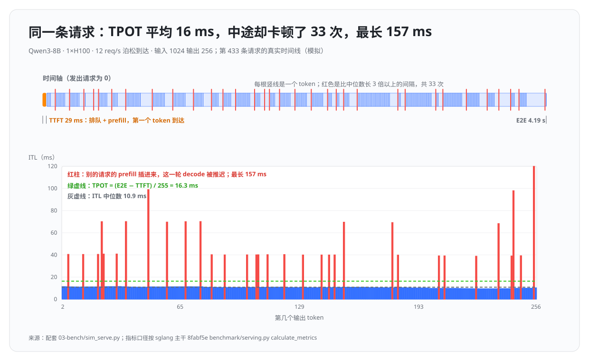
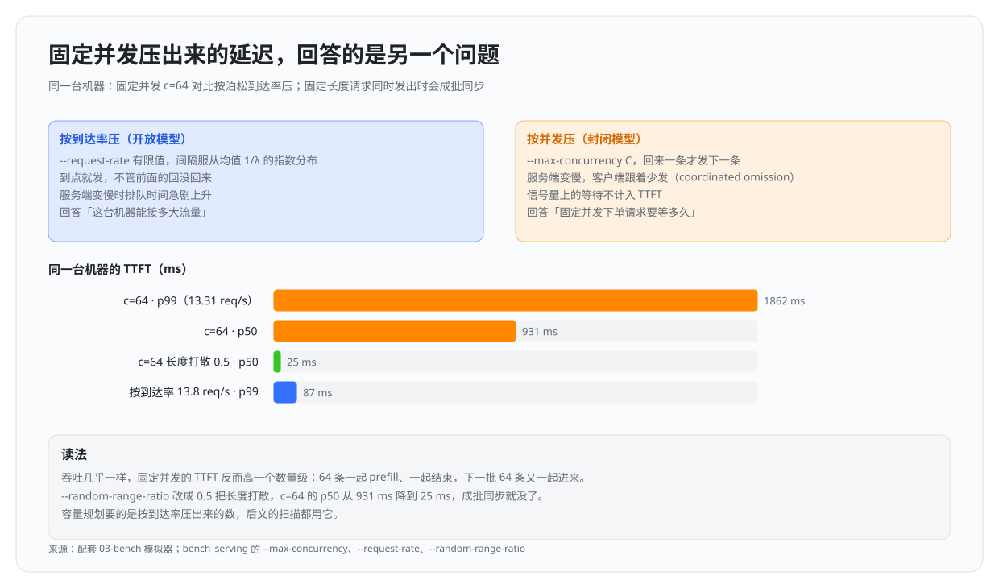
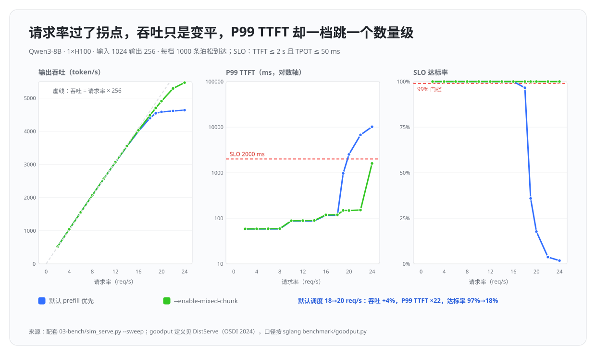
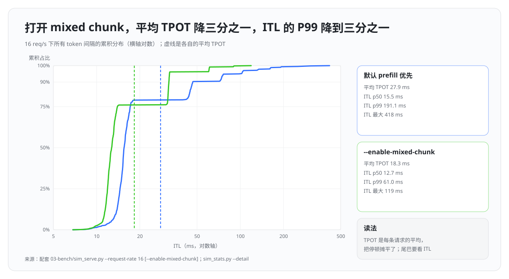
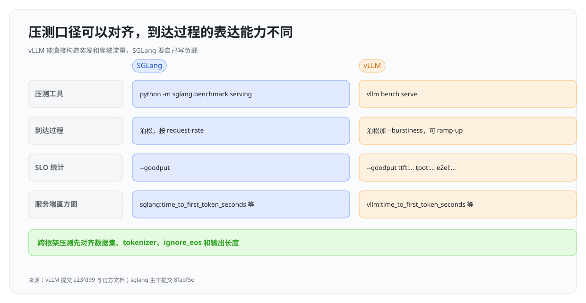

# SGL-03｜上手｜指标与压测：TTFT、TPOT、ITL 与 goodput

> 🎯 **遇到的问题**：这一篇把一台 SGLang 服务压到拐点，读出它在给定 SLO 下最多能接多少请求。途中要弄清几件事：TTFT、TPOT、ITL、E2E 在客户端和服务端各怎么算，按到达率和按固定并发压为什么结论不同，百分位和 goodput 怎么读，默认的 prefill 优先调度为什么让 ITL 长出尖峰、TPOT 却看不出来。
>
> **主线**：压测只回答一个问题：在给定 SLO 下最多能接多少请求；所有指标都服务于找到这个拐点。
>
> **读完这一篇**：能设计一组可复现的请求率扫描，找出最大可承受负载，分清报告里哪些数可信、哪些只说明过载了。能拿 Prometheus 直方图和调度日志对账，判断瓶颈在排队、prefill 还是 decode。
>
> **代码**：[zero-to-sglang/03-bench](../03-bench)。bench.sh 调官方工具做扫描，sim_stats.py 按主干口径重算分位数和 goodput，sim_serve.py 是连续批处理的离散事件模拟器，没有 GPU 也能跑出本篇所有曲线。计时代码按主干 8fabf5e 逐行核对。

# 导读 · 结论先行

1. **TPOT 是每条请求的平均值，会把卡顿摊平。**同一条请求 TPOT 16 ms，中间却有 33 次超过 32 ms 的停顿，最长 157 ms。用户感受到的卡顿，只能从 ITL 的分布里看出来，尤其是 p99 和最大值。
2. **请求率过了拐点，吞吐只是变平，TTFT 却一档涨一个数量级。**模拟的 Qwen3-8B 单卡上，请求率从 18 加到 20，输出吞吐只多 4%，P99 TTFT 从 117 ms 跳到 2.5 s，SLO 达标率从 96.6% 掉到 17.7%。容量要用 goodput 定义，看吞吐会高估[[1]](https://arxiv.org/abs/2401.09670)。
3. **固定并发压测会替服务端藏起排队。**固定并发时，服务端一慢，客户端就自动少发，延迟看起来一直可控。线上用户不会因为服务慢了就晚点来，所以评估容量时用泊松到达的压测[[2]](https://www.usenix.org/conference/nsdi-06/open-versus-closed-cautionary-tale)[[3]](https://github.com/giltene/wrk2)。
4. **ITL 的 p99 几乎每个用户都会碰到。**一条请求有 255 个 token 间隔，12 req/s 时 94.5% 的请求至少有一次间隔超过全体 ITL 的 p99。按 token 统计的尾巴，落到按请求统计上就是常态。
5. **默认 prefill 优先，新请求的 prefill 会插进所有在跑请求的 decode 之间。**打开 --enable-mixed-chunk 让 decode 搭 prefill 的车，模拟里 16 req/s 时 ITL 的 p99 从 191 ms 降到 61 ms，最大可承受负载从 16 升到 22 以上。



上图是 12 req/s 下第 433 条请求的完整时间线。橙色段是 TTFT，29 ms 里没有排队，全是自己那 1024 个 token 的 prefill。之后每根竖线是一个输出 token，绝大多数间隔在 10 ms 左右，红色的那些是别的请求的 prefill 插了进来，这一轮 decode 只能等。按 TPOT 算，这条请求很健康；按 ITL 看，它卡了 33 次。

**📎 与系列其他文档的分工**：本篇只讲 SGLang 服务层面的指标和压测方法：TTFT、ITL、吞吐怎么定义，负载怎么设计，报告怎么写才能复现。调度器每一轮怎么挑请求留给 [SGL-05｜原理｜调度器：waiting、running 与 KV 预算](./05-scheduler.md)，chunk 大小对 TTFT 和 ITL 的权衡留给 [SGL-06｜原理｜Chunked prefill：切块大小、mixed chunk 与 TTFT / ITL 的取舍](./06-chunked-prefill.md)，生产面板和 kernel 级 profile 留给 [SGL-18｜实战｜可观测与 profiling：从指标到 kernel](./18-observability.md)。

# 第 1 章 · 问题：压测报告里的数到底说明什么

[SGL-02｜上手｜推理账本：显存、KV 与 Roofline](./02-ledger.md) 算出了单步的下限：Qwen3-8B 单卡 decode 一步几毫秒，prefill 一个 8192 的 chunk 两百多毫秒。可上线前真正要回答的是服务层面的问题：

- 这台机器在 TTFT 2 秒、TPOT 50 ms 的 SLO 下，每秒最多接几条请求？
- 压测报告说吞吐 4600 tok/s，P99 TTFT 2.5 s，这是正常负载还是已经过载？
- 同一台机器，同事用 --max-concurrency 64 测出 13 req/s，我们用 --request-rate 测出 16 req/s，谁对？
- TPOT 只有 16 ms，用户却反馈流式输出一顿一顿的，问题在哪？
- Prometheus 上的 TTFT p50 是 50 ms，压测工具报 29 ms，差的 20 ms 去哪了？

这些问题的答案都藏在指标的定义和压测的设计里。定义没对齐，两份报告的数没法比；压法选错，结论会偏向乐观。下面先把每个指标在代码里怎么算讲清楚，再讲怎么设计负载、怎么读结果。

| 现象 | 先查什么 | 本篇位置 |
|-|-|-|
| TPOT 正常，用户说卡 | ITL 分布和最大值，prefill 插队 | 2.1、2.8 |
| 两份报告的延迟差很多 | 按到达率还是固定并发，num-prompts，range-ratio | 2.3、5.2 |
| 吞吐涨不动，延迟一直涨 | 是否过了拐点，看 goodput 和达标率 | 2.5、2.6 |
| 压测时长短，结果每次都不一样 | 爬坡和收尾占比，稳态窗口 | 2.7 |
| 服务端指标和压测工具对不上 | 计时起点、直方图分桶 | 2.9 |
| P99 很好看，投诉却不少 | 按 token 和按请求统计的差别 | 2.4 |

# 第 2 章 · 原理：指标定义、负载设计与拐点

## 2.1 四个延迟指标，按客户端口径

sglang.benchmark.serving 的计时都在客户端。发请求前取一次 perf_counter 作为起点 st，之后流式收到的每个带文本的 chunk 打一个时间戳[[4]](https://docs.sglang.io/docs/developer_guide/bench_serving)：

- **TTFT**：第一个带文本的 chunk 到达时刻减去 st。包含服务端排队、prefill、第一个 token 的采样和网络。
- **ITL**：之后每个 chunk 和上一个 chunk 的间隔。一个 chunk 里有多个 token 时，把间隔平均摊给这几个 token，每个 token 记一个值。
- **E2E**：最后一个 chunk 到达时刻减去 st。
- **TPOT**：每条请求一个值，等于 E2E 减 TTFT，再除以输出 token 数减 1。只统计输出超过 1 个 token 的请求。

$$\mathrm{TPOT}_i = \frac{\mathrm{E2E}_i - \mathrm{TTFT}_i}{n_i - 1} = \frac{1}{n_i - 1}\sum_{k=1}^{n_i-1}\mathrm{ITL}_{i,k}$$

第二个等号是关键：一条请求的 ITL 加起来正好等于 E2E 减 TTFT，个数正好是 n − 1，所以 TPOT 就是这条请求 ITL 的算术平均。报告里的 TPOT p99 是把一千条请求的平均值排序取第 990 个，ITL p99 是把二十五万个间隔排序取第 2550 个左右。TPOT 的每个样本都已经被平均过一次，尾巴被摊平了。ITL 保留了每一次停顿。

还有两处口径要知道。用 sglang-oai 或 sglang-oai-chat 后端、并且服务端返回了投机解码的接受长度时，ITL 会按每个 chunk 重新分词得到的 token 数来摊，口径和普通情况不同，投机解码的细节见 [SGL-13｜原理｜投机解码：EAGLE、MTP、NGRAM 怎么选、怎么调](./13-speculative.md)。打开 --max-concurrency 时，请求要先拿到信号量才会进入发请求的函数，st 在拿到信号量之后才取，所以客户端排队的时间不计入 TTFT。这一点在 2.3 节会变得很重要。

## 2.2 吞吐和并发：Little 定律

吞吐有三个：请求吞吐是完成的请求数除以压测时长，输出吞吐是输出 token 总数除以时长，总吞吐再加上输入 token。报告里还有一个 Concurrency，算法是所有请求的 E2E 加起来除以时长，也就是平均同时在途的请求数。它和请求吞吐、平均 E2E 之间满足 Little 定律[[5]](https://en.wikipedia.org/wiki/Little's_law)：

$$L = \lambda\times W$$

12 req/s 那一档，请求吞吐 11.96，平均 E2E 4.168 s，相乘是 49.9，和报告里的并发完全一致。这个等式在任何稳定的排队系统里都成立，和到达分布、调度策略无关。它的用处是互相校验：给定目标吞吐和延迟，就能算出服务端要同时容纳多少请求，再回到 SGL-02 的账本看 KV 池装不装得下。报告里另有一个 Peak concurrent requests，是按秒统计的峰值，压测收尾时请求堆积会让它远高于平均值，不适合拿来做容量估算。

## 2.3 按到达率压和按并发压

压测工具有两种发请求的方式。

**按到达率压（开放模型）**：--request-rate 设成有限值，请求按泊松过程到达，相邻两条的间隔服从均值 1/λ 的指数分布，到点就发，不管前面的有没有回来。设成 inf 则所有请求在 0 时刻同时发出。MLPerf 的 Server 场景就是泊松到达[[6]](https://github.com/mlcommons/inference_policies/blob/master/inference_rules.adoc)。

**按并发压（封闭模型）**：--max-concurrency 设成 C，同时在途的请求不超过 C 条，回来一条才发下一条。通常配合 --request-rate inf 使用。

两种方式压同一台机器，得出的延迟分布不同。Schroeder 等人在 2006 年就系统地比较过：开放系统里排队时间随负载急剧上升，封闭系统里客户端的发送速率会被服务端的响应速度反向调节，延迟被压在一个看起来很舒服的范围里[[2]](https://www.usenix.org/conference/nsdi-06/open-versus-closed-cautionary-tale)。wrk2 的作者把这种现象叫 coordinated omission：压测客户端在服务端变慢时少发了请求，于是本该被记录的高延迟样本根本没产生[[3]](https://github.com/giltene/wrk2)。

sglang 的固定并发压测还多一层：信号量等待不计入 TTFT。服务端变慢时，排队发生在客户端的信号量上，这段时间从报告里消失了。模拟器里同一台机器，固定并发 c=64 测出 13.31 req/s、TTFT p99 1862 ms；按到达率压到 13.8 req/s 时 TTFT p99 只有 87 ms。

固定并发的 TTFT 反而更高，原因是固定长度、同时发出的请求会成批同步：64 条一起 prefill、一起 decode、一起结束，下一批 64 条又一起进来，每条都要等前面几十条的 prefill。把 --random-range-ratio 改成 0.5，长度一打散，c=64 的 TTFT p50 就从 931 ms 降到 25 ms。

结论是两种压法回答不同的问题。固定并发适合回答固定并发下单请求的延迟是多少，比如评估一个 Agent 框架开 64 个并发时每步要等多久。按到达率压回答的是这台机器能接多大的流量，容量规划要的正是这个数。后文的扫描都按到达率压。



## 2.4 百分位和尾延迟

百分位用 numpy 默认的线性插值：把样本排序，第 q 百分位落在下标 (n − 1) × q / 100 上，不是整数时在相邻两个样本之间插值。1000 条请求的 TTFT p99，实际由最慢的十条左右决定。这意味着两件事：样本少时 p99 很不稳定，同一组参数换个 --seed 就可能差出一截；以及多次压测的 p99 不能取平均，要么合并原始样本再算，要么分别报告。

Dean 和 Barroso 在 The Tail at Scale 里讲过扇出放大：一个请求要等 100 个子服务都返回，即使每个子服务只有 1% 的概率慢，整体也有 63% 的概率碰到至少一次慢[[7]](https://research.google/pubs/the-tail-at-scale/)。流式生成是同一件事在时间轴上的版本。一条请求有 255 个 token 间隔，如果停顿是独立的，每个间隔有 1% 的概率超过 ITL p99，那么一条请求完全不碰到的概率是 0.99${}^{255}$，约 7.7%。模拟里实测，12 req/s 时 94.5% 的请求至少有一次间隔超过全体 ITL 的 p99，和这个估算很接近。所以 ITL p99 描述的是几乎每个用户都会经历的那几次卡顿。

Etalon 正是从这个角度批评 TTFT 和 TPOT 的：它们分别只看首 token 和平均值，抓不住生成过程中的停顿。它提出的 fluidity-index 给每个 token 设一个截止时间，统计按时到达的比例，更接近用户对流畅度的感受[[8]](https://arxiv.org/abs/2407.07000)。sglang 的压测工具没有这个指标，但输出明细里有每个 token 的 ITL，自己算并不难。

## 2.5 goodput 和 SLO 达标率

DistServe 把 goodput 定义为满足 SLO 的请求吞吐：一条请求只有 TTFT 和 TPOT 都在阈值以内才算数[[1]](https://arxiv.org/abs/2401.09670)。sglang 的 --goodput 参数实现了同样的定义，支持 ttft、tpot、e2el 三个键，单位毫秒。计算逻辑在 goodput.py：失败的请求不算好请求。达标率的分母是全部发出的请求，失败按不达标计。只输出 1 个 token 的请求 TPOT 记为 0。

报告里会同时给出总达标率和每个指标单独的达标率。单项达标率用来定位：20 req/s 那一档总达标率 17.7%，其中 TTFT 达标 83.3%，TPOT 达标只有 32.6%。说明先被打破的是 TPOT，排队虽然也开始了，但还没到让大多数请求的 TTFT 超标的程度。

SLO 的取值没有标准答案，MLPerf 推理的规则可以作为参照。LLM 类基准都用 TTFT 和 TPOT 两个约束，按交互程度分档[[6]](https://github.com/mlcommons/inference_policies/blob/master/inference_rules.adoc)：

| 模型 | 宽松档 TTFT / TPOT | 交互档 TTFT / TPOT |
|-|-|-|
| Llama3.1-8B（摘要） | 2000 ms / 100 ms | 500 ms / 30 ms |
| Llama2-70B（问答） | 2000 ms / 200 ms | 450 ms / 40 ms |
| DeepSeek-R1（推理） | 2000 ms / 80 ms | 1500 ms / 15 ms |
| GPT-OSS-120B | 3000 ms / 80 ms | 2000 ms / 20 ms |
| Llama3.1-405B（长文本） | 6000 ms / 175 ms | 4500 ms / 80 ms |

MLPerf Server 场景的流程也值得照抄：泊松到达，每次至少跑 600 秒，99% 的请求满足约束才算有效，用二分搜索找到满足条件的最大到达率作为成绩。本篇默认用 TTFT 2000 ms、TPOT 50 ms、达标率 99%，处在宽松档和交互档之间。换成 TTFT 500 ms、TPOT 30 ms、达标率 95%，同一台机器的最大可承受负载从 16 降到 12。容量是相对 SLO 而言的，脱离 SLO 谈每秒能接多少请求没有意义。

## 2.6 拐点：吞吐变平，延迟爆炸



上图是模拟的 Qwen3-8B 单卡在不同请求率下的三条曲线，输入 1024、输出 256，每档 1000 条。蓝线是默认调度。

左图，输出吞吐在 16 req/s 之前几乎贴着理想线（请求率 × 256），18 之后变平，24 req/s 时 4638 tok/s，比 18 时只多 5%。中图，P99 TTFT 在 18 之前稳定在 100 ms 左右，20 跳到 2.5 s，24 到 10 s，对数轴上几乎是一条竖线。右图，达标率在 18 时还有 96.6%，20 就只剩 17.7%。

原因可以从排队论直接看出来。到达率低于服务能力时，队列长度有界，TTFT 约等于一次 prefill 加上偶尔等几个前面的 prefill。12 req/s 时 TTFT p50 是 29 ms，正好是一个 1024 token prefill 的耗时，p99 87 ms 是前面还排着两条。到达率一旦超过服务能力，多出来的请求只能在队列里越积越多，队列长度随时间线性增长，TTFT 取决于压了多久。

这也解释了一个常被忽略的现象：过载档的延迟数字取决于 --num-prompts。同样 24 req/s，压 500 条时 TTFT p50 是 117 ms，压 1000 条是 3.7 s，压 2000 条是 9.8 s。超过容量后的延迟只能说明过载了，拿它去比较两个配置的好坏是没有意义的。

18 req/s 那一档为什么先坏在 TPOT？每秒 18 次 1024 token 的 prefill，每次 29 ms，合计每秒有 0.53 s 花在 prefill 上，decode 只剩不到一半的时间。在跑的请求平均 182 条，每条每秒能拿到的 decode 轮数被 prefill 挤掉一半，TPOT 自然翻倍。在默认的 prefill 优先调度下，这台机器的瓶颈先出现在 decode 被挤占，然后才是排队。

## 2.7 稳态窗口

一次压测有爬坡和收尾两段：开始时服务端是空的，并发从 0 慢慢涨上来；最后一条请求发出后，在途请求逐个结束，并发慢慢降到 0。这两段的吞吐偏低、延迟偏好，按全程平均会稀释稳态的表现。

sglang 在主干里加了 steady_state.py 来处理这个问题。算法是按每条请求的发出和结束时刻扫一遍，得到并发随时间的阶梯曲线，取峰值乘以一个比例（默认 0.8）作为阈值，并发不低于阈值的最长连续区间就是稳态窗口。窗口内的输出吞吐按 token 的时间戳落在窗口里的才算。入口是 python -m sglang.benchmark.steady_state_serving，其余参数原样转给 serving。模拟里 18 req/s 的稳态窗口是 35.2 到 48.2 s，窗口内输出 4716 tok/s，全程平均只有 4398，差了 7%。

稳态窗口只有 13 秒，说明 1000 条请求对这个请求率来说太少了。MLPerf 要求至少 600 秒是有道理的。实践中可以把 --num-prompts 设到请求率乘以 300 以上，让稳态段占大头。

## 2.8 prefill 插队与 ITL 尖峰

调度器每一轮先问等待队列能不能凑出一个 prefill batch，能就跑 prefill，不能才对在跑请求做一步 decode。这段逻辑在 [scheduler.py:4053](https://github.com/sgl-project/sglang/blob/8fabf5e/python/sglang/srt/managers/scheduler.py#L4053)，注释原话是 Run prefill first if possible。好处是新请求的 TTFT 尽量短；代价是每来一条新请求，所有在跑请求都要停下来等它的 prefill。Orca 提出的迭代级调度让请求可以随时加入 batch[[9]](https://www.usenix.org/conference/osdi22/presentation/yu)，但加入那一刻的 prefill 由谁来付，就是 TTFT 和 ITL 之间的取舍。

12 req/s 时，每秒 12 次 prefill，每次 29 ms，在跑请求每秒要被打断 12 次。detail 输出里，超过中位数 3 倍的间隔只占 11.9%，却占了生成时间的 43%。ITL p99 是 p50 的 9.3 倍，TPOT p99 只比 p50 高 19%。开头那条请求的 33 次停顿就是这么来的。

Sarathi-Serve 的思路是让 decode 搭 prefill 的车：把 prefill 切成块，每一步在 prefill 块里顺带给所有在跑请求各算一个 token，decode 不再被整段跳过[[10]](https://arxiv.org/abs/2403.02310)。sglang 的对应开关是 --enable-mixed-chunk，要求同时开着 chunked prefill。打开后：

- [scheduler.py:1379](https://github.com/sgl-project/sglang/blob/8fabf5e/python/sglang/srt/managers/scheduler.py#L1379)：is_mixed_chunk 为真的条件是 chunked_prefill_size 不为空且开了 enable_mixed_chunk。
- [scheduler.py:4230](https://github.com/sgl-project/sglang/blob/8fabf5e/python/sglang/srt/managers/scheduler.py#L4230) 和 [schedule_policy.py:648](https://github.com/sgl-project/sglang/blob/8fabf5e/python/sglang/srt/managers/schedule_policy.py#L648)：组 prefill batch 时先从 token 预算里扣掉在跑请求数，给顺带的 decode 留位置。
- [scheduler.py:4440](https://github.com/sgl-project/sglang/blob/8fabf5e/python/sglang/srt/managers/scheduler.py#L4440)：真正混合前还要满足一串条件：在跑 batch 非空，没有请求要 logprob，没有 input_embeds，没有 beam search；先剔除本轮就要结束的请求，再检查 decode 所需的显存，通过了才调用 mix_with_running。



上图是 16 req/s 下全部 token 间隔的累积分布。默认调度（蓝线）在 30 ms 之后拖着一条长尾，p99 191 ms，最大 418 ms。mixed chunk（绿线）的尾巴被截短了，p99 61 ms，最大 119 ms，平均 TPOT 从 27.9 ms 降到 18.3 ms。

吞吐也跟着变了。在模拟器的耗时模型里，1024 token 的 prefill 单独跑是 29.4 ms，100 条请求单独 decode 一步是 13.7 ms，两者合成一步只要 32.3 ms。decode 那一步几乎是白送的，所以 mixed chunk 下 20 req/s 达标率仍是 100%，输出 4910 tok/s；24 req/s 时 5468 tok/s，P99 TTFT 1.6 s，才开始逼近 SLO。

另一个工具是 --prefill-decode-interval N：跑完一个 prefill batch 后，接下来至少跑 N 轮 decode 才允许下一次 prefill，在跑请求数低于 --prefill-decode-interval-min-bs 时不生效，见 [scheduler.py:4032](https://github.com/sgl-project/sglang/blob/8fabf5e/python/sglang/srt/managers/scheduler.py#L4032)。它用 TTFT 换 ITL，适合 TPOT 约束紧、TTFT 约束松的场景。mixed chunk 是把两件事放进同一步，prefill-decode-interval 是拉开两件事的间隔，思路不同。哪个更合适取决于 SLO 的形状，chunk 大小怎么配合，见 [SGL-06｜原理｜Chunked prefill：切块大小、mixed chunk 与 TTFT / ITL 的取舍](./06-chunked-prefill.md)。

需要说明的是，这里的数来自模拟器，混合步的耗时按 roofline 下限除以利用率估算，真实 kernel 在混合 batch 下的效率会更低。Vidur 这类模拟器在真实负载上的延迟误差可以做到 9% 以内，代价是要先在目标硬件上 profile 每个算子[[11]](https://arxiv.org/abs/2405.05465)。本篇的模拟器没做 profile，只用来看清曲线的形状，绝对数字要上卡验证。

## 2.9 服务端看到的数

压测工具在客户端计时，服务端还有自己的一套。启动时加 --enable-metrics，/metrics 会暴露 Prometheus 指标[[12]](https://docs.sglang.io/docs/references/production_metrics)[[13]](https://docs.sglang.io/docs/advanced_features/observability)。和延迟相关的几个直方图：

- sglang:time_to_first_token_seconds：从 TokenizerManager 收到请求到第一个 token，不含网络和客户端。
- sglang:inter_token_latency_seconds：两次输出之间的间隔，一次输出多个 token 时按 token 数摊开，和客户端口径一致。
- sglang:request_time_per_output_token_seconds：每条请求的 TPOT，分桶和 ITL 共用。
- sglang:e2e_request_latency_seconds 和 sglang:queue_time_seconds：端到端和排队时间。

分桶是最容易被忽略的坑。TTFT 默认分桶从 0.1 s 起，往下没有更细的档。12 req/s 时 99.6% 的 TTFT 都小于 100 ms，全部落在第一个桶里。Grafana 上常用的 histogram_quantile 在桶内做线性插值，桶的下界按 0 算，于是 p50 被估成 50.2 ms，真实值是 29.4 ms[[14]](https://prometheus.io/docs/practices/histograms/)。

ITL 的默认分桶在 2 ms 到 40 ms 之间很密，估出来的 p99 是 98.7 ms，和真实的 99.6 ms 很接近。业务 TTFT 在百毫秒以内时，用 --bucket-time-to-first-token 自己给分桶，比如从 10 ms 开始。

另一个信息源是调度日志。每次 prefill 打一行，每 40 轮 decode（--decode-log-interval）打一行：

```text
Prefill batch, #new-seq: 1, #new-token: 1024, #cached-token: 0, token usage: 0.14, #running-req: 49, #queue-req: 0, #pending-token: 0,
Decode batch, #running-req: 50, #token: 52480, token usage: 0.14, cuda graph: True, gen throughput (token/s): 3071.25, #queue-req: 0
```

压测时盯三个字段。#queue-req 持续为 0 说明没有排队，延迟的大头在 prefill 和 decode；它开始单调上涨，说明已经过了拐点，再加负载只会推高 TTFT。gen throughput 是最近一个日志周期内的 decode 吞吐，和压测报告的输出吞吐对得上说明客户端没有成为瓶颈。token usage 接近 1 时 KV 池满了，新请求进不来，会表现为 #queue-req 上涨而 #running-req 不涨，这时就回到 SGL-02 的账本看容量。

## 2.10 vLLM 怎么做

vLLM 的压测入口是 vllm bench serve。它和 SGLang 的 sglang.benchmark.serving 一样支持 --request-rate、--max-concurrency 和 --goodput；--goodput 按 KEY:VALUE 给 SLO，键是 ttft、tpot、e2el，单位毫秒[[15]](https://docs.vllm.ai/en/latest/cli/bench/serve.html)。

vLLM 多两个控制到达过程的参数：--burstiness 取 1 时是泊松到达，小于 1 更突发，大于 1 更均匀；--ramp-up-strategy 让请求率在一次压测里线性或指数爬升，一条命令就能扫出拐点。SGLang 的压测脚本没有 burstiness，突发流量要靠外部脚本构造。

服务端指标的命名几乎平行。vLLM 的 vllm:time_to_first_token_seconds、vllm:inter_token_latency_seconds 对应 SGLang 的 sglang:time_to_first_token_seconds、sglang:inter_token_latency_seconds[[16]](https://docs.vllm.ai/en/latest/usage/metrics.html)。跨框架比较时最容易出错的是输入：数据集采样、tokenizer、是否 ignore_eos、输出长度上限都要对齐，否则两边算的根本不是同一批请求。

| 维度 | SGLang | vLLM | 差异的代价 |
|-|-|-|-|
| 压测工具 | python -m sglang.benchmark.serving | vllm bench serve | 参数名接近，默认数据集不同 |
| 到达过程 | 泊松，按 request-rate | 泊松加 --burstiness，可 ramp-up | SGLang 测突发流量要自己写负载 |
| SLO 统计 | --goodput | --goodput ttft:… tpot:… e2el:… | 口径一致，可直接对照 |
| 服务端直方图 | sglang:time_to_first_token_seconds 等 | vllm:time_to_first_token_seconds 等 | 前缀不同，看板查询要改 |



# 第 3 章 · 源码走读：一个指标从计时到报告

按压测从发请求到出报告的顺序读，最后几行是服务端。行号对应主干 8fabf5e。

| 顺序 | 位置 | 做什么 |
|-|-|-|
| 1 | [serving.py:1092 get_request](https://github.com/sgl-project/sglang/blob/8fabf5e/python/sglang/benchmark/serving.py#L1092) | 按到达率发请求：请求率有限时每发一条就 sleep 一个指数分布的间隔，inf 时不等待 |
| 2 | [serving.py:1434 limited_request_func](https://github.com/sgl-project/sglang/blob/8fabf5e/python/sglang/benchmark/serving.py#L1434) | 并发限流：有 --max-concurrency 时包一层 asyncio.Semaphore，拿到信号量后才进入请求函数开始计时 |
| 3 | [serving.py:692 async_request_sglang_generate](https://github.com/sgl-project/sglang/blob/8fabf5e/python/sglang/benchmark/serving.py#L692) | sglang 原生接口的请求函数；第 703 行 ignore_eos 默认为真，输出固定跑满 --random-output-len |
| 4 | [serving.py:795](https://github.com/sgl-project/sglang/blob/8fabf5e/python/sglang/benchmark/serving.py#L795) | 一个 chunk 带来多个 token 时，chunk_gap 除以新 token 数，摊给每个 token |
| 5 | [serving.py:1132 calculate_metrics](https://github.com/sgl-project/sglang/blob/8fabf5e/python/sglang/benchmark/serving.py#L1132) | 汇总：第 1171 行算 TPOT，第 1153 行起是投机解码时按重新分词摊 ITL 的分支 |
| 6 | [serving.py:1305](https://github.com/sgl-project/sglang/blob/8fabf5e/python/sglang/benchmark/serving.py#L1305) | Concurrency 等于 E2E 之和除以时长，即 Little 定律里的 L |
| 7 | [serving.py:1519](https://github.com/sgl-project/sglang/blob/8fabf5e/python/sglang/benchmark/serving.py#L1519) | 预热之后可选清空前缀缓存，--flush-cache 或在 CI 环境下自动执行 |
| 8 | [goodput.py:24 calculate_goodput](https://github.com/sgl-project/sglang/blob/8fabf5e/python/sglang/benchmark/goodput.py#L24) | goodput 与达标率，分母是全部发出的请求 |
| 9 | [steady_state.py:64 find_steady_state_window](https://github.com/sgl-project/sglang/blob/8fabf5e/python/sglang/benchmark/steady_state.py#L64) | 稳态窗口；第 162 行按 token 时间戳统计窗口内吞吐 |
| 10 | [datasets/common.py:56 compute_random_lens](https://github.com/sgl-project/sglang/blob/8fabf5e/python/sglang/benchmark/datasets/common.py#L56) | random 数据集的长度在 [full × ratio, full] 上均匀取整；--random-range-ratio 默认 0.0（serving.py:2424） |
| 11 | [scheduler.py:4053](https://github.com/sgl-project/sglang/blob/8fabf5e/python/sglang/srt/managers/scheduler.py#L4053) | prefill 优先：有 prefill batch 就先跑它；第 4032 行是 prefill-decode-interval 的推迟逻辑 |
| 12 | [scheduler.py:4440](https://github.com/sgl-project/sglang/blob/8fabf5e/python/sglang/srt/managers/scheduler.py#L4440) | mixed chunk 的混合条件和 mix_with_running 调用 |
| 13 | [req_time_stats.py:483](https://github.com/sgl-project/sglang/blob/8fabf5e/python/sglang/srt/observability/req_time_stats.py#L483) | 服务端 TTFT 的起点是请求在 TokenizerManager 的创建时刻 |
| 14 | [metrics_collector.py:1966](https://github.com/sgl-project/sglang/blob/8fabf5e/python/sglang/srt/observability/metrics_collector.py#L1966) | TTFT 默认分桶从 0.1 s 起。第 2014 行是 ITL 分桶。第 2161 行按 token 数摊开记录 ITL |
| 15 | [metrics_reporter.py:754](https://github.com/sgl-project/sglang/blob/8fabf5e/python/sglang/srt/managers/scheduler_components/metrics_reporter.py#L754) | Prefill batch 日志；第 963 行起是 Decode batch 日志 |

几处值得多看一眼的细节：

- ignore_eos 默认为真，模型输出 EOS 也会继续生成，直到 --random-output-len。这样每条请求的输出长度固定，方便比较。真实流量里请求会提前结束，平均输出更短，KV 占用更低。想模拟真实分布时，会加 --disable-ignore-eos，或者用 sharegpt 这类真实数据集。
- --random-range-ratio 默认 0.0，输入和输出长度都在 1 到设定值之间均匀分布，平均只有设定值的一半。模拟里同样 12 req/s，ratio 0 时输出吞吐只有 1583 tok/s，ratio 1 时是 3063。报告里一定要写清这个参数，否则别人按 1024/256 复现会得到完全不同的数。
- --output-details 写出的明细只有 input_lens、output_lens、ttfts、itls、generated_texts 和 errors，没有每条请求的发出时刻。所以拿到真实压测结果后，事后是算不了稳态窗口的，只能在压测时就用 steady_state_serving。结果按行追加进 --output-file，一次扫描的多个请求率会落在同一个 JSONL 里。
- --warmup-requests 默认 1，预热请求不计入结果。预热之后默认不清前缀缓存，random 数据集的 token 是随机采样的，前缀命中很少，影响不大；用真实数据集时要加 --flush-cache。
- --seed 默认 42，同时决定请求长度和泊松间隔。比较两个服务端配置时保持种子不变，两边就是完全相同的到达序列。

# 第 4 章 · 实验：扫描、找拐点、对比调度

## 4.1 没卡：用模拟器扫一遍请求率

```bash
cd zero-to-sglang/03-bench
python3 sim_serve.py --sweep 2 4 8 12 16 18 20 24 --output-file sweep.jsonl
```

```text
# Qwen3-8B on 1 x H100 SXM: KV 池 366,669 token, chunk 8192, 请求上限 4096, MBU 70%, MFU 55%
# 单步耗时：decode b=1 6.82 ms，b=64 11.39 ms，prefill 8192 token 264.6 ms
  负载  req/s out tok/s   并发 TTFT p50 TTFT p99 TPOT p50 TPOT p99 ITL p99 ITL max goodput 达标率
     2   2.04       523    4.0       29       58      7.6      8.4    36.5    95.4    2.04 100.0%
     4   4.07      1041    8.9       29       58      8.5      9.8    37.1   154.2    4.07 100.0%
     8   8.07      2066   23.3       29       58     11.3     13.1    67.4   184.5    8.07 100.0%
    12  11.96      3063   49.9       29       87     16.3     19.4    99.6   332.4   11.96 100.0%
    16  15.63      4000  111.7       29      117     28.6     32.8   191.1   418.2   15.63 100.0%
    18  17.18      4398  181.9       29      117     45.2     51.2   257.8   489.4   16.60  96.6%
    20  17.90      4584  250.7      829     2516     57.2     60.1   347.7   738.6    3.17  17.7%
    24  18.12      4638  318.2     3721    10192     58.2     60.0   377.0  1104.3    0.33   1.8%
# SLO ttft≤2000ms tpot≤50ms，达标率门槛 99%：最大可承受负载 16（goodput 15.63 req/s）
# 输出吞吐在 18 之后增长不到 5%，再往上加负载只会推高排队
```

读这张表的顺序是：先看最后两行的结论，再看达标率那一列在哪里断崖，最后看断崖前后是哪个指标先超标。这里 TPOT p99 在 18 时到了 51.2 ms，先碰线；TTFT 在 20 时才爆。并发那一列随请求率的增长明显快于线性，16 到 20 请求率只涨 25%，并发涨了 124%，这是排队的信号。

## 4.2 换一组 SLO

```bash
python3 sim_stats.py sweep.jsonl --goodput ttft:500 tpot:30 --target 0.95
```

最大可承受负载从 16 降到 12，16 req/s 的达标率只剩 71.4%。同一份原始数据可以按不同的 SLO 反复重算，压测时只要带上 --output-details 把明细存下来，事后换 SLO 不用重新压。

## 4.3 看一档的完整分位数

```bash
python3 sim_stats.py sweep.jsonl --detail 12
```

```text
## 负载 12：完成 1000，时长 83.6 s，输入 12252 tok/s，输出 3063 tok/s，平均并发 49.9
    指标      mean       p50       p90       p95       p99
    TTFT      35.6      29.4      58.4      58.4      87.5
    TPOT      16.2      16.3      18.5      18.8      19.4
     ITL      16.2      10.7      39.4      41.0      99.6
     E2E    4168.2    4196.5    4745.5    4818.4    4992.6
# ITL 尖峰：超过中位数 3 倍（32.1 ms）的间隔占 11.9%，却占了生成时间的 43.0%；p99/p50 = 9.3，最长一次 332 ms
# goodput 11.96 req/s，全部达标 100.0%（ttft 100.0%，tpot 100.0%）
```

TPOT 和 ITL 的均值都是 16.2，这是 2.1 节那个等式的直接体现。分布完全不同：TPOT 的 p99 只比 p50 高 19%，ITL 的 p99 是 p50 的 9.3 倍。ITL 的 p50 只有 10.7 ms，是没有被打断时的 decode 单步耗时，均值被尖峰拉高了一半。

## 4.4 打开 mixed chunk

```bash
python3 sim_serve.py --sweep 8 12 16 18 20 --enable-mixed-chunk --output-file mixed.jsonl
```

```text
  负载  req/s out tok/s   并发 TTFT p50 TTFT p99 TPOT p50 TPOT p99 ITL p99 ITL max goodput 达标率
     8   8.07      2066   21.2       30       59     10.3     11.7    30.2    87.9    8.07 100.0%
    12  11.98      3067   41.1       31       89     13.4     15.4    59.6   117.7   11.98 100.0%
    16  15.73      4028   74.1       32      119     18.3     20.8    61.0   119.0   15.73 100.0%
    18  17.51      4482  100.4       33      119     22.7     25.1    90.5   148.3   17.51 100.0%
    20  19.18      4910  136.6       60      148     29.0     32.4    92.1   149.8   19.18 100.0%
```

和 4.1 对比：TTFT p50 多了 1 到 3 ms，因为 prefill 那一步多带了 decode 的 token。TPOT 和 ITL 全面下降。同样 16 req/s，平均并发从 111.7 降到 74.1，请求更快结束，KV 池的压力也小了。代价是这台机器上几乎没有，原因在 2.8 节：decode 的 token 搭在 prefill 上几乎不增加耗时。真实硬件上要验证两件事：混合 batch 的注意力 kernel 是否走了高效路径，以及开了 logprob 的请求会退回不混合。

## 4.5 固定并发对照

```bash
for c in 16 32 64 128 256; do
  python3 sim_serve.py --max-concurrency $c --output-file c$c.jsonl
done
python3 sim_stats.py c*.jsonl
```

```text
  负载  req/s out tok/s   并发 TTFT p50 TTFT p99 TPOT p50 TPOT p99 ITL p99 ITL max goodput 达标率
inf c=16   6.41      1640   15.9      233      466      7.9      8.8     8.0   240.6    6.41 100.0%
inf c=32   9.74      2493   31.5      466      931     10.0     11.8     9.3   707.2    9.74 100.0%
inf c=64  13.31      3407   62.8      931     1862     14.1     17.8    11.9  1640.5   13.31 100.0%
inf c=128 16.30      4173  125.4     1862     3725     22.4     29.7    17.0  3507.0    8.35  51.2%
inf c=256 18.36      4701  250.4     3725     7450     39.0     53.6    27.3  7240.0    2.94  16.0%
```

ITL p99 只有十几毫秒，比按到达率压低一个数量级，ITL max 却到了秒级。这是固定长度加同时发出造成的批同步：一批请求一起 prefill，ITL 最大值来自批与批交接时的那一大段 prefill；之后一起 decode，中间没有新请求插队。同样 13 req/s 左右，两种压法给出的延迟画像完全不同。加 --random-range-ratio 0.5 再跑 c=64，TTFT p50 降到 25 ms，ITL p99 升到 61 ms，画像就接近按到达率压的结果了。

## 4.6 有卡：对真实服务扫描

```bash
# 先用 ../01-first-server/serve.sh 起服务，再：
bash bench.sh rate                       # 请求率扫描，默认 2 到 20
RATES="14 16 17 18 19 20" N=3000 bash bench.sh rate   # 在拐点附近加密、加长
bash bench.sh conc                       # 并发扫描，对照用
python3 sim_stats.py results/rate-*.jsonl --detail all
```

bench.sh 固定了几项容易漏掉的参数：--random-range-ratio 1.0 让长度固定，--warmup-requests 4，--flush-cache，--output-details，结果追加进 results 下的 JSONL，最后调 sim_stats.py 出表。真实结果里没有逐请求的 E2E，sim_stats.py 按 TTFT 加 ITL 之和还原，和 serving 内部的 latency 有毫秒级出入。

> 💡 **实验记录**：我们在自己的卡上做了一次完整的容量评估：先粗扫 2 到 20 找到达标率断崖的位置，再在断崖附近每 1 req/s 一档、每档 3000 条细扫，确定最大可承受负载。同时开着 --enable-metrics，压测结束后对比 /metrics 里的 TTFT p50 和压测报告，看分桶带来多大偏差。最后打开 --enable-mixed-chunk 重扫一遍，记下拐点移动了多少。说明见 [README.md](../03-bench/README.md)。

# 第 5 章 · 调过的参数和踩过的坑

## 5.1 压测和服务端相关的参数

| 参数 | 影响哪一项 | 什么时候改它 |
|-|-|-|
| --request-rate | 泊松到达率 | 容量评估用有限值扫描；inf 只用于测离线吞吐上限 |
| --max-concurrency | 在途请求上限 | 评估固定并发客户端的体验时用，不拿它测容量 |
| --num-prompts | 样本量和压测时长 | 拐点附近设到请求率乘以 300 以上；样本太少时 p99 不稳定 |
| --random-range-ratio | 长度分布 | 默认 0.0 会让平均长度减半；报告里写明，或固定为 1.0 |
| --disable-ignore-eos | 输出长度 | 想让输出长度服从模型的自然分布时打开 |
| --warmup-requests / --flush-cache | 冷启动和缓存污染 | 真实数据集一律加 --flush-cache；预热数至少覆盖 CUDA Graph 的几个档位 |
| --goodput | goodput 与达标率 | 按业务 SLO 填写，可事后用明细重算 |
| --enable-mixed-chunk | ITL 尾巴、TPOT | ITL 尖峰明显、没有 logprob 需求时打开 |
| --prefill-decode-interval | TTFT 换 ITL | TPOT 约束紧、TTFT 约束松的场景 |
| --bucket-time-to-first-token | 服务端 TTFT 直方图精度 | 业务 TTFT 在 100 ms 以内时必改 |
| --decode-log-interval | Decode 日志频率 | 压测时调小到 10 左右，看得更细；线上保持默认 40 |

## 5.2 踩过的坑

> 💡 **踩过的坑**：我们曾用 --max-concurrency 测容量。固定并发会让客户端在服务端变慢时自动少发，信号量等待又不计入 TTFT，排队被藏了起来。模拟里 c=64 的 13.31 req/s 只说明 64 个并发客户端能拿到这么多吞吐，这台机器按到达率压能接到 16 req/s 且全部达标。

> 💡 **踩过的坑**：我们比较两个配置在过载档的延迟。到达率超过容量后，TTFT 随压测时长线性增长，500 条和 2000 条能差出两个数量级。后来改成比各自的最大可承受负载，或者在两者都没过载的请求率上比延迟。

> 💡 **踩过的坑**：只看 TPOT 判断流式体验。TPOT 是每条请求的平均值，prefill 插队造成的停顿被摊平了。现在至少同时报告 ITL 的 p99 和最大值，再算一下超过某个阈值（比如 100 ms）的间隔占比。

> 💡 **踩过的坑**：我们沿用 --random-range-ratio 的默认值，又按设定长度写报告。默认 0.0 时 1024/256 的实际平均是 512/128，吞吐和延迟都会好看很多，别人按 1024/256 固定长度复现会对不上。

> 💡 **踩过的坑**：拿 Grafana 上的 TTFT 分位数和压测报告直接比。服务端 TTFT 从 TokenizerManager 收到请求开始算，不含网络；默认分桶从 100 ms 起，百毫秒以内的分位数全靠插值猜。后来先改分桶，再对账。

> 💡 **踩过的坑**：把多次压测的 p99 取平均。分位数不能平均，两次各 1000 条的 p99 取平均，不等于 2000 条的 p99。后来要么合并明细重算，要么分别报告并给出波动范围。

## 5.3 我们的看法

我们见过最多的压测错误，是先有答案再找数。想证明某个优化有效，就挑一个刚好在拐点附近的请求率，延迟能差好几倍；想证明机器够用，就用固定并发压，延迟永远好看。我们现在写报告，会给出整条扫描曲线、明确的 SLO、按到达率还是固定并发、长度分布、样本量，以及最大可承受负载这一个数。少一项，结论都可能被参数左右。

我们看别人的压测报告，第一眼找三样东西：用的是 --request-rate 还是 --max-concurrency，--random-range-ratio 是多少，有没有 ITL 的 p99。这三项缺了，后面的数基本不用看。第二眼看达标率曲线断崖的位置，以及断崖处是哪个指标先超标，这直接说明该去调调度、调 chunk，还是加卡。

# 第 6 章 · 上线核对和下一步

> 📌 **上线前逐条核对**
> - 压测按泊松到达率发请求，按业务 SLO 设好了 --goodput 和达标率门槛
> - 报告写明了输入输出长度、--random-range-ratio、是否 ignore_eos、--num-prompts 和 --seed
> - 请求率扫描覆盖拐点两侧，拐点附近每档至少 300 秒的量
> - 找到了最大可承受负载，并记录断崖处先超标的是 TTFT 还是 TPOT
> - 同时报告 TPOT 和 ITL 的 p99、最大值，ITL 尖峰占比心里有数
> - 用 Little 定律校验并发，和 SGL-02 的 KV 账本对照能否容纳
> - 服务端我们开了 --enable-metrics，TTFT 分桶按业务量级调过，和压测报告对过账
> - 评估过 --enable-mixed-chunk 或 --prefill-decode-interval 对拐点的影响

> 🔑 **学到的**：TTFT 含排队和 prefill，TPOT 是每条请求 ITL 的平均，ITL 才保留每一次停顿。容量要用 goodput 定义：给定 SLO，找达标率不低于门槛的最大到达率。评估容量按到达率压，固定并发会藏起排队；过载档的延迟只说明过载了。默认 prefill 优先会让 ITL 长出尖峰，mixed chunk 让 decode 搭 prefill 的车，能同时改善尾延迟和容量。报告里写清长度分布和压法，否则数没法比。

下一步：[SGL-04｜原理｜请求旅程：从 HTTP 到流式返回](./04-request-path.md) 进到服务内部，跟着一条请求从 HTTP 入口走到流式返回，看它经过哪些进程和队列。本篇里的 TTFT 和 ITL，在那里会被拆成一段段具体的耗时。

# 参考文献

按正文首次引用顺序编号，资料截至 2026 年 10 月底。源码以 sgl-project/sglang 主干提交 8fabf5e（2026 年 10 月 28 日）和 v0.5.22 发行版为准。

[1] Zhong Y, et al. DistServe: Disaggregating Prefill and Decoding for Goodput-optimized Large Language Model Serving. OSDI (2024) [https://arxiv.org/abs/2401.09670](https://arxiv.org/abs/2401.09670)

[2] Schroeder B, Wierman A, Harchol-Balter M. Open Versus Closed: A Cautionary Tale. NSDI (2006) [https://www.usenix.org/conference/nsdi-06/open-versus-closed-cautionary-tale](https://www.usenix.org/conference/nsdi-06/open-versus-closed-cautionary-tale)

[3] Tene G. wrk2: A constant throughput, correct latency recording variant of wrk. GitHub [https://github.com/giltene/wrk2](https://github.com/giltene/wrk2)

[4] SGLang 文档. Bench Serving Guide [https://docs.sglang.io/docs/developer_guide/bench_serving](https://docs.sglang.io/docs/developer_guide/bench_serving)

[5] Little's law. Wikipedia [https://en.wikipedia.org/wiki/Little%27s_law](https://en.wikipedia.org/wiki/Little's_law)

[6] MLCommons. MLPerf Inference Rules [https://github.com/mlcommons/inference_policies/blob/master/inference_rules.adoc](https://github.com/mlcommons/inference_policies/blob/master/inference_rules.adoc)

[7] Dean J, Barroso L A. The Tail at Scale. CACM (2013) [https://research.google/pubs/the-tail-at-scale/](https://research.google/pubs/the-tail-at-scale/)

[8] Agrawal A, et al. Etalon: Holistic Performance Evaluation Framework for LLM Inference Systems. arXiv (2024) [https://arxiv.org/abs/2407.07000](https://arxiv.org/abs/2407.07000)

[9] Yu G-I, et al. Orca: A Distributed Serving System for Transformer-Based Generative Models. OSDI (2022) [https://www.usenix.org/conference/osdi22/presentation/yu](https://www.usenix.org/conference/osdi22/presentation/yu)

[10] Agrawal A, et al. Taming Throughput-Latency Tradeoff in LLM Inference with Sarathi-Serve. OSDI (2024) [https://arxiv.org/abs/2403.02310](https://arxiv.org/abs/2403.02310)

[11] Agrawal A, et al. Vidur: A Large-Scale Simulation Framework For LLM Inference. MLSys (2024) [https://arxiv.org/abs/2405.05465](https://arxiv.org/abs/2405.05465)

[12] SGLang 文档. Production Metrics [https://docs.sglang.io/docs/references/production_metrics](https://docs.sglang.io/docs/references/production_metrics)

[13] SGLang 文档. Observability [https://docs.sglang.io/docs/advanced_features/observability](https://docs.sglang.io/docs/advanced_features/observability)

[14] Prometheus 文档. Histograms and summaries [https://prometheus.io/docs/practices/histograms/](https://prometheus.io/docs/practices/histograms/)

[15] vLLM Docs. vllm bench serve [https://docs.vllm.ai/en/latest/cli/bench/serve.html](https://docs.vllm.ai/en/latest/cli/bench/serve.html)

[16] vLLM Docs. Metrics [https://docs.vllm.ai/en/latest/usage/metrics.html](https://docs.vllm.ai/en/latest/usage/metrics.html)

---

[在 Colab 里跑本章 CPU 练习](https://colab.research.google.com/github/zyaochen/zero-to-sglang/blob/main/colab/03-bench.ipynb) · 上一章：[SGL-02｜上手｜推理账本：显存、KV 与 Roofline](./02-ledger.md) · [目录](./README.md) · 下一章：[SGL-04｜原理｜请求旅程：从 HTTP 到流式返回](./04-request-path.md)
