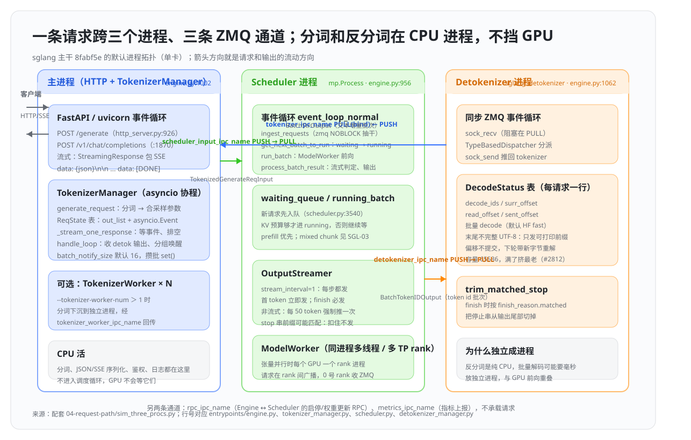
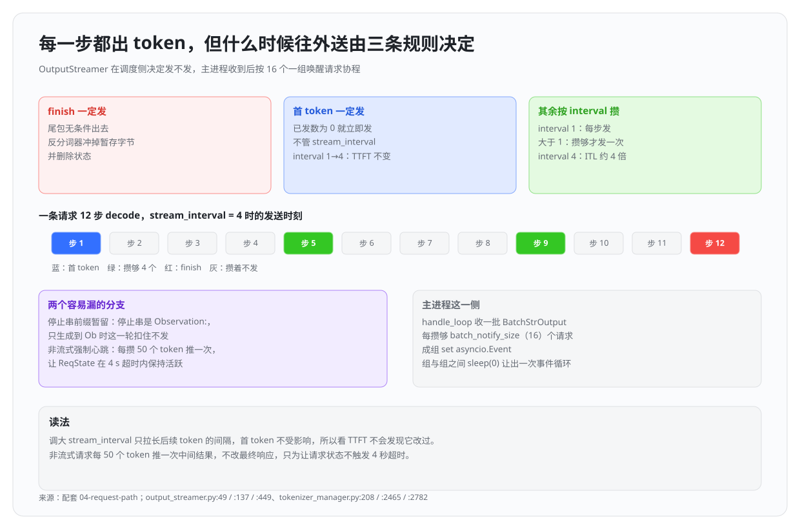
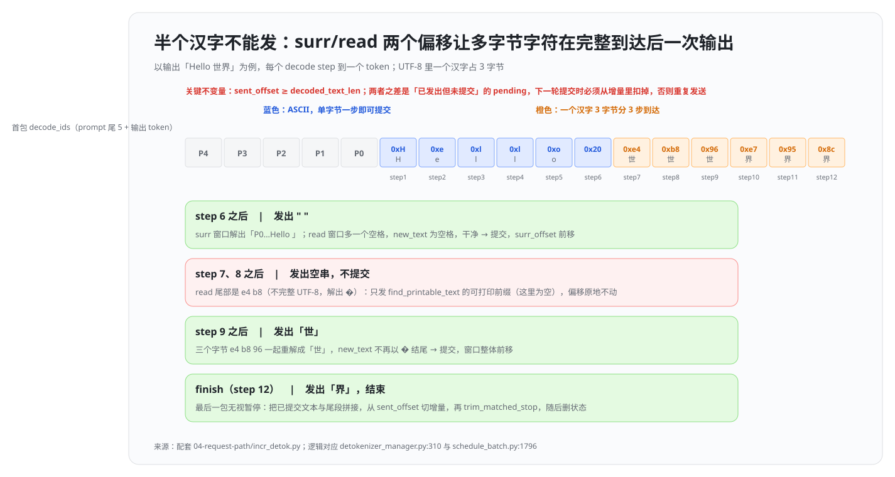
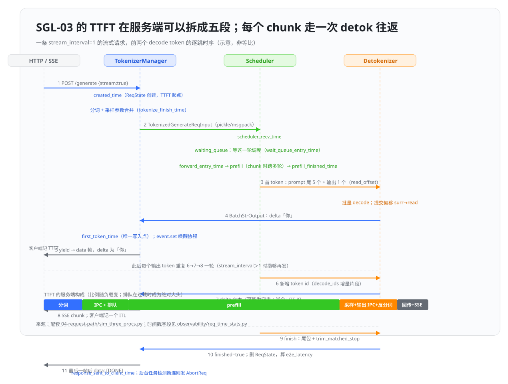
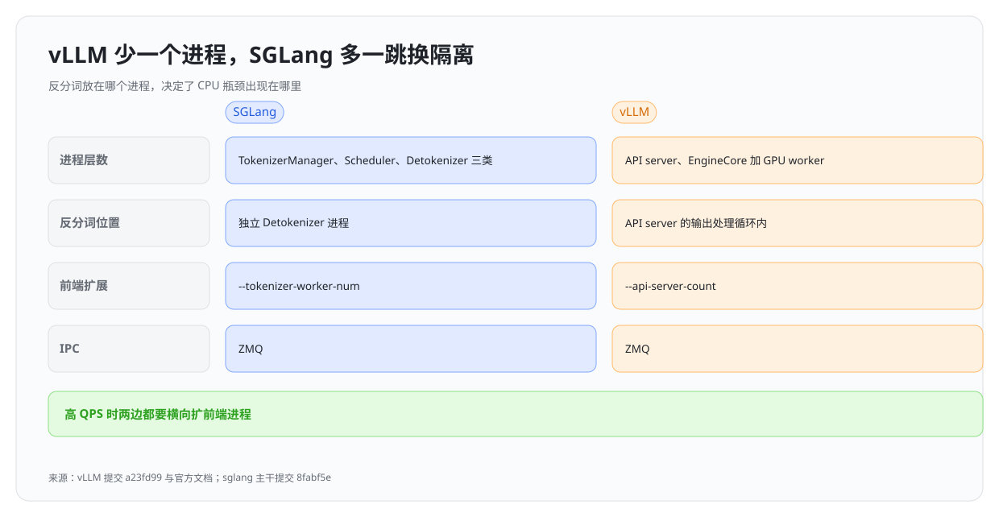

# SGL-04｜原理｜请求旅程：从 HTTP 到流式返回

> 🎯 **遇到的问题**：SGL-03 在服务外面量延迟，这一篇进到服务内部，跟一条流式请求走完全程。它在主进程里被 FastAPI 接住、分词，经一条 ZMQ 通道进调度进程，等 KV 预算、跑 prefill。之后每个 decode step 的 token id 经第二条通道送到反分词进程，变回文本，再经第三条通道回到主进程，包成 SSE 帧推给客户端。单卡默认部署，请求路径上就有三个进程、三条通道。
>
> **主线**：一条请求穿过三个进程、四条通道，每一跳都可能成为延迟的来源；画出这条路径，排障才有地图。
>
> **读完这一篇**：能画出这条拓扑，说清每个组件为什么放在那个进程。能解释汉字为什么不会先闪一下乱码，也就是反分词的 surr、read、sent 三个偏移怎么配合。能把 TTFT 拆成五段，知道 stream_interval 等几个参数各管什么。
>
> **代码**：[zero-to-sglang/04-request-path](../04-request-path)。sim_three_procs.py 用 multiprocessing 起三个进程、三条队列，在 CPU 上复现整条路径，模型计算用 sleep 代替，事件顺序和线上一致。incr_detok.py 单独拎出增量反分词的状态机，逐 step 打印。行号按主干 8fabf5e 核对。

# 导读 · 结论先行

1. **默认拓扑是三个进程，不是一个。**HTTP 服务和 TokenizerManager 在主进程，调度器是独立子进程，反分词器也是独立子进程。分词、JSON 序列化这些纯 CPU 活不进调度循环，反分词的批量解码可以和 GPU 前向重叠，谁也不挡谁。
2. **进程之间只有三条承载请求的 ZMQ 通道，全是 PUSH 到 PULL 的单向流。**分词后的请求去调度器，token id 批次去反分词器，文本增量批次回主进程。载荷默认走 pickle（SGLANG_USE_PICKLE_IPC 默认开），关掉则用 msgspec 编 msgpack。启停 RPC 和指标走另外两条通道，不承载请求。
3. **不是每个 decode step 都往外发文本。**OutputStreamer 有三条规则：首 token 必发、finish 必发、其余按 stream_interval 攒；非流式请求每 50 个 token 才被强制推一次心跳。停止串可能只匹配了前缀时，整段文本会被扣住等下一轮揭晓。
4. **一个汉字的 3 个 UTF-8 字节可能跨 3 个 decode step 到达。**反分词器末尾解出半个字符时，只发可打印前缀，偏移原地不提交，下一轮带着新字节重解；屏幕上因此不会先出现 �。状态机靠 surr_offset、read_offset、sent_offset 三个偏移和一条「已发不能重发」的不变量工作。
5. **TTFT 在服务端能拆成五段，prefill 通常是大头，过载时大头换成排队。**每个组件在收发消息时都往 ReqTimeStats 里写时间戳，首 token 时间在整条代码路径上只有一个写入点。



上图是单卡默认部署的进程拓扑与消息流。张量并行时 Scheduler 内部还会有多个 TP rank 进程，请求在 rank 间广播，只有 0 号 rank 收发 ZMQ，拓扑形状不变。另两条通道 rpc_ipc_name 和 metrics_ipc_name 负责 Engine 与 Scheduler 间的启停、权重更新 RPC 和指标上报，不承载请求数据。

**📎 与系列其他文档的分工**：连续批处理为什么能把多个请求塞进一次前向，见 [SGL-02｜上手｜推理账本：显存、KV 与 Roofline](./02-ledger.md)。TTFT、ITL 的外部口径和尾延迟怎么量，见 [SGL-03｜上手｜指标与压测：TTFT、TPOT、ITL 与 goodput](./03-bench.md)。调度器每一轮怎么在 KV 预算下挑请求、waiting 队列怎么进 running，留给 [SGL-05｜原理｜调度器：waiting、running 与 KV 预算](./05-scheduler.md)。多卡张量并行的 rank 拓扑，留给 [SGL-11｜原理｜并行：TP、DP Attention、EP 怎么组合](./11-parallelism.md)。

# 第 1 章 · 问题：一个 token 从 GPU 到屏幕要经过多少道手

写过 HTTP 服务的人第一次读推理引擎的代码，通常会有三个不适应：处理请求的不止一个进程，进程间不用 RPC 框架而用裸 ZMQ，模型吐出来的是 token id，到用户屏幕上却要变回完整的字符串，而且不能闪乱码。具体落到问题上：

- 一条 POST /generate 进了服务，先被谁接到，分词在哪个进程做，会不会挡住 GPU？
- 调度器在一个独立进程里，主进程怎么把请求送过去，序列化用什么格式，通道堵了怎么办？
- 模型每步产出的是 token id，谁负责把 id 变回文本，为什么这个活要单独开一个进程？
- 流式输出时，为什么 stream_interval 调大后 ITL 成比例变差，首 token 延迟却几乎不动？
- 一个汉字占 3 个字节、可能分 3 步才生成完，客户端为什么从没看到半个字？
- 压测发现 TTFT 高，怎么判断是分词慢、排队久、prefill 重，还是反分词回传拖了后腿？

这些问题我们当初都碰到过，这一篇逐个回答。先讲三个进程为什么这样分工，再顺着消息走一遍三条通道，然后用两章的篇幅分别讲调度侧的输出节拍和反分词侧的偏移状态机，最后把时间戳串起来拆 TTFT。

| 想弄清的现象 | 看哪一节 |
|-|-|
| 分词、鉴权、SSE 序列化会不会拖累 GPU | 2.1 |
| 进程间消息长什么样、pickle 还是 msgpack | 2.2 |
| 为什么不是每步都推、非流式为什么也有心跳 | 2.3 |
| 半个汉字为什么不闪乱码、空 chunk 是什么 | 2.4 |
| TTFT 高了先查哪一段 | 2.5 |
| 客户端断连后请求会不会白跑 | 2.6 |

# 第 2 章 · 原理：三进程、三通道、两套节拍

## 2.1 为什么是三个进程

引擎启动时，[engine.py:1002](https://github.com/sgl-project/sglang/blob/8fabf5e/python/sglang/srt/entrypoints/engine.py#L1002) 附近的主进程先起好 HTTP 服务和 TokenizerManager，然后显式拉起两个 multiprocessing 子进程：调度器在 [engine.py:956](https://github.com/sgl-project/sglang/blob/8fabf5e/python/sglang/srt/entrypoints/engine.py#L956)，反分词器在 [engine.py:1062](https://github.com/sgl-project/sglang/blob/8fabf5e/python/sglang/srt/entrypoints/engine.py#L1062)，反分词器的进程名特意设成 sglang::detokenizer，在 top 里一眼能认出来。

分工的逻辑是把「不和 GPU 打交道的 CPU 活」挪出调度循环。

- **主进程：HTTP + TokenizerManager。**FastAPI/uvicorn 的事件循环接住请求，TokenizerManager 是一组 asyncio 协程，负责分词、合并采样参数、维护每条请求的输出状态（ReqState）、把反分词回来的文本分组唤醒、做 SSE 序列化。鉴权、日志、请求校验也都在这。这些活加起来可能有毫秒级，但它们和 GPU 前向是异步重叠的，调度器不会等它们。
- **Scheduler 进程：调度循环 + ModelWorker。**一个事件循环反复做四件事：非阻塞抽干输入队列、waiting 到 running 的准入、组 batch 跑前向、处理结果并决定发不发。这个进程的时间应该几乎全花在 GPU 上。张量并行时每个 GPU 一个 rank，rank 之间用自己的通信组广播。
- **Detokenizer 进程：同步 ZMQ 循环。**阻塞在 PULL 口上收 token id 批次，批量调 tokenizer 解码，再 PUSH 回主进程。HF fast tokenizer 的批量解码是纯 CPU 活，一批可能要几百微秒到几毫秒；放独立进程，这段时间正好和下一步 GPU 前向重叠。

多一层进程就多一跳 IPC，这个代价是有意付的。vLLM v1 走的是另一条路，反分词留在 API server 的输出处理循环里，靠多开 API server 分摊 CPU[[1]](https://github.com/vllm-project/vllm/blob/a23fd9903418de0e1d3757bb23e2f1697eb066f3/vllm/v1/engine/detokenizer.py)；两种做法的取舍放在 2.7 节对照。分词侧同理：默认分词在主进程协程里做（很快），高 QPS 或慢 tokenizer 时可以用 --tokenizer-worker-num 起多个 TokenizerWorker 进程，分词结果经 tokenizer_worker_ipc_name 回传，这是第四条可能出现的通道。

## 2.2 三条 ZMQ 通道与线上的消息类型

通道名都是启动参数，默认值在 server_args 的 PortArgs 里（[server_args.py:733](https://github.com/sgl-project/sglang/blob/8fabf5e/python/sglang/srt/server_args.py#L733) 附近），端点名是临时文件形式的 ipc:// 地址。三条主通道方向固定：

| 通道参数 | 方向 | 套接字类型 | 载荷类型 |
|-|-|-|-|
| scheduler_input_ipc_name | 主进程 → Scheduler | PUSH → PULL | TokenizedGenerateReqInput（或 AbortReq） |
| detokenizer_ipc_name | Scheduler → Detokenizer | PUSH → PULL | BatchTokenIDOutput（token id 批次） |
| tokenizer_ipc_name | Detokenizer → 主进程 | PUSH → PULL（主进程 bind） | BatchStrOutput（文本增量批次） |

ZMQ 在这里承担的是「带缓冲的、单向的、成批的字节管道」：PUSH/PULL 模式天然做负载分发和背压缓冲，一个 send 是一条完整消息不会半包，比手写 socket 加长度前缀省事得多[[2]](https://zguide.zeromq.org/docs/chapter3/)。主进程在 tokenizer_ipc_name 上 bind，反分词器去 connect，所以无论子进程起得多慢，回传通道的接收端始终先在。

消息体在 [io_struct.py](https://github.com/sgl-project/sglang/blob/8fabf5e/python/sglang/srt/managers/io_struct.py#L86) 里定义，多数是 msgspec.Struct，打开 tag=True 和 array_like 后序列化紧凑。实际编码有一个开关：[io_struct.py:2692](https://github.com/sgl-project/sglang/blob/8fabf5e/python/sglang/srt/managers/io_struct.py#L2692) 的 \_USE_PICKLE_IPC 读环境变量 SGLANG_USE_PICKLE_IPC，[environ.py:368](https://github.com/sgl-project/sglang/blob/8fabf5e/python/sglang/srt/environ.py#L368) 里默认是 True。

也就是本机 IPC 默认直接 pickle（HIGHEST_PROTOCOL），换 msgpack 要自己承担兼容面，numpy 数组、自定义对象用 msgspec 表达都更麻烦。msgspec 本身仍是项目依赖，跨进程的结构化消息定义靠它[[3]](https://github.com/jcrist/msgspec)，msgpack 编码格式见规范[[4]](https://msgpack.org/)。

对写应用的人，真正要记住的是消息边界和生命周期，字段表可以随用随查：

- 请求在进调度器之前已经分词完毕，线上消息里带的是 input_ids，不是原始 prompt 文本；重复请求的前缀在这之后才由 RadixCache 去重（SGL-08 讲）。
- Scheduler 和 Detokenizer 之间只传 token id 和每个请求的 read_offset，不传模型输出对象本身，批次是多请求拼的。
- 回主进程的 BatchStrOutput 里 rids 和 output_strs 等长：即使某个请求这一轮的增量是空串（半个 UTF-8 字符），它照样占一个位置，主进程照样唤醒它。
- AbortReq 是和正常请求同一条通道的特殊消息，调度器在抽干队列时遇到就从 waiting 和 running 里摘掉，没有专门的取消通道。

## 2.3 输出节拍：OutputStreamer 的三条规则

模型每个 decode step 都产出新 token，但不是每步都该往通道里送。决策在调度侧的 OutputStreamer 里，核心是 [output_streamer.py:137](https://github.com/sgl-project/sglang/blob/8fabf5e/python/sglang/srt/managers/scheduler_components/output_streamer.py#L137) 的 stream_output，判定逻辑集中在累加器的 accept 方法（[output_streamer.py:449](https://github.com/sgl-project/sglang/blob/8fabf5e/python/sglang/srt/managers/scheduler_components/output_streamer.py#L449) 附近）。三条规则：

1. **finish 一定发。**请求结束的尾包无条件出去，保证调用方一定能收到结束信号，也保证反分词器能在这一包里把暂存的字节全部冲掉并删除状态。
2. **首 token 一定发。**已发数为 0 且有新 token 时立即发，不管 stream_interval 多大。这就是 SGL-03 里观察到的现象：interval 从 1 调到 4，ITL 约变成 4 倍，TTFT 几乎不变。
3. **其余按 stream_interval 攒。**interval 为 1 时每步发；大于 1 时攒够未发送 token 数才发一次。

还有两个容易忽略的分支。一个是停止串前缀暂留：如果新文本的尾巴正好是某个 stop 字符串的前缀（比如停止串是 "Observation:"，目前只生成到 "Ob"），无法判断下一轮是继续匹配还是只是普通文本，这一轮就把文本扣住不发，等下一轮揭晓。其二是非流式请求的强制心跳：[output_streamer.py:49](https://github.com/sgl-project/sglang/blob/8fabf5e/python/sglang/srt/managers/scheduler_components/output_streamer.py#L49) 的 SGLANG_FORCE_STREAM_INTERVAL 默认 50，非流式请求每攒 50 个 token 也被推一次中间结果。

它不改变最终响应（客户端要的是完整文本），作用是让这条请求在主进程的 ReqState 保持活跃，[tokenizer_manager.py:1946](https://github.com/sgl-project/sglang/blob/8fabf5e/python/sglang/srt/managers/tokenizer_manager.py#L1946) 的 \_stream_one_response 等事件有超时（[tokenizer_manager.py:208](https://github.com/sgl-project/sglang/blob/8fabf5e/python/sglang/srt/managers/tokenizer_manager.py#L208) 的 SGLANG_REQUEST_STATE_WAIT_TIMEOUT 默认 4 秒），长时间没有任何消息会被判异常，也给断线检测留检查点。

主进程收到回传后并不是来一个唤醒一个。[tokenizer_manager.py:2465](https://github.com/sgl-project/sglang/blob/8fabf5e/python/sglang/srt/managers/tokenizer_manager.py#L2465) 的 handle_loop 收一批 BatchStrOutput，把文本挂到各请求的 out_list 上，每攒够 batch_notify_size（默认 16）个请求才成组 set 它们的 asyncio.Event，组与组之间 await asyncio.sleep(0) 让出一次事件循环（[tokenizer_manager.py:2782](https://github.com/sgl-project/sglang/blob/8fabf5e/python/sglang/srt/managers/tokenizer_manager.py#L2782)）。

这个参数的官方说明是 Number of streaming notifications to batch before yielding to the event loop：高并发时每个通知都立刻唤起协程会把事件循环打爆，攒批唤醒用一点通知延迟换吞吐。



## 2.4 反分词：三个偏移和半个汉字

这是全篇最绕的一块，先看现象，再看状态机。

模型输出的是 token id。BPE/SentencePiece 一类 tokenizer 里，一个 token 不一定对应完整字符的完整字节；而在这个模拟配套里为了把问题放大，干脆让一个汉字的 3 个 UTF-8 字节分 3 个 decode step 到达。线上真实情况同理：任何 tokenizer 都可能让一个多字节字符跨 token，增量解码时末尾出现半个字符是常态。如果直接把 bytes 解成字符串往外发，UTF-8 解码失败的半截会变成 U+FFFD（�），用户屏幕上先闪一个乱码，下一轮又没法撤回。



线上的解法在初始化阶段就埋了窗口：[schedule_batch.py:163](https://github.com/sgl-project/sglang/blob/8fabf5e/python/sglang/srt/managers/schedule_batch.py#L163) 的 INIT_INCREMENTAL_DETOKENIZATION_OFFSET 是 5，[schedule_batch.py:1795](https://github.com/sgl-project/sglang/blob/8fabf5e/python/sglang/srt/managers/schedule_batch.py#L1795) 的 init_incremental_detokenize 规定首包带上 prompt 末尾 5 个 token 加已有输出。为什么要回看 prompt？因为 token 解码依赖上下文：同一个字节序列在不同上文下可能有不同切分，带上前面几个 token 重新解，才能保证增量边界处稳定。反分词侧的主循环在 [detokenizer_manager.py:310](https://github.com/sgl-project/sglang/blob/8fabf5e/python/sglang/srt/managers/detokenizer_manager.py#L310)，每个请求维护三个偏移：

- **surr_offset（surrounding）**：本轮「参考窗口」的起点。窗口 [surr_offset, read_offset) 的解码结果只用作对照，不产生新文本。
- **read_offset**：本轮「读取窗口」的终点，读取窗口是 [surr_offset, read_offset] 之后的全部 id。read 解出来的文本去掉 surr 解出来的前缀，差值 new_text 才是这一轮的新增量。
- **sent_offset**：已经发给主进程的文本长度，按字符计。finish 时用它从全文里切出最后一段增量。

每轮的判定可以压缩成四句话：

1. 批量解两个窗口：surr 窗口解出上文，read 窗口解出全文，new_text = read_text[len(surr_text):]。
2. 请求未结束且 new_text 不以 � 结尾：这是干净文本，提交，即追加到 decoded_text，surr_offset 推进到旧 read_offset，read_offset 推进到当前 id 总长，发出 new_text。
3. 末尾是不完整 UTF-8：不提交任何偏移，只调用 find_printable_text 取 new_text 里可以安全展示的前缀发出去（可能是空串），下一轮带着新字节整窗重解。
4. finish：无视暂停状态，full = decoded_text + new_text，从 sent_offset 切到末尾，再按 finish_reason 做 trim_matched_stop 把停止串从尾部切掉，随后删除该请求的状态。

find_printable_text 在 [utils.py:345](https://github.com/sgl-project/sglang/blob/8fabf5e/python/sglang/utils.py#L345)，判定规则借用自 Hugging Face 的 TextIteratorStreamer[[5]](https://github.com/huggingface/transformers/blob/main/src/transformers/generation/streamers.py)：换行结尾直接放行。末尾是完整 CJK 字符放行。倒数第二个是 CJK 字符时只发到倒数第二个字符之前。否则退回到最后一个空格，只发完整词。它解决的是同一类问题的另一面：空格分词的语言里，不要把半个英文词先发出去。

**关键不变量：sent_offset ≥ decoded_text_len，二者之差是「已发出但还没提交」的 pending。**第三类分支里，可打印前缀已经发给用户了，但偏移没提交；下一轮干净文本提交后，new_text 里包含这段发过的前缀，必须从增量里扣掉 pending 长度再发，否则用户会收到重复文本。模拟在这个点上踩出过真实 bug：finish 分支最初直接发 new_text，当最后一批恰好结束在暂存恢复的边界上时，已发的 pending 文本被整段重发，拼出来的结果比目标多出一截；改成从 sent_offset 切全文后才对齐。

还有一个容量问题。DecodeStatus 存在一个有限容量的有序字典里（[detokenizer_manager.py:532](https://github.com/sgl-project/sglang/blob/8fabf5e/python/sglang/srt/managers/detokenizer_manager.py#L532) 的 LimitedCapacityDict），容量上限 [detokenizer_manager.py:73](https://github.com/sgl-project/sglang/blob/8fabf5e/python/sglang/srt/managers/detokenizer_manager.py#L73) 的 SGLANG_DETOKENIZER_MAX_STATES 默认 65536，满了挤掉最老的请求。正常并发下永远用不完，但异常场景（海量 aborted 请求的尾包还在飞、或进程长期不重启）下旧状态被挤掉、新包再来找就会抛 RuntimeError，报错信息直接指向 GitHub issue #2812[[6]](https://github.com/sgl-project/sglang/issues/2812)。配套模拟把容量调到 2 就能稳定复现这个退出。

## 2.5 把 TTFT 拆成五段



上图是一条 stream_interval=1 的请求前两个输出 token 的逐跳时序。每个组件在边界上往 ReqTimeStats 写时间戳（定义在 [req_time_stats.py:385](https://github.com/sgl-project/sglang/blob/8fabf5e/python/sglang/srt/observability/req_time_stats.py#L385) 附近），把它们串起来，服务端口径的 TTFT 就是五段之和：

| 段 | 时间戳边界 | 大小与影响因素 |
|-|-|-|
| 1 分词 + 参数合并 | created_time → tokenize_finish_time | 通常亚毫秒；慢 tokenizer、长 prompt、分词 worker 排队时上涨 |
| 2 IPC + 排队 | tokenize_finish_time → scheduler_recv_time → wait_queue_entry_time → forward_entry_time | 轻载时只是一次 PUSH/PULL；过载时 waiting 队列是绝对大头 |
| 3 prefill | forward_entry_time → prefill_finished_time | 通常是轻载下的大头，随输入长度近似线性；chunked 时跨多轮调度 |
| 4 采样 + 输出 IPC + 反分词 | prefill_finished_time → 反分词批量 decode → BatchStrOutput | 一个 token 的采样很快；反分词是批量做的，batch 大时毫秒级 |
| 5 回传唤醒 + SSE | first_token_time → response_sent_to_client_time | 协程唤醒、JSON 序列化、一帧 SSE；group notify 可能多等一组 |

两个写入点值得专门记住。[tokenizer_manager.py:2736](https://github.com/sgl-project/sglang/blob/8fabf5e/python/sglang/srt/managers/tokenizer_manager.py#L2736) 是 first_token_time 在整条路径上唯一的写入位置，在 handle_loop 处理回传批次、确认这是该请求第一条非空输出时写。

response_sent_to_client_time 在 \_stream_one_response 真正把 chunk yield 出去时写（[tokenizer_manager.py:2026](https://github.com/sgl-project/sglang/blob/8fabf5e/python/sglang/srt/managers/tokenizer_manager.py#L2026)）。所以「首 token 时间」在服务内部有两个含义：反分词回来的时刻和真正写进 socket 的时刻，排障时看的是哪个要说清楚。SGL-03 里客户端量的 TTFT 还在第 5 段之后，再加真实网络。

比例随负载移动：轻载、短 prompt 时 prefill 占一半以上很正常；一旦 #queue-req 开始堆积，第 2 段的增长速度会让其他三段全部变得无所谓，这和 SGL-03 拐点之后 TTFT 一档涨十倍的观察是同一件事的内外两面。prefill 被 chunked 拆多轮时，prefill_finished_time 记录最后一个 chunk 完成，中间每轮的边界另有 last_chunked_prefill_finish_time 一类字段，排查被插队的 TTFT 时要用细粒度字段。

## 2.6 断连、取消与尾包

流式响应是 FastAPI 的 StreamingResponse，media_type 是 text/event-stream，每个输出 yield 一帧 \`data: JSON文本\n\n\`，最后一帧是 \`data: [DONE]\n\n\`，data 字段和空行分隔遵循 SSE 规范[[7]](https://html.spec.whatwg.org/multipage/server-sent-events.html)；JSON 载荷和 [DONE] 结束标记是这里的接口约定，FastAPI 的 StreamingResponse 用法见官方文档[[8]](https://fastapi.tiangolo.com/advanced/custom-response/#streamingresponse)。生成器在路由 [http_server.py:933](https://github.com/sgl-project/sglang/blob/8fabf5e/python/sglang/srt/entrypoints/http_server.py#L933) 附近，真正推帧的循环在 [http_server.py:956](https://github.com/sgl-project/sglang/blob/8fabf5e/python/sglang/srt/entrypoints/http_server.py#L956) 到 [http_server.py:975](https://github.com/sgl-project/sglang/blob/8fabf5e/python/sglang/srt/entrypoints/http_server.py#L975)。

断连处理挂在路由的 background 任务上（[http_server.py:980](https://github.com/sgl-project/sglang/blob/8fabf5e/python/sglang/srt/entrypoints/http_server.py#L980) 的 create_abort_task）：生成器循环里周期性 await request.is_disconnected()（[http_server.py:962](https://github.com/sgl-project/sglang/blob/8fabf5e/python/sglang/srt/entrypoints/http_server.py#L962)），一旦发现客户端没了，就往 scheduler_input 通道发 AbortReq。

主进程侧 \_stream_one_response 每次事件超时醒来也会查一次 is_disconnected（它没有阻塞在无限等待上，4 秒超时既是异常保护也是取消检查点）。取消的语义是「尽快」而不是「立即」：已经在跑的这一轮前向不会中途作废，调度器下一轮抽干队列时摘除请求，KV 在该轮清理后回收，已经反分词出来的尾包丢弃即可。

/v1/chat/completions 走同一个 TokenizerManager，差别只在 HTTP 层：chat 模板渲染在分词前，delta 文本按 OpenAI 的 choices[].delta.content 切片，在 serving_chat.py 里完成。理解了原生路径，OpenAI 兼容层就是多一层格式翻译。

## 2.7 vLLM 怎么做

vLLM v1 的进程拓扑只有两层。API server 进程里跑 FastAPI、分词和输出处理；EngineCore 进程跑调度器，再为每张 GPU 拉一个 worker 进程，两层之间用 ZMQ 通信[[9]](https://docs.vllm.ai/en/latest/design/arch_overview.html)[[10]](https://docs.vllm.ai/en/latest/design/multiprocessing.html)。反分词放在 API server 的输出处理循环里，用增量的 DecodeStream 逐 token 解码[[1]](https://github.com/vllm-project/vllm/blob/a23fd9903418de0e1d3757bb23e2f1697eb066f3/vllm/v1/engine/detokenizer.py)。API server 不够用时用 --api-server-count 横向加进程，开 DP 时默认与 DP 规模相同。

同一条请求在 SGLang 里多走一跳：TokenizerManager 分词后发给 Scheduler，Scheduler 把输出 token 发给独立的 DetokenizerManager，反分词结果再回到 TokenizerManager 推给客户端。多出的这一跳换来的是反分词与 HTTP 处理互不阻塞；vLLM 少一跳，延迟更短，但 API server 同时承担分词、反分词和流式发送，高 QPS 下要靠多开 API server 分摊。

| 维度 | SGLang | vLLM | 差异的代价 |
|-|-|-|-|
| 进程层数 | TokenizerManager、Scheduler、Detokenizer 三类 | API server、EngineCore 加 GPU worker | SGLang 每个 token 多一次 IPC |
| 反分词位置 | 独立 Detokenizer 进程 | API server 的输出处理循环内 | vLLM 的 API server 更容易成为 CPU 瓶颈 |
| 前端扩展 | --tokenizer-worker-num | --api-server-count | 两边都要按 CPU 核数估 |
| IPC | ZMQ | ZMQ | 序列化开销同量级 |



# 第 3 章 · 源码走读：一条请求的 15 个落脚点

按一条流式请求触达代码的顺序列。行号对应主干 8fabf5e，顺着读一遍就是图 2 的时序。

| # | 位置 | 发生了什么 |
|-|-|-|
| 1 | [http_server.py:933 generate_request](https://github.com/sgl-project/sglang/blob/8fabf5e/python/sglang/srt/entrypoints/http_server.py#L933) | POST /generate 入口；先过 generate_contract_error 做请求校验，再进 serve_generate_request |
| 2 | [http_server.py:943 serve_generate_request](https://github.com/sgl-project/sglang/blob/8fabf5e/python/sglang/srt/entrypoints/http_server.py#L943) | 流式时返回 StreamingResponse，生成器逐帧 yield，background 挂断连 abort 任务 |
| 3 | [tokenizer_manager.py:895 generate_request](https://github.com/sgl-project/sglang/blob/8fabf5e/python/sglang/srt/managers/tokenizer_manager.py#L895) | 创建 ReqState（out_list、finished、asyncio.Event、time_stats），写 created_time |
| 4 | [tokenizer_manager.py:1096 \_tokenize_one_request](https://github.com/sgl-project/sglang/blob/8fabf5e/python/sglang/srt/managers/tokenizer_manager.py#L1096) | 分词、合采样参数；第 1660 行写 tokenize_finish_time |
| 5 | [tokenizer_manager.py:1533 \_create_tokenized_object](https://github.com/sgl-project/sglang/blob/8fabf5e/python/sglang/srt/managers/tokenizer_manager.py#L1533) | 构造 TokenizedGenerateReqInput；第 1769 行 \_send_one_request 经 PUSH 发出 |
| 6 | [request_receiver.py:127 drain](https://github.com/sgl-project/sglang/blob/8fabf5e/python/sglang/srt/managers/scheduler_components/request_receiver.py#L127) | Scheduler 侧用 sock_recv(zmq.NOBLOCK) 一次抽干；上限 SGLANG_SCHEDULER_MAX_RECV_PER_POLL，-1 不限 |
| 7 | [scheduler.py:2227 process_input_requests](https://github.com/sgl-project/sglang/blob/8fabf5e/python/sglang/srt/managers/scheduler.py#L2227) | handle_generate_request；set_scheduler_recv_time 在 schedule_batch.py:1399 |
| 8 | [scheduler.py:3540 \_add_request_to_queue](https://github.com/sgl-project/sglang/blob/8fabf5e/python/sglang/srt/managers/scheduler.py#L3540) | 进 waiting_queue，写 wait_queue_entry_time；KV 预算够才在后续轮次进 running |
| 9 | [scheduler.py:2029 event_loop_normal](https://github.com/sgl-project/sglang/blob/8fabf5e/python/sglang/srt/managers/scheduler.py#L2029) | ingest → get_next_batch_to_run → run_batch → process_batch_result 四段循环 |
| 10 | [output_streamer.py:449 accept](https://github.com/sgl-project/sglang/blob/8fabf5e/python/sglang/srt/managers/scheduler_components/output_streamer.py#L449) | 首 token/finish/interval 三条发送判定 + 停止串前缀暂留；非流式走 50 token 强制心跳 |
| 11 | [schedule_batch.py:1795 init_incremental_detokenize](https://github.com/sgl-project/sglang/blob/8fabf5e/python/sglang/srt/managers/schedule_batch.py#L1795) | 首包带 prompt 尾 5 token；后续包只带新增量和 read_offset |
| 12 | [detokenizer_manager.py:184 event_loop](https://github.com/sgl-project/sglang/blob/8fabf5e/python/sglang/srt/managers/detokenizer_manager.py#L184) | 同步循环：sock_recv 阻塞 → TypeBasedDispatcher 分派 → sock_send 回推 |
| 13 | [detokenizer_manager.py:310 \_decode_batch_token_id_output](https://github.com/sgl-project/sglang/blob/8fabf5e/python/sglang/srt/managers/detokenizer_manager.py#L310) | 批量双窗解码、提交/暂存判定、pending 扣减；第 194 行 trim_matched_stop |
| 14 | [tokenizer_manager.py:2465 handle_loop](https://github.com/sgl-project/sglang/blob/8fabf5e/python/sglang/srt/managers/tokenizer_manager.py#L2465) | 收 BatchStrOutput。第 2736 行写唯一的 first_token_time。按 batch_notify_size 分组 set event |
| 15 | [tokenizer_manager.py:1946 \_stream_one_response](https://github.com/sgl-project/sglang/blob/8fabf5e/python/sglang/srt/managers/tokenizer_manager.py#L1946) | 等事件、加锁排空 out_list，yield 给 HTTP 生成器；finish 后删 ReqState，写 e2e |

几处容易看漏的细节：

- 非增量模式（incremental_streaming_output 默认关）走的是另一条省事路径：主进程不拼增量，反分词每轮回全文，[\_stream_one_response](https://github.com/sgl-project/sglang/blob/8fabf5e/python/sglang/srt/managers/tokenizer_manager.py#L1946) 里把回包文本置空、用 state.get_text() 取全文，避免 O(n²) 字符串拼接。打开这个开关后输出是互不重叠的文本段，语义不同，不要混用。
- handle_loop 排空 out_list 必须在锁里做（取出 + 清空 + clear event 是一个临界区），否则回传和唤醒之间会丢通知。配套的多线程模拟里这个顺序也严格照搬，写成先 clear 后取就会偶发卡住。
- 反分词进程是同步 zmq Context，没有 asyncio：它的活是纯 CPU 批处理，事件循环只需要「收一批、解一批、发一批」，协程化没有收益，反而增加调度不确定性。
- DecodeStatus 的淘汰是「静默挤掉、用时才报错」：挤掉本身不打日志，等被挤请求的下一包到达才抛 RuntimeError。排查 #2812 类问题时，报错的请求往往不是元凶，容量是被更早的请求潮占满的。

# 第 4 章 · 实验：在 CPU 上跑完整条路径

两个脚本只用标准库，模型计算用 sleep 代替，数字没有性能意义，只保证事件顺序和线上一致：首 token 立即推、之后按 interval 攒、不完整 UTF-8 暂不提交、finish 发尾包。

## 4.1 默认：六条流式请求

```bash
cd zero-to-sglang/04-request-path
python3 sim_three_procs.py
```

```text
# 6 条请求（流式 6，非流式 0），每条最多 48 token，stream_interval=1，batch_notify_size=16
      rid 模式   chunk   非空  空chunk  TTFT ms   ITL中位 ms
  req-000 流       48     42       6     36.9        2.1
  req-001 流       48     42       6     36.5        2.1
  ...
# req-000 前 60 字：'XI HEX VX 程SN AC HQT RG 请HOSIZ YZ WNK 调YK '
# 第一个汉字在第 10 个字符；它的 3 个 UTF-8 字节分 3 个 decode step 到达
```

两个数对照前面的原理看：48 个输出 token 产生 48 个 chunk，chunk 数和 token 数一一对应，即使增量是空串也占一帧，其中 6 个空串对应 3 个汉字各自的前两个字节；ITL 中位 2.1 ms 就是一个 decode step（sleep 2 ms）加一点进程往返。

## 4.2 调 stream_interval，看 ITL 成比例变差

```bash
python3 sim_three_procs.py --stream-interval 4 --requests 3
```

```text
  req-000 流       13     13       0     20.7        8.3
  req-001 流       13     13       0     20.5        8.4
```

chunk 数从 48 降到约 13（攒 4 个发一次，加上首尾特例），ITL 中位从 2.1 变成 8.3，约 4 倍；TTFT 反而更小，纯粹是进程启动的随机差，首 token 特例保证它不随 interval 变大。线上把 stream_interval 调大通常是为了降低高并发下 SSE 帧和协程唤醒的密度，代价直接落在用户感知的流畅度上。

## 4.3 非流式：50 token 一次的强制心跳

```bash
python3 sim_three_procs.py --nonstream 2 --force-interval 10 --requests 4 --max-new 40
```

```text
  req-000 非流       4      4       0     44.2       20.8
  req-001 非流       4      4       0     44.1       20.8
  req-002 流       40     36       4     25.1        2.1
```

两条非流式请求 40 个 token 只收到 4 次推送：每 10 个 token 一次强制心跳加最后全文（线上默认 50，用 --force-interval 调小方便观察）。心跳之间的间隔 20.8 ms 正好是 10 个 decode step。非流式的拼接结果不做逐字节断言，因为它收到的本来就不是增量序列。

## 4.4 把 DecodeStatus 容量调到 2，复现 #2812

```bash
python3 sim_three_procs.py --requests 8 --max-states 2
```

```text
# 8 条请求（流式 8，非流式 0），每条最多 48 token
# detokenizer 进程已退出：DecodeStatus 容量太小，状态被挤掉，见 issue #2812
# 调大 --max-states（线上对应 SGLANG_DETOKENIZER_MAX_STATES）后重试
```

8 条请求的状态塞进容量 2 的字典，最老的不断被挤掉，后续包到达时反分词进程抛错退出，主进程检测到子进程死亡后给出和线上同款的处置提示。这个实验也顺带验证了为什么反分词器的崩溃必须被显式上报：三个进程是管道，中间一环静默消失，表现为主进程所有请求集体等到 4 秒超时。

## 4.5 单看一个汉字的三步

```bash
python3 incr_detok.py
```

```text
step               新到 token     new_text   提交?  发出
   7                  0x0e4          '�'       否   ''
   8                  0x0b8          '�'       否   ''
   9                  0x096          '世'       是   '世'
  10                  0x0e7          '�'       否   ''
  11                  0x095          '�'       否   ''
  12                  0x08c          '界'       是   '界'

拼起来：'Hello 世界'
目标：  'Hello 世界'
一致。
```

这个脚本把状态机从进程框架里剥出来，固定输入「Hello 世界」，逐 step 打印新字节、解出的 new_text、是否提交偏移、实际发出的文本。step 7、8 末尾是不完整序列，发出空串、偏移原地不动；step 9 三个字节一起重解，整字一次发出。最后有一条断言：增量拼接结果必须等于一次性解码，提交偏移或 pending 扣减写错它立刻会红。

> 💡 **实验记录**：五个实验各跑了一遍，重点观察两个对照：interval=1 对 4 的 chunk 数与 ITL，以及 --max-states 2 时主进程的集体超时现象。又把 --batch-notify-size 改成 1 跑高并发，对比逐请求唤醒和攒批唤醒的差别（模拟里用 time.sleep(0) 让出 GIL 对应 asyncio.sleep(0)）。全部命令和期望输出见 [README.md](../04-request-path/README.md)，状态机实现见 [sim_three_procs.py](../04-request-path/sim_three_procs.py)。

# 第 5 章 · 调过的参数和踩过的坑

## 5.1 动过的参数

| 参数 / 环境变量 | 默认 | 管什么 | 什么时候动它 |
|-|-|-|-|
| --stream-interval | 1 | 流式攒多少个输出 token 推一次 | 高并发下协程/SSE 帧过密时调大；代价是 ITL 成倍涨 |
| --batch-notify-size | 16 | 主进程一次唤醒多少个请求的协程 | 超大并发事件循环被通知打爆时调大；低延迟场景保持小 |
| SGLANG_FORCE_STREAM_INTERVAL | 50 | 非流式请求多少 token 强制推一次心跳 | 一般不动；自有客户端做长请求进度展示时可调小 |
| SGLANG_DETOKENIZER_MAX_STATES | 65536 | 反分词状态表容量 | 遇到 #2812 报错时调大，同时排查 abort 风暴 |
| --tokenizer-worker-num | 1 | 分词 worker 进程数 | 长 prompt 高 QPS、分词成为 TTFT 第一段瓶颈时加大 |
| SGLANG_USE_PICKLE_IPC | true | IPC 序列化用 pickle 还是 msgpack | 跨版本/调试需要可读线格式时关；本机部署保持默认 |
| SGLANG_REQUEST_STATE_WAIT_TIMEOUT | 4s | 主进程等输出的事件超时 | 只在极慢 GPU + 超大 chunk 可能误杀时调大，不拿它掩盖卡死 |
| --incremental-streaming-output | false | 回包是否为互不重叠的文本段 | 需要按段消费的下游才开；普通拼接客户端不必开 |

## 5.2 踩过的坑

> 💡 **踩过的坑**：我们以为 stream_interval 能降 TTFT。首 token 有必发特例，调 interval 动的只是稳态 ITL 和 chunk 密度。后来降 TTFT 时改去动排队长度、chunked prefill 或前缀缓存，方向完全不同。

> 💡 **踩过的坑**：看到空 chunk 以为是 bug。反分词遇到不完整 UTF-8 时发出空串是设计的一部分，BatchStrOutput 里 rids 和文本等长，空串照样唤醒协程、照样触发一轮等待逻辑。客户端拼接时空串天然无害；我们试过在服务端过滤它，结果破坏了请求和批次的下标对齐。

> 💡 **踩过的坑**：在客户端做「收到 � 就修正」。发给客户端的文本已经保证不包含半个字符。后来查明，出现 � 是因为链路里有人绕过了反分词器（直接消费 token id 自己解码），在 UI 层打补丁是治标。

> 💡 **踩过的坑**：把非流式的 50 token 心跳当成输出保证。心跳是保活和进度旁路，内容可能在后续轮次被停止串裁剪逻辑改写；最终响应永远以 finish 尾包为准，现在只拿尾包做业务落库。

> 💡 **踩过的坑**：反分词进程崩了，我们只看了它自己的日志。管道式架构里，中间进程消失的外部症状是主进程请求集体超时 4 秒。后来我们的报警覆盖了三个进程的存活；模拟里 --max-states 2 的实验就是标准死法。

> 💡 **踩过的坑**：在主进程的请求协程里做重活。鉴权回调、分词后处理、自定义日志如果是阻塞调用，会直接占住事件循环，拖慢同进程所有请求的唤醒和 SSE 序列化，这正是三进程设计想避免的事。后来把重 CPU 活挪到了线程池或独立服务。

## 5.3 我们的看法

这套架构读下来，我们最大的启发是「按资源类型拆进程」的克制：GPU 一个循环、CPU 批处理一个循环、IO 协程一个循环，彼此只通过三条方向固定的窄通道通信。通道窄反而好排查：消息类型屈指可数，每种都能在纸上画出生死周期，排查问题时可以逐跳截。我们见过不少自研推理服务把采样后处理、业务回调、日志上报全塞进调度线程，最后谁都不敢动，差别就在第一天有没有把这几条边界画清楚。

反分词那段状态机则是另一种教材：它没有追求「一步到位的正确」，而是允许自己暂时发出空串、暂不提交、下一轮重试，靠三个偏移和一条 pending 不变量把正确性收敛回来。分布式和流式系统里这类「最终对齐但中间有空窗」的设计很常见，理解了 sent_offset 为什么永远不小于 decoded_text_len，就掌握了读这类代码的钥匙。

# 第 6 章 · 上线核对和下一步

> 📌 **上线前逐条核对**
> - 能默画三进程三通道拓扑，说得出每条通道的方向、套接字类型和载荷类型
> - 确认过分词、SSE 序列化、鉴权日志在主进程，排查 GPU 卡顿不用怀疑它们挡前向
> - stream_interval、batch_notify_size、强制心跳间隔三个节拍参数，摸清了默认值和代价
> - 理解了首 token 和 finish 必发、停止串前缀暂留、非流式 50 token 心跳三个特例
> - 讲得清 surr/read/sent 三个偏移和 sent_offset ≥ decoded_text_len 不变量
> - 确认过空 chunk 是正常现象，链路里没有任何环节把它过滤掉
> - 能把 TTFT 拆成五段，轻载看 prefill、过载看排队，服务端两个 first-token 时间点也分得清
> - 监控覆盖三个进程存活；碰到 #2812 时调了 SGLANG_DETOKENIZER_MAX_STATES 并排查 abort 风暴
> - 确认过断连通过 AbortReq 取消，语义是「下一轮摘除」而非「当轮中断」，KV 回收有一轮延迟

> 🔑 **学到的**：一条流式请求跨三个进程：主进程接 HTTP、分词、组 SSE，调度进程管准入和前向，反分词进程做批量解码，三条 PUSH/PULL 通道单向连接。输出节拍由 OutputStreamer 控制，首 token 和 finish 必发，其余按 stream_interval 攒，非流式每 50 token 有强制心跳。增量反分词靠 surr/read/sent 三个偏移：半个多字节字符到达时只发可打印前缀、偏移不提交、下轮整窗重解，pending 已发文本在下一轮扣减，保证不重不漏。TTFT 是分词、IPC 排队、prefill、反分词回传、SSE 五段之和，时间戳在每跳都有落盘，首 token 时间只有一个写入点。

下一步：[SGL-05｜原理｜调度器：waiting、running 与 KV 预算](./05-scheduler.md) 进到调度器内部，看 event_loop_normal 每一轮怎么从 waiting_queue 挑请求、KV 预算怎么算、prefill 和 decode 怎么组 batch。本篇里的「KV 预算够才进 running」和 prefill 优先插队，在那里会展开成完整的准入与抢占逻辑。

# 参考文献

按正文首次引用顺序编号，资料截至 2026 年 10 月底。源码以 sgl-project/sglang 主干提交 8fabf5e（2026 年 10 月 28 日）和 v0.5.22 发行版为准。

[1] vllm-project/vllm. vllm/v1/engine/detokenizer.py（a23fd99） [https://github.com/vllm-project/vllm/blob/a23fd9903418de0e1d3757bb23e2f1697eb066f3/vllm/v1/engine/detokenizer.py](https://github.com/vllm-project/vllm/blob/a23fd9903418de0e1d3757bb23e2f1697eb066f3/vllm/v1/engine/detokenizer.py)

[2] Hintjens P. ZeroMQ: Advanced Request-RePLY patterns. ZeroMQ Guide [https://zguide.zeromq.org/docs/chapter3/](https://zguide.zeromq.org/docs/chapter3/)

[3] Crist J. msgspec: fast serialization/validation library. GitHub [https://github.com/jcrist/msgspec](https://github.com/jcrist/msgspec)

[4] MessagePack specification [https://msgpack.org/](https://msgpack.org/)

[5] Hugging Face. transformers TextIteratorStreamer（CJK 可打印判定出处）. GitHub [https://github.com/huggingface/transformers/blob/main/src/transformers/generation/streamers.py](https://github.com/huggingface/transformers/blob/main/src/transformers/generation/streamers.py)

[6] sgl-project/sglang issue #2812: Decode status not found. GitHub [https://github.com/sgl-project/sglang/issues/2812](https://github.com/sgl-project/sglang/issues/2812)

[7] WHATWG. Server-sent events. HTML Living Standard [https://html.spec.whatwg.org/multipage/server-sent-events.html](https://html.spec.whatwg.org/multipage/server-sent-events.html)

[8] FastAPI 文档. Custom Response — StreamingResponse [https://fastapi.tiangolo.com/advanced/custom-response/#streamingresponse](https://fastapi.tiangolo.com/advanced/custom-response/#streamingresponse)

[9] vLLM Docs. Architecture Overview [https://docs.vllm.ai/en/latest/design/arch_overview.html](https://docs.vllm.ai/en/latest/design/arch_overview.html)

[10] vLLM Docs. Python Multiprocessing [https://docs.vllm.ai/en/latest/design/multiprocessing.html](https://docs.vllm.ai/en/latest/design/multiprocessing.html)

---

上一章：[SGL-03｜上手｜指标与压测：TTFT、TPOT、ITL 与 goodput](./03-bench.md) · [目录](./README.md) · 下一章：[SGL-05｜原理｜调度器：waiting、running 与 KV 预算](./05-scheduler.md)
