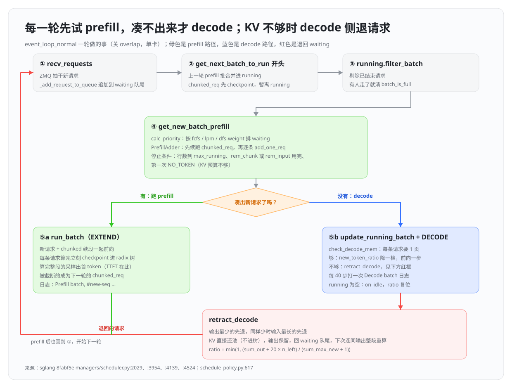
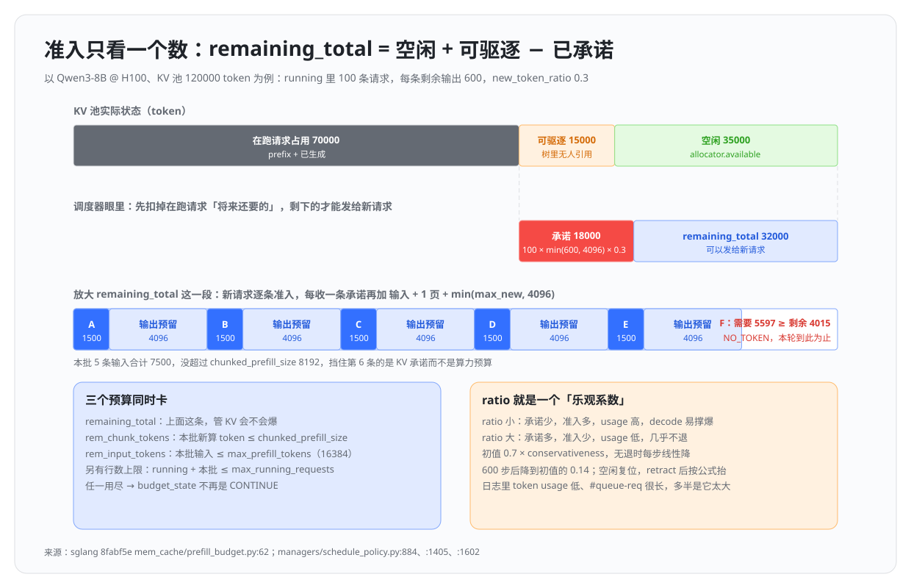
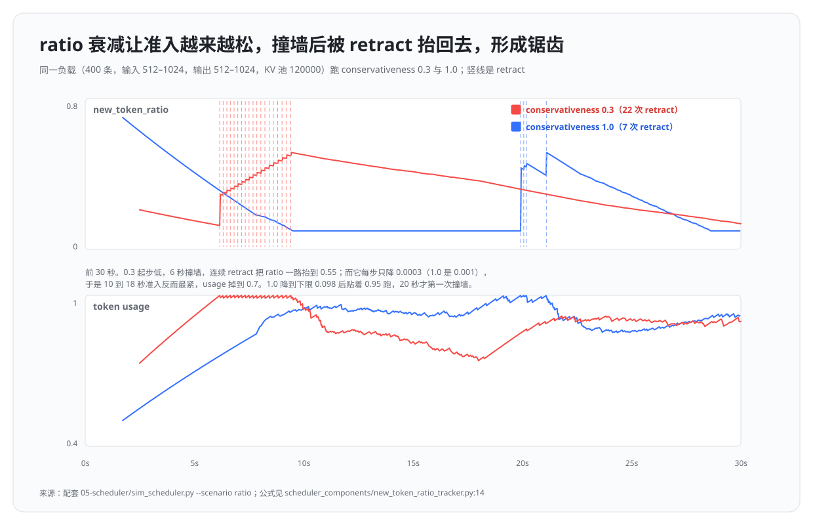
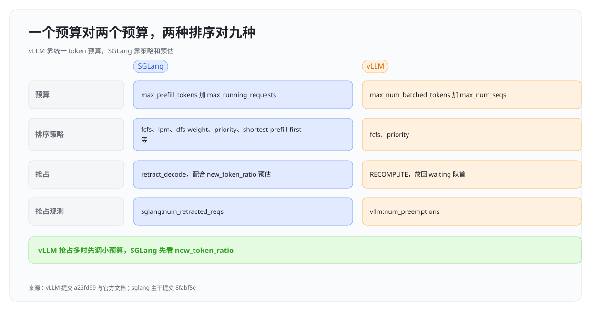

# SGL-05｜原理｜调度器：waiting、running 与 KV 预算

> 🎯 <p><b>遇到的问题</b>：[SGL-04｜原理｜请求旅程：从 HTTP 到流式返回](./04-request-path.md) 把调度进程当成黑箱，这一篇把箱子打开。调度器每一轮只回答一个问题：这一步 GPU 跑什么，是从 waiting 队列挑一批新请求做 prefill，还是让 running 里的请求各走一个 token。答案取决于三本账：KV 池还剩多少，这一批的算力预算还剩多少，running 里的请求将来还要占多少 KV。</p><p>第三本没人算得准，因为谁也不知道请求会在第几个 token 碰到 EOS。SGLang 用一个会衰减、会被打回去的系数 new_token_ratio 去猜。猜松了，KV 撑爆，只能把在跑的请求退回去重算；猜紧了，KV 空着，队列越排越长。</p><p><b>主线</b>：调度器每一轮只决定一件事：这一步 GPU 跑哪些 token；准入、排序和抢占都是在为这个决定记账。</p><p><b>读完这一篇</b>：能读懂 Prefill batch、Decode batch、KV cache pool is full 三类日志，给定池子状态算出某条请求为什么没进来。能说清 fcfs、lpm、dfs-weight 各适合什么负载，按 token usage 和 retract 频率调 schedule_conservativeness，开优先级调度前估出被抢占的代价。</p><p><b>代码</b>：<a href="../05-scheduler">zero-to-sglang/05-scheduler</a>。sim_scheduler.py 只用标准库，在 CPU 上复刻两条队列、PrefillAdder 的预算、四种排序策略、chunked 续跑、radix 前缀树、ratio 衰减与 retract、优先级抢占，日志格式和线上逐字段一致。行号按主干 8fabf5e 核对。</p>

# 导读 · 结论先行

1. **每一轮 prefill 优先。**get_next_batch_to_run 先试着凑一个 prefill 批，凑出来就跑 prefill，凑不出来才轮到 decode。所以 decode 并不是每轮都跑，waiting 里只要还有能准入的请求，running 就得等这一步。
2. **准入只看一个数。**remaining_total 等于空闲加可驱逐再减去已承诺。已承诺有两部分：在跑请求的剩余输出乘 ratio，以及本批已收请求的输入加输出预留。新请求的「输入 + min(max_new_tokens, 4096) + 1 页」必须严格小于它，否则返回 NO_TOKEN。
3. **几个预算同时卡，碰到第一个 NO_TOKEN 就收工。**KV 承诺、chunked_prefill_size、max_prefill_tokens、max_running_requests 任一用完，这一批就封口。循环不会跳过队首的大请求去找后面的小请求，队首阻塞在这里是设计行为。
4. **默认策略是 fcfs。**lpm 能把共享前缀负载的重复计算砍掉一半以上，靠的是批内去重；waiting 超过 128 条时它自动退回 fcfs。dfs-weight 在 8fabf5e 里没有批内去重，同组请求扎堆到达时和 fcfs 一样差。
5. **KV 不够时 decode 侧 retract。**输出最少的先退，KV 直接还池不进树，请求回到 waiting 队尾，下次连同已生成的输出一起重算。ratio 每个 decode step 线性降，retract 后按公式抬回去，曲线是锯齿形；schedule_conservativeness 调的就是这条锯齿的高度。



上图是关掉 overlap 时 event_loop_normal 一轮的完整路径。绿色是 prefill 分支，蓝色是 decode 分支，红色是 retract 把请求退回 waiting。开 overlap 时选批和前向错开一拍，判断逻辑不变，留给 SGL-09。

**📎 与系列其他文档的分工**：请求怎么进调度进程、结果怎么回到客户端，见 [SGL-04｜原理｜请求旅程：从 HTTP 到流式返回](./04-request-path.md)。chunked_prefill_size 取多大、长 prompt 对 ITL 的冲击，留给 [SGL-06｜原理｜Chunked prefill：切块大小、mixed chunk 与 TTFT / ITL 的取舍](./06-chunked-prefill.md)。req_to_token 和 token_to_kv 两级池子怎么分配，留给 [SGL-07｜原理｜内存池与页表：req_to_token、token_to_kv 与 page size](./07-memory-pool.md)。radix 树的匹配、加锁、驱逐，留给 [SGL-08｜原理｜RadixAttention：基数树的匹配、插入、加锁与驱逐](./08-radix-attention.md)。这一篇的参数怎么和别的参数一起按顺序调，留给 [SGL-17｜实战｜参数调优手册：从日志倒推配置](./17-tuning.md)。

# 第 1 章 · 问题：调度日志里的数字为什么对不上直觉

我们第一次盯 SGLang 的运行日志时，困惑几乎都落在调度器身上：

- #queue-req 堆了几百条，token usage 只有 0.6，KV 明明还空着三四成，为什么不再放请求进来？
- 一批请求共享同一段 system prompt，第一批的 #cached-token 是 0 可以理解，为什么后面几批也只命中一点点？
- 换成 --schedule-policy lpm 之后压测没变好，有时还更差，问题出在哪？
- KV cache pool is full. Retract requests 这条日志算不算事故，一分钟出现几次可以接受？
- schedule_conservativeness 调小能不能提吞吐，代价落在谁身上？
- 打开优先级调度，高优先级请求能不能随时插队，被挤掉的请求要重算多少？

这些问题的答案都在三个文件里：scheduler.py 管循环和队列，schedule_policy.py 管排序和准入，schedule_batch.py 管 decode 时的显存检查和 retract。下面按「一轮循环、准入预算、排序策略、retract、chunked 续跑、优先级抢占」的顺序把它们拆开。

| 现象 | 答案在哪一节 |
|-|-|
| decode 为什么偶尔停一拍、新请求什么时候加入 decode | 2.1 |
| KV 还有空却不准入，max_tokens 写大了有什么后果 | 2.2 |
| 共享前缀命中率低、lpm 不见效 | 2.3 |
| retract 日志、ratio 锯齿、conservativeness 怎么调 | 2.4 |
| 长 prompt 被切开后怎么接着算、会不会被饿死 | 2.5 |
| 优先级调度什么时候真的抢占、代价多大 | 2.6 |

# 第 2 章 · 原理：一轮循环、一个预算、一条锯齿

## 2.1 一轮循环：prefill 优先，decode 兜底

[scheduler.py:2029](https://github.com/sgl-project/sglang/blob/8fabf5e/python/sglang/srt/managers/scheduler.py#L2029) 的 event_loop_normal 每一轮做四件事：从 ZMQ 抽干新请求，选出这一步要跑的批，跑前向，处理结果。新请求经 [\_add_request_to_queue](https://github.com/sgl-project/sglang/blob/8fabf5e/python/sglang/srt/managers/scheduler.py#L3540) 校验优先级和队列上限（max_queued_requests，默认不限）后追加到 waiting 队尾，同时记下 wait_queue_entry_time，这个时间戳后面在优先级抢占里还会用到。

选批全在 [get_next_batch_to_run](https://github.com/sgl-project/sglang/blob/8fabf5e/python/sglang/srt/managers/scheduler.py#L3954) 里，顺序很固定：

1. 如果有上一轮被截断的 chunked_req，先把它排除在本轮合并之外；若上一段确实往前算了，就调 stash_chunked_request，内部是 checkpoint_kv_cache：把已经算好的那段插进 radix 树，prefix_len 推到 extend_end。
2. 如果上一轮跑的是 prefill 批，剔掉其中已结束的请求和 chunked_req，把剩下的合并进 running。新请求 prefill 完不会当场开始 decode，要到下一轮才入列。
3. running.filter_batch 剔除已结束的请求。只要有人离开，batch_is_full 就清零，下一轮重新尝试准入。
4. [\_should_defer_prefill](https://github.com/sgl-project/sglang/blob/8fabf5e/python/sglang/srt/managers/scheduler.py#L1403) 判断要不要跳过这轮 prefill。prefill_decode_interval 默认不开；设成 N 后，每次 prefill 之后强制连跑 N 轮 decode，running 小于 prefill_decode_interval_min_bs 时不受限，让小批先长起来。
5. 调 get_new_batch_prefill 尝试凑新批。凑到了就跑 prefill，本轮结束。
6. 凑不到，且 running 非空，才调 update_running_batch 跑一步 decode。

第 6 步里有个容易漏看的分支。[update_running_batch](https://github.com/sgl-project/sglang/blob/8fabf5e/python/sglang/srt/managers/scheduler.py#L4524) 发现 KV 不够时，如果这一步恰好有请求正在结束（结果还在路上，KV 要等结果处理完才释放），它返回 None，宁可让 decode 空转一拍，也不去 retract 别人。源码注释说得直白：结束请求的 KV 在这一步末尾就会还回来，下一步再 decode 剩下的请求。只有没人要结束时才真的 retract。

prefill 优先是 Orca 迭代级调度的直接延续：每个前向步都重新决定批里有谁，新请求不必等整批结束[[1]](https://www.usenix.org/conference/osdi22/presentation/yu)。代价也很清楚，关掉 mixed chunk（默认关）时 prefill 和 decode 分属不同的批，跑 prefill 的那一步，running 里所有请求都停一拍，它们的 ITL 被这一步的 prefill 时长拉长。chunked prefill 把长 prompt 切成多段，正是为了限制这一拍的长度，Sarathi-Serve 把这类做法系统化成「不停顿的批」[[2]](https://arxiv.org/abs/2403.02310)，细节在 SGL-06。

## 2.2 准入预算：remaining_total 一个数说了算

凑批的主体是 [\_get_new_batch_prefill_raw](https://github.com/sgl-project/sglang/blob/8fabf5e/python/sglang/srt/managers/scheduler.py#L4139)。它先过几道早退：running 已满（batch_is_full）或 waiting 为空且没有 chunked_req，直接返回；[get_num_allocatable_reqs](https://github.com/sgl-project/sglang/blob/8fabf5e/python/sglang/srt/managers/scheduler.py#L4087) 算出的可用行数小于等于 0，也返回。行数取 max_running_requests 减去 running 条数，再和 req_to_token 池的空行数取小。过了这几关，先 calc_priority 给 waiting 排序，再构造 PrefillAdder，逐条往里装。

PrefillAdder 背后的账本是 [PrefillBudget](https://github.com/sgl-project/sglang/blob/8fabf5e/python/sglang/srt/mem_cache/prefill_budget.py#L62)，核心就两行：

```python
remaining_total = allocator.available_size() + tree_cache.evictable_size() - total_offset
admit           = total_tokens < remaining_total
```

空闲加可驱逐，是这一刻 KV 池在物理上最多能腾出多少 token：树里没人引用的节点随时可以驱逐，对新请求来说和空闲等价。total_offset 是调度器已经许出去的承诺，由两部分组成：

- **在跑请求的未来需求。**构造 PrefillAdder 时，对 running 里每条请求累加 min(max_new_tokens − len(output_ids), 4096) × new_token_ratio，见 [schedule_policy.py:795](https://github.com/sgl-project/sglang/blob/8fabf5e/python/sglang/srt/managers/schedule_policy.py#L795)。设了 ignore_eos 的请求一定会跑满，ratio 取 1。
- **本批已收请求。**每收一条，[reserve](https://github.com/sgl-project/sglang/blob/8fabf5e/python/sglang/srt/mem_cache/prefill_budget.py#L62) 把「输入（按页向上取整）+ 1 页 + 输出预留」加进 total_offset，其中输出预留取 min(max_new_tokens, 4096)，这一刻不打折。



上图用一组具体数字走一遍。120000 token 的池子，在跑请求占了 70000，树里可驱逐 15000，空闲 35000，物理上能腾出 50000。running 里 100 条请求每条还剩 600 个 token 没生成，ratio 0.3，承诺 18000，剩给新请求的只有 32000。新请求每条输入 1500、max_new_tokens 4096，各要 5597，收到第 5 条后只剩 4015，第 6 条 NO_TOKEN。这一批输入合计 7500，chunked_prefill_size 8192 的算力预算还没用完，挡住它的是 KV 承诺。

[add_one_req](https://github.com/sgl-project/sglang/blob/8fabf5e/python/sglang/srt/managers/schedule_policy.py#L1405) 和 [\_select_prefill_admission](https://github.com/sgl-project/sglang/blob/8fabf5e/python/sglang/srt/managers/schedule_policy.py#L1602) 里的判定顺序，日志里的很多现象都由它决定：

- 先查本批条数上限 prefill_max_requests（默认不限），超了返回 OTHER。
- 再查 KV：total_tokens = 输入 + 输出预留 + 每请求开销，不小于 remaining_total 就返回 NO_TOKEN。
- 再查算力：开了 chunked prefill 时，输入超过本批剩余的 rem_chunk_tokens 就截断，被截断的请求只预留输入、不预留输出（max_new 记 0），成为本批唯一的 new_chunked_req。关掉 chunked prefill 时，输入超过 rem_input_tokens（max_prefill_tokens 剩余）的请求返回 OTHER，但本批第一条例外，否则超长 prompt 永远进不来。
- 都通过才 commit：给 last_node 加锁防止前缀被驱逐，加入 can_run_list，扣预算。

回到 scheduler.py 的循环（[scheduler.py:4268](https://github.com/sgl-project/sglang/blob/8fabf5e/python/sglang/srt/managers/scheduler.py#L4268) 起），只要 add_one_req 返回的不是 CONTINUE 就 break。返回 NO_TOKEN 时，只要本批已收到请求或 running 非空，就把 batch_is_full 置真，之后每轮在早退那一步直接跳过，不再白白排序和试探，直到有请求离开。

由此可以得出两个在生产上很实用的推论。其一，新请求的输出预留在准入那一刻按全额计，进了 running 才按 ratio 打折。客户端习惯把 max_tokens 写成 8192 或更大，每条请求准入时都按 4096 预留，单批能放进来的条数被压得很低；我们遇到过 KV 空着、队列很长、每批 #new-seq 只有个位数的情况，最后查出来是请求里的 max_tokens。其二，fcfs 下队首一条超长请求拿不到预算时，后面的短请求也一起等，这是公平性换来的队首阻塞。

## 2.3 排序策略：fcfs、lpm、dfs-weight 差在哪

[calc_priority](https://github.com/sgl-project/sglang/blob/8fabf5e/python/sglang/srt/managers/schedule_policy.py#L213) 在每次凑批前给 waiting 排序。默认 --schedule-policy 是 fcfs（[schedule.py:86](https://github.com/sgl-project/sglang/blob/8fabf5e/python/sglang/srt/arg_groups/fields/schedule.py#L86)），可选值还有 lpm、dfs-weight、lof、random、priority、routing-key、hrrn、shortest-prefill-first。按是否需要前缀匹配分两类：

| 策略 | 排序键 | 适合什么负载 |
|-|-|-|
| fcfs | 到达顺序；开了优先级调度时先按 priority 再按到达 | 默认；前缀共享少、追求公平和可预测的 TTFT |
| lof | max_new_tokens 从大到小 | 离线批量，想让长任务先占位 |
| lpm | 在树里匹配到的前缀长度从长到短，带批内去重 | 大量请求共享长前缀、waiting 不太深 |
| dfs-weight | 按 radix 树做 DFS，子树里等待请求越多越先走 | 前缀已经在树里、多分支共享 |
| hrrn | 响应比：已等待的 prefill 量 / 自身未命中长度 | 想在 lpm 的命中和公平之间折中 |

lpm 的思路来自 SGLang 论文：按 radix 树的 DFS 顺序处理请求，缓存够大时命中率最优，按最长前缀优先排序等价于 DFS 顺序[[3]](https://arxiv.org/abs/2312.07104)[[4]](https://www.lmsys.org/blog/2024-01-17-sglang/)。但把论文落到在线服务，有一个论文里不存在的问题：前缀要等这一批 prefill 算完、checkpoint 进树之后才看得见。同一组请求同时到达时，第一批里 8 条共享同一个 1024 token 前缀，彼此看不到对方，于是前缀被算 8 遍。

lpm 用批内去重解决这个问题，见 [\_compute_prefix_matches](https://github.com/sgl-project/sglang/blob/8fabf5e/python/sglang/srt/managers/schedule_policy.py#L356)：每轮先清空一棵只存 waiting 请求的临时 radix 树；对在主树里匹配不到 32 个 token 的请求，再去临时树里匹配，和前面某条 waiting 请求共享不少于 32 个 token 的，打上「暂缓」标记排到队尾，否则把自己插进临时树。效果是每组只放 1 条进第一批，它算完进了树，同组其余请求下一批全部命中。两个阈值分别在 [schedule_policy.py:110](https://github.com/sgl-project/sglang/blob/8fabf5e/python/sglang/srt/managers/schedule_policy.py#L110) 和 [:117](https://github.com/sgl-project/sglang/blob/8fabf5e/python/sglang/srt/managers/schedule_policy.py#L117)，都是 32，可用环境变量改。

这套去重目前只挂在 lpm、hrrn、shortest-prefill-first 上。dfs-weight 调的是 [tree_cache.dfs_weight_order](https://github.com/sgl-project/sglang/blob/8fabf5e/python/sglang/srt/mem_cache/base_prefix_cache.py#L456)，按每条请求在主树里的 last_node 计权，前缀还没进树时所有请求的 last_node 都是根，排序退化成原顺序，所以同组扎堆到达的负载上它和 fcfs 一样。

还有一个开关藏在 [\_determine_active_policy](https://github.com/sgl-project/sglang/blob/8fabf5e/python/sglang/srt/managers/schedule_policy.py#L314)：waiting 超过 128 条（[WAITING_QUEUE_PREFIX_MATCH_MAX](https://github.com/sgl-project/sglang/blob/8fabf5e/python/sglang/srt/managers/schedule_policy.py#L137)）时，lpm 和 hrrn 本轮直接按 fcfs 走。原因是开销：每轮要给整个 waiting 队列做一遍前缀匹配，队列几千条时这一步的 CPU 时间会直接挤占调度循环。所以线上积压越深，lpm 越不起作用。另外 tree cache 被关掉（--disable-radix-cache）时，所有依赖前缀的策略在初始化时就被改成 fcfs。

默认选 fcfs 的理由，官方调参文档给的是 lpm 适合前缀共享多的负载但有额外开销[[5]](https://docs.sglang.io/docs/advanced_features/hyperparameter_tuning)。再补两条：lpm 的排序键里没有等待时间，前缀匹配不上的请求在高负载下可能一直被排在后面；hrrn 把等待量计进排序键，就是在补这个缺口。跨实例的前缀感知调度是另一个问题，Preble 和 SGLang 自己的 cache-aware 路由在多副本之间分配请求[[6]](https://arxiv.org/abs/2407.00023)，在 SGL-19 展开。

模拟器在三种负载上跑了一遍，数字见第 4 章。结论先放在这里：同组扎堆到达时 lpm 命中率 61.7%，fcfs 和 dfs-weight 都是 11.1%。各组轮流到达时 fcfs 反而略好，因为第一批天然每组一条。队列 400 条时 lpm 前几轮退回 fcfs，差距缩到 4 个百分点。跑完这组对照，我们养成了一个习惯：选策略之前，先看清楚自己的到达模式。

## 2.4 new_token_ratio 与 retract：一条锯齿

ratio 由 [NewTokenRatioTracker](https://github.com/sgl-project/sglang/blob/8fabf5e/python/sglang/srt/managers/scheduler_components/new_token_ratio_tracker.py#L14) 管，三个数在启动时定好：

```python
init  = min(0.7 * schedule_conservativeness, 1.0)   # SGLANG_INIT_NEW_TOKEN_RATIO
min   = init * 0.14                                 # SGLANG_MIN_NEW_TOKEN_RATIO_FACTOR
decay = (init - min) / 600                          # SGLANG_NEW_TOKEN_RATIO_DECAY_STEPS
# 每个没有 retract 的 decode step：current = max(current - decay, min)
# 调度器空闲（on_idle）：current = init
# retract 之后：current = min(1, (剩余请求已输出之和 + 20 * 剩余条数) / (剩余请求 max_new_tokens 之和 + 1))
```

默认 conservativeness 为 1.0 时，初值 0.7，下限 0.098，每步降 0.001，600 步走到底。含义是：刚启动时假设在跑请求还要生成剩余额度的 70%，之后每跑一步没出事，就更相信它们会提前结束，600 步后只按 9.8% 预留。环境变量默认值在 [environ.py:650](https://github.com/sgl-project/sglang/blob/8fabf5e/python/sglang/srt/environ.py#L650) 一带。

乐观到一定程度，KV 池就会被 decode 撑满。[check_decode_mem](https://github.com/sgl-project/sglang/blob/8fabf5e/python/sglang/srt/managers/schedule_batch.py#L3439) 检查下一步每条请求能否各拿到一个 token 的槽位（page_size 为 1 时），不够就进 [retract_decode](https://github.com/sgl-project/sglang/blob/8fabf5e/python/sglang/srt/managers/schedule_batch.py#L3458)：

1. 排序：[\_get_decode_retraction_order](https://github.com/sgl-project/sglang/blob/8fabf5e/python/sglang/srt/managers/schedule_batch.py#L3549) 按（已输出长度，−输入长度）从大到小排，从尾部弹出。输出最少的先退，输出一样少时输入最长的先退。退输出少的，丢掉的 decode 进度最少；同等进度下退输入长的，腾出来的 KV 最多。--retraction-policy priority 会把优先级放在排序键最前面。
2. 释放：[release_req](https://github.com/sgl-project/sglang/blob/8fabf5e/python/sglang/srt/managers/schedule_batch.py#L2367) 调 release_kv_cache(checkpoint=False)，这条请求自己持有的 KV 直接还池，已生成的输出不进树。再从树里按 LRU 驱逐「剩余条数 × 20」个 token，给留下的请求留出 20 步余量。最后 reset_for_retract 把 prefix_len 清零、打上 retracted_stain。
3. 循环直到剩下的请求放得下，至少留 1 条。只剩 1 条还放不下，就把它 abort 掉，报 Out of memory even after retracting all other requests。beam search 组没法退回重来，直接 abort。
4. 退回的请求以 is_retracted 标记重新进 waiting 队尾，ratio 按上面的公式重估，打印 KV cache pool is full. Retract requests，带上退了几条、腾出多少 token、ratio 从多少变成多少。

被退回的请求下次准入时，prompt 前缀如果还在树里没被驱逐，可以命中；decode 出来的输出 token 一定要重算。对用户来说更直观的代价是流式输出卡住：这条请求的 TTFT 早就记过了，现在它回到队尾重新排队，客户端看到的是一段几秒的停顿。指标上它体现在 ITL 的长尾，看 TTFT 是看不出来的。



上图是模拟器里同一负载跑 conservativeness 0.3 和 1.0 的前 30 秒。0.3 初值只有 0.21，准入很松，6 秒就撞墙，几次 retract 把 ratio 抬到 0.3 附近，此后它每步只降 0.0003，比 1.0 的 0.001 慢得多，所以 10 到 18 秒之间反而是准入最紧的一段，usage 掉到 0.7。1.0 一路降到下限，usage 贴着 0.95 跑，20 秒才第一次撞墙。锯齿的高度由 retract 公式决定，下降斜率由 conservativeness 决定，两者叠在一起决定了 KV 的平均利用率。

官方调参文档给的判断标准很具体[[5]](https://docs.sglang.io/docs/advanced_features/hyperparameter_tuning)：token usage 长期高于 0.9 是好状态。usage 低于 0.9 同时 #queue-req 不为 0，说明准入太保守，常见于 max_new_tokens 给得很大、请求却早早结束的负载，可以把 conservativeness 降到 0.3。retract 频繁就往上调到 1.3。一分钟一次左右的 retract 可以接受。

vLLM 论文讨论过另一条路：显存不够时把被抢占请求的 KV 换出到 CPU 而不是重算，两者的取舍取决于 PCIe 带宽和重算长度[[7]](https://arxiv.org/abs/2309.06180)。SGLang 在单机模式下选重算，PD 分离的 decode 端才把被退请求的 KV 备份到 host（release_req 里 disaggregation_mode 为 decode 的分支）。

## 2.5 chunked 续跑：截断的请求不会被饿死

被截断的请求成为 self.chunked_req，同一时刻只有一个。下一轮在 get_next_batch_to_run 开头先 checkpoint 它已算好的部分，然后在 PrefillAdder 里第一个处理它，走 [add_chunked_req](https://github.com/sgl-project/sglang/blob/8fabf5e/python/sglang/srt/managers/schedule_policy.py#L1150)。这里的预算规则和普通请求不同：

```python
# prefill_budget.py:142
available = min(chunk_limit, int(self.remaining_total))
# Single-pool continuation must make progress to release its KV.
return available if available > 0 else chunk_limit
```

remaining_total 小于等于 0 时，它照样拿一整块 chunk 往前算。道理在注释里：半截请求已经占着 KV，只有把 prompt 算完、生成完才能释放，卡住它只会让 KV 永远还不回来。截断的段不预留输出，最后一段才把 max_new_tokens 加进承诺。中间段不采样，TTFT 记在最后一段算完那一刻。切多大、切几段对 TTFT 和 ITL 的影响，SGL-06 专门做对比实验。

## 2.6 优先级抢占：只在行数打满时发生

--enable-priority-scheduling 打开后，fcfs 先按 priority 排再按到达顺序排，默认数值越大越优先（--schedule-low-priority-values-first 可以反过来），抢占默认随之打开（[scheduler.py:1472](https://github.com/sgl-project/sglang/blob/8fabf5e/python/sglang/srt/managers/scheduler.py#L1472)）。

读 waiting 循环会发现，抢占只在一个地方被调用：本批条数加 running 已经达到可用行数、batch_is_full 被置真的时候。KV 不够返回 NO_TOKEN 时不会触发抢占，高优先级请求只是排在队首等。我们想让它在 KV 紧张时也能插队，办法是把 max_running_requests 设到 KV 撑得住的范围，让行数先于 KV 打满。

[preempt_to_schedule](https://github.com/sgl-project/sglang/blob/8fabf5e/python/sglang/srt/managers/schedule_policy.py#L1717) 的逻辑：

- 候选是 running 里没结束、还没被选中的请求。结束分两阶段（先释放 KV，下一轮才从批里剔除），抢占恰好夹在中间，源码特意跳过已结束的请求，避免二次释放。
- 候选按优先级从低到高、同优先级按进入队列时间从新到旧排序。
- 需要腾出的量 = 新请求输入 + min(max_new_tokens, 4096) − remaining_total。从头往后取候选，优先级差严格大于阈值（默认 10）才能抢，累加它们的「剩余输出 × ratio」直到够数；碰到第一个不满足阈值的就停。
- 一个都没选上或腾不够就放弃。选上了就逐个 release_req、从 running 剔除，放进 preempt_list，本批结束时重新排进 waiting。

被抢占请求的代价和 retract 一样是重算，但实际多少要看它的前缀还在不在树里。prefill 之后 prompt 已经 checkpoint 进树，只要回来之前没被驱逐，重算的只有已生成的输出。模拟实验里被抢的请求有 2048 token 的 prompt、生成了 5 个 token，回来时 #cached-token 2048、#new-token 5。KV 紧张、驱逐频繁时就是整段重算。

跨实例的系统有更便宜的做法。Llumnix 在多个推理实例之间迁移请求的 KV，用迁移代替抢占重算，让高优先级请求在别的实例上腾出空间[[8]](https://arxiv.org/abs/2406.03243)。单实例的 SGLang 没有迁移这条路，抢占的成本最终由被抢的低优先级请求承担。

## 2.7 vLLM 怎么做

vLLM v1 的调度器不分 prefill 轮和 decode 轮，每一步只有一个 token 预算 max_num_batched_tokens 和一个行数上限 max_num_seqs。它先给 running 队列里的请求排上本步要算的 token，decode 天然排在前面，剩余预算再从 waiting 队列取新请求[[9]](https://github.com/vllm-project/vllm/blob/a23fd9903418de0e1d3757bb23e2f1697eb066f3/vllm/v1/core/sched/scheduler.py)。排序策略只有 fcfs 和 priority 两种。SGLang 的策略多得多，默认 fcfs，还有按前缀命中排序的 lpm、dfs-weight，以及本月新增的 shortest-prefill-first。

显存不够时，两边都会把请求踢出去。vLLM 的抢占方式是 RECOMPUTE：释放这条请求的全部 KV，把它放回 waiting 队首，下次重新 prefill，同时打一条告警，建议调大 gpu_memory_utilization 或 TP，或者调小 max_num_seqs、max_num_batched_tokens[[10]](https://docs.vllm.ai/en/latest/configuration/optimization.html)。SGLang 的 retract_decode 也是释放后重算，但它在入队时就用 new_token_ratio 预估未来的 KV 需求，抢占发生后再把这个比例调保守，用预估换更少的抢占。

| 维度 | SGLang | vLLM | 差异的代价 |
|-|-|-|-|
| 预算 | max_prefill_tokens 加 max_running_requests | max_num_batched_tokens 加 max_num_seqs | 参数名不同，含义大体对应 |
| 排序策略 | fcfs、lpm、dfs-weight、priority、shortest-prefill-first 等 | fcfs、priority | vLLM 没有缓存感知排序，命中率靠前缀缓存本身 |
| 抢占 | retract_decode，配合 new_token_ratio 预估 | RECOMPUTE，放回 waiting 队首 | vLLM 更依赖把预算设保守 |
| 抢占观测 | sglang:num_retracted_reqs | vllm:num_preemptions | 看板要按各自指标告警 |



# 第 3 章 · 源码走读：调度一轮的 20 个落脚点

按一轮循环里被调用的顺序排。行号对应主干 8fabf5e，链接直达。

| # | 位置 | 发生了什么 |
|-|-|-|
| 1 | [scheduler.py:2029 event_loop_normal](https://github.com/sgl-project/sglang/blob/8fabf5e/python/sglang/srt/managers/scheduler.py#L2029) | 收请求、选批、前向、处理结果；不开 overlap 时的主循环 |
| 2 | [scheduler.py:3540 \_add_request_to_queue](https://github.com/sgl-project/sglang/blob/8fabf5e/python/sglang/srt/managers/scheduler.py#L3540) | 校验优先级和 max_queued_requests，追加到 waiting 队尾，记 wait_queue_entry_time |
| 3 | [scheduler.py:3954 get_next_batch_to_run](https://github.com/sgl-project/sglang/blob/8fabf5e/python/sglang/srt/managers/scheduler.py#L3954) | stash chunked_req、合并上一轮 prefill 批、filter running、prefill 优先，凑不到再 decode |
| 4 | [scheduler.py:1403 \_should_defer_prefill](https://github.com/sgl-project/sglang/blob/8fabf5e/python/sglang/srt/managers/scheduler.py#L1403) | prefill_decode_interval 节拍，running 小于 min_bs 时不限制 |
| 5 | [scheduler.py:4087 get_num_allocatable_reqs](https://github.com/sgl-project/sglang/blob/8fabf5e/python/sglang/srt/managers/scheduler.py#L4087) | 可用行数 = min(max_running − running，req_to_token 空行) |
| 6 | [scheduler.py:4139 \_get_new_batch_prefill_raw](https://github.com/sgl-project/sglang/blob/8fabf5e/python/sglang/srt/managers/scheduler.py#L4139) | 早退判断、calc_priority、构造 PrefillAdder、chunked_req 先续跑、逐条 add_one_req |
| 7 | [schedule_policy.py:213 calc_priority](https://github.com/sgl-project/sglang/blob/8fabf5e/python/sglang/srt/managers/schedule_policy.py#L213) | 按策略排序 waiting；:314 队列超过 128 时 lpm 和 hrrn 退回 fcfs |
| 8 | [schedule_policy.py:356 \_compute_prefix_matches](https://github.com/sgl-project/sglang/blob/8fabf5e/python/sglang/srt/managers/schedule_policy.py#L356) | 主树匹配 + 临时树批内去重，阈值 32 / 32 |
| 9 | [base_prefix_cache.py:456 dfs_weight_order](https://github.com/sgl-project/sglang/blob/8fabf5e/python/sglang/srt/mem_cache/base_prefix_cache.py#L456) | dfs-weight 的排序；按 last_node 计子树权重，无批内去重 |
| 10 | [schedule_policy.py:617 PrefillAdder](https://github.com/sgl-project/sglang/blob/8fabf5e/python/sglang/srt/managers/schedule_policy.py#L617) | 初始化时把在跑请求的 min(剩余输出, 4096) × ratio 记进 total_offset（:795） |
| 11 | [prefill_budget.py:62 PrefillBudget](https://github.com/sgl-project/sglang/blob/8fabf5e/python/sglang/srt/mem_cache/prefill_budget.py#L62) | remaining_total、check_prefill（严格小于）、reserve、available_chunk_tokens |
| 12 | [schedule_policy.py:1150 add_chunked_req](https://github.com/sgl-project/sglang/blob/8fabf5e/python/sglang/srt/managers/schedule_policy.py#L1150) | 续跑段至少拿一块 chunk；截断时不预留输出 |
| 13 | [schedule_policy.py:1405 add_one_req](https://github.com/sgl-project/sglang/blob/8fabf5e/python/sglang/srt/managers/schedule_policy.py#L1405) | 条数上限、KV 判定、截断；:1602 \_select_prefill_admission 给出 NO_TOKEN / OTHER |
| 14 | [schedule_policy.py:1717 preempt_to_schedule](https://github.com/sgl-project/sglang/blob/8fabf5e/python/sglang/srt/managers/schedule_policy.py#L1717) | 行数满时按优先级差抢占，release_req 后进 preempt_list |
| 15 | [scheduler.py:4524 update_running_batch](https://github.com/sgl-project/sglang/blob/8fabf5e/python/sglang/srt/managers/scheduler.py#L4524) | 有请求正在结束时跳过一拍；否则 retract，:4591 打日志，:4605 退回队尾 |
| 16 | [schedule_batch.py:3458 retract_decode](https://github.com/sgl-project/sglang/blob/8fabf5e/python/sglang/srt/managers/schedule_batch.py#L3458) | 循环退请求直到放得下；:3439 check_decode_mem，:3549 退回顺序 |
| 17 | [schedule_batch.py:2367 release_req](https://github.com/sgl-project/sglang/blob/8fabf5e/python/sglang/srt/managers/schedule_batch.py#L2367) | KV 还池不进树，驱逐 剩余条数 × 20 token，:2056 reset_for_retract |
| 18 | [new_token_ratio_tracker.py:14](https://github.com/sgl-project/sglang/blob/8fabf5e/python/sglang/srt/managers/scheduler_components/new_token_ratio_tracker.py#L14) | init / min / decay 的计算，retract 后的重估公式 |
| 19 | [common.py:271 checkpoint_kv_cache](https://github.com/sgl-project/sglang/blob/8fabf5e/python/sglang/srt/mem_cache/common.py#L271) | prefill 段算完插进树、推进 prefix_len；调用点在 batch_result_processor.py:394 和 :495 |
| 20 | [metrics_reporter.py:754](https://github.com/sgl-project/sglang/blob/8fabf5e/python/sglang/srt/managers/scheduler_components/metrics_reporter.py#L754) | Prefill batch 日志；:963 是 Decode batch，默认每 40 步一条 |

# 第 4 章 · 实验：在 CPU 上把调度器跑起来

模拟器是单线程、无 overlap、page_size 为 1，单步耗时借用 SGL-03 的 Roofline 模型，KV 池容量借用 SGL-02 的账本，时间数字只用来排序和对比。准入、排序、retract、抢占的判定逻辑按源码逐条复刻，日志字段和线上一致，可以拿线上日志来对照着读。

## 4.1 共享前缀、同组扎堆：三种策略差多少

```bash
cd zero-to-sglang/05-scheduler
python3 sim_scheduler.py --scenario policy
```

```text
# 共享前缀负载：128 条请求，16 组 system prompt 各 1024 token，私有后缀 128 token，输出 64，同组扎堆到达
# KV 池 60000 token，chunked_prefill_size 8192，max_prefill_tokens 16384
     policy prefill步    新算token    命中token     命中率   TTFT均值s TTFT p99 s     总时长s
       fcfs        17      131200       16384    11.1%      2.011      3.735      4.77
        lpm         8       57728       93184    61.7%      1.002      1.653      2.68
 dfs-weight        17      131200       16384    11.1%      2.011      3.735      4.77
# 理想下限：每组前缀只算一次 = 16 x 1024 + 128 x 128 = 32768 token
```

fcfs 每批塞 8 条同组请求，8192 token 刚好用满 chunk，前缀在批内被算 8 遍，128 条请求几乎每组都这样，新算 token 是理想下限的 4 倍。lpm 第一批同样是 8 条、命中 0，从第二批起去重生效：日志里第二批是 #new-seq 30、#cached-token 25600，同一个 8192 的 chunk 装进了将近 4 倍的请求。TTFT 均值和总时长都减半。dfs-weight 和 fcfs 的每一个数都相同，印证了 2.3 的分析。

## 4.2 换个到达顺序，再把队列拉长

```bash
python3 sim_scheduler.py --scenario policy --interleaved
python3 sim_scheduler.py --scenario policy --num 400
```

```text
# --interleaved：16 组轮流到达
       fcfs         5       35072      113536    76.4%      0.826      1.007      2.03
        lpm         6       41216      109312    72.6%      0.718      1.182      2.21
 dfs-weight         6       41216      109312    72.6%      0.718      1.182      2.21
# --num 400：队列远超 128 条
       fcfs        18      140131      356352    71.8%      2.732      5.719      6.74
        lpm        16      121978      374390    75.4%      2.648      5.204      6.23
 dfs-weight        18      136448      361501    72.6%      2.730      5.615      6.64
```

轮流到达时，fcfs 的第一批天然每组一条，后面全部命中，命中率 76.4%，比 lpm 还高一点，lpm 的去重在这里只是多余的开销。队列拉到 400 条后，lpm 前几轮因为超过 128 条直接按 fcfs 排，等队列消化到 128 以下才开始按前缀排，和 fcfs 的差距从 50 个百分点缩到 4 个。从那以后，压测共享前缀负载时至少用默认和 --interleaved 两种到达顺序各跑一遍，再看并发量把队列推到多深。

## 4.3 conservativeness 0.3、1.0、1.3

```bash
python3 sim_scheduler.py --scenario ratio
```

```text
# 长输出负载：400 条请求，输入 [512, 1024]，max_new_tokens 1024，实际输出 [512, 1024]，KV 池 120000
conserv  ratio初值  ratio最低  retract次     退回请求   重算token decode usage  峰值running     总时长s   输出tok/s
    0.3     0.210    0.0294         22        22      28604         0.79         117     56.50       5404
    1.0     0.700    0.0980          7         7       5897         0.76         110     56.84       5372
    1.3     0.910    0.1274          0         0          0         0.75         104     57.06       5351
# conservativeness 0.3 的前三条 retract 日志：
[t=   6.154s] KV cache pool is full. Retract requests. #retracted_reqs: 1, #new_tokens_gained: 1289, #new_token_ratio: 0.1266 -> 0.2910
[t=   6.310s] KV cache pool is full. Retract requests. #retracted_reqs: 1, #new_tokens_gained: 1300, #new_token_ratio: 0.2880 -> 0.3018
[t=   6.482s] KV cache pool is full. Retract requests. #retracted_reqs: 1, #new_tokens_gained: 1309, #new_token_ratio: 0.2984 -> 0.3135
```

三档吞吐只差 1%，这是 decode 受显存带宽限制的直接结果：峰值 running 从 104 涨到 117，每步多跑的十几条请求摊到权重读取上几乎不花钱，但也就多这么点。差别落在别处。0.3 退了 22 次、重算 28604 token，22 个用户的流式输出各卡了一次；TTFT 均值 19.4 秒，1.3 是 21.6 秒，准入松一点让排队短了约 10%。

retract 日志里 ratio 每次从 0.13 左右被抬到 0.29 以上，这就是图里锯齿的齿。这个负载的输出长度和 max_new_tokens 同量级，ratio 低估得厉害；换成 max_new_tokens 给 4096、实际只生成几百的聊天负载，0.3 才是正确答案。

## 4.4 优先级抢占：关和开

```bash
python3 sim_scheduler.py --scenario priority
```

```text
# max_running_requests=8，t=0 来 8 条低优先级（priority=0）长请求，t=0.5s 来 1 条 priority=100 的短请求
## 关闭抢占：高优先级 TTFT 8.217s，完成于 9.14s；被抢占 0 次，低优先级重算 0 token，低优先级最晚完成 8.70s
[t=   8.702s] Prefill batch, #new-seq: 1, #new-token: 512, #cached-token: 0, token usage: 0.00, #running-req: 0, ...

## 打开抢占：高优先级 TTFT 0.021s，完成于 1.01s；被抢占 1 次，低优先级重算 5 token，低优先级最晚完成 9.14s
[t=   0.506s] Preempt req 7 (priority 0) for req 8 (priority 100)
[t=   0.506s] Prefill batch, #new-seq: 1, #new-token: 512, #cached-token: 0, token usage: 0.04, #running-req: 7, #queue-req: 1, ...
[t=   1.006s] Prefill batch, #new-seq: 1, #new-token: 5, #cached-token: 2048, token usage: 0.04, #running-req: 7, #queue-req: 0, ...
```

8 行全被低优先级占满，关掉抢占时高优先级请求要等到最后一条低优先级请求结束，TTFT 8.2 秒。打开后 0.5 秒到达当场抢占 req 7，TTFT 0.02 秒。req 7 在 1.006 秒回来，#cached-token 2048 说明它的 prompt 还在树里，只重算了生成过的 5 个 token；代价是它的完成时间推迟到 9.14 秒。把 KV 池调小让驱逐发生，可以看到重算量变成整段。

## 4.5 对着日志读准入

```bash
python3 sim_scheduler.py --workload random --num 400 --out 1024 --max-total-tokens 120000 \
    --schedule-conservativeness 0.3 --log-head 12
```

```text
[t=   0.000s] Prefill batch, #new-seq: 11, #new-token: 8192, #cached-token: 0, token usage: 0.07, #running-req: 0, #queue-req: 389, #pending-token: 294279, ...
[t=   0.232s] Prefill batch, #new-seq: 12, #new-token: 8192, #cached-token: 423, token usage: 0.14, #running-req: 10, #queue-req: 378, ...
...
[t=   2.085s] Prefill batch, #new-seq: 12, #new-token: 8192, #cached-token: 292, token usage: 0.68, #running-req: 98, #queue-req: 290, ...
[t=   2.317s] Prefill batch, #new-seq: 8, #new-token: 5588, #cached-token: 493, token usage: 0.73, #running-req: 109, #queue-req: 283, ...
[t=   2.971s] Decode batch, #running-req: 117, #token: 92188, token usage: 0.77, cuda graph: True, gen throughput (token/s): 1574.99, #queue-req: 283
```

前 10 批每批都是 8192 个新 token，卡住它们的是 chunked_prefill_size，不是 KV，而且每批最后一条被截断，下一批 #running-req 只比上批多 #new-seq 减 1。

第 11 批只有 5588 个 token，这时 token usage 0.73，KV 承诺先于算力预算用完，返回 NO_TOKEN，batch_is_full 置真，之后 0.65 秒里一个 prefill 都没有，直接进入 decode，直到有请求结束。#queue-req 283 条、usage 0.77：这正是 2.2 里说的「KV 还空着却不准入」，空出来的那部分是许给 running 里 117 条请求的未来输出。

> 💡 **实验记录**：五个实验各跑了一遍，又做了三个改动：把 --max-total-tokens 降到 60000 跑优先级场景，被抢请求的 #cached-token 变成了 0。把 4.5 的 --out 改成 4096，每批 #new-seq 明显掉下来。给 4.1 加 --schedule-policy lof 做对照。命令和期望输出见 [README.md](../05-scheduler/README.md)，实现见 [sim_scheduler.py](../05-scheduler/sim_scheduler.py)，文件头注释列了每个函数对应的源码行。

# 第 5 章 · 调过的参数和踩过的坑

## 5.1 动过的参数

| 参数 / 环境变量 | 默认 | 管什么 | 什么时候动它 |
|-|-|-|-|
| --schedule-policy | fcfs | waiting 的排序 | 共享长前缀且队列常在 128 以内时试 lpm；先用两种到达顺序压测 |
| --schedule-conservativeness | 1.0 | ratio 初值和下限，即准入松紧 | usage 低于 0.9 且有排队时降到 0.3；retract 频繁时升到 1.3 |
| --max-running-requests | 自动 | 同时 decode 的行数上限 | 想让优先级抢占生效、或限制单步 decode 批大小时设 |
| --max-prefill-tokens | 16384 | 单批 prefill 的输入上限（rem_input） | 一般不动；关掉 chunked prefill 时它成了主要的算力闸门 |
| --chunked-prefill-size | 按显存档位 | 单批新算 token 上限（rem_chunk） | 见 SGL-06 |
| --prefill-decode-interval | 不开 | prefill 之后强制连跑几轮 decode | ITL 尖刺比 TTFT 更要紧时开，配合 min_bs |
| --enable-priority-scheduling | 关 | 按 priority 排序并允许抢占 | 有明确的在线和离线混部需求时开 |
| --priority-scheduling-preemption-threshold | 10 | 优先级差严格大于它才抢 | 避免相近优先级之间互相抢 |
| --retraction-policy | length | retract 时先退谁 | 开了优先级调度时改 priority，避免先退高优先级 |
| --max-queued-requests | 不限 | waiting 上限，超了直接拒 | 上游有重试和多副本时设，过载快速失败 |
| SGLANG_CLIP_MAX_NEW_TOKENS_ESTIMATION | 4096 | 输出预留的封顶 | 长输出负载 retract 多时可调大 |
| SGLANG_NEW_TOKEN_RATIO_DECAY_STEPS | 600 | ratio 从初值降到下限的步数 | 负载输出长度稳定时一般不动 |
| SGLANG_RETRACT_DECODE_STEPS | 20 | retract 后给留下的请求留几步余量 | 一般不动 |

## 5.2 踩过的坑

> 💡 **踩过的坑**：我们一开始把 max_tokens 写满，当成安全默认。准入时输出预留按 min(max_tokens, 4096) 全额计，写满的请求一条顶别人好几条。后来客户端按业务给了一个贴近实际的上限，单批 #new-seq 明显变大。

> 💡 **踩过的坑**：看到 retract 就把 conservativeness 拉到了 2 以上。其实 retract 一分钟一次左右是正常的。调得过于保守以后，usage 长期在 0.6 上下，队列变长，TTFT 上涨，换来的只是日志干净。现在先算 retract 频率，再决定动不动参数。

> 💡 **踩过的坑**：给所有共享前缀负载都开了 lpm。lpm 的收益取决于同组请求是不是扎堆到达、队列深不深。队列超过 128 条它就退回 fcfs，轮流到达时它还略差。吃过这个亏以后，压测时的到达顺序都按线上的来。

> 💡 **踩过的坑**：把 dfs-weight 当成 lpm 的升级版。读了源码才发现，8fabf5e 里 dfs-weight 没有批内去重，前缀还没进树时它等同 fcfs。

> 💡 **踩过的坑**：以为开了优先级调度，高优先级请求在 KV 紧张时也能插队。实际上抢占只在行数打满时触发，KV 不够只会让它排在队首等。需要强保证的那次，把 max_running_requests 收到了 KV 撑得住的范围。

> 💡 **踩过的坑**：拿 token usage 高当扩容信号。后来想明白，usage 高于 0.9 说明 KV 用得充分，是健康的状态。现在扩容看 #queue-req 的趋势和 TTFT 的 SLO，官方文档给的经验是队列在 100 到 2000 之间算正常运转。

## 5.3 我们的看法

读完调度器，最值得学的是它怎么对待不确定性。输出长度在请求结束前不可知，SGLang 没有去做预测模型，用的是一个只有三个参数的反馈环：没出事就逐步放松，出了事按实际消耗一次性收紧。这个环便宜、可解释、出问题时日志里每个数字都对得上，代价是锯齿和偶发的重算。很多自研引擎在这里做过长度预测，效果高度依赖负载分布，换个业务就要重训；我们更倾向于先把反馈环调好，预测留给路由层去做。

另一个感受是，大部分「调度策略」的收益取决于负载形状，策略本身反倒次要。fcfs 和 lpm 谁好，取决于到达顺序；conservativeness 取多少，取决于 max_new_tokens 和实际输出之比。模拟器能在几秒钟里把这些对照跑出来，比在 GPU 上一档一档压测便宜得多，上线前先用线上请求的长度分布喂一遍，能省掉大半试错。

# 第 6 章 · 上线核对和下一步

> 📌 **上线前逐条核对**
> - 讲得清一轮循环的顺序：stash chunked、合并上轮 prefill、filter、prefill 优先、decode 兜底
> - 能用 remaining_total = 空闲 + 可驱逐 − 承诺 算出某条请求为什么没进来
> - 确认过新请求的输出预留按 min(max_new_tokens, 4096) 全额计，查过客户端的 max_tokens
> - 确认过碰到第一个 NO_TOKEN 就收工，也弄清了队首阻塞和 batch_is_full 的作用
> - 选 lpm 之前用两种到达顺序压测过，也确认了队列超过 128 条时它退回 fcfs
> - 能从 retract 日志读出退了几条、腾出多少、ratio 怎么变，也确认了一分钟一次可以接受
> - conservativeness 按 usage 和排队情况调过，记录了调整前后的 TTFT 和重算量
> - 开优先级调度时，同时配了 max_running_requests 和 --retraction-policy priority
> - 监控里有 ITL 长尾，用来发现 retract 和抢占造成的流式停顿

> 🔑 **学到的**：调度器每一轮先试 prefill，凑不出来才 decode。准入只看 remaining_total：空闲加可驱逐，减去在跑请求的剩余输出乘 ratio 和本批已收请求的输入加全额输出预留；KV 承诺、chunk、max_prefill_tokens、行数四个预算任一用完就封口，第一个 NO_TOKEN 就停。默认 fcfs，lpm 靠阈值 32 的批内去重提升共享前缀的命中，队列超过 128 条时退回 fcfs，dfs-weight 没有去重。ratio 从 0.7 × conservativeness 起步，600 步线性降到 0.14 倍，KV 不够时按输出最少先退的顺序 retract，KV 还池不进树，ratio 按实际消耗重估，形成锯齿。chunked 续跑段总能往前走。优先级抢占只在行数打满时触发，被抢请求的代价取决于它的前缀还在不在树里。

下一步：[SGL-06｜原理｜Chunked prefill：切块大小、mixed chunk 与 TTFT / ITL 的取舍](./06-chunked-prefill.md) 专讲 chunked prefill。本篇里 rem_chunk_tokens 一直被当作给定的数，下一篇要回答它该取多大：长 prompt 怎么在 prefill 的那一拍里拖慢所有 decode，切块大小怎么在 TTFT 和 ITL 之间换，Sarathi 和 DeepSpeed-FastGen 各给了什么答案。

# 参考文献

按正文首次引用顺序编号，资料截至 2026 年 10 月底。源码以 sgl-project/sglang 主干提交 8fabf5e（2026 年 10 月 28 日）和 v0.5.22 发行版为准。

[1] Yu G-I, et al. Orca: A Distributed Serving System for Transformer-Based Generative Models. OSDI (2022) [https://www.usenix.org/conference/osdi22/presentation/yu](https://www.usenix.org/conference/osdi22/presentation/yu)

[2] Agrawal A, et al. Taming Throughput-Latency Tradeoff in LLM Inference with Sarathi-Serve. OSDI (2024) [https://arxiv.org/abs/2403.02310](https://arxiv.org/abs/2403.02310)

[3] Zheng L, et al. SGLang: Efficient Execution of Structured Language Model Programs. NeurIPS (2024) [https://arxiv.org/abs/2312.07104](https://arxiv.org/abs/2312.07104)

[4] LMSYS. Fast and Expressive LLM Inference with RadixAttention and SGLang. LMSYS Blog (2024-01-17) [https://www.lmsys.org/blog/2024-01-17-sglang/](https://www.lmsys.org/blog/2024-01-17-sglang/)

[5] SGLang 文档. Hyperparameter Tuning [https://docs.sglang.io/docs/advanced_features/hyperparameter_tuning](https://docs.sglang.io/docs/advanced_features/hyperparameter_tuning)

[6] Srivatsa V, et al. Preble: Efficient Distributed Prompt Scheduling for LLM Serving. arXiv (2024) [https://arxiv.org/abs/2407.00023](https://arxiv.org/abs/2407.00023)

[7] Kwon W, et al. Efficient Memory Management for Large Language Model Serving with PagedAttention. SOSP (2023) [https://arxiv.org/abs/2309.06180](https://arxiv.org/abs/2309.06180)

[8] Sun B, et al. Llumnix: Dynamic Scheduling for Large Language Model Serving. OSDI (2024) [https://arxiv.org/abs/2406.03243](https://arxiv.org/abs/2406.03243)

[9] vllm-project/vllm. vllm/v1/core/sched/scheduler.py（a23fd99） [https://github.com/vllm-project/vllm/blob/a23fd9903418de0e1d3757bb23e2f1697eb066f3/vllm/v1/core/sched/scheduler.py](https://github.com/vllm-project/vllm/blob/a23fd9903418de0e1d3757bb23e2f1697eb066f3/vllm/v1/core/sched/scheduler.py)

[10] vLLM Docs. Optimization and Tuning [https://docs.vllm.ai/en/latest/configuration/optimization.html](https://docs.vllm.ai/en/latest/configuration/optimization.html)

---

[在 Colab 里跑本章 CPU 练习](https://colab.research.google.com/github/chenziyaos/zero-to-sglang/blob/main/colab/05-scheduler.ipynb) · 上一章：[SGL-04｜原理｜请求旅程：从 HTTP 到流式返回](./04-request-path.md) · [目录](./README.md) · 下一章：[SGL-06｜原理｜Chunked prefill：切块大小、mixed chunk 与 TTFT / ITL 的取舍](./06-chunked-prefill.md)
