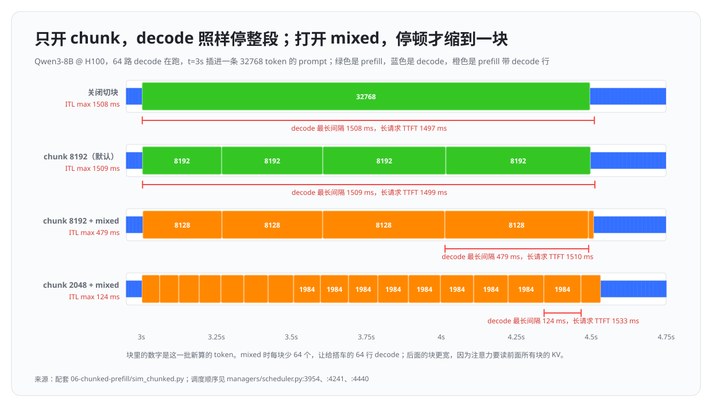
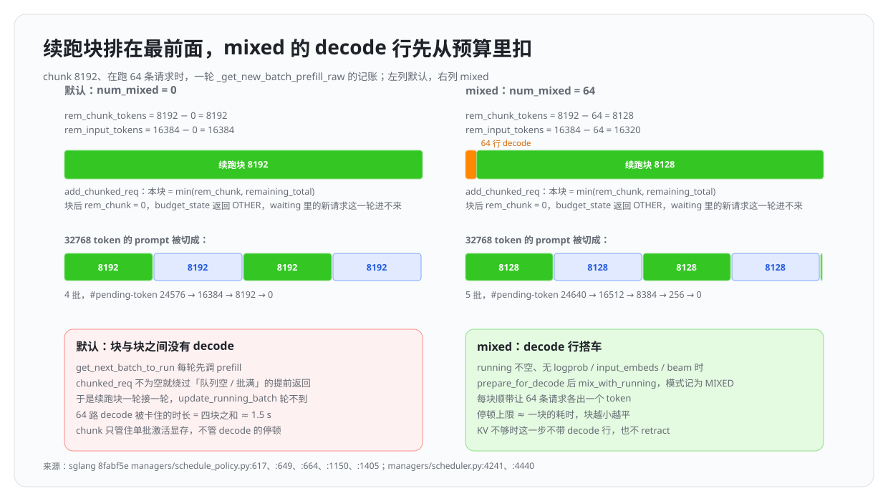
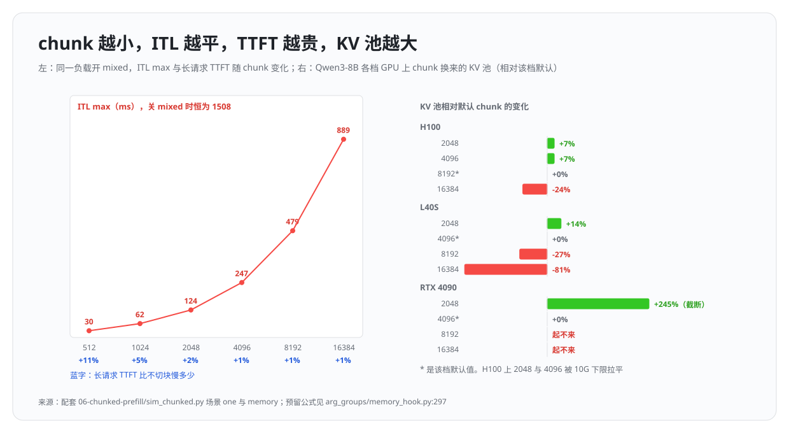
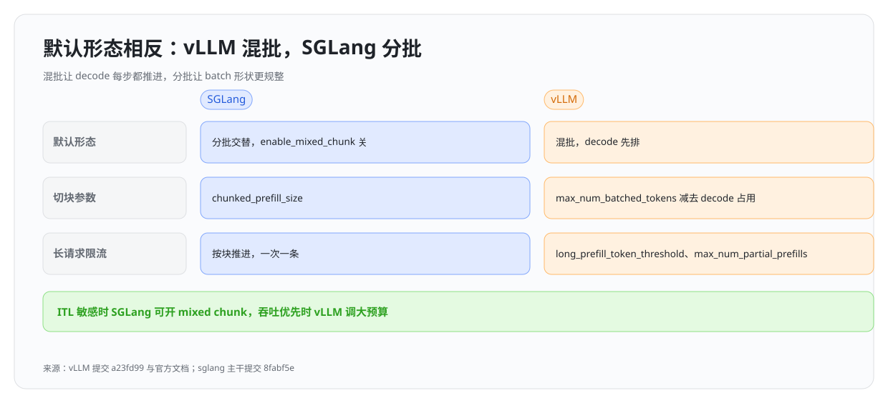

# SGL-06｜原理｜Chunked prefill：切块大小、mixed chunk 与 TTFT / ITL 的取舍

> 🎯 <p><b>遇到的问题</b>：64 条请求正在流式输出，每 12 ms 吐一个 token。这时进来一条 32k token 的 prompt，H100 上整段 prefill 要 1.5 秒。[SGL-05｜原理｜调度器：waiting、running 与 KV 预算](./05-scheduler.md) 讲过调度器每轮先试 prefill，于是这 1.5 秒里 64 个用户的屏幕全部停住，然后一下子涌出来。</p><p>chunked prefill 想把这一拍切短，可只开切块，停顿并不会变短：续跑块排在所有事情前面，四块背靠背跑完，decode 照样等满 1.5 秒。把停顿压到一块时长的，是默认关闭的 --enable-mixed-chunk。这一篇拆开这条链路：块怎么切，为什么默认背靠背，mixed 怎么让 decode 搭车，块大小又怎么反过来决定 KV 池有多大。</p><p><b>主线</b>：切块只是手段，目的是让长 prompt 不再卡住正在输出的 decode；块多大、能不能和 decode 混批，决定停顿有多长。</p><p><b>读完这一篇</b>：能从 #new-token 和 #pending-token 认出一条请求被切成几块、是不是 mixed，估出 decode 的最长停顿和长请求多付的 TTFT。知道 ITL p99 为什么会骗人，能按 SLO 在三个开关之间做选择，并算出换块大小后 KV 池变多少。</p><p><b>代码</b>：<a href="../06-chunked-prefill">zero-to-sglang/06-chunked-prefill</a>。sim_chunked.py 只用标准库，复刻 PrefillAdder 的块预算、chunked_req 续跑、mixed 拼批、prefill-decode interval 和 memory_hook 的显存预留，单步耗时沿用 SGL-03 的 Roofline 模型。行号按主干 8fabf5e 核对。</p>

# 导读 · 结论先行

1. **只开切块，decode 照样停整段。**chunked_req 续跑排在所有新请求之前，而且绕过「队列空 / 批已满」的提前返回，所以块与块之间没有 decode。32k prompt 切 4 块还是 16 块，64 路 decode 的最长停顿都约 1.5 秒。切块默认只做两件事：限住单批激活显存，让别的短请求能挤进块的余量。
2. **开 mixed，停顿上限缩到一块。**is_mixed_chunk 为真时，在跑的每条请求作为长度 1 的 extend 行拼进 prefill 批，每块顺带让所有人出一个 token。代价是块预算先扣掉 decode 行数，长请求多切一块；块越小，权重被重读的次数越多，TTFT 越贵。
3. **最后一块最慢。**第 k 块的注意力要读前 k−1 块的 KV，8192 的四块依次约 264、336、407、479 ms。ITL max 由最后一块决定，prompt 越长越明显。
4. **p99 会骗人。**一条长 prompt 只制造几次停顿，落不进前 1%。mixed 8192 的 ITL p99 比 mixed 2048 好看得多，最长停顿却是它的 4 倍。判断块大小看 ITL max 和停顿占比。
5. **块大小决定 KV 池。**启动时激活预留按 1.5 × max(chunk, 2048) MB 算。H100 上从 8192 调到 16384，KV 少 24%。L40S 上调到 16384 少 81%。RTX 4090 用 8192 直接起不来。按显存分档的默认值就是这么来的。



上图四条时间线来自同一个负载：64 路 decode 在跑，t=3s 插进一条 32768 token 的 prompt。前两条几乎一样，切块并没有让 decode 早一点恢复。第三条每块都带一行蓝色之外的橙色，decode 在块之间按块的节奏前进。第四条块更小，停顿更短，长请求多花 36 ms。

**📎 与系列其他文档的分工**：调度循环、PrefillAdder 的 KV 准入和 chunked 续跑不被饿死的原因，见 [SGL-05｜原理｜调度器：waiting、running 与 KV 预算](./05-scheduler.md)。切出来的块写进哪些 KV 槽、req_to_token 怎么记，留给 [SGL-07｜原理｜内存池与页表：req_to_token、token_to_kv 与 page size](./07-memory-pool.md)。续跑块怎么借 radix 树接上前一块的 KV，留给 [SGL-08｜原理｜RadixAttention：基数树的匹配、插入、加锁与驱逐](./08-radix-attention.md)。overlap 调度下 mixed 的时序、prefill CUDA Graph 怎么按块大小抓，留给 [SGL-09｜原理｜Overlap 调度与 CUDA Graph：把 CPU 开销藏到 GPU 后面](./09-overlap-cudagraph.md)。把 prefill 整个搬到另一组机器上，留给 [SGL-15｜原理｜PD 分离：prefill 和 decode 拆到两组卡上](./15-pd-disagg.md)。这些开关在一份完整的调参顺序里排第几，留给 [SGL-17｜实战｜参数调优手册：从日志倒推配置](./17-tuning.md)。

# 第 1 章 · 问题：长 prompt 一来，所有人的流都卡一下

我们在线上碰到长上下文负载时，遇到的问题都和 prefill 的那一拍有关：

- RAG 或代码补全场景，偶尔来一条 30k 的请求，监控上 ITL max 跳到一两秒，用户反馈「打字打一半停住」，可 ITL p99 看起来还正常。
- 把 --chunked-prefill-size 从 8192 调到 2048，以为停顿会变成四分之一，压测结果几乎没变。
- 打开 --enable-mixed-chunk 之后 ITL 尖刺没了，TPOT 均值却涨了，长请求的 TTFT 也慢了一点，不确定该不该留着。
- 同一个模型换到 L40S 上，照搬 H100 的 --chunked-prefill-size 16384，启动日志里的 max_total_num_tokens 少了一大截，甚至直接 OOM。
- 日志里同一条请求连着出现好几行 Prefill batch，#new-token 是 8128 不是 8192，#pending-token 每次只减 8128，不知道这是什么状态。

这些问题的答案分在三处：scheduler.py 决定块与块之间能不能插 decode，schedule_policy.py 决定每块切多大，memory_hook.py 决定块大小在启动时吃掉多少显存。下面按「为什么 prefill 会卡 decode、论文给的解法、SGLang 的实现、mixed、interval、显存」的顺序拆。

| 想弄清的现象 | 看哪一节 |
|-|-|
| 一次 prefill 为什么能让所有流停住，停多久 | 2.1 |
| Sarathi 和 DeepSpeed-FastGen 怎么解，块该取多大 | 2.2 |
| 只开切块为什么不减停顿，#new-token 为什么不是整数块 | 2.3 |
| mixed 什么时候生效、什么时候悄悄不生效 | 2.4 |
| 不开 mixed 时还有什么办法压停顿 | 2.5 |
| 块大小怎么改变 KV 池和分档默认值 | 2.6 |
| mini-sglang 和课程里的简化版差在哪 | 2.7 |

# 第 2 章 · 原理：一拍有多长，谁来分这一拍

## 2.1 一次 prefill 能卡住所有 decode

迭代级调度让新请求不用等整批结束就能加入[[1]](https://www.usenix.org/conference/osdi22/presentation/yu)，可它没有回答另一个问题：新请求加入的那一步跑多久。prefill 一步处理整段 prompt，算力受限，耗时和 token 数近似线性；decode 一步每条请求只算一个 token，访存受限，耗时主要由权重和 KV 的读取量决定。两者差了一到两个数量级。Sarathi-Serve 在 Falcon-180B 上量过，一次 4k token 的 prefill 约 1150 ms，同一时刻的 decode 一步约 200 ms，正在生成的请求要硬等这一整拍，他们把这种现象叫 generation stall[[2]](https://arxiv.org/abs/2403.02310)。

放到 SGLang 里看更具体。[SGL-05｜原理｜调度器：waiting、running 与 KV 预算](./05-scheduler.md) 讲过 get_next_batch_to_run 的顺序：能凑出 prefill 批就跑 prefill，凑不出来才 decode。默认 prefill 和 decode 分属不同的批，跑 prefill 的那一步，running 里的所有请求都停一拍。本篇的模拟负载里，Qwen3-8B 在 H100 上 64 路 decode 一步 11.9 ms，32768 token 整段 prefill 1494 ms，相当于让 64 个用户同时卡住 125 个 token 的时间。

停顿的代价落在两类人身上。正在流式输出的用户看到的是 ITL 尖刺；长请求后面排队的短请求，TTFT 被这 1.5 秒推后。流式输出的用户通常更难受，因为已经开始读了。

## 2.2 论文给的解法：切块，再让 decode 搭车

Sarathi 最早把这两件事放在一起做：把 prefill 切成大小相同的块，每一步只算一块，同时把在跑请求的 decode 塞进同一个批，作者叫它 piggyback。decode 单独跑时是访存受限的，搭在一块 prefill 上几乎不增加时间，因为权重已经为这一块读过一遍了。论文报告 LLaMA-13B 在 A6000 上 decode 吞吐最多提升 10 倍、端到端 1.33 倍。LLaMA-33B 在 A100 上端到端 1.25 倍、decode 4.25 倍。用在流水线并行上，气泡减少 6.29 倍[[3]](https://arxiv.org/abs/2308.16369)。

Sarathi-Serve 把它做成在线服务的调度器，核心是 stall-free batching：每一步先装满所有 decode，剩下的 token 预算再分给 prefill 块，decode 永远不被 prefill 挡住。在给定 P99 TBT SLO 下，它比 vLLM 多承载 Mistral-7B 2.6 倍、Yi-34B 3.7 倍、Falcon-180B 5.6 倍的负载[[2]](https://arxiv.org/abs/2403.02310)。

论文里有三处对选块大小直接有用：

- **块大小就是 TBT 的上限。**他们按 SLO 选预算：P99 TBT 0.5 秒的宽松档用 2048，0.1 秒的严格档用 512。块越小，每块重读一遍权重的开销越显眼，512 时最多约 25% 的额外 prefill 时间，2048 时可以忽略。
- **块大小要对齐 tile。**GEMM 按 tile 切矩阵，块长 257 比 256 最多慢 32%，多出来的一个 token 让最后一列 tile 几乎空跑。SGLang 要求 chunk 能被 page_size 整除，实践中再取 2 的幂，基本躲开这个坑。
- **两样都要。**Yi-34B、预算 1024 的消融里，openchat 负载只做 hybrid batch 的 TTFT / TBT 是 0.53 / 0.68 秒，只做切块是 1.04 / 0.17 秒，两者都开是 0.76 / 0.14 秒；arxiv 摘要负载对应是 3.78 / 1.38、5.38 / 0.20、3.90 / 0.17 秒。只切不搭车，TTFT 变差，TBT 收益也打折扣。

DeepSpeed-FastGen 的 Dynamic SplitFuse 是同一个思路的另一种写法：每一步固定一个前向 token 数，长 prompt 拆开分到多步，短 prompt 和其他请求的 decode 凑满这个数。论文报告相对 vLLM 有效吞吐高 2.3 倍，平均延迟低一半，token 级尾延迟低 3.7 倍[[4]](https://arxiv.org/abs/2401.08671)。两篇的共同结论是：降 ITL 靠的是固定每步的 token 预算，让每一步的耗时可预测，切块只是实现手段。

## 2.3 SGLang 的实现：续跑块优先，默认背靠背

切块的开关是 chunked_prefill_size（[schedule.py:52](https://github.com/sgl-project/sglang/blob/8fabf5e/python/sglang/srt/arg_groups/fields/schedule.py#L52)）。不设时按显存分档自动取（2.6 节），设成 -1 关掉；调度器初始化时把小于等于 0 的值统一换成 None（[scheduler.py:1375](https://github.com/sgl-project/sglang/blob/8fabf5e/python/sglang/srt/managers/scheduler.py#L1375)）。每一轮凑 prefill 批时，[\_get_new_batch_prefill_raw](https://github.com/sgl-project/sglang/blob/8fabf5e/python/sglang/srt/managers/scheduler.py#L4139) 先构造 [PrefillAdder](https://github.com/sgl-project/sglang/blob/8fabf5e/python/sglang/srt/managers/schedule_policy.py#L617)，块预算就是它的 rem_chunk_tokens，初值等于 chunked_prefill_size。

关键在接下来几行（[scheduler.py:4241](https://github.com/sgl-project/sglang/blob/8fabf5e/python/sglang/srt/managers/scheduler.py#L4241)）：

```python
if self.chunked_req is not None:
    self.chunked_req.init_next_round_input()
    adder.chunked_req_limit = self.policy.shortest_prefill_chunk_limit(...)
    self.chunked_req = adder.add_chunked_req(self.chunked_req)
# 之后才轮到 waiting 队列里的新请求
```

上一轮被截断的请求（chunked_req）在 waiting 循环之前就被装进本批。[add_chunked_req](https://github.com/sgl-project/sglang/blob/8fabf5e/python/sglang/srt/managers/schedule_policy.py#L1150) 取 available_chunk_tokens 和剩余长度的较小值作为本块，截断的块不预留输出 token，因为中间块不采样。装完之后 rem_chunk_tokens 归零，budget_state 返回 OTHER，waiting 里的新请求这一轮进不来。另外，函数开头那道「running 已满或 waiting 为空就返回」的早退，条件里带着 chunked_req is None（[scheduler.py:4158](https://github.com/sgl-project/sglang/blob/8fabf5e/python/sglang/srt/managers/scheduler.py#L4158)），续跑块不受它影响。

两件事叠在一起，结论就清楚了：只要还有 chunked_req，每一轮都能凑出一个 prefill 批，get_next_batch_to_run 永远走不到 decode 分支。32k prompt 切成 4 块，就是连续 4 轮 prefill，decode 等的是四块之和，和不切块几乎一样。模拟器里 chunk 从 512 到 16384，ITL max 都在 1508 到 1527 ms 之间。

新请求第一次进来时走 [add_one_req](https://github.com/sgl-project/sglang/blob/8fabf5e/python/sglang/srt/managers/schedule_policy.py#L1405)，准入判断在 [\_select_prefill_admission](https://github.com/sgl-project/sglang/blob/8fabf5e/python/sglang/srt/managers/schedule_policy.py#L1602)：输入超过本块剩余预算时，按页对齐截断成新的 chunked_req，输出预留记 0。关掉切块时规则不同：本批第一条请求即使超过 max_prefill_tokens 也照收，第二条以后输入大于等于 rem_input_tokens 就返回 OTHER。所以关切块的服务对超长请求依然能跑，只是一次吃下整段的激活显存。

中间块不出 token。[batch_result_processor.py:427](https://github.com/sgl-project/sglang/blob/8fabf5e/python/sglang/srt/managers/scheduler_components/batch_result_processor.py#L427) 对还没算完的 chunked 请求只减 inflight_middle_chunks，不采样，也不往客户端推流，长请求的 TTFT 从最后一块结束算起。日志里同一条请求会连着打出多行 Prefill batch，[metrics_reporter.py:754](https://github.com/sgl-project/sglang/blob/8fabf5e/python/sglang/srt/managers/scheduler_components/metrics_reporter.py#L754) 的 #pending-token 由 [load_inquirer.py:62](https://github.com/sgl-project/sglang/blob/8fabf5e/python/sglang/srt/managers/scheduler_components/load_inquirer.py#L62) 算，等于 waiting 的总长加 chunked_req 的剩余部分，所以 32768 切 8192 时依次是 24576、16384、8192、0。



上图是同一轮里块预算怎么分。左列默认，8192 全给续跑块；右列 mixed，64 行 decode 先从预算里扣掉，续跑块只剩 8128，32768 因此切成 4 × 8128 + 256 共 5 块。

既然默认背靠背，切块有什么用？两件事。其一，限住单批激活显存：一次前向最多 chunked_prefill_size 个新 token，中间激活和 logits 的峰值跟着被限住，这也是启动时能少预留显存的前提。其二，给短请求留门：续跑块装不满预算时（最后一块往往只剩一点），waiting 里的短请求可以在同一批里一起进来，不用等长请求整段算完。实验 4.4 的泊松负载里，2048 比不切块的短请求 TTFT p99 低了 236 ms，靠的就是这条。

## 2.4 mixed chunk：让 decode 行搭在每一块上

--enable-mixed-chunk 默认关。打开后 is_mixed_chunk = 切块开启且该开关为真（[scheduler.py:1379](https://github.com/sgl-project/sglang/blob/8fabf5e/python/sglang/srt/managers/scheduler.py#L1379)）。它在两个地方起作用。

第一处是预算。构造 PrefillAdder 时，第 4230 行把 running 的条数作为 num_mixed_decode_tokens 传进去（不开 mixed 时传 0），PrefillAdder 里 rem_input_tokens 减掉它（[schedule_policy.py:649](https://github.com/sgl-project/sglang/blob/8fabf5e/python/sglang/srt/managers/schedule_policy.py#L649)），rem_chunk_tokens 也减掉它（[schedule_policy.py:664](https://github.com/sgl-project/sglang/blob/8fabf5e/python/sglang/srt/managers/schedule_policy.py#L664)），KV 预算 PrefillBudget 同样先扣（[prefill_budget.py:60](https://github.com/sgl-project/sglang/blob/8fabf5e/python/sglang/srt/mem_cache/prefill_budget.py#L60)）。

每条 decode 行占一个 token，所以 64 路 decode 时块从 8192 变成 8128，running 有 500 条时块只剩 7692。

第二处是拼批（[scheduler.py:4440](https://github.com/sgl-project/sglang/blob/8fabf5e/python/sglang/srt/managers/scheduler.py#L4440)）。prefill 批凑好之后，满足这些条件才拼：

- running 不为空；
- 新批和 running 都没有请求 return_logprob；
- 新批没有 input_embeds，mix_with_running 只拼 input_ids，拼 embeds 会形状不匹配；
- running 里没有 beam search 的成员行。

条件都满足时，先剔掉本步结果还在路上、马上要结束的请求，再调 check_decode_mem 看 KV 够不够给每行多写一个 token。够，就 prepare_for_decode，然后 [mix_with_running](https://github.com/sgl-project/sglang/blob/8fabf5e/python/sglang/srt/managers/schedule_batch.py#L3274) 把每条 decode 行变成 extend 长度为 1、前缀为当前长度减一的 extend 行，forward_mode 记为 MIXED，running 换成空批。不够，这一步就不带 decode 行，源码注释写得很清楚：decode 行坐着等下一个 decode 步，mixed 步不 retract 它们。

这几个条件决定了 mixed 会在什么情况下悄悄失效。线上只要有一部分请求带 logprobs（评测、RL 打分、部分 OpenAI 兼容客户端默认开），这些请求在 running 里时就不拼；多模态模型走 input_embeds 的路径也不拼。日志里 Prefill batch 行看不到 decode 行数时，先查这几条。

效果和代价都很直接。停顿上限从四块之和变成一块：mixed 8192 的 ITL max 是 479 ms，2048 是 124 ms，512 是 30 ms，和块大小基本成正比。每一块多算了 64 个 decode token，块数多一块，长请求 TTFT 慢 1% 到 11%，块越小越贵，因为每块都要把权重从 HBM 再读一遍。decode 步数也少了：decode 行搭在 prefill 上走掉了一部分步数，在跑请求的 TPOT 均值会上升，因为它们那几步花的是一块 prefill 的时间。

官方 cookbook 的几组压测和这个结论一致。MiniMax-M3 在 8×H200 上开 mixed 加 chunk 2048，吞吐约高 10%，中位 TPOT 约低 10%，同时写明延迟敏感的低并发服务别开。Qwen3-4B / 8B 在 H200 上 mixed 能压低中位 TTFT，但 TPOT 和端到端尾延迟会变高。

PaddleOCR-VL 在 H200 上把 chunk 从 8192 提到 16384，加 mixed 和 --num-continuous-decode-steps 2，请求吞吐高 11%，排队 TTFT 低 23%[[5]](https://docs.sglang.io/cookbook/intro)。可见 mixed 的收益取决于并发和输出长度，不同模型的推荐配置差别很大。

## 2.5 prefill-decode interval：不开 mixed 时的替代

不想让 prefill 和 decode 拼进一个批（比如有 logprob 请求，或者 attention 后端对 MIXED 支持不好），可以用 --prefill-decode-interval N（[schedule.py:56](https://github.com/sgl-project/sglang/blob/8fabf5e/python/sglang/srt/arg_groups/fields/schedule.py#L56)）。每跑一个 extend 批（含 MIXED），[\_arm_prefill_decode_interval](https://github.com/sgl-project/sglang/blob/8fabf5e/python/sglang/srt/managers/scheduler.py#L1416) 重新上膛，接下来 N 轮 [\_should_defer_prefill](https://github.com/sgl-project/sglang/blob/8fabf5e/python/sglang/srt/managers/scheduler.py#L1403) 返回真，调度器不收 prefill，只跑 decode。running 少于 --prefill-decode-interval-min-bs 时立刻清零，让小批先长起来。

效果是把 N 步 decode 硬插在两块之间，停顿上限同样降到一块的时间。代价落在长请求身上：每块之后都要等 N 步 decode，块越多等得越久。chunk 2048、N=32 时，32k 请求的 TTFT 从 1.5 秒拉到 13 秒。min_bs 设得比实际并发高，这个开关就等于没开，这是最常见的配置失误。

## 2.6 块大小决定启动时的显存预留

块大小还有一个容易被忽略的作用：它决定启动时给激活留多少显存。[memory_hook.py:297](https://github.com/sgl-project/sglang/blob/8fabf5e/python/sglang/srt/arg_groups/memory_hook.py#L297) 的公式是：

```python
activation_tokens = max(chunked_prefill_size, 2048)    # 关切块时用 max(max_prefill_tokens, 2048)
reserved_mb  = 512 + 1.5 * activation_tokens
reserved_mb += tp_size * pp_size / 8 * 1024
reserved_mb += reserve_for_graph_mb(server_args)      # prefill / decode CUDA Graph
if gpu_mem > 60 * 1024:
    reserved_mb = max(reserved_mb, 10 * 1024)         # 80G 以上的卡至少留 10G
mem_fraction_static = (gpu_mem - reserved_mb) / gpu_mem
```

权重和预留之外剩下的才是 KV 池。块翻倍，激活预留多 1.5 × chunk MB，prefill CUDA Graph 的最大档位默认也等于块大小（[memory_hook.py:236](https://github.com/sgl-project/sglang/blob/8fabf5e/python/sglang/srt/arg_groups/memory_hook.py#L236)），一起把 KV 池往下压。显存越小的卡，这部分占比越高，所以 [memory_hook.py:90](https://github.com/sgl-project/sglang/blob/8fabf5e/python/sglang/srt/arg_groups/memory_hook.py#L90) 起按显存分档给默认值：小于 20G 用 2048，20G 到 60G 用 4096，60G 到 160G 用 8192，再往上 16384。



左图是同一负载开 mixed 时 ITL max 和长请求 TTFT 随块大小的变化，两条曲线方向相反，中间没有免费的点。右图是 Qwen3-8B 在三档 GPU 上换块大小换来的 KV 池。H100 上 2048 和 4096 一样多，因为预留被 10G 下限拉平了，往小调块没有显存收益；16384 少 24%。L40S 上 16384 少 81%。RTX 4090 上 8192 时权重加预留已经超过显存，服务起不来。

这也解释了官方调参文档为什么把「prefill 阶段 OOM 就把 --chunked-prefill-size 降到 4096 或 2048」列为第一条手段：它同时降低单批激活峰值和启动预留[[6]](https://docs.sglang.io/docs/advanced_features/hyperparameter_tuning)。启动日志里那一行 max_total_num_tokens 和 chunked_prefill_size 是一起打印的，调块大小之后先看它变了多少。

几条校验也和块大小有关：chunk 必须能被 page_size 整除（[validation_hook.py:243](https://github.com/sgl-project/sglang/blob/8fabf5e/python/sglang/srt/arg_groups/validation_hook.py#L243)）。开 DP attention 时块大小会除以 attn_dp_size（[parallel_hook.py:331](https://github.com/sgl-project/sglang/blob/8fabf5e/python/sglang/srt/arg_groups/parallel_hook.py#L331)）。部分 attention 后端和打分模式会强制关掉切块（[attention_hook.py:564](https://github.com/sgl-project/sglang/blob/8fabf5e/python/sglang/srt/arg_groups/attention_hook.py#L564)）。prefill-only 且不留 KV 的嵌入路径要求切块关闭，因为块与块之间必须复用 KV（[kv_cache_hook.py:900](https://github.com/sgl-project/sglang/blob/8fabf5e/python/sglang/srt/arg_groups/kv_cache_hook.py#L900)）。

## 2.7 对照：mini-sglang 和课程里的简化版

mini-sglang 的切块只有十几行[[7]](https://github.com/sgl-project/mini-sglang)。[prefill.py](https://github.com/sgl-project/mini-sglang/blob/main/python/minisgl/scheduler/prefill.py) 里的 PrefillAdder 拿一个 token_budget，每条请求取 chunk_size = min(token_budget, remain_len)，没算完的包成 ChunkedReq，它的 can_decode 返回假，不会进 decode 队列；本轮结束时把 chunked 请求放回 pending_list 的最前面。它没有 mixed，调度器同样是 prefill 优先、凑不出来才 decode，所以和 SGLang 默认模式一样，块与块背靠背。

zero-to-sglang 课程第 6 章用一个 2500 token、预算 1024 的例子演示切块：1024、1024、452 三块[[8]](https://github.com/datawhalechina/zero-to-sglang)。把它和本篇的模拟对照，可以看到主干多出来的几样东西：mixed 时预算先扣 decode 行，所以实际块是 1024 减去在跑请求数。块边界按页对齐。截断块不预留输出。shortest-prefill-first 策略下还会用 chunked_req_limit 把续跑块再收窄，给更短的 waiting 请求留位置。读主干时，先在 mini 版里看清「预算、截断、放回队首」三步，再去找这几处差异。

## 2.8 vLLM 怎么做

vLLM v1 默认开启 chunked prefill，而且 prefill 和 decode 默认混在同一批里：每步先给所有 decode 请求各分 1 个 token，剩下的预算切给 prefill[[9]](https://github.com/vllm-project/vllm/blob/a23fd9903418de0e1d3757bb23e2f1697eb066f3/vllm/config/scheduler.py)。long_prefill_token_threshold 默认 0，表示不限制单个长请求一步能吃多少预算；想让多条长请求同时推进，可以调大 max_num_partial_prefills。官方调优文档的建议是：追求吞吐把 max_num_batched_tokens 设到 8192 以上，追求 ITL 就调小[[10]](https://docs.vllm.ai/en/latest/configuration/optimization.html)。

SGLang 默认把 prefill 和 decode 分成两种 batch 交替跑，enable_mixed_chunk 默认关闭；chunked_prefill_size 是固定的切块大小。两种默认各有侧重。混批让 decode 每步都有进展，ITL 更平稳，但 prefill 块越大 decode 步越慢。分批让每种 batch 形状更规整，CUDA Graph 和 kernel 更好调，代价是长 prefill 期间 decode 会被插队。

| 维度 | SGLang | vLLM | 差异的代价 |
|-|-|-|-|
| 默认形态 | 分批交替，enable_mixed_chunk 关 | 混批，decode 先排 | SGLang 默认 ITL 抖动更大，vLLM 默认 decode 步更重 |
| 切块参数 | chunked_prefill_size | max_num_batched_tokens 减去 decode 占用 | vLLM 的块大小随 decode 数浮动 |
| 长请求限流 | 按块推进，一次一条 | long_prefill_token_threshold、max_num_partial_prefills | vLLM 可同时推进多条长请求 |



# 第 3 章 · 源码走读：一条长 prompt 被切开的 16 个落脚点

按一条 32k 请求从启动配置到最后一块出 token 的顺序排列。

| # | 位置 | 发生了什么 |
|-|-|-|
| 1 | [schedule.py:52 chunked_prefill_size](https://github.com/sgl-project/sglang/blob/8fabf5e/python/sglang/srt/arg_groups/fields/schedule.py#L52) | None 表示按显存分档自动取，-1 关闭 |
| 2 | [memory_hook.py:90 handle_gpu_memory_settings](https://github.com/sgl-project/sglang/blob/8fabf5e/python/sglang/srt/arg_groups/memory_hook.py#L90) | 按显存分档给默认块大小：2048 / 4096 / 8192 / 16384 |
| 3 | [memory_hook.py:297](https://github.com/sgl-project/sglang/blob/8fabf5e/python/sglang/srt/arg_groups/memory_hook.py#L297) | 激活预留 512 + 1.5 × max(chunk, 2048) MB，加 TP / PP 修正和 Graph 预留，80G 以上至少 10G |
| 4 | [validation_hook.py:243](https://github.com/sgl-project/sglang/blob/8fabf5e/python/sglang/srt/arg_groups/validation_hook.py#L243) | chunk 必须能被 page_size 整除 |
| 5 | [scheduler.py:1375](https://github.com/sgl-project/sglang/blob/8fabf5e/python/sglang/srt/managers/scheduler.py#L1375) | 小于等于 0 的块大小换成 None；第 1379 行算 is_mixed_chunk |
| 6 | [scheduler.py:3954 get_next_batch_to_run](https://github.com/sgl-project/sglang/blob/8fabf5e/python/sglang/srt/managers/scheduler.py#L3954) | 先试 prefill，凑不出来才 decode；第 1403 行 interval 判断要不要跳过 prefill |
| 7 | [scheduler.py:4158](https://github.com/sgl-project/sglang/blob/8fabf5e/python/sglang/srt/managers/scheduler.py#L4158) | 早退条件带 chunked_req is None，续跑块绕过「批满 / 队列空」 |
| 8 | [scheduler.py:4230](https://github.com/sgl-project/sglang/blob/8fabf5e/python/sglang/srt/managers/scheduler.py#L4230) | mixed 时把 running 条数作为 num_mixed_decode_tokens 传给 PrefillAdder |
| 9 | [schedule_policy.py:649 / :664](https://github.com/sgl-project/sglang/blob/8fabf5e/python/sglang/srt/managers/schedule_policy.py#L649) | rem_input 和 rem_chunk 都先扣掉 decode 行数 |
| 10 | [scheduler.py:4241](https://github.com/sgl-project/sglang/blob/8fabf5e/python/sglang/srt/managers/scheduler.py#L4241) | chunked_req 先于 waiting 循环续跑 |
| 11 | [schedule_policy.py:1150 add_chunked_req](https://github.com/sgl-project/sglang/blob/8fabf5e/python/sglang/srt/managers/schedule_policy.py#L1150) | 本块 = min(可用块预算, 剩余长度)，按页对齐，截断时不预留输出 |
| 12 | [schedule_policy.py:1602 \_select_prefill_admission](https://github.com/sgl-project/sglang/blob/8fabf5e/python/sglang/srt/managers/schedule_policy.py#L1602) | 新请求超出块预算时截断成新的 chunked_req；关切块时第二条以后的超长请求返回 OTHER |
| 13 | [scheduler.py:4440](https://github.com/sgl-project/sglang/blob/8fabf5e/python/sglang/srt/managers/scheduler.py#L4440) | mixed 条件：running 非空、无 logprob、无 input_embeds、无 beam；KV 不够就不带 decode 行 |
| 14 | [schedule_batch.py:3274 mix_with_running](https://github.com/sgl-project/sglang/blob/8fabf5e/python/sglang/srt/managers/schedule_batch.py#L3274) | decode 行变成长度 1 的 extend 行，forward_mode 记为 MIXED |
| 15 | [batch_result_processor.py:427](https://github.com/sgl-project/sglang/blob/8fabf5e/python/sglang/srt/managers/scheduler_components/batch_result_processor.py#L427) | 中间块不采样、不推流，只减 inflight_middle_chunks |
| 16 | [metrics_reporter.py:754](https://github.com/sgl-project/sglang/blob/8fabf5e/python/sglang/srt/managers/scheduler_components/metrics_reporter.py#L754) | Prefill batch 日志；#pending-token 含 chunked_req 剩余部分（load_inquirer.py:62） |

# 第 4 章 · 实验：在 CPU 上看块怎么切、停顿怎么变

所有实验用同一个模型和卡：Qwen3-8B、H100 SXM、单卡。时间来自 Roofline 下限加利用率模型，只用来排序和对比，不代表真实性能。

## 4.1 64 路 decode 中途插进一条 32k prompt

```bash
cd zero-to-sglang/06-chunked-prefill
python3 sim_chunked.py
```

```text
# 64 条短请求（输入 1024、输出 512）t=0 进来，t=3s 来一条 32768 token 的长 prompt（输出 64）
    模式  chunk    长请求块数   长TTFT ms  短TTFT p99  ITL p50  ITL p99  ITL max    停顿占比 prefill步  decode步
    默认    off        1       1497       1861     12.4     13.6   1507.6   22.9%        6      511
    默认   2048       16       1499       1870     12.4     13.6   1512.1   22.9%       48      511
    默认   8192        4       1499       1862     12.4     13.6   1508.5   22.9%       12      511
    默认  16384        2       1497       1861     12.4     13.6   1507.9   22.9%        6      511
 mixed   2048       17       1533       1881     12.4    110.7    123.5   24.4%       50      494
 mixed   4096        9       1516       1871     12.4    176.1    246.6   23.0%       26      502
 mixed   8192        5       1510       1866     12.4     18.3    479.1   22.9%       14      506
 mixed  16384        3       1505       1865     12.4     13.6    889.5   22.8%        8      508
# 参考：64 路 decode 一步 11.9 ms；32768 token 整段 prefill 1494 ms
```

默认模式下四行的 ITL max 几乎一样，长请求块数从 1 变到 16，decode 步数始终是 511，说明 decode 一步也没插进块之间。mixed 的 ITL max 跟着块大小走，decode 步数少了 3 到 17 步，那些 token 搭在 prefill 块上出去了。

再看 ITL p99：mixed 8192 只有 18.3 ms，16384 是 13.6 ms，比 2048 的 110.7 ms 还低，可它们的最长停顿分别是 2048 的 4 倍和 7 倍。原因是这个负载里停顿只发生几次，2048 切了 17 块，停顿次数多到挤进了前 1%，大块只停四五次，全落在 p99 之外。

## 4.2 再小一点的块

```bash
python3 sim_chunked.py --chunks 512 1024
```

```text
    默认    512       64       1519       1880     12.4     13.6   1526.5   23.0%      192      511
    默认   1024       32       1513       1861     12.4     13.6   1516.9   22.9%       96      511
 mixed    512       74       1665       2014     12.5     29.8     30.4    0.0%      211      437
 mixed   1024       35       1574       1925     12.4     59.4     62.4   21.9%      102      476
```

mixed 512 把最长停顿压到 30 ms，已经接近 decode 一步的 2.5 倍，停顿占比为 0；代价是长请求 TTFT 从 1497 涨到 1665 ms，多了 11%，块数从 1 变成 74，每块都重读一遍 16 GB 的权重。这和 Sarathi-Serve 说的「512 时额外开销最多约 25%」量级一致。

## 4.3 不开 mixed，用 interval 插 decode

```bash
python3 sim_chunked.py --scenario interval
```

```text
 chunk    N min_bs   长TTFT ms  ITL p99  ITL max    停顿占比    被推迟轮数
  2048    0      0       1499     13.6   1512.1   22.9%        0
  2048    2      0       1845    120.9    141.2   24.9%       96
  2048    8      0       4086    121.4    141.7   30.7%      384
  2048   32      0      13153     67.7    130.2   20.0%     1536
  2048    8     80       1499     13.6   1512.1   22.9%        0
  8192    2      0       1569     13.6    496.3   23.3%       24
  8192   32      0       3851    244.1    496.8   27.9%      384
# min_bs=80 大于在跑的 64 条，interval 每次都被清零，等于没开
```

N=2 已经把 ITL max 压到一块的时间，再加大 N 对停顿几乎没有帮助，只是把长请求 TTFT 越拉越长。实际用时 N 取 1 到 4 就够了。min_bs 那一行是故意设错的，生产配置里最容易踩。

## 4.4 泊松负载：分位数怎么变

```bash
python3 sim_chunked.py --scenario poisson    # 8 req/s 短请求，每 6 s 一条 32k，跑 60 s
```

```text
    模式  chunk  短TTFT p50  短TTFT p99   长TTFT ms  ITL p50  ITL p99  ITL max    停顿占比 out tok/s
    默认    off         39       1739       1501     10.9     71.0   2088.7   46.6%      1897
    默认   2048         39       1503       1506     10.9     71.2   2095.0   47.1%      1897
    默认   8192         39       1672       1502     10.9     71.0   2089.6   46.9%      1897
 mixed   2048         40       1517       1564     10.5    104.1    126.9   27.3%      1901
 mixed   8192         40       1672       1720     10.6    181.7    482.1   26.0%      1900
 mixed  16384         39       1742       1775     10.6     59.5    892.1   25.8%      1900
 mixed    512         50       1533       1564      9.6     30.1     32.2    4.4%      1905
```

默认模式下切块对 ITL 没用，对短请求 TTFT p99 有用：2048 比不切块低 236 ms，短请求能在续跑块的余量里提前进来。mixed 的停顿占比从 47% 降到 26%，吞吐基本不变。p99 再一次不单调：mixed 16384 的 ITL p99 是 59.5 ms，比 2048 还好看，最长停顿却是 892 ms。这和 SGL-03 里 16 req/s 时默认与 mixed 的对照方向一致（ITL p99 191 对 61 ms，max 418 对 119 ms）。

## 4.5 块大小换来的 KV 池

```bash
python3 sim_chunked.py --scenario memory
```

```text
      GPU  chunk   激活token  Graph MB    预留 MB   10G下限   frac  KV tokens      相对默认
  rtx4090  2048       2048       432     4144          0.831     30,442   +245.4%
  rtx4090  4096*      4096       496     7280          0.704      8,813     +0.0%
  rtx4090  8192       8192       560    13488          0.451          0   -100.0%
     l40s  4096*      4096       464     7248          0.843    161,395     +0.0%
     l40s 16384      16384       656    25872          0.438     30,488    -81.1%
 h100-sxm  2048       2048       848    10240      触发  0.874    391,995     +6.9%
 h100-sxm  8192*      8192       976    13904          0.830    366,669     +0.0%
 h100-sxm 16384      16384      1104    26320          0.677    278,601    -24.0%
 h100-sxm   off      16384       512    25728          0.685    283,206    -22.8%
# * 是该档 GPU 的默认 chunk；KV tokens 为 0 表示权重放不下或池子为负
```

关掉切块并不省显存：激活按 max_prefill_tokens 16384 算，H100 上的 KV 池比默认少 22.8%，只是省掉了 prefill Graph 那一份。RTX 4090 上 2048 比默认多出 245% 的 KV，因为 8B 模型的 bf16 权重已经占掉 16 GB，剩下的每一点预留都很贵；这类卡上跑长上下文，先把块调小。

## 4.6 对着日志认出切块和 mixed

```bash
python3 sim_chunked.py --scenario trace --chunked-prefill-size 8192
python3 sim_chunked.py --scenario trace --chunked-prefill-size 8192 --enable-mixed-chunk
```

```text
# 默认
[t=   3.004s] Prefill batch, #new-seq: 1, #new-token: 8192, #cached-token: 0, token usage: 0.22, #running-req: 64, #queue-req: 0, #pending-token: 24576, ...
[t=   3.269s] Prefill batch, #new-seq: 1, #new-token: 8192, ... #pending-token: 16384, ...
[t=   3.606s] Prefill batch, #new-seq: 1, #new-token: 8192, ... #pending-token: 8192, ...
[t=   4.016s] Prefill batch, #new-seq: 1, #new-token: 8192, ... #pending-token: 0, ...
# 短请求 #0 的 decode 间隔（ms）：11 11 11 11 11 1509 13 13

# mixed
[t=   3.006s] Prefill batch, #new-seq: 1, #new-token: 8128, ... #pending-token: 24640, ...  [MIXED +64 decode]
[t=   3.270s] Prefill batch, #new-seq: 1, #new-token: 8128, ... #pending-token: 16512, ...  [MIXED +64 decode]
[t=   3.605s] Prefill batch, #new-seq: 1, #new-token: 8128, ... #pending-token: 8384, ...   [MIXED +64 decode]
[t=   4.013s] Prefill batch, #new-seq: 1, #new-token: 8128, ... #pending-token: 256, ...    [MIXED +64 decode]
[t=   4.492s] Prefill batch, #new-seq: 1, #new-token: 256, ... #pending-token: 0, ...      [MIXED +64 decode]
# 短请求 #0 的 decode 间隔（ms）：11 11 11 11 11 264 336 407 479 18 13
```

线上日志没有末尾那个 MIXED 标记，认法是看两个数：连续几行 Prefill batch 的 #new-seq 都是 1 且 #pending-token 单调下降，说明在续跑同一条长请求；#new-token 等于 chunk 减去 #running-req，说明开了 mixed 且这一步真的拼上了。如果开了 mixed 而 #new-token 仍是整块，回到 2.4 节查 logprob 和 input_embeds。mixed 那组 decode 间隔逐块递增，就是「最后一块最慢」的直接证据。

> 💡 **实验记录**：六个实验各跑了一遍，又试了三个改动：trace 场景把 --chunked-prefill-size 降到 2048 并加 --enable-mixed-chunk，数了长请求被切成几块、decode 间隔最高涨到多少。interval 场景加 --prefill-decode-interval-min-bs 128，确认在并发 64 时 interval 被整体清零。memory 场景换 --model qwen3-0.6b --gpus rtx4090，看小模型在 4090 上 8192 档能不能起来。命令和期望输出见 [README.md](../06-chunked-prefill/README.md)，实现见 [sim_chunked.py](../06-chunked-prefill/sim_chunked.py)，文件头注释列了每个函数对应的源码行。

# 第 5 章 · 调过的参数和踩过的坑

## 5.1 动过的参数

| 参数 | 默认 | 管什么 | 什么时候动它 |
|-|-|-|-|
| --chunked-prefill-size | 按显存分档 | 单批新算 token 上限；同时决定激活预留和 prefill Graph 最大档位 | prefill OOM 或 KV 池偏小时调小；吞吐优先、显存富余时调大 |
| --enable-mixed-chunk | 关 | decode 行搭在 prefill 块上，停顿上限变成一块 | 长短混合、在乎 ITL 尖刺、并发较高时开；低并发延迟敏感或大量 logprob 请求时别开 |
| --prefill-decode-interval | 不开 | 每个 extend 批之后强制连跑 N 轮 decode | 不能开 mixed 又要压停顿时用，N 取 1 到 4 |
| --prefill-decode-interval-min-bs | 0 | running 少于它时 interval 不生效 | 设成明显低于常态并发的值，避免等于没开 |
| --max-prefill-tokens | 16384 | 单批 prefill 输入上限；mixed 时同样先扣 decode 行 | 一般不动；关掉切块时它决定激活预留 |
| --num-continuous-decode-steps | 1 | 连续 decode 步数，降低调度开销 | 8fabf5e 里只剩参数定义，没有调用点，配了也不生效 |
| --page-size | 1 | KV 页大小，块大小必须是它的整数倍 | 调大页时同步检查 chunk 是否整除 |

--num-continuous-decode-steps 这一行要特别说明：cookbook 里 PaddleOCR-VL 的配方用到了它，但在 8fabf5e 里全仓库只有参数定义和字段顺序表两处引用，调度器不读它。照抄老配方时，我们没把这个参数的收益算进去。

## 5.2 踩过的坑

> 💡 **踩过的坑**：我们以为调小 --chunked-prefill-size 就能降 ITL 尖刺。默认模式下续跑块背靠背，块再小 decode 也要等整段 prefill。不开 mixed 也不开 interval，块大小对 ITL max 几乎没有影响。

> 💡 **踩过的坑**：只看 ITL p99 选块大小。长 prompt 造成的停顿次数少，大块的 p99 反而更好看。后来改看 ITL max、停顿占比，或者直接统计「超过 SLO 的 token 间隔」个数。

> 💡 **踩过的坑**：开了 mixed 就以为一直生效。running 里只要有 return_logprob 的请求，或者新批带 input_embeds，或者有 beam 成员，这一步就不拼；KV 紧张时 decode 行也会被跳过。现在上线后都用日志里 #new-token 和 chunk 的差值确认。

> 💡 **踩过的坑**：跨卡照搬块大小。H100 的 16384 放到 L40S 上 KV 池少 81%，放到 24G 卡上可能起不来。现在换卡时删掉这个参数让它按档位取，或者按 2.6 节的公式重算。

> 💡 **踩过的坑**：我们为了省显存关掉切块。关切块时激活预留按 max_prefill_tokens 算，H100 上反而比默认少 22.8% 的 KV，而且超长请求一次吃下整段激活，峰值更高。

> 💡 **踩过的坑**：我们随手把块大小写成一个非 2 的幂的数。块必须能被 page_size 整除，否则启动校验失败；即便能整除，偏离 tile 边界也会让 GEMM 白跑一截。后来只取 2048、4096、8192 这类值。

## 5.3 我们的看法

chunked prefill 在 SGLang 里被拆成了两件事：切块管显存，mixed 管延迟。默认只开切块，是一个偏保守的选择。mixed 改变的是每一步的批形状，和 logprob、多模态 embeds、beam、投机解码、overlap 都有交互，默认关掉能少很多边界问题。代价是我们一开始也以为开了切块就有 Sarathi 的效果，其实没有。

我们的做法是按负载分三类。纯短请求的服务，块大小保持档位默认，mixed 不开，切块几乎不触发。长短混合、有流式 SLO 的服务，开 mixed，块大小从 SLO 反推：ITL max 预算除以「最后一块的耗时 / 块大小」，再对齐到 2 的幂，最后用 4.5 节的方法确认 KV 池没有缩太多。有 logprob 或多模态 embeds 的服务，mixed 会时灵时不灵，改用 interval，N 取 2，min_bs 设成常态并发的一半。

更长远看，长 prompt 对 decode 的干扰在单机调度里只能缓解。prefill 和 decode 抢的是同一块 GPU 的同一段时间，块切得再细，也只是把一次长停顿摊成多次短停顿，外加重读权重的开销。上下文继续变长、SLO 继续变严，PD 分离把两者拆到不同机器上是更彻底的路，留给 [SGL-15｜原理｜PD 分离：prefill 和 decode 拆到两组卡上](./15-pd-disagg.md)。

# 第 6 章 · 上线核对和下一步

> 📌 **上线前逐条核对**
> - 确认过默认模式下续跑块背靠背，切块本身不降 ITL max
> - 能从 Prefill batch 日志认出续跑（#new-seq 1、#pending-token 递减）和 mixed（#new-token = chunk − #running-req）
> - 开 mixed 前查过 logprob、input_embeds、beam 的使用情况，确认它在主要流量上真的生效
> - 块大小按 ITL max 预算反推，取 2 的幂，能被 page_size 整除
> - 换块大小后对比过启动日志里的 max_total_num_tokens，换卡时没有照搬块大小
> - 用了 interval 时，min_bs 低于常态并发，N 不超过 4
> - 压测报告里有 ITL max 和停顿占比，没有只看 ITL p99
> - 记录了 mixed 开关前后的 TPOT 均值和长请求 TTFT，确认代价在 SLO 之内

> 🔑 **学到的**：长 prompt 的 prefill 一步能让所有 decode 停住。SGLang 的 chunked_req 续跑排在所有新请求之前，还绕过批满和队列空的早退，所以只开切块时各块背靠背，decode 等的是整段 prefill；切块只限住单批激活显存，并让短请求挤进块的余量。打开 --enable-mixed-chunk 后，块预算先扣掉 decode 行，每块顺带让在跑请求各出一个 token，停顿上限变成一块的时间，最后一块最慢；有 logprob、input_embeds、beam 或 KV 不够时不拼。--prefill-decode-interval 是不开 mixed 时的替代，代价是长请求 TTFT。块越小 ITL 越平、TTFT 越贵；块越大启动预留越多、KV 池越小，这决定了按显存分档的默认值。判断块大小看 ITL max 和停顿占比，不看 p99。

下一步：[SGL-07｜原理｜内存池与页表：req_to_token、token_to_kv 与 page size](./07-memory-pool.md) 讲内存池与页表。本篇反复出现的「每块写进 KV 池、按页对齐、decode 行多写一个 token」，背后是 req_to_token 和 token_to_kv 两级池子，以及分页分配器怎么在块边界上不浪费槽位。

# 参考文献

按正文首次引用顺序编号，资料截至 2026 年 10 月底。源码以 sgl-project/sglang 主干提交 8fabf5e（2026 年 10 月 28 日）和 v0.5.22 发行版为准。

[1] Yu G-I, et al. Orca: A Distributed Serving System for Transformer-Based Generative Models. OSDI (2022) [https://www.usenix.org/conference/osdi22/presentation/yu](https://www.usenix.org/conference/osdi22/presentation/yu)

[2] Agrawal A, et al. Taming Throughput-Latency Tradeoff in LLM Inference with Sarathi-Serve. OSDI (2024) [https://arxiv.org/abs/2403.02310](https://arxiv.org/abs/2403.02310)

[3] Agrawal A, et al. SARATHI: Efficient LLM Inference by Piggybacking Decodes with Chunked Prefills. arXiv (2023) [https://arxiv.org/abs/2308.16369](https://arxiv.org/abs/2308.16369)

[4] Holmes C, et al. DeepSpeed-FastGen: High-throughput Text Generation for LLMs via MII and DeepSpeed-Inference. arXiv (2024) [https://arxiv.org/abs/2401.08671](https://arxiv.org/abs/2401.08671)

[5] SGLang Cookbook [https://docs.sglang.io/cookbook/intro](https://docs.sglang.io/cookbook/intro)

[6] SGLang 文档. Hyperparameter Tuning [https://docs.sglang.io/docs/advanced_features/hyperparameter_tuning](https://docs.sglang.io/docs/advanced_features/hyperparameter_tuning)

[7] sgl-project. Mini-SGLang. GitHub [https://github.com/sgl-project/mini-sglang](https://github.com/sgl-project/mini-sglang)

[8] datawhalechina. zero-to-sglang. GitHub [https://github.com/datawhalechina/zero-to-sglang](https://github.com/datawhalechina/zero-to-sglang)

[9] vllm-project/vllm. vllm/config/scheduler.py（a23fd99） [https://github.com/vllm-project/vllm/blob/a23fd9903418de0e1d3757bb23e2f1697eb066f3/vllm/config/scheduler.py](https://github.com/vllm-project/vllm/blob/a23fd9903418de0e1d3757bb23e2f1697eb066f3/vllm/config/scheduler.py)

[10] vLLM Docs. Optimization and Tuning [https://docs.vllm.ai/en/latest/configuration/optimization.html](https://docs.vllm.ai/en/latest/configuration/optimization.html)

---

[在 Colab 里跑本章 CPU 练习](https://colab.research.google.com/github/zyaochen/zero-to-sglang/blob/main/colab/06-chunked-prefill.ipynb) · 上一章：[SGL-05｜原理｜调度器：waiting、running 与 KV 预算](./05-scheduler.md) · [目录](./README.md) · 下一章：[SGL-07｜原理｜内存池与页表：req_to_token、token_to_kv 与 page size](./07-memory-pool.md)
