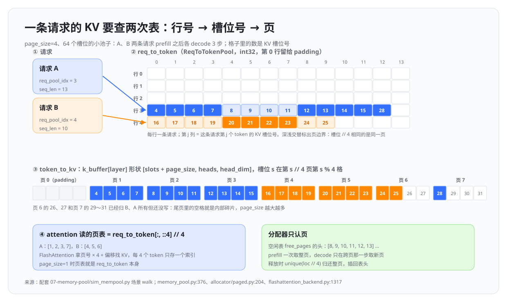
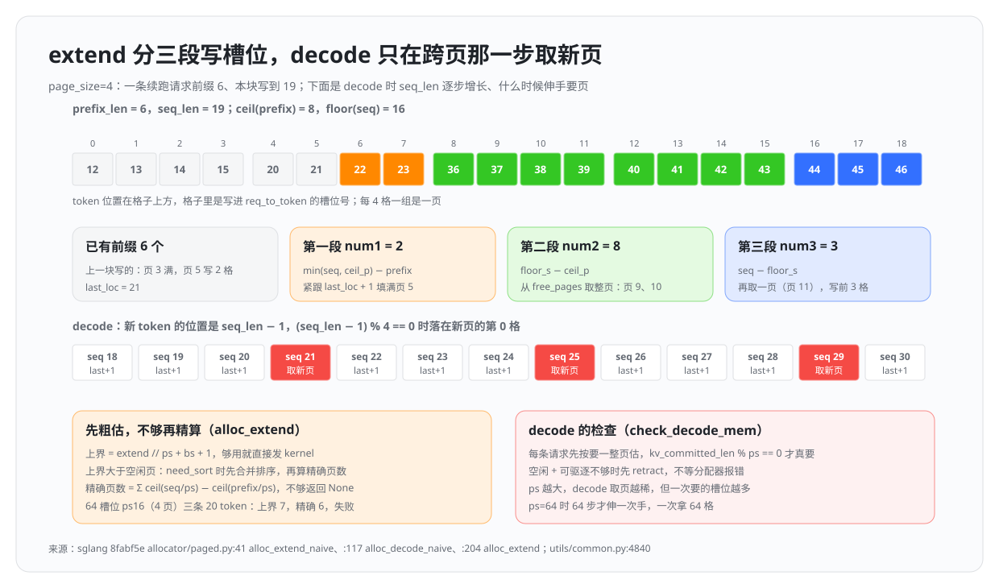
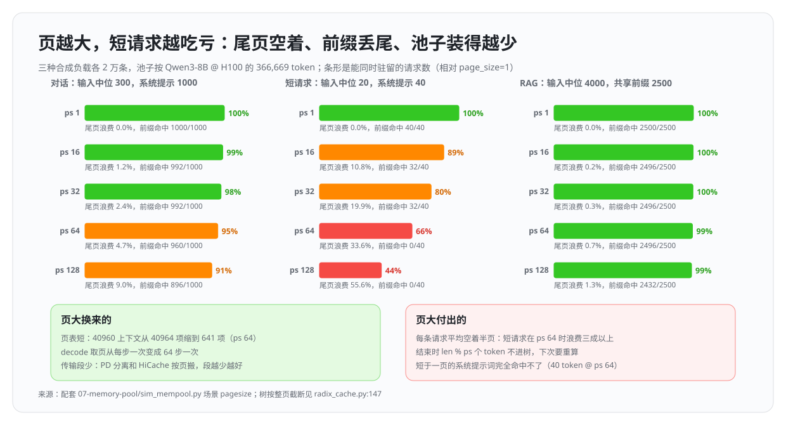
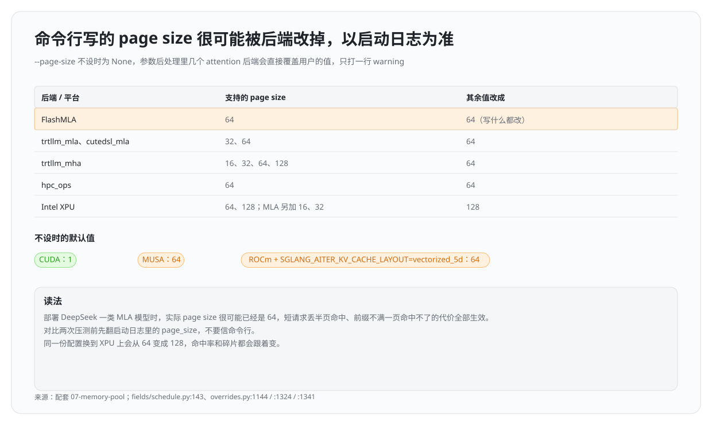
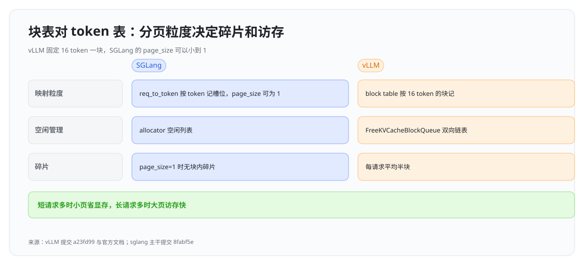

# SGL-07｜原理｜内存池与页表：req_to_token、token_to_kv 与 page size

> 🎯 <p><b>遇到的问题</b>：[SGL-06｜原理｜Chunked prefill：切块大小、mixed chunk 与 TTFT / ITL 的取舍](./06-chunked-prefill.md) 切出的每块 prefill、[SGL-05｜原理｜调度器：waiting、running 与 KV 预算](./05-scheduler.md) 的每步 decode，最后都落到同一个动作：给新 token 找几个 KV 槽位，再把槽位号记到请求名下。SGLang 用两张表做这件事。req_to_token 是 int32 二维表，一行一条请求，第 j 列存第 j 个 token 的槽位号。</p><p>token_to_kv 是按槽位编号的 KV 大数组，每层一份。中间夹着一个分配器，page_size=1 时按槽位发，大于 1 时按页发。这一篇逐行拆开两张表和分配器，回答线上遇到的三个问题：KV 池的 token 数怎么算出来，四种内存报错各是谁抛的，--page-size 该不该调、调大以后丢了什么。</p><p><b>主线</b>：所有 KV 最终都落到一个槽位号上；两张表加一个分配器，决定了池子有多大、碎片有多少、报错从哪来。</p><p><b>读完这一篇</b>：能看着 req_to_token 的一行说清 KV 散在哪些页，从启动日志反推池子容量和 req_to_token 的显存占用。碰到四类内存报错时知道该动哪个参数，能按自己的长度分布估出 page size 调到 16 或 64 的得失。</p><p><b>代码</b>：<a href="../07-memory-pool">zero-to-sglang/07-memory-pool</a>。sim_mempool.py 只用标准库，逐行复刻 ReqToTokenPool、TokenAllocator 和 PagedAllocator，覆盖三段式 alloc_extend、跨页取页、按页归还、前缀树整页截断和 need_sort，另带 page size 扫描、碎片统计和四类报错复现。KV 池容量沿用 SGL-02 的账本，行号按主干 8fabf5e 核对。</p>

# 导读 · 结论先行

1. **两张表，一次间接寻址。**请求先拿到 req_to_token 的一行（req_pool_idx），行里每格是一个槽位号，槽位号直接索引 k_buffer 和 v_buffer。attention 后端从这张表里取索引，KV 在物理上不需要连续。
2. **CUDA 上默认按槽位发。**--page-size 不设时 CUDA 取 1，空闲表就是 1 到 N 的槽位号；FlashMLA、TRTLLM、Intel XPU、MUSA 等后端会把它强制改成 32、64 或 128，日志里只有一行 warning。
3. **分页分配器分三段写。**extend 先补满上一页剩下的空格，再取整页，最后取一页新尾页；decode 只在新 token 落在页首的那一步伸手要页。释放时按页归还，插回空闲表头部，下一个请求最先拿到的就是刚还回来的页。
4. **页越大，短请求越吃亏。**尾页平均空半页，请求结束时 len % ps 个 token 不进前缀树，比一页短的系统提示词完全命中不了。模拟里短请求负载在 ps 64 时少驻留 34% 的请求，40 token 的系统提示词命中 0 个；RAG 负载几乎不受影响。
5. **池子大小在启动时就定了。**max_total_num_tokens 由剩余显存除以每 token 的 KV 字节数得到，再按页向下取整；max_running_requests 决定 req_to_token 有多少行，这张表在 KV 池之外单独占显存，Qwen3-8B 默认 4096 行就是 640 MiB。



上图是 page_size=4、64 个槽位的小池子：A、B 两条请求一起 prefill，再各 decode 3 步。req_to_token 第 3、4 行就是两条请求的全部记账，深浅交替的格子标出页边界；下方 k_buffer 里同一页的四格永远属于同一条请求，页 6、页 7 里还没写的格子就是尾页碎片。attention 读的页表只是把这一行每隔 4 列取一次再除以 4。

**📎 与系列其他文档的分工**：调度器怎么按 KV 余量决定收不收请求、什么时候 retract，见 [SGL-05｜原理｜调度器：waiting、running 与 KV 预算](./05-scheduler.md)。前缀树怎么匹配、加锁、驱逐，这一篇只讲它和分配器的交界，细节留给 [SGL-08｜原理｜RadixAttention：基数树的匹配、插入、加锁与驱逐](./08-radix-attention.md)。CUDA Graph 为什么需要第 0 行和第 0 页做 padding，留给 [SGL-09｜原理｜Overlap 调度与 CUDA Graph：把 CPU 开销藏到 GPU 后面](./09-overlap-cudagraph.md)。各个 attention 后端怎么读页表，留给 [SGL-10｜原理｜注意力后端：FlashInfer、FA3、Triton、TRTLLM 怎么选、怎么接进 CUDA Graph](./10-attention-backend.md)。KV 用 FP8 存能多装多少，留给 [SGL-12｜原理｜量化：FP8、INT4 与 KV 量化怎么选](./12-quantization.md)。GPU 池子之外再挂一层 CPU 和远端存储，留给 [SGL-14｜原理｜HiCache：显存、主机内存、远端存储三层 KV 缓存](./14-hicache.md)。PD 分离时 KV 怎么按页跨机搬，留给 [SGL-15｜原理｜PD 分离：prefill 和 decode 拆到两组卡上](./15-pd-disagg.md)。

# 第 1 章 · 问题：KV 池明明还有空，请求却进不来

线上常见的情形：

- 启动日志里 max_total_num_tokens 是 36 万，压测时 token usage 只到 0.7，新请求却在 waiting 里排队，调度器说放不下。
- 把 --page-size 从 1 改成 64，期望 attention 快一点，结果同样的并发下 retract 变多，前缀命中率还掉了。
- 换了 FlashMLA 或 TRTLLM 后端，命令行里根本没写 --page-size，日志却显示 page_size=64。
- 把 --max-running-requests 调到 16384 想提高并发，KV 池反而小了一截。
- 偶发 Decode out of memory 或 Prefill out of memory，报错里写着 Available tokens 还有几十个。
- 跑一段时间后日志里出现 memory leak detected，不知道是自己改的代码漏了，还是正常现象。

这些问题都出在请求、槽位、页三层之间的换算上。下面先讲为什么要分页，再按「两张表、分配器、释放、page size、池子大小、连续性」的顺序拆，最后对照 vAttention 的另一条路和 mini-sglang 的简化实现。

| 想弄清的现象 | 看哪一节 |
|-|-|
| 为什么 KV 要离散存放，代价是什么 | 2.1 |
| 一个 token 的 KV 怎么从请求一路找到显存 | 2.2 |
| extend 和 decode 各在什么时候取页 | 2.3 |
| 请求结束时哪些槽位归还、哪些进树 | 2.4 |
| page size 调大得到什么、丢掉什么 | 2.5、2.6 |
| 池子的 token 数、max_running 和 req_to_token 开销怎么算 | 2.7 |
| 长时间运行后槽位为什么越来越散，对 PD 分离有什么影响 | 2.8 |
| 不分页的路线（vAttention）和 SGLang 的 KvVmmArena | 2.9 |
| mini-sglang 和课程里的简化版差在哪 | 2.10 |

# 第 2 章 · 原理：请求 → 行 → 槽位 → 页

## 2.1 为什么要分页

早期的推理系统给每条请求按最大长度预留一段连续显存。请求实际生成多长事先不知道，于是预留量远大于用量；不同请求的预留段之间还会留下放不下新请求的空洞。vLLM 的论文把浪费拆成三类：为未来 token 预留的、预留段内没用满的内部碎片、段与段之间的外部碎片。他们测得当时的系统里只有 20.4% 到 38.2% 的 KV 显存真正存着 token 状态，PagedAttention 把这个比例提到 96.3%，同样延迟下吞吐提高 2 到 4 倍[[1]](https://arxiv.org/abs/2309.06180)。

PagedAttention 借的是操作系统虚拟内存的思路：KV 按固定大小的块存放，每条请求有一张块表，记录逻辑块对应的物理块；块按需分配，只有最后一块可能没装满，浪费上限是每条请求一块。代价是 attention kernel 要多一次查表，读到的 KV 在物理上不连续[[1]](https://arxiv.org/abs/2309.06180)。vLLM 今天的块管理放在本章「vLLM 怎么做」一节里展开。

SGLang 的做法同源，命名不同。块表在 SGLang 里叫 req_to_token，存的是槽位号而不是块号；块叫页，大小由 --page-size 决定。page_size=1 是一个极端：每个 token 自成一页，没有内部碎片，也就没有「块表」和「token 表」的区别，req_to_token 本身就是页表。

## 2.2 两级映射：ReqToTokenPool 和 KV 池

ReqToTokenPool 是一张 int32 表，形状 (size + 1, context_len + 4)，size 就是 max_running_requests[（memory_pool.py:376）](https://github.com/sgl-project/sglang/blob/8fabf5e/python/sglang/srt/mem_cache/memory_pool.py#L376)。第 0 行留给 CUDA Graph 的 padding 请求，真实请求从第 1 行开始。行的分配很简单：空闲行是一个 Python 列表，alloc_rows 从尾部弹出，free_rows 还回尾部，所以刚释放的行最先被复用；每次分配 generation 加一，用来识别同一行上先后住过的请求。

KV 池是按层分开的大数组。MHA 模型每层一个 k_buffer 和一个 v_buffer，形状 [slots + page_size, kv_heads, head_dim]，比 token 数多出一页，第 0 页给 padding token 写垃圾用[（memory_pool.py:2567）](https://github.com/sgl-project/sglang/blob/8fabf5e/python/sglang/srt/mem_cache/memory_pool.py#L2567)。Qwen3-8B 在 H100 上，ps=1 时每层 k_buffer 是 (366670, 8, 128)，36 层，K、V 各 25.18 GB。

一次前向里，调度器先给每条新请求拿一行，再向分配器要 KV 槽位，最后把槽位号写进这一行对应的列[（allocation.py:374 alloc_for_extend）](https://github.com/sgl-project/sglang/blob/8fabf5e/python/sglang/srt/mem_cache/allocation.py#L374)。模型执行时，attention 层拿 req_pool_indices 和 seq_lens 去 req_to_token 里取索引。

FlashAttention 后端的页表就是 req_to_token[:, ::ps] // ps：每隔 ps 列取一个槽位号，除以 ps 得到页号[（flashattention_backend.py:1317）](https://github.com/sgl-project/sglang/blob/8fabf5e/python/sglang/srt/layers/attention/flashattention_backend.py#L1317)。页内偏移不用存，第 j 个 token 在第 j // ps 个页表项的第 j % ps 格。

上面那张图里，A 占第 3 行，10 个 prompt token 写在槽位 4 到 13，decode 三步又写了 14、15、28；B 占第 4 行，槽位 16 到 25。按页看，A 的页表是 [1, 2, 3, 7]，B 是 [4, 5, 6]。槽位 28 跳到了页 7，是因为 decode 第 3 步时 A 的页 3 刚好写满，要一页新的，而页 6 已经在上一步被 B 拿走。

## 2.3 分配器：按槽位发，还是按页发

page_size=1 时用 TokenToKVPoolAllocator。空闲表初始化为 arange(1, size + 1)，槽位 0 留给 padding；alloc 从表头切走 need_size 个，free 把槽位接回表尾[（allocator/token.py:28）](https://github.com/sgl-project/sglang/blob/8fabf5e/python/sglang/srt/mem_cache/allocator/token.py#L28)。没有页的概念，也没有对齐，一条请求的槽位可以散落在任何地方。

page_size 大于 1 时用 PagedTokenToKVPoolAllocator，空闲表里存的是页号[（allocator/paged.py:136）](https://github.com/sgl-project/sglang/blob/8fabf5e/python/sglang/srt/mem_cache/allocator/paged.py#L136)。extend 的槽位分三段写，Triton kernel 和朴素版本 alloc_extend_naive 逻辑相同[（paged.py:41）](https://github.com/sgl-project/sglang/blob/8fabf5e/python/sglang/srt/mem_cache/allocator/paged.py#L41)：

- **第一段**：num1 = min(seq_len, ceil(prefix_len / ps) × ps) − prefix_len。上一块留下的尾页还有空格，就从 last_loc + 1 开始接着写，直到写满这一页。
- **第二段**：num2 = floor(seq_len / ps) × ps − ceil(prefix_len / ps) × ps。中间的整页从空闲表取，每页写满。
- **第三段**：num3 = seq_len − floor(seq_len / ps) × ps。最后不满一页的零头，再取一页新的，写前 num3 格。



上图是一条续跑请求：前缀 6 个 token 已经在槽位 12 到 15 和 20、21，本块写到第 19 个 token。第一段 2 个接在 21 后面补满页 5，第二段 8 个取页 9、10，第三段 3 个取页 11。新页数等于 ceil(19 / 4) − ceil(6 / 4) = 5 − 2 = 3，就是 get_num_new_pages 的公式。

这个精确页数要逐条算再求和，SGLang 不在每一步都算。alloc_extend 先用上界 extend_tokens // ps + bs + 1 粗估：每条请求最多多出一页尾页，再多加一页余量。上界不超过空闲页数就直接发 kernel；超过了，need_sort 打开时先把暂存的释放页合并排序，再按 get_num_new_pages 算精确页数，还不够才返回 None[（paged.py:204）](https://github.com/sgl-project/sglang/blob/8fabf5e/python/sglang/srt/mem_cache/allocator/paged.py#L204)[（utils/common.py:4840）](https://github.com/sgl-project/sglang/blob/8fabf5e/python/sglang/srt/utils/common.py#L4840)。上层收到 None 就抛 Prefill out of memory[（allocation.py:175）](https://github.com/sgl-project/sglang/blob/8fabf5e/python/sglang/srt/mem_cache/allocation.py#L175)。

decode 每条请求只写一个 token，位置是 seq_len − 1。(seq_len − 1) % ps == 0 时这个 token 落在新页的第 0 格，要取一页；其余时候写在 last_loc + 1[（paged.py:117）](https://github.com/sgl-project/sglang/blob/8fabf5e/python/sglang/srt/mem_cache/allocator/paged.py#L117)。ps=4 时 seq_len 走到 21、25、29 才取页；ps=64 时 64 步才伸一次手，可一次拿走 64 格。

调度器不会等分配器报错才处理。每轮 decode 之前，check_decode_mem 先算下一步要多少槽位：kv_committed_len % ps == 0 的请求各要一整页，其余为 0[（schedule_batch.py:3410）](https://github.com/sgl-project/sglang/blob/8fabf5e/python/sglang/srt/managers/schedule_batch.py#L3410)；再交给分配器看空闲加可驱逐够不够[（:3439）](https://github.com/sgl-project/sglang/blob/8fabf5e/python/sglang/srt/managers/schedule_batch.py#L3439)。不够就 retract_decode 把一部分请求退回 waiting[（:3458）](https://github.com/sgl-project/sglang/blob/8fabf5e/python/sglang/srt/managers/schedule_batch.py#L3458)，[SGL-05｜原理｜调度器：waiting、running 与 KV 预算](./05-scheduler.md) 讲过这条路径。真正抛出 Decode out of memory 的情况，通常是绕过了这个检查的代码路径[（allocation.py:572）](https://github.com/sgl-project/sglang/blob/8fabf5e/python/sglang/srt/mem_cache/allocation.py#L572)。

## 2.4 释放：哪些槽位还给分配器，哪些进树

请求结束时调 release_kv_cache[（mem_cache/common.py:418）](https://github.com/sgl-project/sglang/blob/8fabf5e/python/sglang/srt/mem_cache/common.py#L418)。开着前缀缓存时，这条请求的 KV 先交给前缀树，树按整页截断 key：RadixKey.page_aligned 把长度向下取整到 ps 的倍数[（radix_cache.py:147）](https://github.com/sgl-project/sglang/blob/8fabf5e/python/sglang/srt/mem_cache/radix_cache.py#L147)，尾部 len % ps 个 token 不进树，它们的槽位直接还给分配器。为 decode 多分配、还没写的部分由 \_release_overallocated_kv_indices 按 ceil_align 归还[（:465）](https://github.com/sgl-project/sglang/blob/8fabf5e/python/sglang/srt/mem_cache/common.py#L465)。

分页分配器的 free 先对槽位做 unique(idx // ps)，得到页号再归还[（paged.py:328）](https://github.com/sgl-project/sglang/blob/8fabf5e/python/sglang/srt/mem_cache/allocator/paged.py#L328)。need_sort 关闭时，\_release_page_ids 用 cat((page_ids, free_pages)) 把页插到空闲表头部；need_sort 打开时先放进 staged_pages，等下一次不够用时再合并排序[（paged.py:376）](https://github.com/sgl-project/sglang/blob/8fabf5e/python/sglang/srt/mem_cache/allocator/paged.py#L376)。插到头部意味着后进先出：刚还的页最先被下一个请求拿走。

模拟里 ps=4 的流程正好演示了这一点。A 结束时共 13 个 token，进树 12 个，尾部 1 个 token 所在的槽位 28 还给分配器，页 7 插回表头。随后进来的 C 和 A 共享 8 个 token 的系统提示词，命中 8 个，新算 3 个，拿到的正是页 7：C 的行是 4 到 11 加 28、29、30，用的还是 A 刚释放的那一行（generation 2）。

ps=16 时同一个流程就不一样了。A 的 13 个 token 不满一页，进树 0 个，13 个槽位全部归还；C 的系统提示词命中 0 个，11 个 token 全部重算。这就是「比一页短的前缀命中不了」的最小例子。

## 2.5 page size 怎么选：论文和模拟

vLLM 论文专门做过块大小的消融。块太小，kernel 每次读的 KV 太少，GPU 的并行度用不满；块太大，内部碎片变多，前缀共享的粒度变粗。ShareGPT 这类长对话上 16 到 128 表现都不错，Alpaca 这类短请求上 16 和 32 最好，再大就明显变差，所以 vLLM 默认取 16[[1]](https://arxiv.org/abs/2309.06180)。zero-to-sglang 课程第 7 章的说法相同：常见实现用 16，再按负载评估 32 或 64[[2]](https://github.com/datawhalechina/zero-to-sglang)。

SGLang 在 CUDA 上默认取 1，比 vLLM 更激进地放弃了大页。原因有两个：RadixAttention 的前缀匹配希望粒度越细越好，ps=1 时任意长度的公共前缀都能复用；FlashInfer、FA3 这些后端在 ps=1 时用 req_to_token 直接作索引，没有额外的页表转换。page size 的收益主要落在三处：页表短、decode 取页少、传输段少。



上图用三种合成负载各 2 万条请求，池子按 Qwen3-8B 在 H100 上的 366,669 个 token 算。条形是池子能同时驻留的请求数，以 ps=1 为 100%。对话负载（输入中位数 300、系统提示词 1000 token）在 ps 64 时还剩 95%，ps 128 时 91%。短请求负载（输入中位数 20、系统提示词 40 token）在 ps 16 时就只剩 89%，ps 64 时 66%，ps 128 时 44%。RAG 负载（输入中位数 4000）各档都在 99% 以上。

短请求吃亏的原因有三层，都和尾页有关。尾页浪费：请求生命周期里随机取一个时刻，已分配槽位里没装 token 的比例，短请求在 ps 64 时是 33.6%。树丢尾：结束时平均 32.6 个 token 不进前缀树，占这条请求长度的 32.9%，下一次同样的前缀要重算。系统提示词命中：40 token 在 ps 16 和 32 时只能命中 32 个，ps 64 时一个都命中不了。

另一侧的收益在长上下文时最明显。Qwen3-8B 的 context_len 是 40960，ps=1 时一条满长请求的页表有 40964 项，ps=64 时 641 项，attention 每一步读的索引少了 64 倍。decode 取页从每步一次变成 64 步一次，分配器和 Triton kernel 的调用次数随之下降。PD 分离和 HiCache 按段搬 KV，页越大段越少。

## 2.6 很多时候 page size 由不得自己

--page-size 的帮助文本只有一句「The number of tokens in a page」，不设时为 None[（fields/schedule.py:143）](https://github.com/sgl-project/sglang/blob/8fabf5e/python/sglang/srt/arg_groups/fields/schedule.py#L143)。实际取值在参数解析的后处理里决定，几个 attention 后端会直接覆盖用户的值[（overrides.py:1144）](https://github.com/sgl-project/sglang/blob/8fabf5e/python/sglang/srt/arg_groups/overrides.py#L1144)：

- FlashMLA 只支持 64，命令行写什么都会被改成 64[[3]](https://github.com/deepseek-ai/FlashMLA)。
- trtllm_mla 和 cutedsl_mla 支持 32 或 64，其余改成 64。trtllm_mha 支持 16、32、64、128，其余改成 64。hpc_ops 只支持 64。
- Intel XPU 后端支持 64 和 128，MLA 模型再加上 16 和 32，其余改成 128[（:1324）](https://github.com/sgl-project/sglang/blob/8fabf5e/python/sglang/srt/arg_groups/overrides.py#L1324)。
- 不设时的默认值：CUDA 取 1，MUSA 取 64，ROCm 上设了 SGLANG_AITER_KV_CACHE_LAYOUT=vectorized_5d 时取 64[（:1341）](https://github.com/sgl-project/sglang/blob/8fabf5e/python/sglang/srt/arg_groups/overrides.py#L1341)。

这些覆盖只打一行 warning。部署 DeepSeek 一类 MLA 模型时，实际 page size 很可能已经是 64，2.5 节说的短请求代价全部生效。判断依据是启动日志里的 page_size，不是命令行。



## 2.7 池子有多大：max_total_num_tokens、max_running 和 req_to_token

calculate_pool_sizes 用 mem_fraction_static 留下的显存减去权重，剩下的除以每 token 的 KV 字节数，得到 max_total_num_tokens，再按 page_size 向下取整[（pool_configurator.py:637）](https://github.com/sgl-project/sglang/blob/8fabf5e/python/sglang/srt/model_executor/pool_configurator.py#L637)。结果小于等于 0 时 MemoryPoolConfig 在构造时抛 Not enough memory，提示调大 --mem-fraction-static[（:94）](https://github.com/sgl-project/sglang/blob/8fabf5e/python/sglang/srt/model_executor/pool_configurator.py#L94)。--max-total-tokens 只能往下压，官方说明它主要用于开发和调试[[4]](https://docs.sglang.io/docs/advanced_features/server_arguments)。

max_running_requests 不设时由 resolve_max_num_reqs 估算：池子 token 数除以 context_len 再乘 512，夹在 2048 和 4096 之间；用户设了值，就取 min(N // attn_dp, pool_tokens // 2)，N 为设定值[（kv_cache_configurator.py:3119）](https://github.com/sgl-project/sglang/blob/8fabf5e/python/sglang/srt/mem_cache/kv_cache_configurator.py#L3119)。

这个数同时是 req_to_token 的行数。启动日志在 scheduler.py:1272 一行打出 max_total_num_tokens、chunked_prefill_size、max_prefill_tokens、max_running_requests 和 context_len[（scheduler.py:1272）](https://github.com/sgl-project/sglang/blob/8fabf5e/python/sglang/srt/managers/scheduler.py#L1272)。

Qwen3-8B 在 H100 上：每 token 144 KB（36 层 × 8 个 KV 头 × 128 维 × K、V 两份 × 2 字节），池子 366,669 个 token；366669 / 40960 × 512 = 4583，夹到 4096。req_to_token 的大小是 4097 × 40964 × 4 字节 = 640 MiB。

这 640 MiB 不在 KV 池里，从 mem_fraction_static 之外的预留中出。把 --max-running-requests 设成 16384，这张表就涨到 2.5 GiB，预留不够时 KV 池会被挤小，而 16384 条请求平均每条只分到 22 个 token，根本跑不满。Llama-3.1-8B 的 context_len 是 131072，同样 2048 行就要 1 GiB。

## 2.8 槽位的连续性和 need_sort

分页之后，KV 在显存里本来就不要求连续，单机推理时这件事无所谓。PD 分离时不同：prefill 节点算完的 KV 要按槽位段搬到 decode 节点，连续的槽位能合并成一次 RDMA 写，散的槽位只能一段一段发。

SGLang 的 Mooncake 后端用 group_concurrent_contiguous 把源和目标两侧同时连续的槽位合并成段[（disaggregation/common/utils.py:132）](https://github.com/sgl-project/sglang/blob/8fabf5e/python/sglang/srt/disaggregation/common/utils.py#L132)[[5]](https://arxiv.org/abs/2407.00079)。为了让段尽量少，PD 分离的 prefill 和 decode 两侧会打开 need_sort[（kv_cache_configurator.py:2805）](https://github.com/sgl-project/sglang/blob/8fabf5e/python/sglang/srt/mem_cache/kv_cache_configurator.py#L2805)：释放的页先暂存，空闲表不够时再合并排序，分配时就能拿到编号连续的一串。普通部署不开，因为排序有开销，而单机 attention 并不在乎连续。

模拟里一个一万槽位的池子保持 85% 左右的占用，请求不停进出。ps=1 不排序时，新请求的槽位中位数要分 33 段，p90 是 95 段；打开排序后中位数 2 段。ps=16 不排序是 13 段，排序后 2 段。分页本身已经减少了段数，排序再压一层。PD 分离的配置细节见官方文档{r("docs_pd")}和 {S(15)}。

## 2.9 另一条路：vAttention 和 SGLang 的 KvVmmArena

vAttention 认为 PagedAttention 的代价被低估了。要支持分页，每个 attention kernel 都得改成查表版本，框架里还要再写一个内存管理器，重复了操作系统已经做过的事。他们测得 vLLM 的分页 kernel 比 FasterTransformer 的连续版本慢 20% 到 26%，FA2 和 FlashInfer 的分页 prefill kernel 比连续版本最多慢 37% 和 42%，分页 kernel 多执行 7% 到 13% 的指令；vLLM 的分页 decode kernel 在块大小 64 和 128 时还会变慢[[6]](https://arxiv.org/abs/2405.04437)。

vAttention 的做法是让 KV 在虚拟地址上连续、在物理上按需分配。它用 CUDA 虚拟内存管理接口给每条请求预留一大段虚拟地址，生成到哪里再映射物理页到哪里，kernel 可以直接用连续版本。驱动默认的物理粒度是 2 MB，他们改了驱动支持 64 KB 的小页。结果是 decode 吞吐最多提高 1.99 倍，端到端比 FA2 分页版和 FlashInfer 分页版快 1.18 倍和 1.23 倍[[6]](https://arxiv.org/abs/2405.04437)。

SGLang 里也有 CUDA VMM，用途完全不同。KvVmmArena 在每张卡上预留 256 GiB 的虚拟地址，包装成一个 torch.cuda.MemPool，物理显存在提交时才映射[（kv_vmm_backing.py:27）](https://github.com/sgl-project/sglang/blob/8fabf5e/python/sglang/srt/mem_cache/kv_vmm_backing.py#L27)[[7]](https://pytorch.org/docs/stable/notes/cuda.html)。它服务的是 post-capture KV sizing：先抓 CUDA Graph，再按剩下的真实显存把 KV 池调到合适大小，这样启动时就不用为 Graph 预留一块保守的余量。

这个功能由 SGLANG_ENABLE_POST_CAPTURE_KV_SIZING 控制，默认关闭[（environ.py:642）](https://github.com/sgl-project/sglang/blob/8fabf5e/python/sglang/srt/environ.py#L642)，非 CUDA、MLA、开了 DCP 或 KV 分片时都不生效。请求级的 KV 管理仍然是本篇讲的两张表加分配器。

两条路线的取舍可以这样看。vAttention 省掉了 kernel 的改造和查表开销，代价是依赖驱动接口、物理粒度粗，而且每条请求一段连续虚拟地址，和前缀树那种多条请求共享同一批 KV 的模式很难兼容。SGLang 的核心卖点是前缀复用，选择 req_to_token 这种间接寻址是自然的结果。

## 2.10 mini-sglang 和课程里的简化版

mini-sglang 把两级映射压到两个类里[[8]](https://github.com/sgl-project/mini-sglang)。[table.py](https://github.com/sgl-project/mini-sglang/blob/main/python/minisgl/scheduler/table.py) 的 TableManager 管行：空闲行是 list(range(max_running_reqs))，allocate 用 pop、free 用 append，和 SGLang 一样后进先出；它另外存了一份和页表同形状的 token_pool，放输入 token id。[cache.py](https://github.com/sgl-project/mini-sglang/blob/main/python/minisgl/scheduler/cache.py#L15) 的 CacheManager 管页，空闲表初始化为 arange(num_pages) × page_size，存的是每页首个槽位号，天然按页对齐。

allocate_paged 对每条请求算 div_ceil(cached_len, ps) 到 div_ceil(device_len, ps) 之间缺几页，一次性从空闲表头取走，再写进页表[（cache.py:42）](https://github.com/sgl-project/mini-sglang/blob/main/python/minisgl/scheduler/cache.py#L42)。它没有三段式，因为 cached_len 之后的槽位永远从新页开始写，上一页的空格就留着不用。空闲页不够时 \_allocate 先让前缀树驱逐，再取[（:106）](https://github.com/sgl-project/mini-sglang/blob/main/python/minisgl/scheduler/cache.py#L106)。释放时 \_free 把页接到表尾，SGLang 则插到表头。check_integrity 断言空闲页加树里的页等于总页数[（:81）](https://github.com/sgl-project/mini-sglang/blob/main/python/minisgl/scheduler/cache.py#L81)，对应 SGLang 那条更复杂的不变式检查。

课程第 7 章（[PagedKVCache 与显存管理](https://github.com/datawhalechina/zero-to-sglang/blob/main/course-material/ch/part2/第7章_PagedKVCache与显存管理.md)）讲的是 vLLM 式的块表和 PagedAttention 的读取路径：内存合并访问、共享内存暂存，以及在线 softmax 保证分块计算和整段计算数学上等价[[2]](https://github.com/datawhalechina/zero-to-sglang)。读主干时按这个顺序走：先用课程理解为什么分页不改变 attention 的结果，再用 mini-sglang 看最小的分页分配器，最后读 paged.py 里的三段式和 need_sort。

## 2.11 vLLM 怎么做

vLLM 的 KV 按块管理，CUDA 上默认块大小 16 个 token。KVCacheManager 给每条请求维护一张 block table，BlockPool 管所有物理块，空闲块串在一个双向链表 FreeKVCacheBlockQueue 上，取块从队头拿，还块挂回队尾[[9]](https://github.com/vllm-project/vllm/blob/a23fd9903418de0e1d3757bb23e2f1697eb066f3/vllm/v1/core/kv_cache_manager.py)[[10]](https://github.com/vllm-project/vllm/blob/a23fd9903418de0e1d3757bb23e2f1697eb066f3/vllm/v1/core/block_pool.py)。这就是 PagedAttention 论文里的设计，块是分配、共享和驱逐的最小单位。

SGLang 多了一层 token 级映射：req_to_token 记下每条请求每个位置的槽位，page_size 可以小到 1。page_size 为 1 时没有块内碎片，前缀共享能精确到 token；页开大以后行为就和 vLLM 的块接近。块大小 16 的取舍在于 kernel 每次读的连续 KV 多，访存效率好，但每条请求最后一块平均浪费半块。

| 维度 | SGLang | vLLM | 差异的代价 |
|-|-|-|-|
| 映射粒度 | req_to_token 按 token 记槽位，page_size 可为 1 | block table 按 16 token 的块记 | SGLang 小页省显存，大页访存好 |
| 空闲管理 | allocator 空闲列表 | FreeKVCacheBlockQueue 双向链表 | 复杂度同量级 |
| 碎片 | page_size=1 时无块内碎片 | 每请求平均半块 | 短请求多时 vLLM 浪费比例更高 |



# 第 3 章 · 源码走读：一个 token 的 KV 从分配到归还的 18 个落脚点

按启动、分配、读取、释放的顺序排列。

| # | 位置 | 发生了什么 |
|-|-|-|
| 1 | [overrides.py:1341 \_page_size_default](https://github.com/sgl-project/sglang/blob/8fabf5e/python/sglang/srt/arg_groups/overrides.py#L1341) | CUDA 默认 1，MUSA 默认 64；:1144 和 :1324 按后端强制改写 |
| 2 | [pool_configurator.py:637 calculate_pool_sizes](https://github.com/sgl-project/sglang/blob/8fabf5e/python/sglang/srt/model_executor/pool_configurator.py#L637) | 剩余显存 ÷ 每 token KV 字节，按页向下取整 |
| 3 | [pool_configurator.py:94](https://github.com/sgl-project/sglang/blob/8fabf5e/python/sglang/srt/model_executor/pool_configurator.py#L94) | 池子为负时抛 Not enough memory |
| 4 | [kv_cache_configurator.py:3119 resolve_max_num_reqs](https://github.com/sgl-project/sglang/blob/8fabf5e/python/sglang/srt/mem_cache/kv_cache_configurator.py#L3119) | clamp(tokens / context_len × 512, 2048, 4096)；用户值和 tokens // 2 取小 |
| 5 | [memory_pool.py:376 ReqToTokenPool](https://github.com/sgl-project/sglang/blob/8fabf5e/python/sglang/srt/mem_cache/memory_pool.py#L376) | int32 表 (size + 1, context_len + 4)，第 0 行留给 padding |
| 6 | [memory_pool.py:2567 \_kv_buffer_shapes](https://github.com/sgl-project/sglang/blob/8fabf5e/python/sglang/srt/mem_cache/memory_pool.py#L2567) | 每层 k_buffer、v_buffer 多出一页 |
| 7 | [allocator/token.py:28](https://github.com/sgl-project/sglang/blob/8fabf5e/python/sglang/srt/mem_cache/allocator/token.py#L28) | ps=1：空闲表 arange(1, size + 1)，头部取、尾部还 |
| 8 | [allocation.py:327 alloc_req_slots](https://github.com/sgl-project/sglang/blob/8fabf5e/python/sglang/srt/mem_cache/allocation.py#L327) | 拿 req_to_token 行，不够抛 alloc_req_slots runs out of memory |
| 9 | [allocation.py:374 alloc_for_extend](https://github.com/sgl-project/sglang/blob/8fabf5e/python/sglang/srt/mem_cache/allocation.py#L374) | 先拿行，再分配槽位，最后写表 |
| 10 | [paged.py:204 alloc_extend](https://github.com/sgl-project/sglang/blob/8fabf5e/python/sglang/srt/mem_cache/allocator/paged.py#L204) | 上界粗估，不够再合并排序、算精确页数 |
| 11 | [paged.py:41 alloc_extend_naive](https://github.com/sgl-project/sglang/blob/8fabf5e/python/sglang/srt/mem_cache/allocator/paged.py#L41) | 三段式：补尾页、取整页、取新尾页 |
| 12 | [schedule_batch.py:3439 check_decode_mem](https://github.com/sgl-project/sglang/blob/8fabf5e/python/sglang/srt/managers/schedule_batch.py#L3439) | 页首请求各要一页，不够先 retract |
| 13 | [paged.py:117 alloc_decode_naive](https://github.com/sgl-project/sglang/blob/8fabf5e/python/sglang/srt/mem_cache/allocator/paged.py#L117) | (seq_len − 1) % ps == 0 才取新页 |
| 14 | [flashattention_backend.py:1317](https://github.com/sgl-project/sglang/blob/8fabf5e/python/sglang/srt/layers/attention/flashattention_backend.py#L1317) | 页表 = req_to_token[:, ::ps] // ps |
| 15 | [common.py:418 release_kv_cache](https://github.com/sgl-project/sglang/blob/8fabf5e/python/sglang/srt/mem_cache/common.py#L418) | 先交给前缀树，再归还多分配的部分（:465） |
| 16 | [radix_cache.py:147 page_aligned](https://github.com/sgl-project/sglang/blob/8fabf5e/python/sglang/srt/mem_cache/radix_cache.py#L147) | 进树的 key 向下取整到页，尾部零头直接释放 |
| 17 | [paged.py:376 \_release_page_ids](https://github.com/sgl-project/sglang/blob/8fabf5e/python/sglang/srt/mem_cache/allocator/paged.py#L376) | unique 成页号后插回表头；need_sort 时先暂存 |
| 18 | [invariant_checker.py:79](https://github.com/sgl-project/sglang/blob/8fabf5e/python/sglang/srt/managers/scheduler_components/invariant_checker.py#L79) | 空闲 + 可驱逐 + 受保护 + 会话持有 + 未入树 = 总量，不等就报 memory leak |

# 第 4 章 · 实验：在 CPU 上看槽位怎么发、页怎么还

实验都在 CPU 上跑，只用标准库。池子推算用 SGL-02 的账本，模型规格和 GPU 显存来自 common/specs.py。

## 4.1 两条请求走一遍：ps=1 和 ps=4

```bash
cd zero-to-sglang/07-memory-pool
python3 sim_mempool.py
```

```text
# page_size=1
[1] prefill A、B（一批）
  out_cache_loc        1 2 3 4 5 6 7 8 9 10 11 12 13 14 15 16 17
[2] decode 3 步
  step 1: out_cache_loc = [18, 19]
  step 2: out_cache_loc = [20, 21]
  step 3: out_cache_loc = [22, 23]
  A 第 3 行：1 2 3 4 5 6 7 8 9 10 18 20 22
[3] A 结束，release_kv_cache
  A 共 13 token，进前缀树 13 个，还给分配器的槽位：[]
[4] C 进来：和 A 共享 8 token 的系统提示词
  C 第 3 行：1 2 3 4 5 6 7 8 24 25 26

# page_size=4
[1] prefill A、B（一批）
  out_cache_loc        4 5 6 7 8 9 10 11 12 13 16 17 18 19 20 21 22
      A 页表 row[::ps]//ps = [1, 2, 3]，B 页表 = [4, 5]
[2] decode 3 步
  step 1: out_cache_loc = [14, 23]   seq_len 变成 11/8，取新页 0 个
  step 2: out_cache_loc = [15, 24]   seq_len 变成 12/9，取新页 1 个
  step 3: out_cache_loc = [28, 25]   seq_len 变成 13/10，取新页 1 个
[3] A 结束，release_kv_cache
  A 共 13 token，进前缀树 12 个（向下取整到页），还给分配器的槽位：[28]
  按页归还：[7]，插回空闲表头部
[4] C 进来：和 A 共享 8 token 的系统提示词
  C 第 3 行：4 5 6 7 8 9 10 11 28 29 30
```

ps=1 时 decode 的槽位在 A、B 之间交替，A 的行里 18、20、22 隔一个跳一个，连续性在第一步就没了。ps=4 时 A 从槽位 4 开始，因为页 0 是 padding；B 从 16 开始，因为 A 的页 3 只写了两格，剩下的 14、15 归 A 所有，B 只能从页 4 开始。decode 第 2 步 B 的 seq_len 变成 9，(9 − 1) % 4 == 0，取页 6；第 3 步 A 的 seq_len 变成 13，取页 7。A 结束后页 7 回到表头，C 新算的 3 个 token 马上又用上了它。

## 4.2 page size 比系统提示词还大

```bash
python3 sim_mempool.py --scenario walk --page-size 16
```

```text
[1] prefill A、B（一批）
  out_cache_loc        16 17 18 19 20 21 22 23 24 25 32 33 34 35 36 37 38
[2] decode 3 步
  step 1: out_cache_loc = [26, 39]   seq_len 变成 11/8，取新页 0 个
  step 2: out_cache_loc = [27, 40]   seq_len 变成 12/9，取新页 0 个
  step 3: out_cache_loc = [28, 41]   seq_len 变成 13/10，取新页 0 个
[3] A 结束，release_kv_cache
  A 共 13 token，进前缀树 0 个（向下取整到页），还给分配器的槽位：[16, 17, …, 28]
[4] C 进来：和 A 共享 8 token 的系统提示词
  前缀命中 0 token，新算 11 token
```

decode 三步一页都没取，这是大页的好处。代价在第 3、4 步：A 不满一页，什么都没留进树，C 的 8 个共享 token 全部重算。所以开大页之前，先把系统提示词调成 page size 的整数倍，或者至少比一页长很多。

## 4.3 三种负载 × 五档 page size

```bash
python3 sim_mempool.py --scenario pagesize
```

```text
[short] 输入中位数 20，输出中位数 59，共享系统提示词 40 token
    ps     尾页浪费    树丢尾 tok     占比     前缀命中     页表项     新页频率      可驻留条数
     1     0.0%        0.0  0.00%   40/40      61.0       每步       6010
    16    10.8%        7.5  7.54%   32/40       4.3     1/16       5359
    32    19.9%       15.5 15.59%   32/40       2.4     1/32       4813
    64    33.6%       32.6 32.90%    0/40       1.4     1/64       3989
   128    55.6%       66.5 66.99%    0/40       1.1    1/128       2669

[chat] 输入中位数 300，输出中位数 198，共享系统提示词 1000 token
     1     0.0%        0.0  0.00% 1000/1000   638.5       每步        574
    64     4.7%       31.5  4.00%  960/1000    10.5     1/64        547
   128     9.0%       63.3  8.03%  896/1000     5.5    1/128        523

[rag] 输入中位数 4002，输出中位数 298，共享系统提示词 2500 token
     1     0.0%        0.0  0.00% 2500/2500  4696.8       每步         78
    64     0.7%       31.6  0.65% 2496/2500    73.9     1/64         78
```

树丢尾的平均值接近 (ps − 1) / 2，和负载无关，因为请求长度对 ps 取模近似均匀；它占请求长度的比例才和负载有关。短请求 ps 16 就丢 7.5%，RAG 在 ps 64 时只丢 0.65%。页表项一列说明大页对长请求的价值：RAG 每条请求从 4697 项降到 74 项。可驻留条数一列是最终的账：短请求在 ps 64 时从 6010 降到 3989，同一张卡少放三分之一的并发。

## 4.4 池子推算和 req_to_token 开销

```bash
python3 sim_mempool.py --scenario sizing
```

```text
模型                GPU        tp  KB/tok  max_total_tokens max_running  r2t 表 MiB      满上下文条数      FA 页表宽 ps=1/64
Qwen3-8B          h100-sxm    1     144           366,669       4,096        640         9.0      40,964/641
Qwen3-8B          l40s        1     144           161,395       2,048        320         3.9      40,964/641
Qwen3-8B          rtx4090     1     144             8,813       2,048        320         0.2      40,964/641
Llama-3.1-8B      h100-sxm    1     128           415,401       2,048       1025         3.2     131,076/2,049
Llama-3.1-70B     h100-sxm    4      80           417,650       2,048       1025         3.2     131,076/2,049
Qwen3-235B-A22B   h100-sxm    8      47           210,787       2,634        412         5.1      40,964/641

  [ps=1]  #tokens: 366669, 每层 k_buffer 形状 (366670, 8, 128)，页数 366,669
  [ps=64] #tokens: 366656, 每层 k_buffer 形状 (366720, 8, 128)，页数 5,729
  --max-running-requests 1024：生效 1024，req_to_token 160 MiB
  --max-running-requests 16384：生效 16384，req_to_token 2560 MiB
```

有几个数我们印象很深。RTX 4090 上 Qwen3-8B 只剩 8813 个 token，连一条满长请求的四分之一都放不下，max_running 却还是 2048，因为下限写死了；这种卡上要主动把 --max-running-requests 和 --context-length 一起调小。

Llama-3.1-8B 的 context_len 是 128k，2048 行的 req_to_token 就要 1 GiB。ps=64 时 token 数从 366669 取整到 366656，k_buffer 多出的一页从 1 个槽位变成 64 个。Qwen3-235B 的 max_running 是 2634，是因为 attn_dp 和 tokens // 2 的约束介入了。

## 4.5 长时间进出之后的连续性

```bash
python3 sim_mempool.py --scenario churn
```

```text
  ps need_sort     每条段数 p50    p90   每 100 token 段数       合并排序次数
   1     False           33     95             13.9            0
   1      True            2      5              0.8          261
  16     False           13     25              4.6            0
  16      True            2      4              0.8          272
```

段数就是 PD 分离时一条请求的 KV 要拆成几次传输。ps=1 不排序时每 100 个 token 要 13.9 段，几乎每 7 个 token 断一次。打开排序后不到 1 段，代价是两百多次合并排序。单机部署看不到这个差别，PD 分离时它直接变成传输次数。

## 4.6 四类内存报错

```bash
python3 sim_mempool.py --scenario errors
```

```text
[1] req_to_token 行用完
  RuntimeError: alloc_req_slots runs out of memory. Please set a smaller number for `--max-running-requests`.
[2] prefill 槽位不够：64 token / ps 16 = 4 页，三条 20 token 的请求要 6 页
  RuntimeError: Prefill out of memory. Try to lower your batch size.
  上界 extend//ps + bs + 1 = 7，超过空闲页 4，于是算精确页数 6，仍不够，返回 None
[3] decode 跨页时没页可拿：两条请求都停在 32 token（页尾），池子已满
  RuntimeError: Decode out of memory. Try to lower your batch size.
[4] 启动时 KV 池为负：mem_fraction_static 太小
  Qwen3-8B @ RTX 4090，mem_fraction_static=0.6：权重 15.3 GiB，留给 KV -1.2 GiB
  RuntimeError: Not enough memory. Please try to increase --mem-fraction-static.
```

第 2 个报错说明了一个容易误读的现象：三条 20 token 的请求一共 60 个 token，池子有 64 个空槽，按 token 算是够的，按页算要 6 页而只有 4 页。报错里的 Available tokens 是按槽位数打的，看到它比请求量大，现在第一反应是页对齐。第 1 个报错的提示语反直觉：它建议调小 --max-running-requests，真实原因通常是调度器以外的代码绕过了准入，直接往池子里塞请求。

> 💡 **实验记录**：六个场景各跑了一遍，又做了三个改动：walk 场景加 --page-size 8，看 C 能命中几个 token。pagesize 场景把 short 负载的系统提示词改成 64 token，看 ps 64 时命中从 0 变成多少。sizing 场景对 Qwen3-8B @ H100 试 --max-running-requests 8192，算 req_to_token 占多少 MiB。命令和期望输出见 [README.md](../07-memory-pool/README.md)，实现见 [sim_mempool.py](../07-memory-pool/sim_mempool.py)，文件头注释列了每个函数对应的源码行。

# 第 5 章 · 调过的参数和踩过的坑

## 5.1 动过的参数

| 参数 | 默认 | 管什么 | 什么时候动它 |
|-|-|-|-|
| --page-size | CUDA 为 1 | KV 分配的粒度；也是前缀树的匹配粒度 | 长上下文、PD 分离、HiCache 时考虑 16 到 64；短请求和短系统提示词别动 |
| --attention-backend | 按硬件选 | FlashMLA、TRTLLM、XPU 等会强制改写 page size | 换后端后查启动日志里的实际 page_size |
| --mem-fraction-static | 自动 | 权重加 KV 池占显存的比例，决定 max_total_num_tokens | 启动报 Not enough memory 时调大；运行时 OOM 时调小 |
| --max-running-requests | 自动（2048 到 4096） | req_to_token 的行数，并发上限 | 小显存卡上调小；调大前先算 req_to_token 的 MiB 数 |
| --max-total-tokens | 自动 | 只能把池子往小压 | 调试、复现小池子行为时用 |
| --kv-cache-dtype | auto | 每 token 的 KV 字节数 | FP8 让池子 token 数翻倍，精度验证见 SGL-12 |
| SGLANG_ENABLE_POST_CAPTURE_KV_SIZING | False | 抓完 CUDA Graph 再定 KV 池大小 | 实验性功能，MLA、非 CUDA 不生效 |

## 5.2 踩过的坑

> 💡 **踩过的坑**：我们以为调大 --page-size 一定更快。页大带来的收益是页表短、取页少、传输段少，代价是尾页浪费和前缀丢尾。短请求负载在 ps 64 时少驻留三分之一的请求，吞吐反而会掉。现在先用 4.3 节的方法拿自己的长度分布算一遍。

> 💡 **踩过的坑**：以为命令行写了什么，page size 就是什么。FlashMLA、TRTLLM、hpc_ops、Intel XPU 都会覆盖，MUSA 和部分 ROCm 配置默认就是 64。现在以启动日志为准。

> 💡 **踩过的坑**：我们的系统提示词比一页还短，或者长度刚好比整页多几个 token。前缀树按整页截断，40 token 的提示词在 ps 64 时一个都命中不了，1000 token 在 ps 128 时只能命中 896。后来开大页时，都把系统提示词调整到页的整数倍。

> 💡 **踩过的坑**：把 --max-running-requests 当成只影响调度的软限制。它决定 req_to_token 的行数，每行 context_len + 4 个 int32。128k 上下文的模型设成 16384，这张表就要 8 GiB。

> 💡 **踩过的坑**：看到 Available tokens 大于请求量就以为是 bug。分页分配器按页算，零散的空格凑不成整页。后来改看空闲页数和每条请求的尾页需求。

> 💡 **踩过的坑**：我们忽略了 memory leak detected。不变式检查在空闲时核对「空闲 + 可驱逐 + 受保护 + 会话持有 + 未入树 = 总量」[（invariant_checker.py:79）](https://github.com/sgl-project/sglang/blob/8fabf5e/python/sglang/srt/managers/scheduler_components/invariant_checker.py#L79)，自己改调度或缓存代码后最容易触发。现在开发时设 SGLANG_ENABLE_STRICT_MEM_CHECK_DURING_IDLE=1 让它直接抛错，比线上慢慢漏完要好查得多。

## 5.3 我们的看法

SGLang 在 CUDA 上默认 page_size=1，这个选择和它的定位一致：RadixAttention 要的是任意长度的前缀都能复用，细粒度换来的命中率在多轮对话、few-shot、Agent 这类负载上比页表开销重要得多。vLLM 默认 16，是因为它的前缀缓存出现得晚，内存管理先于前缀复用设计。两个默认值背后是两种负载假设。

我们的做法是按场景分三类。单机、对话或短请求为主，保持 1，不动。长上下文 RAG、代码补全，请求动辄几千 token，系统提示词也长，试 16 或 32，用 4.3 节的模拟确认可驻留条数不掉，再压测看 attention 时间有没有下降。PD 分离和 HiCache，传输按段计费，页大一些更划算，这时更要把系统提示词对齐到页。MLA 模型用 FlashMLA 时没得选，64 是硬约束，那就在提示词和请求长度上配合它。

长期看，分页和连续虚拟地址两条路线会继续并存。vAttention 证明了 kernel 不改也能拿到分页的显存效率，但它和前缀共享天然冲突；SGLang 已经把 CUDA VMM 用在了池子定尺寸上，下一步会不会用到请求级的 KV 增长上，我们在盯着主干的 kv_vmm_backing.py。

# 第 6 章 · 上线核对和下一步

> 📌 **上线前逐条核对**
> - 从启动日志确认实际 page_size，没有被后端悄悄改写
> - 用自己负载的长度分布估过尾页浪费和可驻留条数，page size 的选择有数字支撑
> - 系统提示词长度是 page size 的整数倍，或者远长于一页
> - 把 max_running_requests 和 context_len 相乘算过 req_to_token 的显存，小显存卡上主动调小了
> - 确认过四种内存报错分别对应 --max-running-requests、批大小或块大小、调度保守度、--mem-fraction-static
> - PD 分离部署时确认两侧打开了 need_sort，并观察过传输段数
> - 改过调度或缓存代码后，开发环境开启严格的内存不变式检查
> - 压测报告里记录了 token usage、retract 次数和前缀命中率，三者一起看

> 🔑 **学到的**：SGLang 用两张表记 KV：req_to_token 一行一条请求，存每个 token 的槽位号；token_to_kv 按槽位编号存 KV，每层多一页给 padding。page_size=1 时分配器按槽位发，大于 1 时按页发：extend 分三段写，先补尾页、再取整页、最后取新尾页，decode 只在新 token 落在页首时取页；释放时按页插回空闲表头部，前缀树只收整页，尾部零头直接归还。CUDA 默认 1，FlashMLA、TRTLLM、XPU 等后端会强制改成 32 到 128。页越大，页表越短、取页越少、PD 传输段越少；短请求的尾页浪费、前缀丢尾和短提示词不命中也越严重。池子大小由剩余显存除以每 token KV 字节决定，max_running_requests 决定 req_to_token 的行数，这张表单独占显存。

下一步：[SGL-08｜原理｜RadixAttention：基数树的匹配、插入、加锁与驱逐](./08-radix-attention.md) 讲 RadixAttention。本篇多次碰到前缀树：结束的请求把整页交给它，新请求从它那里拿到命中的槽位，分配器不够时还要它驱逐。那棵树怎么匹配、怎么加锁防止正在用的页被驱逐、驱逐按什么顺序，是下一篇的内容。

# 参考文献

按正文首次引用顺序编号，资料截至 2026 年 10 月底。源码以 sgl-project/sglang 主干提交 8fabf5e（2026 年 10 月 28 日）和 v0.5.22 发行版为准。

[1] Kwon W, et al. Efficient Memory Management for Large Language Model Serving with PagedAttention. SOSP (2023) [https://arxiv.org/abs/2309.06180](https://arxiv.org/abs/2309.06180)

[2] datawhalechina. zero-to-sglang. GitHub [https://github.com/datawhalechina/zero-to-sglang](https://github.com/datawhalechina/zero-to-sglang)

[3] deepseek-ai. FlashMLA. GitHub [https://github.com/deepseek-ai/FlashMLA](https://github.com/deepseek-ai/FlashMLA)

[4] SGLang 文档. Server Arguments [https://docs.sglang.io/docs/advanced_features/server_arguments](https://docs.sglang.io/docs/advanced_features/server_arguments)

[5] Qin R, et al. Mooncake: A KVCache-centric Disaggregated Architecture for LLM Serving. FAST (2025) [https://arxiv.org/abs/2407.00079](https://arxiv.org/abs/2407.00079)

[6] Prabhu R, et al. vAttention: Dynamic Memory Management for Serving LLMs without PagedAttention. ASPLOS (2025) [https://arxiv.org/abs/2405.04437](https://arxiv.org/abs/2405.04437)

[7] PyTorch 文档. CUDA semantics: Memory management [https://pytorch.org/docs/stable/notes/cuda.html](https://pytorch.org/docs/stable/notes/cuda.html)

[8] sgl-project. Mini-SGLang. GitHub [https://github.com/sgl-project/mini-sglang](https://github.com/sgl-project/mini-sglang)

[9] vllm-project/vllm. vllm/v1/core/kv_cache_manager.py（a23fd99） [https://github.com/vllm-project/vllm/blob/a23fd9903418de0e1d3757bb23e2f1697eb066f3/vllm/v1/core/kv_cache_manager.py](https://github.com/vllm-project/vllm/blob/a23fd9903418de0e1d3757bb23e2f1697eb066f3/vllm/v1/core/kv_cache_manager.py)

[10] vllm-project/vllm. vllm/v1/core/block_pool.py（a23fd99） [https://github.com/vllm-project/vllm/blob/a23fd9903418de0e1d3757bb23e2f1697eb066f3/vllm/v1/core/block_pool.py](https://github.com/vllm-project/vllm/blob/a23fd9903418de0e1d3757bb23e2f1697eb066f3/vllm/v1/core/block_pool.py)

---

[在 Colab 里跑本章 CPU 练习](https://colab.research.google.com/github/chenziyaos/zero-to-sglang/blob/main/colab/07-memory-pool.ipynb) · 上一章：[SGL-06｜原理｜Chunked prefill：切块大小、mixed chunk 与 TTFT / ITL 的取舍](./06-chunked-prefill.md) · [目录](./README.md) · 下一章：[SGL-08｜原理｜RadixAttention：基数树的匹配、插入、加锁与驱逐](./08-radix-attention.md)
