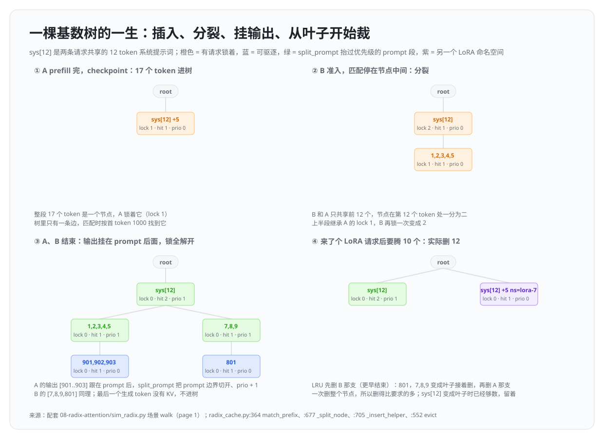
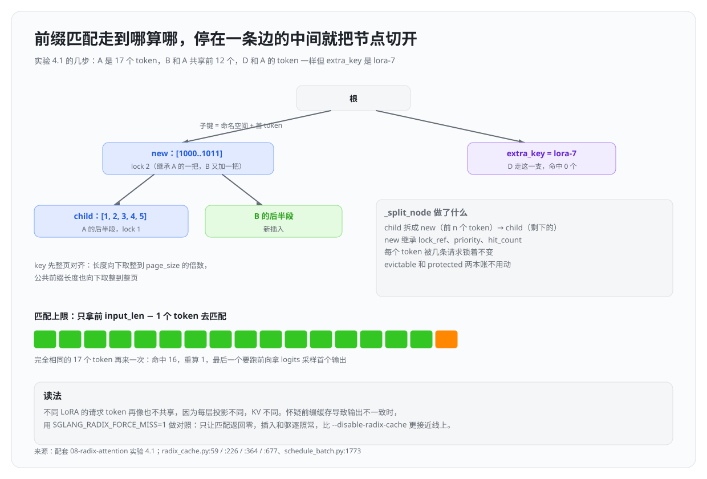
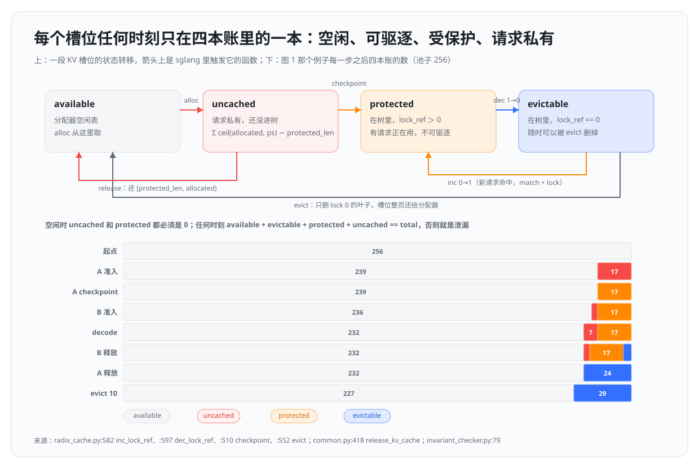
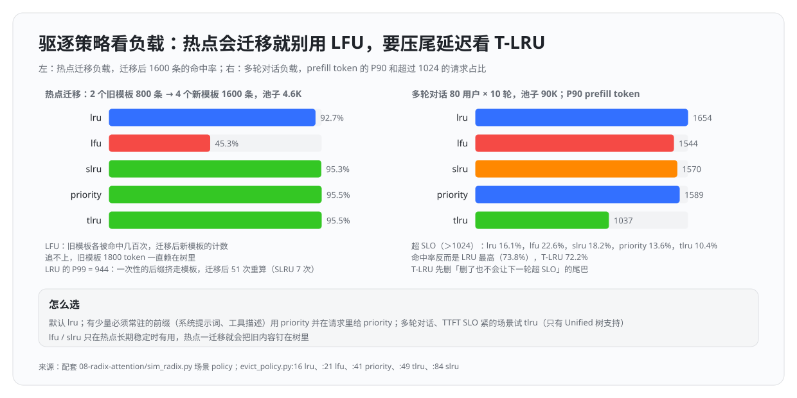
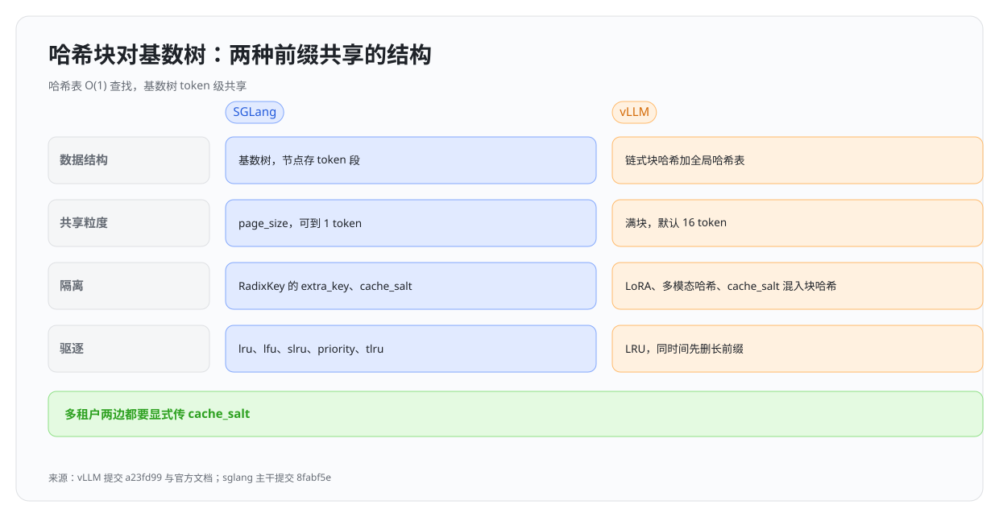
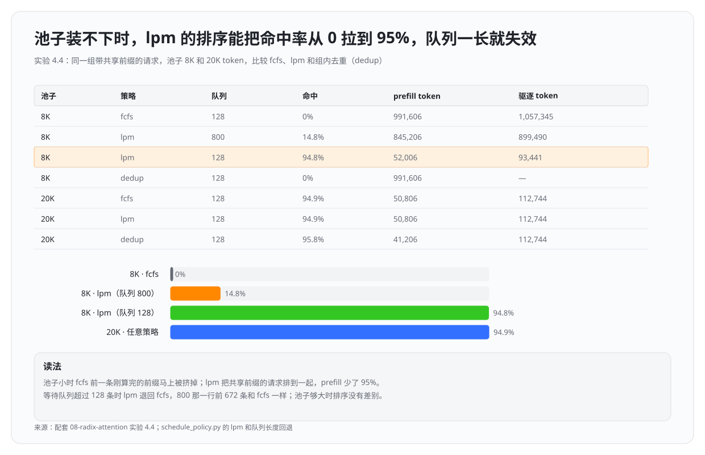

# SGL-08｜原理｜RadixAttention：基数树的匹配、插入、加锁与驱逐

> 🎯 <p><b>遇到的问题</b>：[SGL-07｜原理｜内存池与页表：req_to_token、token_to_kv 与 page size](./07-memory-pool.md) 里请求结束时把整页 KV 交给前缀树，新请求从树里拿走命中的槽位，分配器不够时还要树来驱逐。这一篇讲那棵树。SGLang 把所有请求的 token 序列放进一棵基数树（radix tree），每条边是一段 token，边上挂着这段 token 的 KV 槽位号。新请求先沿树走一遍，走到哪里，前面这些 token 的 KV 就不用再算。</p><p>论文管这套机制叫 RadixAttention，名字里有 attention，代码其实全在 mem_cache 里，attention 层只是照常读 req_to_token。本篇回答四个问题：树怎么匹配和分裂，正在用的前缀靠什么不被驱逐，几种驱逐顺序各适合什么负载，怎么判断自己改的代码有没有漏掉 KV。</p><p><b>主线</b>：前缀命中省下的是重算，代价是要维护一棵会分裂、会加锁、会被驱逐的树；这一篇讲这棵树怎样在省算力和占显存之间取舍。</p><p><b>读完这一篇</b>：能看着 lock_ref 和 hit_count 说清哪些节点能驱逐、按什么顺序。#cached-token 偏低时，能分清是池子、调度顺序、page size、LoRA 命名空间还是 n 采样的问题。能按负载选驱逐策略，认出四种泄漏各留下什么痕迹。</p><p><b>代码</b>：<a href="../08-radix-attention">zero-to-sglang/08-radix-attention</a>。radix_core.py 逐行复刻经典 RadixCache，包括命名空间、匹配分裂、两本锁账、只删叶子的堆驱逐和七种驱逐策略。sim_radix.py 把匹配、加锁、分配、decode、释放串成最小调度器，跑七个场景。只用标准库，一分钟内跑完，行号按主干 8fabf5e 核对。</p>

# 导读 · 结论先行

1. **树里存的是槽位号，KV 本身不动。**每个节点的 key 是一段 token，value 是这段 token 在 KV 池里的槽位号。命中就是把树里的槽位号抄进新请求的 req_to_token 行，前缀部分跳过 prefill。
2. **匹配停在节点中间就分裂。**新请求和某条边只共享前一半时，这条边在分歧点切成两段，前段继承原节点的锁计数、优先级和命中次数。插入走的是同一条路，只是走到头以后把剩下的 token 挂成新叶子。
3. **lock_ref 决定能不能驱逐。**请求准入时从命中的节点一路加锁到根，结束时一路解锁。lock_ref 从 0 变 1 的那一刻，这段长度从 evictable 挪到 protected；任何时刻 available + evictable + protected + uncached 等于池子总量，空闲时 protected 和 uncached 都必须是 0。
4. **驱逐只删没锁的叶子。**所有可驱逐叶子按策略建小根堆，弹一个删一个；父节点因此变成无锁叶子时压回堆里。默认按最近访问时间（lru）。热点会迁移时别用 lfu，旧内容会被钉在树里；多轮对话要压尾延迟，T-LRU 在模拟里把超 1024 token 的请求占比从 16.1% 压到 10.4%。
5. **命中率不只看池子。**调度顺序、page size、LoRA、n 采样都会改命中率。lpm 在等待队列超过 128 条时退回 fcfs。同一批里的 n 条采样互相看不到前缀，要靠预热。不同 LoRA 的请求哪怕 token 完全相同也走不到同一棵子树。



上图是实验 4.1 里一棵树的四个时刻。A 的 17 个 token 先整段进树；B 和 A 共享 12 个 token 的系统提示词，匹配停在 A 的节点中间，节点在第 12 个 token 处一分为二，上半段被两条请求一起锁住（lock 2）。两条请求结束后，输出挂在 prompt 后面，split_prompt 把 prompt 边界切开并把 prompt 段的优先级抬高 1。最后池子要腾 10 个 token，LRU 先删 B 那一支，再删 A 那一支，实际删了 12 个。

**📎 与系列其他文档的分工**：调度器怎么按 KV 余量收请求、lpm 和 dfs-weight 怎么排队，见 [SGL-05｜原理｜调度器：waiting、running 与 KV 预算](./05-scheduler.md)。槽位和页怎么分配、为什么前缀树只收整页，见 [SGL-07｜原理｜内存池与页表：req_to_token、token_to_kv 与 page size](./07-memory-pool.md)。overlap 调度下 checkpoint 和下一批准入的先后，留给 [SGL-09｜原理｜Overlap 调度与 CUDA Graph：把 CPU 开销藏到 GPU 后面](./09-overlap-cudagraph.md)。树之外再挂 CPU 内存和远端存储做第二、三级缓存，留给 [SGL-14｜原理｜HiCache：显存、主机内存、远端存储三层 KV 缓存](./14-hicache.md)。PD 分离时 decode 侧要不要建树，留给 [SGL-15｜原理｜PD 分离：prefill 和 decode 拆到两组卡上](./15-pd-disagg.md)。LoRA 请求的批处理，留给 [SGL-16｜原理｜结构化输出与多 LoRA：约束解码和 adapter 批处理的代价](./16-structured-lora.md)。按负载调参的完整流程，留给 [SGL-17｜实战｜参数调优手册：从日志倒推配置](./17-tuning.md)。cache_hit_rate 怎么上监控，留给 [SGL-18｜实战｜可观测与 profiling：从指标到 kernel](./18-observability.md)。多副本之间按前缀路由，留给 [SGL-19｜实战｜集群与 RL rollout：路由、权重同步与长尾](./19-cluster-rl.md)。

# 第 1 章 · 问题：同样的系统提示词，为什么还在重算

线上常见的情形：

- 所有请求都带同一段 2000 token 的系统提示词，日志里 #cached-token 却时高时低，压测高峰时接近 0。
- 给服务加了 LoRA 以后，同样的提示词命中率从 90% 掉到个位数。
- 用 n=8 做 self-consistency，期望 8 条采样共享 prompt，TTFT 却和单独发 8 条差不多。
- 把 --schedule-policy 改成 lpm，低负载时命中率明显上去了，高负载时又回到原样。
- 空闲了十分钟，token usage 还停在 20% 多，新请求的可用池子越来越小。
- 自己改了 release 或 abort 的路径后，偶发输出乱码，没有任何报错。
- 想让系统提示词常驻，试了 lfu，热门模板换了一批以后命中率反而掉了一半。

这些现象分别落在树的匹配、加锁、驱逐和调度配合上。下面先讲论文为什么选基数树，再按「key、匹配、插入、checkpoint、锁、驱逐、策略、生产实现」的顺序拆，最后对照 vLLM 的哈希块方案和 mini-sglang 的简化实现。

| 想弄清的现象 | 看哪一节 |
|-|-|
| 为什么用基数树，命中率能到多少 | 2.1 |
| LoRA、cache_salt 为什么让命中率掉下来 | 2.2 |
| 完全相同的请求为什么还要算 1 个 token | 2.3 |
| 请求还没结束，前缀什么时候进树 | 2.5 |
| 空闲时 token usage 不归零，或者输出乱码 | 2.6、4.7 |
| 要腾 10 个 token 为什么删了 12 个 | 2.7 |
| lru、lfu、slru、priority、tlru 怎么选 | 2.8、4.3 |
| 线上实际跑的是哪棵树 | 2.9 |
| lpm 为什么在高负载时失效，n 采样为什么要预热 | 4.4、4.5 |

# 第 2 章 · 原理：一棵存槽位号的基数树

## 2.1 为什么是基数树

在 SGLang 之前，vLLM 的 PagedAttention 已经能在同一条请求的 n 次采样之间共享 KV，但跨请求复用要调用方显式声明[[1]](https://arxiv.org/abs/2309.06180)。SGLang 论文观察到 LLM 程序里大量的共享是隐式的：few-shot 的示例、多轮对话的历史、Agent 每一步都带的工具描述、tree-of-thought 的公共前缀。它的做法是请求结束后 KV 不立刻释放，整段 token 序列连同槽位号插进一棵基数树；新请求来了先做最长前缀匹配，命中部分直接复用[[2]](https://arxiv.org/abs/2312.07104)。

选基数树，是因为前缀共享天然是树形的：两条请求共享前 k 个 token，就在第 k 个 token 处分叉。基数树把没有分叉的一串 token 压成一条边，节点数和分叉数同阶，匹配代价和命中长度成正比，和树里存了多少 token 无关。论文在 few-shot、多轮对话、自洽采样、Agent 等负载上测到 50% 到 99% 的命中率，吞吐最高提高 6.4 倍；缓存感知调度拿到的命中率平均是理论最优的 96%[[2]](https://arxiv.org/abs/2312.07104)。LMSYS 发布 RadixAttention 时的博客给的是最高 5 倍吞吐[[3]](https://www.lmsys.org/blog/2024-01-17-sglang/)。

论文还证明了一个结论：一批请求按基数树的深度优先顺序处理，在缓存放得下最长请求时命中率最优；lpm（最长前缀优先）是这个顺序的近似。所以树和调度是一起设计的，[SGL-05｜原理｜调度器：waiting、running 与 KV 预算](./05-scheduler.md) 讲过的 lpm 和 dfs-weight 两种排序就是这个结论的落地[（schedule_policy.py:506 \_sort_by_dfs_weight）](https://github.com/sgl-project/sglang/blob/8fabf5e/python/sglang/srt/managers/schedule_policy.py#L506)。树负责「能复用多少」，调度负责「按什么顺序跑才能少被驱逐」。

名字容易误导。[layers/radix_attention.py:60](https://github.com/sgl-project/sglang/blob/8fabf5e/python/sglang/srt/layers/radix_attention.py#L60) 里的 RadixAttention 只是一个 attention 层的外壳，forward 最后调 get_attn_backend().forward，和树没有任何关系。树在 mem_cache 里，经典实现是 radix_cache.py，线上默认是 unified_radix_cache.py。

attention kernel 看到的只是一张 req_to_token 表，前缀槽位是树里抄过来的还是新分配的，它分不出来。共享前缀上的 attention 还能进一步优化，Hydragen 把共享前缀和各自后缀拆开算，前缀部分把多条请求的 query 拼起来做矩阵乘[[4]](https://arxiv.org/abs/2402.05099)，那是 kernel 层的事，[SGL-10｜原理｜注意力后端：FlashInfer、FA3、Triton、TRTLLM 怎么选、怎么接进 CUDA Graph](./10-attention-backend.md) 再讲。

## 2.2 key：token、命名空间和整页对齐

树的 key 是 RadixKey：一段 token id，加一个 extra_key 和一个 cache_salt[（radix_cache.py:59）](https://github.com/sgl-project/sglang/blob/8fabf5e/python/sglang/srt/mem_cache/radix_cache.py#L59)。extra_key 由调用方在请求里传[（io_struct.py:325）](https://github.com/sgl-project/sglang/blob/8fabf5e/python/sglang/srt/managers/io_struct.py#L325)，Req 构造时会把 lora_id 拼到它后面[（schedule_batch.py:1171）](https://github.com/sgl-project/sglang/blob/8fabf5e/python/sglang/srt/managers/schedule_batch.py#L1171)；cache_salt 也是请求字段[（io_struct.py:370）](https://github.com/sgl-project/sglang/blob/8fabf5e/python/sglang/srt/managers/io_struct.py#L370)，用来在多租户之间隔离相同的前缀。

命名空间只体现在 child_key 上。child_key_at 在 page_size=1 时取单个 token，大于 1 时取整页 token 组成的 tuple；有 extra_key 或 salt 时把它们拼进去[（radix_cache.py:226）](https://github.com/sgl-project/sglang/blob/8fabf5e/python/sglang/srt/mem_cache/radix_cache.py#L226)。

根节点下的分叉键因此是「命名空间 + 首 token」，不同 LoRA 的请求哪怕 token 完全一样，也会落到根下面的不同分支，彼此不共享。实验 4.1 第 6 步就是这个情况：D 和 A 的 17 个 token 一模一样，只是 extra_key 换成 lora-7，命中 0 个。这是正确性要求，LoRA 改了每层的投影，同样的 token 算出来的 KV 不同。

整页对齐在 page_aligned 里做：长度向下取整到 page_size 的倍数[（radix_cache.py:147）](https://github.com/sgl-project/sglang/blob/8fabf5e/python/sglang/srt/mem_cache/radix_cache.py#L147)；match 返回的公共前缀长度也向下取整到整页[（:178）](https://github.com/sgl-project/sglang/blob/8fabf5e/python/sglang/srt/mem_cache/radix_cache.py#L178)[（:182）](https://github.com/sgl-project/sglang/blob/8fabf5e/python/sglang/srt/mem_cache/radix_cache.py#L182)。源码找第一个不同位置用的是倍增加二分，结果和逐个比较一样，只是长 key 上更快。整页对齐的后果 [SGL-07｜原理｜内存池与页表：req_to_token、token_to_kv 与 page size](./07-memory-pool.md) 已经算过：每条请求平均丢半页命中，比一页短的前缀命中不了。

## 2.3 匹配：走到哪里算哪里，停在中间就分裂

match_prefix 先把 key 整页对齐，然后从根开始，每一步用 child_key 找子节点，比较子节点的 key 和剩余 key 的公共长度[（radix_cache.py:364）](https://github.com/sgl-project/sglang/blob/8fabf5e/python/sglang/srt/mem_cache/radix_cache.py#L364)。公共长度等于子节点 key 长度，就把这个节点的槽位号接到结果上，继续往下走；小于子节点 key 长度，说明匹配停在这条边的中间，调 \_split_node 把它切开，再把前半段的槽位号接上，停止。沿路每个节点的 last_access_time 都刷新成当前时间，LRU 靠的就是这个时间戳。

\_split_node 把 child 拆成 new（前 n 个 token）→ child（剩下的）[（radix_cache.py:677）](https://github.com/sgl-project/sglang/blob/8fabf5e/python/sglang/srt/mem_cache/radix_cache.py#L677)。new 继承 child 的 lock_ref、priority 和 hit_count，所以分裂前后每个 token 被几条请求锁着没有变，evictable 和 protected 两本账也不用动。实验里 B 分裂 A 的节点后，上半段 [1000..1011] 是 lock 2，下半段 [1, 2, 3, 4, 5] 是 lock 1：上半段继承了 A 的那把锁，B 准入时又加了一把。

匹配有一个上限：调度器只拿 input_ids 的前 input_len − 1 个去匹配[（schedule_batch.py:1773 \_compute_max_prefix_len）](https://github.com/sgl-project/sglang/blob/8fabf5e/python/sglang/srt/managers/schedule_batch.py#L1773)。最后一个 token 必须真的跑一遍前向，才能拿到它的 logits 采样第一个输出 token。

请求带 return_logprob 时，上限还要再和 logprob_start_len 取小，因为要返回这些位置的 logprob。实验 4.1 第 5 步，完全相同的 17 个 token 再来一次，命中 16，重算 1。mini-sglang 也是这么做的，match_req 只匹配 input_ids[:input_len − 1][（scheduler/cache.py:27）](https://github.com/sgl-project/mini-sglang/blob/main/python/minisgl/scheduler/cache.py#L27)。

还有一个排障开关：SGLANG_RADIX_FORCE_MISS=1 时 match_kv_cache 直接返回零命中[（mem_cache/common.py:240）](https://github.com/sgl-project/sglang/blob/8fabf5e/python/sglang/srt/mem_cache/common.py#L240)，树照常插入和驱逐。怀疑前缀缓存导致输出不一致时，用它做对照，比 --disable-radix-cache 更接近线上路径。



## 2.4 插入：priority 取 max，hit_count 去重

insert 进入 \_insert_helper，前半段和匹配一样沿树往下走，遇到停在中间的情况同样分裂；走到头以后，剩下的 token 挂成一个新叶子[（radix_cache.py:428）](https://github.com/sgl-project/sglang/blob/8fabf5e/python/sglang/srt/mem_cache/radix_cache.py#L428)[（:705 \_insert_helper）](https://github.com/sgl-project/sglang/blob/8fabf5e/python/sglang/srt/mem_cache/radix_cache.py#L705)。新叶子刚插进来没人锁，它的长度直接计入 evictable_size\_。插入返回的是「树里已经有的前缀长度」，调用方拿它决定哪些槽位是重复的，要还给分配器。

路径上有两个统计要维护：

- **priority 沿路径取 max。**插入请求的 priority 会写到它经过的每一个节点上，只升不降。高优先级请求用过的系统提示词，哪怕后来被一堆低优先级请求共享，优先级也留在高位。
- **hit_count 只给新增的部分 +1。**每条请求带着 cache_inserted_len，记录自己已经插过多长。chunked prefill 分几块插入同一条请求时，只有超过 cache_inserted_len 的那段节点 hit_count 加 1，同一条请求不会把自己算成多次命中。lfu 和 slru 的排序都依赖 hit_count，这个去重直接决定它们的行为。

官方驱逐策略文档补了三种 hit_count 不加 1 的情况：chunked prefill 的中间块、被驱逐后重新插入的节点、HiCache write-back 模式下回写的节点[[5]](https://docs.sglang.io/docs/advanced_features/radix_eviction_policy)。所以 hit_count 的含义是「有多少条不同的请求完整用过这段前缀」，不是「被读了多少次」。

radix_cache.py 文件末尾的 \_\_main\_\_ 有一个五次插入的小例子，实验 4.1 第 0 步原样复刻：插入 [1,2,3]、再插一次 [1,2,3]、[1,2,4,5]、[1,2,4,5,6,7]、[8..12]。第二次插 [1,2,3] 树里已有 3 个、新增 0 个；插 [1,2,4,5] 时 [1,2,3] 在第 2 个 token 处分裂成 [1,2] → [3]。最后 [1,2] 的 hit 是 4，[3] 和 [4,5] 各是 2，[6,7] 是 1；匹配 [1,2,3,13,14] 命中 3 个。

## 2.5 checkpoint：请求还在跑，前缀先进树

早期版本只在请求结束时把 KV 插进树。现在的主干在每一块 prefill 跑完后都调 checkpoint_kv_cache[（mem_cache/common.py:271）](https://github.com/sgl-project/sglang/blob/8fabf5e/python/sglang/srt/mem_cache/common.py#L271)[（batch_result_processor.py:393）](https://github.com/sgl-project/sglang/blob/8fabf5e/python/sglang/srt/managers/scheduler_components/batch_result_processor.py#L393)，让还在 decode 的请求的 prompt 立刻对别人可见。checkpoint 做五件事[（radix_cache.py:510）](https://github.com/sgl-project/sglang/blob/8fabf5e/python/sglang/srt/mem_cache/radix_cache.py#L510)[（:450 \_insert_cache）](https://github.com/sgl-project/sglang/blob/8fabf5e/python/sglang/srt/mem_cache/radix_cache.py#L450)：

1. 把 [0, up_to) 的 token 整页对齐后插进树，priority 取请求自己的 priority，没有就是 0。
2. 树里原本就有的前缀，这条请求自己算出来的那一份槽位是重复的，free_segment 把 [cache_protected_len, prefix_len) 还给分配器。
3. 重新匹配一次，把树里的槽位号写回这条请求的 req_to_token 行 [cache_protected_len, len(new_indices))，让请求和树指向同一份 KV。
4. cache_protected_len 前移到新的匹配长度，表示这一段已经归树所有、受锁保护。
5. 先解旧节点的锁，再锁新的叶子。锁从准入时命中的那个节点，挪到这次插入的最深处。

split_prompt 是 checkpoint 时多做的一步。整条序列插完以后，再单独插一次 prompt 部分（origin_input_ids 整页对齐），优先级设成 priority + 1[（radix_cache.py:485）](https://github.com/sgl-project/sglang/blob/8fabf5e/python/sglang/srt/mem_cache/radix_cache.py#L485)。这次插入不新增任何 token，只是在 prompt 和输出的边界上把叶子切开，并把 prompt 段的 priority 抬高 1。效果是驱逐时能单独丢掉输出、留下 prompt。实验 4.1 第 4 步的树里，两段 prompt 节点 prio 都是 1，A 的输出 [901, 902, 903] 和 B 的 [801] 都是 prio 0。

请求结束时走 release_kv_cache[（mem_cache/common.py:418）](https://github.com/sgl-project/sglang/blob/8fabf5e/python/sglang/srt/mem_cache/common.py#L418)：正常结束先 checkpoint 一次把输出也放进树，然后把 [cache_protected_len, allocated) 这段不属于树的槽位还给分配器，最后解锁。被 abort 或 discard 的请求不做最后这次 checkpoint[（batch_result_processor.py:387）](https://github.com/sgl-project/sglang/blob/8fabf5e/python/sglang/srt/managers/scheduler_components/batch_result_processor.py#L387)，输出直接丢弃。最后一个生成的 token 还没写 KV，不进树，所以 A 生成 4 个 token，树里只多了 3 个。

## 2.6 两本账：lock_ref、evictable 和 protected

inc_lock_ref 从给定节点往根走，每个节点 lock_ref + 1；某个节点从 0 变成 1 的那一刻，它的 key 长度从 evictable_size\_ 挪到 protected_size\_[（radix_cache.py:582）](https://github.com/sgl-project/sglang/blob/8fabf5e/python/sglang/srt/mem_cache/radix_cache.py#L582)。dec_lock_ref 反过来，1 变 0 时挪回[（:597）](https://github.com/sgl-project/sglang/blob/8fabf5e/python/sglang/srt/mem_cache/radix_cache.py#L597)。根节点在 reset 时就是 lock_ref = 1、priority 取最小值，永远不会被驱逐[（:343）](https://github.com/sgl-project/sglang/blob/8fabf5e/python/sglang/srt/mem_cache/radix_cache.py#L343)。准入提交时调度器执行 req.lock = tree_cache.lock(last_node)[（schedule_policy.py:1695）](https://github.com/sgl-project/sglang/blob/8fabf5e/python/sglang/srt/managers/schedule_policy.py#L1695)，这把锁跟着请求一直到释放。



上图上半部分是一个 KV 槽位可能处在的四种状态。available 在分配器的空闲表里。uncached 是请求自己分配、还没进树的部分。protected 在树里且有请求锁着。evictable 在树里但没人锁，随时可能被驱逐。下半部分是实验 4.1 每一步之后四本账的数字，池子 256。调度器空闲时检查的就是这条不变式：available + evictable + protected + session_held + uncached == total[（invariant_checker.py:79）](https://github.com/sgl-project/sglang/blob/8fabf5e/python/sglang/srt/managers/scheduler_components/invariant_checker.py#L79)，本篇不涉及会话缓存，session_held 恒为 0。

两本账要分开记，是因为调度器问的是两个不同的问题。「还能收多少请求」看 available + evictable，可驱逐的部分随时能腾出来；「token usage 是多少」看 total − available − evictable，被锁住的才算真正在用。B 准入那一步，A 的 17 个 token 被两条请求锁着，protected 仍然是 17，分裂和第二把锁都不会让它重复计数。

dec_lock_ref 没有 lock_ref >= 0 的断言。多解一次锁，lock_ref 会变成 −1，下一条请求加锁时从 −1 变 0，没有经过 0 → 1，长度不会挪进 protected，这段前缀在被使用的同时还躺在可驱逐集合里。mini-sglang 的 lock_handle 在解锁时有 assert ref_count >= 0[（kvcache/radix_cache.py:113）](https://github.com/sgl-project/mini-sglang/blob/main/python/minisgl/kvcache/radix_cache.py#L113)，主干的经典树没有。

Unified 树的 sanity_check 会报 lock_ref < 0[（unified_tree_core.py:3088）](https://github.com/sgl-project/sglang/blob/8fabf5e/python/sglang/srt/mem_cache/unified_cache/unified_tree_core.py#L3088)，但它只在 SGLANG_ENABLE_TREE_CACHE_SANITY_CHECK 打开、且模型是 SWA 或 Mamba 混合架构时才被调用[（invariant_checker.py:484）](https://github.com/sgl-project/sglang/blob/8fabf5e/python/sglang/srt/managers/scheduler_components/invariant_checker.py#L484)。4.7 节会看到这是四种泄漏里最难查的一种。

## 2.7 驱逐：只删没锁的叶子

分配器不够时，evict_to_free_tokens 差多少就向树要多少[（allocator/base.py:155）](https://github.com/sgl-project/sglang/blob/8fabf5e/python/sglang/srt/mem_cache/allocator/base.py#L155)[（mem_cache/common.py:283）](https://github.com/sgl-project/sglang/blob/8fabf5e/python/sglang/srt/mem_cache/common.py#L283)。树的 evict 把所有可驱逐叶子（没有子节点、lock_ref == 0）按驱逐策略的打分建小根堆，弹出一个，把它的槽位还给分配器，从父节点上摘掉；摘完以后父节点如果没有子节点、也没人锁，就压回堆里继续参与[（radix_cache.py:552）](https://github.com/sgl-project/sglang/blob/8fabf5e/python/sglang/srt/mem_cache/radix_cache.py#L552)[（:780 \_delete_leaf）](https://github.com/sgl-project/sglang/blob/8fabf5e/python/sglang/srt/mem_cache/radix_cache.py#L780)。源码在 \_update_leaf_status 里增量维护可驱逐叶子集合[（:790）](https://github.com/sgl-project/sglang/blob/8fabf5e/python/sglang/srt/mem_cache/radix_cache.py#L790)，模拟里每次现场遍历，结果一样。

只删叶子是基数树的结构要求：中间节点被删了，它下面的节点就接不到根上，前缀匹配走不过去。级联是这个规则的自然结果，一条分支从叶子开始一节一节往上删，删到有锁或者有别的子节点的地方停下。

一次删一整个节点，所以实际删的数量经常比要求的多。实验 4.1 第 7 步要腾 10 个 token：LRU 先删 B 那一支，[801] 1 个，[7, 8, 9] 变成叶子接着删 3 个；再删 A 那一支，[901, 902, 903] 3 个、[1, 2, 3, 4, 5] 5 个，合计 12 个。这时 sys[12] 变成叶子，但已经够数，留了下来。LoRA 那棵子树是最近插入的，排在最后。

## 2.8 驱逐策略：七种打分函数

驱逐策略只是一个打分函数，返回值越小越先被驱逐，堆是小根堆[（evict_policy.py:16）](https://github.com/sgl-project/sglang/blob/8fabf5e/python/sglang/srt/mem_cache/evict_policy.py#L16)。CLI 上能选的有五种，fifo、mru、filo 只在代码里[[5]](https://docs.sglang.io/docs/advanced_features/radix_eviction_policy)：

| 策略 | 打分 | 适合什么 |
|-|-|-|
| lru（默认） | last_access_time | 大多数负载；没有特别理由就用它 |
| lfu | (hit_count, last_access_time) | 热点长期稳定，冷门的一次性请求多 |
| slru | (hit_count >= 阈值 ? 1 : 0, last_access_time) | 同上，但新内容只要被第二条请求用过就能进保护段 |
| priority | (priority, last_access_time) | 有必须常驻的前缀，请求里会给 priority |
| tlru | (TEL-safe ? −1 : 0, last_access_time) | 多轮对话、TTFT 有 SLO，只在 Unified 树上可用 |

slru 的保护阈值默认 2[（evict_policy.py:84）](https://github.com/sgl-project/sglang/blob/8fabf5e/python/sglang/srt/mem_cache/evict_policy.py#L84)。priority 有个细节：节点的 priority 是插入过它的请求的最大值，没开优先级调度时所有请求都是 0，这个策略在官方文档的描述里就退化成 lru[[5]](https://docs.sglang.io/docs/advanced_features/radix_eviction_policy)。但 split_prompt 会把 prompt 段抬到 1，所以即使请求都不带 priority，priority 策略也会先删输出、后删 prompt。4.3 节的模拟里 priority 在两种负载上都比 lru 好，原因就是这一条。

T-LRU 来自 2025 年的 Tail-Optimized Caching 论文。它的观察是：一段对话历史长 L，下一轮预计再来 Q 个 token，只要缓存里保留 L + Q − T 个 token，下一轮的 prefill 就不会超过 T（TTFT 的预算），再多留的部分对尾延迟没有帮助，称为 TEL-safe。驱逐时先删 TEL-safe 的尾巴，删完再按 LRU。论文在真实对话轨迹上测到 P90 TTFT 降低 27.5%、P95 降低 23.9%，SLO 违约减少 38.9%[[6]](https://arxiv.org/abs/2510.15152)。源码的实现是[（evict_policy.py:49）](https://github.com/sgl-project/sglang/blob/8fabf5e/python/sglang/srt/mem_cache/evict_policy.py#L49)：

```python
budget = max(hist_len + next_prompt_estimate - threshold, 0)
tel_safe = cached_prefix_len - len(node.key) >= budget   # 删掉这个节点后，剩下的前缀仍然够用
return (-1 if tel_safe else 0, node.last_access_time)
```

hist_len 是这条分支到过的最大深度，尾巴被裁掉也不缩，否则裁一次以后预算重新算，会一路把整段对话删光。threshold 和 next_prompt_estimate 的单位是 token，论文用的是块，换算要乘 page_size[（evict_policy.py:49 注释）](https://github.com/sgl-project/sglang/blob/8fabf5e/python/sglang/srt/mem_cache/evict_policy.py#L49)。threshold 必须大于 next_prompt_estimate，否则没有任何节点是 TEL-safe，启动时直接报错[（kv_cache_hook.py:375）](https://github.com/sgl-project/sglang/blob/8fabf5e/python/sglang/srt/arg_groups/kv_cache_hook.py#L375)。tlru 只在 UnifiedRadixCache 上可用，其他树选它会抛 ValueError[（registry.py:261）](https://github.com/sgl-project/sglang/blob/8fabf5e/python/sglang/srt/mem_cache/registry.py#L261)。配置写法：

```bash
# 多轮对话，TTFT 预算约 4096 token 的 prefill，新消息平均 512 token
--radix-eviction-policy tlru \
--radix-eviction-policy-config '{"threshold": 4096, "next_prompt_estimate": 512}'

# slru，命中 4 次以上才进保护段
--radix-eviction-policy slru --radix-eviction-policy-config '{"protected_threshold": 4}'

# priority，配合请求里的 priority 字段
--radix-eviction-policy priority --enable-priority-scheduling
```



上图是 4.3 节两组模拟的结果。左边是热点迁移：前 800 条集中在 2 个旧模板上，之后换成 4 个新模板。LFU 迁移后的命中率只有 45.3%，旧模板各被命中了几百次，新模板的计数追不上，1800 个旧 token 到最后都没被删。右边是多轮对话：命中率最高的是 LRU（73.8%），P90 prefill token 最低的是 T-LRU（1037）。命中率高不等于尾延迟低，选策略前要先想清楚自己优化哪一个。

官方文档还强调了一点：驱逐策略只决定谁先走，不能保证谁一定留下[[5]](https://docs.sglang.io/docs/advanced_features/radix_eviction_policy)。池子不够时，protected 以外的所有节点最终都可能被删。真要让一段前缀常驻，办法是让它一直被某条请求锁着，或者把池子留够。

## 2.9 线上跑的是哪棵树：Unified 树和 Rust 核

radix_cache.py 是经典实现，代码短，适合读。线上默认走的是 UnifiedRadixCache：default_radix_cache_factory 在常规配置下返回 create_unified_radix_cache，纯 SWA 模型走 PureSWARadixCache，LMCache、FlexKV 等外部缓存有各自的分支[（mem_cache/registry.py:83）](https://github.com/sgl-project/sglang/blob/8fabf5e/python/sglang/srt/mem_cache/registry.py#L83)。Unified 树把全注意力 KV、SWA 窗口 KV、Mamba 状态当成同一棵树上的不同组件，每个组件各自记锁和驱逐，混合架构模型因此也能做前缀缓存[[7]](https://www.lmsys.org/blog/2026-08-11-unified-radix-cache)。

Unified 树的核心默认用 Rust 实现，环境变量 SGLANG_UNIFIED_RADIX_TREE_CORE_BACKEND 默认是 rust[（environ.py:745）](https://github.com/sgl-project/sglang/blob/8fabf5e/python/sglang/srt/environ.py#L745)。以下情况会退回 Python 核：开了会话缓存、有额外或自定义组件、非 Linux、torch 版本不在支持范围、设备不是 CPU 或 CUDA[（tree_core_registry.py:44）](https://github.com/sgl-project/sglang/blob/8fabf5e/python/sglang/srt/mem_cache/unified_cache/tree_core_registry.py#L44)。LMSYS 的博客给的数字是 Rust 核让 SWA 模型的 TTFT 降低 38%，全注意力模型降低 10%[[7]](https://www.lmsys.org/blog/2026-08-11-unified-radix-cache)，树操作在 CPU 上的耗时在高并发下不可忽略。

语义上两棵树一致：匹配分裂、priority 取 max、hit_count 去重、两本账、只删叶子。差别在 split_prompt：Unified 树只在只有一个 BASE 组件时才做[（unified_radix_cache.py:1285）](https://github.com/sgl-project/sglang/blob/8fabf5e/python/sglang/srt/mem_cache/unified_radix_cache.py#L1285)，SWA 和 Mamba 混合模型上 prompt 和输出不切开，priority 策略的「先删输出」也就不成立。T-LRU 需要的两个长度字段也只在 Unified 树上维护。

## 2.10 vLLM 怎么做

vLLM 的 Automatic Prefix Caching 默认开启，它不建树，给每个满块算一个哈希。哈希的输入是这个块的 token 加上父块的哈希，所以一个哈希值唯一代表从开头到这个块的整段前缀；全局一张表把哈希映射到物理块，新请求按块逐个查表[[8]](https://docs.vllm.ai/en/latest/design/prefix_caching.html)。哈希算法默认 sha256，也可选 sha256_cbor、xxhash 和 xxhash_cbor；LoRA ID、多模态输入的哈希和 cache_salt 都会混进块哈希，避免不同适配器或租户串用 KV[[9]](https://github.com/vllm-project/vllm/blob/a23fd9903418de0e1d3757bb23e2f1697eb066f3/vllm/v1/core/kv_cache_utils.py)。

驱逐在引用计数为 0 的块里按 LRU 选，最近访问时间相同时先删前缀更长的块，因为它更靠近尾部、被复用的概率更低[[8]](https://docs.vllm.ai/en/latest/design/prefix_caching.html)。SGLang 的 RadixKey 同样带 extra_key 和 cache_salt 做隔离，驱逐策略则可选 lru、lfu、slru、priority 和 tlru。

两种结构的取舍很直接。哈希表查找是 O(1)，结构简单，天然适合跨机分布式地查；粒度被块大小锁死，不满一块的前缀不能共享。基数树在 page_size=1 时能做到 token 级共享，匹配代价和命中长度成正比，代价是要维护分裂和锁的传播。GPU 之外的缓存分层留给 [SGL-14｜原理｜HiCache：显存、主机内存、远端存储三层 KV 缓存](./14-hicache.md)。

| 维度 | SGLang | vLLM | 差异的代价 |
|-|-|-|-|
| 数据结构 | 基数树，节点存 token 段 | 链式块哈希加全局哈希表 | 树要维护分裂和锁，哈希表要维护引用计数 |
| 共享粒度 | page_size，可到 1 token | 满块，默认 16 token | vLLM 尾部不满一块的前缀不共享 |
| 隔离 | RadixKey 的 extra_key、cache_salt | LoRA、多模态哈希、cache_salt 混入块哈希 | 多租户都要显式传 salt |
| 驱逐 | lru、lfu、slru、priority、tlru | LRU，同时间先删长前缀 | SGLang 可按业务换策略 |



## 2.11 mini-sglang 和课程里的简化版

mini-sglang 的基数树[[10]](https://github.com/sgl-project/mini-sglang)去掉了 priority、hit_count 和多种驱逐策略，只保留 LRU，适合先读一遍。几个对应点：split_at 是分裂[（kvcache/radix_cache.py:69）](https://github.com/sgl-project/mini-sglang/blob/main/python/minisgl/kvcache/radix_cache.py#L69)。lock_handle 是加解锁，解锁时有 ref_count >= 0 的断言[（:113）](https://github.com/sgl-project/mini-sglang/blob/main/python/minisgl/kvcache/radix_cache.py#L113)。insert_prefix 先 align_down 到整页再走树[（:136）](https://github.com/sgl-project/mini-sglang/blob/main/python/minisgl/kvcache/radix_cache.py#L136)。evict 断言要求的量不超过可驱逐总量，用堆弹叶子，父节点变叶子后压回[（:148）](https://github.com/sgl-project/mini-sglang/blob/main/python/minisgl/kvcache/radix_cache.py#L148)。

最值得读的是 scheduler/cache.py 里 cache_req 开头的注释[（scheduler/cache.py:55）](https://github.com/sgl-project/mini-sglang/blob/main/python/minisgl/scheduler/cache.py#L55)，它把一条请求的 KV 区间切成五段：[0, old.cached_len) 是准入时就在树里的。[old.cached_len, cached_len) 是这条请求自己算的、但在它跑的过程中被别的请求先插进了树，必须释放，否则泄漏。

[cached_len, new.cached_len) 是这次新插入的。[new.cached_len, req.cached_len) 是不满一页的尾巴，请求结束时释放。主干的 cache_protected_len 和 free_segment 做的是同一件事，只是变量名不同。

课程第 8 章（[RadixAttention 与前缀缓存](https://github.com/datawhalechina/zero-to-sglang/blob/main/course-material/ch/part2/第8章_RadixAttention与前缀缓存.md)）用一个例子走完 match、schedule、lock、evict、free 的完整生命周期，并指出一个容易忽略的点：共享成功的前缀页在请求结束时不会被释放，只会解锁，等空间压力触发驱逐时才真正回到空闲表[[11]](https://github.com/datawhalechina/zero-to-sglang)。配套的代码篇（[代码](https://github.com/datawhalechina/zero-to-sglang/blob/main/course-material/ch/part2/第8章_RadixAttention与前缀缓存_代码.md)）沿 mini-sglang 的 prefill 分配加锁、decode、结束和 abort 读一遍，读完再看主干的 checkpoint 会顺很多。

# 第 3 章 · 源码走读：一段前缀从命中到被驱逐的 18 个落脚点

按请求进入、准入、跑、结束、驱逐、检查的顺序排列，路径相对 python/sglang/srt/。

| # | 位置 | 发生了什么 |
|-|-|-|
| 1 | [schedule_batch.py:1171](https://github.com/sgl-project/sglang/blob/8fabf5e/python/sglang/srt/managers/schedule_batch.py#L1171) | extra_key 拼上 lora_id，cache_salt 存进 Req |
| 2 | [radix_cache.py:59 RadixKey](https://github.com/sgl-project/sglang/blob/8fabf5e/python/sglang/srt/mem_cache/radix_cache.py#L59) | token + extra_key + salt；:147 整页对齐，:226 child_key 带命名空间 |
| 3 | [schedule_batch.py:1773](https://github.com/sgl-project/sglang/blob/8fabf5e/python/sglang/srt/managers/schedule_batch.py#L1773) | 匹配上限 input_len − 1，return_logprob 时再和 logprob_start_len 取小 |
| 4 | [mem_cache/common.py:221 match_kv_cache](https://github.com/sgl-project/sglang/blob/8fabf5e/python/sglang/srt/mem_cache/common.py#L221) | 调树的 match_prefix；:240 SGLANG_RADIX_FORCE_MISS 强制零命中 |
| 5 | [radix_cache.py:364 match_prefix](https://github.com/sgl-project/sglang/blob/8fabf5e/python/sglang/srt/mem_cache/radix_cache.py#L364) | 沿树走，刷新 last_access_time，停在中间时分裂 |
| 6 | [radix_cache.py:677 \_split_node](https://github.com/sgl-project/sglang/blob/8fabf5e/python/sglang/srt/mem_cache/radix_cache.py#L677) | 前段继承 lock_ref、priority、hit_count |
| 7 | [schedule_policy.py:314](https://github.com/sgl-project/sglang/blob/8fabf5e/python/sglang/srt/managers/schedule_policy.py#L314) | 等待队列超过 128 条时 lpm、hrrn 退回 fcfs |
| 8 | [schedule_policy.py:356](https://github.com/sgl-project/sglang/blob/8fabf5e/python/sglang/srt/managers/schedule_policy.py#L356) | 批内去重：和队列前面的请求共享超过 32 token 的推后 |
| 9 | [schedule_policy.py:1695](https://github.com/sgl-project/sglang/blob/8fabf5e/python/sglang/srt/managers/schedule_policy.py#L1695) | 准入提交，req.lock = tree_cache.lock(last_node) |
| 10 | [radix_cache.py:582 inc_lock_ref](https://github.com/sgl-project/sglang/blob/8fabf5e/python/sglang/srt/mem_cache/radix_cache.py#L582) | 一路加锁到根，0 → 1 时 evictable 挪到 protected |
| 11 | [mem_cache/common.py:271 checkpoint_kv_cache](https://github.com/sgl-project/sglang/blob/8fabf5e/python/sglang/srt/mem_cache/common.py#L271) | 每块 prefill 之后把已算的部分发布进树 |
| 12 | [radix_cache.py:450 \_insert_cache](https://github.com/sgl-project/sglang/blob/8fabf5e/python/sglang/srt/mem_cache/radix_cache.py#L450) | 插入、释放重复槽位、split_prompt 再插一次 prompt |
| 13 | [radix_cache.py:705 \_insert_helper](https://github.com/sgl-project/sglang/blob/8fabf5e/python/sglang/srt/mem_cache/radix_cache.py#L705) | priority 取 max，超过 inserted_len 的部分 hit_count + 1 |
| 14 | [mem_cache/common.py:418 release_kv_cache](https://github.com/sgl-project/sglang/blob/8fabf5e/python/sglang/srt/mem_cache/common.py#L418) | checkpoint → 还 [protected_len, allocated) → 解锁 |
| 15 | [allocator/base.py:155](https://github.com/sgl-project/sglang/blob/8fabf5e/python/sglang/srt/mem_cache/allocator/base.py#L155) | 分配不够时差多少驱逐多少 |
| 16 | [radix_cache.py:552 evict](https://github.com/sgl-project/sglang/blob/8fabf5e/python/sglang/srt/mem_cache/radix_cache.py#L552) | 可驱逐叶子建堆，弹一个删一个，父节点压回 |
| 17 | [evict_policy.py:49 TLRUStrategy](https://github.com/sgl-project/sglang/blob/8fabf5e/python/sglang/srt/mem_cache/evict_policy.py#L49) | TEL-safe 的节点打分 −1，最先被删 |
| 18 | [invariant_checker.py:79](https://github.com/sgl-project/sglang/blob/8fabf5e/python/sglang/srt/managers/scheduler_components/invariant_checker.py#L79) | 空闲时核对五本账之和等于总量，不等就报泄漏 |

# 第 4 章 · 实验：在 CPU 上看树怎么长、怎么被裁

实验都在 CPU 上跑，只用标准库。radix_core.py 和源码的差别只有三处：时间用逻辑时钟，结果可复现。可驱逐叶子现场遍历，不做增量维护。T-LRU 的两个长度字段也放进经典树里算。所有数字都是模拟结果，用来看趋势和量级。

## 4.1 两条请求的完整生命周期

```bash
cd zero-to-sglang/08-radix-attention
python3 sim_radix.py --scenario walk --page-size 1
```

```text
[3] B 准入：和 A 共享 12 token 系统提示词，匹配停在 A 的节点中间 -> 分裂
  [1000, ..., 1011] len=12 lock=2 hit=1 prio=0
    [1, 2, 3, 4, 5] len=5 lock=1 hit=1 prio=0
  B 命中 12，B row 前 12 个槽位就是树里的：[1, 2, ..., 12]
  available 236 + evictable 0 + protected 17 + uncached 3 = 256 == total 256

[4] 两条都 decode，A 生成 4 个、B 生成 2 个后结束；B 先走
  B 释放后：available 232 + evictable 4 + protected 17 + uncached 3 = 256 == total 256
  A 释放后：available 232 + evictable 24 + protected 0 + uncached 0 = 256 == total 256
  [1000, ..., 1011] len=12 lock=0 hit=2 prio=1
    [1, 2, 3, 4, 5] len=5 lock=0 hit=1 prio=1
      [901, 902, 903] len=3 lock=0 hit=1 prio=0
    [7, 8, 9] len=3 lock=0 hit=1 prio=1
      [801] len=1 lock=0 hit=1 prio=0

[5] 完全一样的请求再来一次：max_prefix_len = input_len - 1
  输入 17 个，树里有完整的 17 个，但只匹配前 16 个：命中 16，prefill 重算 1 个

[6] 同样的 token，换一个 LoRA（extra_key）：命名空间不同，不共享
  D 命中 0

[7] 池子要腾 10 个 token：驱逐只动没锁的叶子，按 LRU
  要 10，实际删了 12（一次删整个节点），树里 41 -> 29
  available 227 + evictable 29 + protected 0 + uncached 0 = 256 == total 256
```

第 3 步 protected 是 17 不是 29：分裂出来的上半段只是把 A 原来那个节点切开，B 加的第二把锁没有经过 0 → 1，不重复计。uncached 3 是 B 自己的 [7, 8, 9]，还没进树。第 4 步 B 释放后 evictable 4，是 B 的 [7, 8, 9, 801] 进了树、没人锁；A 还锁着 17 个 prompt token，它的 3 个输出 token 还算 uncached。A 释放后 protected 和 uncached 都归零，空闲时看到的就该是这个状态。

同一个实验加 --page-size 4 再跑一遍，A 的 17 个 token 只有 16 个进树，checkpoint 后账上是 protected 16 + uncached 4；结束后 A 的输出节点变成 [5, 901, 902, 903]，B 的变成 [7, 8, 9, 801]：整页对齐把 prompt 边界吞掉了，split_prompt 切不出纯 prompt 段，这两个节点的 prio 都是 0。大页下 priority 策略「先删输出」的效果会打折扣。

## 4.2 命中率随池子大小

```bash
python3 sim_radix.py --scenario hitrate
```

```text
负载            输入 token       8K      16K      32K      64K     128K     256K       无限大
fewshot      1,488,090    73.7%    95.1%    94.9%    94.9%    94.9%    94.9%     94.9%
chat           629,494    28.9%    39.9%    54.4%    82.8%    90.0%    90.0%     90.0%
selfcons       729,656    99.8%    99.8%    99.8%    99.8%    99.8%    99.8%     99.8%
unique         503,637     0.0%     0.0%     0.0%     0.0%     0.0%     0.0%      0.0%
```

四种负载对池子大小的敏感度完全不同。fewshot 是 8 个 1200 token 的模板按 Zipf 分布被选中，8K 放不下全部 9600 token，热门的几个还在，命中 73.7%；16K 以后放得下所有模板，命中封顶。chat 是 60 个用户各聊 8 轮，每一轮都要带着全部历史，工作集随用户数线性增长，池子从 32K 到 64K 命中率从 54.4% 跳到 82.8%，这种负载最值得加显存。selfcons 有预热，池子多小都能命中。unique 没有任何共享，前缀缓存帮不上忙，开着也只多一点树操作的开销。

拿到自己的负载，先估工作集：活跃会话数 × 平均历史长度，或者模板数 × 模板长度。工作集明显大于 KV 池时，调驱逐策略的收益有限，该做的是加池子（调 --mem-fraction-static、KV 用 FP8）或者在多副本间按前缀路由。

## 4.3 五种驱逐策略 × 三种负载

```bash
python3 sim_radix.py --scenario policy
```

```text
[scan] 热模板 + 扫描洪峰，池子 48K，每批 16 条，1500 条
  策略             命中率     P90     P99    超 SLO    驱逐 token
  lru           35.0%    2563    2944    36.0%   1,312,179
  lfu           39.9%    2563    2944    36.0%   1,263,579
  priority      39.9%    2563    2944    36.0%   1,263,577

[shift] 热点迁移，池子 4.6K，每批 2 条，2400 条
  策略             命中率     P90     P99    超 SLO    驱逐 token    迁移后命中   旧模板残留
  lru           93.6%      57     944     0.0%     212,031      92.7%         0
  lfu           62.0%     948     959     0.0%     851,856      45.3%     1,800
  slru          95.3%      56      60     0.0%     178,731      95.3%         0
  priority      95.4%      56      60     0.0%     176,930      95.5%         0
  tlru          95.4%      56      60     0.0%     176,931      95.5%         0

[chat] 多轮对话 80 用户 × 10 轮，池子 90K，每批 16 条，800 条
  策略             命中率     P90     P99    超 SLO    驱逐 token
  lru           73.8%    1654    2584    16.1%     344,116
  lfu           65.0%    1544    2256    22.6%     430,497
  slru          67.1%    1570    2544    18.2%     407,312
  priority      72.5%    1589    2584    13.6%     355,275
  tlru          72.2%    1037    2498    10.4%     357,567
```

P90 和 P99 是每条请求真正要 prefill 的 token 数，当作 TTFT 的代理；超 SLO 是 prefill 超过 1024 token 的请求占比。tlru 的 threshold 取 1024，next_prompt_estimate 取 75。三组结果各说明一件事：

- **scan**：6 个热模板反复命中，每隔 150 条来 60 条互不相同的 1500 到 3000 token 长文档。lfu、slru、priority 都能挡住扫描，命中率比 lru 高约 5 个点；但尾延迟由扫描请求本身决定，它们没有可命中的前缀，哪种策略都救不了，五种策略的 P90 和超 SLO 完全一样。
- **shift**：LRU 的 P99 是 944，迁移之后有 51 条请求的模板被一次性的问题后缀挤走、要重算整个模板，SLRU 只有 7 条。LFU 最差，旧模板各被命中几百次，迁移后新模板的计数长期追不上，旧模板的 1800 个 token 到跑完都没被删，迁移后命中只有 45.3%。priority 和 tlru 在这里拿到最好的结果，靠的是 split_prompt 把模板段抬到 prio 1，先删后缀。
- **chat**：命中率最高的是 LRU，尾延迟最好的是 T-LRU。T-LRU 先删「删了也不会让下一轮超 SLO」的那段历史尾巴，命中率只低 1.6 个点，P90 从 1654 降到 1037，超 SLO 从 16.1% 降到 10.4%，和论文报告的方向一致。LFU 在对话负载上最差，早期对话的系统提示词计数高，新对话的历史计数低，被优先删掉的恰好是马上要用的。

真实负载往往是几种的混合。我们的做法是先用 lru 拿一个基线，看 /metrics 上的 cache_hit_rate 和 TTFT 分位数。多轮对话、TTFT SLO 紧的场景试 tlru。有少数必须常驻的前缀，用 priority 并在请求里给 priority。lfu 和 slru 只在确认热点长期稳定时才用。

## 4.4 出队顺序：fcfs、lpm 和批内去重

```bash
python3 sim_radix.py --scenario order
```

```text
8 个模板（每个 1200 token，共 9600）按到达顺序轮流来，800 条，lru，每批 16 条。

      池子     顺序    队列      命中率  prefill token    驱逐 token
      8K   fcfs   128     0.0%        991,606   1,057,345
      8K    lpm   800    14.8%        845,206     899,490
      8K    lpm   128    94.8%         52,006      93,441
      8K  dedup   128     0.0%        991,606   1,057,345
     20K   fcfs   128    94.9%         50,806     112,744
     20K    lpm   128    94.9%         50,806     112,744
     20K  dedup   128    95.8%         41,206     112,744
```

8K + fcfs 命中 0：8 个模板轮流访问、池子只放得下 6 个，LRU 每次都恰好把下一个要用的模板赶走。这是 LRU 在循环扫描下的经典病态。lpm 把命中长的请求排到前面，同一个模板的请求聚在一起跑，命中回到 94.8%，prefill 量降到原来的二十分之一。

问题出在队列长度。等待队列超过 128 条时，lpm 和 hrrn 退回 fcfs[（schedule_policy.py:314）](https://github.com/sgl-project/sglang/blob/8fabf5e/python/sglang/srt/managers/schedule_policy.py#L314)，因为排序前要对队列里每条请求做一次前缀匹配，队列长了这一步本身就扛不住[（:137 WAITING_QUEUE_PREFIX_MATCH_MAX）](https://github.com/sgl-project/sglang/blob/8fabf5e/python/sglang/srt/managers/schedule_policy.py#L137)。

「lpm 800」那一行，前 672 条和 fcfs 完全一样，只有队列排空到 128 条以内才开始排序，14.8% 全来自尾巴。高负载时恰恰是队列最长的时候，lpm 的收益在最需要它的时候消失。--schedule-policy 默认是 fcfs[（arg_groups/fields/schedule.py:86）](https://github.com/sgl-project/sglang/blob/8fabf5e/python/sglang/srt/arg_groups/fields/schedule.py#L86)，官方调参文档也只建议在前缀共享多的负载上改成 lpm[[12]](https://docs.sglang.io/docs/advanced_features/hyperparameter_tuning)。

dedup 对应 \_compute_prefix_matches 里的批内去重[（schedule_policy.py:356）](https://github.com/sgl-project/sglang/blob/8fabf5e/python/sglang/srt/managers/schedule_policy.py#L356)：同一批里和排在前面的请求共享 32 个以上 token 的，推到下一批，让前面那条先把前缀放进树。池子够大时（20K）它把 prefill 从 50,806 降到 41,206；池子太小时（8K）推后的请求等到下一批，模板已经被赶走了，帮不上忙。

两个阈值由环境变量 IN_BATCH_PREFIX_CACHING_CHECK_THRESHOLD 和 IN_BATCH_PREFIX_CACHING_DEPRIORITIZE_THRESHOLD 控制，默认都是 32[（:110）](https://github.com/sgl-project/sglang/blob/8fabf5e/python/sglang/srt/managers/schedule_policy.py#L110)。真正解决「队列长了就没有缓存感知」的办法在副本之外：多副本之间按前缀路由，让每个副本的队列短、模板集中，这是 Preble 和 SGLang 路由器做的事[[13]](https://arxiv.org/abs/2407.00023)，[SGL-19｜实战｜集群与 RL rollout：路由、权重同步与长尾](./19-cluster-rl.md) 展开。



## 4.5 n 采样要预热

```bash
python3 sim_radix.py --scenario nsample
```

```text
self-consistency：150 个问题，每个采 8 条（n = 8），问题 300-900 token。池子 64K，每批 16 条。

  做法                             命中率  prefill token
  8 条一起进同一批                      0.0%        729,656
  先发一条 max_new_tokens=0         99.8%         92,407
```

同一批的 8 条采样在准入时都看不到彼此，前缀还没进树，8 份 prompt 各算一遍。tokenizer_manager 对 n > 1 的请求默认先发一条 max_new_tokens=0 的请求，把 prompt 放进树，再发 n 条实际的采样[（tokenizer_manager.py:2130）](https://github.com/sgl-project/sglang/blob/8fabf5e/python/sglang/srt/managers/tokenizer_manager.py#L2130)；预热请求保留 LoRA 信息，前缀键和后续采样一致。走 HTTP 的 n 参数就自动有这一步，自己在客户端并发发 8 条相同请求就没有，这时要么改用 n，要么自己先发一条预热。

## 4.6 page size 对命中和节点数的影响

```bash
python3 sim_radix.py --scenario pagesize
```

```text
  负载         ps      命中率     节点数      平均节点长度   树里 token
  fewshot     1    94.9%    1706          38     63,995
  fewshot    16    94.9%    1879          34     63,776
  fewshot    64    91.1%     848          74     62,976
  fewshot   128    91.1%     202         169     34,048
  chat        1    82.8%     276         227     62,780
  chat       16    82.0%     267         234     62,464
  chat       64    79.5%     244         251     61,312
  chat      128    78.0%     207         291     60,288
```

ps 变大以后匹配按整页截断，每条请求平均丢半页命中：chat 从 82.8% 掉到 78.0%。节点数变少，匹配时少走几步，但 fewshot 在 ps 128 时树里只剩 34,048 个 token，池子有一半是空的：一次删一整个大节点，删得过多。page size 的选择 [SGL-07｜原理｜内存池与页表：req_to_token、token_to_kv 与 page size](./07-memory-pool.md) 已经讲过，这里只补一条：开大页之前把系统提示词长度对齐到页的整数倍，命中损失能少一大半。

## 4.7 四类泄漏

```bash
python3 sim_radix.py --scenario leak
```

```text
[0] 正确释放
  available 92 + evictable 36 + protected 0 + uncached 0 = 128 == total 128

[1] 忘记解锁（release 漏了 dec_lock_ref）
  available 92 + evictable 0 + protected 36 + uncached 0 = 128 == total 128
  空闲时 token usage = 28% 不归零；evict(全部) 实际删掉 0

[2] 忘记释放（release 漏了 free [cache_protected_len, 已分配)）
  available 88 + evictable 36 + protected 0 + uncached 0 = 124 != total 128

[3] 重复释放（同一段槽位 free 两次）
  available 96 + evictable 36 + protected 0 + uncached 0 = 132 != total 128
  接下来两次分配拿到 [40, 41, 42, 43] 和 [40, 41, 42, 43]

[4] 重复解锁（dec_lock_ref 调了两次）
  available 92 + evictable 36 + protected 0 + uncached 0 = 128 == total 128
  B 命中 36 并加锁，lock_ref 从 -1 变 0，没有挪进 protected：
  available 88 + evictable 36 + protected 0 + uncached 4 = 128 == total 128
  B 还在跑，evict(全部) 删掉 36 个 token，B 正在用的前缀槽位 [4, 5, 6, 7]… 已经回到空闲表
```

起点相同：池子 128、page 4，A 有 36 个输入 token、生成 3 个，跑完 prefill 和 decode，然后在 release 这一步出错。四种 bug 留下的痕迹完全不同：

- **忘记解锁**：账是平的，锁住的 36 个 token 记在 protected 里，空闲检查抓不到。症状是空闲时 token usage 不归零，这些 token 永远驱逐不掉，每漏一次可用池子就永久少一截。定位办法是在测试里断言空闲时 protected_size() == 0。
- **忘记释放**：A 有 KV 的 38 个 token 里整页的 36 个进了树，最后一页不满不进树，本该由 release 还给分配器。账少了 4 个，调度器空闲时报 pool memory leak detected[（scheduler.py:5366）](https://github.com/sgl-project/sglang/blob/8fabf5e/python/sglang/srt/managers/scheduler.py#L5366)；SGLANG_ENABLE_STRICT_MEM_CHECK_DURING_IDLE 默认开，直接抛异常[（environ.py:504）](https://github.com/sgl-project/sglang/blob/8fabf5e/python/sglang/srt/environ.py#L504)。
- **重复释放**：同一页在空闲表里出现两次，账多出 4 个，接下来两次分配拿到同一页，两条请求的 KV 互相覆盖，输出乱码。空闲检查会报账不平；同一页分给两条请求要 SGLANG_CHECK_KV_PAGE_INVARIANTS=1 才会报 KV double free[（invariant_checker.py:350）](https://github.com/sgl-project/sglang/blob/8fabf5e/python/sglang/srt/managers/scheduler_components/invariant_checker.py#L350)，默认关。
- **重复解锁**：最难查的一种。账始终是平的，没有任何报错。lock_ref 变成 −1 以后，下一条命中它的请求加锁只把它拉回 0，这段前缀还在可驱逐集合里，驱逐把 B 正在用的槽位还给了分配器，下一条请求写进新 KV，B 读到的是别人的。经典树的 dec_lock_ref 没有断言，Unified 树的 sanity_check 只在特定条件下运行（2.6 节）。

自己改 release、abort、retract、会话缓存相关的代码时，要在开发环境同时打开三个开关：SGLANG_ENABLE_STRICT_MEM_CHECK_DURING_BUSY=1、SGLANG_CHECK_KV_PAGE_INVARIANTS=1、SGLANG_ENABLE_TREE_CACHE_SANITY_CHECK=1，再在 dec_lock_ref 里临时加一行 assert node.lock_ref >= 0。四类 bug 里前三类都会立刻暴露，第四类靠那行断言。

> 💡 **实验记录**：七个场景各跑了一遍，又做了三个改动：walk 场景把 B 的系统提示词改成 13 个 token、--page-size 4，看 B 命中多少、分裂点在哪。policy 场景把 tlru 的 threshold 从 1024 改成 2048，看 chat 负载的超 SLO 比例怎么变。leak 场景在 radix_core.py 的 dec_lock_ref 里加 assert node.lock_ref >= 0，确认第 4 种 bug 在第一次多解锁时就被抓住。命令和期望输出见 [README.md](../08-radix-attention/README.md)，实现见 [radix_core.py](../08-radix-attention/radix_core.py) 和 [sim_radix.py](../08-radix-attention/sim_radix.py)，边界用例见 [test_radix.py](../08-radix-attention/test_radix.py)。

# 第 5 章 · 调过的参数和踩过的坑

## 5.1 动过的参数

| 参数 | 默认 | 管什么 | 什么时候动它 |
|-|-|-|-|
| --radix-eviction-policy | lru | 驱逐打分函数[（memory.py:25）](https://github.com/sgl-project/sglang/blob/8fabf5e/python/sglang/srt/arg_groups/fields/memory.py#L25) | 多轮对话 SLO 紧用 tlru；有常驻前缀用 priority |
| --radix-eviction-policy-config | 无 | 策略参数，JSON[（:46）](https://github.com/sgl-project/sglang/blob/8fabf5e/python/sglang/srt/arg_groups/fields/memory.py#L46) | tlru 必须给 threshold 和 next_prompt_estimate，单位 token |
| --disable-radix-cache | False | 关闭前缀缓存[（:64）](https://github.com/sgl-project/sglang/blob/8fabf5e/python/sglang/srt/arg_groups/fields/memory.py#L64) | 确认没有任何共享，或者排查缓存导致的不一致 |
| --schedule-policy | fcfs | 出队顺序 | 前缀共享多、队列常在 128 条以内时试 lpm |
| --page-size | CUDA 上 1 | 树的匹配粒度 | 见 SGL-07；开大页时把提示词对齐到页 |
| --enable-priority-scheduling | False | 请求的 priority 字段是否生效 | 配合 priority 驱逐策略 |
| SGLANG_RADIX_FORCE_MISS | False | 强制零命中，树照常维护 | 怀疑缓存导致输出不一致时做对照 |
| SGLANG_ENABLE_STRICT_MEM_CHECK_DURING_IDLE | True | 空闲时账不平直接抛异常 | 保持默认 |
| SGLANG_ENABLE_STRICT_MEM_CHECK_DURING_BUSY | 0 | 运行中也核对账 | 开发和改缓存代码时打开 |
| SGLANG_CHECK_KV_PAGE_INVARIANTS | False | 检查同一页是否分给了两条请求 | 排查乱码、double free |
| SGLANG_ENABLE_TREE_CACHE_SANITY_CHECK | CI 中为 True | 树结构自检，含 lock_ref < 0 | 只对 SWA、Mamba 混合模型生效 |
| IN_BATCH_PREFIX_CACHING\_\*\_THRESHOLD | 32 | 批内去重的两个阈值 | 共享前缀很短时调小，−1 关闭检查 |

优先级调度打开后，没带 priority 的请求会被填成极值：默认高数值优先，填成 −maxsize − 1，即最低；打开 --schedule-low-priority-values-first 时填成 maxsize[（scheduler.py:3580）](https://github.com/sgl-project/sglang/blob/8fabf5e/python/sglang/srt/managers/scheduler.py#L3580)。这个值会一路写进树节点的 priority，所以 priority 驱逐策略下不带 priority 的请求留下的前缀最先被删。--abort-on-priority-when-disabled 打开时，没开优先级调度却带了 priority 的请求会被直接拒绝。

观察命中率看两处。日志里每个 prefill 批打印 #new-token 和 #cached-token[（metrics_reporter.py:757）](https://github.com/sgl-project/sglang/blob/8fabf5e/python/sglang/srt/managers/scheduler_components/metrics_reporter.py#L757)；/metrics 上的 sglang:cache_hit_rate[（metrics_collector.py:389）](https://github.com/sgl-project/sglang/blob/8fabf5e/python/sglang/srt/observability/metrics_collector.py#L389) 按「命中 /（新算 + 命中）」算，扣掉了被重算的部分[（metrics_reporter.py:826）](https://github.com/sgl-project/sglang/blob/8fabf5e/python/sglang/srt/managers/scheduler_components/metrics_reporter.py#L826)[[14]](https://docs.sglang.io/docs/references/production_metrics)。树要清空可以调 /flush_cache[（http_server.py:1025）](https://github.com/sgl-project/sglang/blob/8fabf5e/python/sglang/srt/entrypoints/http_server.py#L1025)，它只在调度器完全空闲时生效[（scheduler.py:5600）](https://github.com/sgl-project/sglang/blob/8fabf5e/python/sglang/srt/managers/scheduler.py#L5600)，压测前清一次能避免上一轮的残留影响结果。

## 5.2 踩过的坑

> 💡 **踩过的坑**：我们以为提示词完全相同就一定命中。LoRA id 会拼进 extra_key，cache_salt 也会，命名空间不同就走不到同一棵子树。page size 大于 1 时比一页短的部分不进树。完全相同的请求也要重算最后 1 个 token。现在命中率低时，先查这三条，再怀疑池子大小。

> 💡 **踩过的坑**：在客户端并发发 n 条相同请求代替 n 参数。同一批里的请求互相看不到前缀，8 条采样各算一遍 prompt。后来改用请求的 n 参数，tokenizer_manager 会自动预热。

> 💡 **踩过的坑**：指望 lpm 在高负载时提升命中率。等待队列超过 128 条时它退回 fcfs，高峰期和 fcfs 没有区别。高负载下的缓存感知，最后靠的是多副本之间按前缀路由。

> 💡 **踩过的坑**：用 lfu 或 slru 想让系统提示词常驻。热点稳定时它们比 lru 好，热点一迁移，旧内容的计数会把它们钉在树里很久。模拟里 lfu 迁移后命中率只有 45.3%。后来要常驻的前缀，用 priority 并在请求里给高 priority，或者保证池子留够。

> 💡 **踩过的坑**：把驱逐策略当成保留策略。策略只决定先删谁，池子压力够大时，没被锁住的节点都可能被删。tlru 也只是先删对尾延迟没用的部分，删完照样按 LRU 往下删。

> 💡 **踩过的坑**：我们改了 release 或 abort 路径后只看空闲检查有没有报错。忘记解锁和重复解锁都不会让账不平，忘记解锁表现为空闲时 token usage 不归零，重复解锁表现为偶发乱码。现在在测试里断言空闲时 protected_size() == 0，并在 dec_lock_ref 里加 lock_ref >= 0 的断言。

> 💡 **踩过的坑**：我们读完经典 radix_cache.py，就以为线上行为一样。线上默认是 Unified 树、Rust 核；混合架构模型上 split_prompt 不生效，tlru 只在 Unified 树上可用。现在看行为以 unified_radix_cache.py 为准。

## 5.3 我们的看法

RadixAttention 的价值在于把前缀复用从「调用方声明」变成「引擎自动发现」。vLLM 的 APC 后来也做到了自动，两者在单机上的命中率差距主要来自粒度：page_size=1 的基数树能复用任意长度的前缀，16 token 一块的哈希表会丢掉每条请求的零头。对话和 Agent 负载里，前缀长、分叉多，这个差距是实打实的 prefill 量。

树本身已经很成熟，我们更关注它和调度、路由的配合。单机上 lpm 受队列长度限制，高峰期失效。n 采样要靠预热。chunked prefill 和 checkpoint 让还没结束的请求也能共享前缀。这些都说明命中率是整个调度链路的产物。多副本时，前缀感知路由决定了每个副本看到的工作集有多集中，这一层做好了，单机的驱逐策略才有发挥空间。

驱逐策略方面，T-LRU 是第一个直接对尾延迟优化的策略，思路是承认命中率和 TTFT SLO 是两个目标，接受少量命中率损失换尾延迟。它目前只在 Unified 树上可用，参数要按自己的 SLO 和消息长度估。我们会在多轮对话服务上先用 lru 跑一周拿基线，再拿 tlru 做 A/B，比较 TTFT 的 P90、P99 和超 SLO 比例，命中率只作参考。

# 第 6 章 · 上线核对和下一步

> 📌 **上线前逐条核对**
> - 估过工作集（活跃会话数 × 历史长度，或模板数 × 模板长度），和 KV 池容量比较过
> - 把日志里 #cached-token 和 /metrics 的 cache_hit_rate 接进了监控，摸清了正常区间
> - 用 LoRA 或 cache_salt 的服务，确认过命名空间的划分符合预期
> -  n 采样走请求的 n 参数，没有在客户端并发发相同请求
> - page size 大于 1 时，把系统提示词长度对齐到了页的整数倍
> - 选驱逐策略有依据：默认 lru，多轮对话 SLO 紧的场景用 tlru 做过 A/B
> - 改过 release、abort、retract 代码后，在开发环境打开三项内存检查并断言 lock_ref >= 0
> - 压测前调过 /flush_cache，避免上一轮的树影响结果

> 🔑 **学到的**：SGLang 把所有请求的 token 序列放进一棵基数树，每条边是一段 token，value 是这段 token 的 KV 槽位号；命中就是把槽位号抄进新请求的 req_to_token 行。key 带命名空间，LoRA 和 cache_salt 不同的请求不共享；匹配和插入按整页对齐，匹配上限是 input_len − 1，停在节点中间时分裂，前段继承锁计数、优先级和命中次数。每块 prefill 之后 checkpoint 把已算部分发布进树，split_prompt 把 prompt 段抬高一级优先级。lock_ref 从 0 变 1 时长度从 evictable 挪到 protected，空闲时 available + evictable 必须等于总量。驱逐只删没锁的叶子，按策略打分建小根堆，父节点变叶子后压回。默认 lru。热点迁移时 lfu 会把旧内容钉住。多轮对话要压尾延迟用 tlru。线上默认是 Unified 树加 Rust 核。四类泄漏里，忘记解锁和重复解锁都不会让账不平，要靠断言抓。

下一步：[SGL-09｜原理｜Overlap 调度与 CUDA Graph：把 CPU 开销藏到 GPU 后面](./09-overlap-cudagraph.md) 讲 overlap 调度和 CUDA Graph。这一篇的树操作、匹配、加锁、checkpoint 都在 CPU 上跑，高并发时这些开销会和 GPU 前向抢时间。overlap 调度怎么把下一批的准备藏到当前批的前向后面，CUDA Graph 怎么把 kernel 启动开销压下去，是下一篇的内容。

# 参考文献

按正文首次引用顺序编号，资料截至 2026 年 10 月底。源码以 sgl-project/sglang 主干提交 8fabf5e（2026 年 10 月 28 日）和 v0.5.22 发行版为准。

[1] Kwon W, et al. Efficient Memory Management for Large Language Model Serving with PagedAttention. SOSP (2023) [https://arxiv.org/abs/2309.06180](https://arxiv.org/abs/2309.06180)

[2] Zheng L, et al. SGLang: Efficient Execution of Structured Language Model Programs. NeurIPS (2024) [https://arxiv.org/abs/2312.07104](https://arxiv.org/abs/2312.07104)

[3] LMSYS. Fast and Expressive LLM Inference with RadixAttention and SGLang. LMSYS Blog (2024-01-17) [https://www.lmsys.org/blog/2024-01-17-sglang/](https://www.lmsys.org/blog/2024-01-17-sglang/)

[4] Juravsky J, et al. Hydragen: High-Throughput LLM Inference with Shared Prefixes. arXiv (2024) [https://arxiv.org/abs/2402.05099](https://arxiv.org/abs/2402.05099)

[5] SGLang 文档. Radix Eviction Policy [https://docs.sglang.io/docs/advanced_features/radix_eviction_policy](https://docs.sglang.io/docs/advanced_features/radix_eviction_policy)

[6] Zhang, et al. Tail-Optimized Caching for LLM Inference. arXiv (2025) [https://arxiv.org/abs/2510.15152](https://arxiv.org/abs/2510.15152)

[7] LMSYS. Unified Radix Cache: One Tree for Hybrid Model Prefix Caching. LMSYS Blog (2026-08-11) [https://www.lmsys.org/blog/2026-08-11-unified-radix-cache](https://www.lmsys.org/blog/2026-08-11-unified-radix-cache)

[8] vLLM 文档. Automatic Prefix Caching [https://docs.vllm.ai/en/latest/design/prefix_caching.html](https://docs.vllm.ai/en/latest/design/prefix_caching.html)

[9] vllm-project/vllm. vllm/v1/core/kv_cache_utils.py（a23fd99） [https://github.com/vllm-project/vllm/blob/a23fd9903418de0e1d3757bb23e2f1697eb066f3/vllm/v1/core/kv_cache_utils.py](https://github.com/vllm-project/vllm/blob/a23fd9903418de0e1d3757bb23e2f1697eb066f3/vllm/v1/core/kv_cache_utils.py)

[10] sgl-project. Mini-SGLang. GitHub [https://github.com/sgl-project/mini-sglang](https://github.com/sgl-project/mini-sglang)

[11] datawhalechina. zero-to-sglang. GitHub [https://github.com/datawhalechina/zero-to-sglang](https://github.com/datawhalechina/zero-to-sglang)

[12] SGLang 文档. Hyperparameter Tuning [https://docs.sglang.io/docs/advanced_features/hyperparameter_tuning](https://docs.sglang.io/docs/advanced_features/hyperparameter_tuning)

[13] Srivatsa V, et al. Preble: Efficient Distributed Prompt Scheduling for LLM Serving. arXiv (2024) [https://arxiv.org/abs/2407.00023](https://arxiv.org/abs/2407.00023)

[14] SGLang 文档. Production Metrics [https://docs.sglang.io/docs/references/production_metrics](https://docs.sglang.io/docs/references/production_metrics)

---

[在 Colab 里跑本章 CPU 练习](https://colab.research.google.com/github/chenziyaos/zero-to-sglang/blob/main/colab/08-radix-attention.ipynb) · 上一章：[SGL-07｜原理｜内存池与页表：req_to_token、token_to_kv 与 page size](./07-memory-pool.md) · [目录](./README.md) · 下一章：[SGL-09｜原理｜Overlap 调度与 CUDA Graph：把 CPU 开销藏到 GPU 后面](./09-overlap-cudagraph.md)
