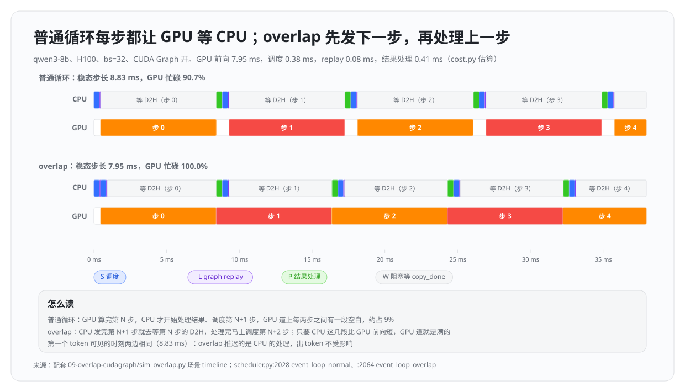
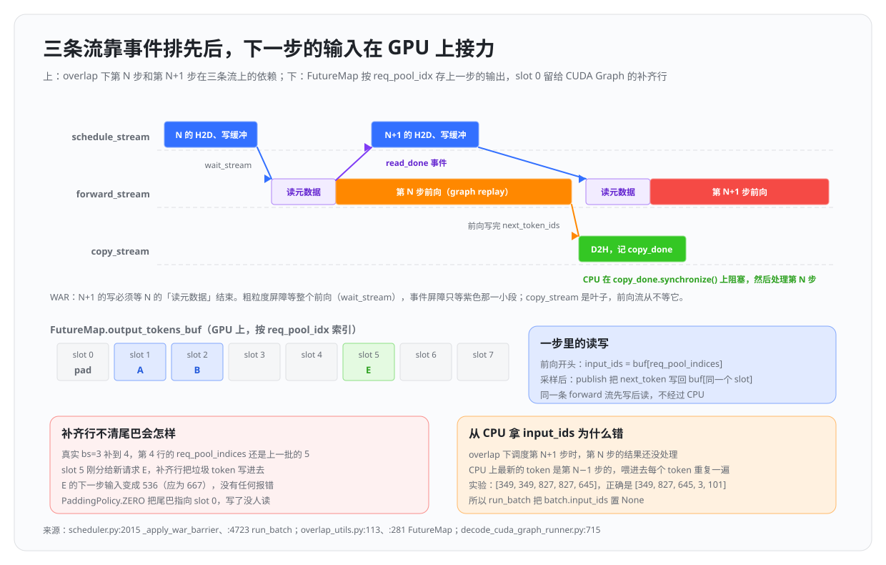
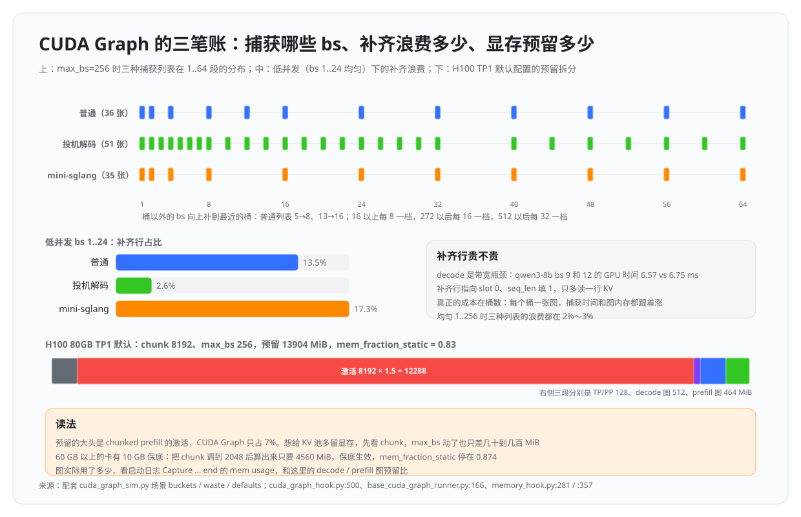
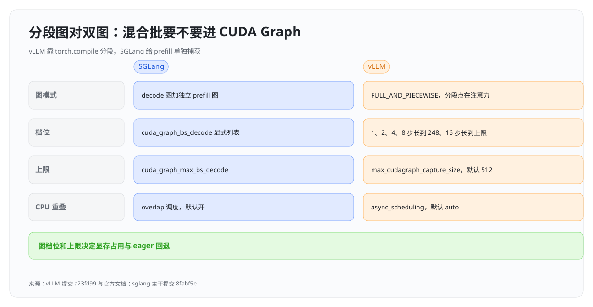

# SGL-09｜原理｜Overlap 调度与 CUDA Graph：把 CPU 开销藏到 GPU 后面

> 🎯 **遇到的问题**：前面几篇讲的调度、chunked prefill、内存池和前缀树，全在 CPU 上跑。GPU 每算完一步，CPU 要处理上一步的结果（追加 token、判断结束、流式返回），为下一步挑请求、分配 KV，再把几百个 kernel 发给 GPU。LMSYS 在 v0.4 的博客里说，不做优化的推理引擎最多有一半时间花在 CPU 开销上[[1]](https://www.lmsys.org/blog/2024-12-04-sglang-v0-4/)。
>
> SGLang 用两件事把这部分时间藏起来：overlap 调度让 CPU 提前一步，GPU 算第 N 步时就准备第 N+1 步；CUDA Graph 把一步里几百次 kernel 启动压成一次 replay。这一篇拆开这两件事，再看各自的副作用：下一步的输入从哪来，已结束的请求怎么处理，三条 CUDA 流谁等谁，补齐行为什么必须指向 slot 0，显存预留花在了哪里。
>
> **主线**：GPU 的每一步都要等 CPU 准备输入；overlap 把准备提前一步，CUDA Graph 把启动压成一次，两者一起把 CPU 开销从关键路径上拿掉。
>
> **读完这一篇**：能从 nsys 时间线指出 GPU 空隙出在调度、结果处理还是 kernel 启动。知道关掉 overlap 损失多少，看到 cuda graph: False 能查出原因。捕获时 OOM 知道先动 chunk 还是 max_bs，改模型或后端时知道哪些静态缓冲要清零。
>
> **代码**：[zero-to-sglang/09-overlap-cudagraph](../09-overlap-cudagraph)。cost.py 给一步 decode 记时间账，sim_overlap.py 用事件时间线对比普通循环和 overlap 循环并复现四个副作用，cuda_graph_sim.py 复刻捕获列表、补齐、显存分档和掉回 eager 的条件。只用标准库，几秒跑完，行号按主干 8fabf5e 核对。

# 导读 · 结论先行

1. **普通循环里 GPU 每一步都在等 CPU。**GPU 算完第 N 步，CPU 才开始处理结果、调度第 N+1 步、发 kernel，这段时间 GPU 空着。qwen3-8b、H100、bs=32 时，模拟里这段空隙占 9.3%；模型越小、batch 越小，占比越大，qwen3-0.6b bs=1 时 GPU 有一半时间在等。
2. **overlap 让调度器提前一步。**先发第 N+1 步，再处理第 N 步的结果。这个想法来自 NanoFlow，v0.4 把它做成默认行为{r("nanoflow")}。只要 CPU 这几段比 GPU 前向短，GPU 道就是满的；第一个 token 出来的时刻不变，因为推迟的只是 CPU 的处理。
3. **提前一步有四个代价。**下一步的 input_ids 还没回到 CPU，只能在 GPU 上从 FutureMap 读。本步已经结束的请求还会被排进下一步，要剔掉或者白算一行。调度流写共享缓冲之前要等上一步读完（WAR barrier）。连续两批 prefill 时，第一批的 TTFT 会被第二批的启动拖长。
4. **CUDA Graph 省掉逐个 kernel 的启动。**一步 decode 有四五百个 kernel，eager 下每个要几微秒的 CPU 发射；捕获成图以后一次 replay 搞定。代价是形状固定：只能按事先捕获的几十个 batch size 跑，真实 bs 向上补齐，补齐的行必须指向 slot 0，否则会把别的请求的 KV 或下一步输入写坏。
5. **两者互补，显存账要看清。**overlap 藏住调度和结果处理，藏不住 eager 下的启动；graph 去掉启动，剩下的 CPU 开销又正好被 overlap 藏住。H100 默认配置下预留给非 KV 的 13.9 GB 里，chunked prefill 的激活占 12 GB，两类图加起来不到 1 GB。



上图是实验 4.1 的输出画成的泳道。上半是普通循环：每一步 CPU 先调度（蓝）、replay（紫），然后在 copy_done 上阻塞等 GPU 算完（灰），拿到结果再处理（绿），处理完才调度下一步，GPU 道上每两步之间都有一段白。下半是 overlap：CPU 发完第 N+1 步立刻去等第 N 步的 D2H，处理完马上调度第 N+2 步，GPU 道连成一片，稳态步长从 8.83 ms 降到 7.95 ms，正好等于 GPU 前向本身。

**📎 与系列其他文档的分工**：调度器怎么挑请求、KV 预算怎么算，见 [SGL-05｜原理｜调度器：waiting、running 与 KV 预算](./05-scheduler.md)。chunked prefill 和 mixed chunk，见 [SGL-06｜原理｜Chunked prefill：切块大小、mixed chunk 与 TTFT / ITL 的取舍](./06-chunked-prefill.md)。req_to_token 和 KV 池的 padding 行，见 [SGL-07｜原理｜内存池与页表：req_to_token、token_to_kv 与 page size](./07-memory-pool.md)。树的 checkpoint 和 release，见 [SGL-08｜原理｜RadixAttention：基数树的匹配、插入、加锁与驱逐](./08-radix-attention.md)。attention 后端怎么在图里准备元数据，留给 [SGL-10｜原理｜注意力后端：FlashInfer、FA3、Triton、TRTLLM 怎么选、怎么接进 CUDA Graph](./10-attention-backend.md)。TP 下 all-reduce 能不能捕获、DP attention 的对齐，留给 [SGL-11｜原理｜并行：TP、DP Attention、EP 怎么组合](./11-parallelism.md)。投机解码的 draft / verify 图和 spec_v2 的 overlap，留给 [SGL-13｜原理｜投机解码：EAGLE、MTP、NGRAM 怎么选、怎么调](./13-speculative.md)。two-batch overlap（把一批拆成两半让计算和通信重叠）属于 MoE 的通信优化，留给 [SGL-11｜原理｜并行：TP、DP Attention、EP 怎么组合](./11-parallelism.md)。nsys 和 torch profiler 的完整用法，留给 [SGL-18｜实战｜可观测与 profiling：从指标到 kernel](./18-observability.md)。

# 第 1 章 · 问题：GPU 明明没满，吞吐却上不去

线上常见的情形：

- 小模型（1B 以下）或者 TP8 跑大模型，nvidia-smi 的利用率在 60% 上下晃，加并发也上不去。
- 同样的模型，加了 --disable-overlap-schedule 以后吞吐掉了 10% 到 30%，但 TTFT 没怎么变。
- 日志里 Decode batch 那一行的 cuda graph 字段时而 True 时而 False，False 的时候 ITL 明显变长。
- 启动时卡在 Capture cuda graph，最后报 OOM，提示把 mem-fraction-static 调到 0.8 或 0.7。
- 调大 --cuda-graph-max-bs-decode 想多吃并发，KV 池反而小了一圈。
- 自己写了一个模型或 attention 后端，bs 正好是捕获桶的时候输出正常，其他 bs 偶发乱码。
- 两批长 prompt 背靠背进来，第一批的 TTFT 比单独发时长了几毫秒。

这些现象落在两件事上：CPU 和 GPU 怎么交替，以及 CUDA Graph 的形状约束。下面先算一步 decode 的时间账，再讲普通循环和 overlap 循环的差别、overlap 的四个副作用，然后讲 CUDA Graph 的捕获、补齐、显存和回退，最后对照 mini-sglang。

| 想弄清的现象 | 看哪一节 |
|-|-|
| GPU 利用率上不去，CPU 开销到底有多大 | 2.1、4.1、4.2 |
| overlap 为什么不推迟出 token | 2.2 |
| overlap 下一步的输入从哪来，CPU 上为什么拿不到 | 2.3、4.5 |
| 结束的请求为什么会多跑一步、会不会重复释放 | 2.4、4.4 |
| 三条 CUDA 流谁等谁，WAR barrier 防的是什么 | 2.5 |
| 连续 prefill 时要不要关 overlap | 2.6、4.3 |
| CUDA Graph 省了什么，为什么形状必须固定 | 2.7 |
| 捕获了哪些 bs，补齐浪费多少 | 2.8、4.6 |
| 补齐行为什么必须指向 slot 0 | 2.9、4.5 |
| 显存预留怎么算，捕获 OOM 先动什么 | 2.10、4.7 |
| 什么时候掉回 eager | 2.11 |

# 第 2 章 · 原理：CPU 提前一步，kernel 一次发完

## 2.1 一步 decode 的时间账

一步 decode 在 CPU 和 GPU 上各有几段。GPU 上是前向：decode 是带宽瓶颈，前向时间约等于权重和 KV 的字节数除以显存带宽，[SGL-02｜上手｜推理账本：显存、KV 与 Roofline](./02-ledger.md) 用 Roofline 算过。

CPU 上有四段：调度（从 waiting 和 running 里挑请求、匹配前缀、分配 KV、准备 ForwardBatch），发 kernel（eager 下逐个 cudaLaunchKernel，开了 CUDA Graph 只剩拷静态输入和一次 cudaGraphLaunch），D2H（把采样出的 token 拷回 CPU），结果处理（每条请求追加 token、判断停止条件、增量 detokenize 的准备、流式返回）。

cost.py 按这几段给了一套估算。qwen3-8b、H100、bs=32、开 CUDA Graph 时：GPU 前向 7.95 ms，调度 0.38 ms，graph replay 0.08 ms，D2H 0.02 ms，结果处理 0.41 ms。CPU 那几项是假设值，按每条请求的固定开销加每步的基础开销估的，换到自己的机器上要用 nsys 量（第 4 章末尾给了校准步骤）。量级上是每步几百微秒，随 bs 线性涨。

这张账里最重要的是比值。GPU 前向在带宽瓶颈区几乎不随 bs 涨，qwen3-8b 从 bs=9 到 bs=12 只多 0.18 ms；CPU 的调度和结果处理每条请求都有一份，随 bs 线性涨。所以模型越小、TP 越大（每张卡上的前向越短），CPU 开销的占比越高。v0.4 博客说 overlap 对小模型和大 TP 收益最大，就是这个原因{r("blog_v04")}。

## 2.2 普通循环和 overlap 循环

普通循环在 [scheduler.py:2028 event_loop_normal](https://github.com/sgl-project/sglang/blob/8fabf5e/python/sglang/srt/managers/scheduler.py#L2028)，顺序很直接：收请求，挑下一批，run_batch 发出去，process_batch_result 处理结果，然后下一轮。run_batch 是异步的，kernel 发出去就返回；process_batch_result 里第一件事是 copy_done.synchronize()[（batch_result_processor.py:268）](https://github.com/sgl-project/sglang/blob/8fabf5e/python/sglang/srt/managers/scheduler_components/batch_result_processor.py#L268)，CPU 在这里阻塞，直到 GPU 算完、token 拷回来。阻塞结束以后的结果处理，加上下一轮的调度和发 kernel，GPU 全程空着。

overlap 循环在 [scheduler.py:2064 event_loop_overlap](https://github.com/sgl-project/sglang/blob/8fabf5e/python/sglang/srt/managers/scheduler.py#L2064)，多了一个长度为 1 的 result_queue。每一轮先挑第 N+1 批并 run_batch，把 (batch.copy(), result) 压进队列，然后才 pop 出第 N 批的结果去处理。处理第 N 批时，CPU 同样会在 copy_done 上阻塞，但这时 GPU 已经在算第 N+1 批，阻塞只是 CPU 在等，GPU 不等。处理完第 N 批，下一轮立刻调度第 N+2 批，GPU 算完第 N+1 批时第 N+2 批的 kernel 已经在流里排着了。

这个顺序的想法来自 NanoFlow：把 CPU 上的批次形成、结果处理和 GPU 上的计算放到不同的时间片里，让 GPU 永远有活[[2]](https://arxiv.org/abs/2408.12757)。SGLang v0.4 把它做成默认调度器，博客里用 Nsight 截了连续 5 个 decode 批，GPU 上没有空隙；端到端比 v0.3 快 1.1 倍，比其他基线快 1.3 倍[[1]](https://www.lmsys.org/blog/2024-12-04-sglang-v0-4/)。

第一个 token 什么时候对用户可见？两种循环一样。普通循环里第 0 步算完就处理；overlap 里第 0 步算完时 CPU 正在发第 1 步，发完立刻处理第 0 步，发第 1 步只要一次 replay 的时间，几十微秒，而这段时间本来就落在 GPU 算第 0 步的窗口里。模拟里两边的首 token 时刻都是 8.83 ms。overlap 推迟的是 CPU 处理结果的起点，只要这个起点还在 GPU 算完之前，出 token 的时刻就不变。

overlap 默认开启，--disable-overlap-schedule 关掉[（fields/schedule.py:193）](https://github.com/sgl-project/sglang/blob/8fabf5e/python/sglang/srt/arg_groups/fields/schedule.py#L193)。有几种情况会被自动关掉：流水线并行（pp_size 大于 1）[（overrides.py:1625）](https://github.com/sgl-project/sglang/blob/8fabf5e/python/sglang/srt/arg_groups/overrides.py#L1625)，Mamba 混合模型用不带额外缓冲的前缀缓存策略[（:478）](https://github.com/sgl-project/sglang/blob/8fabf5e/python/sglang/srt/arg_groups/overrides.py#L478)，embedding 模型开了 sparse head，CPU 和 MPS 设备。启动日志里会打 warning，看到吞吐比预期低时先确认 overlap 有没有真的开着。

## 2.3 下一步的输入在 GPU 上接力：FutureMap

提前一步带来的第一个问题：调度第 N+1 步时，第 N 步还在 GPU 上算，采样出的 token 还没回到 CPU。decode 的 input_ids 就是上一步的输出，CPU 上没有。

SGLang 的做法是让这个 token 不经过 CPU。[overlap_utils.py:281 FutureMap](https://github.com/sgl-project/sglang/blob/8fabf5e/python/sglang/srt/managers/overlap_utils.py#L281) 在 GPU 上开一块按 req_pool_idx 索引的缓冲 output_tokens_buf，长度等于 req_to_token 的行数。第 N 步采样完，\_relay_forward_payload[（scheduler.py:5030）](https://github.com/sgl-project/sglang/blob/8fabf5e/python/sglang/srt/managers/scheduler.py#L5030) 调 stash 把 next_token_ids 写进 buf[req_pool_indices][（overlap_utils.py:680）](https://github.com/sgl-project/sglang/blob/8fabf5e/python/sglang/srt/managers/overlap_utils.py#L680)。

第 N+1 步前向开头，resolve_forward_inputs[（:113）](https://github.com/sgl-project/sglang/blob/8fabf5e/python/sglang/srt/managers/overlap_utils.py#L113) 用同一组 req_pool_indices 从 buf 里 gather 出 input_ids。写和读都在 forward_stream 上，流内天然有序，CPU 不用等。seq_lens 同理，publish 把 seq_lens + 1 写进 new_seq_lens_buf[（:649）](https://github.com/sgl-project/sglang/blob/8fabf5e/python/sglang/srt/managers/overlap_utils.py#L649)。

run_batch 结束时有一行 batch.input_ids = None，注释写着「Next-iter input_ids relayed via future_map」[（scheduler.py:4814）](https://github.com/sgl-project/sglang/blob/8fabf5e/python/sglang/srt/managers/scheduler.py#L4814)。这是防御：CPU 上的 batch.input_ids 是第 N−1 步的值，谁要是误用它，每个 token 都会被喂两遍。实验 4.5 复现了这个错误：玩具模型的正确序列是 [349, 827, 645, 3, 101]，从 CPU 拿输入得到 [349, 349, 827, 827, 645]，从第 2 步开始错。

FutureMap 的 slot 0 是特意留的。req_to_token 池在分配时多开一行[（memory_pool.py:400 +1 padding row）](https://github.com/sgl-project/sglang/blob/8fabf5e/python/sglang/srt/mem_cache/memory_pool.py#L400)，注释说 CUDA Graph 补齐的行 req_pool_indices 默认填 0，读写都落在这一行，无害。FutureMap 按同样的行数开缓冲，slot 0 对应的就是这一行。这个约定在 2.9 节会再出现一次。



上图上半是三条流在两步之间的依赖，下半是 FutureMap 的槽位和两个反例。左下的红框是补齐行不清尾巴的后果：真实 bs=3 补到 4，第 4 行的 req_pool_indices 还是上一批留下的 5，而 slot 5 刚分给了新请求 E，补齐行把垃圾 token 写进去，E 的下一步输入从 667 变成 536，没有任何报错。

## 2.4 已经结束的请求还会被排进下一步

第二个问题：调度第 N+1 步时，第 N 步的结果没处理，调度器不知道哪些请求在第 N 步已经结束了。不做处理的话，这些请求会被排进第 N+1 步，多算一行、多占一个 KV 槽位，结果处理时再被丢掉[（batch_result_processor.py:1022）](https://github.com/sgl-project/sglang/blob/8fabf5e/python/sglang/srt/managers/scheduler_components/batch_result_processor.py#L1022)。

overlap 循环一开始就把 enable_skip_finishing_decode 置成 True。调度时 \_reqs_finishing_inflight[（scheduler.py:4509）](https://github.com/sgl-project/sglang/blob/8fabf5e/python/sglang/srt/managers/scheduler.py#L4509) 看队列里那一批（断言长度为 1），找出同时在队列里、下一步按长度必然结束的请求，update_running_batch[（:4524）](https://github.com/sgl-project/sglang/blob/8fabf5e/python/sglang/srt/managers/scheduler.py#L4524) 把它们从本批剔掉。

判断依据是 next_output_finishes_by_length[（schedule_batch.py:1668）](https://github.com/sgl-project/sglang/blob/8fabf5e/python/sglang/srt/managers/schedule_batch.py#L1668)：len(output_ids) + 1 达到 max_new_tokens。EOS 和 stop 字符串猜不到，只能多算一行。实验 4.4 里，bench_serving 的 random 数据集带 ignore_eos，全按长度结束，2000 条请求一行都不多算；对话负载只有约 25% 撞 max_new_tokens，还剩 1479 行（0.29%）白算。

同一个函数里还有一个细节：KV 不够、又有请求在途结束时，这一步干脆不发 decode，返回 None，而不是 retract。在途那一步一结束，这几条请求的 KV 就还回来了。retract 一条 1500 token 的请求，以后要重算约 49.7 ms 的 prefill；跳一步只让剩下的请求多等一个步长，约 13.7 ms（qwen3-8b、bs=128）。

还有重复释放的风险。没剔掉的请求在第 N 步处理时释放一次，第 N+1 步处理时又被释放一次，KV 槽位进两次空闲表，之后被两条请求同时拿到。mini-sglang 在 \_process_last_data 里专门写了注释「overlap scheduling may make the request freed twice, skip second free」[（scheduler.py:158）](https://github.com/sgl-project/mini-sglang/blob/main/python/minisgl/scheduler/scheduler.py#L158)。

SGLang 靠结果处理时跳过 finished() 和 is_retracted 的请求，并把槽位归还集中在 release_kv_cache 一处。[SGL-08｜原理｜RadixAttention：基数树的匹配、插入、加锁与驱逐](./08-radix-attention.md) 讲过的 SGLANG_CHECK_KV_PAGE_INVARIANTS 就能抓这类问题。

## 2.5 三条流和 WAR barrier

overlap 下 GPU 上有三条流。schedule_stream 是调度器的默认流，下一步的 H2D 拷贝、往 req_to_token、out_cache_loc 这类共享缓冲里写，都在它上面。forward_stream 跑前向，开头先 wait_stream(schedule_stream)，保证读到的是调度器写好的数据{src(SCH, 4737, "（scheduler.py:4737）")}。copy_stream 等前向写完 next_token_ids 再做 D2H，记 copy_done 事件；前向流从不等它，它是一条叶子流。

这里有一个写后读之外的冲突：读后写（write-after-read，WAR）。第 N 步前向开头要读共享缓冲来准备注意力元数据；CPU 提前一步，第 N+1 步的调度可能在第 N 步还没读完时就往同一块缓冲里写。

[scheduler.py:2015 \_apply_war_barrier](https://github.com/sgl-project/sglang/blob/8fabf5e/python/sglang/srt/managers/scheduler.py#L2015) 在每次 run_batch 之后给 schedule_stream 加一道屏障：如果前向在图里记了「元数据读完」的事件（\_publish_read_done[，decode_cuda_graph_runner.py:715](https://github.com/sgl-project/sglang/blob/8fabf5e/python/sglang/srt/model_executor/runner/decode_cuda_graph_runner.py#L715)），schedule_stream 只等这个事件；没有就退回 wait_stream(forward_stream)，等整个前向。

两种屏障的差别在空泡。粗粒度屏障让下一步的准备排在整个前向之后，下一步前向又要等这段准备，每步多一个准备时间的空泡；事件屏障只等前向开头那一小段，准备和本步前向重叠。实验里粗粒度屏障的空泡在 0.2% 到 2.5% 之间，小模型小 batch 最明显；事件屏障是 0。正常情况下 CPU 发得没那么快，不加屏障也很少撞上；但只要有一次 CPU 跑在 GPU 前面（小模型、GPU 被别的流拖住），就会写坏还在读的元数据，症状是偶发乱码，很难复现。SGLANG_FORCE_COARSE_WAR_BARRIER=1 可以强制退回粗粒度，怀疑屏障有问题时拿来对照。

## 2.6 连续 prefill：要不要先处理第一批

overlap 下第 N 批的结果要等第 N+1 批的 kernel 全部发出去才处理。decode 时发 kernel 是一次 replay，可以忽略；prefill 默认走 breakable graph，在注意力处断开，启动开销比 full graph 大得多。两批 prefill 背靠背时，第一批的首 token 要等第二批的 kernel 发完才能返回。

[scheduler.py:2139 is_disable_overlap_for_batch](https://github.com/sgl-project/sglang/blob/8fabf5e/python/sglang/srt/managers/scheduler.py#L2139) 处理这种情况：当前批和上一批都是 extend，并且设了 SGLANG_DISABLE_CONSECUTIVE_PREFILL_OVERLAP，就先处理上一批再发当前批。这个环境变量默认 False[（environ.py:697）](https://github.com/sgl-project/sglang/blob/8fabf5e/python/sglang/srt/environ.py#L697)，源码注释说它能改善第一批的 TTFT，「might slightly hurt the throughput」。DP attention 下用全局同步过的 is_extend_in_batch 判断，否则不同 rank 做出不同决定会死锁。

实验 4.3 量了一下这个取舍。qwen3-0.6b、两批各 128 token 时，第一批 TTFT 从 5.48 ms 降到 3.09 ms，省 2.39 ms，正好是第二批 eager 发 kernel 的时间；到 2048 token 只省 0.44 ms，8192 token 时第一批的 GPU 时间已经比发第二批长，省不了。qwen3-8b 只有 128 token 时省 0.29 ms，再长就是 0。代价是两批总时长多 0.02 到 0.17 ms。结论：只有小模型、短 prompt、对 TTFT 极敏感的场景值得开。

## 2.7 CUDA Graph 省掉的是什么

eager 模式下每个 kernel 都要 CPU 调一次 cudaLaunchKernel，每次几微秒。NVIDIA 的博客在 V100 上做过一个干净的实验：20 个 2.9 µs 的小 kernel 跑 1000 步，每个 kernel 后同步时平均 9.6 µs，开销 6.7 µs。每步只同步一次、kernel 连发时 3.8 µs，开销 0.9 µs。捕获成 CUDA Graph 后 3.4 µs，开销 0.5 µs[[3]](https://developer.nvidia.com/blog/cuda-graphs/)。连发能把启动藏在前一个 kernel 后面，前提是 kernel 比启动长；graph 进一步省掉的是每个 kernel 的 CPU 发射。

放到 LLM decode 上，cost.py 按每层的 kernel 数估：qwen3-0.6b 一步 398 个 kernel，按每个 6 µs 算 eager 发射要 2.39 ms，而 bs=1 的 GPU 前向只要 0.52 ms，GPU 有 78% 的时间在等下一个 kernel。qwen3-8b 一步 510 个，3.06 ms，比 6.08 ms 的前向短，启动大部分被前向盖住。

70B TP8 每层多两个 all-reduce，一步 1286 个、7.72 ms，已经接近 8.86 ms 的前向。这时 overlap 救不了，它只能藏调度和结果处理，藏不住启动本身：qwen3-0.6b bs=1 eager 下 overlap 只加速 1.01 倍，开了 graph 以后是 1.98 倍。

CUDA Graph 的代价是形状和地址都要固定。PyTorch 的博客讲得很清楚：图里记录的是每个 kernel 的参数和指针，replay 时原样重放，所以输入要先拷进捕获时用的静态张量。捕获前要在旁路流上先跑几遍 warmup，把 cuBLAS workspace、kernel 加载这类一次性开销付在图外。NCCL 的集合通信也能捕获。它给的数字是 Mask R-CNN 训练快 1.70 倍、BERT 快 1.12 倍，规律和上面一样：CPU 开销固定，batch 越小越吃亏[[4]](https://pytorch.org/blog/accelerating-pytorch-with-cuda-graphs/)。

SGLang 的 decode 默认用 full graph，整步前向一张图；prefill 默认用 breakable graph，在注意力处断开，因为 prefill 的 token 数和序列长度变化太大。捕获在 [full_cuda_graph_backend.py:127 capture_session](https://github.com/sgl-project/sglang/blob/8fabf5e/python/sglang/srt/model_executor/runner_backend/full_cuda_graph_backend.py#L127)：所有图共享一个全局内存池，每个 bs 捕获前跑两遍 warmup[（:159）](https://github.com/sgl-project/sglang/blob/8fabf5e/python/sglang/srt/model_executor/runner_backend/full_cuda_graph_backend.py#L159)。捕获期间默认冻结 Python GC 加速捕获[（decode_cuda_graph_runner.py:1325）](https://github.com/sgl-project/sglang/blob/8fabf5e/python/sglang/srt/model_executor/runner/decode_cuda_graph_runner.py#L1325)，--enable-cudagraph-gc 可以打开。

## 2.8 捕获哪些 bs，真实 bs 怎么补齐

图的形状固定，batch size 也固定。SGLang 事先捕获一组 bs，运行时真实 bs 向上补到最近的那个。列表由 [cuda_graph_hook.py:500 generate_decode_cuda_graph_batch_sizes](https://github.com/sgl-project/sglang/blob/8fabf5e/python/sglang/srt/arg_groups/cuda_graph_hook.py#L500) 生成，有三条分支：

- 普通：1、2、4、8、12，16 到 256 每 8 一档，272 到 496 每 16 一档，512 以后每 32 一档。max_bs=256 时 36 张图。
- 投机解码：1 到 8 每个都捕获，10 到 32 每 2 一档，40 到 64 每 4 一档，再往上每 8、每 16。小 bs 段更密，因为每条请求一步要验证多个 token，bs 补一行就多算 num_draft_tokens 行。max_bs=256 时 51 张。
- 关补齐（--disable-cuda-graph-padding）：1 到 max_bs 每个都捕获，256 就是 256 张图。

max_bs 不在列表里时补到末尾。生成的列表还要过一道对齐过滤[（base_cuda_graph_runner.py:65 get_batch_sizes_to_capture）](https://github.com/sgl-project/sglang/blob/8fabf5e/python/sglang/srt/model_executor/runner/base_cuda_graph_runner.py#L65)：开 two-batch overlap 时 bs 必须是 2 的倍数，DP attention 需要 gathered buffer 时必须是 attn_tp_size 的倍数，两者都开就是乘积[（utils/common.py:4168）](https://github.com/sgl-project/sglang/blob/8fabf5e/python/sglang/srt/utils/common.py#L4168)。

req_to_token 池比 max_bs 小时（比如 --max-running-requests 50），列表截到池子大小并把 50 补进去；再加 attn_tp=4，50 向上对齐到 52。

运行时 \_pad_to_bucket[（:166）](https://github.com/sgl-project/sglang/blob/8fabf5e/python/sglang/srt/model_executor/runner/base_cuda_graph_runner.py#L166) 用 bisect_left 找第一个不小于真实 bs 的桶。补齐浪费有多大？实验 4.6 在三种 bs 分布下算了一遍。bs 在 1 到 256 均匀分布时，普通、投机、mini-sglang 三种列表的浪费都在 2% 到 3%；低并发（bs 1 到 24）时普通列表浪费 13.5%，最坏是 5 补到 8，投机列表只有 2.6%。



上图上半是三种列表在 1 到 64 段的分布，投机解码的列表在 8 以下每个 bs 都有一张图。中间是低并发下的补齐浪费。下半是 H100 TP1 默认配置的显存预留拆分，红色的激活段占了绝大部分。

13.5% 的补齐行听着多，但 decode 是带宽瓶颈：qwen3-8b bs=9 和 bs=12 的 GPU 时间是 6.57 ms 和 6.75 ms，几乎一样。补齐行指向 slot 0、seq_len 填 1，只多读一行 KV。补齐的成本主要在桶数上：每个桶一张图，捕获时间和图占的显存都跟着桶数涨。所以普通列表在小 bs 段故意稀疏，关补齐只在 bs 很小、对 ITL 极敏感的场景用。

## 2.9 补齐的行写到哪里

补齐的行也会完整跑一遍前向：读 KV、写 KV、采样、把 next token 写进 FutureMap。它们读写的位置由静态缓冲尾部的值决定。上一次 replay 如果是更大的 batch，尾部还留着那时的 req_pool_indices、out_cache_loc、seq_lens。[cuda_graph_buffer_registry.py:106 PaddingPolicy](https://github.com/sgl-project/sglang/blob/8fabf5e/python/sglang/srt/model_executor/cuda_graph_buffer_registry.py#L106) 给每个静态缓冲规定了尾部怎么处理：

| 静态缓冲 | 尾部策略 | 不这样做会怎样 |
|-|-|-|
| req_pool_indices | ZERO | 补齐行的 next token 写进旧的 slot；slot 刚分给新请求时，它下一步的输入被换掉 |
| out_cache_loc | ZERO | 补齐行的新 KV 写进旧槽位；槽位已经还给分配器又分出去时，新请求的 KV 被写坏 |
| seq_lens | FILL_SENTINEL(1) | 注意力按上一批的长度读 KV，白读几百个 token |
| positions | ZERO | 旧尾巴曾让 flashinfer 的 verify plan 越界，见 sglang issue #24361 |
| input_ids | FOREACH_COPY | 不清尾巴是安全的：补齐行的输出写进 slot 0，没人读 |

前两行的后果都不会报错，只是输出变怪。实验 4.5 复现了 req_pool_indices 那一条。自己写模型或者 attention 后端、往图里加新的静态缓冲时，要在 registry 里给它一个策略；默认不清尾巴的话，bs 正好等于桶时一切正常，其他 bs 偶发乱码，这是最难查的一类 bug。

## 2.10 显存预留：大头在激活

mem_fraction_static 决定权重加 KV 池能用多少显存，剩下的留给激活、图和其他。没手动给时，[memory_hook.py:281](https://github.com/sgl-project/sglang/blob/8fabf5e/python/sglang/srt/arg_groups/memory_hook.py#L281) 先按显存分档定 chunked_prefill_size 和 decode max_bs[（:89-170）](https://github.com/sgl-project/sglang/blob/8fabf5e/python/sglang/srt/arg_groups/memory_hook.py#L89)，再算一个预留量：

```python
reserved = 512                          # 固定
         + max(chunk, 2048) * 1.5       # chunked prefill 的激活，MiB
         + tp * pp / 8 * 1024           # 并行带来的通信缓冲
         + decode_max_bs * 2            # decode 图，每个 bs 2 MiB（reserve_for_graph_mb）
         + len(prefill_buckets) * 8     # prefill 图，每个 token 桶 8 MiB
if total > 60 GiB: reserved = max(reserved, 10 GiB)
mem_fraction_static = (total - reserved) / total
```

decode 图的 2 MiB 和 prefill 图的 8 MiB 在 [reserve_for_graph_mb（:357）](https://github.com/sgl-project/sglang/blob/8fabf5e/python/sglang/srt/arg_groups/memory_hook.py#L357)。max_bs 默认会被 --max-running-requests 截断[（:182）](https://github.com/sgl-project/sglang/blob/8fabf5e/python/sglang/srt/arg_groups/memory_hook.py#L182)。

按这个公式，H100 80GB TP1 的默认配置是 chunk 8192、max_bs 256，预留 13904 MiB，其中激活 12288、decode 图 512、prefill 图 464（58 个 token 桶），mem_fraction_static = 0.830。TP8 时 max_bs 512，预留 15312，0.812。4090 是 chunk 4096、max_bs 48，0.704。

这张账说明两件事。想给 KV 池多留显存时，先看 chunk：chunk 从 8192 降到 4096 省 6 GB，max_bs 从 256 降到 16 只省 480 MB。4090 上把 --max-running-requests 设成 8，mem_fraction_static 只从 0.704 涨到 0.707。另外，60 GB 以上的卡有 10 GB 保底：H100 上把 chunk 调到 2048，算出来只要 4560 MiB，保底生效，mem_fraction_static 停在 0.874，再怎么调 max_bs 都不变。

这是公式估的预留，图实际占多少要看启动日志。捕获开始和结束各打一行[（cuda_graph_setup.py:786）](https://github.com/sgl-project/sglang/blob/8fabf5e/python/sglang/srt/model_executor/model_runner_components/cuda_graph_setup.py#L786)：Capture target decode cuda graph end 那一行有 bs 列表、elapsed 和 mem usage。mem usage 就是图实际吃掉的显存，和上面的 decode 图预留比，超了就要降 mem_fraction_static 或 max_bs。SGLANG_ENABLE_POST_CAPTURE_KV_SIZING（默认 False）可以改成先捕获图再按剩余显存定 KV 池，省掉估算的误差。

捕获顺序也影响显存。[decode_cuda_graph_runner.py:1358](https://github.com/sgl-project/sglang/blob/8fabf5e/python/sglang/srt/model_executor/runner/decode_cuda_graph_runner.py#L1358) 按 reversed(capture_bs) 从大到小捕获，注释是「Reverse so cuda graphs share memory better」。所有图共享一个内存池，第一张就是最大的，后面的小图都能塞进它释放的块里，总占用约等于最大那张图的中间激活。mini-sglang 同样倒序捕获，并把第一张图的 pool 传给后面所有图[（engine/graph.py:128）](https://github.com/sgl-project/mini-sglang/blob/main/python/minisgl/engine/graph.py#L128)[[5]](https://github.com/sgl-project/mini-sglang)。PyTorch 文档的内存管理一节解释了图内存池的复用规则[[6]](https://pytorch.org/docs/stable/notes/cuda.html)。

捕获失败时，SGLang 的报错给三条建议[（runner_backend_utils/\_\_init\_\_.py:14）](https://github.com/sgl-project/sglang/blob/8fabf5e/python/sglang/srt/model_executor/runner_backend_utils/__init__.py#L14)：mem-fraction-static 降到 0.8 或 0.7，--cuda-graph-max-bs-decode 降到 16，或者关掉 decode 图（注明性能损失巨大）。按上面的账，前两条的效果差很多：降 mem_fraction_static 直接让出几个 GB，降 max_bs 只省几百 MB。OOM 时先降 mem_fraction_static。

## 2.11 什么时候掉回 eager

每次 decode 前 [decode_cuda_graph_runner.py:877 can_run_graph](https://github.com/sgl-project/sglang/blob/8fabf5e/python/sglang/srt/model_executor/runner/decode_cuda_graph_runner.py#L877) 判断这一批能不能 replay。不能的情况有：请求带了 replace_embeds（自带 embedding 覆盖，每条请求不一样，图里没有这条路径）。投机解码时这批的每请求 token 数和捕获宽度不一致。bs 超过最大桶。关了补齐又没有完全相等的那张图。DP attention 下按所有 rank 里最大的 bs 判断。

掉回 eager 时，日志 Decode batch 那一行的 cuda graph 字段打 False[（metrics_reporter.py:1040）](https://github.com/sgl-project/sglang/blob/8fabf5e/python/sglang/srt/managers/scheduler_components/metrics_reporter.py#L1040)。线上看到它频繁为 False，先查 #running-req 是否经常超过 max_bs，超了就调大 --cuda-graph-max-bs-decode，同时按 2.10 节算一下显存。qwen3-0.6b 掉回 eager 时每步多 2.39 ms 的 kernel 发射，而 GPU 只要 0.52 ms，ITL 直接翻几倍；qwen3-8b 的启动大部分被前向盖住，影响小得多。

## 2.12 对照：mini-sglang 怎么写

mini-sglang 用不到 300 行把同样的结构写了一遍，适合对照读[[5]](https://github.com/sgl-project/mini-sglang)。overlap_loop[（scheduler.py:83）](https://github.com/sgl-project/mini-sglang/blob/main/python/minisgl/scheduler/scheduler.py#L83) 和 SGLang 的顺序一样：收消息，调度下一批，在 engine 流上 wait_stream 后发出去，然后 \_process_last_data 处理上一批。

下一步的输入也在 GPU 上接力：\_forward[（:227）](https://github.com/sgl-project/mini-sglang/blob/main/python/minisgl/scheduler/scheduler.py#L227) 里 batch.input_ids = token_pool[input_mapping]，前向完 token_pool[output_mapping] = next_tokens_gpu，一张按表索引的 GPU 缓冲，作用和 FutureMap 一样。

差别在细节上。mini-sglang 没有在途结束的提前剔除，靠 \_process_last_data 跳过第二次释放兜底。没有 WAR barrier 的细分，engine 流整体等调度流。捕获列表是 [1, 2, 4] 加 8 的倍数[（engine/graph.py:49）](https://github.com/sgl-project/mini-sglang/blob/main/python/minisgl/engine/graph.py#L49)，低并发时补齐浪费 17.3%，比 SGLang 的普通列表还高。SGLang 多出来的那些代码，都是在处理上面几节讲的边界情况。

## 2.13 vLLM 怎么做

vLLM 的 CUDA Graph 和 torch.compile 绑在一起。CUDAGraphMode 有 NONE、PIECEWISE、FULL、FULL_DECODE_ONLY 和 FULL_AND_PIECEWISE 五种，v1 默认 FULL_AND_PIECEWISE：纯 decode 批走整图，含 prefill 的混合批走分段图，分段点在注意力算子处，注意力本身 eager 执行[[7]](https://docs.vllm.ai/en/latest/design/cuda_graphs.html)[[8]](https://docs.vllm.ai/en/latest/design/torch_compile.html)。

捕获档位是 1、2、4，再从 8 到 248 每 8 一档，从 256 起每 16 一档，上限由 max_cudagraph_capture_size 决定，默认 512，Blackwell 上 1024。

和 SGLang 的 overlap 调度对应的是 async_scheduling，默认 auto：CPU 准备下一步的调度时，GPU 还在跑上一步。SGLang 的 overlap 默认开启，用 --disable-overlap-schedule 关；图档位用 cuda_graph_max_bs_decode 和 cuda_graph_bs_decode 定，prefill 有单独的一组图。分段图的好处是混合批也能吃到图的收益，代价是依赖 torch.compile，首次启动要编译，缓存失效时启动明显变慢。

| 维度 | SGLang | vLLM | 差异的代价 |
|-|-|-|-|
| 图模式 | decode 图加独立 prefill 图 | FULL_AND_PIECEWISE，分段点在注意力 | vLLM 混合批也能用图，但依赖编译 |
| 档位 | cuda_graph_bs_decode 显式列表 | 1、2、4、8 步长到 248、16 步长到上限 | 档位越密显存越多 |
| 上限 | cuda_graph_max_bs_decode | max_cudagraph_capture_size，默认 512 | 超出上限都退回 eager |
| CPU 重叠 | overlap 调度，默认开 | async_scheduling，默认 auto | 关掉后小 batch 的 ITL 都会变差 |



# 第 3 章 · 源码走读：一步 decode 从调度到图 replay 的 18 个落脚点

按启动时的配置、运行时一步的先后顺序排列，路径相对 python/sglang/srt/。

| # | 位置 | 发生了什么 |
|-|-|-|
| 1 | [arg_groups/memory_hook.py:89](https://github.com/sgl-project/sglang/blob/8fabf5e/python/sglang/srt/arg_groups/memory_hook.py#L89) | 按显存分档定 chunked_prefill_size 和 decode max_bs；:182 被 max_running_requests 截断 |
| 2 | [memory_hook.py:281](https://github.com/sgl-project/sglang/blob/8fabf5e/python/sglang/srt/arg_groups/memory_hook.py#L281) | 预留公式，:357 reserve_for_graph_mb 算图的预留 |
| 3 | [arg_groups/cuda_graph_hook.py:500](https://github.com/sgl-project/sglang/blob/8fabf5e/python/sglang/srt/arg_groups/cuda_graph_hook.py#L500) | 生成 decode 捕获列表；:480 生成 prefill 的 token 桶 |
| 4 | [runner/base_cuda_graph_runner.py:65](https://github.com/sgl-project/sglang/blob/8fabf5e/python/sglang/srt/model_executor/runner/base_cuda_graph_runner.py#L65) | 对齐过滤、补 num_max_requests、截到池子大小 |
| 5 | [runner/decode_cuda_graph_runner.py:1358](https://github.com/sgl-project/sglang/blob/8fabf5e/python/sglang/srt/model_executor/runner/decode_cuda_graph_runner.py#L1358) | 从大到小捕获，共享内存池；:1325 冻结 GC |
| 6 | [runner_backend/full_cuda_graph_backend.py:127](https://github.com/sgl-project/sglang/blob/8fabf5e/python/sglang/srt/model_executor/runner_backend/full_cuda_graph_backend.py#L127) | capture_session，每个 bs 两遍 warmup 再捕获 |
| 7 | [model_runner_components/cuda_graph_setup.py:786](https://github.com/sgl-project/sglang/blob/8fabf5e/python/sglang/srt/model_executor/model_runner_components/cuda_graph_setup.py#L786) | 打印 Capture … end，带 mem usage |
| 8 | [managers/scheduler.py:2064](https://github.com/sgl-project/sglang/blob/8fabf5e/python/sglang/srt/managers/scheduler.py#L2064) | event_loop_overlap：先 run_batch(N+1)，再 pop_and_process(N) |
| 9 | [scheduler.py:2139](https://github.com/sgl-project/sglang/blob/8fabf5e/python/sglang/srt/managers/scheduler.py#L2139) | 连续 extend 且设了环境变量时，先处理上一批 |
| 10 | [scheduler.py:4524](https://github.com/sgl-project/sglang/blob/8fabf5e/python/sglang/srt/managers/scheduler.py#L4524) | update_running_batch：剔掉在途必然结束的请求；KV 不够时跳一步 |
| 11 | [scheduler.py:4737](https://github.com/sgl-project/sglang/blob/8fabf5e/python/sglang/srt/managers/scheduler.py#L4737) | forward_stream 等 schedule_stream，resolve_forward_inputs 从 FutureMap 取输入 |
| 12 | [managers/overlap_utils.py:281](https://github.com/sgl-project/sglang/blob/8fabf5e/python/sglang/srt/managers/overlap_utils.py#L281) | FutureMap：按 req_pool_idx 索引的 GPU 缓冲，slot 0 对应 padding 行 |
| 13 | [decode_cuda_graph_runner.py:877](https://github.com/sgl-project/sglang/blob/8fabf5e/python/sglang/srt/model_executor/runner/decode_cuda_graph_runner.py#L877) | can_run_graph：replace_embeds、宽度、最大桶 |
| 14 | [base_cuda_graph_runner.py:166](https://github.com/sgl-project/sglang/blob/8fabf5e/python/sglang/srt/model_executor/runner/base_cuda_graph_runner.py#L166) | \_pad_to_bucket：bisect_left 找桶 |
| 15 | [model_executor/cuda_graph_buffer_registry.py:106](https://github.com/sgl-project/sglang/blob/8fabf5e/python/sglang/srt/model_executor/cuda_graph_buffer_registry.py#L106) | PaddingPolicy：尾部 ZERO、FILL_SENTINEL、FOREACH_COPY |
| 16 | [decode_cuda_graph_runner.py:715](https://github.com/sgl-project/sglang/blob/8fabf5e/python/sglang/srt/model_executor/runner/decode_cuda_graph_runner.py#L715) | \_publish_read_done：把图里的元数据读完事件交给调度器 |
| 17 | [scheduler.py:2015](https://github.com/sgl-project/sglang/blob/8fabf5e/python/sglang/srt/managers/scheduler.py#L2015) | \_apply_war_barrier：等事件，没有就 wait_stream |
| 18 | [scheduler_components/batch_result_processor.py:268](https://github.com/sgl-project/sglang/blob/8fabf5e/python/sglang/srt/managers/scheduler_components/batch_result_processor.py#L268) | copy_done.synchronize()，CPU 唯一阻塞的地方；:1022 跳过已结束的请求 |

# 第 4 章 · 实验：在 CPU 上看 GPU 空在哪里

实验都在 CPU 上跑，只用标准库。时间来自 cost.py 的粗估模型，CPU 各项是假设值；数字用来看趋势和量级，具体倍数以自己机器上的实测为准。

## 4.1 普通循环和 overlap 的时间线

```bash
cd zero-to-sglang/09-overlap-cudagraph
python3 sim_overlap.py
```

```text
== 时间线：qwen3-8b TP1 h100-sxm，bs=32，CUDA Graph 开 ==
  一步的账（cost.py 的估算）：GPU 前向 7.95 ms，调度 0.38 ms，graph replay 0.08 ms，D2H 0.02 ms，结果处理 0.41 ms

  普通循环：稳态步长 8.83 ms，GPU 忙碌 90.7%，吞吐 3623 tok/s
    CPU |LWWWWWWWWWWWWWWWWWWWWPSLWWWWWWWWWWWWWWWWWWWWPSWWWWWWWWWWWWWWWWWWWWWPSW…|
    GPU |.00000000000000000000...11111111111111111111..222222222222222222222..3…|

  overlap：稳态步长 7.95 ms，GPU 忙碌 100.0%，吞吐 4026 tok/s
    CPU |LSWWWWWWWWWWWWWWWWWWWPSLWWWWWWWWWWWWWWWWWWPSWWWWWWWWWWWWWWWWWWPSLWWW…|
    GPU |.00000000000000000000111111111111111111111222222222222222222223333…|

  overlap 稳态加速 1.11x。第 1 个 token 可见时刻：普通 8.83 ms，overlap 8.83 ms
```

普通循环每一步的 GPU 空隙是「D2H + 结果处理 + 调度 + replay」，0.02 + 0.41 + 0.38 + 0.08 = 0.89 ms，正好是 8.83 − 7.95。overlap 把这 0.89 ms 全部藏进了下一步的前向，步长等于 GPU 前向。CPU 道上 W 占了大部分：CPU 其实很闲，它在等 GPU。

## 4.2 什么时候 overlap 赚得多

```bash
python3 sim_overlap.py --scenario sweep
```

```text
  preset            bs   mode    GPU前向  发kernel      普通   idle  overlap   idle     加速
  qwen3-0.6b         1  eager     0.52     2.39    2.82    81%     2.80    81%  1.01x
  qwen3-0.6b         1  graph     0.52     0.08    1.04    48%     0.52     0%  1.98x
  qwen3-0.6b        16  eager     1.23     2.39    3.00    59%     2.98    58%  1.01x
  qwen3-0.6b        16  graph     1.23     0.08    1.92    35%     1.23     0%  1.56x
  qwen3-0.6b        64  eager     3.47     2.39    4.66    25%     3.56     2%  1.31x
  qwen3-0.6b       256  graph    12.44     0.08   16.02    22%    12.44     0%  1.29x
  qwen3-8b           1  graph     6.08     0.08    6.60     7%     6.08     0%  1.08x
  qwen3-8b          64  graph     9.87     0.08   11.14    11%     9.87     0%  1.13x
  qwen3-8b         256  graph    21.41     0.08   24.98    14%    21.41     0%  1.17x
  llama-70b-tp4    256  graph    24.31     0.08   27.88    12%    24.31     0%  1.15x
  llama-70b-tp8    256  graph    13.11     0.08   16.69    21%    13.11     0%  1.27x
```

三条规律。第一条，eager 下发 kernel 比 GPU 前向还慢时（qwen3-0.6b bs 1 和 16），overlap 几乎没用，GPU 81% 的时间在等下一个 kernel，要先开 CUDA Graph。第二条，开了 graph 以后 overlap 在所有配置上都把 GPU 空转压到 0，两者叠加才把 GPU 喂满。第三条，8B 和 70B 上 bs 越大 overlap 越赚，因为 CPU 开销随 bs 线性涨，GPU 前向在带宽瓶颈区涨得慢；70B TP8 比 TP4 赚得多，因为每张卡上的前向更短。这和 v0.4 博客「小模型、大 TP 收益最大」的结论同向。

## 4.3 连续 prefill

```bash
python3 sim_overlap.py --scenario prefill
```

```text
  preset         每批 token   P1 GPU   TTFT 开   TTFT 关       差      总时长 开      总时长 关
  qwen3-0.6b          128     0.52     5.48     3.09    2.39       5.63       5.65
  qwen3-0.6b          512     1.24     5.63     3.24    2.39       5.78       5.80
  qwen3-0.6b         2048     4.97     6.25     5.81    0.44      10.78      10.95
  qwen3-0.6b         8192    19.88    21.94    21.94    0.00      41.82      42.00
  qwen3-8b            128     6.08     6.82     6.54    0.29      12.62      12.80
  qwen3-8b            512    16.96    17.49    17.49    0.00      34.45      34.62
```

「开」是 overlap 照常，「关」是设了 SGLANG_DISABLE_CONSECUTIVE_PREFILL_OVERLAP。P1 的 GPU 时间比发 P2 的 kernel 长时，这段启动被藏住，两边 TTFT 一样；P1 很短时，TTFT 被 P2 的启动拖长，差值就是 eager 发一遍 kernel 的 2.39 ms。prefill 在主干上走 breakable graph，实际启动开销介于 eager 和 full graph 之间，真实差值会比这里小。

## 4.4 在途结束的请求

```bash
python3 sim_overlap.py --scenario finishing
```

```text
  bench_serving random（ignore_eos，全按长度结束）：2000 条，有效 decode 513342 行
    overlap 不剔  多算 2000 行（0.39%），每条多占 1 个 KV 槽位一步
    overlap 剔掉  多算 0 行（0.00%）
  对话负载（约 25% 撞 max_new_tokens，其余 EOS）：2000 条，有效 decode 514847 行
    overlap 不剔  多算 2000 行（0.39%）
    overlap 剔掉  多算 1479 行（0.29%）

  KV 不够时：retract 还是跳一步
    retract 1 条：这条以后要重算 1500 token 的 prefill ≈ 49.7 ms GPU，还要重新排队
    跳一步：本轮不发 decode，在途那一步结束后 4500 个槽位回来，代价是剩下 125 条多等 ≈ 13.72 ms

  重复释放：overlap 不剔、也没有幂等保护时
    50 条请求触发 50 次重复 free。
```

白算的行数不到 0.4%，对吞吐影响很小；真正要防的是重复释放，一次就会让两条请求共用同一个 KV 槽位。压测时用带 ignore_eos 的 random 数据集，看到的是剔除机制的最好情况；线上对话负载大部分靠 EOS 结束，剔不掉。

## 4.5 FutureMap relay 和补齐行

```bash
python3 sim_overlap.py --scenario relay
python3 cuda_graph_sim.py --scenario padding
```

```text
  GPU relay：[349, 827, 645, 3, 101] …  和普通循环一致：True
  CPU 拿：  [349, 349, 827, 827, 645] …  从第 2 步开始错，每个 token 都重复喂了一遍旧输入

  CUDA Graph 补齐：真实 bs=3，graph 按 4 捕获，第 4 行写到哪个 slot
    req_pool_indices 尾部 ZERO ：padding 行写 slot 0，E 的下一个输入 正确
    req_pool_indices 尾部 stale：padding 行写 slot 5，E 的下一个输入 被覆盖成 536（应为 667）

  真实 bs=5，桶 8，后 3 行是补齐行。上一次 replay 是 bs=8 的满批，静态缓冲尾部留着旧值
    req_pool_indices ZERO              真实 [3, 7, 9, 21, 14]  尾部 [0, 0, 0]（不清就是 [21, 22, 23]）
    out_cache_loc    ZERO              真实 [41, 72, 96, 501, 142]  尾部 [0, 0, 0]（不清就是 [210, 219, 230]）
    seq_lens         FILL_SENTINEL(1)  真实 [11, 34, 52, 2, 10]  尾部 [1, 1, 1]（不清就是 [400, 260, 77]）
    input_ids        FOREACH_COPY      真实 [31, 32, 33, 34, 35]  尾部 [16, 17, 18]
```

玩具模型的下一个 token 只取决于上一个 token 和请求编号，所以错一步马上能看出来。第二段的场景是：上一批的第 4 行属于请求 D，D 结束后 slot 5 立刻分给了新请求 E；这一批 bs=3 补到 4，如果 req_pool_indices 的尾巴不清，补齐行还指着 slot 5，它算出的垃圾 token 覆盖了 E 刚写进去的正确 token。

## 4.6 捕获列表和补齐浪费

```bash
python3 cuda_graph_sim.py
python3 cuda_graph_sim.py --scenario waste
```

```text
  normal  max_bs=256  [1, 2, 4, 8, 12, 16, 24, 32, 40, 48, …, 232, 240, 248, 256]（36 个），最大间距 8
  normal  max_bs=512  [1, 2, 4, 8, 12, 16, 24, 32, 40, 48, …, 464, 480, 496, 512]（52 个），最大间距 16
  spec    max_bs=256  [1, 2, 3, 4, 5, 6, 7, 8, 10, 12, …, 232, 240, 248, 256]（51 个），最大间距 8
  mini    max_bs=256  [1, 2, 4, 8, 16, 24, 32, 40, 48, 56, …, 232, 240, 248, 256]（35 个），最大间距 8
  DP attention，attn_tp=4，需要 gathered buffer：mul_base=4，[4, 8, 12, 16, 24, 32, 40, 48, …, 248, 256]（34 个）
  --max-running-requests 50：[1, 2, 4, 8, 12, 16, 24, 32, 40, 48, 50]，50 被补进来

  分布              规则         桶数      平均补齐行     浪费比例  1..256 最坏
  均匀 1..256       normal     36       3.35     2.5%      5→8
  均匀 1..256       spec       51       2.91     2.2%     33→40
  低并发 1..24       normal     36       1.97    13.5%      5→8
  低并发 1..24       spec       51       0.33     2.6%     33→40
  低并发 1..24       mini       35       2.63    17.3%      9→16
  对数均匀 1..256     normal     36       2.20     4.6%      5→8
```

DP attention 下 bs=1、2 被过滤掉了：只有 1 条请求时也要补到 4。低并发服务如果开了 DP attention，补齐浪费会比这里的 13.5% 更高。

## 4.7 各 GPU 的默认值

```bash
python3 cuda_graph_sim.py --scenario defaults
```

```text
  GPU            MiB  TP  chunk  max_bs    预留 MiB     其中图   10G 保底 mem_frac
  T4           15360   1   2048       8      4064     352             0.735
  RTX 4090     24564   1   4096      48      7280     496             0.704
  A100-40G     40960   1   4096      32      7248     464             0.823
  A100-80G     81920   1   8192     256     13904     976             0.830
  H100-SXM     81559   1   8192     256     13904     976             0.830
  H100-SXM     81559   8   8192     512     15312    1488             0.812
  H20          97871   1   8192     256     13904     976             0.858
  H200        143771   1   8192     256     13904     976             0.903
  B200        183359   1  16384     512     26832    1616             0.854
  4090 上 --max-running-requests 8：max_bs 48 → 8，mem_fraction_static 0.704 → 0.707，只多 80 MB 给 KV 池
  H100 上手动 --chunked-prefill-size 2048：算出来的预留 4560 MB < 10 GB，保底生效，mem_fraction_static 停在 0.874
```

「其中图」一列是 decode 图和 prefill 图的预留之和，所有配置下都不到预留的 12%。这里只算了非 MLA、非 VLM、无 DP attention 的分支；DeepSeek 这类 MLA 模型、多模态模型、PD 分离部署各有额外调整，以启动日志打印的 mem_fraction_static 为准。

> 💡 **实验记录**：各场景都跑了一遍，又做了三个改动：在 cost.py 里把 qwen3-8b 的 sched_per_req_us 翻倍，看 overlap 在 bs=256 时还能不能把 GPU 喂满。在 cuda_graph_sim.py 里给 decode_bs 加一个 mode，在 1 到 16 段每个 bs 都捕获，算出低并发下的浪费和桶数。在 sim_overlap.py 的 scenario_relay 里把 ZERO 换成 stale，再把 live 里 slot 5 改成 slot 6，看 E 还会不会被写坏。命令和期望输出见 [README.md](../09-overlap-cudagraph/README.md)，边界用例见 [test_overlap.py](../09-overlap-cudagraph/test_overlap.py)。

## 4.8 在真机上校准

模拟里 CPU 那几项是假设值。在自己的机器上量，用 SGLang 文档推荐的 nsys 参数[[9]](https://docs.sglang.io/docs/developer_guide/benchmark_and_profiling)：

```bash
# 1. 抓 decode 稳态（服务起来后用 bench_serving 打稳定负载）
nsys profile --trace-fork-before-exec=true --cuda-graph-trace=node \
  --delay 60 --duration 30 -o overlap_on \
  python3 -m sglang.launch_server --model-path Qwen/Qwen3-8B

# 2. 关 overlap 再抓一次，两次的步长差就是 overlap 藏住的部分
... --disable-overlap-schedule -o overlap_off

# 3. 关 decode 图再抓一次，数一步里 cudaLaunchKernel 的个数和总耗时
... --cuda-graph-backend-decode disabled -o eager

# 4. 只看吞吐：同一份 bench_serving 参数，开关 overlap 各跑一次
python3 -m sglang.bench_serving --backend sglang --dataset-name random \
  --random-input-len 4096 --random-output-len 2048 --num-prompts 500
```

第 4 步的参数就是 v0.4 博客对比 overlap 时用的那一组（Llama-3.2-3B，500 条，输入 4096、输出 2048）[[1]](https://www.lmsys.org/blog/2024-12-04-sglang-v0-4/)。看 nsys 时盯两处：GPU 行上 decode 步之间的空隙，CPU 行上 run_batch 之外的时间。--cuda-graph-trace=node 让图里的每个 kernel 单独显示，不加的话一次 replay 只是一个大块。量到的 kernel 数和每个 kernel 的发射时间，填回 cost.py 的 kernels_per_layer 和 op_us。

# 第 5 章 · 调过的参数和踩过的坑

## 5.1 动过的参数

| 参数 | 默认 | 管什么 | 什么时候动它 |
|-|-|-|-|
| --disable-overlap-schedule | False | 关 overlap[（schedule.py:193）](https://github.com/sgl-project/sglang/blob/8fabf5e/python/sglang/srt/arg_groups/fields/schedule.py#L193) | 排查 overlap 相关的正确性问题；做对照实验 |
| SGLANG_DISABLE_CONSECUTIVE_PREFILL_OVERLAP | False | 连续两批 prefill 时先处理第一批 | 小模型、短 prompt、TTFT 极敏感 |
| SGLANG_FORCE_COARSE_WAR_BARRIER | False | WAR 屏障退回 wait_stream | 怀疑事件屏障导致乱码时做对照 |
| --cuda-graph-backend-decode | full | decode 图的后端：full、breakable、disabled[（exec\_.py:616）](https://github.com/sgl-project/sglang/blob/8fabf5e/python/sglang/srt/arg_groups/fields/exec_.py#L616) | 排查图相关问题时设 disabled 对照 |
| --cuda-graph-max-bs-decode | 按显存分档 | decode 最大捕获 bs | cuda graph 字段频繁为 False 时调大；捕获 OOM 时调小 |
| --cuda-graph-bs-decode | 无 | 手动给捕获列表，此时 max_bs = 列表最大值 | 负载 bs 分布很集中时只捕获用得到的几个 |
| --disable-cuda-graph-padding | False | 需要补齐时不用图 | bs 很小、对 ITL 极敏感；注意捕获列表变成 1..max_bs |
| --enable-cudagraph-gc | False | 捕获期间不冻结 GC | 捕获阶段内存吃紧时 |
| --debug-cuda-graph | False | 用 breakable 图在每个算子处断开，走图的路径但逐个执行 | 图里结果不对、eager 正常时定位是哪个算子 |
| --enable-profile-cuda-graph | False | 捕获过程打 profile | 捕获很慢时看时间花在哪 |
| --mem-fraction-static | 按公式 | 权重加 KV 池占显存的比例 | 捕获 OOM 时先降它 |
| --chunked-prefill-size | 按显存分档 | 同时决定激活预留，大头 | 想给 KV 池多留显存时先动它，见 SGL-06 |
| --enable-torch-compile | False | torch.compile 优化，配合图使用 | 小模型小 bs 想再压一点 kernel 数；只对 bs ≤ --torch-compile-max-bs（默认 32）生效 |
| --num-continuous-decode-steps | 1 | 帮助里说一次跑多步 decode | 主干上没有任何地方读它[（schedule.py:200）](https://github.com/sgl-project/sglang/blob/8fabf5e/python/sglang/srt/arg_groups/fields/schedule.py#L200)，设了不生效 |

参数的完整说明见 SGLang 文档的 Server Arguments 一页[[10]](https://docs.sglang.io/docs/advanced_features/server_arguments)。--disable-cuda-graph 在主干上已经废弃，只保留了命令行入口，等价于把 decode 和 prefill 的后端都设成 disabled；新脚本里用 --cuda-graph-backend-decode disabled 或 --disable-decode-cuda-graph。调参的整体顺序见文档的 Hyperparameter Tuning 一页[[11]](https://docs.sglang.io/docs/advanced_features/hyperparameter_tuning)，这一篇只管 overlap 和图。

## 5.2 踩过的坑

> 💡 **踩过的坑**：我们以为 overlap 能救一切 CPU 开销。它只藏调度和结果处理，藏不住 eager 下的 kernel 发射。小模型小 bs 时如果 cuda graph 字段是 False，得先把图开起来，overlap 的效果才出得来。

> 💡 **踩过的坑**：用 ignore_eos 的 random 数据集压测，以为线上也是这个数。压测里所有请求按长度结束，在途结束的剔除机制全部生效；线上大部分请求靠 EOS 结束，剔不掉，每条多算一行。差距通常不到 0.5%，但做精细对比时要把这个偏差记上。

> 💡 **踩过的坑**：我们从 CPU 侧的 req.output_ids 拿最新 token 做下一步的输入。overlap 下 CPU 上最新的是第 N−1 步的结果，每个 token 会被喂两遍。后来才明白，下一步的输入只能从 FutureMap 读。

> 💡 **踩过的坑**：我们自己加静态缓冲时不设 PaddingPolicy。bs 正好等于桶时输出正常，其他 bs 偶发乱码，没有报错。后来把所有会被用作索引的缓冲（req_pool_indices、out_cache_loc、positions）尾部都清零了。

> 💡 **踩过的坑**：我们捕获 OOM 时先降 max_bs。decode 图每个 bs 只预留 2 MiB，从 256 降到 16 只省 480 MB，激活预留是它的 20 多倍。现在先降 mem_fraction_static，再考虑 chunk。

> 💡 **踩过的坑**：在 60 GB 以上的卡上调小 chunk 和 max_bs 想给 KV 池多留显存。算出来的预留低于 10 GB 时保底生效，mem_fraction_static 不会再变。要突破保底，最后只能手动给 --mem-fraction-static。

> 💡 **踩过的坑**：我们设了 --num-continuous-decode-steps 想减少调度次数。主干上这个参数没有任何地方读，设多少都一样。overlap 已经把调度藏在前向后面了，连续多步 decode 的收益本来也不大。

## 5.3 我们的看法

overlap 和 CUDA Graph 解决的是同一个问题的两半：GPU 越来越快，Python 写的调度器和逐个发射的 kernel 跟不上。H100 上 8B 模型一步 decode 只要几毫秒，Python 处理 32 条请求的结果就要几百微秒，这个比例在 B200 上只会更差。常说的「CPU 成了新瓶颈」，在 SGLang 里落地就是这两件事。

这两件事的代价都在正确性上。overlap 让调度器在信息不全的情况下做决定，于是有了 FutureMap、在途结束剔除、WAR barrier、重复释放保护；CUDA Graph 让形状和地址固定，于是有了补齐策略和 slot 0 约定。每一个都是踩过坑之后加的，出问题时的共同特征是没有报错、只是输出偶尔不对。我们改这部分代码时会同时准备三组对照：--disable-overlap-schedule、--cuda-graph-backend-decode disabled、SGLANG_FORCE_COARSE_WAR_BARRIER=1，哪一组让问题消失，问题就在哪一层。

往后看，CPU 开销还会继续往 GPU 上挪。spec_v2 已经让投机解码的 draft 和 verify 也走 overlap。FutureMap 从只存 token 扩到存 seq_lens、置信度、top-k。Orca 提出 iteration-level 调度时[[12]](https://www.usenix.org/conference/osdi22/presentation/yu)，每步都要回到 CPU 做决定，现在的方向是让 GPU 自己多跑几步，CPU 只在必要时介入。读懂这一篇的几个机制，再看这些新特性就容易得多。

# 第 6 章 · 上线核对和下一步

> 📌 **上线前逐条核对**
> - 在启动日志里确认过 overlap 没有被自动关掉（PP、Mamba no_buffer、sparse head 等会关）
> - 把 Capture … end 那一行的 mem usage 和 decode 图预留比过，没有超
> - 日志里 cuda graph 字段大部分时间是 True；频繁 False 时查过 #running-req 和 max_bs
> - 用 nsys --cuda-graph-trace=node 抓过一次 decode 稳态，GPU 行上步与步之间没有明显空隙
> - 开、关 overlap 各跑过一次 bench_serving，量出了 overlap 在自己负载上的收益
> - 自己加过的静态缓冲都在 PaddingPolicy 里登记了尾部策略
> - 低并发服务我们看过补齐浪费，必要时手动给了 --cuda-graph-bs-decode
> - 捕获 OOM 的处理顺序写进了 runbook：先 mem_fraction_static，再 chunk，最后 max_bs

> 🔑 **学到的**：一步 decode 在 CPU 上有调度、发 kernel、D2H、结果处理四段，普通循环里 GPU 每一步都要等它们。overlap 调度让 CPU 先发第 N+1 步再处理第 N 步，CPU 只在 copy_done 上阻塞，GPU 不等；首 token 时刻不变。提前一步的代价是：下一步的输入在 GPU 上经 FutureMap 按 req_pool_idx 接力，CPU 上的 input_ids 被置 None。按长度必然结束的请求在调度时剔掉，KV 不够时跳一步而不是 retract。调度流写共享缓冲前要等上一步读完元数据，事件屏障没有空泡。连续 prefill 可以用环境变量先处理第一批，只对小模型短 prompt 有用。CUDA Graph 把几百次 kernel 发射压成一次 replay，形状固定，按捕获列表向上补齐，补齐行的 req_pool_indices、out_cache_loc、positions 必须清零指向 slot 0。显存预留的大头是 chunked prefill 的激活，图只占几百 MB；捕获 OOM 先降 mem_fraction_static。overlap 藏调度，graph 去启动，两者叠加才把 GPU 喂满。

下一步：[SGL-10｜原理｜注意力后端：FlashInfer、FA3、Triton、TRTLLM 怎么选、怎么接进 CUDA Graph](./10-attention-backend.md) 讲注意力后端。这一篇反复提到图里「准备注意力元数据」的那一小段，就是后端的 init_forward_metadata；FlashInfer、FA3、Triton、TRTLLM、FlashMLA 各自怎么准备元数据、怎么支持 CUDA Graph、适合什么硬件和模型，是下一篇的内容。

# 参考文献

按正文首次引用顺序编号，资料截至 2026 年 10 月底。源码以 sgl-project/sglang 主干提交 8fabf5e（2026 年 10 月 28 日）和 v0.5.22 发行版为准。

[1] LMSYS. SGLang v0.4: Zero-Overhead Batch Scheduler, Cache-Aware Load Balancer, Faster Structured Outputs. LMSYS Blog (2024-12-04) [https://www.lmsys.org/blog/2024-12-04-sglang-v0-4/](https://www.lmsys.org/blog/2024-12-04-sglang-v0-4/)

[2] Zhu K, et al. NanoFlow: Towards Optimal Large Language Model Serving Throughput. arXiv (2024) [https://arxiv.org/abs/2408.12757](https://arxiv.org/abs/2408.12757)

[3] Gray A. Getting Started with CUDA Graphs. NVIDIA Technical Blog (2019) [https://developer.nvidia.com/blog/cuda-graphs/](https://developer.nvidia.com/blog/cuda-graphs/)

[4] Nguyen V, et al. Accelerating PyTorch with CUDA Graphs. PyTorch Blog (2021) [https://pytorch.org/blog/accelerating-pytorch-with-cuda-graphs/](https://pytorch.org/blog/accelerating-pytorch-with-cuda-graphs/)

[5] sgl-project. Mini-SGLang. GitHub [https://github.com/sgl-project/mini-sglang](https://github.com/sgl-project/mini-sglang)

[6] PyTorch 文档. CUDA semantics: Memory management [https://pytorch.org/docs/stable/notes/cuda.html](https://pytorch.org/docs/stable/notes/cuda.html)

[7] vLLM Docs. CUDA Graphs [https://docs.vllm.ai/en/latest/design/cuda_graphs.html](https://docs.vllm.ai/en/latest/design/cuda_graphs.html)

[8] vLLM Docs. torch.compile integration [https://docs.vllm.ai/en/latest/design/torch_compile.html](https://docs.vllm.ai/en/latest/design/torch_compile.html)

[9] SGLang 文档. Benchmark and Profiling [https://docs.sglang.io/docs/developer_guide/benchmark_and_profiling](https://docs.sglang.io/docs/developer_guide/benchmark_and_profiling)

[10] SGLang 文档. Server Arguments [https://docs.sglang.io/docs/advanced_features/server_arguments](https://docs.sglang.io/docs/advanced_features/server_arguments)

[11] SGLang 文档. Hyperparameter Tuning [https://docs.sglang.io/docs/advanced_features/hyperparameter_tuning](https://docs.sglang.io/docs/advanced_features/hyperparameter_tuning)

[12] Yu G-I, et al. Orca: A Distributed Serving System for Transformer-Based Generative Models. OSDI (2022) [https://www.usenix.org/conference/osdi22/presentation/yu](https://www.usenix.org/conference/osdi22/presentation/yu)

---

[在 Colab 里跑本章 CPU 练习](https://colab.research.google.com/github/chenziyaos/zero-to-sglang/blob/main/colab/09-overlap-cudagraph.ipynb) · 上一章：[SGL-08｜原理｜RadixAttention：基数树的匹配、插入、加锁与驱逐](./08-radix-attention.md) · [目录](./README.md) · 下一章：[SGL-10｜原理｜注意力后端：FlashInfer、FA3、Triton、TRTLLM 怎么选、怎么接进 CUDA Graph](./10-attention-backend.md)
