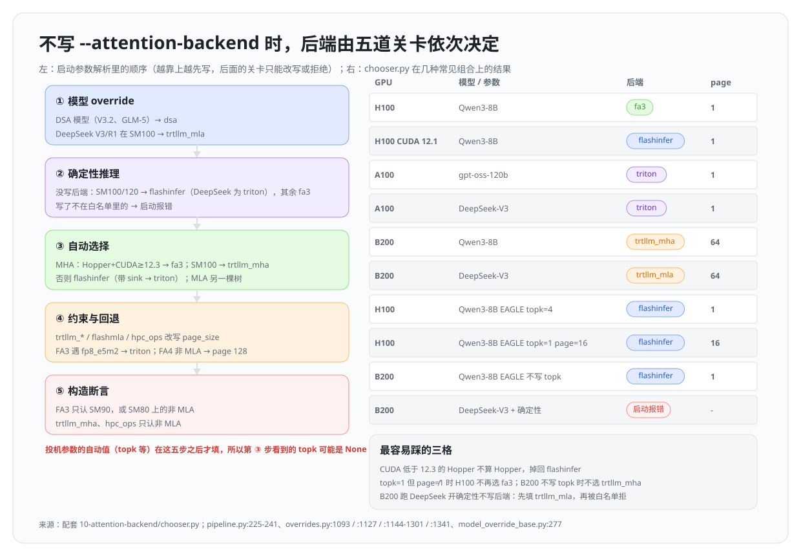
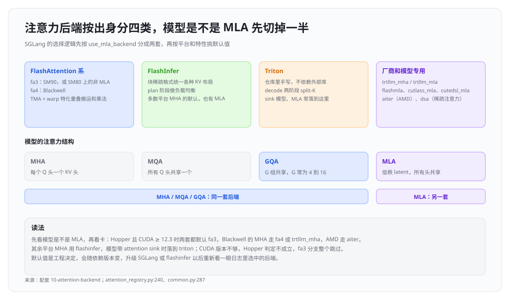
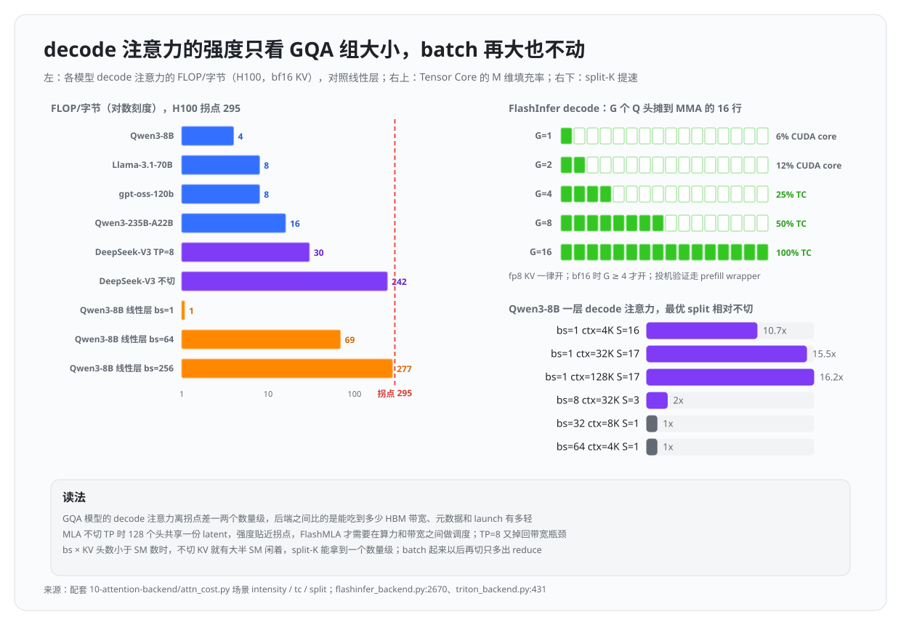
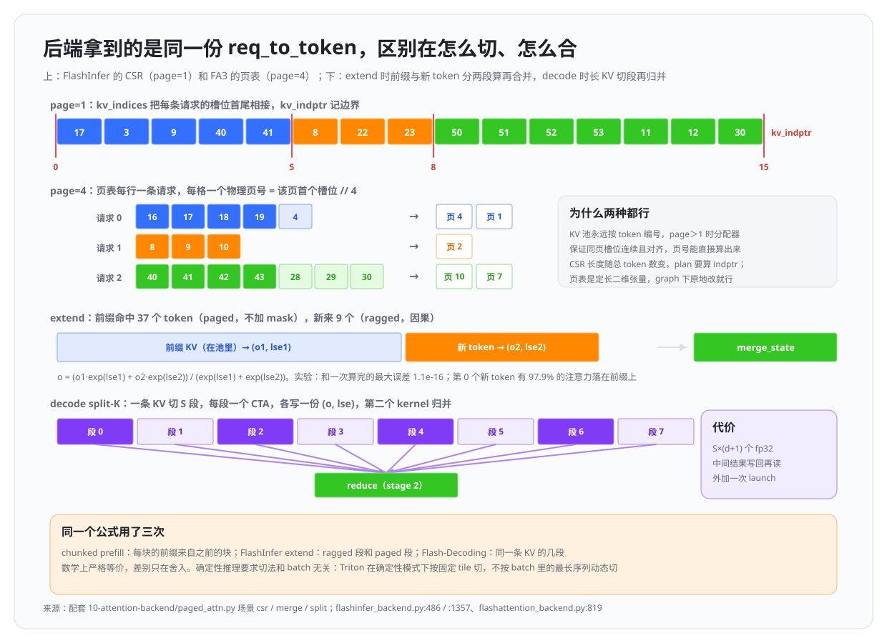
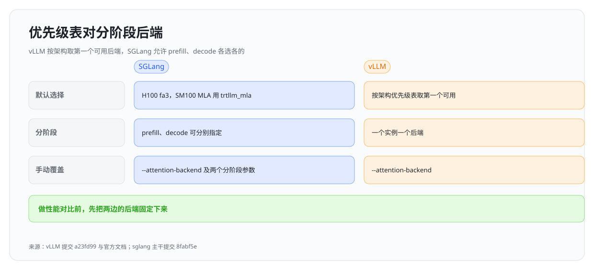

# SGL-10｜原理｜注意力后端：FlashInfer、FA3、Triton、TRTLLM 怎么选、怎么接进 CUDA Graph

> 🎯 **遇到的问题**：SGLang 的模型代码里，每一层注意力最后都落到一行 get_attn_backend().forward(...)。这一行背后是十几个可互换的实现：FlashInfer、FlashAttention-3、Triton、TRTLLM 的 MHA 和 MLA、FlashMLA、FA4、CUTLASS MLA、AMD 的 aiter，还有 DSA 稀疏注意力。
>
> 调度、KV 池和前缀树决定「算哪些 token」，注意力后端决定「怎么从 KV 池里把它们读出来算」。decode 时 HBM 带宽吃到几成、prefill 长上下文的 TTFT 都归它管，开 CUDA Graph 时它还要把每步的索引元数据塞进固定形状的缓冲。
>
> 这一篇拆四件事：不写参数时后端怎么选出来，哪些约束会改写 page_size 或直接拒绝启动，后端拿到的数据结构和数学长什么样，它怎么和 SGL-09 的 CUDA Graph 对接。
>
> **主线**：调度决定算哪些 token，注意力后端决定怎样从 KV 池里把它们读出来；选对后端，带宽和 TTFT 才能吃满。
>
> **读完这一篇**：拿到机器和模型，能先推出会选哪个后端、page_size 多少，再去日志核对。看到 B200 上开投机后掉吞吐、确定性推理在 DeepSeek 上启动报错、page 改成 64 后命中率下降，能说出是哪一步造成的。能用算术强度判断换后端有没有意义，自己写后端时分清元数据哪一半能碰 CPU。
>
> **代码**：[zero-to-sglang/10-attention-backend](../10-attention-backend)。chooser.py 按源码顺序重写后端选择的十一步，attn_cost.py 算注意力这一层的算术强度、split-K 占用和 KV 读取占比，paged_attn.py 复刻页表、LSE 合并、split-K 归并和 CUDA Graph 契约检查。只用标准库，几秒跑完，行号按主干 8fabf5e 核对。

# 导读 · 结论先行

1. **后端由五道关卡依次决定。**模型 override 最先写（DeepSeek V3 在 B200 上直接填 trtllm_mla），确定性推理第二（不在白名单里就报错），然后才是按 GPU 和模型结构的自动选择，再往后是各后端对 page_size 和 KV 精度的约束，最后在构造时还有一道平台断言。后面的关卡只能改写或拒绝前面的结果。
2. **投机参数的自动值比后端晚填。**不写 --speculative-eagle-topk 时，选后端那一刻 topk 是 None。H100 把它当成没开投机选 FA3，B200 则退到 FlashInfer；Llama 的自动 topk 是 4，于是 H100 上拿到的是「按 topk=1 选的 FA3」配「实际 topk=4」。
3. **所有后端看的是同一份 req_to_token。**KV 池永远按 token 编号，FlashInfer 和 Triton 把每条请求的槽位首尾相接成 CSR（page=1），FA3、FlashMLA、TRTLLM 取每页首个槽位除以 page 得到二维页表。两种看法的代价不同：CSR 的长度随总 token 数变，页表是定长张量。
4. **decode 注意力的强度只看 GQA 组大小。**每条请求只读自己的 KV，batch 再大也不复用，所以 bf16 下 FLOP/字节等于 G，离 H100 的拐点 295 差一两个数量级。后端之间比的是带宽利用率、split-K 填 SM 的本事和元数据有多轻。MLA 是例外：128 个头共享一份 latent，强度 240 左右，贴着拐点。
5. **接进 CUDA Graph 靠一份两段式契约。**init_forward_metadata 拆成 out_graph（replay 之前在图外跑，可以碰 CPU）和 in_graph（被录进图里，只能是固定形状的 GPU 操作）。FlashInfer 的 plan 在图外，FA3 的页表更新在图里，自己写后端时在 in_graph 里藏一个 .item() 就会在图下出错、eager 下正常。



上图左边是五道关卡的顺序，右边是 chooser.py 在十种常见组合上的结果。最容易踩的是右下三格：CUDA 12.1 的 H100 不算 Hopper，掉回 FlashInfer。topk=1 但 page≠1 时 H100 不再选 FA3。B200 跑 DeepSeek 开确定性推理不写后端，模型 override 先填 trtllm_mla，再被确定性白名单拒掉，服务起不来。

**📎 与系列其他文档的分工**：KV 池、req_to_token 和 page 分配器，见 [SGL-07｜原理｜内存池与页表：req_to_token、token_to_kv 与 page size](./07-memory-pool.md)。前缀树的匹配和 page 对齐，见 [SGL-08｜原理｜RadixAttention：基数树的匹配、插入、加锁与驱逐](./08-radix-attention.md)。CUDA Graph 的捕获、补齐和 slot 0 约定，见 [SGL-09｜原理｜Overlap 调度与 CUDA Graph：把 CPU 开销藏到 GPU 后面](./09-overlap-cudagraph.md)。TP 和 DP Attention 下每张卡上的头数怎么算，留给 [SGL-11｜原理｜并行：TP、DP Attention、EP 怎么组合](./11-parallelism.md)。FP8 / FP4 KV 的量化细节，留给 [SGL-12｜原理｜量化：FP8、INT4 与 KV 量化怎么选](./12-quantization.md)。投机解码的 draft / verify 和树形注意力，留给 [SGL-13｜原理｜投机解码：EAGLE、MTP、NGRAM 怎么选、怎么调](./13-speculative.md)。HiCache 把 KV 卸到 CPU 后后端怎么读，留给 [SGL-14｜原理｜HiCache：显存、主机内存、远端存储三层 KV 缓存](./14-hicache.md)。nsys 和 torch profiler 的完整用法，留给 [SGL-18｜实战｜可观测与 profiling：从指标到 kernel](./18-observability.md)。

# 第 1 章 · 问题：同一个模型换台机器，后端和速度都变了

线上常见的情形：

- 同一份启动命令，在 H100 上日志写 Use fa3 backend by default，在另一台 H100 上写 flashinfer，decode 慢了一截。两台机器只差 CUDA 版本。
- B200 上跑 Qwen3，加上 --speculative-algorithm EAGLE 以后后端从 trtllm_mha 变成了 flashinfer，page_size 从 64 变回 1。
- B200 上跑 DeepSeek-V3，加 --enable-deterministic-inference 后启动直接报错，提示后端不在支持列表里。
- 换了 TRTLLM 或 FA4 后端，吞吐涨了，但前缀缓存命中率从 83% 掉到 74%。
- A100 上给 DeepSeek 指定 --attention-backend fa3，构造模型时断言失败。
- 升级 flashinfer 以后，Hopper 上 Qwen3-235B 的 decode 吞吐掉了一成多，降回去就好。
- bs=1 跑 128K 上下文，ITL 比预想的慢好几倍，nvidia-smi 显示 GPU 利用率很低。
- 自己改了一个后端，eager 下输出正常，开了 CUDA Graph 偶发乱码。

这些现象落在三件事上：选择逻辑（谁在什么时候写了 attention_backend 和 page_size），注意力这一层的成本结构（带宽、SM 占用、Tensor Core），以及后端和 CUDA Graph 的契约。下面按这个顺序讲。

| 想弄清的现象 | 看哪一节 |
|-|-|
| 有哪些后端，各自支持什么 | 2.1 |
| 不写参数时后端怎么选，日志里那一行从哪来 | 2.2、4.1 |
| 开投机解码后后端为什么变了 | 2.3、4.2 |
| page_size 被改写、启动报错、构造断言 | 2.4、4.3 |
| 换后端到底能快多少，什么时候没意义 | 2.5、2.13、4.4、4.8 |
| FlashInfer 什么时候用 Tensor Core | 2.6、4.5 |
| bs=1 长上下文为什么慢，split-K 是什么 | 2.7、4.6 |
| CSR 和页表是什么，为什么两种都行 | 2.8、4.7 |
| 前缀和新 token 为什么能分开算 | 2.9、4.7 |
| page 变大为什么命中率掉 | 2.10、4.9 |
| CUDA Graph 下后端的元数据怎么准备 | 2.11、4.10 |
| prefill 和 decode 能不能用不同后端 | 2.12、4.11 |

# 第 2 章 · 原理：后端怎么选，选出来以后算的是什么

## 2.1 后端列表和支持矩阵

SGLang 文档的 Attention Backend 一页列了所有后端和一张支持矩阵，横轴是 page_size>1、FP8 KV、FP4 KV、投机 topk=1、topk>1、滑动窗口、多模态等特性[[1]](https://docs.sglang.io/docs/advanced_features/attention_backend)。按出身可以分成四类：

- **FlashAttention 系**：fa3 和 fa4。FlashAttention 的思路是分块计算 softmax，把 S=QK^T 留在 SRAM 里不写回 HBM[[2]](https://arxiv.org/abs/2205.14135)。FA2 调整了并行维度和循环顺序[[3]](https://arxiv.org/abs/2307.08691)。FA3 针对 Hopper 用 TMA 和 warp 特化把数据搬运和矩阵乘重叠，再加 FP8 支持[[4]](https://arxiv.org/abs/2407.08608)。FA3 只认 SM90，或者 SM80 上的非 MLA 模型；fa4 面向 Blackwell。
- **FlashInfer**：一个可定制的注意力引擎，用块稀疏格式统一表示各种 KV 布局，按 batch 情况在 plan 阶段做负载均衡调度[[5]](https://arxiv.org/abs/2501.01005)。它在 SGLang 里历史最久，是大多数非 Hopper、非 Blackwell 平台上 MHA 的默认值，MLA 也有一套实现[[6]](https://github.com/flashinfer-ai/flashinfer)。
- **Triton**：SGLang 仓库里用 Triton 手写的一套 kernel，decode 用两阶段 split-K，prefill 和 extend 也有对应实现。它不依赖外部库，什么平台都能跑，带 attention sink 的模型（gpt-oss）和 MLA 在很多平台上会落到它。
- **厂商和模型专用**：trtllm_mha 和 trtllm_mla 来自 TensorRT-LLM 的 Blackwell kernel。flashmla 是 DeepSeek 开源的 MLA decode kernel[[7]](https://github.com/deepseek-ai/FlashMLA)。cutlass_mla、cutedsl_mla 也是 MLA 专用。aiter 是 AMD 平台的默认值。dsa 给 DeepSeek V3.2、GLM-5 这类稀疏注意力模型。

模型的注意力结构决定了能用哪一类。MHA 每个 Q 头配一个 KV 头。MQA 所有 Q 头共享一个 KV 头[[8]](https://arxiv.org/abs/1911.02150)。GQA 把 Q 头分成 G 组，每组共享一个 KV 头[[9]](https://arxiv.org/abs/2305.13245)，Llama 3、Qwen3 都是这种，G 通常是 4 到 16。MLA 把 K 和 V 压成一个低秩 latent，推理时把上投影矩阵吸收进 Q 和输出，所有头共享这份 latent[[10]](https://arxiv.org/abs/2405.04434)。SGLang 里 MHA 和 GQA 走同一套后端，MLA 走另一套，选择逻辑里的 use_mla_backend 分支就是按这个分的。这几种结构的 KV 体积差别在 [SGL-02｜上手｜推理账本：显存、KV 与 Roofline](./02-ledger.md) 算过。



## 2.2 选择流程：五道关卡

后端在启动参数解析时就定了，不在运行时切换。参数解析是一条按顺序挂载的 pipeline[（pipeline.py:225）](https://github.com/sgl-project/sglang/blob/8fabf5e/python/sglang/srt/arg_groups/pipeline.py#L225)，和注意力相关的几步按先后是：

1. **模型 override**。handle_model_specific_adjustments 按架构调用各模型的 override。DSA 模型（DeepSeek V3.2、GLM-5）直接设成 dsa[（deepseek_v2.py:102）](https://github.com/sgl-project/sglang/blob/8fabf5e/python/sglang/srt/arg_groups/model_overrides/deepseek_v2.py#L102)；DeepSeek V3 / R1 在 SM100 上没写后端时填 trtllm_mla[（deepseek_v2.py:178）](https://github.com/sgl-project/sglang/blob/8fabf5e/python/sglang/srt/arg_groups/model_overrides/deepseek_v2.py#L178)。
2. **确定性推理**。开了 --enable-deterministic-inference 时，\_deterministic_attention_backend 介入[（overrides.py:1093）](https://github.com/sgl-project/sglang/blob/8fabf5e/python/sglang/srt/arg_groups/overrides.py#L1093)：没写后端时 SM100 / SM120 选 flashinfer（DeepSeek 选 triton），其余平台选 fa3；写了但不在白名单 {ascend, fa3, fa4, flashinfer, intel_xpu, triton} 里[（choices.py:113）](https://github.com/sgl-project/sglang/blob/8fabf5e/python/sglang/srt/arg_groups/choices.py#L113)，直接抛 ValueError。注意它看的是「此刻 attention_backend 的值」，第 1 步填进去的也算。
3. **自动选择**。\_attention_backend_default[（overrides.py:1127）](https://github.com/sgl-project/sglang/blob/8fabf5e/python/sglang/srt/arg_groups/overrides.py#L1127)：如果用户只写了 prefill 和 decode 两个后端且相同，就把它当成 attention_backend；否则调 get_default_attn_backend[（model_override_base.py:277）](https://github.com/sgl-project/sglang/blob/8fabf5e/python/sglang/srt/arg_groups/model_override_base.py#L277)，并打一行日志 Attention backend not specified. Use … backend by default.（:1137）。显式写了后端不打这一行。
4. **约束与回退**。attention_hook 里按顺序挂了几步[（attention_hook.py:120–241）](https://github.com/sgl-project/sglang/blob/8fabf5e/python/sglang/srt/arg_groups/attention_hook.py#L120)：MLA 和 TRTLLM 一类后端的 page 约束、MLA 的 KV 精度检查、cutedsl_mla 补 prefill 后端、trtllm_mha 的平台检查、FA3 遇到 fp8_e5m2 回退到 triton、FA4 非 MLA 强制 page 128。之后 \_page_size_default[（overrides.py:1341）](https://github.com/sgl-project/sglang/blob/8fabf5e/python/sglang/srt/arg_groups/overrides.py#L1341) 给还没定的 page_size 填 1。
5. **构造断言**。模型加载时按名字查注册表构造后端[（attention_backend_setup.py:283）](https://github.com/sgl-project/sglang/blob/8fabf5e/python/sglang/srt/model_executor/model_runner_components/attention_backend_setup.py#L283)，FA3 的构造函数断言平台是 SM90，或者 SM80 且非 MLA[（attention_registry.py:240）](https://github.com/sgl-project/sglang/blob/8fabf5e/python/sglang/srt/layers/attention/attention_registry.py#L240)；trtllm_mha、hpc_ops 只认非 MLA。

get_default_attn_backend 本身是一棵按平台和结构分叉的树：

```python
# MHA / GQA
if hopper and cuda >= 12.3 and (topk is None or (topk == 1 and page in (1, None))):
    return "fa3"            # 注释：flashinfer 0.6.1 在 Hopper 上有回退，见 issue #17411
elif sm100 and 同上条件 and (没开投机 or topk 已写 or 算法强制 topk=1):
    return "fa4" if K/V 宽度不同 else "trtllm_mha"
elif hip:  return "aiter"
elif mps:  return "torch_native"
else:      return "flashinfer" if 可用且模型没有 attention sink else "triton"

# MLA
if hopper and cuda >= 12.3: return "fa3"
elif sm100:                 return "flashinfer"     # DeepSeek V3 在第 1 步已被填成 trtllm_mla
elif hip:                   return "aiter" if 头数 in (16, 128) else "triton"
else:                       return "triton"
```

Hopper 判定用的是 is_hopper_with_cuda_12_3[（common.py:287–330）](https://github.com/sgl-project/sglang/blob/8fabf5e/python/sglang/srt/utils/common.py#L287)，CUDA 版本不够就不算 Hopper，FA3 分支整个跳过。H100 上 MHA 默认 FA3 的直接原因写在源码注释里：flashinfer 0.6.1 在 Hopper 上的注意力 kernel 有性能回退，issue #17411 报告 H20 上 Qwen3-235B 升级后吞吐明显下降[[11]](https://github.com/sgl-project/sglang/issues/17411)。这说明默认值是工程决定，会随依赖版本变，升级 SGLang 或 flashinfer 后要重新看一眼日志里那一行。

## 2.3 topk=None：投机参数比后端晚填

pipeline 的最后一步才是 handle_speculative_decoding，投机参数的自动值在这里由 \_auto_choose_speculative_params 填[（speculative_hook.py:1206）](https://github.com/sgl-project/sglang/blob/8fabf5e/python/sglang/srt/arg_groups/speculative_hook.py#L1206)：Llama、Grok 一类是 (steps=5, topk=4, draft=8)，DeepSeek 一类是 (3, 1, 4)。而选后端发生在第 3 步，那时候用户没写的 topk 还是 None。

is_no_spec_infer_or_topk_one 的定义是 topk 为 None，或 topk=1 且 page_size 为 1 或未设[（common.py:3960）](https://github.com/sgl-project/sglang/blob/8fabf5e/python/sglang/srt/utils/common.py#L3960)。topk 为 None 时它返回 True，H100 分支就当成没开投机，选 FA3。B200 分支多了一个条件：开了投机算法的话，topk 必须已经写明，或者算法本身强制 topk=1，否则不选 trtllm_mha，落到 FlashInfer。于是同样一句「开 EAGLE 不写 topk」，在两种卡上有两种结局：

- H100 + Llama + EAGLE 不写 topk：选 FA3，随后 topk 被填成 4。FA3 支持 topk>1，能跑，但这个组合并没有经过 topk>1 的选择分支，等于绕过了「topk>1 时别选 FA3」那条默认规则。
- B200 + Qwen3 + EAGLE 不写 topk：选 FlashInfer，page_size 回到 1，trtllm_mha 的 kernel 用不上。写明 topk=1 后回到 trtllm_mha、page 64。

实践上，开投机解码时把 --speculative-num-steps、--speculative-eagle-topk、--speculative-num-draft-tokens 和 --attention-backend 四个都显式写，结果才可预期[[12]](https://docs.sglang.io/docs/advanced_features/speculative_decoding)。

## 2.4 约束、改写和拒绝

第 4 步的规则大多是 kernel 本身的硬限制，SGLang 选择改写参数而不报错，所以很容易在不知情的情况下吃到副作用：

| 规则 | 位置 | 效果 |
|-|-|-|
| flashmla 要求 page 64 | [overrides.py:1144](https://github.com/sgl-project/sglang/blob/8fabf5e/python/sglang/srt/arg_groups/overrides.py#L1144) | page_size 改成 64 |
| trtllm_mla、cutedsl_mla 只认 page 32 或 64 | overrides.py:1144 同一函数 | 其他值改成 64 |
| trtllm_mha 只认 page 16、32、64、128 | 同上 | 其他值改成 64 |
| hpc_ops 只认 page 64 | 同上 | 改成 64 |
| trtllm_mla 的 KV 精度只能是 fp8_e4m3、bf16、auto | attention_hook.py:190 | 其他值报错 |
| FA3 不支持 fp8_e5m2 | [overrides.py:1263](https://github.com/sgl-project/sglang/blob/8fabf5e/python/sglang/srt/arg_groups/overrides.py#L1263) | 后端改成 triton |
| FA4 在 SM100 上跑非 MLA 且 topk≤1 | [overrides.py:1274](https://github.com/sgl-project/sglang/blob/8fabf5e/python/sglang/srt/arg_groups/overrides.py#L1274) | page_size 改成 128 |
| cutedsl_mla 只做 decode | overrides.py:1233 | prefill 补成 trtllm_mla |
| TRTLLM MLA 只支持 Blackwell | attention_hook.py | 非 Blackwell 报错 |
| FA3 平台 | [attention_registry.py:240](https://github.com/sgl-project/sglang/blob/8fabf5e/python/sglang/srt/layers/attention/attention_registry.py#L240) | SM80 + MLA 等组合构造时断言失败 |

FA4 那一条有个细节：EAGLE topk>1 走两段式的页树级联，FA4 的 CUTLASS kernel 在 page>1 时会中止，所以 topk>1 时不强制 128，保持 page 1。这类注释在源码里很多，读约束时要连注释一起看。

## 2.5 decode 注意力为什么永远吃带宽

Roofline 模型把一个 kernel 的性能上限写成 峰值算力和「带宽 × 算术强度」两者中较小的那个，强度是 FLOP 除以访存字节，两条线的交点叫拐点[[13]](https://dl.acm.org/doi/10.1145/1498765.1498785)。H100 SXM 的 BF16 稠密峰值 989 TFLOPS，HBM3 带宽 3.35 TB/s[[14]](https://www.nvidia.com/en-us/data-center/h100/)，拐点约 295 FLOP/字节。[SGL-02｜上手｜推理账本：显存、KV 与 Roofline](./02-ledger.md) 用它算过线性层，这里算注意力。

一层、一个请求、一步 decode，上下文长 L，头维 d，Q 头 H，KV 头 Hkv，组大小 G = H / Hkv：

```text
FLOPs = QK^T 2·H·d·L + PV 2·H·d·L = 4·H·d·L
字节  = 读 K 和 V：2·Hkv·d·L·b          （b 为 KV 每元素字节数）
强度  = 4·H·d·L / (2·Hkv·d·L·b) = 2·G / b    （bf16 时等于 G）
```

L 和 d 都约掉了，batch 也不出现：每条请求读自己的 KV，别的请求帮不上忙。线性层正相反，权重被整个 batch 共享，强度随 bs 线性涨。attn_cost.py 的结果：Qwen3-8B（32 个 Q 头、8 个 KV 头）强度 4，Llama-3.1-70B 是 8，Qwen3-235B-A22B 是 16，换成 FP8 KV 翻倍；同一个 Qwen3-8B 的线性层在 bs=256 时强度 277，已经贴到拐点。



左边的对数刻度把这件事画得很清楚：GQA 模型的注意力条都挤在 10 附近，离 295 的红线一两个数量级；线性层的橙条随 bs 往右走。所以 GQA 模型 decode 时换注意力后端，比的是能吃到多少 HBM 带宽，以及 plan、索引构造、kernel 启动这些固定开销有多轻。带宽瓶颈的 kernel，优化目标是把带宽利用率推到八九成，注意力后端之间的差距大多在这个区间里。

MLA 是例外。吸收之后所有 Q 头共享一份 latent，K 用 kv_lora_rank + rope 维（512 + 64 = 576），V 用 512 维。DeepSeek-V3 有 128 个头，强度约 2·128·(576+512)/576/2 ≈ 242，贴着拐点。

FlashMLA 团队的解析给了同一个结论：计算访存比约 2·h_q·s_q，H800 降频到 865 TFLOPS 时，h_q·s_q ≥ 128 就转成算力瓶颈，他们因此重写了 kernel 的调度，让算力和带宽两条线交替打满，H800 上做到 660 TFLOPS，访存瓶颈场景 3 TB/s[[15]](https://github.com/deepseek-ai/FlashMLA/blob/main/docs/20250422-new-kernel-deep-dive.md)。DeepSeek 自己的推理部署里 decode 不开 TP[[16]](https://arxiv.org/abs/2412.19437)，原因之一就在这里：TP=8 时每卡只剩 16 个头，强度掉到 30 左右，又回到带宽瓶颈，MLA 省下的算力白白浪费。

## 2.6 FlashInfer 什么时候用 Tensor Core

decode 时 Q 只有一行，单个头的 QK^T 是向量乘矩阵，Tensor Core 用不上。FlashInfer 的做法是把同一个 KV 头下的 G 个 Q 头叠起来，当成 MMA 的 M 维。mma.m16n8k16 的 M 维是 16 行，G=4 时只填了 4 行，填充率 25%；G=16 才填满。SGLang 的规则在 should_use_tensor_core[（flashinfer_backend.py:2670）](https://github.com/sgl-project/sglang/blob/8fabf5e/python/sglang/srt/layers/attention/flashinfer_backend.py#L2670)：

- 环境变量 SGLANG_FLASHINFER_USE_TENSOR_CORE 优先，设 true / false 直接决定。
- KV 是 FP8（e4m3 或 e5m2）一律开：FP8 要先反量化，CUDA core 本来就更忙。
- KV 是 fp16 / bf16 时，组大小 ≥ 4 才开；源码注释写的就是「至少 4 才能高效利用 Tensor Core」。
- 开确定性推理时强制开（:443），保证不同 batch 下走同一条 kernel 路径。

投机解码的 verify 一次算 draft 个 token，s_q > 1，在 FlashInfer 里走 prefill wrapper（:1025），本来就用 Tensor Core，不受这条规则管。组大小按每张卡上的头数算，TP 切过之后 Q 头和 KV 头同比例减少，G 不变；KV 头少于 TP 时 KV 头被复制，G 只会变小，这时候要留意它有没有跌破 4。

## 2.7 split-K：bs=1 长上下文为什么慢

朴素的 decode kernel 给每个（请求，KV 头）分一个 CTA，沿着 L 顺序扫完。Qwen3-8B 只有 8 个 KV 头，bs=1 时只有 8 个 CTA，H100 有 132 个 SM，一百多个 SM 闲着；一个 SM 拉不满整张卡的 HBM，带宽也只用到零头。Flash-Decoding 的做法是把 KV 沿长度切成 S 段，每段一个 CTA 独立算出部分输出和它的 log-sum-exp，第二个 kernel 按 LSE 归并[[17]](https://crfm.stanford.edu/2023/10/12/flashdecoding.html)。博客里说 bs=1 时原版 FlashAttention 用不到 1% 的 GPU，切开以后长序列 decode 快到 8 倍。

attn_cost.py 用「带宽 ≈ 峰值 × CTA 数与 SM 数之比，封顶 1」这个粗模型算一层 decode 注意力：bs=1、ctx=32K 不切要 826 µs，切 8 份 106 µs（7.8 倍），切 17 份填满 SM 后 53 µs（15.5 倍）。bs=8 时切 3 份就够，2.0 倍。bs=32 以上 CTA 自己就填满了 SM，再切只多出 reduce 和中间结果的读写。

所以 split 数要随 batch 动态取。Triton 后端的上限是 --triton-attention-num-kv-splits，默认 8[（exec\_.py:416）](https://github.com/sgl-project/sglang/blob/8fabf5e/python/sglang/srt/arg_groups/fields/exec_.py#L416)，帮助里写着上下文越长越大越好；每步实际取几段由 get_num_kv_splits 用一个小 Triton kernel 按 batch 里的序列长度和头数算[（triton_backend.py:431）](https://github.com/sgl-project/sglang/blob/8fabf5e/python/sglang/srt/layers/attention/triton_backend.py#L431)。FlashInfer 在 plan 阶段决定是否切、切多少。

切法会影响数值。归并顺序不同，浮点舍入就不同，同一条请求在 bs=1 和 bs=64 下末位可能不一样。确定性推理要求结果和 batch 无关[[18]](https://www.lmsys.org/blog/2025-09-22-sglang-deterministic/)，所以开了 --enable-deterministic-inference 后，Triton 按固定 tile 切，每段 SGLANG_TRITON_DECODE_SPLIT_TILE_SIZE 个 token（默认 256），段数等于 ceil(L / 256)，只和这条请求自己的长度有关。

FlashInfer 同样换成固定 tile（decode 2048、prefill 4096），并在 CUDA Graph 下关掉动态 split。浮点加法不满足结合律，分块方式一变结果就跟着变，这是推理侧的处理办法。

## 2.8 同一份 req_to_token，两种看法

[SGL-07｜原理｜内存池与页表：req_to_token、token_to_kv 与 page size](./07-memory-pool.md) 讲过，SGLang 的 KV 池是一个按 token 槽位编号的大数组，req_to_token[req, i] 记录第 req 条请求第 i 个 token 的 KV 存在哪个槽位。后端拿到的就是这张表加上本步的 req_pool_indices 和 seq_lens，各自转换成 kernel 要的格式。



上半是两种看法。FlashInfer 用 CSR：kv_indices 把每条请求的槽位首尾相接，kv_indptr 记边界。SGLang 给 FlashInfer 传 page_size=1（:1847、:2403），kv_last_page_len 全是 1[（flashinfer_backend.py:486）](https://github.com/sgl-project/sglang/blob/8fabf5e/python/sglang/srt/layers/attention/flashinfer_backend.py#L486)，每个「页」就是一个槽位，所以槽位可以完全分散。图里三条请求长 5、3、7，indptr 是 [0, 5, 8, 15]。真实实现是一个 Triton kernel，逻辑就是这个循环。

FA3、FlashMLA、TRTLLM 要的是二维页表：每行一条请求，每格一个物理页号。page_size>1 时分配器保证同一页里的槽位连续且起点对齐到 page 的倍数，于是页号可以直接算：取每页首个槽位，除以 page[（flashattention_backend.py:819–828）](https://github.com/sgl-project/sglang/blob/8fabf5e/python/sglang/srt/layers/attention/flashattention_backend.py#L819)。page=4 时三条请求的页表是 [[4, 1], [2], [10, 7]]。page=1 时这一步是恒等变换，页表就是 req_to_token 本身。

两种格式的代价不同。CSR 的长度等于本步的总 token 数，每步都在变，plan 时要知道总长度；页表是定长二维张量（max_bs × max_pages），CUDA Graph 下原地改就行。这是 FlashInfer 的元数据准备通常比 FA3 重的结构性原因。

## 2.9 前缀和新 token 分两段算，再按 LSE 合并

extend（带前缀命中的 prefill）时，前缀的 KV 已经在池里，新 token 的 K、V 刚算出来还在手上。FlashInfer 的 forward_extend 分两次算[（flashinfer_backend.py:1357）](https://github.com/sgl-project/sglang/blob/8fabf5e/python/sglang/srt/layers/attention/flashinfer_backend.py#L1357)：新 token 之间用 ragged kernel，加因果 mask；新 token 对前缀用 paged kernel，不加 mask。两次各出一份 (o, lse)，最后 merge_state 合并（:1503）。合并公式：

```text
lse = log(exp(lse1) + exp(lse2))
o   = o1·exp(lse1 − lse) + o2·exp(lse2 − lse)
```

softmax 的分母是所有位置 exp(score) 之和，可以分段求和再相加；每段的输出是按本段分母归一化的加权平均，乘回本段分母占总分母的比例就得到全局结果。paged_attn.py 拿 37 个前缀 token 加 9 个新 token 验证，两段合并和一次算完的最大误差 1.1e-16。第 0 个新 token 的 lse 分别是 4.052（前缀）和 0.213（自己），合并后 4.073，97.9% 的注意力落在前缀上。

这一个公式在 SGLang 里用了三次：chunked prefill 的每一块看之前所有块（[SGL-06｜原理｜Chunked prefill：切块大小、mixed chunk 与 TTFT / ITL 的取舍](./06-chunked-prefill.md)），FlashInfer extend 的 ragged 段加 paged 段，Flash-Decoding 的每一段 KV。FA3 不需要拆，它的 kernel 一次同时吃页表里的前缀和新 K/V。

## 2.10 page_size 的账：kernel 更快，命中更少

TRTLLM、FA4、FlashMLA 强制 page>1，因为大页让 kernel 一次连续读一大块，TMA 和向量化访存都更好做。代价在前缀缓存上：page_size>1 时 radix cache 的匹配长度截到 page 的整数倍[（radix_cache.py:381）](https://github.com/sgl-project/sglang/blob/8fabf5e/python/sglang/srt/mem_cache/radix_cache.py#L381)，每条请求最多丢 page−1 个本可复用的 token；每条请求的最后一页平均还要空出 page/2 个槽位。

paged_attn.py 模拟 256 条请求共享 1000 token 的系统提示、各自再接 20 到 400 token、输出 200 token：page=1 时前缀命中率 82.9%，page=64 时 79.6%，page=128 时 74.3%，尾页浪费从 0 涨到 4%。

多轮对话更明显，上一轮的回复也在缓存里，下一轮的前缀长度几乎从来不是整页：2047 个 token 的前缀在 page=128 时只能复用 1920 个。长 prompt 场景这点损失可以接受；短 prompt、高并发、前缀很碎的负载上，page=128 吃掉的命中率可能比 kernel 省下的时间还多，要实测两边一起算。

## 2.11 后端和 CUDA Graph 的契约：out_graph 和 in_graph

[SGL-09｜原理｜Overlap 调度与 CUDA Graph：把 CPU 开销藏到 GPU 后面](./09-overlap-cudagraph.md) 讲过，CUDA Graph 把一步 decode 录成固定形状的图，replay 时只能改静态缓冲里的值。注意力后端每一步都要根据新的 seq_lens 重建索引，这件事在图里怎么做，由基类的一份契约规定[（base_attn_backend.py:99）](https://github.com/sgl-project/sglang/blob/8fabf5e/python/sglang/srt/layers/attention/base_attn_backend.py#L99)：

- **init_forward_metadata_out_graph**[（:117）](https://github.com/sgl-project/sglang/blob/8fabf5e/python/sglang/srt/layers/attention/base_attn_backend.py#L117)：在 graph.replay() 之前、图外面跑。可以读 CPU 上的 seq_lens_cpu、可以算总长度、可以调 FlashInfer 的 plan。捕获时也会以 in_capture=True 调一次，用来开缓冲。
- **init_forward_metadata_in_graph**[（:139）](https://github.com/sgl-project/sglang/blob/8fabf5e/python/sglang/srt/layers/attention/base_attn_backend.py#L139)：被录进图里，每次 replay 都重放。只能是固定形状的 GPU 操作，写进 init_cuda_graph_state 预分配的缓冲。基类的 lint 注释列了禁止项：.item()、.cpu()、.tolist()，以及形状依赖本步数据的 torch.empty。
- **init_cuda_graph_state**[（:256）](https://github.com/sgl-project/sglang/blob/8fabf5e/python/sglang/srt/layers/attention/base_attn_backend.py#L256)：按 max_bs 和最大 token 数一次性分配所有元数据缓冲。

eager 模式下 model_runner 直接调 init_forward_metadata，两半依次跑[（model_runner.py:1824）](https://github.com/sgl-project/sglang/blob/8fabf5e/python/sglang/srt/model_executor/model_runner.py#L1824)。图模式下 decode 图 runner 在捕获前调 out_graph(in_capture=True)（decode_cuda_graph_runner.py:1433），把 in_graph 放进被捕获的区域（:665），replay 前再调一次 out_graph（:1875）。

各后端的分工不一样。FlashInfer 把活几乎都放在 out_graph：调 indices_updater 构造 CSR、调 plan，捕获时还把 plan 换成 fast_decode_plan 省掉 Python 开销[（flashinfer_backend.py:846）](https://github.com/sgl-project/sglang/blob/8fabf5e/python/sglang/srt/layers/attention/flashinfer_backend.py#L846)；in_graph 基本为空。

FA3 走另一条路，页表和 cu_seqlens 的更新是一个能被捕获的 kernel，放在 in_graph 里[（flashattention_backend.py:475）](https://github.com/sgl-project/sglang/blob/8fabf5e/python/sglang/srt/layers/attention/flashattention_backend.py#L475)，图外几乎不用做事。trtllm_mha 同样拆成两半（:1124、:1251）。差别直接反映在 CPU 开销上：FlashInfer 每步的 plan 在图外，bs 大时有可感知的 CPU 时间，好在 SGL-09 的 overlap 能把它藏住。

违约的后果在 eager 下看不出来。in_graph 里的 .item() 在捕获时会报错，或者把捕获那一刻的值烧进图里；形状依赖 bs 的 torch.empty 在 replay 时形状不会变。paged_attn.py 的 contract 场景用 AST 扫了一段违规代码，找出 5 处：.item()、int(tensor)、.cpu()、.tolist()、按 batch_size 开的 torch.empty。

## 2.12 拆分后端：prefill 和 decode 用不同实现

--prefill-attention-backend 和 --decode-attention-backend 可以分开写。两者不同时，SGLang 构造一个 HybridAttnBackend 把两个后端包起来[（attention_backend_setup.py:232）](https://github.com/sgl-project/sglang/blob/8fabf5e/python/sglang/srt/model_executor/model_runner_components/attention_backend_setup.py#L232)，每次 forward 按模式分派[（hybrid_attn_backend.py:64）](https://github.com/sgl-project/sglang/blob/8fabf5e/python/sglang/srt/layers/attention/hybrid_attn_backend.py#L64)：decode 和 idle 走 decode 后端。

投机解码的 target_verify 默认走 prefill 后端，--speculative-attention-mode decode 时走 decode 后端[（spec.py:129）](https://github.com/sgl-project/sglang/blob/8fabf5e/python/sglang/srt/arg_groups/fields/spec.py#L129)。extend、mixed 等其余模式都走 prefill 后端。

典型用法是 prefill 用 FA3 / FA4 吃长上下文的算力，decode 用 FlashInfer 或 TRTLLM 吃带宽，或者 MLA 模型 decode 用 cutedsl_mla、prefill 用 trtllm_mla（这个组合 SGLang 会自动补）。代价是两个后端各有一份元数据缓冲和 workspace，显存和 plan 开销都是两份；verify 走哪边还会影响投机解码的接受路径，要和 SGL-13 一起看。

## 2.13 什么时候换后端有意义

注意力后端只管注意力这一层。prefill 时注意力 FLOPs 随上下文平方涨，线性层随 token 数线性涨，平衡点在哪个长度，决定了 prefill 后端什么时候开始影响 TTFT。attn_cost.py 的结果：Qwen3-8B 在 5.6 万 token 时两者相等，8K 时注意力只占 13%。Llama-3.1-70B 要到 10.8 万。MoE 模型激活参数少，Qwen3-235B-A22B 和 DeepSeek-V3 在 3 万左右就五五开。短 prompt 的 prefill 基本是 GEMM，换注意力后端看不出差别。

decode 时看 KV 读取占一步的比例。Qwen3-8B 在 H100 上一步读权重 5.65 ms（按 80% 带宽），每 token KV 144 KiB：bs=1、4K 上下文时 KV 只占 4%。bs×ctx 到 13 万 token 时占 56%。KV 池快塞满（26 万 token）时占 72%。KV 占大头时，后端的带宽利用率、FP8 KV、page 布局才有优化空间；小 batch 短上下文时先看 [SGL-09｜原理｜Overlap 调度与 CUDA Graph：把 CPU 开销藏到 GPU 后面](./09-overlap-cudagraph.md) 讲的 CPU 开销。性能优化先定位瓶颈在哪一层，这里给的是注意力这一层的判断方法。

## 2.14 vLLM 怎么做

vLLM 按硬件架构排后端优先级，取第一个支持当前模型和参数的后端[[19]](https://github.com/vllm-project/vllm/blob/a23fd9903418de0e1d3757bb23e2f1697eb066f3/vllm/v1/attention/backends/registry.py)。非 MLA 模型在 Blackwell 上优先 FlashInfer，在 Hopper 上优先 FlashAttention。MLA 模型在 SM100 上依次是 FLASHINFER_MLA、CUTLASS_MLA、FLASH_ATTN_MLA、FLASHMLA、TRITON_MLA；在 Hopper 上是 FLASH_ATTN_MLA、FLASHMLA、FLASHINFER_MLA、TRITON_MLA。手动指定用 --attention-backend[[20]](https://docs.vllm.ai/en/latest/design/attention_backends.html)。

SGLang 在 H100 上默认 fa3，DeepSeek 一类 MLA 模型在 SM100 上默认 trtllm_mla。最大的结构差别在于 SGLang 允许 prefill 和 decode 用不同后端，分别由 --prefill-attention-backend 和 --decode-attention-backend 指定；vLLM 一个实例只用一个后端。分开选能让 prefill 用算力型 kernel、decode 用带宽型 kernel，但两个后端的 KV 布局必须兼容，组合测试面也翻倍。

| 维度 | SGLang | vLLM | 差异的代价 |
|-|-|-|-|
| 默认选择 | H100 fa3，SM100 MLA 用 trtllm_mla | 按架构优先级表取第一个可用 | 升级版本后默认后端可能悄悄变 |
| 分阶段 | prefill、decode 可分别指定 | 一个实例一个后端 | SGLang 组合更灵活，测试面更大 |
| 手动覆盖 | --attention-backend 及两个分阶段参数 | --attention-backend | 对比性能前先固定后端 |



# 第 3 章 · 源码走读：从启动参数到一次注意力 forward 的 18 个落脚点

前 9 行是启动时的参数解析，后 9 行是运行时。路径相对 python/sglang/srt/。

| # | 位置 | 发生了什么 |
|-|-|-|
| 1 | [arg_groups/pipeline.py:225](https://github.com/sgl-project/sglang/blob/8fabf5e/python/sglang/srt/arg_groups/pipeline.py#L225) | 参数解析的挂载顺序：模型 override → 确定性 → 注意力兼容 → page 默认 → 投机（最后） |
| 2 | [model_overrides/deepseek_v2.py:178](https://github.com/sgl-project/sglang/blob/8fabf5e/python/sglang/srt/arg_groups/model_overrides/deepseek_v2.py#L178) | DeepSeek V3 在 SM100 填 trtllm_mla；:102 DSA 模型填 dsa |
| 3 | [arg_groups/overrides.py:1093](https://github.com/sgl-project/sglang/blob/8fabf5e/python/sglang/srt/arg_groups/overrides.py#L1093) | \_deterministic_attention_backend：没写就按平台填，写了不在白名单里就报错 |
| 4 | [overrides.py:1127](https://github.com/sgl-project/sglang/blob/8fabf5e/python/sglang/srt/arg_groups/overrides.py#L1127) | \_attention_backend_default：prefill 与 decode 相同则合并，否则自动选，:1137 打日志 |
| 5 | [arg_groups/model_override_base.py:277](https://github.com/sgl-project/sglang/blob/8fabf5e/python/sglang/srt/arg_groups/model_override_base.py#L277) | get_default_attn_backend：MHA / MLA 两棵树 |
| 6 | [utils/common.py:3960](https://github.com/sgl-project/sglang/blob/8fabf5e/python/sglang/srt/utils/common.py#L3960) | is_no_spec_infer_or_topk_one：topk 为 None 也算 |
| 7 | [arg_groups/attention_hook.py:120](https://github.com/sgl-project/sglang/blob/8fabf5e/python/sglang/srt/arg_groups/attention_hook.py#L120) | 按 :120 → :184 → :190 → :196 → :198 → :239 → :241 挂约束 |
| 8 | [overrides.py:1144](https://github.com/sgl-project/sglang/blob/8fabf5e/python/sglang/srt/arg_groups/overrides.py#L1144) | MLA / TRTLLM / hpc_ops 的 page 约束。:1263 FA3 e5m2 回退。:1274 FA4 page 128 |
| 9 | [arg_groups/speculative_hook.py:1206](https://github.com/sgl-project/sglang/blob/8fabf5e/python/sglang/srt/arg_groups/speculative_hook.py#L1206) | 投机参数自动值，晚于注意力后端选择 |
| 10 | [model_runner_components/attention_backend_setup.py:232](https://github.com/sgl-project/sglang/blob/8fabf5e/python/sglang/srt/model_executor/model_runner_components/attention_backend_setup.py#L232) | prefill ≠ decode 时构造 HybridAttnBackend；:283 按名字查注册表 |
| 11 | [layers/attention/attention_registry.py:240](https://github.com/sgl-project/sglang/blob/8fabf5e/python/sglang/srt/layers/attention/attention_registry.py#L240) | FA3 构造断言 SM90 或 SM80 非 MLA |
| 12 | [model_executor/model_runner.py:1824](https://github.com/sgl-project/sglang/blob/8fabf5e/python/sglang/srt/model_executor/model_runner.py#L1824) | eager 下每步调 init_forward_metadata |
| 13 | [layers/attention/base_attn_backend.py:117](https://github.com/sgl-project/sglang/blob/8fabf5e/python/sglang/srt/layers/attention/base_attn_backend.py#L117) | out_graph / in_graph（:139）契约，:256 init_cuda_graph_state |
| 14 | [runner/decode_cuda_graph_runner.py:665](https://github.com/sgl-project/sglang/blob/8fabf5e/python/sglang/srt/model_executor/runner/decode_cuda_graph_runner.py#L665) | in_graph 进图。:1433 捕获时 out_graph。:1875 replay 前 out_graph |
| 15 | [flashinfer_backend.py:740](https://github.com/sgl-project/sglang/blob/8fabf5e/python/sglang/srt/layers/attention/flashinfer_backend.py#L740) | out_graph 构造 CSR 和 plan。:846 换成 fast_decode_plan。:2670 Tensor Core 开关 |
| 16 | [flashinfer_backend.py:1357](https://github.com/sgl-project/sglang/blob/8fabf5e/python/sglang/srt/layers/attention/flashinfer_backend.py#L1357) | forward_extend：ragged + paged 两段，:1503 merge_state |
| 17 | [flashattention_backend.py:819](https://github.com/sgl-project/sglang/blob/8fabf5e/python/sglang/srt/layers/attention/flashattention_backend.py#L819) | 页表 = 每页首个槽位 // page_size；:475 in_graph 更新页表 |
| 18 | [triton_backend.py:431](https://github.com/sgl-project/sglang/blob/8fabf5e/python/sglang/srt/layers/attention/triton_backend.py#L431) | get_num_kv_splits：确定性下按固定 tile，否则启发式 |

模型这一侧只有一个入口：RadixAttention.forward 调 get_attn_backend().forward[（radix_attention.py:183）](https://github.com/sgl-project/sglang/blob/8fabf5e/python/sglang/srt/layers/radix_attention.py#L183)，基类 forward 按 forward_mode 分派到 forward_decode 或 forward_extend（base_attn_backend.py:321）。读一个新后端时，按「init_cuda_graph_state → out_graph → in_graph → forward_decode → forward_extend」的顺序看，五个函数读完就知道它怎么接进 SGLang。

# 第 4 章 · 实验：在 CPU 上推后端、算账、拼索引

实验都在 CPU 上跑，只用标准库。chooser.py 的逻辑按源码逐行重写，结果应该和真实启动日志一致。attn_cost.py 的时间是粗估模型，用来看趋势和量级。paged_attn.py 的数学是精确的，和 GPU kernel 只差在精度和并行。

## 4.1 常见 GPU × 模型的默认后端

```bash
cd zero-to-sglang/10-attention-backend
python3 chooser.py
```

```text
                    Qwen3-8B              Llama-3.1-70B         gpt-oss-120b          DeepSeek-V3           DeepSeek-V3.2
  A100              flashinfer  page=1    flashinfer  page=1    triton      page=1    triton      page=1    dsa         page=1
  L40S              flashinfer  page=1    flashinfer  page=1    triton      page=1    triton      page=1    dsa         page=1
  H100/H20          fa3         page=1    fa3         page=1    fa3         page=1    fa3         page=1    dsa         page=1
  H100 + CUDA 12.1  flashinfer  page=1    flashinfer  page=1    triton      page=1    triton      page=1    dsa         page=1
  B200              trtllm_mha  page=64   trtllm_mha  page=64   trtllm_mha  page=64   trtllm_mla  page=64   dsa         page=1
  RTX 5090          flashinfer  page=1    flashinfer  page=1    triton      page=1    triton      page=1    dsa         page=1
  MI300X            aiter       page=1    aiter       page=1    aiter       page=1    aiter       page=1    dsa         page=1
```

几个要看懂的格子。gpt-oss 在 A100 上是 triton，因为它带 attention sink[[21]](https://arxiv.org/abs/2508.10925)，FlashInfer 的默认分支会跳过带 sink 的模型。DeepSeek-V3 在 B200 上是 trtllm_mla 且 page 64：第 1 步模型 override 先填了后端，第 4 步 page 再被约束改写。RTX 5090 是 SM120，默认分支只认 SM100，落到 FlashInfer。H100 + CUDA 12.1 那一行整行退回非 Hopper 的结果。

## 4.2 投机参数怎么改变默认值

```bash
python3 chooser.py --scenario spec
```

```text
  H100 + Qwen3-8B
    不开投机                  fa3          page=1
    EAGLE topk 未设           fa3          page=1
    EAGLE topk=1              fa3          page=1
    EAGLE topk=1, page=16     flashinfer   page=16
    EAGLE topk=4              flashinfer   page=1
    EAGLE topk=4, 指定 fa3    fa3          page=1

  B200 + Qwen3-8B
    不开投机                  trtllm_mha   page=64
    EAGLE topk 未设           flashinfer   page=1
    EAGLE topk=1              trtllm_mha   page=64
    EAGLE topk=4              flashinfer   page=1
```

「topk 未设」在两种卡上结局不同，原因见 2.3。H100 上 topk=1 但 page=16 也会离开 FA3：is_no_spec_infer_or_topk_one 要求 page 为 1，源码的 TODO 写着 FA3 在 topk=1、page>1 时接受率还要改进。显式指定 fa3 不受默认规则限制，topk=4 照样能跑。

## 4.3 被改写和被拒绝的组合

```bash
python3 chooser.py --scenario rules
```

```text
  FA3 + fp8_e5m2                    triton                 page=1
      overrides.py:1263 FA3 只认 fp8_e4m3: attention_backend=triton
  A100 上给 MLA 指定 FA3            报错：attention_registry.py:240 FA3 需要 SM80（非 MLA）或 SM90
  trtllm_mha + page 1               trtllm_mha             page=64
  B200 + FA4（非 MLA）              fa4                    page=128
  H100 上指定 trtllm_mla            报错：TRTLLM MLA 只支持 Blackwell
  decode 用 cutedsl_mla             trtllm_mla / cutedsl_mla page=64
      overrides.py:1233 CuteDSL 补 prefill: prefill_attention_backend=trtllm_mla
  确定性推理，不指定后端            fa3                    page=1
  B200 + DeepSeek 确定性            报错：确定性推理不支持 trtllm_mla
      deepseek_v2.py:185 DeepSeek V3 在 SM100: attention_backend=trtllm_mla
  确定性 + trtllm_mha               报错：确定性推理不支持 trtllm_mha
  hpc_ops + page 16                 hpc_ops                page=64
```

B200 + DeepSeek 确定性那一条最要记住：用户什么后端都没写，报错却说 trtllm_mla 不支持。原因是第 1 步的模型 override 先写了 trtllm_mla，第 2 步的确定性检查把它当成用户指定的值。解决办法是显式写 --attention-backend triton 或 flashinfer。

```bash
python3 chooser.py --scenario matrix
```

```text
  MHA 模型，按需求筛后端（来源：官方文档支持矩阵）
    FP8 KV                    flashinfer, fa3, triton, torch_native, trtllm_mha, hpc_ops, aiter
    FP8 KV + page>1           flashinfer, fa3, trtllm_mha, hpc_ops, aiter
    EAGLE topk>1 + page>1     flashinfer, fa3, fa4, aiter
    多模态 + FP8 KV           fa3, triton, torch_native, aiter
    FP4 KV + topk>1           fa4, triton
  MLA 模型
    FP8 KV                    flashmla, cutlass_mla, trtllm_mla, cutedsl_mla
    EAGLE topk>1              fa3, triton
```

需求多的时候先用这个筛候选，再在候选里实测。MLA 模型想开 EAGLE topk>1，只有 fa3 和 triton 两个选择，B200 上就只剩 triton，这类组合在上线前就要知道。

## 4.4 decode 注意力的算术强度

```bash
python3 attn_cost.py
```

```text
  H100 SXM 的 BF16 拐点 295 FLOP/字节；低于它就是带宽瓶颈
  模型                       Q/KV 头   组 G  bf16 KV  fp8 KV  MTP s_q=2
  Llama-3.1-8B               32/8     4      4.0     8.0        8.0
  Qwen3-8B                   32/8     4      4.0     8.0        8.0
  Llama-3.1-70B              64/8     8      8.0    16.0       16.0
  Qwen3-235B-A22B            64/4    16     16.0    32.0       32.0
  gpt-oss-120b               64/8     8      8.0    16.0       16.0
  DeepSeek-V3           128/latent     -    241.8   483.6      483.6

  对比：Qwen3-8B 线性层在 decode 时的强度随 batch 涨，注意力不动
    bs=1    线性层      1 FLOP/字节   注意力 4
    bs=16   线性层     17 FLOP/字节   注意力 4
    bs=64   线性层     69 FLOP/字节   注意力 4
    bs=256  线性层    277 FLOP/字节   注意力 4
```

FP8 KV 和投机解码（s_q=2）都让强度翻倍：FP8 KV 让字节减半，投机解码一次读 KV 算两个 token。对 GQA 模型这只是从 4 变 8，仍然远在拐点左边，所以 FP8 KV 带来的 decode 提速基本等于字节减少的比例。DeepSeek-V3 开 FP8 KV 或 MTP 后强度到 480，越过拐点，变成算力瓶颈，这就是 FlashMLA 要在两种瓶颈之间调度的原因。

## 4.5 Tensor Core 开关

```bash
python3 attn_cost.py --scenario tc
```

```text
     G  s_q     填充率    相对 CUDA core  默认
     1    1      6%           0.44x  CUDA core
     2    1     12%           0.88x  CUDA core
     4    1     25%           1.75x  TC
     8    1     50%           3.50x  TC
    16    1    100%           7.00x  TC
     2    4     50%           3.50x  prefill wrapper（TC）
     1    8     50%           3.50x  prefill wrapper（TC）
```

「相对 CUDA core」假设 Tensor Core 峰值是 CUDA core 的 7 倍，乘以填充率得到有效算力，是量级假设。G=2 时有效算力低于 CUDA core，还要多做一次 Q 的重排；G=4 时开始稳赚。这和源码里的阈值 4 对得上。

## 4.6 split-K 与 SM 占用

```bash
python3 attn_cost.py --scenario split
```

```text
  Qwen3-8B，H100（132 个 SM），一层 decode 注意力，KV 头 8
    bs     ctx  splits   CTA     占用     耗时 us      相对不切
     1    4096       1     8     6%     103.3      1.0x
     1    4096      16   128    97%       9.7     10.7x
     1   32768       1     8     6%     826.3      1.0x
     1   32768       8    64    48%     106.5      7.8x
     1   32768      17   136   100%      53.3     15.5x
     1  131072      17   136   100%     203.5     16.2x
     8   32768       3   192   100%     403.9      2.0x
    32    8192       8  2048   100%     406.8      1.0x
    64    4096       8  4096   100%     410.0      1.0x
```

bs×KV 头数小于 SM 数时，split 能拿到一个数量级；默认上限 8 在 bs=1 时只填了一半 SM，长上下文单流场景把 --triton-attention-num-kv-splits 调到 16 左右有收益。bs=32 以后 CTA 自己就够，再切只多出 reduce 的几微秒。这个模型没有算 L2 命中和 kernel 尾效应，真实倍数会小一些，趋势不变。

## 4.7 CSR、页表和 LSE 合并

```bash
python3 paged_attn.py
python3 paged_attn.py --scenario merge
python3 paged_attn.py --scenario split
```

```text
  page_size=1（FlashInfer 和 Triton 的默认）
    req_to_token[2][:5] = [17, 3, 9, 40, 41]
    req_to_token[5][:3] = [8, 22, 23]
    req_to_token[7][:7] = [50, 51, 52, 53, 11, 12, 30]
    kv_indptr  = [0, 5, 8, 15]
    kv_indices = [17, 3, 9, 40, 41, 8, 22, 23, 50, 51, 52, 53, 11, 12, 30]
    kv_last_page_len = [1, 1, 1]
  page_size=4（FA3 / FlashMLA / TRTLLM 一类后端要的页表）
    req_to_token[2][:5] = [16, 17, 18, 19, 4]  对齐 True
    req_to_token[5][:3] = [8, 9, 10]  对齐 True
    req_to_token[7][:7] = [40, 41, 42, 43, 28, 29, 30]  对齐 True
    page_table（每页首个槽位 // 4）= [[4, 1], [2], [10, 7]]

  前缀命中 37 个 token（在 KV 池里），新来 9 个 token（因果）
  paged 段 + ragged 段 + merge_state  vs  一次算完：最大误差 1.11e-16
  第 0 个新 token：lse_paged=4.052  lse_ragged=0.213  合并后 4.073，前缀权重 97.9%

  一个 decode query，KV 长 1000
    splits      每段长度        最大误差        中间结果 float 数
         1      1000     0.0e+00                  17
         8       125     7.6e-17                 136
        64        16     8.3e-17                1071
```

page=4 那一组里，请求 0 的第二页只有一个 token（槽位 4），它所在的页是 1 号页，这一页剩下的三个槽位就是尾页浪费。split 场景里切多少段结果都一样，代价是 splits×(d+1) 个 fp32 中间结果；真实 kernel 的头维是 128，切 16 段时每个头要多写读 16×129 个 fp32。

## 4.8 decode 一步里 KV 读取的占比

```bash
python3 attn_cost.py --scenario share
```

```text
  每 token KV 144 KiB，按 85% 显存估 KV 池约 350K token，bs×ctx 不能超过它
    bs     ctx   bs×ctx    权重 ms   KV ms      注意力占比
     1    4096    4,096     5.65    0.23         4%
     8    4096   32,768     5.65    1.80        24%
    32    4096  131,072     5.65    7.21        56%
    64    4096  262,144     5.65   14.42        72%
     1  131072  131,072     5.65    7.21        56%
     8   32768  262,144     5.65   14.42        72%
    12   32768  393,216     5.65   21.64        79%  放不下
```

同样 13 万 token，bs=32 × 4K 和 bs=1 × 128K 的 KV 读取时间一样，但 bs=1 只有 8 个 CTA，不切 KV 根本吃不到这个带宽，这就是 4.6 和 4.8 要一起看的原因。

## 4.9 page_size 与前缀命中

```bash
python3 paged_attn.py --scenario page
```

```text
  256 条请求共享 1000 token 的系统提示，各自再接 20~400 token，输出 200 token
    page     可复用前缀      前缀命中率       尾页浪费槽位     浪费占比
       1      1000      82.9%            0    0.00%
      16       992      82.3%         1920    0.53%
      32       992      82.3%         3920    1.08%
      64       960      79.6%         7568    2.06%
     128       896      74.3%        15120    4.03%
  多轮对话：上一轮的回复也在缓存里，下一轮的前缀长度每次都不是整页
    page     前缀 130     前缀 515    前缀 2047
       1        130        515       2047
      16        128        512       2032
      64        128        512       1984
     128        128        512       1920
```

## 4.10 out_graph / in_graph 契约检查

```bash
python3 paged_attn.py --scenario contract
```

```text
  合规的 init_forward_metadata_in_graph：0 处问题
  违规的 init_forward_metadata_in_graph：5 处问题
    第 3 行 .item()：要同步 CPU，挪到 out_graph
    第 5 行 int(tensor)：隐式 .item()
    第 6 行 .cpu()：要同步 CPU，挪到 out_graph
    第 6 行 .tolist()：要同步 CPU，挪到 out_graph
    第 7 行 torch.empty 的形状随批次变：预分配到 init_cuda_graph_state
```

合规版本只用 torch.cumsum(..., out=buf)（buf 预先分配好） 和一个按捕获 bs 启动的索引 kernel，形状全部由 self.graph_bs 决定。int(tensor) 那一条最隐蔽，看起来只是类型转换，实际会触发一次 GPU 到 CPU 的同步。

## 4.11 拆分后端的分派

```bash
python3 paged_attn.py --scenario hybrid
python3 -m unittest test_attention -v
```

```text
  --prefill-attention-backend fa3 --decode-attention-backend flashinfer 时，各 forward 走哪个
  forward_mode       spec mode=prefill    spec mode=decode
  extend                           fa3                 fa3
  decode                    flashinfer          flashinfer
  idle                      flashinfer          flashinfer
  target_verify                    fa3          flashinfer
  mixed                            fa3                 fa3

  Ran 26 tests ... OK
```

> 💡 **实验记录**：各场景都跑了一遍，又做了三个改动：在 chooser.py 的 PLATFORMS 里加一台 CUDA 12.4 的 H20，确认它回到 fa3，再给 Qwen3-8B 加上 EAGLE topk=1、page=32，看后端变成什么。在 attn_cost.py 的 decode_attn_us 里把 bw_eff 从 0.8 改成 0.6，看 bs=1、128K 时最优 split 数会不会变。在 paged_attn.py 的 BAD_IN_GRAPH 里加一行 x = forward_batch.seq_lens[0] + 1，看检查器能不能抓到。它确实抓不到，我们回头想清楚了它为什么在 in_graph 里其实是合法的。命令和期望输出见 [README.md](../10-attention-backend/README.md)，边界用例见 [test_attention.py](../10-attention-backend/test_attention.py)。

## 4.12 在真机上校准

模拟给的是结构和量级。后端之间真实的快慢，只能在自己的卡、自己的负载上量：

```bash
# 1. 看实际选中的后端（只有没写 --attention-backend 时才有这一行）
grep "Attention backend not specified" server.log
# 和 chooser.py 的推算对不上，说明版本或平台判定不同，先查 CUDA 版本和 SM 架构

# 2. 后端对比：同一份 bench_serving 参数，每个后端跑一次
for be in fa3 flashinfer triton; do
  python3 -m sglang.launch_server --model-path Qwen/Qwen3-8B --attention-backend $be --port 30000 &
  # 等服务就绪后
  python3 -m sglang.bench_serving --backend sglang --dataset-name random \
    --random-input-len 4096 --random-output-len 512 --num-prompts 500 --max-concurrency 64
  kill %1
done

# 3. decode 注意力吃了多少带宽：抓稳态，按 kernel 名过滤
nsys profile --cuda-graph-trace=node -o attn python3 -m sglang.launch_server ...
#   FlashInfer: BatchDecode / BatchPrefill 系列；FA3: flash_fwd 系列；Triton: _fwd_kernel_stage1 / stage2
#   本步读的 KV 字节 ÷ kernel 耗时，对比 HBM 峰值，填回 attn_cost.py 的 bw_eff

# 4. split 的效果：bs=1、长上下文，比较 ITL
... --attention-backend triton --triton-attention-num-kv-splits 16

# 5. page_size：同一份带共享前缀的负载，--page-size 1 和 64 各跑一次，看 cache hit rate 和吞吐
```

第 2 步的对比要固定 flashinfer 版本，Hopper 上 FA3 和 FlashInfer 的差距和它强相关，issue #17411 就是一次升级造成的回退[[11]](https://github.com/sgl-project/sglang/issues/17411)。第 3 步 nsys 的用法和 kernel 过滤方法见 SGLang 文档的 Benchmark and Profiling 一页[[22]](https://docs.sglang.io/docs/developer_guide/benchmark_and_profiling)。

--cuda-graph-trace=node 让图里每个 kernel 单独显示，不加的话一次 replay 只是一个大块。第 5 步的命中率在日志的 Prefill batch 行和 /metrics 的 cache_hit_rate 里都能看到，和 paged_attn.py --scenario page 的估算对比。

# 第 5 章 · 调过的参数和踩过的坑

## 5.1 动过的参数

| 参数 | 默认 | 管什么 | 什么时候动它 |
|-|-|-|-|
| --attention-backend | 自动 | prefill 和 decode 共用的后端[（exec\_.py:210）](https://github.com/sgl-project/sglang/blob/8fabf5e/python/sglang/srt/arg_groups/fields/exec_.py#L210) | 默认值和预期不符；开投机解码或确定性推理时显式写 |
| --prefill-attention-backend | 无 | prefill / extend 用的后端（:238） | 长上下文想单独换 prefill kernel |
| --decode-attention-backend | 无 | decode 用的后端（:218） | MLA 用 cutedsl_mla 一类 decode 专用 kernel |
| --speculative-attention-mode | prefill | verify 和 draft extend 走哪个后端[（spec.py:129）](https://github.com/sgl-project/sglang/blob/8fabf5e/python/sglang/srt/arg_groups/fields/spec.py#L129) | 拆分后端时 verify 想走 decode 后端 |
| --page-size | 1 | 每页 token 数，部分后端会改写 | 前缀很碎时别手动调大；TRTLLM / FA4 会强制改 |
| --kv-cache-dtype | auto | KV 精度，影响后端可选范围 | FA3 只认 fp8_e4m3；trtllm_mla 只认 fp8_e4m3 / bf16 |
| --triton-attention-num-kv-splits | 8 | Triton decode 的最大 split 数[（exec\_.py:416）](https://github.com/sgl-project/sglang/blob/8fabf5e/python/sglang/srt/arg_groups/fields/exec_.py#L416) | bs 小、上下文长时调到 16 左右 |
| --triton-attention-split-tile-size | 无 | 固定 tile 切分 | 想在非确定性模式下也固定切法 |
| SGLANG_FLASHINFER_USE_TENSOR_CORE | 未设 | FlashInfer decode 是否用 Tensor Core | G 小于 4 时做对照实验 |
| SGLANG_TRITON_DECODE_SPLIT_TILE_SIZE | 256 | 确定性模式下 Triton 的 tile | 确定性推理长上下文太慢时调大 |
| --enable-deterministic-inference | False | 后端白名单、固定切分 | RL 训推一致、回归测试；B200 + DeepSeek 要同时写后端 |

参数的完整说明见 Server Arguments 一页[[23]](https://docs.sglang.io/docs/advanced_features/server_arguments)。调参的整体顺序见 Hyperparameter Tuning 一页[[24]](https://docs.sglang.io/docs/advanced_features/hyperparameter_tuning)，注意力后端通常排在 KV 池大小、chunk、并发之后：先让 batch 起来，再看注意力占多少，最后才轮到换后端。

## 5.2 踩过的坑

> 💡 **踩过的坑**：我们照搬别人的启动命令不看日志。同一份命令在不同 CUDA 版本、不同 SM 架构上选出的后端不同，性能结论没法直接搬。现在每次换环境，先 grep 一下 Attention backend not specified 那一行，或者干脆显式写后端。

> 💡 **踩过的坑**：我们开投机解码不写 topk。H100 上会拿到按 topk=1 选的 FA3 配实际的 topk=4，B200 上会从 trtllm_mha 退到 FlashInfer、page 从 64 退到 1。后来四个参数（steps、topk、draft、后端）都显式写。

> 💡 **踩过的坑**：在 B200 上跑 DeepSeek 开确定性推理，没写后端。模型 override 先填 trtllm_mla，确定性检查再拒掉，报错信息里的后端名并不是我们写的。后来显式写了 --attention-backend triton。

> 💡 **踩过的坑**：我们换了强制大页的后端，只看 kernel 时间不看命中率。TRTLLM 和 FA4 把 page 改成 64 或 128 后，前缀很碎的负载命中率能掉好几个点，多出来的 prefill 可能抵掉 kernel 的收益。现在换后端前后都看一眼 cache hit rate。

> 💡 **踩过的坑**：以为换注意力后端能救短 prompt 的 TTFT。8K 以内的 prefill 里注意力 FLOPs 只占一到两成，瓶颈在 GEMM 和调度。后来短 prompt 慢时，先看 SGL-06 的 chunk 和 SGL-09 的 CPU 开销。

> 💡 **踩过的坑**：我们自己写后端时在 init_forward_metadata_in_graph 里读 seq_lens 的值做分支。eager 下完全正常，图下会把捕获时的值烧进去，表现是特定 bs 下偶发乱码。后来把所有依赖本步数据的 Python 逻辑都放进了 out_graph。

> 💡 **踩过的坑**：拿 G=2 的模型和 G=8 的模型比 FlashInfer 的 decode 性能。G=2 默认走 CUDA core，G=8 走 Tensor Core，连 kernel 都换了。现在做对照时，用 SGLANG_FLASHINFER_USE_TENSOR_CORE 固定下来。

## 5.3 我们的看法

SGLang 的注意力后端层做对了一件事：模型代码只认 RadixAttention，后端只认 req_to_token 和 ForwardBatch，中间用一份基类契约隔开。这让它能在一年多里接进十几个后端，FlashInfer、FA3、TRTLLM、FlashMLA 都是外部 kernel 库，SGLang 只写薄薄一层元数据转换。

PagedAttention 把块大小同时写进了 KV 管理和 kernel[[25]](https://arxiv.org/abs/2309.06180)，SGLang 选的是另一条路：KV 池按 token 编号，page 只是后端的看法，所以 page=1 的 FlashInfer 和 page=64 的 TRTLLM 能共用同一个池和同一棵前缀树。

代价是选择逻辑越来越复杂。五道关卡、十几条约束、模型 override 和确定性白名单互相影响，默认值还会因为某个依赖的一次回退而改变（issue #17411）。这里面没有哪一条是错的，但组合起来很难靠读文档推出结果，这也是 chooser.py 存在的理由。我们的做法是：线上服务一律显式写后端和 page_size，默认值只在探索阶段用；每次升级 SGLang 或 flashinfer，用同一份 bench_serving 参数把候选后端各跑一遍，结果记进 runbook。

往后看，后端之间的差距会继续向两头分化。decode 侧 GQA 模型是纯带宽问题，各家 kernel 已经很接近带宽上限，差异主要在元数据和 CPU 开销上；MLA、稀疏注意力（DSA）和更长的投机树把强度推过拐点，kernel 的调度设计重新变得重要，FlashMLA 的解析就是一个例子[[7]](https://github.com/deepseek-ai/FlashMLA)。prefill 侧，上下文到几万 token 后注意力 FLOPs 和线性层同量级，FA3、FA4 和 trtllm-gen 的 MFU 直接决定 TTFT。Hopper 和 Blackwell 的取舍要按负载算，注意力后端的选择是这笔账里的一项。

# 第 6 章 · 上线核对和下一步

> 📌 **上线前逐条核对**
> - 在启动日志里确认了实际后端和 page_size，和 chooser.py 的推算一致
> - 生产启动命令里显式写了 --attention-backend 和 --page-size，没有依赖默认值
> - 开了投机解码时，steps、topk、draft、后端四个参数都显式写了
> - 开了确定性推理时，后端在白名单里；B200 + DeepSeek 显式写了 triton 或 flashinfer
> - 换后端前后对比过 cache hit rate，没有因为强制大页丢掉太多命中
> - 同一份 bench_serving 参数下，把候选后端各跑过一次，结果和 flashinfer 版本一起记录了
> - 长上下文小 batch 场景我们看过 split 数，Triton 后端按需调了 --triton-attention-num-kv-splits
> - 自己改过的后端，in_graph 里没有 .item() / .cpu() / .tolist() / 动态形状，图下和 eager 下输出一致

> 🔑 **学到的**：不写参数时，注意力后端由五道关卡依次决定：模型 override、确定性推理、按平台和结构的自动选择、page 和精度约束、构造断言，后面的只能改写或拒绝前面的。投机参数的自动值比后端晚填，topk=None 在 H100 上被当成没开投机，在 B200 上让 trtllm_mha 落空。所有后端读同一份按 token 编号的 req_to_token：FlashInfer 和 Triton 看成 page=1 的 CSR，FA3 一类看成按页的二维表；前缀和新 token 可以分两段算再按 LSE 合并，Flash-Decoding 的 split-K 用的是同一个公式。GQA 模型 decode 注意力的算术强度等于组大小，远低于拐点，后端比的是带宽利用率、SM 占用和元数据开销；MLA 不切 TP 时贴着拐点。大页让 kernel 更快，也让前缀命中变少。接进 CUDA Graph 靠 out_graph / in_graph 两段契约，图里只能有固定形状的 GPU 操作。

下一步：[SGL-11｜原理｜并行：TP、DP Attention、EP 怎么组合](./11-parallelism.md) 讲并行。这一篇反复提到「每张卡上的头数」：TP 把 Q 头和 KV 头切到多张卡，KV 头少于 TP 时要复制；DP Attention 让注意力按数据并行、MoE 按专家并行，MLA 模型正是靠它避开 2.5 里 TP 把强度打回带宽瓶颈的问题。下一篇讲 TP、DP Attention 和 EP 各自切什么、通信在哪里、什么时候用哪一种。

# 参考文献

按正文首次引用顺序编号，资料截至 2026 年 10 月底。源码以 sgl-project/sglang 主干提交 8fabf5e（2026 年 10 月 28 日）和 v0.5.22 发行版为准。

[1] SGLang 文档. Attention Backend [https://docs.sglang.io/docs/advanced_features/attention_backend](https://docs.sglang.io/docs/advanced_features/attention_backend)

[2] Dao T, et al. FlashAttention: Fast and Memory-Efficient Exact Attention with IO-Awareness. NeurIPS (2022) [https://arxiv.org/abs/2205.14135](https://arxiv.org/abs/2205.14135)

[3] Dao T. FlashAttention-2: Faster Attention with Better Parallelism and Work Partitioning. ICLR (2024) [https://arxiv.org/abs/2307.08691](https://arxiv.org/abs/2307.08691)

[4] Shah J, et al. FlashAttention-3: Fast and Accurate Attention with Asynchrony and Low-precision. NeurIPS (2024) [https://arxiv.org/abs/2407.08608](https://arxiv.org/abs/2407.08608)

[5] Ye Z, et al. FlashInfer: Efficient and Customizable Attention Engine for LLM Inference Serving. MLSys (2025) [https://arxiv.org/abs/2501.01005](https://arxiv.org/abs/2501.01005)

[6] flashinfer-ai. FlashInfer. GitHub [https://github.com/flashinfer-ai/flashinfer](https://github.com/flashinfer-ai/flashinfer)

[7] deepseek-ai. FlashMLA. GitHub [https://github.com/deepseek-ai/FlashMLA](https://github.com/deepseek-ai/FlashMLA)

[8] Shazeer N. Fast Transformer Decoding: One Write-Head is All You Need. arXiv (2019) [https://arxiv.org/abs/1911.02150](https://arxiv.org/abs/1911.02150)

[9] Ainslie J, et al. GQA: Training Generalized Multi-Query Transformer Models from Multi-Head Checkpoints. EMNLP (2023) [https://arxiv.org/abs/2305.13245](https://arxiv.org/abs/2305.13245)

[10] DeepSeek-AI. DeepSeek-V2: A Strong, Economical, and Efficient Mixture-of-Experts Language Model. arXiv (2024) [https://arxiv.org/abs/2405.04434](https://arxiv.org/abs/2405.04434)

[11] sgl-project/sglang issue #17411: Performance dropped on H20 for Qwen3-235B after installing flashinfer 0.6.1. GitHub [https://github.com/sgl-project/sglang/issues/17411](https://github.com/sgl-project/sglang/issues/17411)

[12] SGLang 文档. Speculative Decoding [https://docs.sglang.io/docs/advanced_features/speculative_decoding](https://docs.sglang.io/docs/advanced_features/speculative_decoding)

[13] Williams S, Waterman A, Patterson D. Roofline: An Insightful Visual Performance Model for Multicore Architectures. CACM (2009) [https://dl.acm.org/doi/10.1145/1498765.1498785](https://dl.acm.org/doi/10.1145/1498765.1498785)

[14] NVIDIA. H100 Tensor Core GPU 规格页 [https://www.nvidia.com/en-us/data-center/h100/](https://www.nvidia.com/en-us/data-center/h100/)

[15] Li J, Liu S, Sun Y. A Deep-Dive Into the New Flash MLA Kernel. FlashMLA docs (2025-04-22) [https://github.com/deepseek-ai/FlashMLA/blob/main/docs/20250422-new-kernel-deep-dive.md](https://github.com/deepseek-ai/FlashMLA/blob/main/docs/20250422-new-kernel-deep-dive.md)

[16] DeepSeek-AI. DeepSeek-V3 Technical Report. arXiv (2024) [https://arxiv.org/abs/2412.19437](https://arxiv.org/abs/2412.19437)

[17] Dao T, Haziza D, Massa F, Sizov G. Flash-Decoding for long-context inference. Stanford CRFM Blog (2023-10-12) [https://crfm.stanford.edu/2023/10/12/flashdecoding.html](https://crfm.stanford.edu/2023/10/12/flashdecoding.html)

[18] LMSYS. Towards Deterministic Inference in SGLang and Reproducible RL Training. LMSYS Blog (2025-09-22) [https://www.lmsys.org/blog/2025-09-22-sglang-deterministic/](https://www.lmsys.org/blog/2025-09-22-sglang-deterministic/)

[19] vllm-project/vllm. vllm/v1/attention/backends/registry.py（a23fd99） [https://github.com/vllm-project/vllm/blob/a23fd9903418de0e1d3757bb23e2f1697eb066f3/vllm/v1/attention/backends/registry.py](https://github.com/vllm-project/vllm/blob/a23fd9903418de0e1d3757bb23e2f1697eb066f3/vllm/v1/attention/backends/registry.py)

[20] vLLM Docs. Attention Backend Feature Support [https://docs.vllm.ai/en/latest/design/attention_backends.html](https://docs.vllm.ai/en/latest/design/attention_backends.html)

[21] OpenAI. gpt-oss-120b & gpt-oss-20b Model Card. arXiv (2025) [https://arxiv.org/abs/2508.10925](https://arxiv.org/abs/2508.10925)

[22] SGLang 文档. Benchmark and Profiling [https://docs.sglang.io/docs/developer_guide/benchmark_and_profiling](https://docs.sglang.io/docs/developer_guide/benchmark_and_profiling)

[23] SGLang 文档. Server Arguments [https://docs.sglang.io/docs/advanced_features/server_arguments](https://docs.sglang.io/docs/advanced_features/server_arguments)

[24] SGLang 文档. Hyperparameter Tuning [https://docs.sglang.io/docs/advanced_features/hyperparameter_tuning](https://docs.sglang.io/docs/advanced_features/hyperparameter_tuning)

[25] Kwon W, et al. Efficient Memory Management for Large Language Model Serving with PagedAttention. SOSP (2023) [https://arxiv.org/abs/2309.06180](https://arxiv.org/abs/2309.06180)

---

上一章：[SGL-09｜原理｜Overlap 调度与 CUDA Graph：把 CPU 开销藏到 GPU 后面](./09-overlap-cudagraph.md) · [目录](./README.md) · 下一章：[SGL-11｜原理｜并行：TP、DP Attention、EP 怎么组合](./11-parallelism.md)
