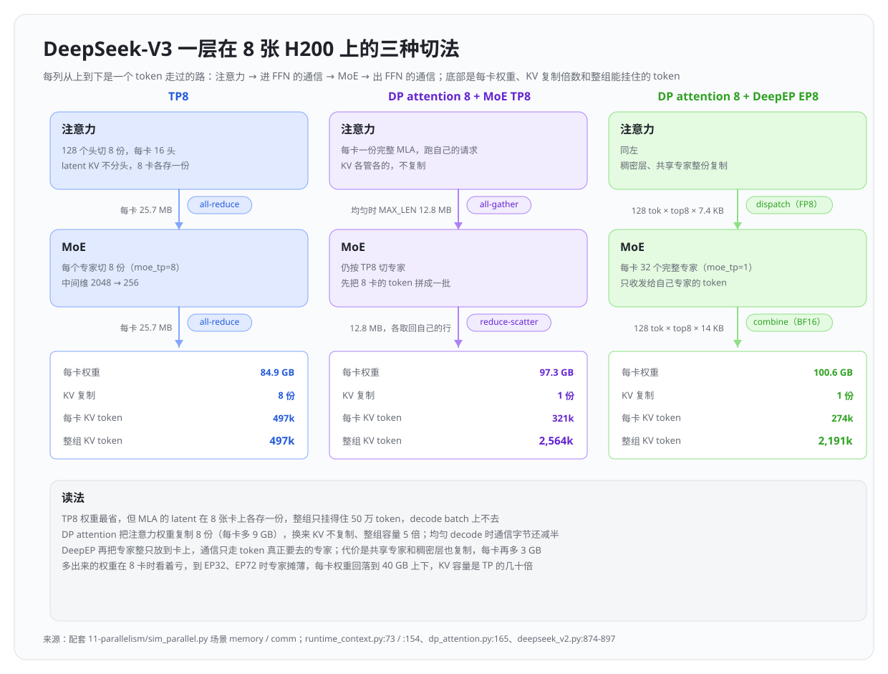
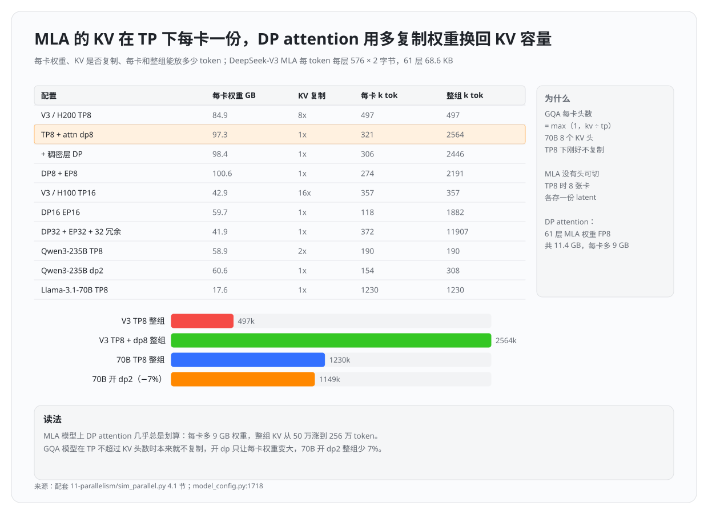
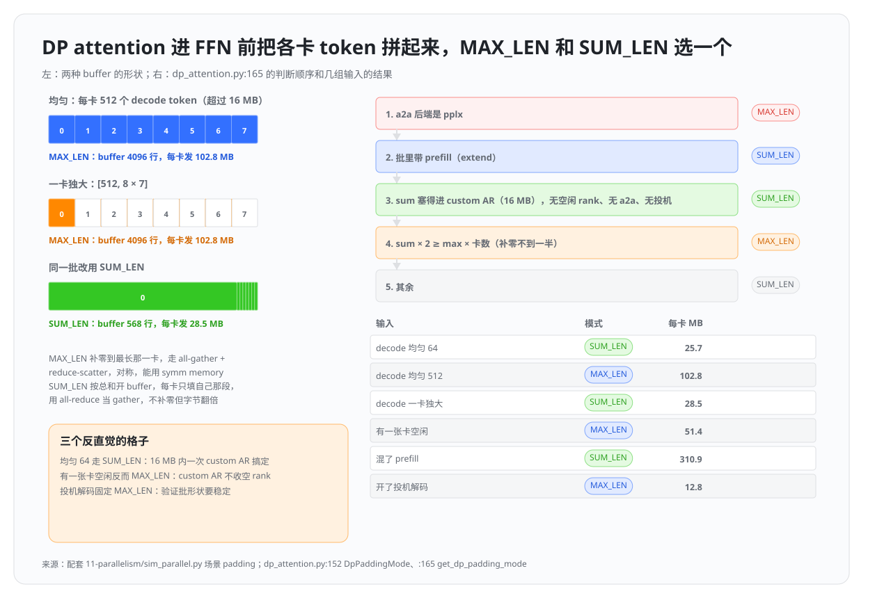
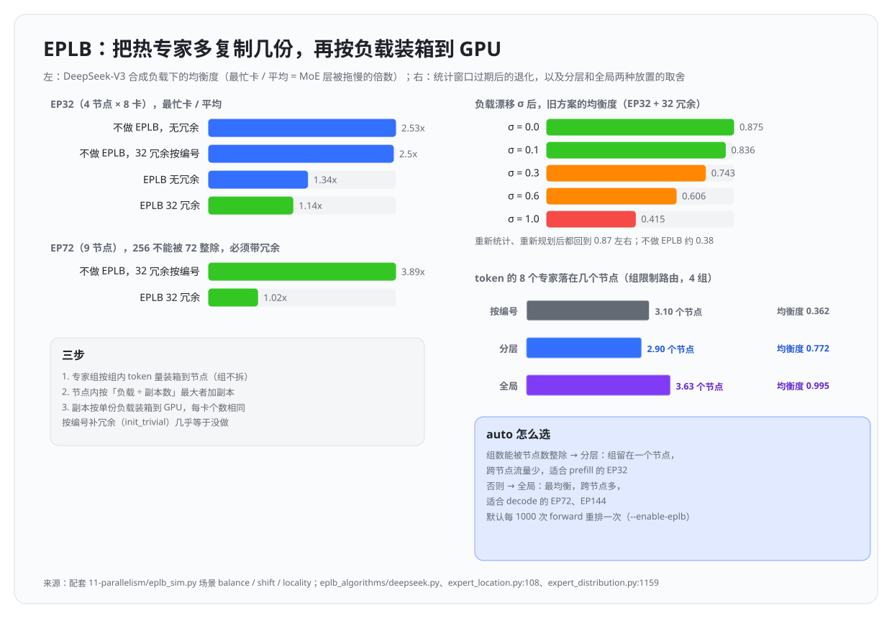
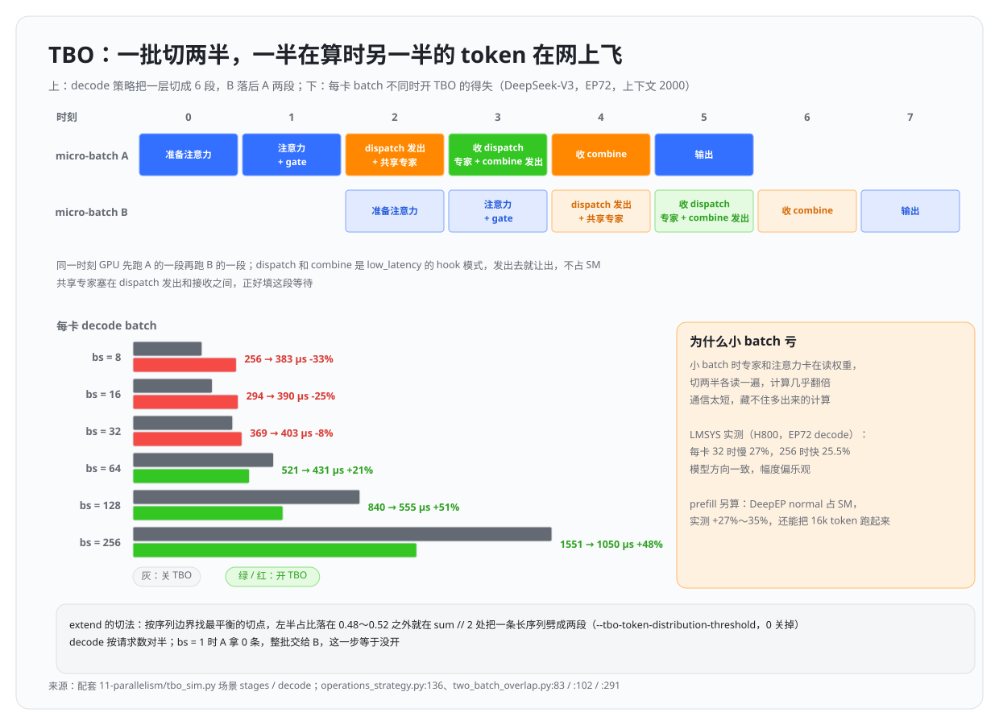
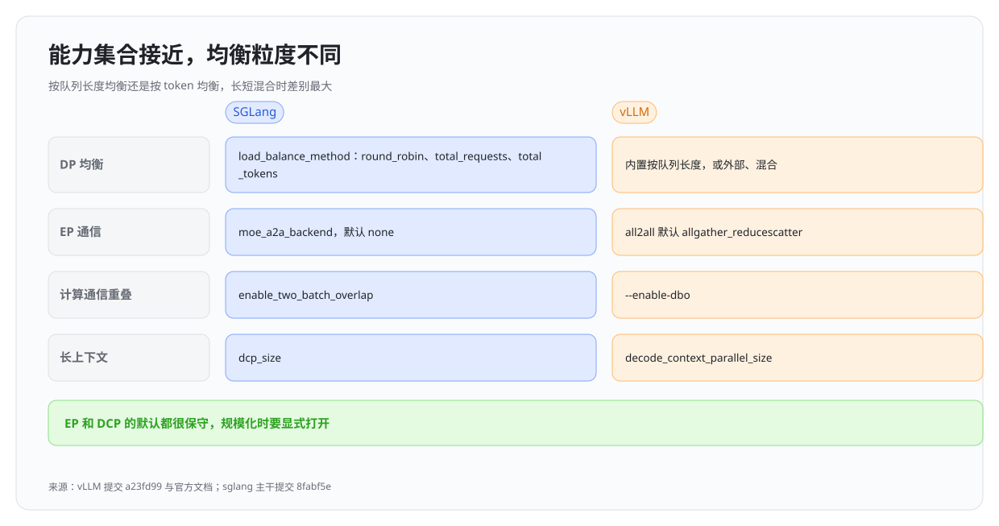
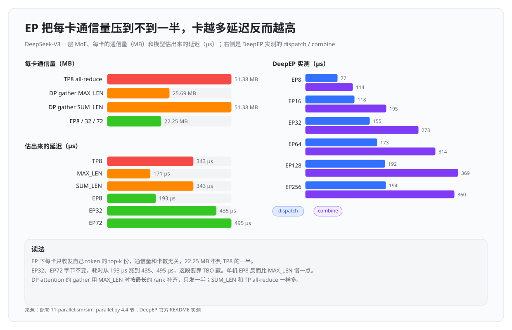

# SGL-11｜原理｜并行：TP、DP Attention、EP 怎么组合

> 🎯 **遇到的问题**：单卡放不下 DeepSeek-V3，这一点没人争，争的是放到 8 张、32 张、72 张卡上怎么切。SGLang 给了三把刀：TP 把每个矩阵切成几份，DP Attention 让注意力按请求分到不同卡上，EP 把 256 个路由专家整只分到卡上。
>
> 三把刀可以叠着用，叠法不同，每卡权重差 15 GB，整组能挂住的 KV token 差 20 倍，每层通信字节差一倍，跨节点时 decode 的 ITL 差出几十毫秒。
>
> LMSYS 在 96 张 H100 上用 PD 分离加大规模 EP 跑 DeepSeek，decode 吞吐比同等卡数的 TP 高 5 倍[[1]](https://www.lmsys.org/blog/2025-05-05-large-scale-ep/)，这 5 倍几乎全来自切法。这一篇拆四件事：几个并行维度怎么从一个 --tp 推出来，每种切法的显存和通信账，MoE 负载不均怎么用 EPLB 补，TBO 什么时候能藏住通信、什么时候反而变慢。
>
> **主线**：模型放不下单卡以后，切法决定每卡的权重、KV 容量和通信量；同样的卡数，切法不同吞吐可以差几倍。
>
> **读完这一篇**：能算出每卡权重、KV 复制倍数和整组 token 容量，再去日志核对。看到 block_n 整除报错、EP24 起不来、DeepEP 关掉 CUDA Graph、TBO 变慢，能指到哪一行。能为单机 8 卡、EP32 prefill、EP72 decode 各写一份讲得清理由的启动命令，并判断 EPLB 值不值得开。
>
> **代码**：[zero-to-sglang/11-parallelism](../11-parallelism)。sim_parallel.py 重写并行参数解析，逐层累加每卡显存、KV 容量和通信字节。eplb_sim.py 是 EPLB 的纯 Python 移植，和 deepseek-ai/EPLB README 的例子逐位一致。tbo_sim.py 移植 TBO 的切分逻辑，用屋顶线模型估开关得失。只用标准库，几秒跑完，行号按主干 8fabf5e 核对。

# 导读 · 结论先行

1. **所有并行维度都从 tp 推出来。**--tp 是总卡数（单个 DP 组内），attn_tp = tp ÷ attn_dp ÷ attn_cp，moe_tp = tp ÷ ep ÷ moe_dp。DP Attention 和 EP 不额外加卡，只改变同一组卡上注意力和 MoE 各自怎么切。
2. **MLA 在 TP 下 KV 会复制。**MLA 每层每 token 只存一份 576 维的 latent，不分头，切 TP 时每张卡都要存完整的一份。TP8 等于 KV 存 8 遍，整组只挂得住 50 万 token。DP Attention 让每张卡跑完整的注意力、各管各的请求，KV 不复制，容量乘 5 倍以上。
3. **FFN 前后的通信有三种形状。**TP 是两次 all-reduce。DP Attention 加 MoE TP 是 gather 加 scatter，均匀时字节减半。DeepEP 只把 token 发给它真正选中的专家，消息字节和 EP 规模无关，跨节点时吃的是 RDMA 带宽。
4. **EP 越大，负载不均越伤。**合成负载下 EP32 不做均衡时最忙卡是平均的 2.5 倍，MoE 层被拖慢 2.5 倍。EPLB 给热专家多放副本再装箱，能把这个倍数压到 1.1 到 1.2；统计窗口一旦过期，收益会掉光，所以要周期重排。
5. **TBO 只在大 batch 时赚。**把一批切两半，一半算的时候另一半的 token 在网上飞。小 batch 时专家和注意力卡在读权重，切两半各读一遍，计算接近翻倍，通信又短，藏不住。LMSYS 实测每卡 32 时慢 27%，256 时快 25.5%。



上图是同一层 DeepSeek-V3 在 8 张 H200 上的三种切法，从上往下是一个 token 走过的路。左列 TP8 权重最省，但 KV 存 8 份。中列 DP Attention 把注意力权重复制 8 份，换来 KV 不复制、整组容量 5 倍，进出 FFN 的通信从 all-reduce 换成 gather 和 scatter。右列再把专家整只放到卡上，用 DeepEP 收发。底部的数字都由 sim_parallel.py 按结构算出来，4.1 节会逐项拆。

**📎 与系列其他文档的分工**：本篇讲 TP、DP Attention、EP 三种切法怎么组合，MoE 路由和集合通信只讲到能算通信量为止。KV 池的大小怎么从显存推出来，见 [SGL-07｜原理｜内存池与页表：req_to_token、token_to_kv 与 page size](./07-memory-pool.md)。CUDA Graph 的捕获和补齐，见 [SGL-09｜原理｜Overlap 调度与 CUDA Graph：把 CPU 开销藏到 GPU 后面](./09-overlap-cudagraph.md)。注意力后端在每卡头数变化后怎么选，见 [SGL-10｜原理｜注意力后端：FlashInfer、FA3、Triton、TRTLLM 怎么选、怎么接进 CUDA Graph](./10-attention-backend.md)。FP8 块量化本身，留给 [SGL-12｜原理｜量化：FP8、INT4 与 KV 量化怎么选](./12-quantization.md)。PD 分离的 KV 传输和调度，留给 [SGL-15｜原理｜PD 分离：prefill 和 decode 拆到两组卡上](./15-pd-disagg.md)。多机部署、路由器和 RL rollout，留给 [SGL-19｜实战｜集群与 RL rollout：路由、权重同步与长尾](./19-cluster-rl.md)。

# 第 1 章 · 问题：同样 8 张卡，切法不同差出几倍

线上常见的情形：

- 8 卡 H200 跑 DeepSeek-V3，--tp 8 起得来，但并发上到 200 就开始排队，日志里 max_total_num_tokens 只有 50 万左右。加上 --attn-dp-size 8 后同样 8 张卡能挂两百多万 token。
- Qwen3-235B-A22B-FP8 在 --tp 8 上启动报 not divisible by weight quantization block_n = 128，换成 --tp 4 或加 --ep 8 就好。
- 24 卡想跑 DeepEP，启动报专家数不能均分；加上 --ep-num-redundant-experts 32 就能起来。
- 写了 --moe-a2a-backend deepep --ep 4 --tp 16，日志里 ep_size 却是 16。
- 开 DeepEP 以后 CUDA Graph 被关掉了，日志里一行 Cuda graph is disabled because deepep_mode=\`normal\`，decode 慢了一大截。
- 开 DP Attention 后单条请求的 TTFT 变长，长 prompt 被切成更小的 chunk。
- EP32 上 MoE 层的耗时比按 FLOPs 估算的长两倍多，nsys 里各卡的 expert GEMM 长短不一。
- 开了 --enable-two-batch-overlap，低并发时吞吐反而掉了；高并发时才涨。

这些现象落在四件事上：并行维度怎么推（谁决定了 attn_tp、moe_tp、ep），每种切法的显存和通信账，专家负载均衡，以及计算和通信能不能重叠。下面按这个顺序讲。

| 想弄清的现象 | 看哪一节 |
|-|-|
| --tp、--attn-dp-size、--ep 各管什么，rank 怎么编号 | 2.1、4.2 |
| 为什么某些组合启动就被拒绝 | 2.2、4.2 |
| 每卡权重和 KV 容量怎么估，DP Attention 为什么能乘容量 | 2.3、4.1 |
| FP8 模型在某个 TP 下报整除错误，稠密层该不该切 | 2.4、4.3 |
| TP、DP gather、DeepEP 每层发多少字节 | 2.5、4.4 |
| DP gather 的 MAX_LEN 和 SUM_LEN | 2.6、4.5 |
| DeepEP normal、low_latency、auto 怎么选，CUDA Graph 为什么被关 | 2.7、4.6 |
| MoE 层被最忙的卡拖慢，EPLB 怎么补 | 2.8、2.9、4.7、4.8 |
| 冗余专家有多个副本时 token 发给哪一个 | 2.10、4.9 |
| TBO 怎么切、什么时候赚 | 2.11、4.10、4.11 |
| 单机、多机、PD 分离各用什么组合 | 2.12、2.13 |

# 第 2 章 · 原理：三把刀各切什么，账怎么算

## 2.1 并行维度：一切从 tp 推出来

Megatron-LM 的张量并行把注意力按头切、MLP 第一个矩阵按列切、第二个按行切，每个 Transformer 块前向只需要两次 all-reduce[[2]](https://arxiv.org/abs/1909.08053)。SGLang 的 --tp 就是这个意思，但它在 SGLang 里还多了一层含义：它是单个 DP 组内的总卡数，后面所有维度都在这个数里再划分。参数定义在 fields/parallel.py：tp_size[（:45）](https://github.com/sgl-project/sglang/blob/8fabf5e/python/sglang/srt/arg_groups/fields/parallel.py#L45)、dp_size（:73）、attn_dp_size（:81）、attn_cp_size（:104）、moe_dp_size（:112）、ep_size（:281）、moe_dense_tp_size（:289）。

运行时由 runtime_context.py 推出两个派生宽度[（runtime_context.py:73、:154）](https://github.com/sgl-project/sglang/blob/8fabf5e/python/sglang/srt/runtime_context.py#L73)：

```python
attn_tp = tp // attn_dp // attn_cp      # 注意力实际切几份
moe_tp  = tp // ep // moe_dp            # 每个专家实际切几份

# rank 展开（runtime_context.py:79、:120-133），tp 维变化最快
tp_rank     = (attn_dp_rank * attn_cp + attn_cp_rank) * attn_tp + attn_tp_rank
moe_dp_rank = tp_rank // (tp // moe_dp)
moe_ep_rank = tp_rank % (tp // moe_dp) // (tp // moe_dp // ep)
moe_tp_rank = tp_rank % (tp // moe_dp // ep)
```

几种常见组合拿这两条公式一套就清楚：

- **--tp 8**：attn_tp=8、moe_tp=8。注意力 128 头每卡 16 头，每个专家的中间维 2048 切成 8 份每份 256。经典 Megatron 切法。
- **--tp 8 --attn-dp-size 8**：attn_tp=1，每张卡一份完整的注意力，跑自己的请求；moe_tp 仍是 8，专家照旧按 TP 切。这就是 DP Attention。
- **--tp 8 --attn-dp-size 8 --moe-a2a-backend deepep**：a2a 后端会把 ep 强制成 tp，moe_tp=1，每张卡放 256÷8=32 个完整专家。这是 DeepSeek 推荐的 DP Attention 加 EP。
- **--tp 8 --ep 8**（不带 a2a）：moe_tp=1，专家整只分到卡上，但 token 不走 all-to-all。每张卡对全部 token 算自己那 32 个专家，再 all-reduce 求和。Qwen3 的 FP8 整除问题就靠它绕过去。

--dp-size 是另一回事。它起多个完全独立的副本，每个副本内部再按上面的方式切，前面挂一个按 --load-balance-method 分请求的控制器[（parallel.py:91）](https://github.com/sgl-project/sglang/blob/8fabf5e/python/sglang/srt/arg_groups/fields/parallel.py#L91)。auto 在非 PD 部署下解析成 round_robin，PD 的 prefill 侧解析成 follow_bootstrap_room，让同一请求的 prefill 和 decode 落在对应的 DP rank 上[（serving_hook.py:217-235）](https://github.com/sgl-project/sglang/blob/8fabf5e/python/sglang/srt/arg_groups/serving_hook.py#L217)。

--enable-dp-attention 是旧写法，等价于 attn_dp_size 等于 tp，源码标了 2026-12-31 之后删除[（parallel.py:192）](https://github.com/sgl-project/sglang/blob/8fabf5e/python/sglang/srt/arg_groups/fields/parallel.py#L192)，新命令统一写 --attn-dp-size。

## 2.2 校验：哪些组合会被拒绝

参数解析阶段有几条硬约束，违反就直接报错，不会悄悄改：

- tp 必须能被 attn_dp × attn_cp 整除[（parallel_hook.py:162）](https://github.com/sgl-project/sglang/blob/8fabf5e/python/sglang/srt/arg_groups/parallel_hook.py#L162)。--tp 8 --attn-dp-size 3 起不来。
- --dp-size 和 --attn-dp-size 不能同时大于 1[（parallel_hook.py:285-287）](https://github.com/sgl-project/sglang/blob/8fabf5e/python/sglang/srt/arg_groups/parallel_hook.py#L285)。要多副本加 DP Attention 时，用的是多个独立服务加路由器，或者把 attn_dp 直接写大。
- --moe-dense-tp-size 只能是 1 或 tp[（validation_hook.py:205-207）](https://github.com/sgl-project/sglang/blob/8fabf5e/python/sglang/srt/arg_groups/validation_hook.py#L205)。写 2 或 4 会被拒绝。
- 用 a2a 后端（deepep、mooncake、nixl 等）时，ep 不等于 tp 会被直接改成 tp[（overrides.py:1611-1612）](https://github.com/sgl-project/sglang/blob/8fabf5e/python/sglang/srt/arg_groups/overrides.py#L1611)。--tp 16 --ep 4 加 deepep 得到的是 ep=16，这一条只打日志、不报错，最容易被忽略。SGLang 文档也写明 a2a 后端只支持 ep 等于 tp[[3]](https://docs.sglang.io/docs/advanced_features/expert_parallelism)。
- 物理专家数（路由专家 + 冗余）要能被 ep 整除。DeepSeek-V3 的 256 个专家放不进 EP24、EP72，加 32 个冗余凑成 288 才行。
- 注意力头数要能分到 attn_tp 张卡上。DeepSeek 128 头，--tp 6 起不来。

还有两条是软调整，开了 DP Attention 会自动生效[（parallel_hook.py:314-331）](https://github.com/sgl-project/sglang/blob/8fabf5e/python/sglang/srt/arg_groups/parallel_hook.py#L314)：schedule_conservativeness 乘 0.3，调度器更敢往批里塞请求；chunked_prefill_size 除以 attn_dp，因为 DP Attention 下每个 rank 的 chunk 会在 FFN 前被拼起来，单个 rank 的 chunk 不缩小，拼完的批会撑爆激活显存。第 1 章那条「开了 DP Attention 后长 prompt 的 TTFT 变长」就是这个除法造成的，需要的话手动把 --chunked-prefill-size 写回去。

## 2.3 显存账：MLA 的 KV 在 TP 下复制

每卡显存 = 权重 + KV 池 + 激活和 CUDA Graph 预留。权重按模块累加：注意力按 attn_tp 切，稠密 MLP 按 moe_dense_tp 切，共享专家在 a2a 下不切，路由专家按 moe_tp 和 ep 切，embedding 和 lm_head 按 attn_tp 或 tp 切。sim_parallel.py 按 DeepSeek-V3 的结构逐层累加，得到 670.9B 参数，和官方的 671B 对得上[[4]](https://arxiv.org/abs/2412.19437)。

KV 是这一节的重点。GQA 模型切 TP 时 KV 头跟着切，每卡头数 = max(1, kv_heads ÷ tp)[（model_config.py:1718）](https://github.com/sgl-project/sglang/blob/8fabf5e/python/sglang/srt/configs/model_config.py#L1718)，只有 tp 大于 KV 头数时才会复制，Llama-3.1-70B 的 8 个 KV 头在 TP8 下刚好不复制。

MLA 不一样：DeepSeek-V2 把 K 和 V 压成一个 512 维的 latent 加 64 维的 RoPE key，所有头共享这一份[[5]](https://arxiv.org/abs/2405.04434)。它没有「头」可以切，TP8 时 8 张卡各存一份完整的 latent。每 token 每层 576 × 2 字节，61 层是 68.6 KB，在 TP8 下整组实际花了 8 × 68.6 KB 存一个 token。

DP Attention 的出发点就在这里。每张卡跑完整的注意力、只管分给自己的请求，KV 不复制，代价是注意力权重复制 attn_dp 份。DeepSeek-V3 的 MLA 权重一层约 187M 参数，FP8 下 61 层共 11.4 GB，复制 8 份每卡多 9 GB。H200 上换来的是整组 KV 从 50 万 token 涨到 256 万。这笔账在 MLA 模型上几乎总是划算的；在 GQA 模型上就不一定，Llama-3.1-70B 在 TP8 下 KV 本来就不复制，开 attn_dp2 只会让每卡权重变大、容量变小（见 4.1）。

SGLang Cookbook 的 DeepSeek-V3 页面把 --tp 8 --attn-dp-size 8 列为高吞吐配置[[6]](https://docs.sglang.io/cookbook/intro)，同时说明它不适合低延迟场景：DP Attention 下单条请求只用一张卡的注意力算力，并发低时每张卡都吃不饱。



## 2.4 FP8 块量化的整除和稠密层的最优 TP

DeepSeek-V3 和 Qwen3 的 FP8 权重用 128 × 128 的块量化，每个块一个缩放因子[[4]](https://arxiv.org/abs/2412.19437)。切 TP 后每张卡上的输出维（列切）或输入维（行切）必须是 128 的倍数，不然一个缩放块会被劈到两张卡上。fp8.py 在加载时检查这一点，不满足就报 not divisible by weight quantization block_n = 128[（fp8.py:591-609）](https://github.com/sgl-project/sglang/blob/8fabf5e/python/sglang/srt/layers/quantization/fp8.py#L591)。

Qwen3-235B-A22B 的专家中间维是 1536，TP8 时切到 192，不是 128 的倍数。QwenLM/Qwen3 的 discussion #1674 报的就是这个错[[7]](https://github.com/QwenLM/Qwen3/discussions/1674)。出路有三条：降到 TP4（384），加 --ep 8 让专家不切（moe_tp=1），或者换 BF16 权重。DeepSeek-V3 的专家中间维 2048，到 TP32 才切到 64，所以单机 TP8、双机 TP16 都没事；但它前 3 层是稠密 MLP，中间维 18432，TP32 时切到 576，也会报错。

稠密层切多少合适，LMSYS 的博客给了一个显存模型[[1]](https://www.lmsys.org/blog/2025-05-05-large-scale-ep/)：每卡显存 = N_param ÷ TP + (1+k) × N_hidden × DP，前一项是权重，后一项是激活（k 是 decode 时多出来的中间缓冲倍数），DP 取 TP 时对 TP 求导，最优 TP = √(N_param ÷ ((1+k) × N_hidden))。代入 DeepSeek-V3 的稠密层，prefill 每卡 2048 token 时最优 TP 约 3，decode 每卡 128 token 时约 6。

两者都比 8 小，再考虑到 TP 每层要两次 all-reduce，LMSYS 的做法是 --moe-dense-tp-size 1，稠密层完全不切，按 DP 跑，两次 all-reduce 换成一次 reduce-scatter 加一次 all-gather，通信减半。

模型代码里这条路径对应 mlp_parallel_group 设成 replicated[（deepseek_v2.py:2676）](https://github.com/sgl-project/sglang/blob/8fabf5e/python/sglang/srt/models/deepseek_v2.py#L2676)。lm_head 同理，--enable-dp-lm-head 让它按注意力 TP 组切[（deepseek_v2.py:3307）](https://github.com/sgl-project/sglang/blob/8fabf5e/python/sglang/srt/models/deepseek_v2.py#L3307)，DP Attention 下就是每卡一份完整的 lm_head，省掉一次跨 DP 的 gather。

## 2.5 每层通信字节：三种形状

以 DeepSeek-V3 一个 MoE 层、每卡 128 个 decode token、BF16 激活为例，每卡要发多少字节：

- **TP8**：注意力输出后一次 all-reduce，MoE 输出后一次 all-reduce。ring all-reduce 每卡发 2 × (N-1)/N × 消息大小，消息是 8 卡 × 128 token × 7168 × 2 字节。合计 51.4 MB。
- **DP Attention 8 + MoE TP8**：注意力各算各的，不需要 all-reduce；进 MoE 前要把 8 张卡的 token 拼成一批（gather），出 MoE 后各取回自己的行（reduce-scatter）。均匀时是 25.7 MB，正好是 TP 的一半。这和 Megatron 序列并行把 all-reduce 拆成 reduce-scatter 加 all-gather 是同一个道理{r("megatron_sp")}。
- **DeepEP EP8**：每个 token 只发给它选中的 8 个专家。dispatch 用 FP8 加缩放，每条消息 7392 字节；combine 用 BF16，14336 字节。每卡 128 × 8 × (7392 + 14336) = 22.3 MB。

DeepEP 的字节数有一个特点：它和 EP 规模无关。EP8 和 EP72 每卡发的都是 22.3 MB，变的是这些字节走 NVLink 还是 RDMA。DeepEP 的 README 给了 H800 加 CX7 上 low_latency 模式的实测，EP8 走 NVLink 时 dispatch 77 μs，EP64 跨 8 个节点时 173 μs[[8]](https://github.com/deepseek-ai/DeepEP)。4.4 节用这组数字反推带宽，再拿 sim_parallel.py 的字节数算回去，EP8 到 EP256 的误差都在 5% 以内，说明这里的字节口径和 DeepEP 自己的口径一致。

GShard 最早把「按专家分卡、token 用 all-to-all 收发」做成了标准做法[[9]](https://arxiv.org/abs/2006.16668)，Switch Transformer 讨论了容量因子和负载均衡损失[[10]](https://arxiv.org/abs/2101.03961)。推理场景下没有容量因子丢 token 这回事，热专家只会让对应的卡变慢，这就是 2.8 节 EPLB 要解决的问题。

## 2.6 DP gather 的两种补齐：MAX_LEN 和 SUM_LEN



DP Attention 下各 rank 的 token 数不一样，拼成一批时有两种做法[（dp_attention.py:150）](https://github.com/sgl-project/sglang/blob/8fabf5e/python/sglang/srt/layers/dp_attention.py#L150)。MAX_LEN 按最长那一卡补零，每卡开 max × N 行的 buffer，用 all_gather_into_tensor，出 MoE 时可以用 reduce-scatter，对称、能走 symmetric memory。SUM_LEN 按总和开 buffer，每卡只把自己那段填进去、其余填零，再用一次 all-reduce 当 gather 用，不补零，但 all-reduce 的字节是 all-gather 的两倍。

get_dp_padding_mode 的判断顺序[（dp_attention.py:163）](https://github.com/sgl-project/sglang/blob/8fabf5e/python/sglang/srt/layers/dp_attention.py#L163)：

1. a2a 后端是 pplx：MAX_LEN。
2. 批里带 prefill（extend）：SUM_LEN。prefill 各 rank 长度差别太大，补零代价不可接受。
3. decode 且总和塞得进 custom all-reduce 的 buffer（16 MB），没有空闲 rank、没有 a2a、没开投机：SUM_LEN。一次 custom AR 搞定，延迟最低。
4. sum × 2 ≥ max × N，也就是补零浪费不到一半：MAX_LEN，打平也选 MAX_LEN。
5. 其余：SUM_LEN。

上图右下角三个格子和直觉相反：均匀的小 decode 批走 SUM_LEN，因为它塞得进 custom AR。有一张卡空闲反而走 MAX_LEN，因为 custom AR 不接受空 rank。开了投机解码固定走 MAX_LEN，因为 verify 批的形状要稳定，才能被 CUDA Graph 录进去。这也是为什么 DP Attention 下所有 rank 都必须同步前向：哪怕某个 rank 没有请求，也要跑一次 idle 批参与通信，utils/common.py 里的 require_mlp_sync 管的就是这件事{src(UC, 4163, "（common.py:4163）")}。

## 2.7 DeepEP：normal、low_latency 和 auto

DeepEP 是 DeepSeek 开源的 EP 通信库，两套 kernel[[8]](https://github.com/deepseek-ai/DeepEP)。normal 面向 prefill：先按节点去重，一个 token 发到一个节点只走一次 RDMA，再由 NVLink 转给节点内的专家，吞吐高，但发送前要先算 layout，CPU 要等接收计数才能分配 buffer，所以没法被 CUDA Graph 录进去。low_latency 面向 decode：纯 RDMA 点对点，buffer 预分配成固定形状，支持 CUDA Graph，还有 hook 模式，发出去就让出 GPU，不占 SM，这是 2.11 节 TBO 能工作的前提。

--deepep-mode 有三个值[（exec\_.py:901）](https://github.com/sgl-project/sglang/blob/8fabf5e/python/sglang/srt/arg_groups/fields/exec_.py#L901)。normal 时 moe_hook 会关掉 CUDA Graph，打一行 Cuda graph is disabled because deepep_mode=\`normal\`[（moe_hook.py:437-450）](https://github.com/sgl-project/sglang/blob/8fabf5e/python/sglang/srt/arg_groups/moe_hook.py#L437)，第 1 章那条 decode 变慢就是它。auto 按批选：批里有 prefill 用 normal，纯 decode 用 low_latency[（layers/moe/utils.py:345-363）](https://github.com/sgl-project/sglang/blob/8fabf5e/python/sglang/srt/layers/moe/utils.py#L345)。

这里有个容易漏的点：DP Attention 下 is_extend_in_batch 在所有 rank 之间取最大值同步[（dp_attn.py:291）](https://github.com/sgl-project/sglang/blob/8fabf5e/python/sglang/srt/managers/scheduler_components/dp_attn.py#L291)，只要有一个 rank 在做 prefill，所有 rank 这一步都走 normal，其余 rank 的 decode 也被拖进 normal 模式、跑不了 CUDA Graph。

LMSYS 的博客把三种模式的适用面列成一张表[[1]](https://www.lmsys.org/blog/2025-05-05-large-scale-ep/)：normal 支持长输入、不支持 CUDA Graph。low_latency 支持长输出和 CUDA Graph、不适合长输入。auto 两头都要，但在非 PD 部署下和 DP Attention 配合不好。结论是大规模 EP 要配 PD 分离：prefill 实例固定 normal，decode 实例固定 low_latency，各取所长。PD 分离的细节留给 [SGL-15｜原理｜PD 分离：prefill 和 decode 拆到两组卡上](./15-pd-disagg.md)。

low_latency 的 buffer 按「每 rank 最大 token 数 × 专家数」预分配，和 EP 规模无关[[11]](https://github.com/deepseek-ai/DeepEP/tree/v1.2.1)。sglang 的默认值 SGLANG_DEEPEP_NUM_MAX_DISPATCH_TOKENS_PER_RANK=128[（environ.py:1449）](https://github.com/sgl-project/sglang/blob/8fabf5e/python/sglang/srt/environ.py#L1449)，上限 1024[（deepep.py:404-409）](https://github.com/sgl-project/sglang/blob/8fabf5e/python/sglang/srt/layers/moe/token_dispatcher/deepep.py#L404)。

按 v1.2.1 的 LowLatencyLayout 算，128 token、288 个专家时每卡 2.15 GB，开到 512 要 8.6 GB。decode 每卡的 batch，包括 CUDA Graph 的最大 bs，不能超过这个数。我们把 decode batch 开到 256 时，同时调了这个环境变量，并给 KV 池少留 2 GB。

还有一处权重上的变化：a2a 后端下共享专家不切，每卡一份完整的[（deepseek_v2.py:874-878）](https://github.com/sgl-project/sglang/blob/8fabf5e/python/sglang/srt/models/deepseek_v2.py#L874)。DeepSeek-V3 的共享专家 FP8 下合计 2.55 GB，TP8 时每卡只有 0.32 GB。和稠密层 DP 一起，DeepEP 每卡比 DP Attention 加 MoE TP 再多 3 GB 权重（见 4.1）。

## 2.8 EPLB：给热专家加副本，再按负载装箱



MoE 层的耗时由最忙的那张卡决定。DeepSeek-V3 用无辅助损失的负载均衡训练[[4]](https://arxiv.org/abs/2412.19437)，训练时的全局负载已经比较均匀，但推理时某一批、某一层里，热专家能比冷专家多收好几倍的 token。EP 越大，每卡专家越少，越难靠平均抹平。用 均衡度 = 平均负载 ÷ 最忙卡负载 来衡量，sglang 的 expert_distribution.py 就是这么算的[（expert_distribution.py:1159）](https://github.com/sgl-project/sglang/blob/8fabf5e/python/sglang/srt/eplb/expert_distribution.py#L1159)。它的倒数就是 MoE 层被拖慢的倍数。

DeepSeek 开源的 EPLB 分三步[[12]](https://github.com/deepseek-ai/EPLB)，sglang 的 eplb_algorithms/deepseek.py 和它逐行相同[（deepseek.py:86）](https://github.com/sgl-project/sglang/blob/8fabf5e/python/sglang/srt/eplb/eplb_algorithms/deepseek.py#L86)：

1. **组装箱到节点**。DeepSeek-V3 的路由先选 4 个组、再在组内选专家，所以按组统计 token 量，用 balanced_packing 把组装到节点上，每个节点组数相同[（:7）](https://github.com/sgl-project/sglang/blob/8fabf5e/python/sglang/srt/eplb/eplb_algorithms/deepseek.py#L7)。组不拆，一个组的专家都在同一个节点。
2. **节点内加副本**。replicate_experts 每次给「负载 ÷ 副本数」最大的专家加一个副本，直到用完冗余槽位[（:55）](https://github.com/sgl-project/sglang/blob/8fabf5e/python/sglang/srt/eplb/eplb_algorithms/deepseek.py#L55)。
3. **副本装箱到 GPU**。每个副本按单份负载再做一次 balanced_packing，每张 GPU 上的副本个数相同。

这是分层策略。组数不能被节点数整除时，第一步没法做，就退成全局策略：把所有专家当成一个节点做第二、三步。compute_algorithm 的 auto 按这个规则自动选[（\_\_init\_\_.py:75）](https://github.com/sgl-project/sglang/blob/8fabf5e/python/sglang/srt/eplb/eplb_algorithms/__init__.py#L75)。8 组在 EP32 的 4 个节点上走分层，在 EP72 的 9 个节点上只能走全局。

两种策略的取舍在上图右下：分层把组留在一个节点内，一个 token 最多碰 4 个节点，跨节点流量少，但均衡度只有 0.77；全局最均衡（0.995），一个 token 平均碰 3.6 个节点。DeepSeek 官方的做法是 prefill（EP32，4 节点）用分层，decode（EP144，18 节点）用全局：prefill 的 normal 模式按节点去重，节点数直接决定 RDMA 字节；decode 的 low_latency 是点对点，节点数没那么要紧，均衡更重要。

DeepSeek 的推理系统公开说明里给了部署规模：prefill 每个实例 4 节点 EP32，每张卡 9 个路由专家加 1 个共享专家，其中 32 个是冗余；decode 每个实例 18 节点 EP144，每卡 2 个路由专家加 1 个共享专家[[13]](https://github.com/deepseek-ai/open-infra-index/blob/main/202502OpenSourceWeek/day_6_one_more_thing_deepseekV3R1_inference_system_overview.md)。DeepSeek 的 profile-data 仓库还公开了训练和推理的 profiling trace，能看到通信和计算的重叠方式[[14]](https://github.com/deepseek-ai/profile-data)。

冗余槽位放哪里很关键。sglang 的默认 --init-expert-location trivial 把冗余槽位按编号补齐，第 i 个冗余放第 i % 256 号专家，也就是给 0 到 31 号专家各加一个副本，和热度无关。4.7 节的结果是这样摆和不加冗余几乎一样（2.50x 对 2.51x）。冗余要配 EPLB 才有意义。

## 2.9 统计会过期：周期重排和 recorder

EPLB 按一个统计窗口的负载规划，负载一漂移，旧方案的收益就掉。4.8 节的模拟里，专家热度乘一个 exp(N(0, σ)) 的扰动，σ=0.6 时旧方案的均衡度从 0.875 掉到 0.606，σ=1.0 时掉到 0.415，和不做 EPLB 差不多。真实负载的漂移来自请求分布：编码题、数学题和闲聊激活的专家不一样，一天之内流量构成的变化就够让统计过期。

sglang 的对策是 --enable-eplb[（exec\_.py:925）](https://github.com/sgl-project/sglang/blob/8fabf5e/python/sglang/srt/arg_groups/fields/exec_.py#L925)：EPLBManager 每 --eplb-rebalance-num-iterations 次前向（默认 1000）重排一次[（eplb_manager.py:225）](https://github.com/sgl-project/sglang/blob/8fabf5e/python/sglang/srt/eplb/eplb_manager.py#L225)；--eplb-min-rebalancing-utilization-threshold 默认 1.0，即每次都重排，调低以后只在利用率低于阈值时才动。

重排会搬专家权重，--eplb-rebalance-layers-per-chunk 控制每次搬几层，避免一次停太久。开 --enable-eplb 而没写 recorder 模式时，参数解析会自动把 --expert-distribution-recorder-mode 设成 stat[（parallel_hook.py:748-750）](https://github.com/sgl-project/sglang/blob/8fabf5e/python/sglang/srt/arg_groups/parallel_hook.py#L748)。

不想在线重排，也可以离线做：用 --expert-distribution-recorder-mode stat 启动，调 /start_expert_distribution_record、跑一段代表性流量、调 /dump_expert_distribution_record[（http_server.py:1265-1289）](https://github.com/sgl-project/sglang/blob/8fabf5e/python/sglang/srt/entrypoints/http_server.py#L1265)，rank 0 会把 expert_distribution_recorder_时间戳.pt 写到 SGLANG_EXPERT_DISTRIBUTION_RECORDER_DIR（默认 /tmp）[（expert_distribution.py:1012）](https://github.com/sgl-project/sglang/blob/8fabf5e/python/sglang/srt/eplb/expert_distribution.py#L1012)。

文件里有 logical_count，可以直接喂给 --init-expert-location，它接受 .pt、.json 或 JSON 字符串，键可以是 physical_to_logical_map 或 logical_count[（expert_location.py:769-800）](https://github.com/sgl-project/sglang/blob/8fabf5e/python/sglang/srt/eplb/expert_location.py#L769)。PD 分离时 prefill 和 decode 的负载形状不同，要各自统计、各自规划。

## 2.10 多副本时发给哪一个：static 和 dynamic

一个逻辑专家有多个副本时，每个 token 要挑一个。--ep-dispatch-algorithm 有两种[（exec\_.py:920）](https://github.com/sgl-project/sglang/blob/8fabf5e/python/sglang/srt/arg_groups/fields/exec_.py#L920)。static 在加载时为每个源 rank、每个逻辑专家查一张固定表，按同卡、同节点、其余均分的优先级生成，随机种子固定为 42[（expert_location.py:615）](https://github.com/sgl-project/sglang/blob/8fabf5e/python/sglang/srt/eplb/expert_location.py#L615)；dynamic 每个 token 在副本之间轮转[（expert_location_dispatch.py:132）](https://github.com/sgl-project/sglang/blob/8fabf5e/python/sglang/srt/eplb/expert_location_dispatch.py#L132)。

默认值由 handle_eplb_and_dispatch 决定[（parallel_hook.py:748）](https://github.com/sgl-project/sglang/blob/8fabf5e/python/sglang/srt/arg_groups/parallel_hook.py#L748)：有 a2a 后端用 static，没有 a2a 只能 dynamic。原因是不带 a2a 时所有 EP rank 处理同一批 token、最后 all-reduce 求和，各 rank 必须对同一个 token 挑同一个副本，static 每个 rank 查的表不同，会直接出错。

4.9 节的结果是 static 的均衡度略低于 dynamic（0.943 对 0.968）：同一节点内的源 rank 都挑同一个本地副本，副本之间不一定平分，而 EPLB 规划时假设副本平分负载。差距不大，static 换来的是更少的跨节点流量。

## 2.11 TBO：一批切两半，计算和通信错开



EP 下每层有两次通信（dispatch 和 combine），decode 时 EP72 一层通信就要 0.5 ms，和计算同量级。TBO（two-batch overlap）把一批切成两个 micro-batch，A 在等通信的时候 B 在算，B 等通信的时候 A 在算[[3]](https://docs.sglang.io/docs/advanced_features/expert_parallelism)。DeepSeek-V3 的技术报告里，训练用的 DualPipe 和推理 decode 用的 5 段流水都是这个思路[[4]](https://arxiv.org/abs/2412.19437)，硬件那篇反思文章也把通信和计算的重叠列为大规模 EP 能跑起来的前提[[15]](https://arxiv.org/abs/2505.09343)。

切法在 two_batch_overlap.py：decode 按请求数对半，bs//2 给 A，其余给 B[（two_batch_overlap.py:83）](https://github.com/sgl-project/sglang/blob/8fabf5e/python/sglang/srt/batch_overlap/two_batch_overlap.py#L83)；extend 先按序列边界找最平衡的切点，左半 token 占比落在 [0.48, 0.52] 之外时改成两段切，在 sum//2 处把一条长序列劈成两段，前半给 A、后半给 B，B 的注意力读 A 先写进去的 KV（:102、:142、:157、:291）。阈值由 --tbo-token-distribution-threshold 控制，默认 0.48，设 0 关掉两段切[（exec\_.py:1065）](https://github.com/sgl-project/sglang/blob/8fabf5e/python/sglang/srt/arg_groups/fields/exec_.py#L1065)。

一层被 YieldOperation 切成 6 段，decode 策略里 B 落后 A 两段（tbo_delta_stages=2）[（operations_strategy.py:136）](https://github.com/sgl-project/sglang/blob/8fabf5e/python/sglang/srt/batch_overlap/operations_strategy.py#L136)。段 2 是 dispatch 发出加共享专家，段 3 是收 dispatch、算专家、发 combine，段 4 是收 combine。

low_latency 的 hook 模式下发出去就让出 GPU，于是 A 的 token 在网上飞的时候 GPU 在跑 B 的注意力。共享专家被特意塞在 dispatch 发出和接收之间，填的就是这段等待。prefill 策略[（:105）](https://github.com/sgl-project/sglang/blob/8fabf5e/python/sglang/srt/batch_overlap/operations_strategy.py#L105)不一样：normal 模式的 kernel 要占 SM，DeepGEMM 只能用 总 SM − DeepEP 的 num_sms，计算本身变慢一些。

TBO 有代价。小 batch 时注意力和专家都卡在读权重上，切成两半各读一遍，两半计算之和接近翻倍；通信又短，藏不住多出来的计算。tbo_sim.py 的屋顶线模型给出的拐点在每卡 32 到 64 之间，LMSYS 实测每卡 32 时 TBO 慢 27%，256 时快 25.5%，博客的建议是每卡 batch 小于 64 到 128 时别开。源码里也有一行 TODO，说 batch 太小时应该自动关掉 TBO（two_batch_overlap.py:82），目前还没做。

几条运行时限制：所有 rank 的前向模式必须一致才能跑 TBO[（two_batch_overlap.py:463）](https://github.com/sgl-project/sglang/blob/8fabf5e/python/sglang/srt/batch_overlap/two_batch_overlap.py#L463)。a2a 后端解析成 low_latency 时，extend 批不走 TBO（:438-445）。prefill 的可中断 CUDA Graph 不支持 TBO[（cuda_graph_hook.py:218-220）](https://github.com/sgl-project/sglang/blob/8fabf5e/python/sglang/srt/arg_groups/cuda_graph_hook.py#L218)，decode 的 CUDA Graph 支持。prefill 开 TBO 还有一个实在的好处：同一时刻只有半个批的激活在显存里，LMSYS 实测不开时每卡 16384 token 会 OOM、只能跑 8192，开了能跑 16k，吞吐涨 27% 到 35%。

SBO（single-batch overlap）是另一种思路，不切批，在一个 micro-batch 内部让通信和计算重叠，参数是 --enable-single-batch-overlap[（exec\_.py:1062）](https://github.com/sgl-project/sglang/blob/8fabf5e/python/sglang/srt/arg_groups/fields/exec_.py#L1062)，适合 batch 小、切两半不划算的 decode。

## 2.12 单机怎么选

单机 8 卡，按模型和负载分三种情况：

- **GQA 稠密模型（Llama、Qwen3 dense）**：纯 TP。KV 不复制，没有专家，DP Attention 只会让每卡权重变大。并发特别高、单卡放得下时，用 --dp-size 起多个副本比加大 TP 更划算。
- **MLA 模型、低延迟**：--tp 8。单条请求能用到 8 张卡的注意力算力，ITL 最低，但容量只有 DP Attention 的五分之一，并发上不去。
- **MLA 模型、高吞吐**：--tp 8 --attn-dp-size 8 --enable-dp-lm-head，专家仍按 TP 切。想再省通信时，加 --moe-a2a-backend deepep 和 --moe-dense-tp-size 1。单机内 DeepEP 走 NVLink，比 MoE TP 的 gather / scatter 字节少一些，代价是 CUDA Graph 的模式选择（2.7）。

Qwen3-235B 这类 GQA 的 MoE 模型介于两者之间：KV 头只有 4 个，TP8 复制 2 份，attn_dp2 能去掉复制；专家在 FP8 下 TP8 切不开，加 --ep 8。SGLang 文档的 EP 一页给的单机示例就是 --tp 8 --ep 8 加 deepep 和 deep_gemm 的组合[[3]](https://docs.sglang.io/docs/advanced_features/expert_parallelism)。

## 2.13 多机：LMSYS 和 DeepSeek 的两份配方

LMSYS 在 12 个节点、96 张 H100 上的部署[[1]](https://www.lmsys.org/blog/2025-05-05-large-scale-ep/)：prefill 3 个节点、decode 9 个节点（也有 4 加 9 的对照），PD 分离。prefill 侧 EP32，DeepEP normal、分层 EPLB、TBO。decode 侧 EP72，low_latency、全局 EPLB、TBO、CUDA Graph。注意力全部 DP，稠密层 DP，lm_head DP。

每个节点 52.3k 输入 token/s、22.3k 输出 token/s，折合每百万输出 token 0.20 美元。prefill 在 1K、2K、4K 输入下每节点 57,674、54,543、50,302 token/s，比 TP16 快 3.3 倍；decode 2K 输入下每节点 22,282 token/s，比 TP 快 5.2 倍。

这组数字和 DeepSeek 公开的 profile 对得上：DeepSeek 的 profile 折算 prefill 每节点 62,713 token/s、decode 18,598；SGLang 分别是 50,302 和 22,282，假设 EPLB 完美时 prefill 能到 59,337[[1]](https://www.lmsys.org/blog/2025-05-05-large-scale-ep/)。prefill 侧主要差在负载不均，decode 侧 SGLang 已经超过 DeepSeek 公开的数字（两者 batch 和上下文不同，不能直接比高低）。博客也坦白了限制：TTFT 2 到 5 秒、ITL 约 100 ms，是一个为吞吐优化、牺牲了延迟的配置。

GB200 NVL72 上同样的套路走得更远，72 张卡在一个 NVLink 域内，decode 的 EP72 不再跨 RDMA[[16]](https://www.lmsys.org/blog/2025-06-16-gb200-part-1/)。字节跳动的 MegaScale-Infer 把注意力和专家拆到不同的卡组上，各自按最合适的并行度扩展，中间用 M:N 的通信库连起来，是 DP Attention 加 EP 再往前一步的做法[[17]](https://arxiv.org/abs/2504.02263)。

## 2.14 vLLM 怎么做

vLLM 的数据并行由 N 个 API server 和 N 个 DP EngineCore 组成，负载均衡有三种方式：内置模式按每个引擎 running 加 waiting 的队列长度选，外部模式交给上游路由，混合模式节点内用内置、节点间用外部[[18]](https://docs.vllm.ai/en/latest/serving/data_parallel_deployment.html)。MoE 用 --enable-expert-parallel 开 EP，all2all 默认 allgather_reducescatter；--enable-eplb 开专家负载均衡，--enable-dbo 开双 batch 重叠，长上下文 decode 用 decode_context_parallel_size 开 DCP[[19]](https://docs.vllm.ai/en/latest/serving/expert_parallel_deployment.html)。

SGLang 的对应参数是 attn_dp_size 开注意力 DP，load_balance_method 选 round_robin、total_requests、total_tokens 等，moe_a2a_backend 默认 none，enable_two_batch_overlap 和 EPLB 默认都关，DCP 用 dcp_size。两边的能力集合已经很接近，差别主要在默认值和调度粒度：vLLM 按队列长度均衡，SGLang 可以按 token 数均衡，长短请求混合时按 token 数更准。

| 维度 | SGLang | vLLM | 差异的代价 |
|-|-|-|-|
| DP 均衡 | load_balance_method：round_robin、total_requests、total_tokens | 内置按队列长度，或外部、混合 | 长短混合负载按请求数均衡会偏 |
| EP 通信 | moe_a2a_backend，默认 none | all2all 默认 allgather_reducescatter | 大规模 EP 两边都要显式换 DeepEP 类后端 |
| 计算通信重叠 | enable_two_batch_overlap | --enable-dbo | 都要 batch 足够大才有收益 |
| 长上下文 | dcp_size | decode_context_parallel_size | DCP 与投机、PD 的组合两边都在补 |



# 第 3 章 · 源码走读：从 --tp 到一次 MoE 层前向的 18 个落脚点

前 9 行是启动时的参数解析，后 9 行是运行时。路径相对 python/sglang/srt/。

| # | 位置 | 发生了什么 |
|-|-|-|
| 1 | [arg_groups/fields/parallel.py:45](https://github.com/sgl-project/sglang/blob/8fabf5e/python/sglang/srt/arg_groups/fields/parallel.py#L45) | tp / dp / attn_dp / attn_cp / moe_dp / ep / moe_dense_tp 的定义；:192 enable_dp_attention 已废弃 |
| 2 | [arg_groups/parallel_hook.py:162](https://github.com/sgl-project/sglang/blob/8fabf5e/python/sglang/srt/arg_groups/parallel_hook.py#L162) | tp 能被 attn_dp×attn_cp 整除。:285 dp 与 attn_dp 冲突。:314 DP Attention 的保守度和 chunk 调整 |
| 3 | [arg_groups/validation_hook.py:205](https://github.com/sgl-project/sglang/blob/8fabf5e/python/sglang/srt/arg_groups/validation_hook.py#L205) | moe_dense_tp 只能是 1 或 tp |
| 4 | [arg_groups/overrides.py:1611](https://github.com/sgl-project/sglang/blob/8fabf5e/python/sglang/srt/arg_groups/overrides.py#L1611) | a2a 后端把 ep 改成 tp |
| 5 | [arg_groups/moe_hook.py:437](https://github.com/sgl-project/sglang/blob/8fabf5e/python/sglang/srt/arg_groups/moe_hook.py#L437) | deepep normal 关 CUDA Graph；:628 pplx 的 auto 解析成 low_latency |
| 6 | [parallel_hook.py:748](https://github.com/sgl-project/sglang/blob/8fabf5e/python/sglang/srt/arg_groups/parallel_hook.py#L748) | EPLB 自动开 recorder；有 a2a 时分派默认 static，否则 dynamic |
| 7 | [arg_groups/serving_hook.py:217](https://github.com/sgl-project/sglang/blob/8fabf5e/python/sglang/srt/arg_groups/serving_hook.py#L217) | --load-balance-method auto 的解析 |
| 8 | [arg_groups/fields/exec\_.py:917](https://github.com/sgl-project/sglang/blob/8fabf5e/python/sglang/srt/arg_groups/fields/exec_.py#L917) | 冗余专家、分派算法、EPLB 参数（:917-950）。:1058 TBO。:1065 两段切阈值 |
| 9 | [runtime_context.py:73](https://github.com/sgl-project/sglang/blob/8fabf5e/python/sglang/srt/runtime_context.py#L73) | attn_tp。:79 rank 展开。:154 moe_tp |
| 10 | [configs/model_config.py:1718](https://github.com/sgl-project/sglang/blob/8fabf5e/python/sglang/srt/configs/model_config.py#L1718) | 每卡 KV 头数，GQA 头少于 TP 时取 1 |
| 11 | [layers/quantization/fp8.py:591](https://github.com/sgl-project/sglang/blob/8fabf5e/python/sglang/srt/layers/quantization/fp8.py#L591) | FP8 块量化 128 整除检查 |
| 12 | [models/deepseek_v2.py:874](https://github.com/sgl-project/sglang/blob/8fabf5e/python/sglang/srt/models/deepseek_v2.py#L874) | a2a 下共享专家不切。:2676 稠密 MLP replicated。:3307 lm_head |
| 13 | [layers/dp_attention.py:163](https://github.com/sgl-project/sglang/blob/8fabf5e/python/sglang/srt/layers/dp_attention.py#L163) | MAX_LEN / SUM_LEN 选择。:1080 dp_scatter。:1111 能否用 reduce-scatter |
| 14 | [managers/scheduler_components/dp_attn.py:291](https://github.com/sgl-project/sglang/blob/8fabf5e/python/sglang/srt/managers/scheduler_components/dp_attn.py#L291) | 各 rank 的 is_extend_in_batch 取最大值同步 |
| 15 | [layers/moe/utils.py:345](https://github.com/sgl-project/sglang/blob/8fabf5e/python/sglang/srt/layers/moe/utils.py#L345) | DeepEPMode.resolve：auto 按批里有无 prefill 选模式 |
| 16 | [layers/moe/token_dispatcher/deepep.py:404](https://github.com/sgl-project/sglang/blob/8fabf5e/python/sglang/srt/layers/moe/token_dispatcher/deepep.py#L404) | 每 rank 最大 dispatch token 数，上限 1024。:204 buffer。:746 low_latency |
| 17 | [eplb/eplb_algorithms/deepseek.py:86](https://github.com/sgl-project/sglang/blob/8fabf5e/python/sglang/srt/eplb/eplb_algorithms/deepseek.py#L86) | 分层 EPLB。:7 balanced_packing。:55 replicate_experts。eplb_manager.py:225 周期重排 |
| 18 | [batch_overlap/two_batch_overlap.py:83](https://github.com/sgl-project/sglang/blob/8fabf5e/python/sglang/srt/batch_overlap/two_batch_overlap.py#L83) | TBO 切分。:463 各 rank 前向模式一致才能跑。operations_strategy.py:136 decode 的 6 段 |

读 DeepSeek 的 MoE 层，从 deepseek_v2.py 的 forward 进去，\_enable_a2a_moe 决定走 forward_normal（:1303）还是 forward_deepep（:1527）[（deepseek_v2.py:999）](https://github.com/sgl-project/sglang/blob/8fabf5e/python/sglang/srt/models/deepseek_v2.py#L999)。forward_deepep 里依次是 gate、select_experts、dispatcher.dispatch、experts、dispatcher.combine，加上共享专家，TBO 的 6 段就是按这几个调用切开的。

# 第 4 章 · 实验：在 CPU 上算显存、通信和负载

实验都在 CPU 上跑，只用标准库。参数解析、FP8 整除、DP 补齐、EPLB 和 TBO 切分是按源码逐行移植的，结果应该和真实启动一致。显存和容量按结构累加，权重应该和日志差在 1 GB 以内。通信和 TBO 的耗时是粗估模型，用来看趋势和量级。

## 4.1 每卡显存和 KV 容量

```bash
cd zero-to-sglang/11-parallelism
python3 sim_parallel.py
```

```text
DeepSeek-V3  fp8 权重  H200  （按结构累加 670.9B 参数）
  配置                             attn  dense     共享     路由  emb+lm    合计GB   KV/tok    复制     每卡 tok     整组 tok
  TP8                             2.2   0.15   0.32   81.7    0.46    84.9    68.6K    8x       497k       497k
  TP8 + attn_dp8                 11.4   0.15   0.32   81.7    3.71    97.3    68.6K    1x       321k      2564k
  TP8 + attn_dp8 + dense DP      11.4   1.19   0.32   81.7    3.71    98.4    68.6K    1x       306k      2446k
  DP8 + DeepEP EP8               11.4   1.19   2.55   81.7    3.71   100.6    68.6K    1x       274k      2191k

DeepSeek-V3  fp8 权重  H100 SXM
  TP16（2 节点）                    1.6   0.07   0.16   40.9    0.23    42.9    68.6K   16x       357k       357k
  DP16 + DeepEP EP16             11.4   1.19   2.55   40.9    3.71    59.7    68.6K    1x       118k      1882k
  DP32 + EP32 + 32 冗余           11.4   1.19   2.55   23.0    3.71    41.9    68.6K    1x       372k     11907k

Qwen3-235B-A22B  bf16 权重  H100 SXM
  TP8                             1.8   0.00   0.00   56.8    0.31    58.9    47.0K    2x       190k       190k
  TP8 + attn_dp2                  3.4   0.00   0.00   56.8    0.47    60.6    47.0K    1x       154k       308k

Llama-3.1-70B  bf16 权重  H100 SXM
  TP8                             3.0  14.09   0.00    0.0    0.53    17.6    40.0K    1x      1230k      1230k
  TP8 + attn_dp2                  6.0  14.09   0.00    0.0    0.79    20.9    80.0K    1x       575k      1149k
```

先看 H200 那四行。TP8 到 TP8 + attn_dp8，注意力从 2.2 GB 涨到 11.4 GB，emb+lm 从 0.46 涨到 3.71（每卡一份完整的 lm_head），每卡 token 从 497k 掉到 321k，但复制从 8 份变 1 份，整组 token 从 50 万涨到 256 万。再往右两行，稠密层和共享专家也复制，每卡再多 3 GB，整组降到 219 万，仍是 TP 的 4.4 倍。

H100 的三行说明了大规模 EP 的显存为什么反而更宽裕：TP16 每卡只有 43 GB 权重，但 KV 存 16 份，整组只有 36 万 token；EP32 加 32 冗余，路由专家摊到每卡 23 GB，合计 42 GB，和 TP16 差不多，整组却能挂 1190 万 token，是 TP16 的 33 倍。Llama-3.1-70B 那两行是反例：KV 本来不复制，开 attn_dp2 每卡 token 减半还多，整组反而少了 7%。

## 4.2 rank 编号和参数校验

```bash
python3 sim_parallel.py --scenario layout
```

```text
tp=8, attn_dp=4, attn_cp=1, ep=8：tp_rank = (dp·cp + cp_rank)·attn_tp + attn_tp_rank
   tp_rank  attn_dp  attn_tp  moe_ep  moe_tp
         0        0        0       0       0
         1        0        1       1       0
         2        1        0       2       0
         ...
         7        3        1       7       0

tp=16, attn_dp=2, attn_cp=2（attn_tp=4）：
  0:000  1:001  2:002  3:003  4:010  5:011  6:012  7:013  8:100  9:101  10:102  11:103  12:110  13:111  14:112  15:113
  （rank:dp cp tp，tp 变化最快）

参数校验：
  --tp 8 --dp 2 --attn-dp-size 2                                    拒绝：--dp-size 和 --attn-dp-size 不能同时大于 1
  --tp 8 --attn-dp-size 3                                           拒绝：tp 8 不能被 attn_dp×attn_cp = 3 整除
  --tp 8 --moe-dense-tp-size 2                                      拒绝：moe_dense_tp 只能是 1 或 tp，给的是 2
  --tp 16 --moe-a2a-backend deepep --ep 4                           通过，ep=16，attn_tp=1，moe_tp=1
  --tp 24 --moe-a2a-backend deepep                                  拒绝：256+0 个物理专家不能均分到 ep=24
  --tp 24 --moe-a2a-backend deepep --ep-num-redundant-experts 32    通过，ep=24，attn_tp=1，moe_tp=1
  --tp 6（DeepSeek 128 头）                                          拒绝：128 个注意力头分不到 attn_tp=6 张卡上
```

tp 维变化最快意味着同一个注意力 TP 组的卡编号相邻，单机 8 卡时它们落在同一节点、走 NVLink。多机时如果 attn_tp 跨了节点，注意力里的 all-reduce 就要走 RDMA，这是 attn_tp 一般不超过 8 的原因。第四条校验是 2.2 讲的静默改写，第六条说明冗余专家除了均衡负载，还有一个作用是让 256 不能整除的 EP 规模能起来。

## 4.3 FP8 整除和稠密层的最优 TP

```bash
python3 sim_parallel.py --scenario shard
```

```text
FP8 块量化（128×128）要求：列切后的输出维、行切后的输入维都是 128 的倍数（fp8.py:593-609）
  矩阵                           tp2       tp4       tp8      tp16      tp32
  DeepSeek-V3 稠密 MLP        9216      4608      2304      1152       576 ✗
  DeepSeek-V3 专家            1024       512       256       128        64 ✗
  Qwen3-235B 专家              768       384       192 ✗      96 ✗      48 ✗
  Llama-3.1-70B MLP        14336      7168      3584      1792       896

稠密 FFN 的显存最优 TP（LMSYS 大规模 EP 博客的模型）：
  prefill  每卡  2048 token，k=0：最优 TP ≈  3.0
  prefill  每卡  8192 token，k=0：最优 TP ≈  1.5
  decode   每卡   128 token，k=3：最优 TP ≈  6.0
  decode   每卡    32 token，k=3：最优 TP ≈ 12.0
```

Qwen3-235B 那一行从 TP8 起就是 ✗，和 discussion #1674 的报错对应。DeepSeek-V3 的专家到 TP32 才出问题，但 --tp 32 不带 EP 本来就不是合理配置。最优 TP 那四行说明 prefill 时 token 多、激活大，稠密层应该少切甚至不切；decode 每卡 token 少时最优 TP 变大，但它还要和两次 all-reduce 的通信比，LMSYS 最后选了全 DP。

## 4.4 每层通信字节，对账 DeepEP README

```bash
python3 sim_parallel.py --scenario comm
```

```text
  配置                        做法                                     每卡发送 MB     估算 μs
  TP8                       attn 后 all-reduce + MoE 后 all-reduce       51.38       343
  DP-attn8 + MoE TP8 均匀     MAX_LEN：gather + scatter                 25.69       171
  DP-attn8 + MoE TP8 不均     SUM_LEN：gather + scatter                 51.38       343
  DP8 + DeepEP EP8          dispatch(FP8) + combine(BF16)            22.25       193
  DP32 + DeepEP EP32        dispatch(FP8) + combine(BF16)            22.25       435
  DP72 + DeepEP EP72        dispatch(FP8) + combine(BF16)            22.25       495

对账 DeepEP README 的 low_latency 实测（128 token/rank，top-8，hidden 7168）：
  每卡 dispatch 128×8×7392 B = 7.57 MB，combine 128×8×14336 B = 14.68 MB
     EP   实测 dispatch       按带宽反推    实测 combine       按带宽反推
      8          77μs        77μs         114μs       116μs
     16         118μs       120μs         195μs       198μs
     32         155μs       158μs         273μs       277μs
     64         173μs       176μs         314μs       319μs
    128         192μs       194μs         369μs       376μs
    256         194μs       194μs         360μs       367μs
```

前三行是同样 8 卡、同样总 token 下的对比：DP Attention 均匀时字节是 TP 的一半，不均匀退到 SUM_LEN 时和 TP 一样。DeepEP 的字节最少，但单机时 193 μs 比 MAX_LEN 的 171 μs 还慢一点，因为 low_latency kernel 在 NVLink 上吃不满带宽。到了 EP32、EP72，字节不变，耗时翻倍多，这部分就是 TBO 要藏的东西。对账表里反推和实测的差都在 5% 以内，自己的集群换了网卡或拓扑，用 DeepEP 仓库的 tests/test_low_latency.py 跑一遍，把带宽填回 LL_BW 就行。



## 4.5 DP gather 的补齐方式

```bash
python3 sim_parallel.py --scenario padding
```

```text
  情形                                每 rank token                              模式            每卡发送 MB
  decode 均匀                         [64, 64, 64, 64, 64, 64, 64, 64]          SUM_LEN         25.69
  decode 均匀但 buffer 超过 custom AR    [512, 512, 512, 512, 512, 512, 512, 512]  MAX_LEN        102.76
  decode 一卡独大                       [512, 8, 8, 8, 8, 8, 8, 8]                SUM_LEN         28.50
  decode 有空闲 rank                   [256, 256, 256, 0, 256, 256, 256, 256]    MAX_LEN         51.38
  prefill 混在批里                      [4096, 100, 2000, 0, 0, 0, 0, 0]          SUM_LEN        310.89
  pplx 后端                           [64, 1, 1, 1, 1, 1, 1, 1]                 MAX_LEN         12.85
  开了投机解码                            [64, 64, 64, 64, 64, 64, 64, 64]          MAX_LEN         12.85
```

最值得看的是「一卡独大」：如果走 MAX_LEN，buffer 是 512 × 8 行，每卡发 102.8 MB；SUM_LEN 只开 568 行，28.5 MB。prefill 那一行 310.9 MB 说明了为什么 DP Attention 下 prefill 的 chunk 要除以 attn_dp：一个 rank 的长 prompt 会让所有 rank 一起发几百 MB。线上看到 DP Attention 的 decode 突然变慢，先查是不是有 rank 在做长 prefill。

## 4.6 DeepEP low_latency 的 buffer

```bash
python3 sim_parallel.py --scenario deepep
```

```text
   num_max_dispatch_tokens     专家数     GB/卡
                        64     256     0.95
                       128     256     1.91
                       128     288     2.15
                       256     288     4.29
                       512     288     8.59

  只和专家数 × 每 rank 最大 token 数有关，和 EP 规模无关。
  sglang 默认 SGLANG_DEEPEP_NUM_MAX_DISPATCH_TOKENS_PER_RANK=128，上限 1024；
  decode 每卡的 batch（含 CUDA Graph 的最大 bs）不能超过它。

  消息字节：dispatch 14352（16 + 7168 FP8 + 56 个 float 缩放，和 BF16 的 14336 取大），combine 14560
```

buffer 按每个专家一个接收槽位预留，所以和专家数成正比，和 EP 规模无关。把每卡 decode batch 从 128 开到 256，DeepEP 的 buffer 从 2.15 GB 涨到 4.29 GB，KV 池要让出这部分。deepep.py 里有一行注释提醒 decode 引擎的实际 batch 应该小于 256（:753），超过这个量级 low_latency 的优势会被 buffer 和 RDMA 消息数吃掉。

## 4.7 EPLB 的均衡度

```bash
python3 eplb_sim.py
```

```text
EP32（4 节点 × 8 卡），每卡 9 个物理专家（含冗余）
  方案                                 统计上     新批次      最忙卡 / 平均
  不做 EPLB，无冗余                      0.396   0.398         2.51x
  不做 EPLB，32 冗余按编号                 0.399   0.400         2.50x
  EPLB 无冗余（hierarchical）           0.744   0.749         1.34x
  EPLB 32 冗余（hierarchical）         0.875   0.850         1.18x

EP72（9 节点 × 8 卡），每卡 4 个物理专家（含冗余）
  不做 EPLB，32 冗余按编号                 0.257   0.256         3.91x
  EPLB 32 冗余（global）               0.984   0.934         1.07x
```

「统计上」是用来规划的长窗口平均，「新批次」是每卡 128 token 的一次 decode 实采。EP32 不做 EPLB 时 MoE 层被拖慢 2.5 倍，只加冗余不重排几乎没用，只重排不加冗余能到 1.34 倍，两者都做到 1.18 倍。EP72 每卡专家更少，不做均衡时 3.9 倍，全局策略压到 1.07 倍。负载是合成的（每层独立、组间热度不同），真实负载用 recorder 导出后替换 make_load。LMSYS 报告的 EPLB 收益是 prefill 1.49 倍、decode 2.54 倍[[1]](https://www.lmsys.org/blog/2025-05-05-large-scale-ep/)，和这里的量级一致。

```bash
python3 eplb_sim.py --scenario example
```

```text
  第 0 层（hierarchical）phy2log = [5, 6, 5, 7, 8, 4, 3, 4, 10, 9, 10, 2, 0, 1, 11, 1]  与 README 一致
      每 GPU 负载 [122, 86, 125, 113, 148, 132, 156, 152]  均衡度 0.828（不加副本、按编号摆：0.480）
  第 1 层（hierarchical）phy2log = [7, 10, 6, 8, 6, 11, 8, 9, 2, 4, 5, 1, 5, 0, 3, 1]  与 README 一致
```

这是 deepseek-ai/EPLB README 的例子，12 个专家、4 组、4 个冗余摆到 2 节点 × 4 GPU，两层的 phy2log 逐位一致，说明移植是对的。

## 4.8 负载漂移和放置策略

```bash
python3 eplb_sim.py --scenario shift
python3 eplb_sim.py --scenario locality
```

```text
       σ       按旧统计的方案        按新负载重排     不做 EPLB
     0.0         0.875         0.875       0.399
     0.3         0.743         0.855       0.381
     0.6         0.606         0.866       0.382
     1.0         0.415         0.865       0.300

  放置                             平均节点数         跨节点副本占比     均衡度
  按编号摆（trivial）                   3.10           12.5%   0.362
  分层策略（hierarchical）              2.90            0.0%   0.772
  全局策略（global）                    3.63            2.3%   0.995
```

漂移表说明重排的价值：重新统计、重新规划后都回到 0.86 上下，旧方案随 σ 一路掉。放置表里分层策略的跨节点副本占比是 0，一个 token 平均碰 2.9 个节点；全局策略多碰 0.7 个节点，换来均衡度从 0.77 到 0.995。prefill 的 normal 模式按节点去重，多碰一个节点就多一份 RDMA 字节，所以 prefill 选分层更合算。

## 4.9 多副本分派

```bash
python3 eplb_sim.py --scenario dispatch
```

```text
EP32 + 32 冗余：24 个逻辑专家有多个副本
  分派               均衡度      最忙卡 / 平均
  static         0.943         1.06x
  dynamic        0.968         1.03x
```

差距 3 个点。static 让同节点的源 rank 都挑本地副本，省跨节点流量；dynamic 在副本间轮转，更均衡。有 a2a 时默认 static 是合理的，跨节点流量的代价通常比这 3 个点大。

## 4.10 TBO 的切分

```bash
python3 tbo_sim.py
```

```text
decode：按请求数对半（compute_split_seq_index，bs // 2）
  bs=1    → A 0 条 / B 1 条
  bs=7    → A 3 条 / B 4 条
  target_verify bs=5，每条 4 个 draft token → A 2 条 8 token / B 3 条 12 token

  extend_lens                 方式               切在第几条  A token  B token
  [1000, 1000, 1000, 1000]    balanced             2     2000     2000
  [4000, 100, 100, 100]       two-chunk            0     2150     2150
  [3000, 2000, 1000]          balanced             1     3000     3000
  [8192]                      two-chunk            0     4096     4096
  [100, 200, 300, 400, 5000]  two-chunk            4     3000     3000
  [1]                         balanced             0        0        1
```

bs=1 时 A 拿 0 条，整批交给 B，这一步等于没开 TBO。[8192] 单条长 prompt 平衡切切不开，两段切把它劈成两个 4096。[1] 只有 1 个 token，两段切会让 A 有 1 条序列却分到 0 个 token，违反 batch_size 不大于 token 数，回退成按序列切。

## 4.11 TBO 的得失

```bash
python3 tbo_sim.py --scenario decode
python3 tbo_sim.py --scenario prefill
```

```text
DeepSeek-V3 decode，EP72 + 288 个物理专家（每卡 4 个），平均上下文 2000
     每卡 bs      计算      通信    关 TBO      两半计算      两半通信    开 TBO      变化
         8     195      61      256       383        91      383    -33%
        16     202      92      294       390       122      390    -25%
        32     215     154      369       403       184      403     -8%
        64     243     278      521       431       308      431    +21%
       128     315     525      840       486       555      555    +51%
       256     530    1020     1551       630      1050     1050    +48%

DeepSeek-V3 prefill，EP32（4 节点），每卡 16384 token
  关 TBO：计算 20.0 ms + 通信 21.4 ms = 41.4 ms / 层（normal 模式同步等通信，两者串行）
  开 TBO：计算只剩 108 个 SM，两半计算 24.5 ms，两半通信 21.4 ms → 24.5 ms / 层，理想上限 +69%
  对账：按 61 层折算，每节点关 TBO 51,915 tok/s、开 TBO 87,772 tok/s
```

decode 那张表把 2.11 的道理摆成了数字：bs=8 时计算 195 μs，切两半变成 383 μs，通信只有 61 μs，藏不住，变慢 33%；bs=256 时两半计算 630 μs，两半通信 1050 μs，开 TBO 后耗时由通信决定，计算完全藏进去，快 48%。拐点在 32 到 64 之间，和 LMSYS 的实测方向一致，幅度偏乐观：模型假设通信能完美藏住，也没算两个 micro-batch 各自一份的 kernel 尾部空转。

prefill 关 TBO 的折算是每节点 5.2 万 token/s，和 LMSYS 实测的 5.0 万到 5.8 万（开了 TBO）同量级；开 TBO 的 8.8 万明显偏高。模型只算了大 GEMM 和注意力，norm、RoPE、gate、量化这些小算子都没算；normal kernel 发送前算 layout、CPU 等接收计数这部分也藏不住。实测收益 27% 到 35%，比 69% 的理想上限低一半，是正常的。

> 💡 **实验记录**：各场景都跑了一遍，又做了三个改动：在 sim_parallel.py 的 memory 场景里给 Qwen3-235B 加一行 --tp 8 --attn-dp-size 4，看 KV 复制和整组容量怎么变，弄清了为什么 attn_dp 超过 tp ÷ kv_heads 以后就没有收益。在 eplb_sim.py 的 make_load 里把组间热度的差距调大一倍，比较分层和全局两种策略的均衡度差距会不会变大。在 tbo_sim.py 的 HW 里把 comm_fixed_us 从 15 改成 40（模拟更慢的网络），看 decode 的拐点往哪边移。命令和期望输出见 [README.md](../11-parallelism/README.md)，边界用例见 [test_parallel.py](../11-parallelism/test_parallel.py)。

## 4.12 在真机上校准

模拟给的是结构和量级，真实的数字要在自己的集群上量：

```bash
# 1. 显存：权重应该和 sim_parallel.py 的「合计GB」差在 1 GB 以内，每卡 token 差 10% 到 20%
grep "Load weight end" server.log            # mem usage=xx GB
grep "max_total_num_tokens" server.log

# 2. 对比 TP 和 DP Attention：同一份 bench_serving，并发从低到高各跑一次
python3 -m sglang.launch_server --model-path deepseek-ai/DeepSeek-V3 --tp 8 --trust-remote-code
python3 -m sglang.launch_server --model-path deepseek-ai/DeepSeek-V3 --tp 8 --attn-dp-size 8 \
  --enable-dp-lm-head --trust-remote-code
python3 -m sglang.bench_serving --backend sglang --dataset-name random \
  --random-input-len 2000 --random-output-len 500 --max-concurrency 32   # 再试 128、512

# 3. 导出真实专家负载
python3 -m sglang.launch_server ... --expert-distribution-recorder-mode stat
curl -X POST http://127.0.0.1:30000/start_expert_distribution_record
#   跑一段代表性流量
curl -X POST http://127.0.0.1:30000/dump_expert_distribution_record
#   rank 0 写出 /tmp/expert_distribution_recorder_*.pt，可直接喂给 --init-expert-location

# 4. TBO 开关各跑一次，并发分几档
... --enable-two-batch-overlap

# 5. DeepEP 带宽：在 DeepEP 仓库里跑，把结果填回 sim_parallel.py 的 LL_BW
python3 tests/test_low_latency.py
```

第 1 步的两行日志分别来自 model_runner.py:1402 和 scheduler.py:1272[（model_runner.py:1402）](https://github.com/sgl-project/sglang/blob/8fabf5e/python/sglang/srt/model_executor/model_runner.py#L1402)。第 2 步要看的是 TTFT、ITL 和吞吐随并发的曲线：低并发时 TP8 的 ITL 更低，并发上去以后 TP8 先因为 KV 满了排队，DP Attention 的吞吐曲线能继续往上走。

bench_serving 的参数说明见 Bench Serving Guide[[20]](https://docs.sglang.io/docs/developer_guide/bench_serving)，profile 的方法见 Benchmark and Profiling[[21]](https://docs.sglang.io/docs/developer_guide/benchmark_and_profiling)。第 3 步导出的 logical_count 先拿到 eplb_sim.py 里算一下均衡度，低于 0.6 再考虑开 EPLB。第 4 步至少分三档并发，找到自己负载下的拐点。

# 第 5 章 · 调过的参数和踩过的坑

## 5.1 动过的参数

| 参数 | 默认 | 管什么 | 什么时候动它 |
|-|-|-|-|
| --tp | 1 | 单个 DP 组内的总卡数，其余维度在里面划分[（parallel.py:45）](https://github.com/sgl-project/sglang/blob/8fabf5e/python/sglang/srt/arg_groups/fields/parallel.py#L45) | 模型放不下或想要更低 ITL |
| --attn-dp-size | 1 | 注意力按数据并行切几份，attn_tp = tp ÷ 它 | MLA 模型要高吞吐；GQA 模型 KV 头少于 tp 时 |
| --dp-size | 1 | 起几个完全独立的副本 | 单副本放得下、并发很高 |
| --ep | 1 | 专家并行规模，a2a 下强制等于 tp | MoE 模型；FP8 专家在 TP 下切不开 |
| --moe-a2a-backend | none | token 收发方式，deepep / mooncake / nixl 等[（exec\_.py:839）](https://github.com/sgl-project/sglang/blob/8fabf5e/python/sglang/srt/arg_groups/fields/exec_.py#L839) | 多机 EP，或单机想省 gather 字节 |
| --deepep-mode | auto | normal / low_latency / auto | PD 分离时 prefill 写 normal、decode 写 low_latency |
| --moe-dense-tp-size | 无 | 稠密 MLP 切几份，只能 1 或 tp | 大规模 EP 时写 1 |
| --enable-dp-lm-head | False | lm_head 按注意力 TP 组切 | DP Attention 下都开 |
| --ep-num-redundant-experts | 0 | 冗余专家槽位数 | EP 规模不整除专家数；配 EPLB 用 |
| --enable-eplb | False | 周期重排专家 | recorder 导出的均衡度低于 0.6 |
| --eplb-rebalance-num-iterations | 1000 | 每多少次前向重排一次 | 负载漂移快时调小 |
| --init-expert-location | trivial | 初始专家摆放，可读 .pt / .json | 离线规划好的方案 |
| --ep-dispatch-algorithm | 自动 | static / dynamic | 一般不动 |
| --enable-two-batch-overlap | False | TBO[（exec\_.py:1058）](https://github.com/sgl-project/sglang/blob/8fabf5e/python/sglang/srt/arg_groups/fields/exec_.py#L1058) | 每卡 batch 稳定在 64 以上 |
| --tbo-token-distribution-threshold | 0.48 | extend 两段切的阈值，0 关掉 | 长短 prompt 混合导致切分不均 |
| SGLANG_DEEPEP_NUM_MAX_DISPATCH_TOKENS_PER_RANK | 128 | low_latency 每 rank 最大 token | decode batch 要超过 128 |
| --chunked-prefill-size | 按显存 | DP Attention 下自动除以 attn_dp | 长 prompt 的 TTFT 不可接受 |

参数的完整说明见 Server Arguments[[22]](https://docs.sglang.io/docs/advanced_features/server_arguments)。调参的整体顺序见 Hyperparameter Tuning[[23]](https://docs.sglang.io/docs/advanced_features/hyperparameter_tuning)：先定并行方式让 KV 容量够用，再调 chunk 和并发，最后才是 EPLB、TBO 这类优化。PD 分离下两侧参数的配法见 PD Disaggregation[[24]](https://docs.sglang.io/docs/advanced_features/pd_disaggregation)。

## 5.2 踩过的坑

> 💡 **踩过的坑**：我们给 GQA 模型也开了 DP Attention。KV 头数大于等于 tp 时，TP 下 KV 本来就不复制，开 DP Attention 只会让每卡权重变大、容量变小。后来先算 tp ÷ kv_heads，大于 1 才开，且 attn_dp 不超过这个数。

> 💡 **踩过的坑**：我们写了 --ep 但 a2a 后端在改它。用 deepep 时 ep 恒等于 tp，--ep 4 被静默改成 16。现在看启动日志里的 ep_size，或者干脆不写 --ep。

> 💡 **踩过的坑**：在非 PD 部署上用了 deepep auto 加 DP Attention。只要有一个 rank 在做 prefill，所有 rank 都走 normal，decode 也跑不了 CUDA Graph。后来大规模 EP 都配 PD 分离；单机不上 PD 时，固定 low_latency 并接受 prefill 慢一些。

> 💡 **踩过的坑**：只加冗余不开 EPLB。trivial 的冗余按编号摆，给 0 到 31 号专家各加一个副本，和热度无关，均衡度几乎不变。后来冗余要么配 --enable-eplb，要么配离线规划的 --init-expert-location。

> 💡 **踩过的坑**：把 EPLB 规划一次用一个月。负载漂移以后旧方案能退回到不做 EPLB 的水平。现在在线重排保持开着，或者至少每周重新导一次负载。

> 💡 **踩过的坑**：在低并发时也开了 TBO。每卡 batch 小于 32 时开 TBO 稳定变慢。后来按负载的并发分布决定：大部分时间每卡 batch 在 64 以下就不开，或者试 SBO。

> 💡 **踩过的坑**：把 decode batch 开到 256 不动 DeepEP 的环境变量。超过 SGLANG_DEEPEP_NUM_MAX_DISPATCH_TOKENS_PER_RANK 会出错，调大以后 buffer 翻倍，KV 池要相应让出 2 GB 以上。

> 💡 **踩过的坑**：FP8 MoE 模型报 block_n 整除错误，我们第一反应是降精度。后来发现先试 --ep 让专家不切，或者把稠密层写 --moe-dense-tp-size 1，通常不需要换 BF16。

## 5.3 我们的看法

SGLang 的并行设计有一个好的出发点：只有一个总卡数 --tp，注意力和 MoE 各自在这组卡里决定怎么切。这让「注意力按 DP、专家按 EP」这种混合切法只需要多写两个参数，不需要换一套部署方式。代价是参数之间的关系藏在派生公式和静默改写里，--ep 被 a2a 后端改掉、chunk 被 attn_dp 除掉、auto 模式被其他 rank 的 prefill 拖成 normal，这些都不报错。

我们的做法是：上线的命令里把每个维度都写明，启动后把日志里的 attn_tp、moe_tp、ep_size、deepep_mode 和 max_total_num_tokens 抄下来，和 sim_parallel.py 的推算对一遍。默认值是给大多数人的，线上配置要对自己的负载负责。

MLA 让 DP Attention 从一个可选项变成了 DeepSeek 系模型高吞吐部署的必选项。KV 不能按头切，TP 越大复制越多，这是结构决定的。反过来，GQA 模型用 DP Attention 要算账，Llama-3.1-70B 在 8 卡上开 attn_dp 是亏的。现在看到一个新模型，先看它的 KV 结构，再决定用不用 DP Attention，这比照搬 DeepSeek 的配方靠谱。

大规模 EP 的瓶颈正在从通信转向负载均衡和延迟。DeepEP 加 TBO 已经能把通信藏进计算里，LMSYS 的 profile 里 prefill 和完美 EPLB 还差 18%，decode 的 ITL 在 100 ms 左右，离交互式服务还远。往后看，一个方向是 NVL72 这样更大的 NVLink 域，把 EP72 的 RDMA 换成 NVLink[[16]](https://www.lmsys.org/blog/2025-06-16-gb200-part-1/)。

另一个方向是 MegaScale-Infer 那样把注意力和专家拆开部署，各自扩展[[17]](https://arxiv.org/abs/2504.02263)。在我们看来，对大多数团队，单机 8 卡的 DP Attention 加 EP 已经能拿到大部分收益，跨节点的大规模 EP 要配 PD 分离、EPLB、TBO 一整套，值不值得做取决于流量是否大到能把每卡 batch 撑到 128 以上。

# 第 6 章 · 上线核对和下一步

> 📌 **上线前逐条核对**
> - 核对过启动日志里的 attn_tp、moe_tp、ep_size 和 sim_parallel.py 的推算一致，没有被 a2a 后端静默改写
> - 权重显存和推算差在 1 GB 以内，max_total_num_tokens 够撑住目标并发
> - MLA 模型我们确认了 TP 下的 KV 复制倍数，高吞吐场景用了 DP Attention；GQA 模型算过 tp ÷ kv_heads
> -  FP8 模型的每个切分维度都是 128 的倍数，或者已经用 --ep、--moe-dense-tp-size 1 绕开
> - 开了 DeepEP 时确认了 deepep_mode 和 CUDA Graph 状态，大规模 EP 配了 PD 分离
> -  decode 的最大 batch 不超过 SGLANG_DEEPEP_NUM_MAX_DISPATCH_TOKENS_PER_RANK，buffer 计入了显存预算
> - 用 recorder 导出过真实专家负载，算过均衡度；开 EPLB 时周期重排保持开着
> - 让 TBO 在三档以上并发下各跑过开关对比，确认每卡 batch 落在赚的一侧
> - 确认过 DP Attention 下长 prompt 的 TTFT 可接受，必要时手动设了 --chunked-prefill-size

> 🔑 **学到的**：SGLang 的所有并行维度都在 --tp 这组卡里划分：attn_tp = tp ÷ attn_dp ÷ attn_cp，moe_tp = tp ÷ ep ÷ moe_dp，a2a 后端会把 ep 强制成 tp。MLA 的 latent KV 不分头，TP 下每张卡存一份，DP Attention 让注意力按请求分卡、KV 不复制，整组容量乘 5 倍以上，代价是注意力权重复制；GQA 模型要先算 tp ÷ kv_heads。FFN 前后的通信有三种形状：TP 两次 all-reduce，DP gather 均匀时字节减半、不均匀时在 MAX_LEN 和 SUM_LEN 之间按规则选，DeepEP 只发给选中的专家、字节和 EP 规模无关。DeepEP normal 不支持 CUDA Graph，auto 在 DP Attention 下会被任一 rank 的 prefill 拖成 normal，大规模 EP 要配 PD 分离。EP 越大负载不均越伤，EPLB 给热专家加副本再装箱，组能整除节点时走分层、否则走全局，统计会过期，要周期重排。TBO 切两半让计算和通信错开，只在每卡 batch 足够大时赚。

下一步：[SGL-12｜原理｜量化：FP8、INT4 与 KV 量化怎么选](./12-quantization.md) 讲量化。这一篇碰到了两次量化：FP8 块量化的 128 整除决定了 TP 能切多大，DeepEP 的 dispatch 用 FP8 把消息字节减半。下一篇讲 SGLang 支持的权重量化（FP8 块量化、W4A8、GPTQ、AWQ）和 KV 量化，各自的精度代价、显存收益和 kernel 选择，以及怎么在上线前验证量化没有把模型弄坏。

# 参考文献

按正文首次引用顺序编号，资料截至 2026 年 10 月底。源码以 sgl-project/sglang 主干提交 8fabf5e（2026 年 10 月 28 日）和 v0.5.22 发行版为准。

[1] LMSYS. Deploying DeepSeek with PD Disaggregation and Large-Scale Expert Parallelism on 96 H100 GPUs. LMSYS Blog (2025-05-05) [https://www.lmsys.org/blog/2025-05-05-large-scale-ep/](https://www.lmsys.org/blog/2025-05-05-large-scale-ep/)

[2] Shoeybi M, et al. Megatron-LM: Training Multi-Billion Parameter Language Models Using Model Parallelism. arXiv (2019) [https://arxiv.org/abs/1909.08053](https://arxiv.org/abs/1909.08053)

[3] SGLang 文档. Expert Parallelism [https://docs.sglang.io/docs/advanced_features/expert_parallelism](https://docs.sglang.io/docs/advanced_features/expert_parallelism)

[4] DeepSeek-AI. DeepSeek-V3 Technical Report. arXiv (2024) [https://arxiv.org/abs/2412.19437](https://arxiv.org/abs/2412.19437)

[5] DeepSeek-AI. DeepSeek-V2: A Strong, Economical, and Efficient Mixture-of-Experts Language Model. arXiv (2024) [https://arxiv.org/abs/2405.04434](https://arxiv.org/abs/2405.04434)

[6] SGLang Cookbook [https://docs.sglang.io/cookbook/intro](https://docs.sglang.io/cookbook/intro)

[7] QwenLM/Qwen3 discussion #1674: FP8 weight block_n = 128 not divisible under TP. GitHub [https://github.com/QwenLM/Qwen3/discussions/1674](https://github.com/QwenLM/Qwen3/discussions/1674)

[8] deepseek-ai. DeepEP: an efficient expert-parallel communication library. GitHub [https://github.com/deepseek-ai/DeepEP](https://github.com/deepseek-ai/DeepEP)

[9] Lepikhin D, et al. GShard: Scaling Giant Models with Conditional Computation and Automatic Sharding. ICLR (2021) [https://arxiv.org/abs/2006.16668](https://arxiv.org/abs/2006.16668)

[10] Fedus W, Zoph B, Shazeer N. Switch Transformers: Scaling to Trillion Parameter Models with Simple and Efficient Sparsity. JMLR (2022) [https://arxiv.org/abs/2101.03961](https://arxiv.org/abs/2101.03961)

[11] deepseek-ai. DeepEP v1.2.1 源码（LowLatencyLayout、low_latency 测试）. GitHub [https://github.com/deepseek-ai/DeepEP/tree/v1.2.1](https://github.com/deepseek-ai/DeepEP/tree/v1.2.1)

[12] deepseek-ai. EPLB: Expert Parallelism Load Balancer. GitHub [https://github.com/deepseek-ai/EPLB](https://github.com/deepseek-ai/EPLB)

[13] deepseek-ai. Day 6: DeepSeek-V3 / R1 Inference System Overview. open-infra-index (2025-03-01) [https://github.com/deepseek-ai/open-infra-index/blob/main/202502OpenSourceWeek/day_6_one_more_thing_deepseekV3R1_inference_system_overview.md](https://github.com/deepseek-ai/open-infra-index/blob/main/202502OpenSourceWeek/day_6_one_more_thing_deepseekV3R1_inference_system_overview.md)

[14] deepseek-ai. profile-data: Analyze computation-communication overlap in V3/R1. GitHub [https://github.com/deepseek-ai/profile-data](https://github.com/deepseek-ai/profile-data)

[15] Zhao C, et al. Insights into DeepSeek-V3: Scaling Challenges and Reflections on Hardware for AI Architectures. ISCA (2025) [https://arxiv.org/abs/2505.09343](https://arxiv.org/abs/2505.09343)

[16] LMSYS. Deploying DeepSeek on GB200 NVL72 with PD and Large Scale EP (Part I). LMSYS Blog (2025-06-16) [https://www.lmsys.org/blog/2025-06-16-gb200-part-1/](https://www.lmsys.org/blog/2025-06-16-gb200-part-1/)

[17] Zhu R, et al. MegaScale-Infer: Serving Mixture-of-Experts at Scale with Disaggregated Expert Parallelism. arXiv (2025) [https://arxiv.org/abs/2504.02263](https://arxiv.org/abs/2504.02263)

[18] vLLM Docs. Data Parallel Deployment [https://docs.vllm.ai/en/latest/serving/data_parallel_deployment.html](https://docs.vllm.ai/en/latest/serving/data_parallel_deployment.html)

[19] vLLM Docs. Expert Parallel Deployment [https://docs.vllm.ai/en/latest/serving/expert_parallel_deployment.html](https://docs.vllm.ai/en/latest/serving/expert_parallel_deployment.html)

[20] SGLang 文档. Bench Serving Guide [https://docs.sglang.io/docs/developer_guide/bench_serving](https://docs.sglang.io/docs/developer_guide/bench_serving)

[21] SGLang 文档. Benchmark and Profiling [https://docs.sglang.io/docs/developer_guide/benchmark_and_profiling](https://docs.sglang.io/docs/developer_guide/benchmark_and_profiling)

[22] SGLang 文档. Server Arguments [https://docs.sglang.io/docs/advanced_features/server_arguments](https://docs.sglang.io/docs/advanced_features/server_arguments)

[23] SGLang 文档. Hyperparameter Tuning [https://docs.sglang.io/docs/advanced_features/hyperparameter_tuning](https://docs.sglang.io/docs/advanced_features/hyperparameter_tuning)

[24] SGLang 文档. PD Disaggregation [https://docs.sglang.io/docs/advanced_features/pd_disaggregation](https://docs.sglang.io/docs/advanced_features/pd_disaggregation)

---

[在 Colab 里跑本章 CPU 练习](https://colab.research.google.com/github/zyaochen/zero-to-sglang/blob/main/colab/11-parallelism.ipynb) · 上一章：[SGL-10｜原理｜注意力后端：FlashInfer、FA3、Triton、TRTLLM 怎么选、怎么接进 CUDA Graph](./10-attention-backend.md) · [目录](./README.md) · 下一章：[SGL-12｜原理｜量化：FP8、INT4 与 KV 量化怎么选](./12-quantization.md)
