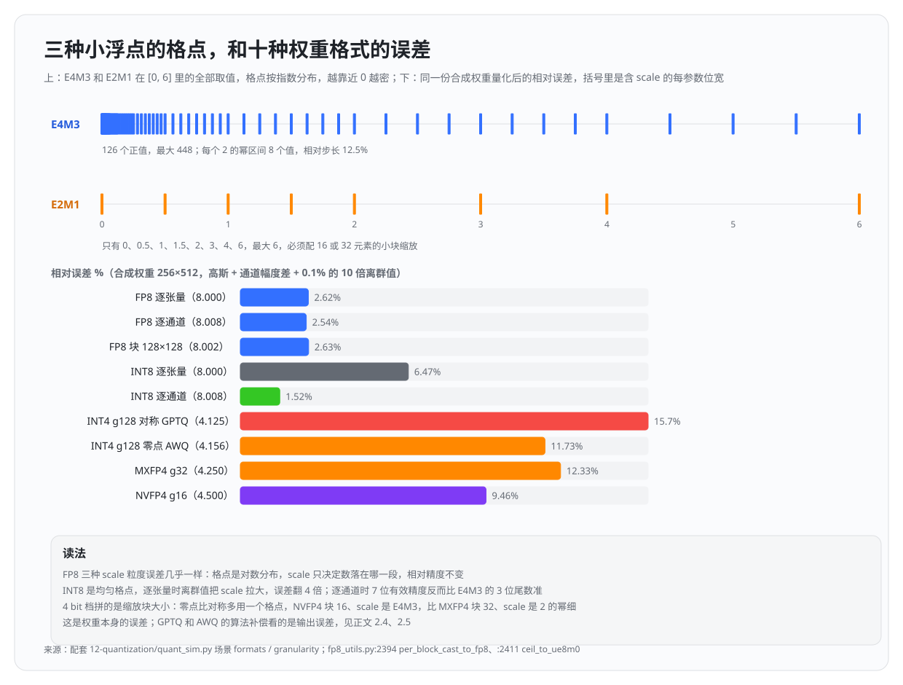
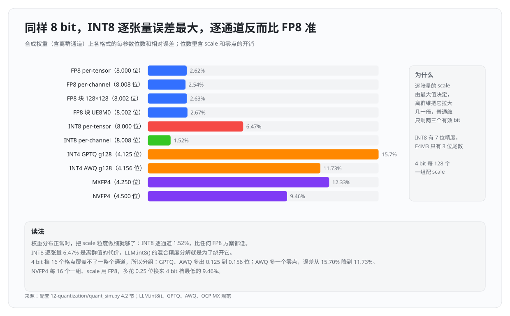
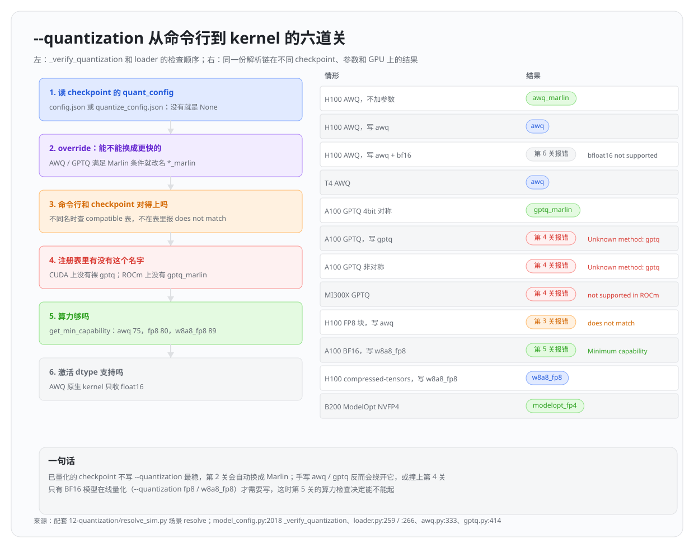
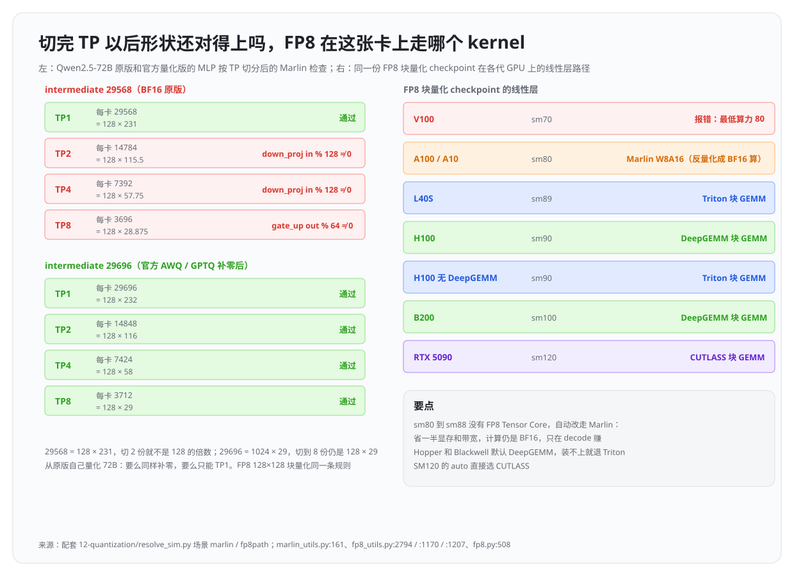
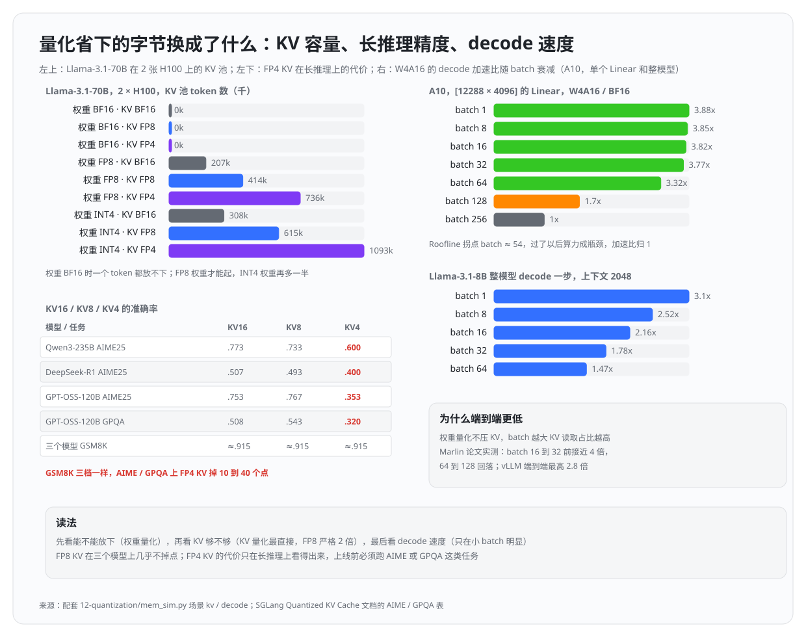
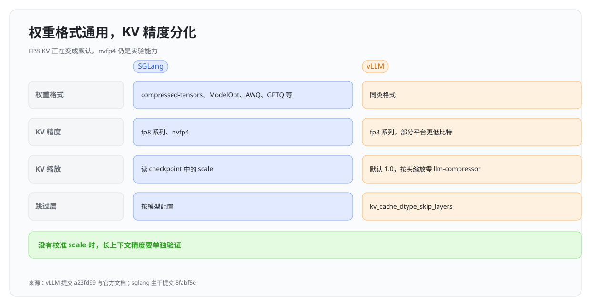
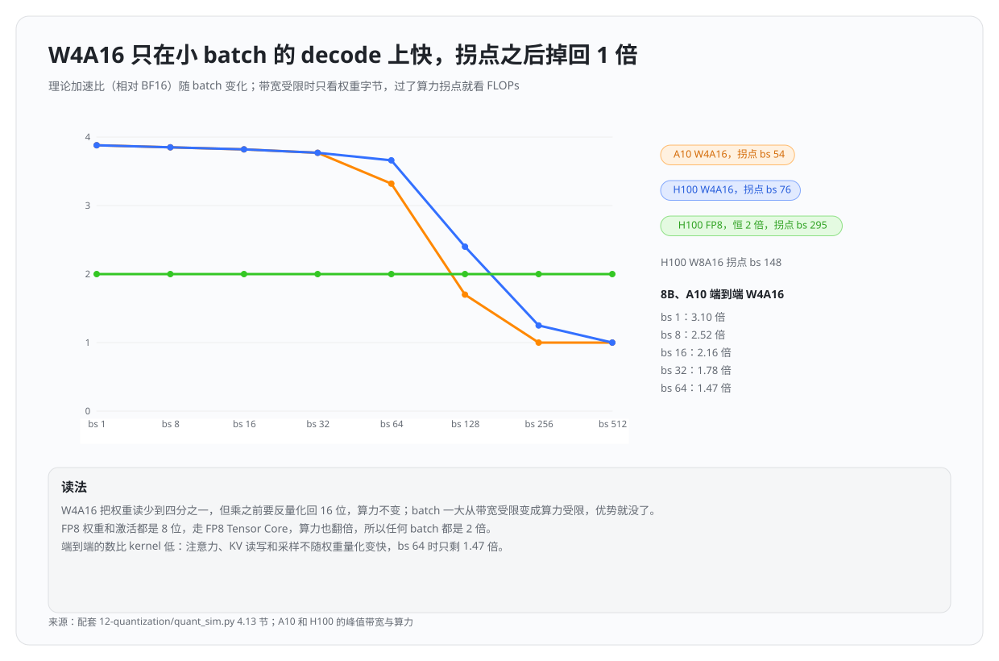

# SGL-12｜原理｜量化：FP8、INT4 与 KV 量化怎么选

> 🎯 **遇到的问题**：Llama-3.1-70B 的 BF16 权重是 141 GB，两张 H100 合计 160 GB，扣掉激活和 CUDA Graph 预留，KV 池一个 token 都放不下。换成 hugging-quants 的 AWQ-INT4 版，文件只有 39.8 GB，一张卡就能起，还剩 28 GB 给 KV。
>
> 量化是推理里最便宜的扩容手段，也最容易悄悄把模型弄坏：SGLang 文档里 GPT-OSS-120B 把 KV 从 FP8 换成 FP4，GSM8K 纹丝不动，AIME25 从 .77 掉到 .35[[1]](https://docs.sglang.io/docs/advanced_features/quantized_kv_cache)，只跑 GSM8K 就会以为 FP4 KV 是免费的。
>
> 这一篇拆四件事：低精度格式的误差从哪来，GPTQ、AWQ、SmoothQuant 各补什么，SGLang 拿到 checkpoint 后怎么选 kernel，省下的字节换成了什么（KV 容量、decode 速度）、要付什么精度代价。
>
> **主线**：量化把字节省下来换成 KV 容量或 decode 速度，同时付出精度；这一篇讲怎么算这笔账，以及怎么验证没把模型弄坏。
>
> **读完这一篇**：拿到量化 checkpoint，启动前能说出它会解析成哪个方法、走哪类 kernel。看到 gptq、awq、min_thread_k、does not match 这几类启动报错，能指到哪一关。能算出真实位宽、checkpoint 体积和 KV 池容量，知道 FP8 KV 什么时候要 scale 文件、FP4 KV 上线前跑什么评测。
>
> **代码**：[zero-to-sglang/12-quantization](../12-quantization)。quant_sim.py 用纯 Python 实现三种低精度格点、十种权重格式、AWQ 和 GPTQ。resolve_sim.py 移植 --quantization 解析链、Marlin 检查和各代 GPU 的 FP8 kernel 选择。mem_sim.py 算位宽、体积和 KV 容量，和四个真实 checkpoint 对账，偏差都在 0.1% 以内。只用标准库，行号按主干 8fabf5e 核对。

# 导读 · 结论先行

1. **格点的形状决定误差的形状。**FP8 E4M3 的格点按指数分布，每个 2 的幂区间 8 个值，相对步长固定 12.5%，所以 scale 取逐张量、逐通道还是 128×128 块，权重误差几乎一样。INT8 是均匀格点，离群值一把 scale 拉大，小数值就没精度了。4 bit 档只有 16 个格点，误差几乎全看缩放块多小。
2. **算法补偿看输出，不看权重。**GPTQ 把先量化的列留下的误差按 Hessian 摊给后面的列。AWQ 按激活幅度放大显著通道再量化。SmoothQuant 把激活的离群幅度挪一部分给权重。三者都要校准数据，量出来的 checkpoint 和直接舍入（RTN）相比，输出误差能降三到五成。
3. **已量化的 checkpoint 我们不再写 --quantization。**SGLang 先读 checkpoint 的 quant_config，再让每个方法有机会把它换成更快的实现（AWQ、GPTQ 换成 Marlin）。手写 awq 会绕开这一步，手写 gptq 在 CUDA 上会直接报 Unknown，因为注册表里已经没有裸 GPTQ。只有 BF16 模型在线量化时才需要写。
4. **形状和算力是两道硬门槛。**Marlin 要求切完 TP 以后输出维是 64 的倍数、输入维是 128 的倍数，FP8 块量化要求两个维度都是 128 的倍数。Qwen2.5-72B 原版的 intermediate 是 29568，切 2 份就对不齐。算力上 AWQ 原生 kernel 要 7.5，Marlin 和 FP8 要 8.0，W8A8 FP8 要 8.9。A100 没有 FP8 Tensor Core，FP8 checkpoint 在上面自动改走 Marlin W8A16。
5. **我们的顺序是先看能不能放下，再看 KV 够不够，最后看速度。**权重量化决定模型能不能起、KV 池剩多少。KV 量化是严格的容量倍增（FP8 两倍），但 K 里有大离群通道又没有 scale 时会饱和。W4A16 的 decode 加速只在小 batch 明显，过了 Roofline 拐点就归 1。长推理任务对 KV 精度最敏感，FP4 KV 必须拿 AIME 或 GPQA 验。



上半部分是 E4M3 和 E2M1 在 0 到 6 之间的全部取值。E4M3 越靠近 0 越密，一个非零有限值在不溢出、且舍入结果不落入次正规区或零时，最近舍入的相对误差不超过 6.25%；下溢或饱和时不适用这个界限（舍到 0 的相对误差为 100%，超出 448 后饱和到 448 的相对误差可趋近 100%）。E2M1 只有 8 个非负值，单独拿来存权重是不可用的，必须给每 16 或 32 个元素配一个缩放。下半部分是同一份合成权重（高斯分布加通道幅度差，再加 0.1% 的 10 倍离群值）量化到十种格式后的相对误差，括号里是摊进 scale 以后的每参数位宽。4.1 和 4.2 节会逐行拆。

**📎 与系列其他文档的分工**：本篇讲 SGLang 怎么识别一个量化 checkpoint、选哪个 kernel、怎么验精度，量化算法只讲到能读懂格式为止。KV 池的大小怎么从显存推出来，见 [SGL-07｜原理｜内存池与页表：req_to_token、token_to_kv 与 page size](./07-memory-pool.md)。FP8 块量化的 128 整除怎么限制 TP 的切法，[SGL-11｜原理｜并行：TP、DP Attention、EP 怎么组合](./11-parallelism.md) 讲过，这里补上 Marlin 的那一份。注意力后端对 FP8 KV 的支持，见 [SGL-10｜原理｜注意力后端：FlashInfer、FA3、Triton、TRTLLM 怎么选、怎么接进 CUDA Graph](./10-attention-backend.md)。投机解码的草稿模型用低精度能不能省，留给 [SGL-13｜原理｜投机解码：EAGLE、MTP、NGRAM 怎么选、怎么调](./13-speculative.md)。

# 第 1 章 · 问题：同一个模型，换个格式差出几倍

线上常见的情形：

- GPTQ checkpoint 加了 --quantization gptq，启动报 Unknown quantization method: gptq；去掉这个参数就好了，日志里多了一行 The model is convertible to gptq_marlin during runtime。
- AWQ 模型写了 --quantization awq --dtype bfloat16，加载前就报 bfloat16 is not supported for quantization method awq。
- 自己从 Qwen2.5-72B 原版量化出 INT4，TP1 能跑，--tp 2 报 input_size_per_partition = 14784 is not divisible by min_thread_k = 128；官方的 GPTQ 版在 TP8 也能跑。
- 同一份 FP8 checkpoint，H100 上吞吐很好，挪到 A100 上能起，但 prefill 比 BF16 还慢。
- FP8 checkpoint 上加了 --quantization awq 想换 kernel，报 does not match。
- 开了 --kv-cache-dtype fp8_e4m3，日志没报错，某个模型的长文本输出明显变差；另一个模型完全看不出差别。
- 换了 FP4 KV 以后 GSM8K 分数不变，用户反馈数学推理题错得多了。
- INT4 量化以后 batch 1 的 decode 快了 3 倍，压测并发上到 64，吞吐只比 BF16 高四成。
- Qwen 官方 72B-GPTQ-Int4 生成停不下来，32B-GPTQ-Int4 多卡输出一串感叹号。

这些现象落在四件事上：格式和算法本身的误差，SGLang 的解析链（checkpoint 和参数怎么变成一个量化方法），kernel 的选择和它的形状、算力门槛，以及省下的字节换成了什么。下面按这个顺序讲。

| 想弄清的现象 | 看哪一节 |
|-|-|
| FP8、INT8、INT4、FP4 的误差各从哪来，scale 粒度有多大影响 | 2.1、2.2、4.1、4.2 |
| 激活为什么难量化，SmoothQuant 和 FP8 动态量化怎么解决 | 2.3、4.3 |
| GPTQ、AWQ 各补了什么，desc_act 和 α 是什么 | 2.4、2.5、4.4、4.5 |
| MXFP4 和 NVFP4 差在哪 | 2.6 |
| --quantization 写不写、写什么，各种启动报错是哪一关 | 2.7、4.6 |
| Marlin 能吃哪些 checkpoint，TP 切完为什么对不齐 | 2.8、4.7 |
| FP8 在 A100、L40S、H100、B200、5090 上各走哪个 kernel | 2.9、4.8 |
| FP8 KV 要不要 scale，FP4 KV 能不能上 | 2.10、4.9、4.10 |
| checkpoint 体积和 KV 池容量怎么估 | 2.11、4.11、4.12 |
| INT4 的 decode 加速为什么随 batch 掉 | 2.11、4.13 |
| 给一个模型和一组卡，该选哪种格式 | 2.12 |

# 第 2 章 · 原理：误差从哪来，SGLang 怎么选 kernel

## 2.1 三种小浮点：格点按指数分布

FP8 有两种编码。E4M3 是 4 位指数、3 位尾数，去掉了无穷大，把编码空间留给有限值，最大到 448；E5M2 是 5 位指数、2 位尾数，保留 IEEE 的无穷和 NaN，最大到 57344。NVIDIA、Arm 和 Intel 的联合提案建议权重和激活用 E4M3，梯度用 E5M2[[2]](https://arxiv.org/abs/2209.05433)。推理里几乎只用 E4M3，E5M2 只在 KV cache 上作为一个不需要 scale 的选项出现。

浮点格式的关键性质是：每个 2 的幂区间里格点数一样多。E4M3 在 [1, 2) 里有 8 个值，步长 0.125；在 [2, 4) 里也是 8 个，步长 0.25。所以任何一个落在正规数范围里的值，舍入后的相对误差上限都是步长的一半除以区间下界，也就是 6.25%，平均在 2% 左右。这件事有一个直接推论：给 FP8 选 scale，只是决定这批数落在哪几个区间，不改变它们的相对精度。只要不溢出、不掉进次正规区，逐张量、逐通道、128×128 块的误差差不多。INT8 不是这样，它的 255 个格点均匀铺在 [-amax, amax] 上，scale 一大，小数值的相对误差就跟着变大。

E2M1 是 4 bit 浮点，非负值只有 0、0.5、1、1.5、2、3、4、6 八个。它单独拿来存权重没法用，只能配小块缩放：每 16 或 32 个元素共享一个 scale，块内的数先除以 scale 再舍入到这 8 个格点上。块越小，scale 越贴近这一小段数的范围，误差越低，代价是 scale 本身占的位宽。这就是 MX 格式和 NVFP4 的思路[[3]](https://arxiv.org/abs/2310.10537)[[4]](https://developer.nvidia.com/blog/introducing-nvfp4-for-efficient-and-accurate-low-precision-inference/)，2.6 节展开。

## 2.2 粒度和离群值：为什么 INT8 逐张量不能用

LLM.int8() 发现，模型规模到 6.7B 左右以后，隐藏状态里会系统性地出现少数幅度极大的特征维，这些维度在几乎所有层、所有 token 上都大[[5]](https://arxiv.org/abs/2208.07339)。对 INT8 逐张量量化来说这是灾难：scale 由最大值决定，离群维把 scale 拉大几十倍，普通维只剩两三个有效 bit。LLM.int8() 的办法是混合精度分解，离群维用 FP16 乘，其余 99.9% 用 INT8 乘。这条路精度好，但速度不行，后来的工作基本都在想怎么不拆矩阵也能扛住离群值。

对权重来说，把 scale 粒度做细就够了：INT8 逐通道（每个输出通道一个 scale）在合成权重上的误差是 1.52%，比 FP8 的 2.5% 还低，因为分布正常时 INT8 有 7 位有效精度，E4M3 只有 3 位尾数。4 bit 档没有这么宽裕，16 个格点要覆盖一整个通道是不够的，所以 GPTQ 和 AWQ 默认每 128 个输入元素一组，各配一个 scale（AWQ 再加一个零点），每参数多出 0.125 到 0.156 bit。



## 2.3 激活：SmoothQuant 和 FP8 动态量化

权重是静态的，可以离线慢慢量；激活每个 batch 都不一样，离群通道也在激活上。想用 INT8 Tensor Core 做 W8A8，激活必须量化。SmoothQuant 的观察是：离群值集中在少数输入通道，而且跨 token 稳定，所以可以给每个输入通道 j 一个平滑因子 s_j，激活除以 s_j，对应的权重列乘 s_j，矩阵乘的结果不变[[6]](https://arxiv.org/abs/2211.10438)。s_j = max|X_j|^α ÷ max|W_j|^(1-α)，α 控制把多少难度从激活挪给权重，论文推荐 0.5 左右，W8A8 下拿到最高 1.56 倍加速和 2 倍显存节省。

FP8 让这件事简单了很多。格点按指数分布，离群通道把 scale 拉大以后，普通通道的相对精度基本不受影响，所以 SGLang 的 FP8 默认是激活按 token 动态量化，不做平滑也够用。DeepSeek-V3 训练时更进一步，激活按 1×128 分组、权重按 128×128 分块各配 scale[[7]](https://arxiv.org/abs/2412.19437)，这个格式现在是 FP8 checkpoint 的事实标准，Qwen3-FP8 也照搬。SGLang 的 Fp8Config 只认两种激活方案，static 和 dynamic[（fp8.py:188）](https://github.com/sgl-project/sglang/blob/8fabf5e/python/sglang/srt/layers/quantization/fp8.py#L188)，块量化 checkpoint 一律动态。

## 2.4 GPTQ：用 Hessian 把误差摊给后面的列

直接舍入（RTN）把每个权重独立地四舍五入，最小化的是权重误差。我们真正关心的是层输出误差 ‖WX − QX‖²，它对权重的二阶导就是 H = 2XXᵀ，由校准激活决定。GPTQ 沿用 OBQ 的思路：一列一列地量化，每量化一列，就用 H⁻¹ 算出这一列的误差该怎么由还没量化的列来补，把补偿量加到后面的列上[[8]](https://arxiv.org/abs/2210.17323)。为了能在大模型上跑，GPTQ 固定了从左到右的顺序、按 128 列一批做惰性更新、用 Cholesky 分解稳定 H⁻¹，175B 的模型大约 4 个 GPU 小时量化到 3 或 4 bit。

desc_act（也叫 act_order）是一个常见选项：不按列号顺序，而是先处理 H 对角线大的列，也就是激活能量大的列，让它们的误差有更多的后续列来摊。精度会再好一截，代价是量化顺序和分组顺序对不上了，推理时 kernel 要按一个 g_idx 表去找每列属于哪组。SGLang 的 Marlin 路径能处理 desc_act，但要额外重排。sym 决定对称还是带零点；Marlin 的 GPTQ 路径只收对称的 4 bit 和 8 bit，这一点 2.8 节会碰到。

## 2.5 AWQ：保护 1% 的显著通道

AWQ 的出发点是一个实验：权重里只有约 1% 的通道是显著的，把它们留在 FP16、其余量化到 INT4，误差就大幅下降；而判断哪些通道显著，看激活幅度比看权重幅度准[[9]](https://arxiv.org/abs/2306.00978)。混合精度对硬件不友好，AWQ 换了一个等价做法：把显著通道的权重乘一个大于 1 的 s，对应的激活除以 s。放大后的权重在组里相对更精细，舍入误差相对变小；激活除以 s 的操作可以折进前一层的 LayerNorm 或线性层，推理时零开销。

s 怎么取？AWQ 用 s_j = mean|X_j|^α，在 0 到 1 之间网格搜索 α，挑校准集上输出误差最小的。α 太小等于没缩放，太大时显著通道被放得太大，同组里其他权重的 scale 跟着变粗，误差又涨回来。AWQ 不需要反向传播，也不需要 Hessian，几十条校准样本就够，对校准集的分布也不太敏感，这是它在社区里流行的主要原因。默认格式是 INT4、group 128、带零点。

## 2.6 MXFP4 和 NVFP4：4 bit 浮点的两种缩放

OCP 的 MX 规范定义了一族块缩放格式：每 32 个元素共享一个 8 bit 的 E8M0 scale，E8M0 只有指数没有尾数，也就是只能是 2 的幂[[3]](https://arxiv.org/abs/2310.10537)。MXFP4 是 E2M1 元素加 E8M0 scale，每参数 4.25 bit。2 的幂 scale 便宜，硬件里乘它等于移位，但粒度粗：块内最大值除以 scale 以后可能只用到格点的一半。

NVFP4 是 Blackwell 的原生格式，做了两处改动：块缩小到 16 个元素，scale 换成 E4M3（带 3 位尾数，能贴近真实最大值），再加一个 FP32 的逐张量二级 scale 防止 E4M3 scale 溢出。每参数 4.5 bit，比 FP16 小约 3.5 倍，比 FP8 小约 1.8 倍。

NVIDIA 报告 DeepSeek-R1-0528 从 FP8 训练后量化到 NVFP4，关键任务上掉点不超过 1%，AIME 2024 反而高 2%[[4]](https://developer.nvidia.com/blog/introducing-nvfp4-for-efficient-and-accurate-low-precision-inference/)。在我们的合成权重上，NVFP4 的误差是 9.46%，MXFP4 是 12.33%，INT4 g128 带零点是 11.73%。

## 2.7 解析链：--quantization 从命令行到方法的六道关



左边是 SGLang 决定量化方法的顺序。第 1 关读 checkpoint 的 quant_config：config.json 里的 quantization_config，或者单独的 quantize_config.json、hf_quant_config.json[（model_config.py:1745）](https://github.com/sgl-project/sglang/blob/8fabf5e/python/sglang/srt/configs/model_config.py#L1745)。第 2 关是 override：除了 REQUANTIZATION 名单里的方法（目前只有 quark_mxfp4[，:545](https://github.com/sgl-project/sglang/blob/8fabf5e/python/sglang/srt/configs/model_config.py#L545)），每个注册方法的 override_quantization_method 都会被调用一次，问它要不要把这个 checkpoint 认领成自己。

AWQ 的 override 在用户没写参数、或写了 marlin / awq_marlin 时，只要 is_awq_marlin_compatible 成立就改名 awq_marlin[（awq.py:333）](https://github.com/sgl-project/sglang/blob/8fabf5e/python/sglang/srt/layers/quantization/awq/awq.py#L333)。GPTQ 同理改成 gptq_marlin[（gptq.py:414）](https://github.com/sgl-project/sglang/blob/8fabf5e/python/sglang/srt/layers/quantization/gptq/gptq.py#L414)。moe_wna16 只在用户显式写了它时才认领[（moe_wna16.py:164）](https://github.com/sgl-project/sglang/blob/8fabf5e/python/sglang/srt/layers/quantization/moe_wna16.py#L164)。

第 3 关处理命令行和 checkpoint 不一致的情况[（model_config.py:2018）](https://github.com/sgl-project/sglang/blob/8fabf5e/python/sglang/srt/configs/model_config.py#L2018)：用户没写就用 checkpoint 的 quant_method。

写了且不同名，就查一张兼容表，比如 checkpoint 是 compressed-tensors 时允许写 w8a8_fp8 或 w8a8_int8，modelopt_fp4 允许写 modelopt 或 fp8，查到就打一行 Using CLI-specified quantization (X) which is compatible with HF config quant_method (Y)，查不到报 does not match。

第 4 关查注册表[（quantization/\_\_init\_\_.py:62）](https://github.com/sgl-project/sglang/blob/8fabf5e/python/sglang/srt/layers/quantization/__init__.py#L62)：CUDA 和 ROCm 上已经删掉了裸 gptq，只有 NPU、CPU、XPU 还保留；ROCm 上另有一张支持表，不在表里的（比如 gptq_marlin）直接拒绝。通过以后不在优化名单里的方法会打一行 not fully optimized yet 的警告。

第 5、6 关在 loader 里[（loader.py:259）](https://github.com/sgl-project/sglang/blob/8fabf5e/python/sglang/srt/model_loader/loader.py#L259)：算力不够报 Minimum capability，激活 dtype 不在 get_supported_act_dtypes 里报 not supported（:266）。AWQ 原生 kernel 只收 float16[（awq.py:105）](https://github.com/sgl-project/sglang/blob/8fabf5e/python/sglang/srt/layers/quantization/awq/awq.py#L105)，最低算力 7.5。awq_marlin 和 gptq_marlin 要 8.0。fp8 要 8.0（A100 上走 Marlin）。w8a8_fp8 要 8.9。右边的表是 resolve_sim.py 按这条链跑出来的结果，4.6 节逐条看。

这条链引出 SGLang 量化文档里最该记住的一句：用预量化模型时不要加 --quantization[[10]](https://docs.sglang.io/docs/advanced_features/quantization)。不写参数时第 2 关会自动换成最快的实现；写了 awq 反而锁死在没优化的原生 kernel，写了 gptq 直接撞第 4 关。BF16 模型在线量化是另一回事：fp8 的 get_config_filenames 返回空列表[（fp8.py:342）](https://github.com/sgl-project/sglang/blob/8fabf5e/python/sglang/srt/layers/quantization/fp8.py#L342)，get_quant_config 不去找文件，直接构造一个 Fp8Config[（weight_utils.py:269）](https://github.com/sgl-project/sglang/blob/8fabf5e/python/sglang/srt/model_loader/weight_utils.py#L269)，加载时把权重量化成 FP8，这时才必须写 --quantization fp8。

## 2.8 Marlin：能吃什么类型，切完对不对得齐

Marlin 是 IST Austria 和 Neural Magic 写的混合精度 GEMM：权重以 INT4 存，在寄存器里反量化成 FP16 再喂 Tensor Core，激活不量化（W4A16）。论文报告 batch 16 到 32 之前接近理想的 4 倍加速，64 到 128 逐步回落，在 vLLM 里端到端最高 2.8 倍[[11]](https://arxiv.org/abs/2408.11743)。

SGLang 的 Marlin 族现在不止 INT4：query_marlin_supported_quant_types 在 sm80 以上、无零点时返回 uint4b8、uint8b128、float8_e4m3fn、float4_e2m1f 四种，有零点时只有 uint4，sm80 以下一律为空[（marlin_utils.py:68）](https://github.com/sgl-project/sglang/blob/8fabf5e/python/sglang/srt/layers/quantization/marlin_utils.py#L68)。

group 只收 -1、32、64、128[（:104）](https://github.com/sgl-project/sglang/blob/8fabf5e/python/sglang/srt/layers/quantization/marlin_utils.py#L104)。GPTQ 能转 Marlin 的条件是 (bits, sym) 能映射到上面的类型，也就是 4 或 8 bit 对称；非对称、3 bit、group 256 都转不了，而 CUDA 上又没有裸 gptq 可退，结果就是 Unknown quantization method。



形状是另一道门槛。verify_marlin_supports_shape 要求切完 TP 以后每卡的输出维能被 min_thread_n = 64 整除，输入维能被 min_thread_k = 128 整除，还要能被 group 整除[（marlin_utils.py:161）](https://github.com/sgl-project/sglang/blob/8fabf5e/python/sglang/srt/layers/quantization/marlin_utils.py#L161)。AWQ 在建权重时检查[（awq_marlin.py:49）](https://github.com/sgl-project/sglang/blob/8fabf5e/python/sglang/srt/layers/quantization/awq/schemes/awq_marlin.py#L49)，GPTQ 在加载后检查。左图是 Qwen2.5-72B：intermediate 29568 = 128 × 231，切 2 份是 14784 = 128 × 115.5，down_proj 的输入维就对不齐了。

Qwen 官方给 AWQ / GPTQ 版把 intermediate 补零到 29696 = 1024 × 29，gate / up 补零行、down_proj 补零列，数学上等价，切到 TP8 每份 3712 = 128 × 29[[12]](https://qwen.readthedocs.io/en/latest/quantization/gptq.html)。从原版自己量化 72B 时要么同样补零，要么只能 TP1。FP8 128×128 块量化是同一条规则（validate_fp8_block_shape[，fp8_utils.py:2852](https://github.com/sgl-project/sglang/blob/8fabf5e/python/sglang/srt/layers/quantization/fp8_utils.py#L2852)），[SGL-11｜原理｜并行：TP、DP Attention、EP 怎么组合](./11-parallelism.md) 里 Qwen3-235B-FP8 在 TP8 报 block_n 整除错误就是这个[[13]](https://github.com/QwenLM/Qwen3/discussions/1674)。

## 2.9 FP8 线性层：每代 GPU 一条路

Fp8LinearMethod 初始化时先决定三件事[（fp8.py:508）](https://github.com/sgl-project/sglang/blob/8fabf5e/python/sglang/srt/layers/quantization/fp8.py#L508)。先看 CUTLASS 的 scaled_mm 能不能用：sm90 以上要 CUDA 12.0，sm89 要 12.4[（fp8_utils.py:397）](https://github.com/sgl-project/sglang/blob/8fabf5e/python/sglang/srt/layers/quantization/fp8_utils.py#L397)。再看要不要走 Marlin：SGLANG_FORCE_FP8_MARLIN 为真，或者 can_auto_enable_marlin_fp8 成立（80 ≤ sm （:2794）。

最后是块量化时用哪个 GEMM：auto 模式按 DeepGEMM、Blackwell 上的 FlashInfer、SM120 的 CUTLASS、AMD aiter、NPU、XPU、Triton 的顺序选第一个可用的[（:1170）](https://github.com/sgl-project/sglang/blob/8fabf5e/python/sglang/srt/layers/quantization/fp8_utils.py#L1170)；SM120 在 auto 下直接定成 cutlass[（:1207）](https://github.com/sgl-project/sglang/blob/8fabf5e/python/sglang/srt/layers/quantization/fp8_utils.py#L1207)。

DeepGEMM 是 DeepSeek 开源的细粒度缩放 FP8 GEMM，支持 SM90 和 SM100，运行时 JIT 编译，需要 CUDA 12.9 以上；SM90 上 scale 是 FP32，SM100 上是打包的 UE8M0，H800 上最高 1550 TFLOPS[[14]](https://github.com/deepseek-ai/DeepGEMM)。UE8M0 就是只有指数的 8 bit scale，SGLang 用 ceil_to_ue8m0 把 FP32 scale 向上取到 2 的幂[（fp8_utils.py:2411）](https://github.com/sgl-project/sglang/blob/8fabf5e/python/sglang/srt/layers/quantization/fp8_utils.py#L2411)，在合成权重上误差从 2.63% 变成 2.67%。

逐张量 checkpoint（ModelOpt、llm-compressor 导出的那种）走另一条路[（fp8.py:1142）](https://github.com/sgl-project/sglang/blob/8fabf5e/python/sglang/srt/layers/quantization/fp8.py#L1142)：加载后把每个分片的 scale 展开成逐通道，用 CUTLASS 的 scaled_mm，激活按 token 动态量化；CUTLASS 不可用时（比如 L40S 配 CUDA 12.1）退回逐张量 scale 加 torch.\_scaled_mm，要先按最大 scale 把各分片重量化一遍。

SM120 是个例外，源码注释说那里的 cudnn / nvjet 逐张量 kernel 快 1.2 到 2.7 倍，所以反过来把逐通道 scale 合并成最大值。BF16 模型在线量化时，能用 CUTLASS 或 Marlin 就逐通道量化，否则逐张量。

A100 上的 Marlin W8A16 要单独说一句：权重按 1 字节存，显存和带宽省一半，但计算还是 BF16，激活不量化。所以它只在 decode 这种带宽受限的阶段赚；prefill 时多了一步反量化，可能比原生 BF16 还慢。这解释了第 1 章里同一份 FP8 checkpoint 在 A100 上 prefill 变慢的现象。

## 2.10 KV 量化：dtype 和 scale

--kv-cache-dtype 可选 auto、bf16、fp8_e4m3、fp8_e5m2、mxfp8（只 FA4 后端）、nvfp4、fp4_mx_block16[（model.py:197）](https://github.com/sgl-project/sglang/blob/8fabf5e/python/sglang/srt/arg_groups/fields/model.py#L197)。configure_kv_cache_dtype 的规则[（kv_cache_dtype.py:34）](https://github.com/sgl-project/sglang/blob/8fabf5e/python/sglang/srt/mem_cache/kv_cache_dtype.py#L34)：auto 时如果 checkpoint 声明了 kv_cache_quant_algo 为 FP8 就用 e4m3，否则跟模型 dtype。

ROCm 上两种 FP8 都映射成 float8_e4m3fnuz。两种 FP4 都是 float4_e2m1fn_x2，要 PyTorch 2.8 和 CUDA 12.8 以上，启动时会打一行 KV Cache might lead to an accuracy drop 的警告。写其他值报 Unsupported kv_cache_dtype。

E4M3 需要 scale。BaseKVCacheMethod 在加载时给每个注意力层建 k_scale、v_scale，初值 -1；checkpoint 里有就覆盖[（kv_cache.py:52）](https://github.com/sgl-project/sglang/blob/8fabf5e/python/sglang/srt/layers/quantization/kv_cache.py#L52)。两个都大于 0 就直接用，ROCm fnuz 格式最大值只有 240，所以要乘 2。两个都没有就用 1.0。只有一个就复制成两个。只支持逐张量 scale。

--quantization-param-path 是另一个来源，帮助文本写得很直白：FP8 KV 一般应该提供，否则 scale 默认 1.0，可能有精度问题[（model.py:185）](https://github.com/sgl-project/sglang/blob/8fabf5e/python/sglang/srt/arg_groups/fields/model.py#L185)。scale 等于 1.0 意味着假设 K、V 的绝对值都不超过 448，多数模型成立，K 里有大离群通道的模型会饱和。E5M2 范围到 57344，不怕饱和，代价是平时多一倍舍入误差。

学术界对 KV 量化有更细的做法。KIVI 发现 K 的离群值集中在固定通道、V 没有这个结构，所以 K 按通道、V 按 token 量化到 2 bit[[15]](https://arxiv.org/abs/2402.02750)。SGLang 目前没有走这么激进的路线，FP4 KV 用的是块 16 缩放，每块自带 scale，不怕离群值，但只有 8 个非负格点。代价在哪，SGLang 的 Quantized KV Cache 文档给了一张表[[1]](https://docs.sglang.io/docs/advanced_features/quantized_kv_cache)：三个模型的 GSM8K 在 KV16、KV8、KV4 下都在 .915 左右，没区别。

AIME25 上 Qwen3-235B 从 .773 掉到 .600，DeepSeek-R1 从 .507 掉到 .400，GPT-OSS-120B 从 .753 掉到 .353，GPQA 从 .508 掉到 .320。FP8 KV 几乎不掉，GPT-OSS 上甚至略高（噪声范围内）。长推理生成几千个 token，每一步都在读被量化过的 KV，误差会累积，短答案的 GSM8K 看不出来。

## 2.11 省下的字节换成什么：容量和 decode 速度



先算体积。每参数的平均位宽要把 scale 摊进去：FP8 块量化每 128×128 个权重多一个 FP32 scale，是 8.002 bit。INT4 g128 对称每 128 个权重多一个 FP16 scale，是 4.125 bit，带零点再多 4 bit 的零点，是 4.156 bit。MXFP4 是 4.25，NVFP4 是 4.5。embedding 和 lm_head 通常保持 BF16。

按这三条口径算，Llama-3.1-70B 的 BF16 版估算 141.20 GB，实际文件 141.11 GB；AWQ-INT4 版估算 39.79 GB，实际 39.77 GB。INT4 名义上压 4 倍，70B 实际只压了 3.5 倍，差的是 group scale 和 2.1B 参数的 embedding / lm_head。小模型更吃亏，Qwen3-8B 的 embedding 加 lm_head 占 15% 参数，AWQ 只压到 BF16 的 37%。

再算容量。左上图是 Llama-3.1-70B 在 2 张 H100 上的 KV 池：BF16 权重每卡 65.8 GB，扣掉预留以后一个 token 都放不下。FP8 权重能起，KV 池 20.7 万 token。INT4 权重 30.8 万。KV 从 BF16 换 FP8 是严格的 2 倍 token，FP4 是 3.56 倍。小模型权重本来就小，量化权重带来的 KV 增量有限，扩容主要靠 KV 量化。KV 池的推法见 [SGL-07｜原理｜内存池与页表：req_to_token、token_to_kv 与 page size](./07-memory-pool.md)。

最后算速度。decode 时 batch 小，GEMM 的瓶颈是读权重，按 Roofline 模型，性能等于带宽乘算术强度[[16]](https://dl.acm.org/doi/10.1145/1498765.1498785)。权重从 2 字节变成 0.5 字节，读权重的时间缩成四分之一，单个 Linear 的理想加速是 16 ÷ 4.125 = 3.9 倍。batch 涨上去以后算术强度涨，到拐点 batch（峰值算力 ÷ 带宽 × 每参数字节 ÷ 2）就变成算力瓶颈。A10 的 BF16 拐点约 208，INT4 权重把它压到 54 左右。

H100 SXM 的带宽是 3.35 TB/s，BF16 稠密算力约 989 TFLOPS[[17]](https://www.nvidia.com/en-us/data-center/h100/)，INT4 拐点约 76。过了拐点 W4A16 的加速比一路降到 1，因为计算还是 BF16。W8A8 FP8 不一样，计算也在 FP8 Tensor Core 上，峰值翻倍，大 batch 也保持 2 倍。端到端还要再打折：权重量化不压 KV，batch 越大 KV 读取占比越高。Llama-3.1-8B 在 A10 上，W4A16 的端到端加速从 batch 1 的 3.1 倍降到 batch 64 的 1.47 倍。

## 2.12 怎么选

把前面几节压成一张表。前提是已经有对应的 checkpoint；没有的话，FP8 可以在线量化，INT4 和 FP4 要离线量。

| 场景 | 首选 | 原因和代价 |
|-|-|-|
| H100 / H200，放得下 FP8 | FP8 块量化权重 + FP8 KV（带 scale） | DeepGEMM 原生，prefill 和 decode 都快；精度几乎无损 |
| H100，FP8 也放不下或想省卡 | AWQ / GPTQ INT4（Marlin） | 体积再小一半。decode 小 batch 快，大 batch 没 FP8 快。精度要验 |
| A100 / A10 / L4 之前的 Ampere | AWQ / GPTQ INT4，或 FP8 走 Marlin W8A16 | 没有 FP8 Tensor Core，只赚带宽；prefill 不会更快 |
| L40S（sm89） | FP8，确认 CUDA 12.4 以上 | 低于 12.4 退回逐张量 scale，精度略差 |
| B200 / GB200 | NVFP4（modelopt_fp4）或 FP8 | NVFP4 原生 Tensor Core；FP8 走 DeepGEMM |
| RTX 5090（sm120） | FP8，auto 下走 CUTLASS | 逐张量 checkpoint 会把 scale 合并成最大值 |
| 小模型，KV 是瓶颈 | 权重保持 BF16 或 FP8，KV 用 FP8 | 权重量化省得有限，KV 量化直接翻倍 |
| 长推理（数学、代码、Agent） | KV 最低到 FP8，不上 FP4 | FP4 KV 在 AIME / GPQA 上掉 10 到 40 个点 |

## 2.13 vLLM 怎么做

权重量化这一侧，两边加载的格式基本相同：compressed-tensors、ModelOpt、AWQ、GPTQ、FP8 等主流 checkpoint 都能直接读[[18]](https://docs.vllm.ai/en/latest/features/quantization/)。差别在 KV 量化。vLLM 用 --kv-cache-dtype fp8 开 FP8 KV，没有校准数据时缩放因子默认 1.0；要按注意力头单独缩放，需要 FlashAttention 后端加 llm-compressor 产出的校准结果[[19]](https://docs.vllm.ai/en/latest/features/quantization/quantized_kvcache.html)。kv_cache_dtype_skip_layers 可以让个别层保持高精度。

默认值也在向 FP8 KV 靠拢，vLLM 已经为 GLM5.3 Flash 把 FP8 KV 设成默认[[20]](https://github.com/vllm-project/vllm/pull/61228)。SGLang 的 --kv-cache-dtype 除 FP8 外还提供 nvfp4，容量收益更大，但官方仍标为实验能力，SGL-20 里有它在 Prefill 上变慢的实测。缩放因子为 1.0 时，激活值超出 FP8 范围的层会被截断，长上下文任务的精度损失往往先在这里出现。

| 维度 | SGLang | vLLM | 差异的代价 |
|-|-|-|-|
| 权重格式 | compressed-tensors、ModelOpt、AWQ、GPTQ 等 | 同类格式 | 迁移时 checkpoint 基本可复用 |
| KV 精度 | fp8 系列、nvfp4 | fp8 系列，部分平台更低比特 | nvfp4 省容量，Prefill 不一定快 |
| KV 缩放 | 读 checkpoint 中的 scale | 默认 1.0，按头缩放需 llm-compressor | 无校准时精度风险两边都在 |
| 跳过层 | 按模型配置 | kv_cache_dtype_skip_layers | 敏感层要单独验证 |



# 第 3 章 · 源码走读：从一个 checkpoint 到一次量化 GEMM 的 18 个落脚点

前 10 行是启动时的解析和检查，后 8 行是加载和运行时。路径相对 python/sglang/srt/。

| # | 位置 | 发生了什么 |
|-|-|-|
| 1 | [arg_groups/fields/model.py:177](https://github.com/sgl-project/sglang/blob/8fabf5e/python/sglang/srt/arg_groups/fields/model.py#L177) | --quantization。:185 --quantization-param-path。:197 --kv-cache-dtype。:233 --modelopt-quant |
| 2 | [arg_groups/fields/exec\_.py:276](https://github.com/sgl-project/sglang/blob/8fabf5e/python/sglang/srt/arg_groups/fields/exec_.py#L276) | --fp8-gemm-backend；:285 --fp4-gemm-backend，auto 时 SM100 走 flashinfer_cutedsl、SM80 到 90 走 marlin |
| 3 | [layers/quantization/\_\_init\_\_.py:62](https://github.com/sgl-project/sglang/blob/8fabf5e/python/sglang/srt/layers/quantization/__init__.py#L62) | BASE_QUANTIZATION_METHODS；裸 gptq 只在 NPU / CPU / XPU 分支注册 |
| 4 | [configs/model_config.py:1745](https://github.com/sgl-project/sglang/blob/8fabf5e/python/sglang/srt/configs/model_config.py#L1745) | \_parse_quant_hf_config 读 checkpoint 的 quant_config；:1856 ModelOpt 的格式 |
| 5 | [model_config.py:2018](https://github.com/sgl-project/sglang/blob/8fabf5e/python/sglang/srt/configs/model_config.py#L2018) | \_verify_quantization：override、兼容表、注册表、ROCm 表、优化名单；:545 REQUANTIZATION_METHODS |
| 6 | [layers/quantization/awq/awq.py:333](https://github.com/sgl-project/sglang/blob/8fabf5e/python/sglang/srt/layers/quantization/awq/awq.py#L333) | AWQ 的 override，满足条件改名 awq_marlin。:402 is_awq_marlin_compatible。:105 只收 float16 |
| 7 | [layers/quantization/gptq/gptq.py:414](https://github.com/sgl-project/sglang/blob/8fabf5e/python/sglang/srt/layers/quantization/gptq/gptq.py#L414) | GPTQ 的 override。:44 check_marlin_format。:459 is_gptq_marlin_compatible。:298 类型映射 |
| 8 | [layers/quantization/moe_wna16.py:164](https://github.com/sgl-project/sglang/blob/8fabf5e/python/sglang/srt/layers/quantization/moe_wna16.py#L164) | moe_wna16 只在用户显式写时认领 GPTQ / AWQ 的 MoE checkpoint |
| 9 | [layers/quantization/base_config.py:223](https://github.com/sgl-project/sglang/blob/8fabf5e/python/sglang/srt/layers/quantization/base_config.py#L223) | ModelOpt 系列的 override |
| 10 | [model_loader/loader.py:259](https://github.com/sgl-project/sglang/blob/8fabf5e/python/sglang/srt/model_loader/loader.py#L259) | 算力检查；:266 激活 dtype 检查 |
| 11 | [model_loader/weight_utils.py:269](https://github.com/sgl-project/sglang/blob/8fabf5e/python/sglang/srt/model_loader/weight_utils.py#L269) | get_quant_config；fp8 的 get_config_filenames 为空（fp8.py:342），在线量化直接构造 Fp8Config |
| 12 | [layers/quantization/marlin_utils.py:68](https://github.com/sgl-project/sglang/blob/8fabf5e/python/sglang/srt/layers/quantization/marlin_utils.py#L68) | Marlin 支持的类型。:104 group 检查。:161 切完 TP 后的形状检查 |
| 13 | [layers/quantization/fp8.py:268](https://github.com/sgl-project/sglang/blob/8fabf5e/python/sglang/srt/layers/quantization/fp8.py#L268) | Fp8Config：ignored_layers 和 SGLANG_FP8_IGNORED_LAYERS；:188 激活方案 |
| 14 | [fp8.py:508](https://github.com/sgl-project/sglang/blob/8fabf5e/python/sglang/srt/layers/quantization/fp8.py#L508) | Fp8LinearMethod：CUTLASS 能否用、是否走 Marlin、块量化选哪个 GEMM |
| 15 | [fp8.py:1142](https://github.com/sgl-project/sglang/blob/8fabf5e/python/sglang/srt/layers/quantization/fp8.py#L1142) | process_weights_after_loading：逐通道 / 逐张量、在线量化、SM120 重量化 |
| 16 | [layers/quantization/fp8_utils.py:1170](https://github.com/sgl-project/sglang/blob/8fabf5e/python/sglang/srt/layers/quantization/fp8_utils.py#L1170) | 块量化 GEMM 的 auto 选择顺序。:1207 SM120 定 cutlass。:2852 块形状检查。:2794 Marlin 自动启用 |
| 17 | [mem_cache/kv_cache_dtype.py:34](https://github.com/sgl-project/sglang/blob/8fabf5e/python/sglang/srt/mem_cache/kv_cache_dtype.py#L34) | --kv-cache-dtype 解析成 torch dtype |
| 18 | [layers/quantization/kv_cache.py:52](https://github.com/sgl-project/sglang/blob/8fabf5e/python/sglang/srt/layers/quantization/kv_cache.py#L52) | k_scale / v_scale 的兜底和 fnuz 乘 2 |

读一个量化方法，从它的 Config 类进去：get_name 是注册名，get_min_capability 和 get_supported_act_dtypes 是第 5、6 关的输入，override_quantization_method 是第 2 关，get_quant_method 按层类型返回 LinearMethod 或 MoEMethod。

LinearMethod 的 create_weights 决定权重和 scale 的形状，process_weights_after_loading 把 checkpoint 的布局重排成 kernel 要的布局，apply 才是每次前向调用的 GEMM。Fp8LinearMethod 是最好的范本[（fp8.py:508）](https://github.com/sgl-project/sglang/blob/8fabf5e/python/sglang/srt/layers/quantization/fp8.py#L508)，三个方法覆盖了第 2.9 节的全部分支。

# 第 4 章 · 实验：在 CPU 上量化、解析和算账

实验都在 CPU 上跑，只用标准库。格点、舍入、GPTQ 和 AWQ 是按论文逐步实现的。解析链、Marlin 检查、FP8 路径和 KV dtype 是按源码逐行移植的，结果应该和真实启动一致。体积和容量按结构累加，和真实文件对过账。误差用的是合成数据，看的是相对大小和趋势，不能直接当成某个模型的掉点。

## 4.1 三种小浮点的格点

```bash
cd zero-to-sglang/12-quantization
python3 quant_sim.py --scenario formats
```

```text
三种小浮点格式（OCP 规范）
  格式         正值个数        最大值        最小正规数        最小次正规     1 附近步长
  E4M3        126        448       0.0156      0.00195      0.125
  E5M2        123      57344      6.1e-05     1.53e-05       0.25
  E2M1          7          6            1          0.5        0.5

  E2M1 全部取值： [0.0, 0.5, 1.0, 1.5, 2.0, 3.0, 4.0, 6.0]

  在 [1, 2) 里均匀取 10000 个数，舍入到各格式后的平均相对误差：
    E4M3: 2.17%
    E5M2: 4.33%
    E2M1（[0.5, 5.5)）: 10.45%
```

fp_grid 按指数位、尾数位、偏置枚举出全部有限值，E4M3 去掉了 S.1111.111 这个 NaN 编码，所以最大值是 448 而不是 480。E5M2 少一位尾数，[1, 2) 里只有 4 个值，平均误差正好翻倍。E2M1 的平均误差 10% 意味着它单独存权重会丢掉三位有效数字，必须配块缩放。舍入用的是就近舍入、平局取偶，和 torch 的 to(float8_e4m3fn) 一致，超过最大值饱和到最大值。

## 4.2 十种权重格式的误差

```bash
python3 quant_sim.py
```

```text
合成权重 256×512（高斯 + 通道幅度差 + 0.1% 的 10 倍离群值）
  格式                           位/参数      相对误差  SQNR dB
  FP8 per-tensor              8.000     2.62%     31.6
  FP8 per-channel             8.008     2.54%     31.9
  FP8 块 128×128               8.002     2.63%     31.6
  FP8 块 128×128 UE8M0         8.002     2.67%     31.5
  INT8 per-tensor             8.000     6.47%     23.8
  INT8 per-channel            8.008     1.52%     36.4
  INT4 g128 对称（GPTQ）          4.125    15.70%     16.1
  INT4 g128 零点（AWQ）           4.156    11.73%     18.6
  MXFP4 g32                   4.250    12.33%     18.2
  NVFP4 g16                   4.500     9.46%     20.5
```

三件事。FP8 的四种 scale 粒度误差在 2.5% 到 2.7% 之间，印证了 2.1 节：格点按指数分布，scale 粒度对权重几乎没影响。128×128 块的口径和 per_block_cast_to_fp8 一样，amax 下限 1e-4、除以 448[（fp8_utils.py:2394）](https://github.com/sgl-project/sglang/blob/8fabf5e/python/sglang/srt/layers/quantization/fp8_utils.py#L2394)。

UE8M0 把 scale 向上取到 2 的幂，多付 0.04 个百分点。INT8 逐张量的误差是逐通道的 4 倍，离群值把 scale 拉大了。4 bit 档按缩放块大小排队：零点比对称多用了一个格点，误差低四个点；NVFP4 块 16、scale 带尾数，是四种里最准的。这些是权重本身的误差，GPTQ 和 AWQ 的价值在输出误差上，下面两节看。

## 4.3 激活量化和 SmoothQuant

```bash
python3 quant_sim.py --scenario activation
```

```text
合成激活 32×512，离群通道 [64, 120, 137, 261]，最大幅度 108，普通通道中位数 3.0

  方案                                           输出误差
  W8A8 INT8，激活 per-tensor                     8.62%
  W8A8 INT8，激活 per-token                      3.93%
  W8A8 INT8 + SmoothQuant α=0.5，per-tensor    1.78%
  W8A8 INT8 + SmoothQuant α=0.75，per-tensor    2.07%
  W8A8 FP8，激活 per-tensor                      3.90%
  W8A8 FP8，激活 per-token（sglang 默认）            3.56%
  W8A8 FP8，激活 1×128 + 权重 128×128              3.05%
  W8A16 FP8（Marlin，激活不量化）                     2.82%
```

INT8 逐张量是 8.62%，离群通道比普通通道大 36 倍，普通通道只剩两三个有效 bit。SmoothQuant α=0.5 把它压到 1.78%，比逐 token 的 INT8 还好，因为它从源头上把离群值摊平了，而逐 token 对每个 token 内部的离群通道无能为力。FP8 三种做法的差距只有半个点，逐 token 动态量化不做平滑就够用，这是 SGLang 把它定为默认的原因。DeepSeek 的 1×128 分组再好一点。W8A16 不量化激活，误差最低，但它的计算是 BF16。

## 4.4 AWQ 的 α 搜索

```bash
python3 quant_sim.py --scenario awq
```

```text
INT4 g128（零点）权重 128×512，校准激活 64 个 token，显著通道 [67, 133, 243, 378, 485]

  RTN（直接舍入）                     输出误差 9.39%
  1% 显著通道保留 FP16（混合精度）     输出误差 3.61%
  按激活幅度缩放 s_j = mean|X_j|^α，W 乘 s、X 除 s：
    α=0.0  输出误差 9.39%
    α=0.2  输出误差 5.72%
    α=0.4  输出误差 5.18%
    α=0.6  输出误差 6.50%
    α=0.8  输出误差 9.28%
    α=1.0  输出误差 14.43%
  最好的 α=0.4，误差从 9.39% 降到 5.18%，权重仍然全是 INT4。
```

两个对照组复现了 AWQ 论文的论证顺序。保留 1% 显著通道在 FP16，误差从 9.39% 降到 3.61%，说明这 1% 确实关键。缩放的做法拿到了一大半收益（5.18%），而且不需要混合精度。误差随 α 是一条 U 形曲线，最低点在 0.4；α=1.0 时比不缩放还差，显著通道被放得太大，把同组其他权重的 scale 撑粗了。真实工具（AutoAWQ、llm-compressor）每层单独搜 α，还会搜一个裁剪比例。

## 4.5 GPTQ 和 desc_act

```bash
python3 quant_sim.py --scenario gptq
```

```text
权重 32×128，校准 256 个 token（3 个离群通道），对称量化，H = X^T X，阻尼 1%
  bit     分组      RTN     GPTQ  GPTQ+desc_act
    4     整行   12.14%    8.99%          7.29%
    4    g32    9.92%    7.32%          6.34%
    3     整行   25.70%   18.82%         16.32%
    3    g32   20.66%   16.25%         13.50%
```

gptq 函数是论文算法 1 的直译：H 加 1% 的对角阻尼，求逆后做上三角 Cholesky，逐列量化，误差乘 H⁻¹ 的对应行加到后面的列上。4 bit 整行时 GPTQ 把输出误差从 12.14% 降到 8.99%，desc_act 再降到 7.29%；3 bit 时收益更大。分组和 desc_act 的效果能叠加。注意 3 bit 的结果再好也上不了 SGLang 的 CUDA 路径，4.7 节会看到 Marlin 不收 3 bit。

## 4.6 解析链：22 个组合

```bash
python3 resolve_sim.py
```

```text
[H100] AWQ 4bit，不加参数
    -> awq_marlin
       info: The model is convertible to awq_marlin during runtime.
[H100] AWQ，--quantization awq
    -> awq
       warning: awq quantization is not fully optimized yet.
[H100] AWQ，--quantization awq --dtype bfloat16
    -> ERROR bfloat16 is not supported for quantization method awq. Supported dtypes: ['float16']
[V100] AWQ，V100 上不加参数
    -> ERROR The quantization method awq is not supported for the current GPU. Minimum capability: 75. Current capability: 70.
[A100] GPTQ 4bit 对称，不加参数
    -> gptq_marlin
[A100] GPTQ，--quantization gptq
    -> ERROR Unknown quantization method: gptq.
[A100] GPTQ 非对称
    -> ERROR Unknown quantization method: gptq.
[MI300X] GPTQ，MI300X 上不加参数
    -> ERROR gptq_marlin quantization is currently not supported in ROCm.
[H100] FP8 块量化，--quantization awq
    -> ERROR Quantization method specified in the model config (fp8) does not match the quantization method specified in the `quantization` argument (awq).
[A100] BF16 模型，A100 上 --quantization w8a8_fp8
    -> ERROR The quantization method w8a8_fp8 is not supported for the current GPU. Minimum capability: 89. Current capability: 80.
[H100] compressed-tensors，--quantization w8a8_fp8
    -> w8a8_fp8
       info: Using CLI-specified quantization (w8a8_fp8) which is compatible with HF config quant_method (compressed-tensors).
[B200] ModelOpt NVFP4，不加参数
    -> modelopt_fp4
```

这是节选，完整 22 条见 README。逐条对应 2.7 节的六道关：不加参数时第 2 关自动升级到 Marlin。写 awq 绕开了升级，只能用没优化的原生 kernel，再配 bfloat16 就在第 6 关被拒。T4 是 7.5，awq_marlin 要 8.0，所以 T4 上不加参数也停在 awq。

GPTQ 非对称在 CUDA 上没有退路：override 不改名，quant_method 停在 gptq，注册表里找不到，报 Unknown。要么重新量化成 4 或 8 bit 对称、group 128，要么换 AWQ；MoE 模型还可以显式写 --quantization moe_wna16。MI300X 上 gptq 能被 override 成 gptq_marlin，却撞上 ROCm 支持表。

## 4.7 Marlin 的类型和形状

```bash
python3 resolve_sim.py --scenario marlin
```

```text
Marlin 支持的权重类型（query_marlin_supported_quant_types）
  sm75  有零点(AWQ): 无   无零点(GPTQ): 无
  sm80  有零点(AWQ): ['uint4']   无零点(GPTQ): ['uint4b8', 'uint8b128', 'float8_e4m3fn', 'float4_e2m1f']

checkpoint 能不能转 Marlin（A100）
  awq        bits=4, group_size=128, zero_point=True              可以
  gptq       bits=4, group_size=128, sym=True, desc_act=False     可以
  gptq-asym  bits=4, group_size=128, sym=False, desc_act=False    不行
  gptq-3bit  bits=3, group_size=128, sym=True, desc_act=True      不行
  gptq-g256  bits=4, group_size=256, sym=True, desc_act=False     不行

MLP 按 TP 切完以后的形状检查（group 128 的 Marlin / 128x128 的 FP8 块）
  Qwen2.5-72B（BF16 原版）
    TP1  Marlin 通过   FP8 块 通过
    TP2  Marlin 不通过  FP8 块 不通过  down_proj: input_size_per_partition = 14784 不能被 min_thread_k = 128 整除
    TP4  Marlin 不通过  FP8 块 不通过  down_proj: input_size_per_partition = 7392 不能被 min_thread_k = 128 整除
    TP8  Marlin 不通过  FP8 块 不通过  gate_up_proj: output_size_per_partition = 7392 不能被 min_thread_n = 64 整除
  Qwen2.5-72B（官方 AWQ / GPTQ，intermediate 补到 29696）
    TP1 到 TP8 全部通过
  Llama-3.1-70B、Qwen3-32B
    TP1 到 TP8 全部通过
```

uint4b8 是带 8 偏置的 4 bit（GPTQ 对称格式存成 0 到 15，减 8 得到有符号数），uint8b128 同理。TP8 时报的是 gate_up_proj：它把 gate 和 up 合成一个矩阵按列切，每卡输出 2 × 3696 = 7392，不是 64 的倍数。Llama-3.1-70B 的 intermediate 是 28672 = 128 × 224，Qwen3-32B 是 25600 = 128 × 200，都能一路切到 TP8。现在拿到一个新模型，先用 intermediate_size ÷ tp ÷ 128 算一下是不是整数。

## 4.8 FP8 在各代 GPU 上的路径

```bash
python3 resolve_sim.py --scenario fp8path
```

```text
块量化 checkpoint（如 Qwen3-8B-FP8、DeepSeek-V3）
  V100               报错：fp8 最低算力 80
  A100               Marlin W8A16：权重 FP8 存、kernel 里反量化，激活不量化
  L40S               Triton 块量化 GEMM，激活 1x128 分组量化
  H100               DeepGEMM 块量化 GEMM，激活 1x128 分组量化
  H100 无 DeepGEMM    Triton 块量化 GEMM，激活 1x128 分组量化
  B200               DeepGEMM 块量化 GEMM，激活 1x128 分组量化
  RTX 5090           CUTLASS 块量化 GEMM（SM120 auto 直接选 cutlass）

逐张量 checkpoint（如 ModelOpt / llm-compressor 导出的 FP8）
  A100               Marlin W8A16：权重 FP8 存、kernel 里反量化，激活不量化
  L40S + CUDA 12.1   逐张量 scale（按最大值重量化），torch._scaled_mm，激活按 token 动态量化
  L40S               逐通道 scale，CUTLASS scaled_mm，激活按 token 动态量化
  H100               逐通道 scale，CUTLASS scaled_mm，激活按 token 动态量化
  RTX 5090           SM120：逐通道 scale 合并成最大值，逐张量 GEMM，激活按 token 动态量化

BF16 模型 + --quantization fp8（在线量化）
  L40S + CUDA 12.1   加载时逐张量量化权重，torch._scaled_mm，激活按 token 动态量化
  H100               加载时逐通道量化权重，CUTLASS scaled_mm，激活按 token 动态量化
```

L40S 是 sm89，有 FP8 Tensor Core，但块量化 GEMM 不在 DeepGEMM 的支持范围里，落到 Triton。H100 没装 DeepGEMM（或 CUDA 低于 12.9）时也会落到 Triton，性能差距明显，启动日志里要确认。我们在 Hopper 上对比 Marlin W8A16 时，设的是 SGLANG_FORCE_FP8_MARLIN=1。

## 4.9 KV dtype 和 scale 兜底

```bash
python3 resolve_sim.py --scenario kv
```

```text
--kv-cache-dtype 解析结果
  auto      [H100] -> bfloat16
  auto      [H100，checkpoint 声明 kv_cache_quant_algo=FP8] -> float8_e4m3fn
  fp8_e4m3  [H100] -> float8_e4m3fn
  fp8_e5m2  [MI300X] -> float8_e4m3fnuz
  nvfp4     [H100] -> float4_e2m1fn_x2（会打印 accuracy drop 警告）
  int8      [H100] -> ERROR Unsupported kv_cache_dtype: int8.

k_scale / v_scale 兜底（-1 表示 checkpoint 里没有）
  载入 k=-1    v=-1    CUDA      -> 实际用 (1.0, 1.0)
  载入 k=0.12  v=0.08  CUDA      -> 实际用 (0.12, 0.08)
  载入 k=0.12  v=-1    CUDA      -> 实际用 (0.12, 0.12)
  载入 k=0.12  v=0.08  ROCm fnuz -> 实际用 (0.24, 0.16)
```

两个容易忽略的点。auto 不一定是 BF16：checkpoint 的量化配置里写了 kv_cache_quant_algo 为 FP8 时，不加参数也会用 FP8 KV。MI300X 上写 fp8_e5m2 拿到的其实是 e4m3fnuz，两种写法没区别。

## 4.10 FP8 和 FP4 KV 对注意力输出的影响

```bash
python3 quant_sim.py --scenario kv
```

```text
单头 attention，head_dim 128，上下文 256，8 个 query；比较 attention 输出的相对误差
        K 离群通道幅度  E4M3 scale=1    E4M3 校准  E5M2 scale=1   FP4 块16
               8         6.83%      5.88%        11.54%    22.60%
              60        12.25%      8.55%        20.91%    21.58%
             600        88.08%     46.51%        49.15%    46.89%
```

K 的离群通道在 8 左右时，scale=1 的 E4M3 和校准过的差一个点，E5M2 误差翻倍，FP4 是 E4M3 的 3 倍多。离群幅度到 600 超过 448，scale=1 的 E4M3 直接饱和，误差跳到 88%；校准以后 46%，和 E5M2、FP4 在同一档。合成数据的绝对值不能直接对应到模型掉点，趋势是可靠的：没有 scale 时 E4M3 的风险集中在 K 有大离群值的模型上，上线前用 4.14 节的方法看一眼 K 的幅度分布。

## 4.11 位宽和 checkpoint 体积对账

```bash
python3 mem_sim.py
```

```text
每参数平均位宽（含 scale / 零点）
  bf16             16.000 bit   相对 BF16 压缩 1.00x
  fp8-block         8.002 bit   相对 BF16 压缩 2.00x
  gptq-int4-g128    4.125 bit   相对 BF16 压缩 3.88x
  awq-int4-g128     4.156 bit   相对 BF16 压缩 3.85x
  mxfp4             4.250 bit   相对 BF16 压缩 3.76x
  nvfp4             4.500 bit   相对 BF16 压缩 3.56x

和 Hugging Face 实际文件对账（embedding / lm_head 保持 BF16）
  meta-llama/Llama-3.1-70B-Instruct                    估算  141.20 GB  实际  141.11 GB  偏差  +0.1%
  hugging-quants/Meta-Llama-3.1-70B-Instruct-AWQ-INT4  估算   39.79 GB  实际   39.77 GB  偏差  +0.1%
  Qwen/Qwen3-8B-FP8                                    估算    9.44 GB  实际    9.44 GB  偏差  -0.0%
  Qwen/Qwen3-8B-AWQ                                    估算    6.10 GB  实际    6.10 GB  偏差  -0.0%

常见模型各格式体积（GB）
                                bf16       fp8-block   awq-int4-g128           nvfp4
  Qwen3-8B                      16.4             9.4             6.1             6.4
  Llama-3.1-70B                141.2            72.7            39.8            42.7
  Qwen3-235B-A22B              470.2           236.4           124.0           134.0
```

口径只有三条：Linear 按格式位宽算，scale 和零点摊进位宽，embedding 和 lm_head 留 BF16。四个真实 checkpoint 都对得上，说明这三条就是全部。拿到一个没见过的量化 checkpoint，先用这个公式估体积，和 Hugging Face 的文件大小比；差得多，通常是有层没量化（比如 MoE 的 gate、MLA 的某些投影被列进 ignored_layers），或者 embedding 也量化了。

## 4.12 权重格式 × KV 格式的 KV 池

```bash
python3 mem_sim.py --scenario kv
```

```text
Llama-3.1-70B 在 1 张 H100 SXM 上，KV 池 token 数
  权重格式               每卡权重    留给 KV     KV bf16      KV fp8      KV fp4
  bf16              131.5G     0.0G      放不下      放不下      放不下
  fp8-block          67.7G     0.0G      放不下      放不下      放不下
  awq-int4-g128      37.1G    28.6G      93,558     187,116     332,651

Llama-3.1-70B 在 2 张 H100 SXM 上，KV 池 token 数
  权重格式               每卡权重    留给 KV     KV bf16      KV fp8      KV fp4
  bf16               65.8G     0.0G      放不下      放不下      放不下
  fp8-block          33.9G    31.6G     207,022     414,045     736,080
  awq-int4-g128      18.5G    46.9G     307,511     615,022   1,093,372

Qwen3-8B 在 1 张 H100 SXM 上，KV 池 token 数
  权重格式               每卡权重    留给 KV     KV bf16      KV fp8      KV fp4
  bf16               15.3G    50.4G     366,669     733,338   1,303,712
  fp8-block           8.8G    56.8G     413,760     827,521   1,471,149
  awq-int4-g128       5.7G    59.9G     436,404     872,808   1,551,658
```

KV 池的推法复用了 [SGL-07｜原理｜内存池与页表：req_to_token、token_to_kv 与 page size](./07-memory-pool.md) 的账本（显存乘 mem_fraction_static 减权重）。70B 单卡只有 INT4 放得下；两卡时 FP8 权重才能起。Qwen3-8B 从 BF16 换 AWQ 权重，KV 只多 19%；把 KV 换成 FP8，直接翻倍。小模型先动 KV，大模型先动权重。

## 4.13 decode 加速比随 batch 衰减

```bash
python3 mem_sim.py --scenario decode
```

```text
A10：单个 Linear [12288 x 4096]，相对 BF16 的加速比（Roofline 理想值）
  batch           1      8     16     32     64    128    256    512   拐点 batch
  w4a16        3.88   3.85   3.82   3.77   3.32   1.70   1.00   1.00       54
  w8a16        2.00   1.99   1.99   1.98   1.96   1.70   1.00   1.00      104
  w8a8-fp8        -      -      -      -      -      -      -      -   无 FP8

H100 SXM：单个 Linear [12288 x 4096]，相对 BF16 的加速比（Roofline 理想值）
  batch           1      8     16     32     64    128    256    512   拐点 batch
  w4a16        3.88   3.85   3.82   3.77   3.66   2.40   1.25   1.00       76
  w8a16        2.00   1.99   1.99   1.98   1.96   1.92   1.25   1.00      148
  w8a8-fp8     2.00   2.00   2.00   2.00   2.00   2.00   2.00   2.00      295

Llama-3.1-8B 在 A10 上 decode 一步（上下文 2048，KV BF16）
  batch           1      8     16     32     64
  bf16    ms   25.4   28.5   32.1   39.2   53.5
  w4a16   ms    8.2   11.3   14.9   22.0   36.4
  w8a16   ms   13.8   16.9   20.5   27.7   42.0
  W4A16 端到端加速   3.10   2.52   2.16   1.78   1.47
```

这是 Roofline 理想值，真实 kernel 会更早回落：Marlin 论文里 batch 64 到 128 就开始掉[[11]](https://arxiv.org/abs/2408.11743)，反量化指令和 scale 读取吃掉了一部分算力。整模型那一段把 KV 读取也算进去了：batch 64 时每步要读 64 × 2048 个 token 的 KV，W4A16 不压 KV，所以加速比只剩 1.47。第 1 章里 INT4 在并发 64 时只快四成，就是这张表的最后一列。Databricks 的推理性能指南建议用 MBU（实际带宽 ÷ 峰值带宽）衡量 decode 的效率[[21]](https://www.databricks.com/blog/llm-inference-performance-engineering-best-practices)，量化后 MBU 不升反降，多半是 kernel 没选对。

> 💡 **实验记录**：各场景都跑了一遍，又做了三个改动：在 quant_sim.py 的 scenario_granularity 里把离群值比例从 0.1% 调到 1%，看 INT8 逐张量和 INT4 两档的误差怎么变，FP8 为什么几乎不动。在 resolve_sim.py 的 CKPT 里加一个 bits=8、sym=True 的 GPTQ checkpoint，确认它能转 gptq_marlin，再把 group_size 改成 64，看它在 TP 切分后的形状检查。在 mem_sim.py 里给 Qwen3-235B-A22B 算 8 张 H100 上 FP8 和 AWQ 两种权重的 KV 池，判断它先量化权重还是 KV 更划算。命令和期望输出见 [README.md](../12-quantization/README.md)，边界用例见 [test_quant.py](../12-quantization/test_quant.py)。



## 4.14 在真机上校准

模拟给的是规则和量级，上线前要在自己的卡上量三样东西：解析结果、显存、精度和速度。

```bash
# 1. 解析结果：确认走的是哪个方法、哪个 kernel
python3 -m sglang.launch_server --model-path Qwen/Qwen3-8B-AWQ --port 30000 2>&1 | tee server.log
grep -E "convertible to|not fully optimized|compatible with HF config|Detected fp8" server.log

# 2. 显存：权重和 mem_sim.py 的估算差在 1 GB 以内，KV 池对上 4.12 节
grep "Load weight end" server.log            # mem usage=xx GB
grep "max_total_num_tokens" server.log

# 3. 精度：短答案和长推理各测一个，和 BF16 版本对比
python3 -m sglang.test.few_shot_gsm8k --num-shots 5 --num-questions 200 --parallel 128 --port 30000
python3 -m sglang.test.run_eval --eval-name gsm8k --port 30000
#   改了 KV dtype 时，再用 sgl-eval 跑 AIME25 或 GPQA，至少重复 3 次取均值

# 4. 速度：静态 batch 看 decode 加速比怎么随 batch 衰减
python3 -m sglang.benchmark.one_batch --model-path Qwen/Qwen3-8B-AWQ \
  --batch-size 1 8 32 128 --input-len 1024 --output-len 64
python3 -m sglang.benchmark.one_batch --model-path Qwen/Qwen3-8B \
  --batch-size 1 8 32 128 --input-len 1024 --output-len 64

# 5. FP8 KV 的 scale：没有 scale 文件时，先看 K 的幅度会不会超过 448
python3 -m sglang.launch_server --model-path X --kv-cache-dtype fp8_e4m3 \
  --quantization-param-path kv_scales.json
```

第 1 步的四个关键字分别对应 2.7 节的第 2 关、第 4 关之后的警告、第 3 关和 FP8 checkpoint 的识别，一条都没有说明是 BF16 原样加载。第 3 步的 GSM8K 只能发现大问题，长推理任务才看得出 KV 量化的代价，这是 2.10 节那张表给的教训；评测方法见 Bench Serving Guide[[22]](https://docs.sglang.io/docs/developer_guide/bench_serving)。

第 4 步用 one_batch 不起服务，直接测静态 batch 的 prefill 和 decode 延迟，profile 方法见 Benchmark and Profiling[[23]](https://docs.sglang.io/docs/developer_guide/benchmark_and_profiling)。我们把两个模型的 decode 延迟一除，画出加速比随 batch 的曲线，和 4.13 节的理想值比，差得太多就去 nsys 里看实际调用的是哪个 kernel。

# 第 5 章 · 调过的参数和踩过的坑

## 5.1 动过的参数

| 参数 | 默认 | 管什么 | 什么时候动它 |
|-|-|-|-|
| --quantization | 无 | 量化方法名[（model.py:177）](https://github.com/sgl-project/sglang/blob/8fabf5e/python/sglang/srt/arg_groups/fields/model.py#L177) | 只在 BF16 模型在线量化，或要用兼容表里的别名时写 |
| --dtype | auto | 激活和非量化层的 dtype | 原生 awq 只收 float16；其余一般不动 |
| --kv-cache-dtype | auto | KV 的存储格式 | KV 池不够用时换 fp8_e4m3；FP4 只在评测过以后 |
| --quantization-param-path | 无 | KV scale 的 JSON[（model.py:185）](https://github.com/sgl-project/sglang/blob/8fabf5e/python/sglang/srt/arg_groups/fields/model.py#L185) | FP8 KV 且 checkpoint 里没有 k_scale |
| --modelopt-quant | 无 | 用 ModelOpt 在线量化：fp8、int4_awq、w4a8_awq、nvfp4、nvfp4_awq | 需要 nvidia-modelopt；生产建议离线量好 |
| --fp8-gemm-backend | auto | 块量化 FP8 GEMM 的实现[（exec\_.py:276）](https://github.com/sgl-project/sglang/blob/8fabf5e/python/sglang/srt/arg_groups/fields/exec_.py#L276) | 对比 deep_gemm、triton、cutlass，或绕开某个 kernel 的 bug |
| --fp4-gemm-backend | auto | NVFP4 GEMM 的实现 | SM120 或 CUDA 13 上试 flashinfer_cudnn |
| SGLANG_FORCE_FP8_MARLIN | False | 强制 FP8 走 Marlin W8A16[（environ.py:1191）](https://github.com/sgl-project/sglang/blob/8fabf5e/python/sglang/srt/environ.py#L1191) | Hopper 上做对比实验 |
| SGLANG_FP8_IGNORED_LAYERS | 空 | 追加不量化的层名，逗号分隔[（environ.py:1205）](https://github.com/sgl-project/sglang/blob/8fabf5e/python/sglang/srt/environ.py#L1205) | 在线量化时保护某些敏感层 |
| SGLANG_ENABLE_JIT_DEEPGEMM | True | Hopper / Blackwell 上块量化用 DeepGEMM | 排查 JIT 编译问题时临时关掉 |

参数的完整说明见 Server Arguments[[24]](https://docs.sglang.io/docs/advanced_features/server_arguments)，各方法的支持矩阵和推荐用法见 Quantization 文档[[10]](https://docs.sglang.io/docs/advanced_features/quantization)。调参顺序上，量化是最先定的东西，它决定了 KV 池多大，后面的并发、chunk、CUDA Graph 大小都建立在这个数上，整体顺序见 Hyperparameter Tuning[[25]](https://docs.sglang.io/docs/advanced_features/hyperparameter_tuning)。

## 5.2 踩过的坑

> 💡 **踩过的坑**：我们给预量化模型也写了 --quantization。写了 awq 锁死在原生 kernel，写了 gptq 在 CUDA 上直接 Unknown。后来删掉这个参数，让 override 去选，启动日志里看到了 convertible to xxx_marlin。

> 💡 **踩过的坑**：只用 GSM8K 验收量化。短答案任务对 KV 量化几乎不敏感，FP4 KV 在 GSM8K 上和 BF16 一样，AIME 上掉 15 到 40 个点。现在改了 KV dtype，一定跑一个长推理任务，并且重复几次排除采样噪声。

> 💡 **踩过的坑**：我们的 FP8 KV 没给 scale 就上线了。多数模型 scale=1 没问题，K 有大离群通道的模型会饱和。后来要么用带 k_scale 的 checkpoint（ModelOpt、llm-compressor 都能导出），要么提供 --quantization-param-path，要么先跑长文本评测确认。

> 💡 **踩过的坑**：在 A100 上用 FP8 期待 prefill 变快。A100 没有 FP8 Tensor Core，FP8 checkpoint 走 Marlin W8A16，只省显存和 decode 带宽。A100 上要更快的 prefill，INT4 也帮不上，最后只能靠并行或换卡。

> 💡 **踩过的坑**：我们从原版自己量化后按原来的 TP 部署。intermediate 切完不是 128 的倍数时，Marlin 和 FP8 块量化都起不来。现在量化前先算 intermediate ÷ tp ÷ 128，不是整数就像 Qwen 官方那样补零。

> 💡 **踩过的坑**：把 GPTQ 量成了 3 bit 和非对称。论文里精度很好，SGLang 的 CUDA 路径吃不下。后来生产上用 4 bit 对称 group 128，或换 AWQ。

> 💡 **踩过的坑**：拿 batch 1 的加速比估吞吐。W4A16 的 3.9 倍只在小 batch 成立，高并发时可能只剩 1.2 到 1.5 倍。后来按自己负载的并发分布去测，高并发服务优先考虑 FP8 W8A8。

> 💡 **踩过的坑**：Qwen 官方 GPTQ-Int4 输出异常，我们第一反应是怀疑 SGLang。Qwen 文档自己列了已知问题：72B-GPTQ-Int4 可能停不下来，32B-GPTQ-Int4 多卡可能输出一串感叹号。现在先换 AWQ 版或 FP8 版对比，再去查 kernel。

## 5.3 我们的看法

SGLang 的量化子系统在设计上做对了一件事：把是否量化交给 checkpoint 声明，把用哪个 kernel 交给 override 和平台检测。用户不写参数时拿到的几乎总是最快的路径。问题在于这条链很长、分支很多，出错时报的是最后一关的错误，比如 Unknown quantization method: gptq，看不出前面几关为什么没走通。我们的习惯是把 resolve_sim.py 当成一张查表，拿到新 checkpoint 先在 CPU 上跑一遍，再去机器上启动，日志里的那几行关键字和模拟结果对上了才算数。量化真正难的是让格式、kernel、硬件三者对齐，格式本身反而简单。

格式上，FP8 已经是数据中心 GPU 的默认选项。DeepSeek-V3 用 FP8 训练、发布 FP8 checkpoint 以后，128×128 块量化加 1×128 激活成了事实标准，Hopper 上几乎无损、无需校准、prefill 和 decode 都快。INT4 的位置在收缩到两类场景：显存是硬约束（单卡跑 70B、消费级卡），或者 Ampere 这种没有 FP8 的卡。

下一个默认值大概率是 NVFP4，但它的精度故事还要在更多模型上验证，NVIDIA 给的 1% 以内掉点是在 DeepSeek-R1 这种大模型上测的，小模型对 4 bit 更敏感。低精度的舍入偏差会沿着长链路累积，推理时一个 token 一个 token 地读 KV，也是一条长链路。

KV 量化是我们认为最被低估、也最容易被滥用的一项。它对小模型的容量提升比权重量化大得多，FP8 KV 的代价也很小；但它的精度损失只在长生成任务上显形，而长生成恰好是推理模型的主战场。我们的做法是：FP8 KV 带 scale 作为默认，FP4 KV 只在评测了目标任务、而且 KV 容量确实是瓶颈时才开。量化做完，我们至少准备一个短任务、一个长任务、一组速度曲线，三样都对得上才上线。

# 第 6 章 · 上线核对和下一步

> 📌 **上线前逐条核对**
> - 预量化 checkpoint 没写 --quantization；启动日志里看到了预期的 convertible to 或 Detected fp8，没有 not fully optimized 警告
> - 核对过算力和激活 dtype 符合方法要求：AWQ 原生只收 float16，Marlin 和 FP8 要 8.0，W8A8 FP8 要 8.9
> - 算过 intermediate_size ÷ tp ÷ 128 是整数，Marlin 和 FP8 块量化的形状检查能过
> - 确认了 FP8 在这张卡上走的 kernel：Hopper 上是 DeepGEMM 而不是 Triton，Ampere 上是 Marlin W8A16
> -  Load weight end 显存和 mem_sim.py 的估算差在 1 GB 以内，max_total_num_tokens 撑得住目标并发
> -  FP8 KV 有 k_scale / v_scale（checkpoint 自带或 --quantization-param-path），或长文本评测确认 scale=1 没问题
> - 精度评测同时有短任务（GSM8K）和长推理任务（AIME / GPQA），和 BF16 基线对比过，重复多次排除噪声
> - 用 one_batch 测过 decode 加速比随 batch 的曲线，压测并发落在加速比还有意义的区间

> 🔑 **学到的**：量化的误差由格点形状决定：FP8 按指数分布，scale 粒度对权重几乎没影响，激活按 token 动态量化就够。INT8 是均匀格点，要逐通道或 SmoothQuant 扛住离群值。4 bit 档只有 16 个格点，误差看缩放块大小，NVFP4 块 16 加 E4M3 scale 最准。GPTQ 用 Hessian 把误差摊给后续列，AWQ 按激活幅度缩放显著通道，看的都是输出误差。SGLang 先读 checkpoint 的 quant_config，再让各方法 override 成更快的实现，所以预量化模型不写 --quantization；之后依次过兼容表、注册表、算力、激活 dtype 四道检查。Marlin 只收 4 或 8 bit 对称（AWQ 带零点的 4 bit），切完 TP 后输出维要被 64 整除、输入维要被 128 整除，FP8 块量化要求两个维度都被 128 整除。FP8 线性层在 Ampere 上走 Marlin W8A16，Hopper 和 Blackwell 上走 DeepGEMM，SM120 走 CUTLASS。KV 量化是严格的容量倍增，FP8 E4M3 没有 scale 时按 1.0 处理，FP4 KV 在长推理任务上掉点明显。权重量化先决定能不能放下，KV 量化决定容量，W4A16 的 decode 加速只在 Roofline 拐点之前成立。

下一步：[SGL-13｜原理｜投机解码：EAGLE、MTP、NGRAM 怎么选、怎么调](./13-speculative.md) 讲投机解码。这一篇用低精度省带宽，下一篇换一个角度：decode 一步只出一个 token，算力大量闲置，能不能用一个小的草稿模型一次猜几个 token，让大模型一次验证完。会讲 EAGLE、MTP 和 n-gram 三种草稿怎么在 SGLang 里跑，接受率和加速比怎么算，以及什么负载下投机解码反而变慢。

# 参考文献

按正文首次引用顺序编号，资料截至 2026 年 10 月底。源码以 sgl-project/sglang 主干提交 8fabf5e（2026 年 10 月 28 日）和 v0.5.22 发行版为准。

[1] SGLang 文档. Quantized KV Cache [https://docs.sglang.io/docs/advanced_features/quantized_kv_cache](https://docs.sglang.io/docs/advanced_features/quantized_kv_cache)

[2] Micikevicius P, et al. FP8 Formats for Deep Learning. arXiv (2022) [https://arxiv.org/abs/2209.05433](https://arxiv.org/abs/2209.05433)

[3] Rouhani B D, et al. Microscaling Data Formats for Deep Learning. arXiv (2023) [https://arxiv.org/abs/2310.10537](https://arxiv.org/abs/2310.10537)

[4] NVIDIA. Introducing NVFP4 for Efficient and Accurate Low-Precision Inference. NVIDIA Technical Blog (2025) [https://developer.nvidia.com/blog/introducing-nvfp4-for-efficient-and-accurate-low-precision-inference/](https://developer.nvidia.com/blog/introducing-nvfp4-for-efficient-and-accurate-low-precision-inference/)

[5] Dettmers T, et al. LLM.int8(): 8-bit Matrix Multiplication for Transformers at Scale. NeurIPS (2022) [https://arxiv.org/abs/2208.07339](https://arxiv.org/abs/2208.07339)

[6] Xiao G, et al. SmoothQuant: Accurate and Efficient Post-Training Quantization for Large Language Models. ICML (2023) [https://arxiv.org/abs/2211.10438](https://arxiv.org/abs/2211.10438)

[7] DeepSeek-AI. DeepSeek-V3 Technical Report. arXiv (2024) [https://arxiv.org/abs/2412.19437](https://arxiv.org/abs/2412.19437)

[8] Frantar E, et al. GPTQ: Accurate Post-Training Quantization for Generative Pre-trained Transformers. ICLR (2023) [https://arxiv.org/abs/2210.17323](https://arxiv.org/abs/2210.17323)

[9] Lin J, et al. AWQ: Activation-aware Weight Quantization for LLM Compression and Acceleration. MLSys (2024) [https://arxiv.org/abs/2306.00978](https://arxiv.org/abs/2306.00978)

[10] SGLang 文档. Quantization [https://docs.sglang.io/docs/advanced_features/quantization](https://docs.sglang.io/docs/advanced_features/quantization)

[11] Frantar E, et al. MARLIN: Mixed-Precision Auto-Regressive Parallel Inference on Large Language Models. arXiv (2024) [https://arxiv.org/abs/2408.11743](https://arxiv.org/abs/2408.11743)

[12] Qwen 文档. GPTQ [https://qwen.readthedocs.io/en/latest/quantization/gptq.html](https://qwen.readthedocs.io/en/latest/quantization/gptq.html)

[13] QwenLM/Qwen3 discussion #1674: FP8 weight block_n = 128 not divisible under TP. GitHub [https://github.com/QwenLM/Qwen3/discussions/1674](https://github.com/QwenLM/Qwen3/discussions/1674)

[14] deepseek-ai. DeepGEMM: clean and efficient FP8 GEMM kernels with fine-grained scaling. GitHub [https://github.com/deepseek-ai/DeepGEMM](https://github.com/deepseek-ai/DeepGEMM)

[15] Liu Z, et al. KIVI: A Tuning-Free Asymmetric 2bit Quantization for KV Cache. ICML (2024) [https://arxiv.org/abs/2402.02750](https://arxiv.org/abs/2402.02750)

[16] Williams S, Waterman A, Patterson D. Roofline: An Insightful Visual Performance Model for Multicore Architectures. CACM (2009) [https://dl.acm.org/doi/10.1145/1498765.1498785](https://dl.acm.org/doi/10.1145/1498765.1498785)

[17] NVIDIA. H100 Tensor Core GPU 规格页 [https://www.nvidia.com/en-us/data-center/h100/](https://www.nvidia.com/en-us/data-center/h100/)

[18] vLLM Docs. Quantization [https://docs.vllm.ai/en/latest/features/quantization/](https://docs.vllm.ai/en/latest/features/quantization/)

[19] vLLM Docs. Quantized KV Cache [https://docs.vllm.ai/en/latest/features/quantization/quantized_kvcache.html](https://docs.vllm.ai/en/latest/features/quantization/quantized_kvcache.html)

[20] vllm-project/vllm. PR #61228: FP8 KV default for GLM5.3 Flash [https://github.com/vllm-project/vllm/pull/61228](https://github.com/vllm-project/vllm/pull/61228)

[21] Databricks. LLM Inference Performance Engineering: Best Practices (2023) [https://www.databricks.com/blog/llm-inference-performance-engineering-best-practices](https://www.databricks.com/blog/llm-inference-performance-engineering-best-practices)

[22] SGLang 文档. Bench Serving Guide [https://docs.sglang.io/docs/developer_guide/bench_serving](https://docs.sglang.io/docs/developer_guide/bench_serving)

[23] SGLang 文档. Benchmark and Profiling [https://docs.sglang.io/docs/developer_guide/benchmark_and_profiling](https://docs.sglang.io/docs/developer_guide/benchmark_and_profiling)

[24] SGLang 文档. Server Arguments [https://docs.sglang.io/docs/advanced_features/server_arguments](https://docs.sglang.io/docs/advanced_features/server_arguments)

[25] SGLang 文档. Hyperparameter Tuning [https://docs.sglang.io/docs/advanced_features/hyperparameter_tuning](https://docs.sglang.io/docs/advanced_features/hyperparameter_tuning)

---

上一章：[SGL-11｜原理｜并行：TP、DP Attention、EP 怎么组合](./11-parallelism.md) · [目录](./README.md) · 下一章：[SGL-13｜原理｜投机解码：EAGLE、MTP、NGRAM 怎么选、怎么调](./13-speculative.md)
