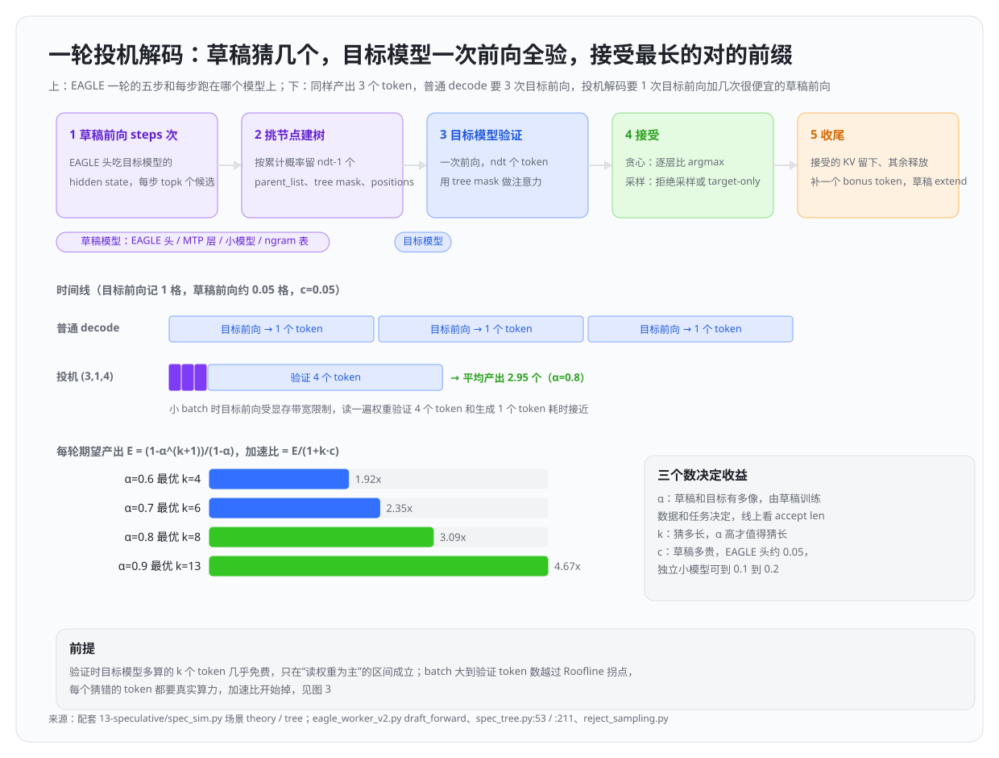
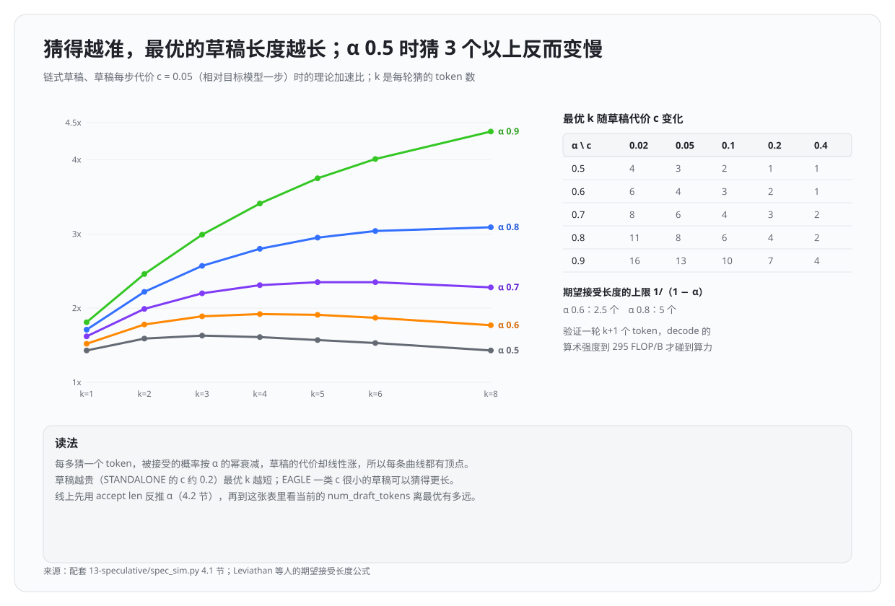
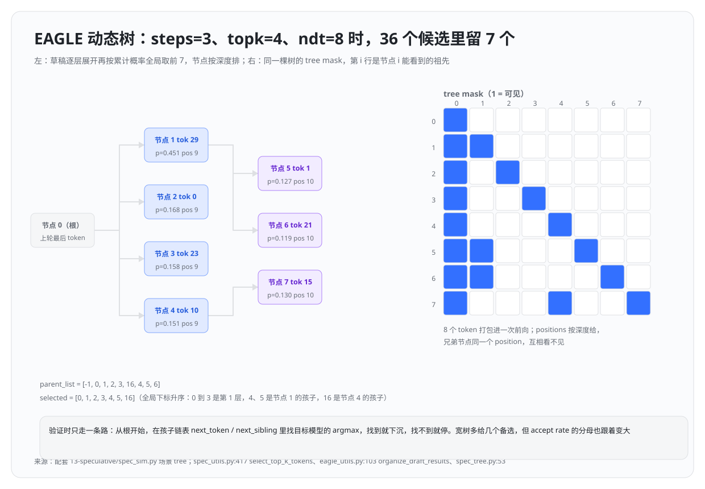
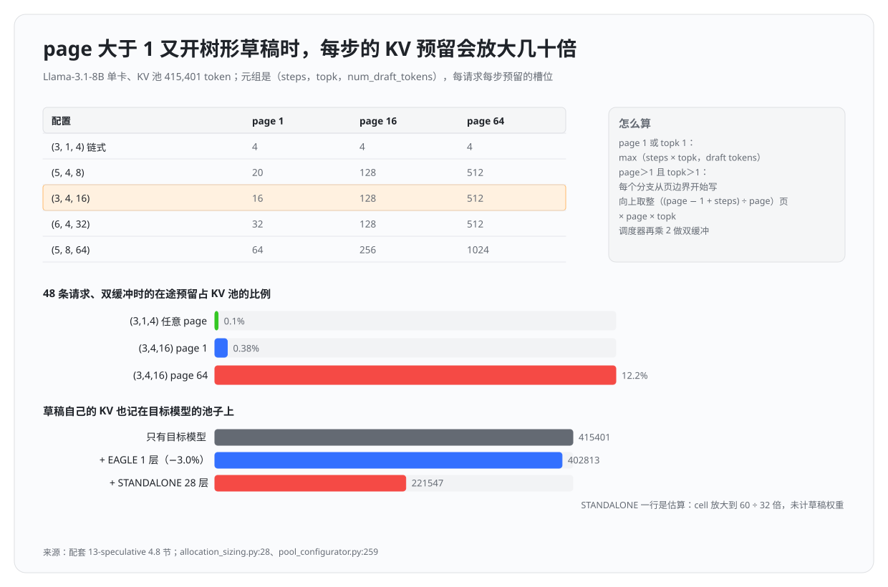
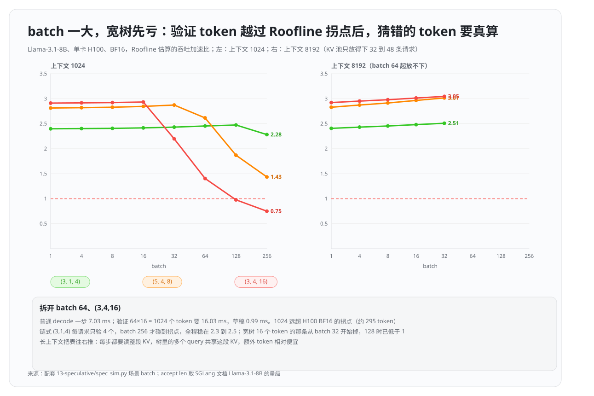
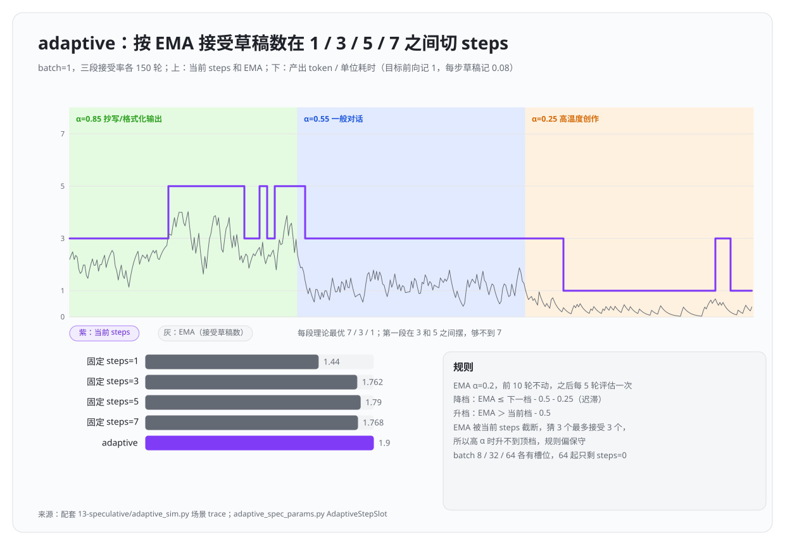
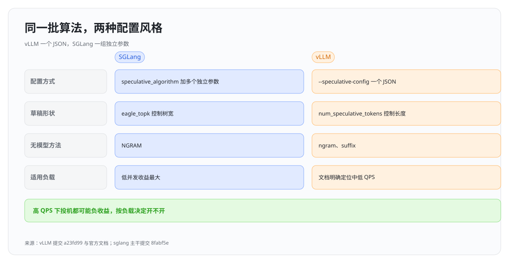
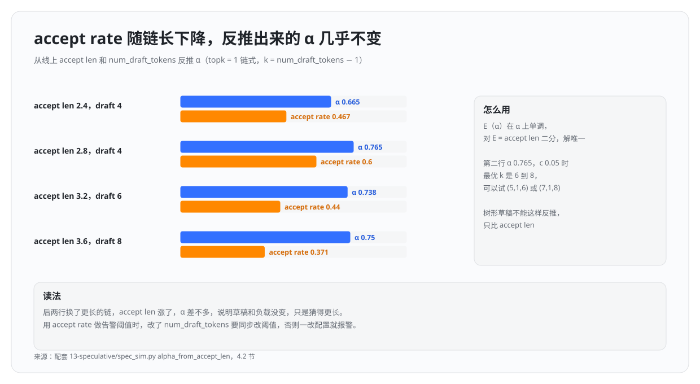

# SGL-13｜原理｜投机解码：EAGLE、MTP、NGRAM 怎么选、怎么调

> 🎯 **遇到的问题**：Llama-3.1-8B 单卡 H100，MT-bench 上 SGLang 不开投机解码是 158 token/s，换上 EAGLE-2 是 244，EAGLE-3 是 373[[1]](https://docs.sglang.io/docs/advanced_features/speculative_decoding)。这是 batch 1 的数。
>
> 同一套 3/4/16 参数，并发压到 64，Roofline 估算的加速比只剩 1.4 倍，压到 128 就低于 1，开了比不开慢。收益取决于三个数：草稿和目标模型有多像（接受率 α），一轮猜多长（k），草稿一次前向有多贵（c）。
>
> 前提是目标模型多验证几个 token 几乎不花钱，这只在读权重为主的小 batch 区间成立。Leviathan 和 Chen 在 2023 年几乎同时给出这套框架和无损证明[[2]](https://arxiv.org/abs/2211.17192)[[3]](https://arxiv.org/abs/2302.01318)，之后 Medusa、EAGLE 三代、MTP 都在回答同一个问题：草稿从哪来，怎么让 α 更高、c 更低。
>
> 这一篇从公式讲到 SGLang 的实现：验证规则怎样保证分布不变，EAGLE 动态树怎样建、怎样验，--speculative-\* 参数怎样被改写，KV 预留怎样随树形和 page size 放大，batch 多大时该关掉投机。
>
> **主线**：投机解码用便宜的草稿换昂贵的验证，只在读权重为主的小 batch 区间划算；接受率和验证成本决定它什么时候该开、什么时候该关。
>
> **读完这一篇**：能从 accept len 反推 α，判断 steps 离最优多远，看懂参数被改写、adaptive 被关、max running 被重置这几行日志。能按模型和负载在 EAGLE3、EAGLE、MTP、STANDALONE、NGRAM 之间选，给出参数起点，压测前估出加速比从哪个 batch 开始掉。
>
> **代码**：[zero-to-sglang/13-speculative](../13-speculative)。spec_sim.py 实现接受率和加速比公式、rejection sampling、树验证、和 SGLang 同布局的 EAGLE-2 动态树，以及 NGRAM 草稿。resolve_sim.py 移植 --speculative-\* 解析链和 KV 预留计算，adaptive_sim.py 移植 adaptive 投机的 EMA 和迟滞。只用标准库，行号按主干 8fabf5e 核对。

# 导读 · 结论先行

1. **一轮投机解码的收益只看三个数。**每轮期望产出 E = (1 − α^(k+1)) ÷ (1 − α)，加速比 = E ÷ (1 + k·c)。α=0.8、c=0.05 时 k=3 的加速比 2.57，k=8 是 3.09；α=0.6 时最优 k 只有 4，加速比不到 2。α 由草稿的训练数据和实际负载决定，线上从 accept len 反推；k 跟着 α 走，α 不高时猜长只是白算。
2. **正确的验证规则让输出分布和目标模型完全一样。**贪心时逐层比 argmax；采样时链式草稿用 rejection sampling（接受概率 min(1, p/q)），树形草稿用 target-only 规则（只看目标概率，按兄弟顺序做逆 CDF）。两个 threshold 参数调低以后会多接受，代价是输出分布变了，这一点文档写得很轻，模拟里 TV 距离从 0.002 跳到 0.30。
3. **EAGLE 的草稿是一棵按累计概率挑出来的树。**steps 是深度，topk 是每层展开的宽度，num_draft_tokens 是最后留下验证的节点数。topk=1 时树退化成链，num_draft_tokens 会被强制改成 steps+1。树越宽 accept len 越高，但 accept rate 的分母也跟着变大，两个指标不能横着比。
4. **SGLang 会悄悄改我们写的参数。**开投机以后 max_running_requests 默认降到 48，STANDALONE 和 NGRAM 还会关掉 mixed chunk。三个树参数要么全填要么全不填，只填一个会在 assert 上崩。adaptive 只认 EAGLE / EAGLE3 加 topk=1，组合不对只打一行 WARN 就退回静态参数。topk 大于 1 配 page 64 时，每个分支按整页预留，48 个请求吃掉 12% 的 KV 池。
5. **batch 大了先关宽树，再关投机。**验证 token 数 = batch × num_draft_tokens，越过 Roofline 拐点以后猜错的 token 要真金白银地算。Llama-3.1-8B 在 H100 上，链式 (3,1,4) 到 batch 256 还有 2.3 倍，宽树 (3,4,16) 在 batch 32 开始掉、128 时低于 1。adaptive 的默认配置在 batch 64 以上直接把 steps 设成 0，就是这个道理。



上半部分是 EAGLE 一轮的五步：草稿头吃目标模型最后几层的 hidden state，自回归地展开几层候选。按累计概率挑出 num_draft_tokens − 1 个节点组成一棵树。目标模型用 tree mask 一次前向验证整棵树。按贪心或采样规则找出被接受的最长路径。

保留接受路径的 KV、释放其余槽位，再补一个 bonus token，草稿模型拿接受的 token 做一次 extend，进入下一轮。下半部分是时间线：同样产出约 3 个 token，普通 decode 要 3 次目标前向，投机解码要 1 次目标前向加 3 次很便宜的草稿前向。图里的柱子是 E ÷ (1 + k·c) 在 c=0.05 时各 α 的最优加速比，4.1 节逐行算。

**📎 与系列其他文档的分工**：decode 为什么受带宽限制、Roofline 怎么算，见 [SGL-02｜上手｜推理账本：显存、KV 与 Roofline](./02-ledger.md)。验证时为什么能把一棵树塞进一次前向，靠的是 [SGL-10｜原理｜注意力后端：FlashInfer、FA3、Triton、TRTLLM 怎么选、怎么接进 CUDA Graph](./10-attention-backend.md) 讲的注意力后端对自定义 mask 的支持。CUDA Graph 为什么要按 batch 档位捕获，见 [SGL-09｜原理｜Overlap 调度与 CUDA Graph：把 CPU 开销藏到 GPU 后面](./09-overlap-cudagraph.md)，adaptive 的槽位就是按这些档位切的。KV 池和 page size，见 [SGL-07｜原理｜内存池与页表：req_to_token、token_to_kv 与 page size](./07-memory-pool.md)。草稿模型能不能量化，接着 [SGL-12｜原理｜量化：FP8、INT4 与 KV 量化怎么选](./12-quantization.md) 在 5.1 节说。

# 第 1 章 · 问题：同样开了投机解码，有人快 2 倍，有人变慢

线上常见的情形：

- batch 1 压测加速 2.5 倍，上线后并发 64，吞吐只比不开高一点，GPU 利用率反而更高了。
- 照文档写了 --speculative-eagle-topk 1 --speculative-num-draft-tokens 16，日志里出现一行 speculative_num_draft_tokens is adjusted，实际只验 4 个。
- 只写了 --speculative-eagle-topk 4，服务起不来，报 AssertionError。
- 开了 --speculative-adaptive，服务正常启动，steps 却一直不变，翻日志才看到 speculative_adaptive disabled。
- 开投机以后 max_running_requests 从几百掉到 48，排队变长，TTFT 变差。
- topk=4、page_size=64 的 DeepSeek 服务启动报 only supported on flashinfer, fa3, triton；换了后端能起，KV 池可用 token 少了一成多。
- 换了一个更宽的树，accept len 从 2.3 涨到 3.0，accept rate 从 0.42 掉到 0.13，我们一时不知道该看哪个。
- temperature 0.7 时 accept len 明显比 temperature 0 低；我们试过调低 accept threshold，accept len 上去了，输出风格也变了。
- NGRAM 在代码补全服务上加速 3 倍，同一配置放到闲聊服务上反而慢了。
- STANDALONE 用 1.5B 小模型当草稿，KV 池几乎少了一半。

这些现象落在五件事上：接受率和加速比的算术，验证规则和输出分布，草稿和树的结构，SGLang 的参数解析和 KV 预留，以及 batch 大小把验证成本从免费变成昂贵的那个拐点。下面按这个顺序讲。

| 想弄清的现象 | 看哪一节 |
|-|-|
| accept len、accept rate、α 是什么关系，k 该取多少 | 2.1、4.1、4.2 |
| 投机解码为什么不改变输出，threshold 调低改变了什么 | 2.2、4.3 |
| EAGLE、EAGLE-3、MTP、Medusa、STANDALONE、NGRAM 的草稿各从哪来 | 2.3、4.6 |
| steps、topk、num_draft_tokens 怎么决定一棵树，宽树为什么 accept rate 低 | 2.4、4.4 |
| 参数被改写、启动报错、adaptive 被关掉 | 2.5、4.7 |
| 开投机以后 KV 池少了多少，page size 为什么有影响 | 2.6、4.8 |
| 并发上来以后加速比为什么掉，长上下文为什么又好一些 | 2.7、4.5 |
| adaptive 怎么切 steps，为什么高接受率时升不到顶 | 2.8、4.9、4.10 |
| 给一个模型和一种负载，该选哪种投机 | 2.9 |

# 第 2 章 · 原理：猜、验、接受，以及什么时候不该猜

## 2.1 为什么能投机：decode 时算力闲着

decode 一步只给每个请求算一个 token，GEMM 的形状是 batch × hidden 乘 hidden × hidden，batch 小时算术强度只有 batch 那么大，远低于 H100 BF16 的拐点（989 TFLOPS ÷ 3.35 TB/s ≈ 295 FLOP/字节，对应每次读权重摊给约 295 个 token）[[4]](https://www.nvidia.com/en-us/data-center/h100/)[[5]](https://dl.acm.org/doi/10.1145/1498765.1498785)。

读一遍 16 GB 的权重算 1 个 token 和算 4 个 token，耗时几乎一样。投机解码就是利用这块闲置的算力：先用便宜的草稿猜 k 个 token，目标模型一次前向把这 k 个连同前缀一起算一遍，得到 k+1 个位置的分布，再按规则决定接受多少。

Leviathan 等人把收益写成了闭式[[2]](https://arxiv.org/abs/2211.17192)。假设每个草稿 token 被接受的概率都是 α，并且互相独立；第一个被拒的位置之后全部作废，但目标模型在那个位置的分布可以免费再采一个 token。于是一轮产出的 token 数是 1 + 接受的草稿数，期望为 E = 1 + α + α² + … + α^k = (1 − α^(k+1)) ÷ (1 − α)。

全部接受时还有一个 bonus token，所以 E 最大是 k+1。一轮的耗时是一次目标前向加 k 次草稿前向，以目标前向为单位记作 1 + k·c，加速比就是 E ÷ (1 + k·c)。Chen 等人在 Chinchilla 70B 上用同样的框架拿到 2 到 2.5 倍[[3]](https://arxiv.org/abs/2302.01318)。

这个公式有三个直接推论。α 是天花板：k 无穷大时 E 趋于 1 ÷ (1 − α)，α=0.6 最多 2.5 个 token，α=0.8 最多 5 个。k 有最优值：E 随 k 收益递减，成本随 k 线性增长，α=0.8、c=0.05 时最优 k=8，c 涨到 0.2 时最优 k 掉到 4。c 决定该用多大的草稿：独立的小模型 c 往往在 0.1 到 0.2，EAGLE 头只有一层 decoder，c 在 0.05 上下，MTP 层也差不多，所以它们能猜得更长。

SGLang 日志里的 accept len 就是 E：metrics_reporter 每隔一段时间把 spec_num_accept_tokens 除以 spec_num_forward_ct 打出来[（metrics_reporter.py:973）](https://github.com/sgl-project/sglang/blob/8fabf5e/python/sglang/srt/managers/scheduler_components/metrics_reporter.py#L973)，接受的 token 数包含 bonus。accept rate 的分母是每轮提出的草稿数 num_draft_tokens − 1，分子是被接受的草稿数，所以 accept rate = (E − 1) ÷ (num_draft_tokens − 1)，它总比 α 小：链越长，排在后面的草稿越难轮到。

Prometheus 上对应 sglang:spec_accept_length 和 sglang:spec_accept_rate[（metrics_collector.py:511）](https://github.com/sgl-project/sglang/blob/8fabf5e/python/sglang/srt/observability/metrics_collector.py#L511)[[6]](https://docs.sglang.io/docs/references/production_metrics)；每个请求的返回里也有 spec_accept_length = completion_tokens ÷ verify_ct[（tokenizer_manager.py:3164）](https://github.com/sgl-project/sglang/blob/8fabf5e/python/sglang/srt/managers/tokenizer_manager.py#L3164)。拿 accept len 和 k 解上面的方程，就能反推 α，4.2 节演示。



## 2.2 验证规则：怎样保证输出分布不变

贪心解码（temperature 0）最简单：目标模型在每个位置取 argmax，和草稿 token 比，相同就接受，不同就停，并用目标的 argmax 作为这个位置的输出。只要目标模型的前向是确定的，投机和不投机的输出逐 token 相同。

采样时要保证的是：每个位置输出 token 的分布严格等于目标分布 p。Leviathan 和 Chen 给出的规则是 rejection sampling：草稿按自己的分布 q 采出 x，以概率 min(1, p(x) ÷ q(x)) 接受；被拒时从残差 max(p − q, 0) 归一化以后补采一个[[2]](https://arxiv.org/abs/2211.17192)[[3]](https://arxiv.org/abs/2302.01318)。

可以验证这样得到的 x 服从 p，单步接受概率是 Σ min(p, q)，也就是 1 减去 p 和 q 的总变差距离。所以 α 衡量的就是草稿和目标有多像。SGLang 的实现在 chain_speculative_sampling_triton[（reject_sampling.py:242）](https://github.com/sgl-project/sglang/blob/8fabf5e/python/sglang/kernels/ops/speculative/reject_sampling.py#L242)，它要求草稿是一条链，--speculative-use-rejection-sampling 只能配 topk=1，ROCm 上默认打开。

链式 rejection 有一个浪费：第 2 个 token 被拒，后面第 3、4 个就算和目标完全一致也作废。Sun 等人的 block verification 把整段草稿当一个块来判断，计算每个前缀的累计比值 min（前一前缀 × p ÷ q, 1），从最长的前缀往短扫，第一个通过的整段接受，同样保证分布不变，并且被证明在所有逐 token 独立的验证规则里期望接受数最优，实测比逐 token 验证快 5% 到 8%[[7]](https://arxiv.org/abs/2403.10444)。

SGLang 用 --speculative-use-block-verification 打开，它会顺带把 use_rejection_sampling 设为真，贪心请求不受影响[[1]](https://docs.sglang.io/docs/advanced_features/speculative_decoding)。

EAGLE 的树形草稿用不了 rejection sampling：树里的候选是按草稿概率取 top-k 挑出来的，不是从 q 采样的，min(1, p/q) 的前提不成立。SGLang 在 temperature 大于 0、没开 rejection sampling 时走 TreeSpeculativeSamplingTargetOnly[（sampling.cuh:39）](https://github.com/sgl-project/sglang/blob/8fabf5e/python/sglang/kernels/jit/include/sgl_kernel/speculative/sampling.cuh#L39)，只看目标概率：同一层的兄弟按顺序把 p 累加进 prob_acc，抛一枚硬币 coin，coin ＜ prob_acc 时接受当前兄弟。

所有兄弟都没被接受，就把它们的 p 从目标分布里扣掉，从剩下的部分补采一个。这等价于对 p 按兄弟顺序做逆 CDF 采样，输出分布严格等于 p，单层接受概率是兄弟们的 p 之和。它和 rejection sampling 各有胜场：分布平坦时 Σ min(p, q) 更大，树要足够宽才追得上；分布尖锐（低 temperature）时目标的最大概率往往比 Σ min(p, q) 还高，target-only 占优。SpecInfer 最早系统地研究了树形草稿的多候选验证[[8]](https://arxiv.org/abs/2305.09781)。

两个 threshold 参数就作用在这条规则上[（sampling.cuh:81）](https://github.com/sgl-project/sglang/blob/8fabf5e/python/sglang/kernels/jit/include/sgl_kernel/speculative/sampling.cuh#L81)：接受条件写作 coin ＜ prob_acc ÷ threshold_acc 或 p(x) ≥ threshold_single。默认都是 1.0[（spec.py:109）](https://github.com/sgl-project/sglang/blob/8fabf5e/python/sglang/srt/arg_groups/fields/spec.py#L109)，第一项退化成上面的逆 CDF，第二项永远不成立。

调低以后两项都更容易满足，accept len 上去了，输出却不再服从 p，等于给目标分布加了一个偏向草稿的扭曲。帮助文本只写了 Lower values accept more aggressively，没写代价；4.3 节的模拟里，threshold_acc=0.5 让一元分布的 TV 距离从 0.0007 变成 0.30。

## 2.3 草稿从哪来：六种来源

SGLang 的 SpeculativeAlgorithm 枚举里有 EAGLE、EAGLE3、STANDALONE、NGRAM、FROZEN_KV_MTP、DFLASH、UNO、DSPARK 和 NONE[（spec_info.py:32）](https://github.com/sgl-project/sglang/blob/8fabf5e/python/sglang/srt/speculative/spec_info.py#L32)，命令行上的 NEXTN 是 EAGLE 的别名。按草稿来源分，主流的是下面几类。

**独立小模型（STANDALONE）**。同一家族的小模型当草稿，比如 Qwen2.5-7B 配 1.5B，文档给的参数是 4/2/7[[1]](https://docs.sglang.io/docs/advanced_features/speculative_decoding)。不用训练，拿来就用；代价是 c 大（1.5B 对 7B 约 0.2），而且草稿有完整的 KV，2.6 节会看到它让 KV 池明显缩水。目前不支持 DP attention。

**额外的预测头（Medusa）**。在目标模型最后一层 hidden state 上挂几个独立的头，第 i 个头直接预测第 i+1 个位置的 token，再把各头的 top-k 组合成树一起验证[[9]](https://arxiv.org/abs/2401.10774)。头很轻，但第 i 个头看不到前 i−1 个位置实际选了什么，越往后越不准，Medusa-1 报告 2.2 倍以上。SGLang 没有单独实现 Medusa，它的思路被 EAGLE 吸收了。

**特征层自回归（EAGLE）**。EAGLE 的观察是：在 token 层做自回归的不确定性太大，在倒数第二层的特征层做自回归更容易；草稿头是一层 decoder，输入是目标模型的特征加上向后错一位的 token embedding，输出下一个位置的特征，再用目标模型的 lm_head 出 token[[10]](https://arxiv.org/abs/2401.15077)。

错一位的 token 解决了采样带来的不确定性：同样的特征，采到不同 token，下一步该走的方向不同。LLaMA2-Chat 70B 上 2.7 到 3.5 倍。EAGLE-2 发现草稿的置信度和真实接受率高度相关，于是不用固定的静态树，按累计置信度动态地长树，再快 20% 到 40%[[11]](https://arxiv.org/abs/2406.16858)。--speculative-algorithm EAGLE 就是 EAGLE-2 的动态树。

**EAGLE-3**。EAGLE 的草稿头要拟合目标的特征，这个约束限制了它从更多训练数据里获益。EAGLE-3 去掉特征预测损失，直接预测 token。输入换成目标模型低、中、高三层特征的融合。训练时把草稿自己的输出喂回去多走几步（training-time test），让训练和推理时的输入分布一致。

论文报告最高 6.5 倍，比 EAGLE-2 再快约 1.4 倍[[12]](https://arxiv.org/abs/2503.01840)。SGLang 文档把它列为速度最好的选项，Llama-3.1-8B 的 373 token/s 就是它[[1]](https://docs.sglang.io/docs/advanced_features/speculative_decoding)。EAGLE-3 草稿要自己训或找社区训好的，SGLang 团队的 SpecForge 是配套的训练框架，直接按 SGLang 的推理路径训练，训出来的草稿可以直接加载[[13]](https://www.lmsys.org/blog/2025-07-25-spec-forge/)[[14]](https://github.com/sgl-project/SpecForge)。

**模型自带的 MTP 层**。Gloeckle 等人在预训练时让模型多预测几个未来 token，发现不仅训练样本效率更高，推理时还能拿这些头做自投机，4-token 预测的模型最多快 3 倍[[15]](https://arxiv.org/abs/2404.19737)。DeepSeek-V3 用了深度为 1 的 MTP 模块，在主干之后串一层 Transformer 预测下下个 token，技术报告说第二个 token 的接受率在 85% 到 90%，用于投机解码时 TPS 是 1.8 倍[[16]](https://arxiv.org/abs/2412.19437)。

SGLang 里 MTP 走 EAGLE 的流程：架构在 MTP 名单里（DeepseekV3、V32、V4、Glm4Moe、Bailing 等）时，草稿路径直接设成目标模型路径[（speculative_hook.py:1161）](https://github.com/sgl-project/sglang/blob/8fabf5e/python/sglang/srt/arg_groups/speculative_hook.py#L1161)，权重从同一个 checkpoint 里读 MTP 层，不需要另外下载草稿。

**无模型的 n-gram（NGRAM）**。不训练、不加载任何草稿：把已经出现过的 token 序列放进一棵 trie，用当前的后缀去匹配，把历史上紧跟在后面的 token 当草稿。代码改写、RAG 摘抄、带格式的结构化输出这类大段重复前文的负载，接受长度很高；全新的自由文本几乎匹配不上。SGLang 的实现是 C++ 的 trie[（ngram_worker.py:76）](https://github.com/sgl-project/sglang/blob/8fabf5e/python/sglang/srt/speculative/ngram_worker.py#L76)，只支持 CUDA，不支持 DP attention，会关掉 overlap 调度和 mixed chunk[[1]](https://docs.sglang.io/docs/advanced_features/speculative_decoding)。

**FR-Spec** 是 EAGLE-2 的一个附加选项，不改草稿的结构。大词表模型（Llama-3 有 12.8 万词）的草稿 lm_head 占了草稿前向的大头，FR-Spec 把草稿的输出限制在高频的 3.2 万个 token 上，lm_head 计算量降约 75%，比 EAGLE-2 再快 1.12 倍左右[[17]](https://arxiv.org/abs/2502.14856)。SGLang 用 --speculative-token-map 指向一个词表文件，草稿前向时用 hot_token_id 把小词表的下标映射回全词表[（eagle_worker_v2.py:763）](https://github.com/sgl-project/sglang/blob/8fabf5e/python/sglang/srt/speculative/eagle_worker_v2.py#L763)。EAGLE-3 的草稿自带裁剪过的词表，这个参数对它无效。

## 2.4 EAGLE 的动态树：steps、topk、num_draft_tokens



EAGLE-2 一轮的草稿分三步生成[[11]](https://arxiv.org/abs/2406.16858)。第一步，草稿头拿目标模型刚算出的 hidden state 和上一轮接受的最后一个 token，前向一次，取概率最高的 topk 个 token，作为树的第一层[（spec_utils.py:417）](https://github.com/sgl-project/sglang/blob/8fabf5e/python/sglang/srt/speculative/spec_utils.py#L417)。之后每一步，把上一层留下的 topk 个节点一起喂给草稿头，每个节点再展开 topk 个孩子，得到 topk² 个候选。

每个候选的分数是从根到它的路径上草稿概率的乘积，也就是累计置信度，从 topk² 个里按分数挑 topk 个作为下一步的输入[（spec_utils.py:438）](https://github.com/sgl-project/sglang/blob/8fabf5e/python/sglang/srt/speculative/spec_utils.py#L438)[（:474）](https://github.com/sgl-project/sglang/blob/8fabf5e/python/sglang/srt/speculative/spec_utils.py#L474)。走完 steps 步，一共产生 topk + (steps − 1)·topk² 个候选，steps=3、topk=4 时是 36 个。这一段是 draft_forward 的主循环[（eagle_worker_v2.py:763）](https://github.com/sgl-project/sglang/blob/8fabf5e/python/sglang/srt/speculative/eagle_worker_v2.py#L763)。

第二步是挑节点。organize_draft_results 把所有候选的累计分数拼成一行，全局取前 num_draft_tokens − 1 个，再把它们的下标升序排好[（eagle_utils.py:103）](https://github.com/sgl-project/sglang/blob/8fabf5e/python/sglang/srt/speculative/eagle_utils.py#L103)。因为候选是按层拼接的，升序排列天然就是按深度排列，父节点一定排在孩子前面。

这里有一个容易忽略的性质：一个节点被选中，它的祖先的累计分数一定更高（概率乘积只会越乘越小），所以也一定被选中，选出来的集合总是一棵连通的树。上图那棵树就是这么来的：36 个候选里，第一层 4 个全部入选，节点 1（概率 0.451）下面又挑了两个孩子，节点 4 下面挑了一个，第二层其他 9 个孩子的累计分数都不够。

第三步是把树编码成目标模型能吃的形式。build_tree_kernel_efficient 给每个节点算出三样东西[（spec_tree.py:53）](https://github.com/sgl-project/sglang/blob/8fabf5e/python/sglang/kernels/ops/speculative/spec_tree.py#L53)：position 按深度给，兄弟节点同一个 position。tree mask 的第 i 行是节点 i 和它所有祖先的位置，前缀部分全可见，所以节点之间只看得见自己那条路径。

再用 next_token / next_sibling 两个数组把树存成孩子兄弟链表，给验证用。整棵树作为 num_draft_tokens 个 token 打包进目标模型的一次前向，注意力后端按 mask 算，[SGL-10｜原理｜注意力后端：FlashInfer、FA3、Triton、TRTLLM 怎么选、怎么接进 CUDA Graph](./10-attention-backend.md) 讲过 FlashInfer、FA3、Triton 怎样支持这种自定义 mask。

贪心验证从根开始[（spec_tree.py:211）](https://github.com/sgl-project/sglang/blob/8fabf5e/python/sglang/kernels/ops/speculative/spec_tree.py#L211)：看目标模型在当前节点位置的 argmax，沿 next_token 找第一个孩子，沿 next_sibling 依次比较兄弟，找到和 argmax 相同的就下沉到这个孩子，找不到就停，当前节点的 argmax 就是 bonus token。采样验证用 2.2 节的 target-only 规则，按同样的链表顺序累加兄弟概率。SpecInfer 最早把多候选的 token 树和树形注意力放进一次验证[[8]](https://arxiv.org/abs/2305.09781)，EAGLE-2 的改进是树的形状随上下文变：草稿有把握的地方长得深，没把握的地方长得宽。

三个参数的含义因此很明确：steps 是树的最大深度，也是草稿前向的次数。topk 是每层的宽度。num_draft_tokens 是最后送去验证的 token 数，包括根。它们之间有两个约束。topk=1 时每层只有一个节点，树退化成一条链，候选只有 steps 个，num_draft_tokens 只能等于 steps + 1，SGLang 会把别的值改掉。topk 大于 1 时 num_draft_tokens 不能超过 steps·topk + 1，bench_speculative.py 遇到超出的组合直接跳过。

树宽带来的一个统计陷阱：accept rate 的分母是 num_draft_tokens − 1，可一轮最多只能接受一条路径，也就是最多 steps 个草稿。(3,4,16) 送了 15 个草稿去验证，就算每轮都接受满 3 个，accept rate 也只有 0.2。所以比较不同树形时只看 accept len（每轮产出），再配上每轮耗时；accept rate 只用于同一树形下的纵向对比，比如换了草稿模型、换了负载以后它是升是降。

## 2.5 参数解析链：写下的参数怎样被改写

--speculative-\* 的入口是 handle_speculative_decoding[（speculative_hook.py:124）](https://github.com/sgl-project/sglang/blob/8fabf5e/python/sglang/srt/arg_groups/speculative_hook.py#L124)，它在服务启动、模型配置读完以后执行，按下面的顺序改写参数。

1. **规范化算法名**。全部转大写，NEXTN 映射成 EAGLE；Gemma4 的 assistant 草稿会被提升为 FROZEN_KV_MTP[（:84）](https://github.com/sgl-project/sglang/blob/8fabf5e/python/sglang/srt/arg_groups/speculative_hook.py#L84)。所以日志和指标里看不到 NEXTN，只有 EAGLE。
2. **block verification 的前置检查**[（:178）](https://github.com/sgl-project/sglang/blob/8fabf5e/python/sglang/srt/arg_groups/speculative_hook.py#L178)。只支持 EAGLE、EAGLE3、DFLASH、DSPARK，打开它会顺带打开 use_rejection_sampling。
3. **adaptive 的可用性**[（:264）](https://github.com/sgl-project/sglang/blob/8fabf5e/python/sglang/srt/arg_groups/speculative_hook.py#L264)。adaptive_unsupported_reason 依次检查[（adaptive_spec_params.py:56）](https://github.com/sgl-project/sglang/blob/8fabf5e/python/sglang/srt/speculative/adaptive_spec_params.py#L56)：算法是 EAGLE 或 EAGLE3、用内置 worker、topk=1、没开 attention DP、没开 multi-layer EAGLE、没开 two-batch overlap、没开 pdmux。任何一条不满足，打一行 speculative_adaptive disabled 的 WARN，把 adaptive 设回 False，服务照常启动。
4. **按算法分派**。EAGLE、EAGLE3、STANDALONE 走 \_handle_eagle_family[（:1113）](https://github.com/sgl-project/sglang/blob/8fabf5e/python/sglang/srt/arg_groups/speculative_hook.py#L1113)，NGRAM 走 \_handle_ngram[（:1326）](https://github.com/sgl-project/sglang/blob/8fabf5e/python/sglang/srt/arg_groups/speculative_hook.py#L1326)，DFLASH、UNO、DSPARK、FROZEN_KV_MTP 各有自己的函数。

\_handle_eagle_family 是最常走的一支，里面依次发生这些事：

- 没显式给 --max-running-requests 时设成 48，并打一行 Max running requests is reset to 48 for speculative decoding[（:1134）](https://github.com/sgl-project/sglang/blob/8fabf5e/python/sglang/srt/arg_groups/speculative_hook.py#L1134)。原因是每个请求每步要预留 num_draft_tokens 量级的 KV 和验证 token，CUDA Graph 也要按 batch × num_draft_tokens 捕获，默认值压低是为了别一上来就把显存和图打爆。高并发服务要自己调回去，并接受 2.7 节说的验证成本。
- mixed chunk 只在算法支持时保留[（:1149）](https://github.com/sgl-project/sglang/blob/8fabf5e/python/sglang/srt/arg_groups/speculative_hook.py#L1149)，支持名单是 EAGLE、EAGLE3、DFLASH、DSPARK[（spec_info.py:147）](https://github.com/sgl-project/sglang/blob/8fabf5e/python/sglang/srt/speculative/spec_info.py#L147)，STANDALONE 会被关掉。
- 目标架构在 MTP 名单里（DeepseekV3、V32、V4、Glm4Moe、BailingMoe、MistralLarge3 等）且没给草稿路径时，草稿路径设成目标模型路径[（:1161）](https://github.com/sgl-project/sglang/blob/8fabf5e/python/sglang/srt/arg_groups/speculative_hook.py#L1161)。
- steps 为空时断言 topk 和 num_draft_tokens 也为空，然后自动选参[（:1201）](https://github.com/sgl-project/sglang/blob/8fabf5e/python/sglang/srt/arg_groups/speculative_hook.py#L1201)。这就是只写 --speculative-eagle-topk 4 会在启动时 AssertionError 的原因，报错信息里什么也不说。自动选参[（:1471）](https://github.com/sgl-project/sglang/blob/8fabf5e/python/sglang/srt/arg_groups/speculative_hook.py#L1471)：STANDALONE 是 (3,1,4)。LlamaForCausalLM 和 Grok 是 (5,4,8)。DeepSeek、GLM-4 MoE、GPT-OSS、Bailing、MiMo 这批大 MoE 是 (3,1,4)。其他架构一律 (3,1,4)。Qwen3 配 EAGLE3 什么都不填，拿到的是 (3,1,4)。
- trtllm_mha 后端只允许 topk=1[（:1217）](https://github.com/sgl-project/sglang/blob/8fabf5e/python/sglang/srt/arg_groups/speculative_hook.py#L1217)。ROCm 上没有 CUDA 的采样验证 kernel，不开 rejection sampling 的话 temperature 会被静默忽略，所以在支持的组合下默认打开 rejection sampling[（:1228）](https://github.com/sgl-project/sglang/blob/8fabf5e/python/sglang/srt/arg_groups/speculative_hook.py#L1228)。
- rejection sampling 只支持 EAGLE / EAGLE3，且要求 topk=1，否则 ValueError[（:1264）](https://github.com/sgl-project/sglang/blob/8fabf5e/python/sglang/srt/arg_groups/speculative_hook.py#L1264)。
- topk=1 而 num_draft_tokens 不等于 steps + 1 时，改成 steps + 1，打一行 speculative_num_draft_tokens is adjusted[（:1297）](https://github.com/sgl-project/sglang/blob/8fabf5e/python/sglang/srt/arg_groups/speculative_hook.py#L1297)。
- topk 大于 1 且 page_size 大于 1 时，注意力后端必须是 flashinfer、fa3、triton 之一[（:1309）](https://github.com/sgl-project/sglang/blob/8fabf5e/python/sglang/srt/arg_groups/speculative_hook.py#L1309)。树的每个分支在分页 KV 上要做两遍的 cascade draft-decode（共享前缀一遍，分支各自展开一遍，前缀最后一页要复制），flashmla 和 trtllm_mla 表达不了，直接报错。DeepSeek 默认 page 64 配 flashmla，想开宽树就得换后端，或者老实用 topk=1。

\_handle_ngram 简单得多：同样把 max_running_requests 设成 48。无条件关掉 mixed chunk。topk 设成 --speculative-ngram-max-bfs-breadth（默认 10）。num_draft_tokens 不填时设成 12 并打 WARN。steps 设成 num_draft_tokens ÷ topk。NGRAM 的 topk 和 steps 只是借用了这两个字段来描述匹配树的形状，含义和 EAGLE 不同。

## 2.6 KV 预留和池子：草稿的 KV 记在谁的账上

投机解码在 KV 上有两笔开销。第一笔是每步的在途预留：调度器在 decode 前要为每个请求预留这一步可能写入的 KV 槽位，大小由 get_alloc_len_per_decode 给出[（allocation_sizing.py:28）](https://github.com/sgl-project/sglang/blob/8fabf5e/python/sglang/srt/mem_cache/allocation_sizing.py#L28)，调度器再乘 2 做双缓冲。page_size=1 或 topk=1 时它是 max(steps·topk, num_draft_tokens)，(3,1,4) 是 4，(3,4,16) 是 16。

page 大于 1 且 topk 大于 1 时，每个分支的 KV 都要从页边界开始写，最坏情况占 ⌈(page − 1 + steps) ÷ page⌉ 页，topk 个分支各占一份，于是预留变成 页数 × page × topk。(3,4,16) 在 page 64 下每步预留 512 个槽位，是 page 1 的 32 倍；48 个请求、双缓冲，在途预留 49,152 个槽位，占 Llama-3.1-8B 单卡 KV 池的 12%。这部分槽位验证完会释放，但它压低了调度器认为可以接纳的请求数。

第二笔是草稿模型自己的 KV。EAGLE 和 STANDALONE 的草稿不另开一个由自己管理的池子，它的 KV 直接用目标模型分配器给出的下标存放：目标模型把某个 token 写进第 i 个槽位，草稿也写进自己那份的第 i 个槽位。所以 SGLang 在算池子大小时，把每 token 的 cell 按（目标层数 + 草稿层数）÷ 目标层数放大[（pool_configurator.py:259）](https://github.com/sgl-project/sglang/blob/8fabf5e/python/sglang/srt/model_executor/pool_configurator.py#L259)，源码注释里写明了前提：草稿每层的 KV 尺寸和目标一样，这对复用目标注意力配置的 EAGLE / MTP 草稿成立。

EAGLE 草稿只有 1 层，对 32 层的 Llama-3.1-8B 只贵 1/32，KV 池从 415,401 token 降到 402,813。STANDALONE 用一个 28 层的小模型当草稿时，cell 接近翻倍，KV 池几乎腰斩，这是第 1 章那个现象的来源。

草稿 KV 可以单独设 dtype：--speculative-draft-kv-cache-dtype[（spec.py:151）](https://github.com/sgl-project/sglang/blob/8fabf5e/python/sglang/srt/arg_groups/fields/spec.py#L151)，帮助文本举的例子是 5 层的 DFLASH 草稿 bf16 下每 token 10,240 字节，换 fp8_e4m3 减半，省下的显存要调高 --mem-fraction-static 才会变成 KV 池容量。草稿的权重也可以单独量化（--speculative-draft-model-quantization），[SGL-12｜原理｜量化：FP8、INT4 与 KV 量化怎么选](./12-quantization.md) 讲的方法都适用；草稿量化以后 α 会掉一点，c 会降一点，划不划算要用 4.1 节的公式算。



## 2.7 batch 和上下文：验证从免费变昂贵的拐点



2.1 节的前提是目标模型多验证几个 token 几乎免费。这在 batch 1 时成立：验证 16 个 token 的 GEMM 形状是 16 × hidden，算术强度 16，远在 Roofline 拐点左边，耗时由读权重决定。batch 上来以后，一次验证处理 batch × num_draft_tokens 个 token。batch 64、(3,4,16) 时是 1024 个 token，已经越过 H100 BF16 约 295 的拐点，GEMM 变成算力受限，耗时和 token 数成正比，那些注定被拒的草稿 token 每一个都要真实的算力[[5]](https://dl.acm.org/doi/10.1145/1498765.1498785)[[18]](https://www.databricks.com/blog/llm-inference-performance-engineering-best-practices)。

上图是 Llama-3.1-8B 单卡 H100 的 Roofline 估算，accept len 取 SGLang 文档的量级。链式 (3,1,4) 每请求只验 4 个 token，batch 256 时一次验证 1024 个 token 才碰到拐点，全程稳在 2.3 到 2.5 倍。(5,4,8) 到 batch 64 掉到 2.62，128 时 1.87。

(3,4,16) 在 batch 1 时最快（2.91），batch 32 开始掉，batch 128 降到 0.98，开了反而慢。拆开 batch 64 这一点：普通 decode 一步 7.03 ms，验证 1024 个 token 16.03 ms，草稿 0.99 ms，平均产出 3.4 个 token，折算加速比 1.40。

长上下文把拐点往右推。decode 每步除了读权重还要读整段 KV，8K 上下文下读 KV 的字节数和读权重相当甚至更多。树验证时同一个请求的多个 query 共享这段 KV，多验证几个 token 不增加读 KV 的量，额外的 token 相对更便宜，所以右图三条线都比左图高、都还在往上走。可惜单卡 KV 池只装得下约 48 条 8K 请求，batch 64 以上根本到不了，这部分图是空的。

这一节的结论可以直接当规则用：并发越高，num_draft_tokens 越要小，先从宽树退到链，再缩短链，最后关掉投机。验证 token 数 batch × num_draft_tokens 是个好用的尺子，越过两三百就要警惕。

## 2.8 adaptive：按接受率和 batch 自动切 steps



固定的 steps 只能对一种负载最优。--speculative-adaptive 让 SGLang 在运行时切 steps[[19]](https://docs.sglang.io/docs/advanced_features/adaptive_speculative_decoding)，规则在 adaptive_spec_params.py 里。默认配置按 batch 分四个槽位[（adaptive_spec_params.py:28）](https://github.com/sgl-project/sglang/blob/8fabf5e/python/sglang/srt/speculative/adaptive_spec_params.py#L28)：batch 1 起的槽位候选 [1,3,5,7]，8 起是 [0,1,3]，32 起是 [0,1]，64 起只有 [0]。

steps=0 就是不投机，所以默认配置在 batch 64 以上自动关掉投机，和 2.7 节的结论一致。--speculative-adaptive-config 可以传一个 JSON 覆盖这些候选和迟滞参数。

每个槽位是一个 AdaptiveStepSlot[（:153）](https://github.com/sgl-project/sglang/blob/8fabf5e/python/sglang/srt/speculative/adaptive_spec_params.py#L153)。它维护一个 EMA，记的是每个请求每轮接受了几个草稿（不含 bonus），平滑系数 0.2，大约记住最近 5 轮；初值是当前 steps − 1。前 10 轮 warmup 不动，之后每 5 轮评估一次[（:213）](https://github.com/sgl-project/sglang/blob/8fabf5e/python/sglang/srt/speculative/adaptive_spec_params.py#L213)：先尝试降档，EMA 不超过下一档 − 0.5 + down_hysteresis 就降一档，能连降。

没降的话再尝试升档，EMA 超过当前档 − 0.5 + up_hysteresis 就升一档，也能连升。batch 1 槽位的 down_hysteresis 是 −0.25，降档比升档多要求 0.25 的差距，防止在两档之间来回切。当前 steps 是 0 时没有接受数据可看，评估时直接试探下一档。

这套规则有一个偏保守的性质：EMA 记的接受草稿数被当前 steps 截断，猜 3 个最多接受 3 个。α=0.85 时，steps=3 的期望接受数是 2.18，steps=5 是 3.15，而从 5 升到 7 要求 EMA 超过 4.5，永远够不着。草稿很便宜、α 很高的负载（代码改写、格式化输出）上，adaptive 会停在 3 和 5 之间，到不了最优的 7。4.9 节的模拟里它仍然比任何固定 steps 都好，因为它跟住了接受率的变化；想更激进时，把候选改成 [3,5,7]，或者把 up_hysteresis 调成负数。

切换 steps 要配合 CUDA Graph。草稿和验证的图按 batch 档位和 steps 分别捕获，[SGL-09｜原理｜Overlap 调度与 CUDA Graph：把 CPU 开销藏到 GPU 后面](./09-overlap-cudagraph.md) 讲过 batch 先补齐到不小于它的图尺寸。adaptive 的路由也分两步[（:342）](https://github.com/sgl-project/sglang/blob/8fabf5e/python/sglang/srt/speculative/adaptive_spec_params.py#L342)：先把 batch 补齐到 CUDA Graph 尺寸，再找不超过这个尺寸的最大槽位。batch 9 补到 12，落进 8 号槽位；batch 33 补到 48，落进 32 号槽位。起始 steps 不在某个槽位的候选里时，构造函数取候选的中位数，所以 32 号槽位从 1 起步。每个槽位各自维护 EMA，batch 在档位间跳动时互不污染。

## 2.9 怎么选

把前面几节合起来，按模型和负载给一个起点。参数写成 (steps, topk, num_draft_tokens)。

| 场景 | 选什么 | 起点参数 | 要注意 |
|-|-|-|-|
| Llama-3.x、Qwen 等有社区 EAGLE-3 草稿的模型 | EAGLE3 | 低并发 (5,4,8)，并发过 32 用 (3,1,4) | Qwen3 自动选参给 (3,1,4)，低并发可以手动试宽树 |
| DeepSeek-V3/R1、GLM-4.5、Ling 等自带 MTP 的模型 | EAGLE（写 NEXTN 也一样），不填草稿路径 | (3,1,4)，接受率高可试 (4,1,5) | page 64 + flashmla 只能 topk=1 |
| 只有 EAGLE-1/2 草稿的老模型 | EAGLE | (5,4,8) 或文档的 (3,4,16) | 大词表加 --speculative-token-map 用 FR-Spec |
| 没有任何草稿，有同家族小模型 | STANDALONE | (3,1,4) 或文档的 (4,2,7) | KV 池按草稿层数缩水；c 大，猜短 |
| 代码改写、RAG 摘抄、结构化输出 | NGRAM | num_draft_tokens 12 到 16 | 只支持 CUDA；新文本负载上只剩开销 |
| 负载混杂、并发波动大 | EAGLE / EAGLE3 + --speculative-adaptive | topk=1，默认配置 | 组合不对会被静默关掉，看日志 |
| 平均并发 64 以上的吞吐型服务 | 先压测不开投机的基线 | 开的话 (2,1,3) 或 (3,1,4) | 验证 token 数越过拐点后加速比低于 1 |
| temperature 较高的创作类负载 | EAGLE3 + topk=1 + block verification | (3,1,4) | threshold 保持 1.0，不要用它换 accept len |

表里的参数只是起点，最终要用 bench_speculative.py 在自己的 prompt 和并发上扫一遍，这是 SGLang 源码和文档都推荐的做法[[1]](https://docs.sglang.io/docs/advanced_features/speculative_decoding)。4.11 节给出完整的命令。

## 2.10 vLLM 怎么做

vLLM 用一个 --speculative-config 的 JSON 配置投机解码，method 可选 ngram、draft_model、suffix、eagle、eagle3、MTP、dflash、dspark，num_speculative_tokens 定草稿长度[[20]](https://docs.vllm.ai/en/latest/features/speculative_decoding/)[[21]](https://github.com/vllm-project/vllm/blob/a23fd9903418de0e1d3757bb23e2f1697eb066f3/vllm/config/speculative.py)。

suffix decoding 用后缀树记录历史输出，树深默认 24，适合重复度高的 Agent 输出；parallel_drafting 让草稿模型一次出多个位置。验证用 standard 拒绝采样，草稿采样默认 greedy。官方文档给的定位是中低 QPS、受带宽限制的场景，高并发时收益会被额外计算吃掉。

SGLang 的算法集合与之相近，EAGLE、EAGLE3、NEXTN、STANDALONE、NGRAM、DFLASH、DSPARK 都在；树形草稿用 speculative_eagle_topk 控制宽度，speculative_num_steps 和 speculative_num_draft_tokens 控制深度和总数。参数更多意味着可调空间更大，也意味着默认配置离最优更远，换模型时要重新扫。

| 维度 | SGLang | vLLM | 差异的代价 |
|-|-|-|-|
| 配置方式 | speculative_algorithm 加多个独立参数 | --speculative-config 一个 JSON | SGLang 参数多，扫参空间大 |
| 草稿形状 | eagle_topk 控制树宽 | num_speculative_tokens 控制长度 | 树宽大接受率高，验证开销也大 |
| 无模型方法 | NGRAM | ngram、suffix | vLLM 的 suffix 对重复输出更友好 |
| 适用负载 | 低并发收益最大 | 文档明确定位中低 QPS | 高 QPS 下两边都可能负收益 |



# 第 3 章 · 源码走读：一轮 EAGLE 投机解码的 18 个落脚点

前 7 行是启动时的参数解析和内存规划，后 11 行是运行时一轮投机的路径。

| # | 位置 | 发生了什么 |
|-|-|-|
| 1 | [arg_groups/fields/spec.py:109](https://github.com/sgl-project/sglang/blob/8fabf5e/python/sglang/srt/arg_groups/fields/spec.py#L109) | threshold_single / threshold_acc。:129 attention_mode。:151 草稿 KV dtype。:237 adaptive |
| 2 | [speculative/spec_info.py:32](https://github.com/sgl-project/sglang/blob/8fabf5e/python/sglang/srt/speculative/spec_info.py#L32) | SpeculativeAlgorithm 枚举；:147 supports_mixed_chunk |
| 3 | [arg_groups/speculative_hook.py:124](https://github.com/sgl-project/sglang/blob/8fabf5e/python/sglang/srt/arg_groups/speculative_hook.py#L124) | handle_speculative_decoding：别名、block verification、adaptive、按算法分派 |
| 4 | [speculative_hook.py:1113](https://github.com/sgl-project/sglang/blob/8fabf5e/python/sglang/srt/arg_groups/speculative_hook.py#L1113) | \_handle_eagle_family：48、mixed chunk、MTP 路径、断言、自动选参、各种报错和改写 |
| 5 | [speculative_hook.py:1471](https://github.com/sgl-project/sglang/blob/8fabf5e/python/sglang/srt/arg_groups/speculative_hook.py#L1471) | \_auto_choose_speculative_params：按架构给 (5,4,8) 或 (3,1,4) |
| 6 | [mem_cache/allocation_sizing.py:28](https://github.com/sgl-project/sglang/blob/8fabf5e/python/sglang/srt/mem_cache/allocation_sizing.py#L28) | get_alloc_len_per_decode：每步每请求的 KV 预留，topk 大于 1 配大 page 时按整页乘分支数 |
| 7 | [model_executor/pool_configurator.py:259](https://github.com/sgl-project/sglang/blob/8fabf5e/python/sglang/srt/model_executor/pool_configurator.py#L259) | cell 按草稿层数放大，草稿 KV 和目标共用下标 |
| 8 | [speculative/eagle_worker_v2.py:1334](https://github.com/sgl-project/sglang/blob/8fabf5e/python/sglang/srt/speculative/eagle_worker_v2.py#L1334) | EAGLEWorkerV2；:1486 forward_batch_generation 是一轮的入口 |
| 9 | [eagle_worker_v2.py:982](https://github.com/sgl-project/sglang/blob/8fabf5e/python/sglang/srt/speculative/eagle_worker_v2.py#L982) | prefill 后草稿做 extend，拿到第一份 hidden state |
| 10 | [eagle_worker_v2.py:673](https://github.com/sgl-project/sglang/blob/8fabf5e/python/sglang/srt/speculative/eagle_worker_v2.py#L673) | draft：准备输入，调用 draft_forward |
| 11 | [eagle_worker_v2.py:763](https://github.com/sgl-project/sglang/blob/8fabf5e/python/sglang/srt/speculative/eagle_worker_v2.py#L763) | draft_forward：steps 次草稿前向；hot_token_id 把 FR-Spec 小词表映射回全词表 |
| 12 | [speculative/spec_utils.py:474](https://github.com/sgl-project/sglang/blob/8fabf5e/python/sglang/srt/speculative/spec_utils.py#L474) | select_top_k_tokens：第一层取 topk，之后从 topk² 里按累计分数取 topk |
| 13 | [speculative/eagle_utils.py:103](https://github.com/sgl-project/sglang/blob/8fabf5e/python/sglang/srt/speculative/eagle_utils.py#L103) | organize_draft_results：全局取前 ndt−1 个并升序；:141 构建树 |
| 14 | [kernels/ops/speculative/spec_tree.py:53](https://github.com/sgl-project/sglang/blob/8fabf5e/python/sglang/kernels/ops/speculative/spec_tree.py#L53) | 建树 kernel：position、tree mask、next_token / next_sibling |
| 15 | [eagle_worker_v2.py:2054](https://github.com/sgl-project/sglang/blob/8fabf5e/python/sglang/srt/speculative/eagle_worker_v2.py#L2054) | verify：目标模型一次前向验证整棵树 |
| 16 | [eagle_utils.py:538](https://github.com/sgl-project/sglang/blob/8fabf5e/python/sglang/srt/speculative/eagle_utils.py#L538) | eagle_sample：贪心、rejection、target-only 三选一 |
| 17 | [spec_tree.py:211](https://github.com/sgl-project/sglang/blob/8fabf5e/python/sglang/kernels/ops/speculative/spec_tree.py#L211) | 贪心验证 kernel；采样分支见 reject_sampling.py:242 和 sampling.cuh:39 |
| 18 | [eagle_worker_v2.py:1133](https://github.com/sgl-project/sglang/blob/8fabf5e/python/sglang/srt/speculative/eagle_worker_v2.py#L1133) | 验证后草稿用接受的 token 做 extend；指标在 metrics_reporter.py:973 汇总 |

我们读投机解码的源码，是从 forward_batch_generation 进去的[（eagle_worker_v2.py:1486）](https://github.com/sgl-project/sglang/blob/8fabf5e/python/sglang/srt/speculative/eagle_worker_v2.py#L1486)，顺着 draft、verify、draft extend 三个调用走一遍，每到一个张量就对照 4.4 节的模拟看它的形状：草稿阶段的张量是 batch × topk，建树以后是 batch × num_draft_tokens，验证以后按每个请求的接受长度变成不规则的形状。

投机解码的大部分复杂度来自最后这一步：每个请求接受的长度不一样，KV 释放、位置更新、下一轮草稿的输入都要按请求分别处理。v2 worker 把这些操作尽量放在 GPU 上，配合 overlap 调度，避免每轮一次 CPU 同步。

# 第 4 章 · 实验：在 CPU 上算接受率、验证分布、建树和解析参数

三个脚本分工如下。spec_sim.py 管算术和算法：接受率公式、几种验证规则、动态树、Roofline 加速比、NGRAM。resolve_sim.py 管启动时那条解析链和 KV 账。adaptive_sim.py 管运行时切 steps。公式和验证规则是按论文实现的，可以和理论值逐位对账。建树、解析链、KV 预留和 adaptive 是按 8fabf5e 的源码逐行移植的，结果应该和真实启动一致。Roofline 加速比是上限估算，看的是拐点在哪，不是绝对值。

## 4.1 α、k、c 和加速比

```bash
cd zero-to-sglang/13-speculative
python3 spec_sim.py
```

```text
每轮期望产出 token 数 E = (1-α^(k+1))/(1-α)（即 SGLang 日志里的 accept len）
  α \ k       1      2      3      4      5      6      8
  0.5      1.50   1.75   1.88   1.94   1.97   1.98   2.00
  0.6      1.60   1.96   2.18   2.31   2.38   2.43   2.47
  0.7      1.70   2.19   2.53   2.77   2.94   3.06   3.20
  0.8      1.80   2.44   2.95   3.36   3.69   3.95   4.33
  0.9      1.90   2.71   3.44   4.10   4.69   5.22   6.13

加速比 E/(k·c+1)，c=0.05（草稿一次前向约等于目标的 1/20，EAGLE 头的量级）
  α \ k       1      2      3      4      5      6      8   最优 k
  0.5      1.43   1.59   1.63   1.61   1.57   1.53   1.43       3
  0.6      1.52   1.78   1.89   1.92   1.91   1.87   1.77       4
  0.7      1.62   1.99   2.20   2.31   2.35   2.35   2.28       6
  0.8      1.71   2.22   2.57   2.80   2.95   3.04   3.09       8
  0.9      1.81   2.46   2.99   3.41   3.75   4.01   4.38      13

最优 k 随草稿成本 c 的变化（c 越大，越不该猜长）
  α \ c    0.02   0.05    0.1    0.2    0.4
  0.5         4      3      2      1      1
  0.6         6      4      3      2      1
  0.7         8      6      4      3      2
  0.8        11      8      6      4      2
  0.9        16     13     10      7      4
```

第一张表按行看是 α 的天花板：α=0.5 那一行到 k=8 也只有 2.00，再猜也没用。第二张表的最优 k 一栏说明 α 决定该猜多长：α 从 0.7 到 0.9，最优 k 从 6 翻到 13。第三张表是草稿成本的影响：同样 α=0.8，EAGLE 头这种 c=0.05 的草稿该猜 8 个，换成 c=0.2 的独立小模型只该猜 4 个。SGLang 的默认值 (3,1,4) 对应 k=3，从表里看它在任何 α 下都不是最优，它是一个在 α 不确定、batch 不确定时都不会太差的折中，4.5 节会看到它在大 batch 下最稳。

这个模型有两处简化，读表时要心里有数。其一，假设每个位置的接受概率相同且独立，实际上接受率随位置下降（草稿越往后误差越累积），所以真实的最优 k 比表里略小。其二，c 只计了草稿前向，没计建树、验证后整理 KV、草稿 extend 这些固定开销，它们在 batch 1 时占一轮耗时的一到两成。所以表格适合判断方向和量级，具体值以 4.11 节的压测为准。

## 4.2 从 accept len 反推 α

```text
从线上指标反推 α：accept len 是每轮产出 token 数，k = num_draft_tokens - 1（topk=1 链式）
  accept len  draft_tokens   反推 α   SGLang accept rate
         2.4             4    0.665        0.467
         2.8             4    0.765        0.600
         3.2             6    0.738        0.440
         3.6             8    0.750        0.371
```

alpha_from_accept_len 对 E(α) = accept len 做二分，E 在 α 上单调，所以解唯一。用法是：从服务日志读 accept len，用当前的 num_draft_tokens 反推 α，再回到 4.1 节的表看当前 k 离最优有多远。表里第二行 accept len 2.8、(3,1,4) 反推 α=0.765，最优 k 是 6 到 8，说明可以试 (5,1,6) 或 (7,1,8)；第三、四行换了更长的链，accept len 涨了，反推的 α 却差不多，说明草稿和负载没变，只是猜得更长。

accept rate 那一列演示了 2.1 节的结论：它随链长单调下降，0.60 到 0.37，而 α 几乎不变。线上用 accept rate 做告警阈值时，改了 num_draft_tokens，要同步改阈值。树形草稿不能这样反推，因为树的每层接受概率是多个兄弟的概率之和，和链式的 α 不是一回事；树形只比 accept len。



## 4.3 验证规则和输出分布

```bash
python3 spec_sim.py --scenario sampling
```

```text
词表 6，p = [0.35, 0.25, 0.15, 0.12, 0.08, 0.05]
          q = [0.2, 0.4, 0.1, 0.05, 0.15, 0.1]
单 token 接受率：rejection sampling 是 Σmin(p,q) = 0.73；target-only 只拿 q 的 top-1（token 1），接受率是 p[1] = 0.25

规则                                        一元 TV   二元 TV   每轮产出   每轮接受草稿
  链式 rejection sampling, k=3                  0.0016    0.0041       2.66          1.66
  block verification, k=3                     0.0016    0.0061       2.87          1.87
  target-only 树, 深 3 宽 1                      0.0019    0.0049       1.33          0.33
  target-only 树, 深 3 宽 3                      0.0007    0.0050       2.46          1.46
  target-only 树, 宽 3, threshold_acc=0.5       0.3011    0.4423       4.00          3.00
  target-only 树, 宽 3, threshold_single=0.3    0.2994    0.4390       4.00          3.00

参照：120000 个样本的 TV 抽样噪声在 0.005 上下。超过 0.03 的那两行，输出分布已经不是 p 了。
理论值：链式 k=3 的每轮产出 = (1-α^4)/(1-α) = 2.65；宽 1 树 = (1-0.25^4)/0.75 = 1.33；宽 3 树每层接受概率 = p[1]+p[0]+p[4] = 0.68

分布尖锐时（低 temperature 的常见情况）：p 的最大概率 0.86，q 的最大概率 0.7
  rejection sampling 接受率 Σmin(p,q) = 0.84，target-only top-1 接受率 = 0.86
```

实验用一个上下文无关的 6 词分布，好处是每条规则的理论值都能手算，和模拟逐位对账。每条规则生成 12 万个 token，统计一元和二元（相邻两个 token）的经验分布，和目标分布算总变差距离 TV。前四行的 TV 都在抽样噪声 0.005 以内，说明它们都是无损的；二元 TV 也在噪声里，说明接受与否没有在相邻 token 之间引入相关性。每轮产出和理论值对得上：链式 2.66 对 2.65，宽 1 树 1.33 对 1.33。

对比前四行能看出三件事。block verification 比逐 token 的 rejection 多接受 0.21 个草稿，和 Sun 等人的结论方向一致。target-only 宽 1 树只拿 q 的 top-1 去碰运气，这里 q 的 top-1 恰好是 p 里排第二的 token，接受率只有 0.25，比 rejection 差得多；宽到 3 以后每层接受概率涨到 0.68，追上了大半。最后一段换成尖锐分布，target-only 的接受率反而比 rejection 高，这就是低 temperature 下 EAGLE 树形验证表现好的原因。

最后两行是 threshold 调低的效果：每轮产出到了顶（4.00，每轮全部接受），TV 从 0.0007 跳到 0.30，相当于输出分布里三成的概率质量被挪了位置，挪到了草稿偏爱的 token 上[（sampling.cuh:81）](https://github.com/sgl-project/sglang/blob/8fabf5e/python/sglang/kernels/jit/include/sgl_kernel/speculative/sampling.cuh#L81)。线上它表现为风格变化、复读和多样性下降，而 accept len 指标看起来很漂亮。

## 4.4 动态树：建树、mask 和贪心验证

```bash
python3 spec_sim.py --scenario tree
```

```text
steps=3, topk=4, num_draft_tokens=8 的一棵树（seq_len=8）
  候选总数 topk + (steps-1)·topk² = 36，parent_list = [-1, 0, 1, 2, 3, 16, 4, 5, 6]
  selected（全局下标，升序）= [0, 1, 2, 3, 4, 5, 16]
  节点  token  父节点  深度  position   累计概率   mask 行
     0      根      -1     0         8          1   10000000
     1     29       0     1         9      0.451   11000000
     2      0       0     1         9      0.168   10100000
     3     23       0     1         9      0.158   10010000
     4     10       0     1         9      0.151   10001000
     5      1       1     2        10      0.127   11000100
     6     21       1     2        10      0.119   11000010
     7     15       4     2        10      0.130   10001001

40 条请求各生成 64 个 token，草稿噪声 σ=1.6，贪心验证
  (steps,topk,ndt)  每轮验证 token   accept len   accept rate   草稿前向/轮   和纯贪心一致
  (1,1,2)              2         1.55         0.548           1.0           是
  (3,1,4)              4         2.26         0.419           3.0           是
  (5,1,6)              6         2.31         0.261           5.0           是
  (5,4,8)              8         2.71         0.244           5.0           是
  (3,4,16)            16         3.01         0.134           3.0           是
  (6,4,32)            32         3.27         0.073           6.0           是
```

目标模型是一个确定性的 toy 语言模型，草稿是在它的 logits 上加高斯噪声得到的，噪声越大草稿越不像。draft_tree、organize_draft_results、build_tree 三个函数和 SGLang 的布局一致，可以拿上面的数逐项核对。parent_list 是每个候选的父节点在全局候选里的下标：前 4 个是第一层的父节点（-1 表示根，0 到 3 是 4 个第一层节点），后面是每一步选中的 topk 个节点在全局候选里的位置。

selected 里的 16 落在第二步的候选里，它的父节点是 parent_list 的第 16 ÷ 4 = 4 项再往前推一位，对应节点 4，所以节点 7 的 mask 行是 10001001。positions 从 seq_len 起按深度递增，8、9、10。

第二张表是这一节最重要的数。最后一列确认了贪心投机解码和纯贪心解码逐 token 一致，六种树形都一样，这是投机解码无损的直接证据。accept len 随树变宽变深单调上升，但收益递减：从链 (5,1,6) 到同样深度的宽树 (5,4,8)，accept len 从 2.31 涨到 2.71，多验证 2 个 token。

从 (3,4,16) 到 (6,4,32)，多验证 16 个 token 只多出 0.26。accept rate 一路从 0.548 掉到 0.073，这完全是口径造成的。(3,1,4) 到 (5,1,6) 几乎没涨，说明这个噪声水平下 α 不高，链再长也是白猜，和 4.1 节的最优 k 规律一致。

## 4.5 batch 和上下文

```bash
python3 spec_sim.py --scenario batch
```

```text
Llama-3.1-8B on H100 SXM，上下文 1024，Roofline 估算的吞吐加速比（>1 才划算；- 表示 KV 池 402,813 token 放不下这么多请求）
  (steps,topk,ndt) L          1      4      8     16     32     64    128    256
  (3, 1, 4)        2.8     2.40   2.40   2.41   2.42   2.43   2.45   2.47   2.28
  (5, 4, 8)        3.6     2.81   2.82   2.83   2.85   2.87   2.62   1.87   1.43
  (3, 4, 16)       3.4     2.91   2.92   2.92   2.93   2.20   1.40   0.98   0.75

Llama-3.1-8B on H100 SXM，上下文 8192，Roofline 估算的吞吐加速比（>1 才划算；- 表示 KV 池 402,813 token 放不下这么多请求）
  (steps,topk,ndt) L          1      4      8     16     32     64    128    256
  (3, 1, 4)        2.8     2.41   2.43   2.45   2.48   2.51      -      -      -
  (5, 4, 8)        3.6     2.83   2.87   2.91   2.96   3.01      -      -      -
  (3, 4, 16)       3.4     2.92   2.95   2.98   3.01   3.05      -      -      -

拆开看 batch=64、ctx=1024、(3,4,16)：普通 decode 一步 7.03 ms；验证 64x16=1024 个 token 16.03 ms，草稿 0.99 ms
```

forward_ms 取读字节时间和算力时间的较大者：字节是权重加上每个请求读一遍自己的 KV，算力按每 token 2 倍参数量的 FLOP 计。关键在 KV 那一项：树里的 num_draft_tokens 个 query 属于同一个请求，共享这个请求的前缀 KV，所以验证时 KV 字节数和 batch 成正比，和 num_draft_tokens 无关。

spec_round_ms 把一轮拆成三段：目标模型验证 batch × ndt 个 token，草稿 extend batch × (steps + 1) 个 token，再加 steps − 1 次每次 batch × topk 个 token 的草稿前向。草稿按 EAGLE-3 头 0.42B 参数计。L 列是每种树形采用的 accept len，取 SGLang 文档 Llama-3.1-8B 的量级。

读表看三处。batch 1 到 16 几乎是平的，这是读权重为主的区间，加速比约等于 L 除以一个接近 1 的成本，宽树最快。每条线开始掉的位置正好是 batch × ndt 越过约 295 的位置：(3,4,16) 在 batch 32（512 个 token），(5,4,8) 在 batch 64（512），(3,1,4) 在 batch 256（1024）。

8K 上下文那张表整体比 1K 高、而且随 batch 上升，因为读 KV 的固定成本把读权重的比重压低了，验证多出的 token 更显得便宜。真实系统里还有 attention kernel 对树形 mask 的额外开销、CUDA Graph 档位的补齐，真机上的拐点会比 Roofline 来得早一些。

## 4.6 NGRAM 的后缀匹配

```bash
python3 spec_sim.py --scenario ngram
```

```text
NGRAM：num_draft_tokens=12（_handle_ngram 的默认值），每轮最多 4 条分支
  输出类型       每轮产出 token   验证轮数 / 生成 token
  抄写型（改代码）              4.48              0.22
  全新文本                  1.00              1.00
```

ngram_draft 用当前输出的最后几个 token 去历史（prompt 加已生成部分）里找相同的后缀，把每处匹配后面紧跟的 token 当作一条分支，最多 4 条，总共不超过 12 个草稿 token，整体当作一棵树去验证。抄写型输出是在 prompt 的基础上做少量修改，大段内容和前文重复，每轮能接受 3.5 个草稿，验证轮数只有生成 token 数的 22%。

全新文本里找不到匹配，每轮只产出 bonus 那一个 token，等于每步多验证了一堆注定被拒的 token。SGLang 的实现用 C++ trie 记录历史[（ngram_worker.py:76）](https://github.com/sgl-project/sglang/blob/8fabf5e/python/sglang/srt/speculative/ngram_worker.py#L76)，支持 BFS 和按频率两种匹配方式，还可以用 --speculative-ngram-external-corpus-path 加载外部语料；原理和这里一样。

## 4.7 参数解析链

```bash
python3 resolve_sim.py
```

```text
Llama-3.1-8B + EAGLE3，什么都不填
  -> EAGLE3 steps=5 topk=4 draft_tokens=8 max_running=48 rejection=False adaptive=False
     WARN Max running requests is reset to 48 for speculative decoding.
     INFO auto params (5, 4, 8)
DeepSeek-V3 + NEXTN，什么都不填
  -> EAGLE steps=3 topk=1 draft_tokens=4 max_running=48 rejection=False adaptive=False
     INFO NEXTN -> EAGLE
     INFO draft_model_path <- model_path（MTP 层在目标 checkpoint 里）
     INFO auto params (3, 1, 4)
topk=1 却写 draft_tokens=16
  -> EAGLE steps=3 topk=1 draft_tokens=4 max_running=48 rejection=False adaptive=False
     WARN speculative_num_draft_tokens is adjusted to speculative_num_steps + 1 when speculative_eagle_topk == 1
只写 topk 不写 steps
  -> 启动失败 AssertionError: num_steps 为空时 eagle_topk 和 num_draft_tokens 也必须为空
rejection sampling + topk 4
  -> 启动失败 ValueError: --speculative-use-rejection-sampling requires --speculative-eagle-topk=1.
block verification，topk 1
  -> EAGLE3 steps=3 topk=1 draft_tokens=4 max_running=48 rejection=True adaptive=False
     INFO block verification -> use_rejection_sampling=True
topk 4 + page 64 + flashmla
  -> 启动失败 ValueError: speculative_eagle_topk > 1 with page_size > 1 is only supported on ('flashinfer', 'fa3', 'triton')
adaptive，默认配置
  -> EAGLE steps=3 topk=1 draft_tokens=4 max_running=48 rejection=False adaptive=True
     INFO adaptive: candidates [0, 1, 3, 5, 7], start steps=3
adaptive + steps 4
  -> 启动失败 ValueError: --speculative-num-steps=4 is not in the adaptive config candidate_steps [0, 1, 3, 5, 7].
adaptive + topk 4（被静默关掉）
  -> EAGLE steps=5 topk=4 draft_tokens=8 max_running=48 rejection=False adaptive=False
     WARN speculative_adaptive disabled: speculative_eagle_topk=4 (only topk=1 is supported). Falling back to static params.
NGRAM，什么都不填
  -> NGRAM steps=1 topk=10 draft_tokens=12 max_running=48 rejection=False adaptive=False
     WARN speculative_num_draft_tokens is set to 12 by default for ngram.
ROCm + EAGLE topk 1
  -> EAGLE steps=3 topk=1 draft_tokens=4 max_running=48 rejection=True adaptive=False
     INFO ROCm: enabling speculative_use_rejection_sampling by default.
```

输出是 16 条里挑出的 12 条，每条的 max_running=48 WARN 都省略了。有几条可以对照 2.5 节看。adaptive + topk 4 那条最隐蔽：命令行写了 --speculative-adaptive，服务正常启动，日志里只有一行 WARN，之后 steps 永远是 5；而且 adaptive 被关掉以后 steps 为空，走了自动选参，拿到的是 Llama 的 (5,4,8)。

adaptive + steps 4 直接报错，因为 adaptive 要求起始 steps 在候选并集 [0,1,3,5,7] 里。NGRAM 的 steps=1、topk=10 是 12 ÷ 10 取整得来的，和 EAGLE 的 steps 不是一个意思。ROCm 那条说明同一条命令在 AMD 卡上默认走的是 rejection sampling，和 NVIDIA 卡上的 target-only 不是同一套验证规则，两边的 accept len 不要直接比。

## 4.8 KV 预留和池子

```bash
python3 resolve_sim.py --scenario memory
```

```text
每个请求每步预留的 KV 槽位（get_alloc_len_per_decode，调度器再乘 2 做 double buffer）
  (steps,topk,ndt)     page=1  page=16  page=64
  (3, 1, 4)                 4        4        4
  (5, 4, 8)                20      128      512
  (3, 4, 16)               16      128      512
  (6, 4, 32)               32      128      512
  (5, 8, 64)               64      256     1024

Llama-3.1-8B 单卡 H100，KV 池：不开投机 415,401 token；EAGLE 1 层草稿摊进 cell 后 402,813 token（少 3.0%，即 1/33）
  48 个并发请求（投机解码默认的 max_running_requests）在途预留：
    (3, 1, 4)    page=1       384 token，占池子 0.10%
    (3, 1, 4)    page=64      384 token，占池子 0.10%
    (3, 4, 16)   page=1     1,536 token，占池子 0.38%
    (3, 4, 16)   page=64   49,152 token，占池子 12.20%
```

第一张表的规律：topk=1 时 page 大小完全不影响预留；topk 大于 1 时，预留由 topk × page 主导，和 num_draft_tokens 关系不大，(5,4,8)、(3,4,16)、(6,4,32) 在 page 64 下都是 512。

原因是每个分支最坏要占 ⌈(page − 1 + steps) ÷ page⌉ 页，steps 远小于 page 时这个数是 1 或 2，几乎是常数。第二部分把它换算成池子占比：链式配任何 page 都可以忽略，宽树配 page 64 吃掉 12%。池子少 3% 那一行验证的是草稿 cell 的放大系数：1 + 1/32 ≈ 1.031，415,401 ÷ 1.031 ≈ 402,813。

这两笔账合起来给出一条实用规则：DeepSeek 这类默认大 page 的模型，用 MTP 时保持 topk=1；非要宽树，就换到 flashinfer / fa3 / triton 后端，并且用 page 1 或 16，同时检查 max_total_num_tokens 是否还够。

## 4.9 adaptive 的轨迹

```bash
python3 adaptive_sim.py
```

```text
batch=1，草稿成本 c=0.08（每步草稿相当于目标前向的 8%），三段接受率各 150 轮
  轮次   α     当前 steps   EMA(接受草稿数)
     0  0.85        3         2.20
    65  0.85        5         3.19
   115  0.85        3         2.26
   125  0.85        5         2.66
   130  0.85        3         2.23
   135  0.85        5         2.24
   155  0.55        3         1.38
   325  0.25        1         0.35
   425  0.25        3         0.69
   435  0.25        1         0.18

  每段的理论最优 steps（候选 1/3/5/7）：α=0.85 -> 7，α=0.55 -> 3，α=0.25 -> 1

  策略         产出 token / 单位耗时
  固定 steps=1       1.440
  固定 steps=3       1.762
  固定 steps=5       1.790
  固定 steps=7       1.768
  adaptive           1.900
```

模拟把一次服务拆成三段负载：前 150 轮是抄写型（α=0.85），中间是一般对话（0.55），最后是高温度创作（0.25）。表里只列出 steps 发生变化的轮次。adaptive 从 3 起步，第一段在 3 和 5 之间来回摆，原因 2.8 节说过：EMA 被当前 steps 截断，升到 7 的阈值 4.5 够不着。

换到第二段，5 轮之内降回 3，正好是这一段的最优；第三段降到 1，中间偶尔被一段运气好的接受试探回 3，下一次评估又降回来。总效率 1.900，比最好的固定 steps（5，1.790）高 6%。差距不大，因为第一段它没到最优；负载切换越频繁、接受率差距越大，adaptive 的优势越明显。

## 4.10 adaptive 的槽位路由

```bash
python3 adaptive_sim.py --scenario route
```

```text
候选 steps 并集 [0, 1, 3, 5, 7]，起始 steps 取中位 = 3
  batch   补齐到 CUDA graph bs   槽位   该槽位候选 steps   初始 steps
      1              1               1   [1, 3, 5, 7]       3
      3              4               1   [1, 3, 5, 7]       3
      7              8               8   [0, 1, 3]          3
      9             12               8   [0, 1, 3]          3
     20             24               8   [0, 1, 3]          3
     31             32              32   [0, 1]             1
     33             48              32   [0, 1]             1
     64             64              64   [0]                0
    100            128              64   [0]                0
```

这张表回答了第 1 章里一个隐含的问题：开了 adaptive 以后，并发一高投机就没了，这是默认配置有意为之。batch 7 被补齐到 8，于是用的是 8 号槽位的候选 [0,1,3]，最多只猜 3 步。batch 31 补到 32，最多猜 1 步。batch 64 以上 steps 固定为 0，等同于不开投机。和 4.5 节对照，这套默认值对链式草稿偏保守（链式到 batch 256 还有 2 倍以上），对宽树又是合适的。想在高并发下保留投机时，自己写了 config 把 32 和 64 号槽位的候选放宽，再用 4.11 节的方法验证。

> 💡 **实验记录**：各场景都跑了一遍，又做了三个改动：在 spec_sim.py 的 scenario_tree 里把草稿噪声从 1.6 降到 0.8，看 (3,1,4) 和 (5,1,6) 的 accept len 差距怎么变，再用 4.2 节的方法从 (3,1,4) 的 accept len 反推 α，查表判断最优 k。在 resolve_sim.py 的 CASES 里加一条 DeepSeek-V3 + topk 4 + page 64 + fa3 的命令，确认它能启动，再用 scenario_memory 算它在 8 卡 H200 上的在途预留。在 adaptive_sim.py 里把 1 号槽位的候选改成 [3,5,7]、up_hysteresis 改成 −0.5，看第一段能不能升到 7、第三段会损失多少。命令和期望输出见 [README.md](../13-speculative/README.md)，边界用例见 [test_spec.py](../13-speculative/test_spec.py)。

## 4.11 在真机上校准

模拟给的是规则和拐点的位置，上线前在自己的卡、自己的 prompt 上量四样东西：解析结果、接受长度、加速比随并发的曲线、KV 池。

```bash
# 1. 解析结果：确认参数没被悄悄改掉
python3 -m sglang.launch_server --model-path meta-llama/Llama-3.1-8B-Instruct \
  --speculative-algorithm EAGLE3 \
  --speculative-draft-model-path jamesliu1/sglang-EAGLE3-Llama-3.1-Instruct-8B \
  --port 30000 2>&1 | tee server.log
grep -E "reset to 48|is adjusted|adaptive disabled|Mixed chunked prefill is disabled" server.log
grep "max_total_num_tokens" server.log          # 和不开投机的服务对比，差多少

# 2. 接受长度：日志、Prometheus、单请求三个口径
grep -o "accept len: [0-9.]*, accept rate: [0-9.]*" server.log | tail -5
curl -s localhost:30000/metrics | grep -E "sglang:spec_accept_(length|rate)"   # 需 --enable-metrics
#   单请求：返回的 meta_info.spec_accept_length = completion_tokens / spec_verify_ct

# 3. 扫参数：每组配置单独起一个服务，结果追加到 output.jsonl
python3 scripts/playground/bench_speculative.py \
  --model-path meta-llama/Llama-3.1-8B-Instruct \
  --speculative-algorithm EAGLE3 \
  --speculative-draft-model-path jamesliu1/sglang-EAGLE3-Llama-3.1-Instruct-8B \
  --batch-size 1 4 16 32 --steps 0 3 5 --topk 0 1 4 --num_draft_tokens 0 4 6 8 16
#   steps/topk/ndt 全为 0 的那组就是不开投机的基线

# 4. 加速比随并发：开关投机各起一个服务，用自己的数据压
python3 -m sglang.bench_serving --backend sglang --port 30000 \
  --dataset-name sharegpt --num-prompts 512 --max-concurrency 64
```

第 1 步的四个关键字对应 2.5 节的四次改写，一条都没有说明我们写的参数原样生效；max_total_num_tokens 和不开投机时的差应该接近 2.6 节的算法，差很多就去看草稿层数和草稿 KV dtype。第 2 步三个口径的定义见 2.1 节，日志里的 accept len 是一个统计周期内全部请求的平均，单请求的 spec_accept_length 适合按任务类型分桶，找出哪类 prompt 接受率低。拿到 accept len 以后用 4.2 节的方法反推 α，再决定第 3 步扫哪些参数。

第 3 步的 bench_speculative.py 是 SGLang 源码和文档都推荐的调参工具[（bench_speculative.py）](https://github.com/sgl-project/sglang/blob/8fabf5e/scripts/playground/bench_speculative.py#L1)[[1]](https://docs.sglang.io/docs/advanced_features/speculative_decoding)：它对每组 (batch, steps, topk, ndt) 起一个服务，把 max_running_requests 和 CUDA Graph 上限都设成 batch，发一批请求，把 acc_length、step_time、speed 写进 output.jsonl；steps × topk + 1 小于 ndt 的组合会被跳过。

它测的是静态 batch，适合找每个 batch 档位的最优树形。第 4 步用 bench_serving 在真实到达模式下压测[[22]](https://docs.sglang.io/docs/developer_guide/bench_serving)，--max-concurrency 分别取 1、4、16、64，开关投机两个服务各压一遍，画出加速比随并发的曲线，和 4.5 节的拐点对照。真机上的拐点通常比 Roofline 早，早得太多就用 profiler 看验证那次前向里注意力 kernel 的耗时[[23]](https://docs.sglang.io/docs/developer_guide/benchmark_and_profiling)，树形 mask 在某些后端上会退化成更慢的实现。

# 第 5 章 · 调过的参数和踩过的坑

## 5.1 动过的参数

| 参数 | 默认 | 管什么 | 什么时候动它 |
|-|-|-|-|
| --speculative-algorithm | 无 | EAGLE、EAGLE3、STANDALONE、NGRAM 等，NEXTN 等同 EAGLE[（spec.py:31）](https://github.com/sgl-project/sglang/blob/8fabf5e/python/sglang/srt/arg_groups/fields/spec.py#L31) | 按 2.9 节的表选；MTP 模型写 EAGLE 或 NEXTN |
| --speculative-draft-model-path | 无 | 草稿权重；MTP 架构不填时取目标模型路径 | EAGLE3 必须填社区或自训的草稿 |
| --speculative-num-steps / -eagle-topk / -num-draft-tokens | 全空，自动选参 | 树的深度、宽度、验证节点数[（spec.py:58）](https://github.com/sgl-project/sglang/blob/8fabf5e/python/sglang/srt/arg_groups/fields/spec.py#L58) | 三个一起写；topk=1 时 ndt 只能是 steps+1 |
| --speculative-accept-threshold-single / -acc | 1.0 | target-only 验证的接受门槛[（spec.py:109）](https://github.com/sgl-project/sglang/blob/8fabf5e/python/sglang/srt/arg_groups/fields/spec.py#L109) | 保持 1.0；调低会改变输出分布 |
| --speculative-use-rejection-sampling | False（ROCm 上自动开） | 链式草稿用 min(1, p/q) 验证 | 采样请求多、topk=1 时和 target-only 对比 accept len |
| --speculative-use-block-verification | False | 按块验证，顺带打开 rejection sampling[（spec.py:120）](https://github.com/sgl-project/sglang/blob/8fabf5e/python/sglang/srt/arg_groups/fields/spec.py#L120) | temperature 较高的 topk=1 服务 |
| --speculative-token-map | 无 | FR-Spec 的高频小词表 | EAGLE-2 草稿配大词表模型；EAGLE-3 不需要 |
| --speculative-adaptive / -adaptive-config | False / 无 | 运行时切 steps，JSON 覆盖槽位和迟滞[（spec.py:237）](https://github.com/sgl-project/sglang/blob/8fabf5e/python/sglang/srt/arg_groups/fields/spec.py#L237) | 负载混杂、并发波动大；只认 topk=1 |
| --speculative-draft-kv-cache-dtype | 跟随目标 | 草稿 KV 的存储格式[（spec.py:151）](https://github.com/sgl-project/sglang/blob/8fabf5e/python/sglang/srt/arg_groups/fields/spec.py#L151) | 多层草稿（STANDALONE、DFLASH）KV 占比大时 |
| --speculative-draft-model-quantization | 跟随目标 | 草稿权重的量化方法[（spec.py:216）](https://github.com/sgl-project/sglang/blob/8fabf5e/python/sglang/srt/arg_groups/fields/spec.py#L216) | 草稿前向成本 c 偏大时，测 α 掉多少再决定 |
| --speculative-attention-mode | prefill | 验证和草稿 extend 用 prefill 还是 decode 的注意力路径[（spec.py:129）](https://github.com/sgl-project/sglang/blob/8fabf5e/python/sglang/srt/arg_groups/fields/spec.py#L129) | profiler 显示验证注意力异常慢时对比 |
| --speculative-ngram-max-bfs-breadth | 10 | NGRAM 匹配树的最大分支数，也被借作 topk[（spec.py:256）](https://github.com/sgl-project/sglang/blob/8fabf5e/python/sglang/srt/arg_groups/fields/spec.py#L256) | 抄写型负载上和 num_draft_tokens 一起扫 |
| --max-running-requests | 开投机后 48 | 并发上限，决定在途 KV 预留和 CUDA Graph 档位 | 高并发服务显式调大，同时缩小树 |

参数的完整说明见 Server Arguments[[24]](https://docs.sglang.io/docs/advanced_features/server_arguments)。调参顺序上，投机解码排在量化和 KV 池之后、并发和 CUDA Graph 之前：先定模型精度，算出 KV 池能装多少 token，再决定树形，最后按树形重新确认 max_running_requests 和 cuda_graph_max_bs，整体流程见 Hyperparameter Tuning[[25]](https://docs.sglang.io/docs/advanced_features/hyperparameter_tuning)。树形改了以后 CUDA Graph 要按 batch × num_draft_tokens 重新捕获，启动时间和显存占用都会变，上线前要连同这两项一起量。

## 5.2 踩过的坑

> 💡 **踩过的坑**：三个树参数我们只写了一个。只写 --speculative-eagle-topk 4 会在 \_handle_eagle_family 的断言上崩，报错没有任何说明。现在要么三个都不写走自动选参，要么三个都写，写之前先用 resolve_sim.py 过一遍。

> 💡 **踩过的坑**：用 topk=1 配 num_draft_tokens 16。链式草稿只有 steps 个候选，ndt 会被改成 steps + 1，日志里只有一行 adjusted。要验 16 个 token，只能把 steps 设成 15，或者用 topk 大于 1 的树。

> 💡 **踩过的坑**：我们调低了 accept threshold 换 accept len。threshold_acc 0.5 时 accept len 到顶，输出分布的 TV 距离从 0.0007 变成 0.30。它改的是模型行为，跟速度无关，线上保持 1.0。

> 💡 **踩过的坑**：开了 --speculative-adaptive 就以为在自适应。topk 大于 1、开了 attention DP、two-batch overlap 或用 STANDALONE 时它会被静默关掉。现在启动后 grep 一次 adaptive disabled，再看 steps 有没有变过。

> 💡 **踩过的坑**：拿 batch 1 的加速比估线上吞吐。宽树在 batch 1 最快，batch 128 时开了比不开慢。后来按线上并发分布压测，算一下 batch × num_draft_tokens 有没有越过两三百。

> 💡 **踩过的坑**：拿 accept rate 比较不同树形。accept rate 的分母随 num_draft_tokens 变，(3,4,16) 满分也只有 0.2。现在跨树形只比 accept len 和每轮耗时，或者直接比 token/s。

> 💡 **踩过的坑**：我们的 STANDALONE 用了多层小模型，没看 KV 池。草稿 KV 和目标共用下标，cell 按层数放大，28 层草稿配 28 层目标，池子减半，最大并发跟着减半。现在上线前对比 max_total_num_tokens，必要时给草稿 KV 换 fp8。

> 💡 **踩过的坑**：在 DeepSeek 的 page 64 上开了宽树。flashmla 直接报错；换成 fa3 能起来，每个分支按整页预留，48 个请求吃掉一成多的 KV 池。后来 MTP 改用 topk=1 的链，accept len 已经足够高。

> 💡 **踩过的坑**：把 NGRAM 配给所有服务。它只在大段重复前文的负载上有用，全新文本上每轮只产出 bonus 一个 token，额外的验证 token 全是开销。后来按服务类型开，或者按请求类型分到不同的服务上。

> 💡 **踩过的坑**：拿 AMD 卡和 NVIDIA 卡的 accept len 直接比。ROCm 默认走 rejection sampling，CUDA 默认走 target-only，同一条命令两边的验证规则不同，接受长度也不同。

## 5.3 我们的看法

投机解码在 SGLang 里已经是一项工程上成熟的功能：验证规则无损，建树、验证、KV 整理都在 GPU 上，配合 overlap 调度没有每轮的 CPU 同步。它难用的地方在参数面：三个树参数、两个验证开关、adaptive、page size、后端之间有十几条约束，违反时有的报错、有的改写、有的静默关掉。我们的做法和量化那篇一样，先把命令喂给 resolve_sim.py，把结果和启动日志的那几行对上，再开始压测。推理引擎里最贵的错误是那些不报错的配置错误，这一篇的解析链就是典型。

草稿来源上，趋势已经很清楚：模型自带 MTP 或社区训好 EAGLE-3 草稿的，用它们；都没有的，花一两天用 SpecForge 训一个 EAGLE-3 头，比用独立小模型划算得多，因为 c 低一个量级，KV 池也几乎不缩水[[13]](https://www.lmsys.org/blog/2025-07-25-spec-forge/)。DeepSeek-V3 把 MTP 放进预训练以后，新发布的大模型越来越多地自带 MTP 层，草稿从哪来这个问题正在变成模型发布方的事。剩下要推理侧回答的，是在什么并发下用多长的链。推理模型的输出动辄上万 token，decode 占了绝大部分时间，投机解码在这类负载上的价值比在普通对话上大得多。

关于高并发，我们的判断是保守一些更好。Roofline 估算给的是上限，真机的拐点来得更早，而线上并发的波动会让一个固定树形在一天里的不同时段表现完全不同。topk=1 的链加 adaptive 是目前最稳的默认：低并发时猜长，高并发时自动退到 0。宽树留给延迟敏感、并发可控的服务，比如单用户的代码助手。无论哪种，我们上线前都有一条开关投机的加速比随并发曲线，没有这条曲线的投机配置不上生产。

# 第 6 章 · 上线核对和下一步

> 📌 **上线前逐条核对**
> - 在启动日志里 grep 过 reset to 48、is adjusted、adaptive disabled、Mixed chunked prefill is disabled，每一行的原因都查清了，最终参数和预期一致
> - 按目标并发显式设置过 max_running_requests，没有停在默认的 48
> - 和不开投机的服务对比过 max_total_num_tokens，差值和草稿层数、page size、topk 的估算对得上
> -  threshold_single 和 threshold_acc 都是 1.0；采样请求多时比较过 target-only 和 rejection / block verification 的 accept len
> - 用 accept len 反推过 α，当前 steps 落在 4.1 节表里最优 k 的附近
> - 用 bench_speculative.py 在目标 batch 档位上扫过 (steps, topk, ndt)，选出的树形在每个档位都不比基线慢
> - 用 bench_serving 在 1、4、16、64 等并发下开关投机各压过一遍，加速比低于 1 的区间有对应措施（缩树、adaptive 或关掉）
> - 把单请求的 spec_accept_length 按任务类型分过桶，找出了哪类 prompt 接受率低；告警阈值随 num_draft_tokens 同步调整

> 🔑 **学到的**：投机解码利用 decode 时闲置的算力：草稿猜 k 个 token，目标模型一次前向验证。每轮期望产出 E = (1 − α^(k+1)) ÷ (1 − α)，加速比 E ÷ (1 + k·c)，α 是天花板，最优 k 随 α 升高、随 c 降低。贪心逐层比 argmax，采样时链用 rejection sampling 或 block verification，树用 target-only 逆 CDF，都严格保持输出分布；两个 threshold 调低会让分布偏向草稿。EAGLE 的树按累计概率挑节点，steps 是深度、topk 是宽度、num_draft_tokens 是验证节点数，accept rate 的分母随树变大，跨树形只比 accept len。SGLang 的解析链会把并发压到 48、在 topk=1 时改写 ndt、在只填部分参数时断言失败、在组合不对时静默关掉 adaptive，topk 大于 1 配大 page 时只认 flashinfer、fa3、triton，KV 预留按整页乘分支数。草稿 KV 和目标共用下标，池子按草稿层数缩水。验证 token 数 batch × ndt 越过 Roofline 拐点以后加速比快速下降，所以并发越高树越小，adaptive 默认在 batch 64 以上关掉投机。

下一步：[SGL-14｜原理｜HiCache：显存、主机内存、远端存储三层 KV 缓存](./14-hicache.md) 讲 HiCache。前面几篇都假设 KV 只住在 GPU 显存里，显存一满，RadixAttention 的前缀缓存就只能驱逐。HiCache 把 KV 分层放到主机内存和远端存储，命中时再搬回来，多轮对话和长系统提示词的服务可以缓存远超显存的前缀。会讲三层缓存怎么组织、写回和预取怎么调度、什么时候搬运比重算更贵。

# 参考文献

按正文首次引用顺序编号，资料截至 2026 年 10 月底。源码以 sgl-project/sglang 主干提交 8fabf5e（2026 年 10 月 28 日）和 v0.5.22 发行版为准。

[1] SGLang 文档. Speculative Decoding [https://docs.sglang.io/docs/advanced_features/speculative_decoding](https://docs.sglang.io/docs/advanced_features/speculative_decoding)

[2] Leviathan Y, et al. Fast Inference from Transformers via Speculative Decoding. ICML (2023) [https://arxiv.org/abs/2211.17192](https://arxiv.org/abs/2211.17192)

[3] Chen C, et al. Accelerating Large Language Model Decoding with Speculative Sampling. arXiv (2023) [https://arxiv.org/abs/2302.01318](https://arxiv.org/abs/2302.01318)

[4] NVIDIA. H100 Tensor Core GPU 规格页 [https://www.nvidia.com/en-us/data-center/h100/](https://www.nvidia.com/en-us/data-center/h100/)

[5] Williams S, Waterman A, Patterson D. Roofline: An Insightful Visual Performance Model for Multicore Architectures. CACM (2009) [https://dl.acm.org/doi/10.1145/1498765.1498785](https://dl.acm.org/doi/10.1145/1498765.1498785)

[6] SGLang 文档. Production Metrics [https://docs.sglang.io/docs/references/production_metrics](https://docs.sglang.io/docs/references/production_metrics)

[7] Sun Z, et al. Block Verification Accelerates Speculative Decoding. arXiv (2024) [https://arxiv.org/abs/2403.10444](https://arxiv.org/abs/2403.10444)

[8] Miao X, et al. SpecInfer: Accelerating Large Language Model Serving with Tree-based Speculative Inference and Verification. ASPLOS (2024) [https://arxiv.org/abs/2305.09781](https://arxiv.org/abs/2305.09781)

[9] Cai T, et al. Medusa: Simple LLM Inference Acceleration Framework with Multiple Decoding Heads. ICML (2024) [https://arxiv.org/abs/2401.10774](https://arxiv.org/abs/2401.10774)

[10] Li Y, et al. EAGLE: Speculative Sampling Requires Rethinking Feature Uncertainty. ICML (2024) [https://arxiv.org/abs/2401.15077](https://arxiv.org/abs/2401.15077)

[11] Li Y, et al. EAGLE-2: Faster Inference of Language Models with Dynamic Draft Trees. EMNLP (2024) [https://arxiv.org/abs/2406.16858](https://arxiv.org/abs/2406.16858)

[12] Li Y, et al. EAGLE-3: Scaling up Inference Acceleration of Large Language Models via Training-Time Test. arXiv (2025) [https://arxiv.org/abs/2503.01840](https://arxiv.org/abs/2503.01840)

[13] LMSYS. SpecForge: Accelerating Speculative Decoding Training for SGLang. LMSYS Blog (2025-07-25) [https://www.lmsys.org/blog/2025-07-25-spec-forge/](https://www.lmsys.org/blog/2025-07-25-spec-forge/)

[14] sgl-project. SpecForge. GitHub [https://github.com/sgl-project/SpecForge](https://github.com/sgl-project/SpecForge)

[15] Gloeckle F, et al. Better & Faster Large Language Models via Multi-token Prediction. ICML (2024) [https://arxiv.org/abs/2404.19737](https://arxiv.org/abs/2404.19737)

[16] DeepSeek-AI. DeepSeek-V3 Technical Report. arXiv (2024) [https://arxiv.org/abs/2412.19437](https://arxiv.org/abs/2412.19437)

[17] Zhao W, et al. FR-Spec: Accelerating Large-Vocabulary Language Models via Frequency-Ranked Speculative Sampling. arXiv (2025) [https://arxiv.org/abs/2502.14856](https://arxiv.org/abs/2502.14856)

[18] Databricks. LLM Inference Performance Engineering: Best Practices (2023) [https://www.databricks.com/blog/llm-inference-performance-engineering-best-practices](https://www.databricks.com/blog/llm-inference-performance-engineering-best-practices)

[19] SGLang 文档. Adaptive Speculative Decoding [https://docs.sglang.io/docs/advanced_features/adaptive_speculative_decoding](https://docs.sglang.io/docs/advanced_features/adaptive_speculative_decoding)

[20] vLLM Docs. Speculative Decoding [https://docs.vllm.ai/en/latest/features/speculative_decoding/](https://docs.vllm.ai/en/latest/features/speculative_decoding/)

[21] vllm-project/vllm. vllm/config/speculative.py（a23fd99） [https://github.com/vllm-project/vllm/blob/a23fd9903418de0e1d3757bb23e2f1697eb066f3/vllm/config/speculative.py](https://github.com/vllm-project/vllm/blob/a23fd9903418de0e1d3757bb23e2f1697eb066f3/vllm/config/speculative.py)

[22] SGLang 文档. Bench Serving Guide [https://docs.sglang.io/docs/developer_guide/bench_serving](https://docs.sglang.io/docs/developer_guide/bench_serving)

[23] SGLang 文档. Benchmark and Profiling [https://docs.sglang.io/docs/developer_guide/benchmark_and_profiling](https://docs.sglang.io/docs/developer_guide/benchmark_and_profiling)

[24] SGLang 文档. Server Arguments [https://docs.sglang.io/docs/advanced_features/server_arguments](https://docs.sglang.io/docs/advanced_features/server_arguments)

[25] SGLang 文档. Hyperparameter Tuning [https://docs.sglang.io/docs/advanced_features/hyperparameter_tuning](https://docs.sglang.io/docs/advanced_features/hyperparameter_tuning)

---

上一章：[SGL-12｜原理｜量化：FP8、INT4 与 KV 量化怎么选](./12-quantization.md) · [目录](./README.md) · 下一章：[SGL-14｜原理｜HiCache：显存、主机内存、远端存储三层 KV 缓存](./14-hicache.md)
