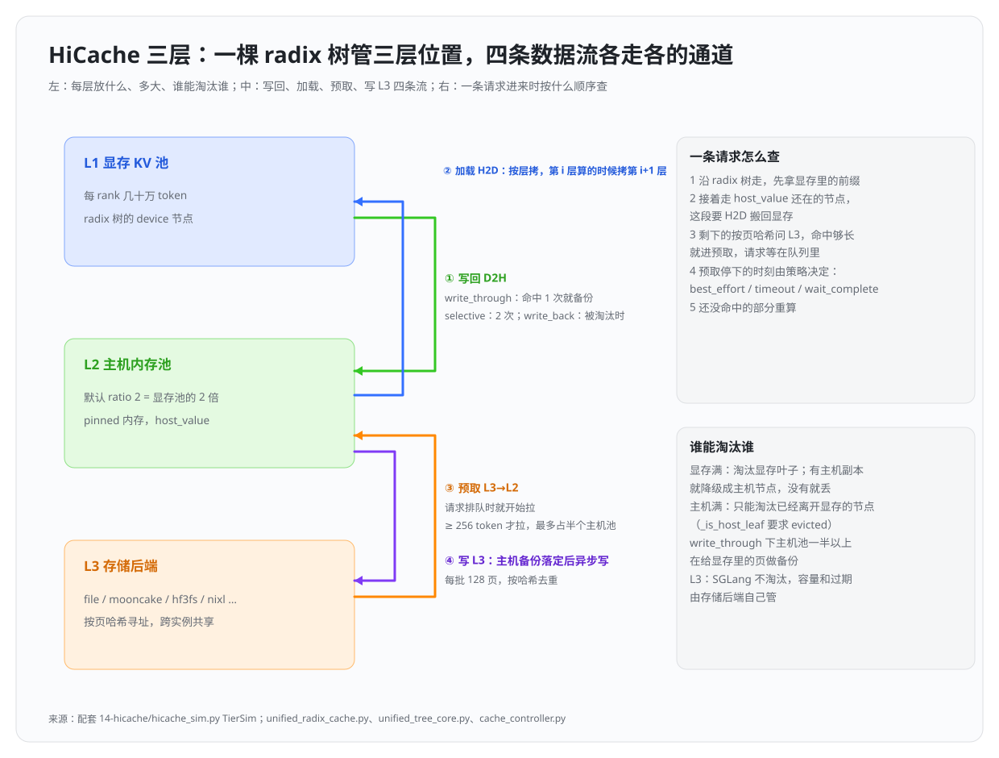
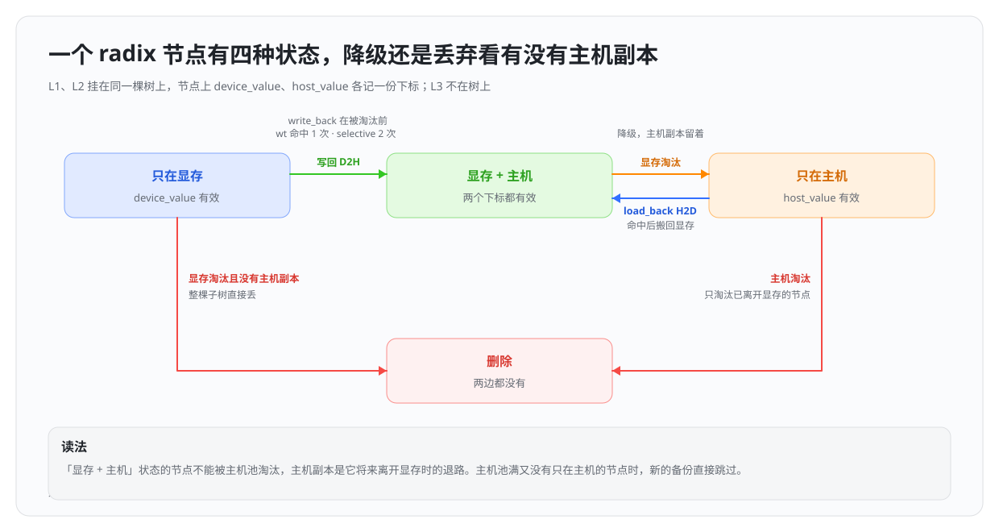
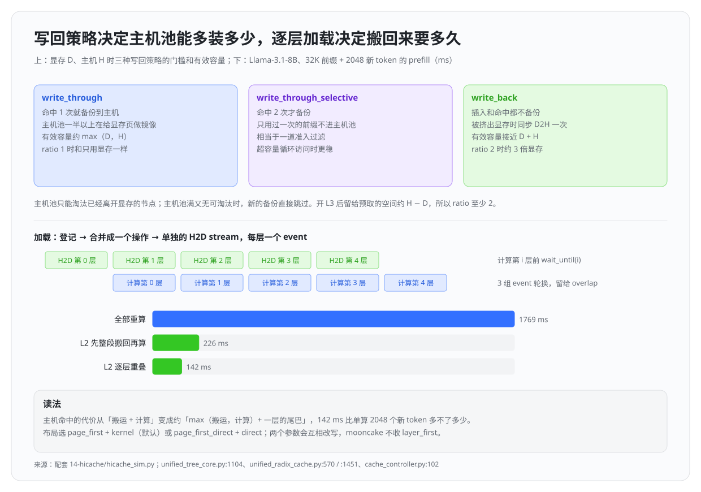
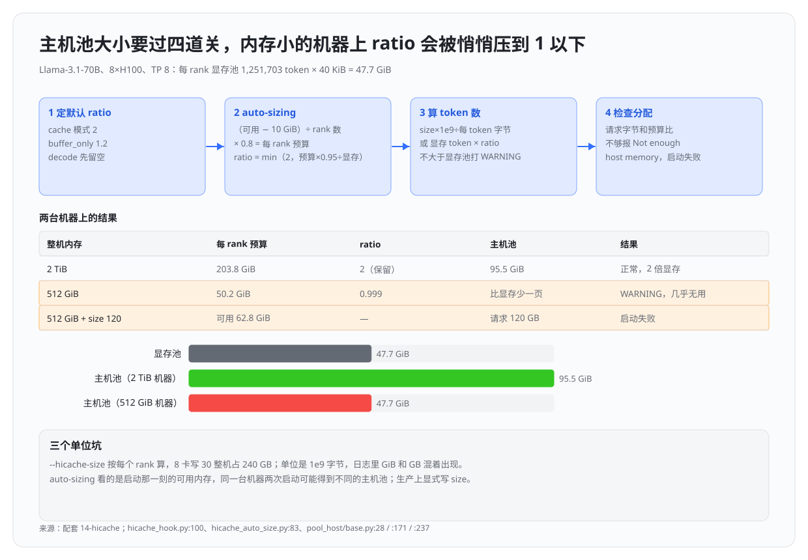
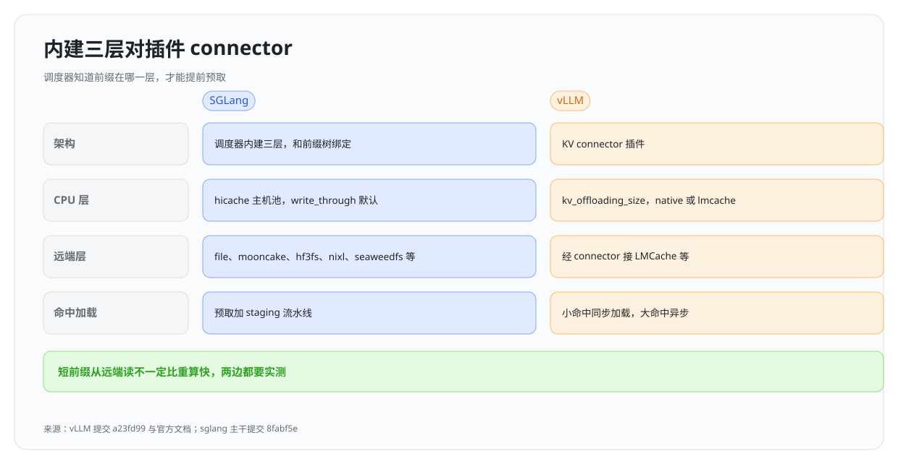
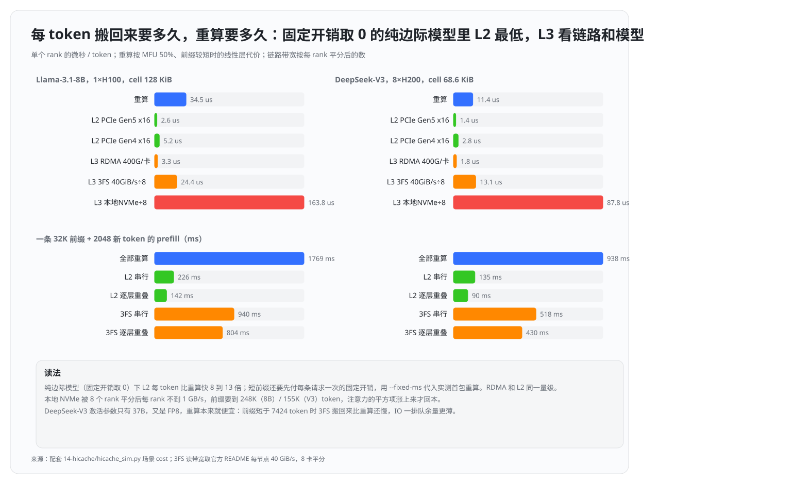
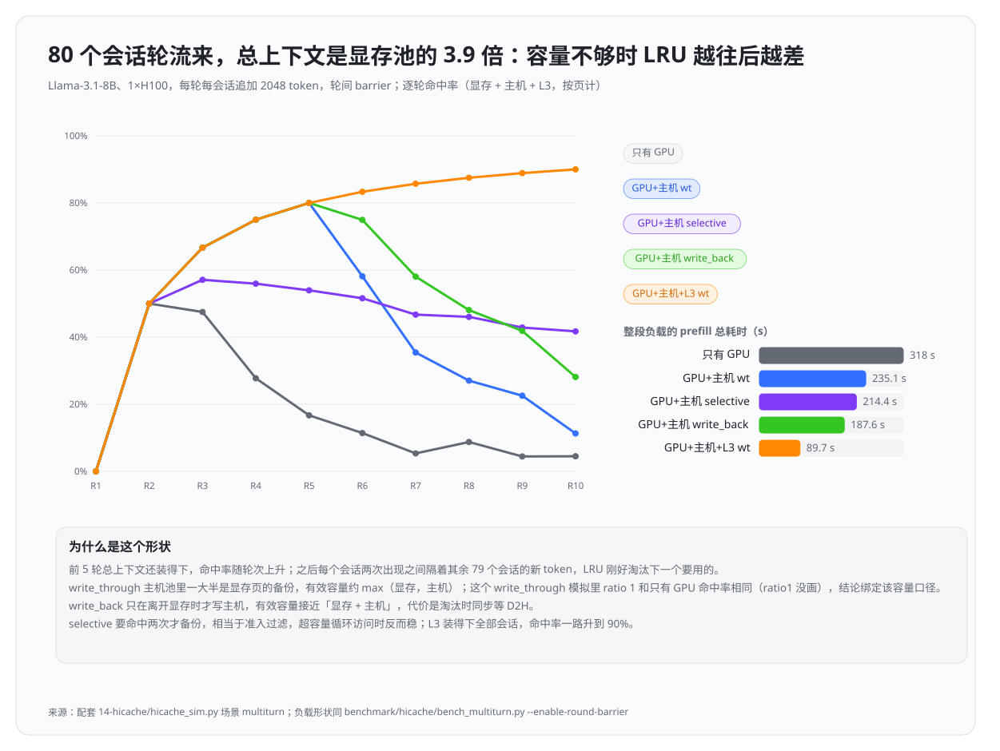
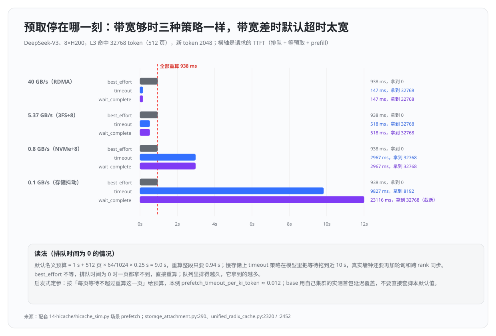

# SGL-14｜原理｜HiCache：显存、主机内存、远端存储三层 KV 缓存

> 🎯 **遇到的问题**：Llama-3.1-8B 单卡 H100，KV 池装得下 41.5 万 token，每个 token 的 KV 占 128 KiB。80 个会话轮流来，每轮各追加 2048 token，到第 10 轮所有上下文合计 164 万 token，是显存池的 3.9 倍。
>
> 只用显存，RadixAttention 的命中率从第 3 轮起一路往下掉，最后两轮只剩 4%，整段 prefill 算了 318 秒。加一个 2 倍显存大小的主机内存池，write_through 下是 235 秒，write_back 下是 188 秒。
>
> 再挂一层装得下全部会话的远端存储，第 10 轮命中率升到 90%，prefill 只要 90 秒。线上数字方向一致：Novita 给 Qwen3-Coder-480B 的编程 Agent 挂上 3FS，命中率从 40% 升到 80%，平均 TTFT 降 56%。
>
> 蚂蚁在 PD 分离的 DeepSeek-R1-671B 上，命中请求的 TTFT 降了 84%[[1]](https://www.lmsys.org/blog/2025-09-10-sglang-hicache/)。HiCache 的思路很简单，显存放不下的 KV 退到主机内存、再退到远端存储，命中时搬回来，比重算便宜。难处在于三层怎么组织才不浪费容量，写回和预取放在什么时刻才不拖慢请求，什么时候搬运反而比重算更贵。这一篇从原理讲到 SGLang 的源码和参数。
>
> **主线**：显存放不下的前缀退到主机和远端，命中时搬回来比重算便宜；难点在搬运的时机和成本，有时重算反而更快。
>
> **读完这一篇**：能算出每 token 搬运和重算各要多少微秒，判断 L2、L3 值不值得开。能说清三种写回策略下主机池的有效容量、为什么 write_through 下 --hicache-ratio 1 在本章容量口径里没有额外命中收益而 write_back 不是，看懂 auto-sizing 日志。能给预取定 timeout 的名义预算，知道换 TP、租户、节点后 L3 里的 KV 能否复用，上线后按缓存来源和预取未满足的指标定位问题。
>
> **代码**：[zero-to-sglang/14-hicache](../14-hicache)。hicache_sim.py 算四个模型的重算和搬运代价、回本前缀长度和逐层流水时延，用按页模拟的 TierSim 实现 GPU、主机、L3 三层和三种写回策略，另带多轮负载、预取停止策略和 L3 键名。resolve_sim.py 移植 HiCache 参数的解析链和主机池大小算法。只用标准库，行号按主干 8fabf5e 核对。

# 导读 · 结论先行

1. **三层用一棵 radix 树管。**树上每个节点记着自己的 KV 在显存（device_value）、主机内存（host_value）里各有没有一份；L3 不挂在树上，按页哈希寻址。请求来了先沿树走，拿显存前缀，再拿主机前缀（要 H2D 搬回），剩下的问 L3。L1 和 L2 是单个实例私有的，只有 L3 能跨实例、跨节点共享。
2. **写回策略决定主机池的有效容量。**write_through 命中 1 次就把页备份到主机，selective 要 2 次，write_back 只在页被挤出显存时才写。主机池只能淘汰已经离开显存的页，所以 write_through 下主机池有一份是显存的镜像，在这个模型的容量口径里有效容量约等于 max（显存，主机），ratio 1 没有额外命中收益；write_back 的有效容量接近显存加主机，代价是淘汰路径上要同步等 D2H。
3. **搬回来要和计算重叠。**H2D 按层拷，第 i 层算的时候拷第 i+1 层，主机命中的代价接近 max（搬运，计算）。L3 的预取在请求排队时就开始，排队时间越长，盖住的越多；排到它时还没拉完，按 best_effort、timeout、wait_complete 三种策略决定等不等。
4. **值不值得搬，看每 token 的两个数。**重算一个 token 约是 2 × 激活参数 ÷（算力 × MFU）加注意力项，搬运一个 token 是 KV 字节数 ÷ 链路带宽。这两个数只算纯带宽和纯算力，没算存储首包、排队和 kernel launch 这类固定开销：固定开销按整条请求收一次，前缀越短占比越大，所以下面的回本长度是固定开销取 0 时、长前缀下的渐近结论，一页以内的超短前缀要把固定开销加进来再比（配套脚本可以用 --fixed-ms 代入实测首包重算）。按这个纯边际模型，PCIe Gen5 的 L2 每 token 代价比重算小十倍以上，四个模型在 64 token 页粒度以上的回本长度都为 0，但这不是「开了就稳赚」的线上承诺。每节点 40 GiB/s 的 3FS 被 8 个 rank 平分后，稠密模型上仍然划算，DeepSeek-V3 这种 FP8、激活参数少的 MoE 要前缀长于 7424 token 才回本。本地 NVMe 平分后要几万到二十几万 token。
5. **默认值有几处要改。**预取 timeout 默认按每 1K token 给 0.25 秒，32K 前缀就是 9 秒，而重算整段只要 0.94 秒。--hicache-size 按每个 rank 算、单位是 1e9 字节。主机内存不够时 auto-sizing 会把 ratio 悄悄降到 1 以下。文件后端默认写本机的 /tmp/hicache，谈不上共享。官方的设计文档和最佳实践文档里各有一处和代码不一致，5.2 节点出来。



左边是三层：L1 是显存里的 KV 池，就是 RadixAttention 一直在用的那个。L2 是 pinned 主机内存里的一个池子，默认是显存池的 2 倍。L3 是外部存储，SGLang 只通过 get、exist、set 几个接口访问它。中间是四条数据流：① 写回把显存的页拷到主机（D2H），② 加载把主机的页搬回显存（H2D），③ 预取把 L3 的页拉进主机池，④ 主机备份落定以后异步写进 L3。右边是一条请求的查找顺序和两层各自的淘汰规则，2.2 到 2.5 节逐条展开。

**📎 与系列其他文档的分工**：本篇讲 GPU 显存之外的两层 KV：主机内存和远端存储。每 token 的 KV 字节数和 KV 池大小怎么算，见 [SGL-02｜上手｜推理账本：显存、KV 与 Roofline](./02-ledger.md)。KV 池、页表、page size，见 [SGL-07｜原理｜内存池与页表：req_to_token、token_to_kv 与 page size](./07-memory-pool.md)。radix 树的匹配、插入、LRU 淘汰，见 [SGL-08｜原理｜RadixAttention：基数树的匹配、插入、加锁与驱逐](./08-radix-attention.md)，这一篇在它上面加两层。TTFT 怎么压测，见 [SGL-03｜上手｜指标与压测：TTFT、TPOT、ITL 与 goodput](./03-bench.md)。KV 量化以后每 token 字节数减半，搬运代价跟着减半，见 [SGL-12｜原理｜量化：FP8、INT4 与 KV 量化怎么选](./12-quantization.md)。

# 第 1 章 · 问题：显存装不下的前缀，存起来还是重算

线上常见的情形：

- 多轮对话服务开了 radix cache，压测前几轮命中率很好看，会话一多、轮次一深，命中率掉到个位数，TTFT 跟着上去。
- 加了 --enable-hierarchical-cache --hicache-ratio 1，D2H 流量涨了很多，命中率和 TTFT 一点没变。
- 8 卡机器写了 --hicache-size 120，启动报 Not enough host memory available. Requesting 120.00 GB but only have 67.38 GB free，可整机明明有 512 GB 内存。
- 什么都没写，启动日志里出现 HiCache auto-sizing: ratio 2.000 -> 0.999，接着一行 smaller than the device pool; L2 cache effectiveness is reduced。
- 挂上远端存储以后，存储抖了一下，一批请求的 TTFT 从 1 秒跳到 10 秒。
- 换成 best_effort 以后 TTFT 不抖了，可 L3 的命中几乎看不到，storage_prefetch_unfulfilled_tokens_total 里 deadline 和 below_threshold 一直在涨。
- 主机池明明很大，挂 L3 以后 reason=「host_capacity」的未命中还是很多。
- 用文件后端做 L3，两个节点的实例互相看不到对方的缓存；本机 /tmp 越写越满。
- DeepSeek-V3 挂 3FS，短前缀请求的 TTFT 比不挂还高一点。
- 把 TP 从 4 改成 8 重启，L3 里攒了几天的缓存一个都没命中。
- mooncake 后端配了 --hicache-mem-layout layer_first，日志里提示被改成了 page_first；最佳实践文档说 page_first 配 direct 会切到 layer_first，实际切成了 page_first_direct。

这些现象落在五件事上：三层的组织和写回策略，搬运和计算怎样重叠，L3 的预取和停止策略，L3 的键和共享范围，以及主机池的大小怎么算出来。下面按这个顺序讲，最后用一个代价模型回答什么时候搬、什么时候算。

| 想弄清的现象 | 看哪一节 |
|-|-|
| 为什么只用显存时命中率随轮次往下掉 | 2.1、4.2 |
| 一棵树怎样管三层，请求按什么顺序查 | 2.2 |
| 三种写回策略的有效容量，ratio 1 为什么没用 | 2.3、4.2 |
| 主机命中为什么几乎不增加 TTFT，io backend 和内存布局怎么选 | 2.4 |
| 预取什么时候开始、什么时候停，默认 timeout 为什么太长 | 2.5、4.3 |
| L3 的键怎么算，换 TP、换租户、换节点能不能复用 | 2.6、4.4 |
| 主机池为什么比预期小，--hicache-size 的单位 | 2.7、4.6 |
| 哪条链路比重算便宜，前缀多长才回本 | 2.8、4.1 |
| 参数被改写、启动失败 | 4.5 |

# 第 2 章 · 原理：三层怎么放，什么时候搬，搬回来值不值

## 2.1 为什么要分层：前缀的工作集远大于显存

[SGL-08｜原理｜RadixAttention：基数树的匹配、插入、加锁与驱逐](./08-radix-attention.md) 讲过，RadixAttention 把算过的 KV 按前缀组织成一棵树，新请求和老请求共享的前缀直接复用。它的上限是显存：KV 池满了，LRU 把最久没用的叶子淘汰掉，被淘汰的前缀下次来只能重算。Llama-3.1-8B 每 token 的 KV 是 32 层 × 8 个 KV 头 × 128 维 × 2（K 和 V）× 2 字节 = 128 KiB，一张 H100 扣掉权重和激活后能放 41.5 万 token，也就是 12 个 32K 上下文的会话。多轮对话、编程 Agent、带长系统提示词的 RAG，活跃会话的前缀加起来常常是这个数的几倍到几十倍。

轮询式的多轮负载对 LRU 尤其不友好。80 个会话轮流来，一个会话两次出现之间，隔着其余 79 个会话这一轮新写入的 KV。总上下文没超过缓存容量时，命中率随轮次上升，第 k 轮的上限是 (k − 1) ÷ k，因为只有新追加的那 2048 个 token 要算；一旦超过容量，LRU 每次淘汰的恰好是最久没出现、也就是下一个要来的那个会话，命中率断崖式下降。4.2 节的模拟里，只用显存时第 3 轮总上下文 49 万 token 刚超过 41.5 万的池子，命中率从 50% 掉到 48%，之后一路掉到 4%。

解决办法是加容量。主机内存比显存大一个数量级而且便宜：一台 8 卡 H100 机器的显存是 640 GB，内存常配 1 到 2 TB；分布式存储再大两个数量级。CachedAttention 在 2024 年系统地做了这件事：多轮对话的 KV 存到主机内存和 SSD 组成的层级里，加载按层预取、保存异步执行，TTFT 降了 87%，prefill 吞吐提高 7.8 倍[[2]](https://arxiv.org/abs/2403.19708)。

Pensieve 把 GPU 和 CPU 内存组成两级缓存，按会话保存状态，吞吐是 vLLM 的 1.14 到 3 倍[[3]](https://arxiv.org/abs/2312.05516)。Mooncake 走得更远，把整个集群的 CPU 内存和 SSD 做成一个分布式 KV 池，以 KV cache 为中心调度 Kimi 的线上请求[[4]](https://arxiv.org/abs/2407.00079)。SGLang 的 HiCache 是同一条路线在一个通用推理引擎里的实现，设计文档把它比作 CPU 的三级缓存[[5]](https://docs.sglang.io/docs/advanced_features/hicache_design)。

## 2.2 三层结构：一棵树、两个池子、一个外部存储

L1 是显存 KV 池，也就是 [SGL-07｜原理｜内存池与页表：req_to_token、token_to_kv 与 page size](./07-memory-pool.md) 讲的 token_to_kv_pool，radix 树节点的 device_value 是它在池子里的下标。L2 是主机内存里的 HostKVCache[（pool_host/base.py:171）](https://github.com/sgl-project/sglang/blob/8fabf5e/python/sglang/srt/mem_cache/pool_host/base.py#L171)，一块 pinned 内存，按 page 管理，节点上对应的字段是 host_value。

两个池子挂在同一棵树上，所以一个节点有四种状态：只在显存（还没备份）、显存和主机各一份（备份过）、只在主机（被挤出显存但主机副本还在）、两边都没有（节点被删除）。SGLang 现在用 UnifiedRadixCache 统一管理这棵树，混合模型的 Mamba 状态、滑动窗口层也挂在同一棵树上[[6]](https://www.lmsys.org/blog/2026-08-11-unified-radix-cache)。

L3 不在树上。它是一个键值存储，键是页的哈希，值是这一页的 KV，SGLang 只调用 batch_exists、batch_get、batch_set 这几个接口，后端可以是本机文件、Mooncake、3FS、NIXL 等十几种[（fields/memory.py:148）](https://github.com/sgl-project/sglang/blob/8fabf5e/python/sglang/srt/arg_groups/fields/memory.py#L148)[[7]](https://github.com/kvcache-ai/Mooncake)[[8]](https://github.com/deepseek-ai/3FS)[[9]](https://github.com/ai-dynamo/nixl)。博客里说，给一个新存储写后端只要实现 get、exist、set[[1]](https://www.lmsys.org/blog/2025-09-10-sglang-hicache/)。

一条请求进来时，match_prefix 沿树往下走[（unified_radix_cache.py:625）](https://github.com/sgl-project/sglang/blob/8fabf5e/python/sglang/srt/mem_cache/unified_radix_cache.py#L625)：先拿到 device_value 有效的那一段，这段直接用。接着走 host_value 还在的节点，这段要 H2D 搬回显存，在调度这条请求时由 init_load_back 发起[（:3677）](https://github.com/sgl-project/sglang/blob/8fabf5e/python/sglang/srt/mem_cache/unified_radix_cache.py#L3677)。树走到头以后，剩下的 token 按页算哈希，问 L3 连续命中多少页，命中够长就发起预取，把这些页先拉进主机池，请求在等待队列里等着。最后还没命中的部分重算。

共享范围要分清：L1 和 L2 都是单个实例私有的，同一台机器上的两个实例也不能共用主机池，调大 --hicache-ratio 只是扩大自己的私有 L2；跨实例复用只能靠 L3，而且要所有实例用同一个后端和同一个命名空间[[10]](https://docs.sglang.io/docs/advanced_features/hicache_best_practices)。文件后端默认写本机的 /tmp/hicache，只能在本机的实例之间共享；Mooncake、3FS、NIXL 这类后端配好以后是集群范围。



## 2.3 写回：三种策略，三种有效容量

显存里的页什么时候拷一份到主机，由 --hicache-write-policy 决定。节点每被命中一次，\_inc_hit_count_and_check 给它的计数加一，达到门槛就发起备份[（unified_tree_core.py:1104）](https://github.com/sgl-project/sglang/blob/8fabf5e/python/sglang/srt/mem_cache/unified_cache/unified_tree_core.py#L1104)。

门槛在 write_through 下是 1，write_through_selective 下是 2[（unified_radix_cache.py:570）](https://github.com/sgl-project/sglang/blob/8fabf5e/python/sglang/srt/mem_cache/unified_radix_cache.py#L570)；write_back 在插入和命中时都不备份，等到这个节点要被挤出显存时，在淘汰路径上同步做一次备份，备份完再释放显存[（:1044）](https://github.com/sgl-project/sglang/blob/8fabf5e/python/sglang/srt/mem_cache/unified_radix_cache.py#L1044)。没有主机副本的节点被淘汰时，整棵子树直接丢弃[（unified_tree_core.py:1825）](https://github.com/sgl-project/sglang/blob/8fabf5e/python/sglang/srt/mem_cache/unified_cache/unified_tree_core.py#L1825)。

决定有效容量的是主机池的淘汰规则：evict_host 只能淘汰已经离开显存的节点[（unified_radix_cache.py:1451）](https://github.com/sgl-project/sglang/blob/8fabf5e/python/sglang/srt/mem_cache/unified_radix_cache.py#L1451)，\_is_host_leaf 要求节点的显存副本已经被释放[（unified_tree_core.py:2366）](https://github.com/sgl-project/sglang/blob/8fabf5e/python/sglang/srt/mem_cache/unified_cache/unified_tree_core.py#L2366)。道理很直接：显存里还在用的页，主机上那份是它将来被淘汰时的退路，删了就白备份了。主机池满了、又没有可淘汰的节点时，新的备份直接跳过[（unified_radix_cache.py:1798）](https://github.com/sgl-project/sglang/blob/8fabf5e/python/sglang/srt/mem_cache/unified_radix_cache.py#L1798)。

把这两条规则放在一起，三种策略的容量就算得出来。write_through 下，每个进了显存的页很快就有一份主机副本，主机池里有显存池那么大的一块在给显存里的页做备份，剩下的空间才留给只在主机的页。显存 D、主机 H，能缓存的不同页数约是 max（D，H）。ratio 1 时 H = D，主机池全是镜像，新请求的备份还会把刚降级的主机副本挤掉，在这个容量模型下命中率和只用显存相同，却白白多出大量 D2H 流量。

ratio 2 时多出一倍容量。write_back 下，主机池只装被挤出来的页，能缓存的不同页数接近 D + H，ratio 2 时是 3 倍显存。selective 的门槛相当于一个准入过滤器：只被用过一次的前缀不进主机池，在超容量的循环访问里反而比纯 LRU 稳。

挂上 L3 以后还有一笔账：L3 的预取要先落进主机池，write_through 下留给预取的空间最多是 H − D，最佳实践文档明确说，主机池不比显存池大时，L3 的命中会被丢掉、直接重算，reason=「host_capacity」的计数会涨[[10]](https://docs.sglang.io/docs/advanced_features/hicache_best_practices)。所以开 L3 时 ratio 至少要 2，主机内存够的话再往上加。

## 2.4 加载：按层搬回，和计算重叠

调度器决定让一条主机命中的请求进 batch 时，init_load_back 调 load_back[（unified_radix_cache.py:1881）](https://github.com/sgl-project/sglang/blob/8fabf5e/python/sglang/srt/mem_cache/unified_radix_cache.py#L1881)：先锁住这条路径，在显存池里分配同样多的槽位，把「主机下标 → 显存下标」包成一个 CacheOperation 放进 load_queue[（cache_controller.py:928）](https://github.com/sgl-project/sglang/blob/8fabf5e/python/sglang/srt/managers/cache_controller.py#L928)。这一步只登记，不拷贝。拷贝在 forward 开始前由 start_loading 发起[（:1028）](https://github.com/sgl-project/sglang/blob/8fabf5e/python/sglang/srt/managers/cache_controller.py#L1028)：这一批所有请求的加载合并成一个操作，提交到一条单独的 H2D stream 上，每拷完一层记一个 CUDA event。

计算那一侧的同步点藏在 KV 池的 get_key_buffer 里[（memory_pool.py:2852）](https://github.com/sgl-project/sglang/blob/8fabf5e/python/sglang/srt/mem_cache/memory_pool.py#L2852)。注意力后端每次取第 i 层的 K、V，都会先调 LayerDoneCounter.wait_until(i)[（cache_controller.py:102）](https://github.com/sgl-project/sglang/blob/8fabf5e/python/sglang/srt/managers/cache_controller.py#L102)，让计算 stream 等第 i 层的 event，前面几层已经到了的不用等。

于是第 i 层在算的时候，第 i+1 层在拷，主机命中的代价从「搬运 + 计算」变成大约「max（搬运，计算）+ 一层的尾巴」。LayerDoneCounter 里有 3 组 event 轮换[（:83）](https://github.com/sgl-project/sglang/blob/8fabf5e/python/sglang/srt/managers/cache_controller.py#L83)，是给 overlap 调度留的：上一个 batch 还在算，下一个 batch 的加载已经可以开始。CachedAttention 用的也是逐层预加载，论文里把它叫 layer-wise pre-loading[[2]](https://arxiv.org/abs/2403.19708)。

按 4.1 节的模型算，Llama-3.1-8B 一条 32K 前缀加 2048 个新 token：全部重算 1769 ms；从 PCIe Gen5 的主机池先整段搬回再算是 226 ms，逐层重叠以后 142 ms，比单算那 2048 个新 token 多不了多少。搬运远快于计算时，重叠省下的就是搬运本身；搬运慢于计算时，总时间是全部搬完加最后一层的计算，这时候该做的是提高链路带宽。

有两个参数决定每一层怎么拷。--hicache-io-backend 选拷贝方式：kernel 是 SGLang 自己写的 GPU 辅助拷贝 kernel，由 GPU 线程直接从 pinned 内存里按下标收集散落的页，设计文档给的数字是比 cudaMemcpyAsync 快到 3 倍[[5]](https://docs.sglang.io/docs/advanced_features/hicache_design)；direct 是逐段调 CUDA 的内存拷贝。--hicache-mem-layout 选主机池的内存布局，它同时影响 H2D 和 L3 两条路径：

- **layer_first**：和显存池一样，先按层再按 token 排。H2D 最顺，可是一页的 KV 分散在每一层各一段，写进 L3 要先拼起来。
- **page_first**：默认值。一页所有层的 KV 连在一起，能当一个对象零拷贝地交给 L3，博客里说这一项让 L3 读写快到 2 倍[[1]](https://www.lmsys.org/blog/2025-09-10-sglang-hicache/)。代价是 H2D 要按「一个 token 的一层」这么细的粒度收集，只有 kernel 能做得快，所以它只配 kernel。
- **page_first_direct**：页还是最外层，页里面再按层分组，同一层的 64 个 token 连在一起，H2D 可以按「一页的一层」整段拷，配 direct。最佳实践文档里 PD 分离的示例都用它[[10]](https://docs.sglang.io/docs/advanced_features/hicache_best_practices)。

两个参数会互相改写[（hicache_hook.py:171）](https://github.com/sgl-project/sglang/blob/8fabf5e/python/sglang/srt/arg_groups/hicache_hook.py#L171)：写了 page_first_direct 配默认的 kernel，io backend 被改成 direct。写了 --hicache-io-backend direct 配默认的 page_first，布局被改成 page_first_direct。

mooncake 后端不收 layer_first，按 io backend 改成 page_first 或 page_first_direct[（:197）](https://github.com/sgl-project/sglang/blob/8fabf5e/python/sglang/srt/arg_groups/hicache_hook.py#L197)。每次改写都有一行 WARN，4.5 节列出了全部组合。没有特别理由就用默认的 page_first + kernel；注意力后端或部署方式要求 direct 时，直接写 page_first_direct + direct。



## 2.5 L3 预取：排队时就开始拉，排到时决定等不等

L3 的读取和 L2 不一样，它慢，而且慢得不稳定，所以 SGLang 把它挪到请求排队的时间里。请求一进等待队列，\_add_request_to_queue 就调 \_prefetch_kvcache[（scheduler.py:3402）](https://github.com/sgl-project/sglang/blob/8fabf5e/python/sglang/srt/managers/scheduler.py#L3402)：在树上匹配完显存和主机两段以后，只要最后一个主机节点已经备份过（或者整条前缀都没命中、停在根上），就把剩下的 token 交给 prefetch_from_storage[（unified_radix_cache.py:2142）](https://github.com/sgl-project/sglang/blob/8fabf5e/python/sglang/srt/mem_cache/unified_radix_cache.py#L2142)。

这里有两道门槛：剩余长度按页向下取整后不到 prefetch_threshold（默认 256，至少一页）就不拉，计入 reason=「below_threshold」；在途预取占用的主机槽位不能超过主机池的一半，另一半留给写回[（cache_controller.py:628）](https://github.com/sgl-project/sglang/blob/8fabf5e/python/sglang/srt/managers/cache_controller.py#L628)，超出的部分计入 reason=「host_capacity」。

过了门槛，预取线程先问 L3 有多少：\_storage_hit_query 把剩余 token 按页算出哈希链，每 128 页一批调 batch_exists[（cache_controller.py:1308）](https://github.com/sgl-project/sglang/blob/8fabf5e/python/sglang/srt/managers/cache_controller.py#L1308)[（hicache_storage.py:24）](https://github.com/sgl-project/sglang/blob/8fabf5e/python/sglang/srt/mem_cache/hicache_storage.py#L24)，遇到第一个不命中的页就停，命中数只算连续的前缀。TP 的每个 rank 各问各的，再用 all_reduce 取最小值[（:1371）](https://github.com/sgl-project/sglang/blob/8fabf5e/python/sglang/srt/managers/cache_controller.py#L1371)，保证所有 rank 拉同样多的页，否则各 rank 树上的前缀长度会不一致。接着在主机池里分配槽位，按批调 batch_get 往里拷。

调度器每次组 prefill batch，对等待队列里的每条请求先问 check_prefetch_progress[（scheduler.py:4306）](https://github.com/sgl-project/sglang/blob/8fabf5e/python/sglang/srt/managers/scheduler.py#L4306)[（unified_radix_cache.py:2452）](https://github.com/sgl-project/sglang/blob/8fabf5e/python/sglang/srt/mem_cache/unified_radix_cache.py#L2452)：预取还没结束、又不允许现在停，这条请求就跳过，后面的请求照常进 batch。能不能停由 \_can_terminate_prefetch 决定[（:2356）](https://github.com/sgl-project/sglang/blob/8fabf5e/python/sglang/srt/mem_cache/unified_radix_cache.py#L2356)：

- **best_effort**：随时可以停。排到它时已经拉回多少就用多少，剩下的重算。从不让请求等，代价是排队时间短时几乎拿不到东西。
- **wait_complete**：必须拉完才放行。已经发起、且主机池装得下的预取会一直等到完成，存储一慢，请求就一直卡在队列里；它不绕过半池上限和 below_threshold 这些前置门槛。
- **timeout**：默认值。等到截止时间就停。计时从这条请求第一次因为预取没完而被拦下的那一刻开始[（:2320）](https://github.com/sgl-project/sglang/blob/8fabf5e/python/sglang/srt/mem_cache/unified_radix_cache.py#L2320)，不从入队算；各 rank 的时钟不一样，由 PP0 判断是否超时，再用 all_reduce 取 MAX，任何一个 rank 超时就全体停。超时停下的部分计入 reason=「deadline」。

截止时间按这次请求要预取的 token 长度线性给：timeout = prefetch_timeout_base + 页数 × page_size ÷ 1024 × prefetch_timeout_per_ki_token[（storage_attachment.py:290）](https://github.com/sgl-project/sglang/blob/8fabf5e/python/sglang/srt/mem_cache/unified_cache/storage_attachment.py#L290)。

这里的页数来自 prefetch_key 的长度（prefetch_length = len(prefetch_key)，unified_radix_cache.py:2293 写进 operation.stats_requested_tokens），是显存和主机两段都没命中、按页对齐后的整段待预取 span，不是 L3 实际命中的页数。

实际命中还要等 batch_exists 的哈希链返回，遇到第一个不命中的页就截断。两个系数从 --hicache-storage-backend-extra-config 里取，默认 1 秒和 0.25 秒[（hybrid_cache_controller.py:404）](https://github.com/sgl-project/sglang/blob/8fabf5e/python/sglang/srt/mem_cache/hybrid_cache/hybrid_cache_controller.py#L404)。

page 64、待预取 32K token 即 512 页时，名义预算 = 1 + 512 × 64 ÷ 1024 × 0.25 = 9 秒。同一段前缀在 DeepSeek-V3、8 卡 H200 上全部重算只要 0.94 秒。默认预算允许一条请求为了省 0.94 秒的计算，在队列里最多愿意等 9 秒。存储正常时它很少等满，存储抖动时 TTFT 会从 1 秒跳到 10 秒，这就是第 1 章那条现象的来历。

预算可以按重算代价来定，作为一个启发式：让每页的名义等待预算不超过「重算这一页」的时间，再加一个覆盖存储首包的 base。写成系数就是 prefetch_timeout_per_ki_token ≈ 1024 × 每 token 重算时间（秒）。DeepSeek-V3 每 token 重算 11.4 微秒，per_ki ≈ 0.0117；Llama-3.1-8B 单卡是 34.5 微秒，per_ki ≈ 0.035。base 取一个调度周期的量级，同机房的分布式存储可以先按 0.05 到 0.2 秒设，再用实测首包覆盖。

要强调的是，这个系数只是调度器「愿意为预取额外等多久」的名义预算，不是整条 TTFT 的硬上界：源码里超时由准入轮询判断、还要跨 rank 做 all_reduce 同步，轮询间隔、调度延迟和跨 rank 等待都会加在名义预算之外；真超时的时候已经花掉的等待收不回来，请求还要回退重算。

所以 TTFT 要按「排队 + 未被其他阶段盖住的预取等待 + 回退重算 + 同步和 launch 等其他开销」分解着估。而且预取能拿到多少还受主机池半池上限和 L3 实际命中率约束，调对 timeout 也不保证把命中全部拿到。要给 TTFT 定 SLO，得分别压测全命中、部分命中和超时回退三条路径，不能只看这一个系数。

有两份官方文档和代码对不上，调参时以代码为准：设计文档写的默认值是 base 2、per_ki 0.1，还有一个 prefetch_timeout_max 上限 30[[5]](https://docs.sglang.io/docs/advanced_features/hicache_design)；运行时挂载的文档也列了 prefetch_timeout_max[[11]](https://docs.sglang.io/docs/advanced_features/hicache_storage_runtime_attach_detach)。

8fabf5e 的代码只从 extra config 里取 prefetch_threshold、prefetch_timeout_base、prefetch_timeout_per_ki_token 和 hicache_storage_pass_prefix_keys 四个键[（hybrid_cache_controller.py:404）](https://github.com/sgl-project/sglang/blob/8fabf5e/python/sglang/srt/mem_cache/hybrid_cache/hybrid_cache_controller.py#L404)，默认是 1 和 0.25，没有上限，写了 prefetch_timeout_max 会原样转给存储后端，HiCache 自己不读。

三种策略怎么选，看排队时间和存储带宽的关系。队列常年有积压的服务，排队时间本身就能盖住预取，best_effort 拿到的不比别的少，又从不额外等。队列经常是空的、存储又稳的服务，用 timeout 并按上面的公式收紧预算。wait_complete 只适合离线批处理这种不在乎单条延迟、只在乎总算力的场景。4.3 节把三种策略放在四种带宽、三种排队时间下逐一算了一遍。

## 2.6 L3 的键：哈希链、命名空间和共享范围

L3 里每一页的键是一条哈希链上的一环：第 k 页的摘要 = SHA256（第 k−1 页的摘要 + 第 k 页的 token，每个 token 按 uint32 小端编码），第 0 页没有前驱。get_storage_hash_str 负责算这条链[（mem_cache/utils.py:142）](https://github.com/sgl-project/sglang/blob/8fabf5e/python/sglang/srt/mem_cache/utils.py#L142)，底层是 sgl-kernel 里的 C++ 实现。链式哈希让一个页的键编码了它前面全部的 token，和 radix 树的前缀语义一致：两条请求在第 k 页分叉，从第 k 页起整条链都不同；前 k 页的键相同，L3 里只存一份。

链的起点可以加种子。storage_namespace_seed[（:125）](https://github.com/sgl-project/sglang/blob/8fabf5e/python/sglang/srt/mem_cache/utils.py#L125) 在请求带了 extra_key 或 cache_salt 时，把它们连同「是否存在、字节长度」一起喂进 SHA256，作为第 0 页的前驱；两个都没有时种子为空，键和不加命名空间时完全一样。cache_salt 是 OpenAI 兼容接口里的一个请求字段，按租户填一个值，不同租户的 KV 在 L3 里就从第 0 页起互不相同。

extra_key 由调用方填，用了 LoRA 时 lora_id 会拼到 extra_key 后面[（schedule_batch.py:1171）](https://github.com/sgl-project/sglang/blob/8fabf5e/python/sglang/srt/managers/schedule_batch.py#L1171)，所以不同 adapter 的 KV 天然分开。存在性和长度都编进了种子，空字符串和不填、「ab」+「c」和「a」+「bc」都得到不同的种子。

哈希链里没有模型、并行度这些信息，它们由后端拼进最终的键。拿文件后端说，键是「页哈希_模型名_tp_rank_tp_size.bin」，开了 PP 再加上 pp_size 和 pp_rank；MLA 模型每个 rank 的 KV 都是整份，键里不带 TP[（hicache_storage.py:728）](https://github.com/sgl-project/sglang/blob/8fabf5e/python/sglang/srt/mem_cache/hicache_storage.py#L728)。由此有三个推论：

- **换 TP，MHA 的缓存全部作废。**MHA 按 KV 头切在各 rank 上，TP 4 的一页和 TP 8 的一页内容不同，键也不同。要让不同 TP 的实例共享，mooncake 后端可以配 page_head 布局加 extra config 里的 tp_lcm_size，按所有 TP 的最小公倍数切头，键在不同 TP 之间可复用[[10]](https://docs.sglang.io/docs/advanced_features/hicache_best_practices)。
- **MLA 只有一个 rank 写。**is_storage_writer 在 MLA 上只对 tp_rank 0 返回真[（:69）](https://github.com/sgl-project/sglang/blob/8fabf5e/python/sglang/srt/mem_cache/hicache_storage.py#L69)，其余 rank 跳过写回，读的时候各 rank 都去拉同一份。MLA 每个 rank 都持有整份 KV，如果每个 rank 都写，L3 里同一页会被写 TP 遍，这一条把写流量压回到一份。
- **换权重不换路径，会命中旧的 KV。**键里只有模型名，没有权重版本。同一个路径下替换了微调后的权重，L3 里旧权重算出的 KV 照样会命中，输出悄悄变差。发版时换一个 cache_salt 或换一个存储目录、存储前缀。

文件后端默认写本机的 /tmp/hicache，可以用环境变量 SGLANG_HICACHE_FILE_BACKEND_STORAGE_DIR 改到别处[（:728）](https://github.com/sgl-project/sglang/blob/8fabf5e/python/sglang/srt/mem_cache/hicache_storage.py#L728)，它只在同一台机器的实例之间共享，而且 SGLang 不管淘汰，写满了磁盘就停在那里，适合做功能验证。

线上要跨节点共享，用 Mooncake、3FS、NIXL 这类后端，过期和容量交给它们自己管。存储后端也可以不重启地挂上和卸下：PUT /hicache/storage-backend 带上后端名、extra config 和预取策略，GET 查看当前状态，DELETE 卸下；只有调度器完全空闲时才接受，否则返回 400，卸下不会删远端的数据[[11]](https://docs.sglang.io/docs/advanced_features/hicache_storage_runtime_attach_detach)。

## 2.7 主机池有多大：一条容易算错的链

主机池的大小经过四步才定下来，每一步都可能让它比预想的小。

1. **定 ratio 的默认值。**没写 --hicache-ratio 时，cache 模式取 2，buffer_only 取 1.2，decode 实例先留空[（hicache_hook.py:100）](https://github.com/sgl-project/sglang/blob/8fabf5e/python/sglang/srt/arg_groups/hicache_hook.py#L100)。只要显式写了 ratio 或 --hicache-size，--hicache-host-memory-fraction 就被置空，后面的 auto-sizing 不再生效。
2. **auto-sizing 压 ratio。**没写 ratio 和 size 时，auto_size_hicache 按本机内存算一个上限[（hicache_auto_size.py:83）](https://github.com/sgl-project/sglang/blob/8fabf5e/python/sglang/srt/mem_cache/hicache_auto_size.py#L83)：可用内存（容器里按 cgroup 限额）先扣 10 GiB 留给系统[（pool_host/base.py:28）](https://github.com/sgl-project/sglang/blob/8fabf5e/python/sglang/srt/mem_cache/pool_host/base.py#L28)，再除以本机的 rank 数[（:84）](https://github.com/sgl-project/sglang/blob/8fabf5e/python/sglang/srt/mem_cache/pool_host/base.py#L84)，乘 fraction（默认 0.8）得到每个 rank 的预算，ratio = min（2，预算 × 0.95 ÷ 显存池字节数），然后在所有 rank 之间取最小值。结果打在一行 INFO 日志里：HiCache auto-sizing: ratio 2.000 -> x[（:115）](https://github.com/sgl-project/sglang/blob/8fabf5e/python/sglang/srt/mem_cache/hicache_auto_size.py#L115)。
3. **算 token 数。**HostKVCache 初始化时[（:171）](https://github.com/sgl-project/sglang/blob/8fabf5e/python/sglang/srt/mem_cache/pool_host/base.py#L171)，写了 --hicache-size 就用 size × 1e9 ÷ 每 token 字节数，否则用显存池 token 数 × ratio，再多补一页。结果不比显存池大时打一行 WARNING：host pool is smaller than the device pool; L2 cache effectiveness is reduced。
4. **检查能不能分配。**\_allocate_host_buffer 拿请求的字节数和预算比[（:237）](https://github.com/sgl-project/sglang/blob/8fabf5e/python/sglang/srt/mem_cache/pool_host/base.py#L237)，不够就报 Not enough host memory available. Requesting X GB but only have Y GB free，启动失败。

拿 Llama-3.1-70B、8 卡 H100、TP 8 算一遍：每个 rank 的显存池 1,251,703 token，每 token 40 KiB，合计 47.7 GiB。整机 2 TiB 内存时，每 rank 预算（2048 − 10）÷ 8 × 0.8 = 203.8 GiB，ratio 2 原样保留，主机池 95.5 GiB。

整机 512 GiB 时，预算（512 − 10）÷ 8 × 0.8 = 50.2 GiB，ratio 被压到 0.999，主机池比显存池还少一页，紧跟着就是那行 WARNING。按 2.3 节的分析，write_through 下这样的主机池几乎没有用处。这时候写 --hicache-size 120 想把它撑大，会直接启动失败：每 rank 的可用量只有（512 − 10）÷ 8 = 62.8 GiB，也就是 67.38 GB。

这里有三个单位上的坑。--hicache-size 是每个 rank 的大小，8 卡写 30，整机占 240 GB。它的单位是 1e9 字节，日志里的预算一会儿是 GiB 一会儿是 GB，对数时先换算。auto-sizing 看的是启动那一刻的可用内存，同机先起的进程、page cache 占得多，ratio 就小，同一台机器两次启动可能得到不同的主机池。生产环境要显式写 --hicache-size，按 free -g 的 available 减去 10 GiB、除以 rank 数、留两三成余量来算，启动日志里不该再出现 auto-sizing 那一行。

PD 分离的 decode 实例是个特例。它的 ratio 在加载模型以后才定[（kv_cache_builder.py:244）](https://github.com/sgl-project/sglang/blob/8fabf5e/python/sglang/srt/mem_cache/kv_cache_builder.py#L244)：没开 HiCache、只用主机池做被抢占请求的备份时，ratio 取 0.2 和「一条最长请求」两者中较大的那个[（:164）](https://github.com/sgl-project/sglang/blob/8fabf5e/python/sglang/srt/mem_cache/kv_cache_builder.py#L164)；开了 HiCache 就是 2。



## 2.8 什么时候搬比算划算：每 token 的两个数

分层缓存成立的前提是「把 KV 搬回来」比「把 KV 算出来」便宜。两边都可以折算成单个 rank 上每 token 的耗时：

- **重算**：线性层每 token 2 × 激活参数次浮点，注意力每 token 再加 4 × 上下文长度 × 层数 × 头数 × head_dim 次，都按 TP 均分，除以算力 × MFU。前缀很短时，还要和「把权重读一遍」的时间取较大值。
- **搬运**：每 token 的 KV 字节数（每 rank）÷ 这条链路分到每个 rank 的带宽。

代入几组数。Llama-3.1-8B 单卡 H100，线性层 2 × 8e9 ÷（989 TFLOPS × 0.5）≈ 32 微秒，加上注意力项是 34.5 微秒；每 token 的 KV 是 128 KiB，PCIe Gen5 按实测 50 GB/s 算，搬回来 2.6 微秒，快 13 倍。

DeepSeek-V3 在 8 卡 H200 上，激活参数 37B 被 8 卡平分，又是 FP8 算力，每 token 重算只要 11.4 微秒；每 token 的 MLA KV 是 68.6 KiB，3FS 官方给的 KV 客户端单机峰值读带宽是 40 GiB/s[[8]](https://github.com/deepseek-ai/3FS)，被 8 个 rank 平分后每 rank 5.37 GB/s，搬一个 token 要 13.1 微秒，反而比重算慢。

重算的边际代价随前缀变长而上升，因为注意力是平方项；纯搬运的边际代价和前缀长度无关，但整条请求还要再付一次固定开销（首包、排队、launch、跨 rank 同步）。所以在固定开销取 0 的纯边际模型里，只要搬运的每 token 代价低于重算，就能找到一个回本长度：前缀长于它时搬运便宜；前缀短于回本长度、或者固定开销不可忽略时，要把两者一起算。4.1 节按页扫出来的就是这个纯边际结果：固定开销取 0 时，L2 和 RDMA 在四个模型上、64 token 的页粒度以上回本长度都为 0。

这是边际代价的结论，不是单 token 极限或真实链路上的收益承诺。3FS 平分后在三个稠密或激活参数较多的模型上页粒度以上都划算，DeepSeek-V3 要前缀长于 7424 token。一块本地 NVMe 被 8 个 rank 平分，每 rank 只有 0.8 GB/s，回本长度是 4.7 万到 25 万 token，基本只对超长上下文有意义。配套 hicache_sim.py 新增 --fixed-ms，把实测的每条请求固定开销代进去以后，回本下界会整体后移。

这个模型有三处会让结论偏乐观。带宽是共享的：一个节点的存储网卡被 8 个 rank 平分，两张 GPU 挂在同一个 PCIe 交换芯片下时 H2D 也要分，按单卡测出来的带宽算会高估一倍。L3 有首包延迟和排队，短前缀时固定开销占比大。搬回来的 KV 要占主机池，抢占的是本来可以缓存别的前缀的位置。

往另一个方向调整的手段也有：CacheGen 把 KV 编码压缩 3.5 到 4.3 倍再传，带宽不变时搬运代价同比下降[[12]](https://arxiv.org/abs/2310.07240)；KV 量化到 FP8 让每 token 字节数减半，见 [SGL-12｜原理｜量化：FP8、INT4 与 KV 量化怎么选](./12-quantization.md)。LMCache 把这些做成了一个独立的 KV 缓存层，同时接 vLLM 和 SGLang，报告的吞吐提升最高 15 倍[[13]](https://arxiv.org/abs/2510.09665)，它和 HiCache 处理的是同一个问题。

还有一条容易忽略：预取发生在排队时间里。只要请求排队的时间够长，即使 L3 每 token 比重算慢，搬运也被排队盖住了，不占 GPU 时间。所以「L3 比重算慢」只说明在空闲时它没用；在繁忙时它照样能省下 GPU。判断要不要开 L3，要同时看回本长度和线上的排队时间分布。

## 2.9 怎么选：按负载和链路定配置

| 场景 | 配置 | 理由 |
|---|---|---|
| 单实例多轮对话、编程 Agent，内存充足 | L2，ratio 2 到 4，write_through | 主机命中几乎不增加 TTFT；有效容量约 max（D，H），ratio 要明显大于 1 |
| 单实例，主机内存只够 1 到 1.5 倍显存 | L2，write_back，或者不开 | write_through 在这个比例下几乎没收益；write_back 有效容量接近 D + H |
| 长尾前缀多、只用一次的请求多 | write_through_selective | 命中两次才备份，过滤掉一次性前缀，4.2 节里 D2H 流量只有 write_through 的八分之一 |
| 多实例、多节点共享系统提示词或文档 | L2 + L3（Mooncake、3FS、NIXL），ratio ≥ 2 | 只有 L3 跨实例；预取最多占半个主机池 |
| FP8 MoE、存储每 rank 只有几 GB/s | L3 + timeout，按重算代价收紧 per_ki | 短前缀搬运比重算慢，预算不收紧就会被慢存储拖住 |
| 多租户 | 每个租户固定一个 cache_salt | L3 键从第 0 页起隔离，同租户内照常复用 |
| PD 分离 | prefill 和 decode 都可开，page_first_direct + direct | decode 产生的 KV 也写回 L3，见 [SGL-15｜原理｜PD 分离：prefill 和 decode 拆到两组卡上](./15-pd-disagg.md) |

## 2.10 vLLM 怎么做

vLLM 把 GPU 之外的 KV 缓存交给 KV connector 框架。最简单的用法是 kv_offloading_size 给 CPU 缓存容量，kv_offloading_backend 选 native 或 lmcache[[14]](https://docs.vllm.ai/en/latest/configuration/engine_args.html)。最近的改动集中在细节上：CPU 层的小命中改为在本步内同步加载，避免为几个块多等一步[[15]](https://github.com/vllm-project/vllm/pull/61961)；OffloadingConnector 开始处理 EAGLE、MTP 分组下不满块的尾部[[16]](https://github.com/vllm-project/vllm/pull/61019)。

SGLang 的 HiCache 是调度器内建的三层：GPU、主机内存、外部存储。默认 write_through，存储后端内置 file、mooncake、hf3fs、nixl、seaweedfs 等，预取和回写与前缀树绑定。内建的好处是调度器知道哪些前缀在哪一层，可以提前预取；插件式的好处是后端解耦，换存储不动引擎。代价是 SGLang 的缓存逻辑和调度耦合更紧，vLLM 的 connector 拿不到调度器内部状态，预取时机只能保守。

| 维度 | SGLang | vLLM | 差异的代价 |
|-|-|-|-|
| 架构 | 调度器内建三层，和前缀树绑定 | KV connector 插件 | 内建易优化，插件易替换 |
| CPU 层 | hicache 主机池，write_through 默认 | kv_offloading_size，native 或 lmcache | 容量参数单位不同 |
| 远端层 | file、mooncake、hf3fs、nixl、seaweedfs 等 | 经 connector 接 LMCache 等 | 后端选择都影响 TTFT |
| 命中加载 | 预取加 staging 流水线 | 小命中同步加载，大命中异步 | 短前缀重算可能更快，两边都要实测 |



# 第 3 章 · 源码走读：一条请求穿过三层缓存的 18 个落脚点

按一条请求的生命周期排：先是启动时参数怎么解析、主机池怎么定大小，然后是请求入队触发 L3 预取、调度时决定等不等、命中的主机前缀怎么逐层搬回，最后是写回、淘汰、L3 的键和指标。行号都对应主干 8fabf5e。

| # | 位置 | 发生了什么 |
|-|-|-|
| 1 | [arg_groups/fields/memory.py:98](https://github.com/sgl-project/sglang/blob/8fabf5e/python/sglang/srt/arg_groups/fields/memory.py#L98) | --enable-hierarchical-cache（别名 --enable-hicache）及其后十几个 hicache 参数的定义和默认值：ratio 2、fraction 0.8、write_through、kernel、page_first、timeout |
| 2 | [arg_groups/hicache_hook.py:100](https://github.com/sgl-project/sglang/blob/8fabf5e/python/sglang/srt/arg_groups/hicache_hook.py#L100) | 没写 ratio 时按模式补默认值；显式写了 ratio 或 size 就把 fraction 置空，auto-sizing 不再生效 |
| 3 | [arg_groups/hicache_hook.py:171](https://github.com/sgl-project/sglang/blob/8fabf5e/python/sglang/srt/arg_groups/hicache_hook.py#L171) | 内存布局和 IO 后端互相改写；:197 mooncake 不收 layer_first，每次改写打一行 WARN |
| 4 | [mem_cache/hicache_auto_size.py:83](https://github.com/sgl-project/sglang/blob/8fabf5e/python/sglang/srt/mem_cache/hicache_auto_size.py#L83) | auto-sizing：可用内存扣 10 GiB、按 rank 平分、乘 fraction 和 0.95，所有 rank 取 MIN，:115 打出 ratio 2.000 -> x |
| 5 | [mem_cache/pool_host/base.py:171](https://github.com/sgl-project/sglang/blob/8fabf5e/python/sglang/srt/mem_cache/pool_host/base.py#L171) | HostKVCache 初始化：按 size 或 ratio 算 token 数，再多补一页；不比显存池大时告警，:237 分配不下时报错退出 |
| 6 | [managers/scheduler.py:3402](https://github.com/sgl-project/sglang/blob/8fabf5e/python/sglang/srt/managers/scheduler.py#L3402) | 请求入队时调 \_prefetch_kvcache，在树上匹配完显存和主机两段，把剩下的 token 交给预取 |
| 7 | [mem_cache/unified_radix_cache.py:2142](https://github.com/sgl-project/sglang/blob/8fabf5e/python/sglang/srt/mem_cache/unified_radix_cache.py#L2142) | prefetch_from_storage：按页向下取整，低于 prefetch_threshold 不拉，计入 below_threshold |
| 8 | [managers/cache_controller.py:628](https://github.com/sgl-project/sglang/blob/8fabf5e/python/sglang/srt/managers/cache_controller.py#L628) | 在途预取最多占主机池的一半，超出的部分计入 host_capacity |
| 9 | [managers/cache_controller.py:1308](https://github.com/sgl-project/sglang/blob/8fabf5e/python/sglang/srt/managers/cache_controller.py#L1308) | \_storage_hit_query：按页算哈希链，每 128 页一批问 batch_exists，只算连续命中；:1371 各 TP rank 用 all_reduce 取 MIN |
| 10 | [managers/scheduler.py:4306](https://github.com/sgl-project/sglang/blob/8fabf5e/python/sglang/srt/managers/scheduler.py#L4306) | 组 prefill batch 时逐条问 check_prefetch_progress（unified_radix_cache.py:2452），还没拉完又不能停的请求先跳过 |
| 11 | [mem_cache/unified_radix_cache.py:2356](https://github.com/sgl-project/sglang/blob/8fabf5e/python/sglang/srt/mem_cache/unified_radix_cache.py#L2356) | \_can_terminate_prefetch：三种策略的判断；:2320 timeout 的计时从第一次被拦下开始，PP0 判断后 all_reduce 取 MAX |
| 12 | [mem_cache/unified_cache/storage_attachment.py:290](https://github.com/sgl-project/sglang/blob/8fabf5e/python/sglang/srt/mem_cache/unified_cache/storage_attachment.py#L290) | timeout = base + 页数 × page_size ÷ 1024 × per_ki；默认值在 hybrid_cache_controller.py:404，1 秒和 0.25 秒 |
| 13 | [mem_cache/unified_radix_cache.py:625](https://github.com/sgl-project/sglang/blob/8fabf5e/python/sglang/srt/mem_cache/unified_radix_cache.py#L625) | match_prefix：先拿 device_value 有效的前缀，再接着走 host_value 还在的节点 |
| 14 | [mem_cache/unified_radix_cache.py:1881](https://github.com/sgl-project/sglang/blob/8fabf5e/python/sglang/srt/mem_cache/unified_radix_cache.py#L1881) | load_back（由 :3677 的 init_load_back 调）：锁路径、分配显存槽位、把主机到显存的下标登记进 load_queue（cache_controller.py:928），start_loading（:1028）在 forward 前统一提交 |
| 15 | [mem_cache/memory_pool.py:2852](https://github.com/sgl-project/sglang/blob/8fabf5e/python/sglang/srt/mem_cache/memory_pool.py#L2852) | get_key_buffer 里调 LayerDoneCounter.wait_until（cache_controller.py:102），计算 stream 只等第 i 层的 event |
| 16 | [mem_cache/unified_cache/unified_tree_core.py:1104](https://github.com/sgl-project/sglang/blob/8fabf5e/python/sglang/srt/mem_cache/unified_cache/unified_tree_core.py#L1104) | \_inc_hit_count_and_check：命中计数达到门槛（unified_radix_cache.py:570，1 或 2）发起 D2H 备份；备份 ack 以后在 :1864 写 L3 |
| 17 | [mem_cache/unified_radix_cache.py:1044](https://github.com/sgl-project/sglang/blob/8fabf5e/python/sglang/srt/mem_cache/unified_radix_cache.py#L1044) | write_back 在淘汰路径上同步备份。没有主机副本的子树在 unified_tree_core.py:1825 直接丢弃。evict_host（:1451）只淘汰 \_is_host_leaf（unified_tree_core.py:2366）为真的节点 |
| 18 | [mem_cache/utils.py:142](https://github.com/sgl-project/sglang/blob/8fabf5e/python/sglang/srt/mem_cache/utils.py#L142) | get_storage_hash_str 算页哈希链，:125 storage_namespace_seed 把 extra_key、cache_salt 编进种子；hicache_storage.py:728 文件后端拼键名 |

我们读的时候分了两遍。第一遍顺着 6 到 12 看预取，这是 HiCache 里最容易出线上问题的一段，重点看两处 all_reduce：一处让所有 rank 拉同样多的页，一处让所有 rank 同时停。第二遍顺着 13 到 17 看 L1 和 L2 之间的来回，对照 [SGL-08｜原理｜RadixAttention：基数树的匹配、插入、加锁与驱逐](./08-radix-attention.md) 的 radix 树，看节点多出来的 host_value 在插入、命中、淘汰三处分别怎么变。指标在 [metrics_collector.py:1935](https://github.com/sgl-project/sglang/blob/8fabf5e/python/sglang/srt/observability/metrics_collector.py#L1935)（按来源拆开的 cached_tokens_total）和 [:2197](https://github.com/sgl-project/sglang/blob/8fabf5e/python/sglang/srt/observability/metrics_collector.py#L2197)（StorageMetricsCollector），第 5 章的排障都靠它们。

# 第 4 章 · 实验：在 CPU 上把三层缓存算一遍

配套目录有两个脚本。hicache_sim.py 管代价和命中：每 token 重算和搬运的代价、回本前缀、逐层重叠，按页模拟三层的 TierSim，三种预取策略的 TTFT，页哈希链和键名。resolve_sim.py 管配置：参数的解析和互相改写、主机池的大小。从源码移植的部分是备份门槛、两层的淘汰规则、预取的阈值和半池上限、timeout 公式、哈希链、键名、参数改写和主机池算法，这些和代码逐行对得上。

估算的部分是重算代价（MFU 取 50%）和链路带宽，第 4.7 节讲怎么用真机的数替换。要特别说明边界：cost 场景默认把每条请求的固定开销取 0，只算纯带宽和纯算力的边际代价，所以回本长度为 0 只在这个假设下成立；hicache_sim.py 提供 --fixed-ms，用实测的存储首包、launch 和同步延迟代进去以后，回本下界会后移。

## 4.1 每 token 的代价和回本前缀

```bash
cd zero-to-sglang/14-hicache
python3 hicache_sim.py
```

```text
每 token 的代价（微秒/token，单个 rank）。重算按 MFU 50%，前缀很短时只剩线性层
  模型 × 卡                     cell B   重算  L2 Gen5  L2 Gen4  RDMA 400G  3FS÷8  NVMe÷8
  Llama-3.1-8B 1×H100 SXM       131072   34.5     2.6      5.2       3.3    24.4   163.8
  Llama-3.1-70B 4×H100 SXM       81920   74.1     1.6      3.3       2.0    15.3   102.4
  Qwen3-235B-A22B 8×H100 SXM     48128   12.8     1.0      1.9       1.2     9.0    60.2
  DeepSeek-V3 8×H200             70272   11.4     1.4      2.8       1.8    13.1    87.8

从哪条链路搬回来开始比重算快（页对齐前缀 token 数；0 = 固定开销取 0 的纯边际模型下，任意页对齐长度都快）
  模型                 L2 Gen5  L2 Gen4  RDMA 400G   3FS÷8   NVMe÷8
  Llama-3.1-8B               0        0          0       0   248064
  Llama-3.1-70B              0        0          0       0    46848
  Qwen3-235B-A22B            0        0          0       0   125760
  DeepSeek-V3                0        0          0    7424   155392

一条 32K 前缀 + 2048 新 token 的请求，prefill 阶段耗时（ms）
  模型                全部重算   L2 串行   L2 逐层重叠   3FS 串行   3FS 重叠
  Llama-3.1-8B            1769       226           142        940        804
  Llama-3.1-70B           3289       292           239        738        503
  Qwen3-235B-A22B          863       108            77        371        295
  DeepSeek-V3              938       135            90        518        430
```



cell B 是每个 rank 上每 token 的 KV 字节数。70B 在 4 卡上按 KV 头切，每 rank 只有 80 KiB。235B 的 KV 头少，48 KiB。DeepSeek-V3 是 MLA，每个 rank 存整份压缩后的 KV，68.6 KiB。重算一列差得更大：70B 激活参数最多，每 token 74 微秒；两个 MoE 激活参数只有 22B 和 37B，又被 8 卡分摊，只有 11 到 13 微秒。所以同一条 3FS 链路，在 70B 上是重算的五分之一，在 DeepSeek-V3 上反而比重算贵。

回本前缀那张表里，NVMe 一列最能说明注意力项的作用。前缀短时重算只剩线性层，每 token 是常数；前缀变长，每个新 token 要和前面所有 token 做注意力，重算的边际代价线性上涨，搬运的边际代价不变，所以在模型覆盖的长度区间内两条线会相交；如果回本点落在模型上下文上限之外，这条链路在实际可用长度里就始终不划算，表里用 1M 的扫描上限标成「-」。70B 层数多、头数多，注意力项涨得快，4.7 万 token 就回本。

8B 要 24.8 万。第三张表是把这些数代进一条请求做的模型演算，不是真机实测：L2 逐层重叠后，主机命中的 prefill 只比单算 2048 个新 token 多一点；3FS 在 DeepSeek-V3 上重叠以后是 430 ms，仍然只有全部重算的一半，因为 32K 已经远过了 7424 的回本线。这些数都没算固定开销，短前缀要以 4.7 节的真机校准为准。

## 4.2 多轮对话：六种配置的命中率

```bash
python3 hicache_sim.py --scenario multiturn
```

```text
Llama-3.1-8B on H100 SXM：KV 池 415,401 token = 6490 页（page 64）
负载：80 个会话 × 10 轮，每轮追加 2048 token；最后一轮合计 1,638,400 token，是显存池的 3.9 倍
  配置                       显存命中     主机命中    L3命中      重算   D2H GB     丢弃页  prefill s
  只有 GPU                  12.7%     0.0%    0.0%   87.3%        0  116440      318.0
  GPU+主机 ratio1           12.7%     0.0%    0.0%   87.3%     1031       0      318.0
  GPU+主机 wt               12.7%    26.0%    0.0%   61.3%      724       0      235.1
  GPU+主机 selective        12.7%    34.1%    0.0%   53.2%       90   60188      214.4
  GPU+主机 write_back       12.7%    40.0%    0.0%   47.3%      504       0      187.6
  GPU+主机+L3 wt            12.7%    26.0%   43.1%   18.2%      215       0       89.7

逐轮命中率（命中 = 显存 + 主机 + L3，按页计）
  配置                      R1    R2    R3    R4    R5    R6    R7    R8    R9   R10
  只有 GPU                  0%   50%   48%   28%   17%   11%    5%    9%    4%    4%
  GPU+主机 ratio1           0%   50%   48%   28%   17%   11%    5%    9%    4%    4%
  GPU+主机 wt               0%   50%   67%   75%   80%   58%   35%   27%   23%   11%
  GPU+主机 selective        0%   50%   57%   56%   54%   52%   47%   46%   43%   42%
  GPU+主机 write_back       0%   50%   67%   75%   80%   75%   58%   48%   42%   28%
  GPU+主机+L3 wt            0%   50%   67%   75%   80%   83%   86%   88%   89%   90%
```



负载形状和 bench_multiturn 打开 --enable-round-barrier 时一样：每一轮 80 个会话都发完才进下一轮，会话之间严格轮询。这是 LRU 最坏的情况，拿来对比策略最清楚。

在这个 write_through 模拟里，ratio 1 那一行的命中率和只有 GPU 相同，却多了 1031 GB 的 D2H：主机池和显存池一样大，write_through 让它全是镜像，被挤出显存的页刚降级，就被新页的备份挤掉。这是该模型容量口径下的结论，不等于任何负载下 ratio 1 都严格零收益。ratio 2 的 write_through 前 5 轮和 write_back 一样，因为总上下文还没超过 max（D，H）= 2D。

第 6 轮总上下文到了 2.4D，两者分开，write_back 的有效容量接近 3D，之后每一轮都比 write_through 高 17 到 23 个百分点。丢弃页一列是另一个角度：只有 GPU 时被淘汰的页全部丢掉，selective 丢了 6 万页，这些是只命中过一次、没过门槛的页。代价是它的命中率曲线前几轮不如另外两种，好处是后几轮掉得最慢，D2H 只有 write_through 的八分之一。

加上 L3 以后，L3 的容量装得下全部会话，后几轮的命中率继续上升到 90%，prefill 总耗时从 318 秒降到 90 秒。这里的 L3 带宽按 RDMA 算，搬运比重算快得多；换成 DeepSeek-V3 加 3FS，短前缀那几轮的收益会打折扣，按 4.1 节的回本线判断。

## 4.3 预取停在哪一刻

```bash
python3 hicache_sim.py --scenario prefetch
```

```text
DeepSeek-V3 8×H200：L3 命中 32768 token（512 页），新 token 2048，每 token 70272 B
默认 timeout = 1.0 + 512 × 64/1024 × 0.25 = 9.0 s（设计文档写的 base 2、per_ki 0.1、上限 30 s 是旧值）
全部重算：938 ms
  每 rank 40.0 GB/s，整段拉完 58 ms
          排队             策略     放行 ms    拿到 token   TTFT ms
         0ms    best_effort         0           0       938
         0ms        timeout        58       32768       147
         0ms  wait_complete        58       32768       147
       200ms    best_effort       200       32768       289
       200ms        timeout       200       32768       289
       200ms  wait_complete       200       32768       289
      1000ms    best_effort      1000       32768      1089
      1000ms        timeout      1000       32768      1089
      1000ms  wait_complete      1000       32768      1089
  每 rank 5.37 GB/s，整段拉完 429 ms
          排队             策略     放行 ms    拿到 token   TTFT ms
         0ms    best_effort         0           0       938
         0ms        timeout       429       32768       518
         0ms  wait_complete       429       32768       518
       200ms    best_effort       200        8192      1027
       200ms        timeout       429       32768       518
       200ms  wait_complete       429       32768       518
      1000ms    best_effort      1000       32768      1089
      1000ms        timeout      1000       32768      1089
      1000ms  wait_complete      1000       32768      1089
  每 rank 0.8 GB/s，整段拉完 2878 ms
          排队             策略     放行 ms    拿到 token   TTFT ms
         0ms    best_effort         0           0       938
         0ms        timeout      2878       32768      2967
         0ms  wait_complete      2878       32768      2967
       200ms    best_effort       200           0      1138
       200ms        timeout      2878       32768      2967
       200ms  wait_complete      2878       32768      2967
      1000ms    best_effort      1000        8192      1827
      1000ms        timeout      2878       32768      2967
      1000ms  wait_complete      2878       32768      2967
  每 rank 0.1 GB/s，整段拉完 23027 ms
          排队             策略     放行 ms    拿到 token   TTFT ms
         0ms    best_effort         0           0       938
         0ms        timeout      9000        8192      9827
         0ms  wait_complete     23027       32768     23116
       200ms    best_effort       200           0      1138
       200ms        timeout      9200        8192     10027
       200ms  wait_complete     23027       32768     23116
      1000ms    best_effort      1000           0      1938
      1000ms        timeout     10000        8192     10827
      1000ms  wait_complete     23027       32768     23116

读法：带宽够、排队时间能盖住预取时三种策略几乎一样。
  带宽变差时 best_effort 拿到的常常是 0 或一两批（128 页一批），等于白拉；
  timeout 的默认预算按每 1K token 给 0.25 s，远超重算的代价，慢存储上会把 TTFT 拖到几秒；
  wait_complete 只适合带宽有保障的 RDMA / 3FS 集群。
  注意：timeout 是调度器的名义等待预算，不是 TTFT 硬上界；准入轮询、跨 rank 同步和
  回退重算都会再加时间，实际墙钟上界要分别压测全命中、部分命中和超时回退三条路径。
启发式定参：让每页的名义等待预算不超过重算这一页的时间。本例重算 11.4 us/token，
  对应 prefetch_timeout_per_ki_token ≈ 0.0117；base 取一个调度周期的量级（0.05~0.2），
  具体首包延迟用自己集群的实测值覆盖。
```



TTFT 在这里是排队时间、等预取的时间、prefill 三段之和。模拟按源码的行为来：预取以 128 页为一批，一批全部到了才算数，所以 best_effort 在 200 ms 时拿到的是 8192 token，也就是一批；排队 0 ms 时一批都没到，等于没拉。

5.37 GB/s 是 3FS 被 8 个 rank 平分后的带宽，整段 429 ms 拉完，比重算的 938 ms 短。排队 200 ms 时 best_effort 只拿到四分之一，剩下的重算，TTFT 1027 ms，比不挂 L3 还慢；timeout 多等 229 ms 拿全，TTFT 518 ms。

带宽降到 0.8 GB/s，整段要 2.9 秒，timeout 策略按默认预算会一直等到拉完，TTFT 近 3 秒，是重算的 3 倍。0.1 GB/s 代表存储抖动，timeout 等满 9 秒才放行，只拿到一批，TTFT 9.8 秒，这就是第 1 章那条「TTFT 从 1 秒跳到 10 秒」。

按 2.5 节的启发式把预算收紧到 base 0.1、per_ki 0.0117，同一个 512 页的待预取 span 给 0.47 秒名义预算。5.37 GB/s 时 0.43 秒拉完，没碰到截止时间，模拟里 TTFT 仍是 518 ms；0.8 和 0.1 GB/s 时在这个模拟里等到 0.47 秒放行，一批都没到，全部重算，TTFT 1412 ms。

模型里最坏情况从 9.8 秒降到 1.4 秒，量级上接近「全部重算 + 名义预算」；但真实墙钟还要再加准入轮询、跨 rank 同步和调度延迟，不能把 1.4 秒当成硬上界，正常路径是否「一点不损失」也要以全命中、部分命中、超时回退三条路径的压测为准。

## 4.4 页哈希链和键名

```bash
python3 hicache_sim.py --scenario hash
```

```text
page=4，请求 A、B 共享前 10 个 token，第 11 个开始不同
  第 0 页  A 1d533aec2cd8  B 1d533aec2cd8  相同  带 cache_salt 的 A 1bc2b0641b6b
  第 1 页  A 2be5b730d761  B 2be5b730d761  相同  带 cache_salt 的 A c93f34670022
  第 2 页  A 669c430ba57e  B 9e2169438863  不同  带 cache_salt 的 A 9d34c52794a7

文件后端的键名（默认目录 /tmp/hicache）：
  MHA tp=2 rank1  1d533aec2cd8...b7960c7_meta-llama-Llama-3.1-8B_1_2.bin
  MLA tp=8        1d533aec2cd8...b7960c7_deepseek-ai-DeepSeek-V3.bin
```

为了让分叉落在页里，这里用 page 4。A、B 前 10 个 token 相同，第 2 页覆盖第 8 到 11 个 token，在页内分叉，于是第 2 页及以后的键全不同；第 0、1 页的键相同，L3 里只存一份。这也说明 L3 的复用粒度是整页：共享前缀的最后不满一页的那部分不能复用，page 64 时平均每条请求损失 32 个 token。带 cache_salt 的 A 从第 0 页就和不带的不同，这就是租户隔离。

键名的后缀是 2.6 节那几条推论的出处：MHA 的键带着 tp_rank 和 tp_size，换并行度以后一个都对不上；MLA 的键不带 TP，TP 8 和 TP 16 的实例可以共享。模型名里的斜杠换成了连字符，权重版本不在里面。

## 4.5 参数改写和启动失败

```bash
python3 resolve_sim.py
```

```text
默认 cache 模式                   ratio=2.0  fraction=0.8  write_through  page_first  kernel
buffer_only 没给存储              启动失败：--hicache-host-memory-mode buffer_only requires a storage backend
buffer_only + write_back          ratio=1.2  fraction=0.8  write_through  page_first  kernel
                                  WARN (info) buffer_only resolves --hicache-write-policy write_back to write_through
page_first_direct + kernel        ratio=2.0  fraction=0.8  write_through  page_first_direct  direct
                                  WARN Kernel io backend does not support page first direct layout, switching to direct io backend
page_first + direct               ratio=2.0  fraction=0.8  write_through  page_first_direct  direct
                                  WARN Page first layout is not supported with direct IO backend, switching to page first direct layout
mooncake + layer_first            ratio=2.0  fraction=0.8  write_through  page_first  kernel
mooncake + layer_first + direct   ratio=2.0  fraction=0.8  write_through  page_first_direct  direct
hf3fs + layer_first               ratio=2.0  fraction=0.8  write_through  layer_first  kernel
显式 --hicache-size 30            ratio=2.0  fraction=None  write_through  page_first  kernel
fraction 1.5                      启动失败：--hicache-host-memory-fraction must be in (0, 1].
decode 实例默认                   ratio=None  fraction=0.8  write_through  page_first  kernel
decode + buffer_only              启动失败：buffer_only is not supported on decode instances
DCP + MHA 模型                    启动失败：HiCache with --dcp-size > 1 is only supported for MLA models
DCP + MLA + EAGLE                 启动失败：HiCache with --dcp-size > 1 only supports DSPARK speculative decoding
linker 和 hicache 同开            启动失败：--enable-unified-cache-external-linker and --enable-hierarchical-cache are mutually exclusive.
```

这张表可以当查询表用。几条容易踩到的：buffer_only 模式把主机池当成 L3 的中转站，必须配存储后端，写回策略会被强制成 write_through。写了 --hicache-size 以后 fraction 变成 None，auto-sizing 不再生效。mooncake 不收 layer_first，hf3fs 收，同样一行配置换个后端，布局就不一样。decode 实例的 ratio 留空，等加载完模型再定。

和官方文档对照，最佳实践文档说 page_first 配 direct 会切到 layer_first[[10]](https://docs.sglang.io/docs/advanced_features/hicache_best_practices)，代码里是 page_first_direct，上面第 5 行就是这条；以日志里的 WARN 为准。

## 4.6 主机池的大小

```bash
python3 resolve_sim.py --scenario size --host-gib 2048
python3 resolve_sim.py --scenario size --host-gib 512
```

```text
Llama-3.1-70B tp=8，每 rank KV 池 1,251,703 token × 40960 B = 47.7 GiB
整机可用内存 2048 GiB，8 个 rank
  默认（ratio 2，fraction 0.8）：每 rank 预算 254.8 × 0.8 = 203.8 GiB，ratio 2.000 -> 2.000，主机池 2,503,424 token = 95.5 GiB
  fraction 0.3（同机还跑别的）：每 rank 预算 254.8 × 0.3 = 76.4 GiB，ratio 2.000 -> 1.521，主机池 72.6 GiB
  --hicache-size 30：732,480 token（0.59 倍显存池），整机 240 GB；OK
    WARN HiCache kv host pool (732480 tokens) is smaller than the device pool (1251703 tokens)
  --hicache-size 120：2,929,728 token（2.34 倍显存池），整机 960 GB；OK

整机可用内存 512 GiB，8 个 rank
  默认（ratio 2，fraction 0.8）：每 rank 预算 62.8 × 0.8 = 50.2 GiB，ratio 2.000 -> 0.999，主机池 1,250,176 token = 47.7 GiB
    WARN HiCache kv host pool (1250176 tokens) is smaller than the device pool (1251703 tokens)
  fraction 0.3（同机还跑别的）：每 rank 预算 62.8 × 0.3 = 18.8 GiB，ratio 2.000 -> 0.375
  --hicache-size 120：Not enough host memory available. Requesting 120.00 GB but only have 67.38 GB free.
```

两台机器差的只是内存。2 TiB 的机器上默认配置正好，ratio 2 不打折；512 GiB 的机器上 auto-sizing 把 ratio 压到 0.999，主机池比显存池少 1527 个 token，按 2.3 节的容量口径，write_through 下这个池子几乎没有额外命中收益。--hicache-size 30 在两台机器上都能起，却比显存池小，照样告警：30 是每个 rank 30 GB，70B 每 rank 的显存池就有 51 GB（47.7 GiB）。

512 GiB 的机器要让 L2 有用，ratio 至少要到 2，主机池每 rank 95.5 GiB，整机 764 GiB，超过了物理内存。这时候的选择只有三个：加内存。换 write_back，让 ratio 1 也有 2 倍显存的有效容量。或者干脆不开 L2，把内存留给 L3 的 buffer_only 中转。

> 💡 **实验记录**：两个脚本的全部场景、命令和期望输出见 [README.md](../14-hicache/README.md)，45 个边界用例见 [test_hicache.py](../14-hicache/test_hicache.py)，包括 ratio 1 的镜像效应、固定开销把回本下界推后、主机池只能淘汰离开显存的页、预取的半池上限、128 页一批的取整、哈希种子对空串和拼接的区分、各种参数改写组合。

## 4.7 在真机上校准

模拟里有两类数是估的：链路带宽和重算代价。我们换成自己机器上的实测值以后，4.1 节的回本前缀和 4.3 节的预算才算数。下面几条命令依次测拓扑和 H2D 带宽、跑和模拟同形状的多轮负载、看命中来源和预取的指标、核对主机池大小，最后演示不重启挂载 L3。

```bash
# 1. 拓扑和 H2D/D2H 带宽：8 卡同时拷时每卡的数才是 L2 的真实带宽
nvidia-smi topo -m
./nvbandwidth -t host_to_device_memcpy_ce -t device_to_host_memcpy_ce

# 2. 起服务：先只开 radix，再开 L2，再开 L2+L3，各跑一遍同样的负载
python3 -m sglang.launch_server --model-path meta-llama/Llama-3.1-8B-Instruct \
  --enable-hierarchical-cache --hicache-ratio 2 --hicache-write-policy write_back \
  --enable-metrics --port 30000

python3 benchmark/hicache/bench_multiturn.py --port 30000 \
  --num-clients 80 --num-rounds 10 --request-length 2048 --output-length 1 \
  --max-parallel 4 --request-rate 16 --ready-queue-policy random --enable-round-barrier

# 3. 命中来源、主机池水位、预取未命中的原因、实测的 L3 读带宽
curl -s localhost:30000/metrics | grep -E 'cached_tokens_total|hicache_host_(used|total)_tokens'
curl -s localhost:30000/metrics | grep -E 'storage_prefetch_unfulfilled_tokens_total|prefetch_bandwidth'

# 4. 主机池大小：auto-sizing 和告警两行应和 resolve_sim.py 的结果一致
grep -E 'HiCache auto-sizing|smaller than the device pool|Not enough host memory' server.log
free -g; cat /sys/fs/cgroup/memory.max

# 5. 调度器空闲时挂上 L3，查看，卸下
curl -X PUT localhost:30000/hicache/storage-backend -H 'Content-Type: application/json' \
  -d '{"hicache_storage_backend": "file", "hicache_storage_prefetch_policy": "timeout"}'
curl -s localhost:30000/hicache/storage-backend
curl -X DELETE localhost:30000/hicache/storage-backend
```

nvbandwidth 测出的 8 卡并发 H2D 带宽，回填到 hicache_sim.py 的 LINKS 里；如果两张卡共享一个 PCIe 交换芯片，数会是单卡的一半左右。重算代价用不开 HiCache 的服务单发一条 32K 前缀的请求测 TTFT，除以 token 数，就是每 token 的重算时间，再乘 1024 得到 per_ki 的上限。

多轮负载跑完以后，cached_tokens_total 按 cache_source 拆成 device、host、storage 三条，和 4.2 节表里的显存、主机、L3 命中三列对照。host 那条很低而 hicache_host_used_tokens 长期贴着 total，说明主机池太小；storage_prefetch_unfulfilled_tokens_total 里 deadline 涨得快说明预算不够或存储太慢，host_capacity 涨得快说明半个主机池装不下预取，below_threshold 多说明请求的剩余前缀普遍很短。

prefetch_bandwidth 直方图是实测的 L3 每 rank 读带宽，可以直接回填模拟。日志里每个 Prefill batch 行（[metrics_reporter.py:754](https://github.com/sgl-project/sglang/blob/8fabf5e/python/sglang/srt/managers/scheduler_components/metrics_reporter.py#L754)）的 #cached-token 是本批三层合计的命中，#queue-req 是排队长度，两者一起看，能判断某个时段命中掉下来时队列是不是也空了，也就是预取有没有排队时间可以藏。

# 第 5 章 · 调过的参数和踩过的坑

## 5.1 动过的参数

| 参数 | 默认 | 管什么 | 什么时候动它 |
|-|-|-|-|
| --enable-hierarchical-cache | 关 | 打开 L2，别名 --enable-hicache | 多轮对话、Agent、长系统提示词，前缀工作集超过显存池时 |
| --hicache-ratio | 2（buffer_only 1.2） | 主机池 = 显存池 × ratio | write_through 下至少 2，开 L3 时更要大于 2；写了它 auto-sizing 就失效 |
| --hicache-size | 无 | 每个 rank 的主机池，单位 1e9 字节，优先于 ratio | 生产环境显式写：（available − 10 GiB）÷ rank 数，再留两三成 |
| --hicache-host-memory-fraction | 0.8 | auto-sizing 每个 rank 最多拿可用内存的多少 | 同机还跑别的服务时调小；只在 ratio 和 size 都没写时生效 |
| --hicache-host-memory-mode | cache | cache 是一层缓存，buffer_only 只做 L3 的中转 | 主机内存很紧、只想要 L3 时用 buffer_only，必须配存储后端 |
| --hicache-write-policy | write_through | 显存的页什么时候备份到主机 | 主机内存只有 1 到 1.5 倍显存时换 write_back；一次性前缀多时用 selective |
| --hicache-io-backend | kernel | H2D/D2H 用自研 kernel 还是 CUDA 拷贝 | 布局选了 page_first_direct 或部署方式要求时用 direct |
| --hicache-mem-layout | page_first | 主机池的内存布局 | PD 分离、mooncake 常用 page_first_direct；和 io backend 成对改 |
| --hicache-storage-backend | 无 | L3 后端：file、mooncake、hf3fs、nixl、aibrix 等 | 要跨实例、跨节点共享时；file 只适合单机验证 |
| --hicache-storage-prefetch-policy | timeout | 预取没拉完时等不等 | 队列常年积压用 best_effort，离线批处理用 wait_complete |
| --hicache-storage-backend-extra-config | 无 | JSON：后端配置，外加 prefetch_threshold、prefetch_timeout_base、prefetch_timeout_per_ki_token | 按 2.5 节的公式收紧 timeout；短前缀多时调大 threshold |
| SGLANG_HICACHE_FILE_BACKEND_STORAGE_DIR | /tmp/hicache | 文件后端的目录 | 用文件后端时改到独立的数据盘，并自己负责清理 |

参数的完整说明见服务参数文档[[17]](https://docs.sglang.io/docs/advanced_features/server_arguments)，和整体调参的关系见调参文档[[18]](https://docs.sglang.io/docs/advanced_features/hyperparameter_tuning)。HiCache 的参数之间牵连多：ratio、size、fraction 三选一生效，布局、IO 后端、存储后端三者会互相改写，写回策略在 buffer_only 下会被强制改掉。改完先跑一遍 resolve_sim.py 看最终结果，再上机看启动日志里的 WARN 是否和预期一致。

## 5.2 踩过的坑

> 💡 **踩过的坑**：**我们以为 --hicache-ratio 1 就是「加了一倍缓存」。**write_through 下主机池先要给显存里的每一页做备份，ratio 1 时它全是镜像，命中率和不开一样，D2H 白白多出来。4.2 节里 ratio 1 多了 1031 GB 的 D2H，prefill 时间一秒没少。后来主机内存只够 1 倍时，换 write_back 或干脆不开。

> 💡 **踩过的坑**：**把 --hicache-size 当成整机大小。**它按每个 rank 算，单位是 1e9 字节。8 卡写 120，整机要 960 GB，512 GiB 的机器直接启动失败；写 30 能起，可每个 rank 30 GB 比 70B 的显存池还小，照样告警。

> 💡 **踩过的坑**：**我们没看启动日志里的 auto-sizing。**没写 ratio 和 size 时，主机池的大小取决于启动那一刻的可用内存。同机先起的进程、page cache 多了，ratio 就悄悄降下来，可能降到 1 以下。现在日志里出现 HiCache auto-sizing: ratio 2.000 -> x，x 小于 2 就要处理。

> 💡 **踩过的坑**：**把默认的预取 timeout 照单全收。**每 1K token 0.25 秒，32K 前缀给 9 秒，而 DeepSeek-V3 在 8 卡 H200 上重算这段只要 0.94 秒。存储一抖，TTFT 就是 10 秒。后来把 per_ki 按 1024 × 每 token 重算秒数定，base 取 0.05 到 0.2。

> 💡 **踩过的坑**：**按官方设计文档里的默认值调 timeout。**文档写的是 base 2、per_ki 0.1、上限 30 秒[[5]](https://docs.sglang.io/docs/advanced_features/hicache_design)，8fabf5e 的代码是 1 和 0.25，没有上限，prefetch_timeout_max 不被 HiCache 读取。现在以 hybrid_cache_controller.py:404 为准。

> 💡 **踩过的坑**：**以为换成 best_effort 就万事大吉。**它从不让请求等，TTFT 是稳了，可排队时间短时几乎什么都拉不到：4.3 节排队 0 ms 时拿到 0 个 token，排队 200 ms 在 3FS 上只拿到一批，剩下的重算，TTFT 反而比不挂 L3 还高。后来只在队列常年有积压的服务上用它。

> 💡 **踩过的坑**：**以为主机池很大，L3 的预取就能放开拉。**在途预取最多占主机池的一半，write_through 下另外还有显存那么大的一块在做镜像。reason=「host_capacity」一直涨时，要么加大主机池，要么减少同时在途的长前缀预取。

> 💡 **踩过的坑**：**用文件后端做跨节点共享。**它默认写本机 /tmp/hicache，只在同一台机器的实例之间可见，而且 SGLang 不淘汰，写满磁盘为止。后来跨节点改用 Mooncake、3FS、NIXL 这类后端。

> 💡 **踩过的坑**：**我们换了 TP 或权重以后指望 L3 继续命中，或者没意识到它在命中。**MHA 的键带 tp_rank 和 tp_size，换 TP 后全部作废；键里没有权重版本，同一路径换了权重，旧 KV 照样命中，输出悄悄变差。现在发版时换 cache_salt 或换存储前缀。

> 💡 **踩过的坑**：**我们相信了最佳实践文档里「page_first 配 direct 会切到 layer_first」。**代码切到的是 page_first_direct[[10]](https://docs.sglang.io/docs/advanced_features/hicache_best_practices)，日志里那行 WARN 写得很清楚。另外 mooncake 不收 layer_first，hf3fs 收，同一套配置换后端，布局可能不同。

> 💡 **踩过的坑**：**我们对 FP8 MoE 模型想当然地开了 L3。**DeepSeek-V3 每 token 重算 11.4 微秒，3FS 平分到每 rank 后搬运要 13.1 微秒，前缀短于 7424 token 时搬回来更慢。现在开之前先按 4.1 节算回本线，再看线上前缀长度和排队时间的分布。

## 5.3 我们的看法

HiCache 最被低估的是写回策略。我们一开始也只调 ratio，可 ratio 的收益完全取决于写回策略：write_through 下主机池的前一倍显存是镜像，买来的内存有一半在做保险。主机内存不宽裕的机器，write_back 比把 ratio 从 2 加到 3 更划算；前缀分布长尾很重的服务，selective 用少得多的 D2H 换来更稳的命中率。现在选策略之前，先在 hicache_sim.py 里用自己的会话数和长度跑一遍，比在线上试快得多。

L3 要不要开，答案取决于三个数：每 token 的重算代价、每 rank 分到的存储带宽、线上的排队时间。在本章的纯边际模型里，稠密模型配 RDMA 或 3FS 长前缀下方向明确，但短前缀仍要先算固定开销。激活参数少的 FP8 MoE 要看前缀长度。本地 NVMe 平分到 8 个 rank 以后只对超长上下文有意义。决定线上体验的是预取的 timeout，默认值宽松到能把一次存储抖动放大成十倍的 TTFT，这一项上线前都按重算代价收紧，并且要分别压测全命中、部分命中和超时回退三条路径。

分层 KV 缓存这条路线会越走越远。CachedAttention、Mooncake、LMCache 和 HiCache 处理的是同一个问题，区别在缓存层放在引擎里还是引擎外、按会话还是按前缀组织。往后的方向大概是三个：KV 压缩让搬运更便宜，按 TP 最小公倍数切头让不同并行度的实例共享 L3，以及 PD 分离以后 prefill 和 decode 两侧都往同一个 L3 写。最后这一条是下一篇的内容。

# 第 6 章 · 上线核对和下一步

> 📌 **上线前逐条核对**
> - 启动日志里没有 smaller than the device pool；HiCache auto-sizing 那一行里 ratio 没有被压到 2 以下，生产环境显式写了 --hicache-size 让这一行消失
> - 把 --hicache-size 按每个 rank、1e9 字节算过，8 个 rank 合计加 10 GiB 预留不超过 free -g 的 available，容器里按 cgroup 限额核对
> - 写回策略和主机内存的比例匹配：ratio 不到 2 时没有用 write_through；一次性前缀多时比较过 selective
> - 把布局、IO 后端、存储后端的组合跑过 resolve_sim.py，启动日志里的 WARN 每一行都查清了原因
> - 实测过每 token 的重算代价，per_ki ≈ 1024 × 每 token 重算秒数，base 0.05 到 0.2；没有沿用默认的 1 和 0.25
> -  L3 用的是跨节点的后端，所有实例的后端、命名空间一致。多租户按租户固定 cache_salt。发版换了 cache_salt 或存储前缀
> - 用 bench_multiturn 在只开 radix、开 L2、开 L2+L3 三种配置下各跑过一遍，逐轮 TTFT 和命中率和模拟方向一致
> - 监控里有 cached_tokens_total 按 device、host、storage 拆开的三条曲线，hicache_host_used_tokens 和 total 的比值，storage_prefetch_unfulfilled_tokens_total 按 reason 的增速，prefetch_bandwidth 的分位数

> 🔑 **学到的**：HiCache 在 RadixAttention 的显存池下面加了主机内存和远端存储两层。L1、L2 挂在同一棵 radix 树上，节点分别记 device_value 和 host_value；L3 按页哈希链寻址，是唯一能跨实例共享的一层。写回策略决定主机池的有效容量：主机池只能淘汰已经离开显存的页，所以 write_through 约是 max（显存，主机），ratio 1 只在 write_through 和本章的容量口径下没有额外命中收益，write_back 仍能装下一份被挤出的页。write_back 接近显存加主机。selective 用二次命中做准入过滤。主机命中的 H2D 逐层和计算重叠，代价接近 max（搬运，计算）。L3 预取在排队时就开始，阈值 256 token，最多占半个主机池，各 rank 取最小命中数；排到时按 best_effort、timeout、wait_complete 决定等不等，默认 timeout 每 1K token 0.25 秒，远超重算代价，可按 1024 × 每 token 重算秒数收紧；它是名义等待预算而不是 TTFT 硬上界，实际墙钟还要算轮询、跨 rank 同步和回退重算。值不值得搬看每 token 的两个数：纯边际模型下 L2 的每 token 代价比重算小十倍以上，但回本长度为 0 依赖固定开销取 0 的假设，短前缀要用 --fixed-ms 代入实测首包重算。3FS 平分到每 rank 后对 FP8 MoE 的短前缀不划算。本地 NVMe 要几万 token 以上。主机池大小经过默认 ratio、auto-sizing、按 size 或 ratio 算 token、检查分配四步，--hicache-size 按每个 rank、1e9 字节算。MHA 的 L3 键带 TP，cache_salt 从第 0 页起隔离租户，键里没有权重版本。

下一步：[SGL-15｜原理｜PD 分离：prefill 和 decode 拆到两组卡上](./15-pd-disagg.md) 讲 PD 分离。这一篇一直假设 prefill 和 decode 在同一个实例里，KV 算出来就地用。PD 分离把两者拆到不同的机器上，prefill 算完的 KV 要跨节点传给 decode，传输走 RDMA，调度要在两组实例之间配对，HiCache 的 L3 也成了两侧共享 KV 的另一条通道。会讲 KV 怎么传、两侧的显存怎么配、什么时候拆分反而更慢。

# 参考文献

按正文首次引用顺序编号，资料截至 2026 年 10 月底。源码以 sgl-project/sglang 主干提交 8fabf5e（2026 年 10 月 28 日）和 v0.5.22 发行版为准。

[1] LMSYS. SGLang HiCache: Fast Hierarchical KV Caching with Your Favorite Storage Backends. LMSYS Blog (2025-09-10) [https://www.lmsys.org/blog/2025-09-10-sglang-hicache/](https://www.lmsys.org/blog/2025-09-10-sglang-hicache/)

[2] Gao B, et al. Cost-Efficient Large Language Model Serving for Multi-turn Conversations with CachedAttention. USENIX ATC (2024) [https://arxiv.org/abs/2403.19708](https://arxiv.org/abs/2403.19708)

[3] Yu L, et al. Stateful Large Language Model Serving with Pensieve. EuroSys (2025) [https://arxiv.org/abs/2312.05516](https://arxiv.org/abs/2312.05516)

[4] Qin R, et al. Mooncake: A KVCache-centric Disaggregated Architecture for LLM Serving. FAST (2025) [https://arxiv.org/abs/2407.00079](https://arxiv.org/abs/2407.00079)

[5] SGLang 文档. HiCache Design [https://docs.sglang.io/docs/advanced_features/hicache_design](https://docs.sglang.io/docs/advanced_features/hicache_design)

[6] LMSYS. Unified Radix Cache: One Tree for Hybrid Model Prefix Caching. LMSYS Blog (2026-08-11) [https://www.lmsys.org/blog/2026-08-11-unified-radix-cache](https://www.lmsys.org/blog/2026-08-11-unified-radix-cache)

[7] kvcache-ai. Mooncake. GitHub [https://github.com/kvcache-ai/Mooncake](https://github.com/kvcache-ai/Mooncake)

[8] deepseek-ai. 3FS. GitHub [https://github.com/deepseek-ai/3FS](https://github.com/deepseek-ai/3FS)

[9] ai-dynamo. NIXL. GitHub [https://github.com/ai-dynamo/nixl](https://github.com/ai-dynamo/nixl)

[10] SGLang 文档. HiCache Best Practices [https://docs.sglang.io/docs/advanced_features/hicache_best_practices](https://docs.sglang.io/docs/advanced_features/hicache_best_practices)

[11] SGLang 文档. HiCache Storage Runtime Attach/Detach [https://docs.sglang.io/docs/advanced_features/hicache_storage_runtime_attach_detach](https://docs.sglang.io/docs/advanced_features/hicache_storage_runtime_attach_detach)

[12] Liu Y, et al. CacheGen: KV Cache Compression and Streaming for Fast Large Language Model Serving. SIGCOMM (2024) [https://arxiv.org/abs/2310.07240](https://arxiv.org/abs/2310.07240)

[13] Liu Y, et al. LMCache: An Efficient KV Cache Layer for Enterprise-Scale LLM Inference. arXiv (2025) [https://arxiv.org/abs/2510.09665](https://arxiv.org/abs/2510.09665)

[14] vLLM Docs. Engine Arguments [https://docs.vllm.ai/en/latest/configuration/engine_args.html](https://docs.vllm.ai/en/latest/configuration/engine_args.html)

[15] vllm-project/vllm. PR #61961: load small CPU-tier hits synchronously within the step [https://github.com/vllm-project/vllm/pull/61961](https://github.com/vllm-project/vllm/pull/61961)

[16] vllm-project/vllm. PR #61019: OffloadingConnector partial tails with EAGLE/MTP groups [https://github.com/vllm-project/vllm/pull/61019](https://github.com/vllm-project/vllm/pull/61019)

[17] SGLang 文档. Server Arguments [https://docs.sglang.io/docs/advanced_features/server_arguments](https://docs.sglang.io/docs/advanced_features/server_arguments)

[18] SGLang 文档. Hyperparameter Tuning [https://docs.sglang.io/docs/advanced_features/hyperparameter_tuning](https://docs.sglang.io/docs/advanced_features/hyperparameter_tuning)

---

上一章：[SGL-13｜原理｜投机解码：EAGLE、MTP、NGRAM 怎么选、怎么调](./13-speculative.md) · [目录](./README.md) · 下一章：[SGL-15｜原理｜PD 分离：prefill 和 decode 拆到两组卡上](./15-pd-disagg.md)
