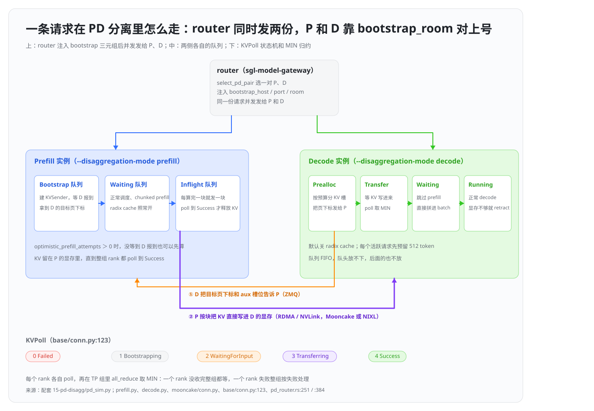
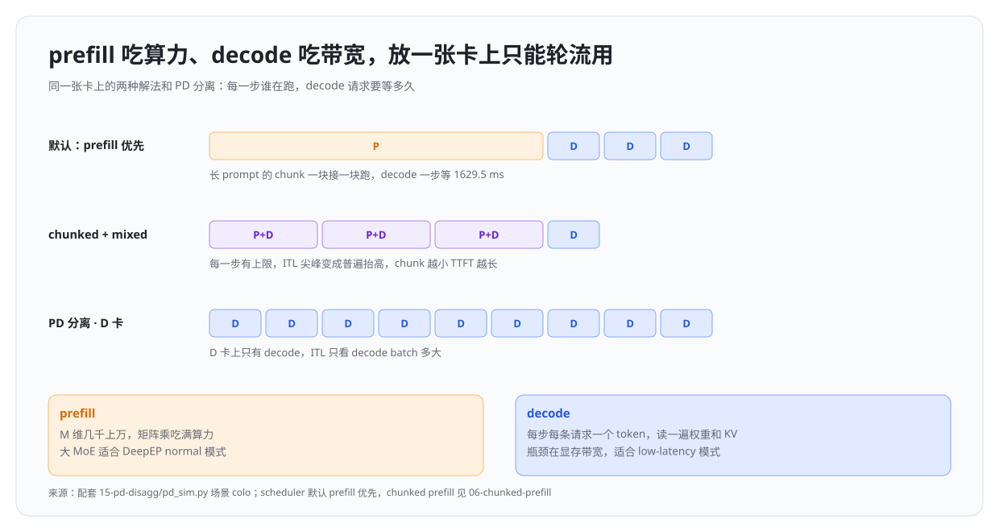
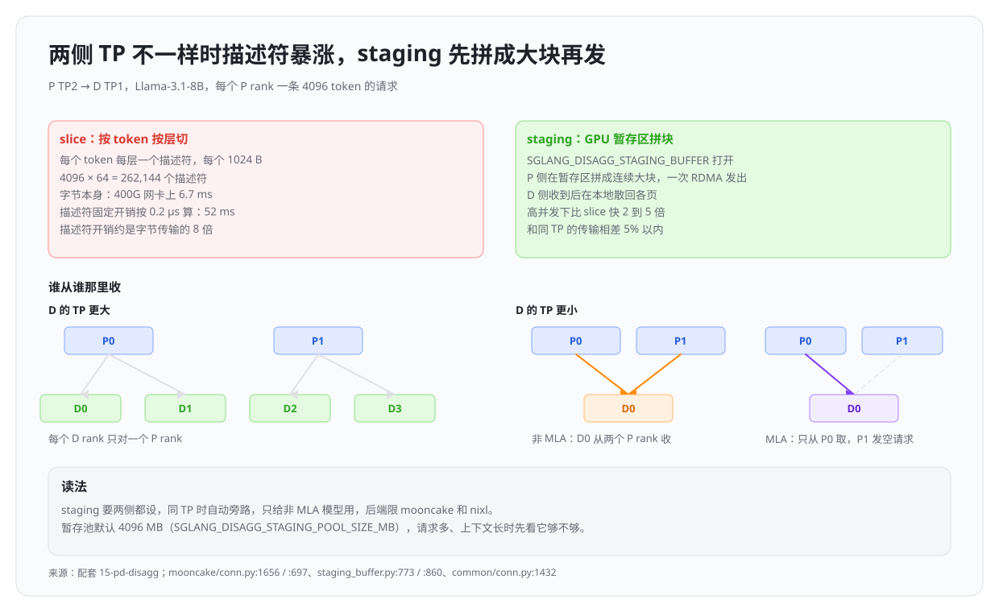
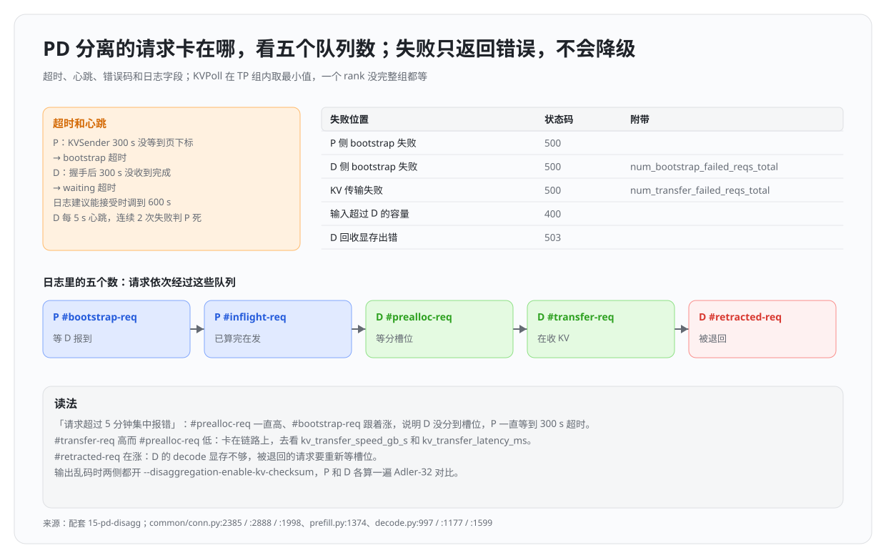
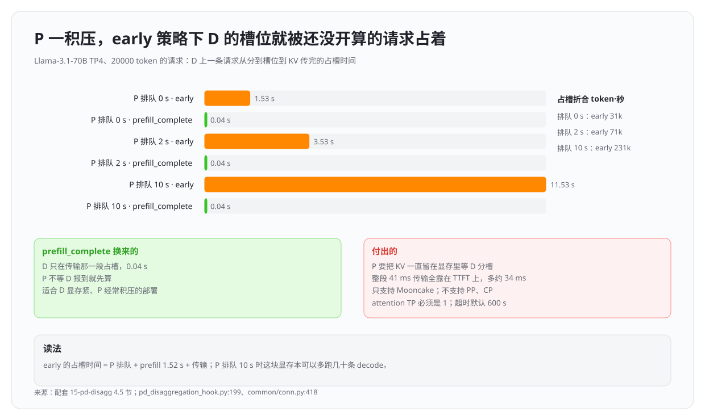
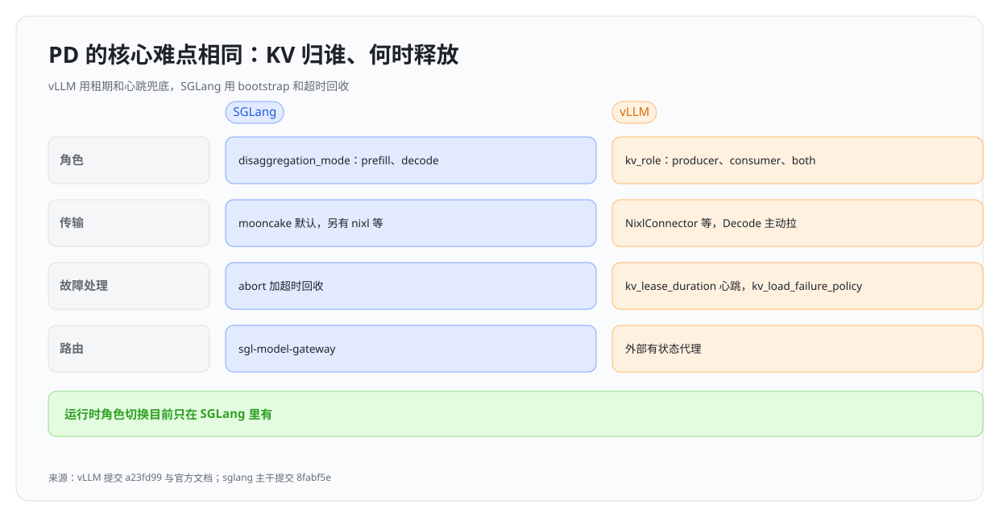
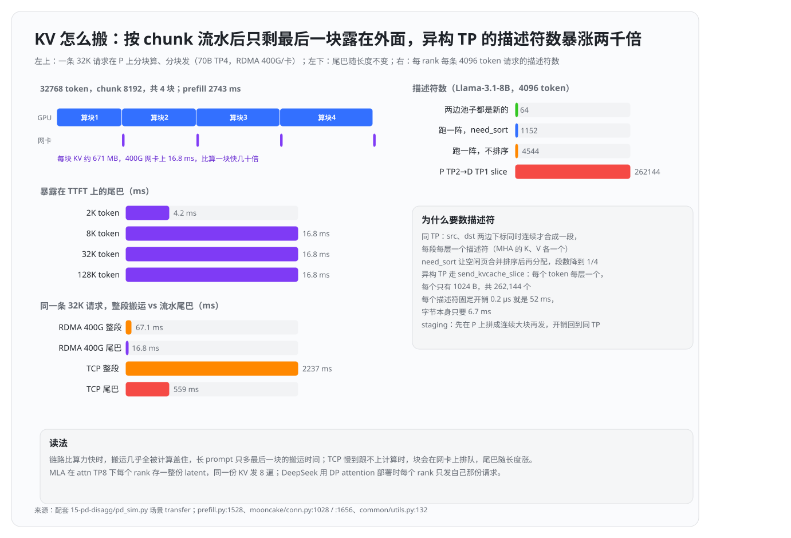
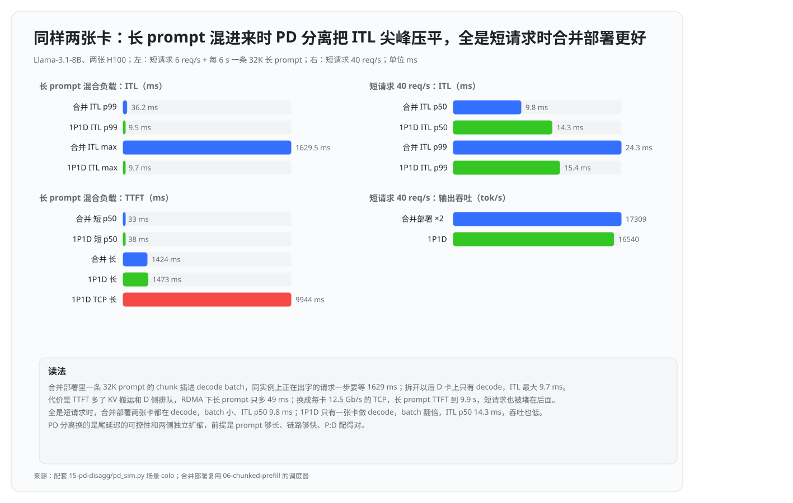
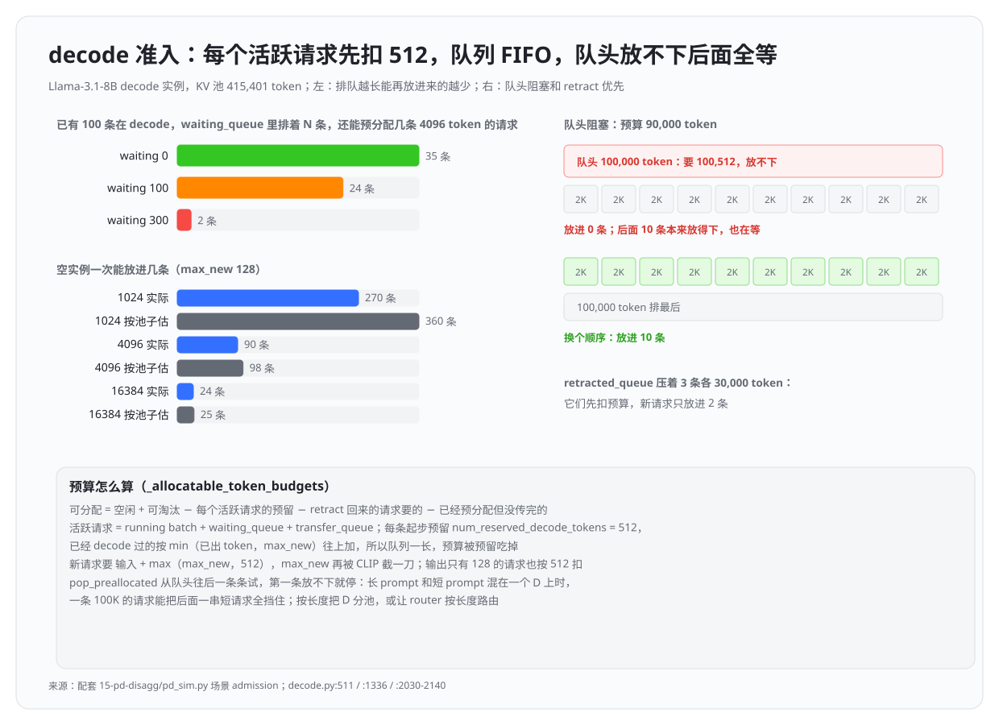

# SGL-15｜原理｜PD 分离：prefill 和 decode 拆到两组卡上

> 🎯 **遇到的问题**：Llama-3.1-8B，两张 H100，短请求每秒 6 条（输入 1024、输出 256），每 6 秒混进一条 32K token 的长 prompt。两张卡各起一个实例合并部署时，长 prompt 的 chunk 一插进 decode batch，同卡正在出字的请求这一步要等 1629.5 ms，ITL 的 p99 是 36.2 ms。
>
> 改成一张专做 prefill、一张专做 decode，KV 算完经 400G RDMA 搬过去，ITL 最大值 9.7 ms，p99 是 9.5 ms，输出吞吐基本不变，代价是长 prompt 的 TTFT 多了 49 ms。
>
> 负载换成全是短请求、每秒 40 条，结论反过来：拆开后只有一张卡在 decode，batch 翻倍，ITL 的 p50 从 9.8 ms 涨到 14.3 ms，吞吐还低了 4%。
>
> 链路换成每卡只分到 12.5 Gb/s 的 TCP，短请求 TTFT 的 p50 从 33 ms 变成 8 秒。PD 分离治的是 prefill 和 decode 互相干扰，DistServe 和 Splitwise 都把它当作单独的部署方式论证[[1]](https://arxiv.org/abs/2401.09670)[[2]](https://arxiv.org/abs/2311.18677)，Kimi 的 Mooncake 和 DeepSeek 的线上推理都拆开部署[[3]](https://arxiv.org/abs/2407.00079)[[4]](https://github.com/deepseek-ai/open-infra-index/blob/main/202502OpenSourceWeek/day_6_one_more_thing_deepseekV3R1_inference_system_overview.md)，SGLang 在 96 张 H100 上用它跑 DeepSeek-V3[[5]](https://www.lmsys.org/blog/2025-05-05-large-scale-ep/)。
>
> 它的前提是 prompt 够长、链路够快、P 和 D 的比例配得对。这一篇讲一条请求怎么在两组卡之间走完，KV 怎么搬，D 侧怎么决定收不收，什么时候拆开反而更慢。
>
> **主线**：PD 分离把互相干扰的 prefill 和 decode 拆到两组卡上，代价是 KV 要跨机搬运；值不值，取决于 prompt 长度、链路带宽和 P、D 配比。
>
> **读完这一篇**：能算出每个 rank 要搬多少 KV、流水后暴露在 TTFT 上的有多少，按 SLO 算出 P:D 配比。D 侧显存空着却不收请求时，知道是 512 token 预留和队头阻塞在起作用。能说清 P、D 的 TP 不同时描述符为什么暴涨、staging 怎么压回去，读懂 KVPoll 状态和两个超时，认出启动报错是哪条校验拒的。
>
> **代码**：[zero-to-sglang/15-pd-disagg](../15-pd-disagg)。pd_sim.py 算每个 rank 的 KV 字节、四种链路的耗时和流水尾巴、描述符计数和 P:D 配比，用事件模拟对比合并部署和 1P1D，并复现 decode 准入、队头阻塞和两种分配策略的占槽时间。resolve_sim.py 移植 --disaggregation-mode 的解析和校验链。只用标准库，行号按主干 8fabf5e 核对。

# 导读 · 结论先行

1. **一条请求同时发给两个实例。**router 选一对 P、D，往请求里塞进 bootstrap_host、bootstrap_port 和一个随机的 bootstrap_room，同一份请求并发发给两边。P 和 D 各自建一个传输对象，靠 bootstrap_room 对上号：D 先按预算在自己的 KV 池里分好槽位，把页下标告诉 P；P 照常 prefill，每算完一块就把这块的 KV 直接写进 D 的显存。D 收齐以后跳过 prefill，直接把请求拼进 decode batch。
2. **搬运几乎全被计算盖住。**70B TP4 一条 32K 请求每个 rank 要搬 2.7 GB，400G 网卡整段要 67 ms；可 P 是一块一块算、一块一块发的，搬运和下一块的计算重叠，露在 TTFT 上的只剩最后一块，16.8 ms，而且不随 prompt 长度涨。链路慢到跟不上计算时，块会在网卡上排队，这时候 TTFT 才真正被拖慢。
3. **D 侧的准入是一本预算账。**每个活跃请求先预留 512 token 给将来的 decode，waiting 和 transfer 队列里的请求也算活跃；新请求要「输入 + max（输出上限，512）」。队列按 FIFO 一条条试，队头放不下就停。所以 D 的显存看着空，也可能一条都不收。
4. **状态靠轮询，失败按整组算。**每个传输对象有 Failed、Bootstrapping、WaitingForInput、Transferring、Success 五个状态，每个 rank 自己 poll，再在 TP 组里取最小值：一个 rank 没收完整组都等，一个 rank 失败整组都失败。bootstrap 和 waiting 各有 300 秒超时，超时的请求返回报错，而不是变慢。
5. **拆不拆看三件事。**prompt 越长，prefill 对 decode 的干扰越大，P:D 配比也越往 P 倾斜。链路要快到流水盖得住。P 和 D 的比例要按 SLO 算出来，配错了一侧闲一侧堵。短 prompt、长输出的负载，合并部署每卡的 goodput 更高。



上面是 router：它只做选对、塞 bootstrap 三元组、并发转发三件事，KV 不经过它。中间左边是 P 的三个队列：Bootstrap 队列等 D 报到，Waiting 队列走正常的调度和 chunked prefill，Inflight 队列放算完但 KV 还没传完的请求。

右边是 D 的四个队列：Prealloc 按预算分槽位，Transfer 等 KV 写进来，Waiting 和 Running 就是 decode 实例自己的调度。两条链路里，① 是控制面，D 把目标页下标和辅助数据的槽位通过 ZMQ 告诉 P；② 是数据面，P 用 RDMA 或 NVLink 把 KV 直接写进 D 的显存，SGLang 默认用 Mooncake，也支持 NIXL 等后端。下面是两侧共用的状态机。2.2 到 2.6 节逐条展开。

**📎 与系列其他文档的分工**：本篇讲 prefill 和 decode 拆到两组机器以后，KV 怎么传、两边各自怎么调度、比例怎么定。两者的算力和带宽特征为什么不同，见 [SGL-02｜上手｜推理账本：显存、KV 与 Roofline](./02-ledger.md)。调度器的事件循环和 batch 怎么组，见 [SGL-05｜原理｜调度器：waiting、running 与 KV 预算](./05-scheduler.md)，P 和 D 两侧各自换了一套事件循环。chunked prefill 和 decode 抢同一张卡的问题，见 [SGL-06｜原理｜Chunked prefill：切块大小、mixed chunk 与 TTFT / ITL 的取舍](./06-chunked-prefill.md)，PD 分离是它的另一种解法。KV 池、页表和 req_to_token_pool，见 [SGL-07｜原理｜内存池与页表：req_to_token、token_to_kv 与 page size](./07-memory-pool.md)，D 侧的预分配就建在它们上面。radix cache 在 P 侧照常开、在 D 侧默认关，见 [SGL-08｜原理｜RadixAttention：基数树的匹配、插入、加锁与驱逐](./08-radix-attention.md)。TP、DP attention 和多机部署，见 [SGL-11｜原理｜并行：TP、DP Attention、EP 怎么组合](./11-parallelism.md)。HiCache 的 L3 作为 P 和 D 之间的另一条 KV 通道，见 [SGL-14｜原理｜HiCache：显存、主机内存、远端存储三层 KV 缓存](./14-hicache.md)。

# 第 1 章 · 问题：prefill 和 decode 抢一张卡

线上常见的情形：

- 平均 ITL 只有 7 ms，p99 也才 36 ms，可用户抱怨流式输出隔一阵就卡一下，最长停了一秒多。
- 开了 chunked prefill，chunk 调小以后卡顿短了，TTFT 却变长，吞吐也掉了。
- 照着文档拆成 1P1D，长 prompt 的服务 ITL 平稳了；换到一个以短问答为主的服务上，ITL 和吞吐都比拆之前差。
- 测试环境没有 RDMA，用 --disaggregation-transfer-backend mooncake_tcp 跑起来，TTFT 从几十毫秒变成好几秒。
- decode 实例显存用了不到一半，Prealloc 队列却一直有几十条在排，#prealloc-req 只增不减。
- P 侧日志里 #bootstrap-req 堆着，请求超过 5 分钟以后集中报错，客户端看到的是失败而不是慢。
- P 用 TP2、D 用 TP1，能跑通，kv_transfer_speed_gb_s 只有同 TP 时的零头。
- 开了 SGLANG_DISAGG_STAGING_BUFFER，换成 mori 后端启动失败；换回 mooncake 能起，可对 DeepSeek 没有任何改善。
- 我们想省 D 侧显存，加了 --disaggregation-decode-allocation-policy prefill_complete，P 用 TP4 启动直接报 does not yet support attention tensor parallelism greater than one。
- DeepSeek-V3 用 attention TP8 部署 PD，传输带宽打满，换成 DP attention 以后同样的流量降到八分之一。
- 机器 128 核，按文档算 Mooncake 传输线程该有 12 个，实际只有 8 个。

这些现象落在六件事上：为什么要拆，请求怎么在两侧之间走，KV 怎么搬，D 侧怎么准入，状态和失败怎么处理，P 和 D 怎么配比。下面按这个顺序讲，最后说后端、router 和 HiCache 的关系。

| 想弄清的现象 | 看哪一节 |
|-|-|
| 合并部署为什么会有一秒级的 ITL 尖峰 | 2.1、4.3 |
| 一条请求在 router、P、D 之间怎么走 | 2.2 |
| KV 搬运会给 TTFT 加多少，TCP 为什么慢这么多 | 2.3、4.1 |
| 异构 TP 为什么传得慢，staging 管什么 | 2.4、4.1 |
| D 显存空着为什么不收请求 | 2.5、4.4 |
| 请求卡在哪一步，超时以后发生什么 | 2.6、4.5 |
| prefill_complete 省什么、为什么限制这么多 | 2.7、4.5、4.6 |
| P 和 D 配几比几，什么负载不该拆 | 2.8、4.2 |
| Mooncake、NIXL 怎么选，router 和 HiCache 在里面做什么 | 2.9 |
| 启动报错和参数被改写 | 4.6 |

# 第 2 章 · 原理：请求怎么在两组卡之间走，KV 怎么搬，D 怎么收

## 2.1 为什么要拆：同一张卡上的两种负载

prefill 一次把几千上万个 token 送进模型，矩阵乘的 M 维很大，GPU 的算力被吃满；decode 每一步每条请求只出一个 token，每一步都要把全部权重和这批请求的 KV 读一遍，瓶颈在显存带宽。两种负载放在同一张卡、同一个调度器里，就得轮流用这张卡。SGLang 默认的事件循环里 prefill 优先，一条长 prompt 被切成的若干 chunk 一块接一块地跑，这段时间里 running batch 里的请求一个 token 都出不来[SGL-06｜原理｜Chunked prefill：切块大小、mixed chunk 与 TTFT / ITL 的取舍](./06-chunked-prefill.md)。开头那条 32K 的 prompt 就是这样把同卡请求的一步拉长到 1629.5 ms 的。

chunked prefill 加上 mixed chunk 是在同一张卡上的解法：把 prefill 切小，和 decode 拼进同一步，每一步的时长有了上限[[6]](https://arxiv.org/abs/2308.16369)[[7]](https://arxiv.org/abs/2403.02310)。代价是 chunk 越小，长 prompt 的 TTFT 越长，每一步的 decode 也被拼进来的 prefill 拖慢一截，ITL 的尖峰变成了普遍抬高。PD 分离换了个思路：prefill 和 decode 各占一组卡，decode 卡上永远只有 decode，ITL 只取决于 decode batch 的大小。

DistServe 把这件事量化成「满足 TTFT 和 TPOT 两个 SLO 的请求率」，也就是 goodput，并且指出拆开以后两侧还能各选各的并行方式[[1]](https://arxiv.org/abs/2401.09670)；Splitwise 从硬件角度论证，两个阶段对算力和带宽的需求差得够远，可以用不同型号的卡来跑[[2]](https://arxiv.org/abs/2311.18677)。服务规模一大，用户感受到的是尾延迟，平均值再好看，一秒级的卡顿每隔几秒来一次也会被投诉[[8]](https://research.google/pubs/the-tail-at-scale/)。

对 DeepSeek 这类大 MoE，拆分还有两个更硬的理由。SGLang 文档列的是 prefill 打断 decode 和 DP attention 下各 rank 负载不均：合并部署时一个 DP rank 在做 prefill，其他 rank 在 decode，整组却要一起跑 MoE 的 all-to-all，快的等慢的[[9]](https://docs.sglang.io/docs/advanced_features/pd_disaggregation)。

LMSYS 在 96 张 H100 上部署 DeepSeek-V3 时还碰到第三个：DeepEP 的 normal 模式适合 prefill 的大批量，low-latency 模式适合 decode 的小批量、能进 CUDA Graph，两种模式在同一个引擎里不能同时用[[5]](https://www.lmsys.org/blog/2025-05-05-large-scale-ep/)[[10]](https://github.com/deepseek-ai/DeepEP)。拆开以后 P 用 normal、D 用 low-latency，各自的 EP 规模也可以不一样[[11]](https://docs.sglang.io/docs/advanced_features/expert_parallelism)[[12]](https://arxiv.org/abs/2412.19437)。

拆开的代价也很直接：KV 要过一次网络，两侧各自的调度都多了一层等待，P 和 D 的比例配错了一侧闲一侧堵。4.2 节和 4.3 节用数字说明这些代价什么时候小于收益。



## 2.2 一条请求怎么走

入口是 router（sgl-model-gateway）。它按 prefill 和 decode 各自的负载均衡策略选出一对实例[（pd_router.rs:1074）](https://github.com/sgl-project/sglang/blob/8fabf5e/sgl-model-gateway/src/routers/http/pd_router.rs#L1074)，往请求体里塞进三个字段[（:251）](https://github.com/sgl-project/sglang/blob/8fabf5e/sgl-model-gateway/src/routers/http/pd_router.rs#L251)：bootstrap_host 和 bootstrap_port 是 P 实例 bootstrap server 的地址，bootstrap_room 是一个随机的 64 位整数，批量请求就塞成数组[（:256）](https://github.com/sgl-project/sglang/blob/8fabf5e/sgl-model-gateway/src/routers/http/pd_router.rs#L256)。

然后同一份请求并发发给 P 和 D[（:384）](https://github.com/sgl-project/sglang/blob/8fabf5e/sgl-model-gateway/src/routers/http/pd_router.rs#L384)，客户端拿到的流式输出来自 D。请求带了 logprob 时，第一个 token 的 logprob 在 P 那边，router 把两边的结果合并以后再返回[（:1490）](https://github.com/sgl-project/sglang/blob/8fabf5e/sgl-model-gateway/src/routers/http/pd_router.rs#L1490)。KV 全程不经过 router[[13]](https://docs.sglang.io/docs/advanced_features/sgl_model_gateway)[[14]](https://github.com/smg-project/smg)。

P 侧收到请求先进 Bootstrap 队列[（prefill.py:174）](https://github.com/sgl-project/sglang/blob/8fabf5e/python/sglang/srt/disaggregation/prefill.py#L174)：建一个 KVSender[（:396）](https://github.com/sgl-project/sglang/blob/8fabf5e/python/sglang/srt/disaggregation/prefill.py#L396)，按 bootstrap_room 等 D 来报到；输入超过 KV 池能装的长度直接返回 400[（:473）](https://github.com/sgl-project/sglang/blob/8fabf5e/python/sglang/srt/disaggregation/prefill.py#L473)。入队时把 max_new_tokens 改成 1[（:478）](https://github.com/sgl-project/sglang/blob/8fabf5e/python/sglang/srt/disaggregation/prefill.py#L478)，因为 P 只负责出第一个 token，这样 PrefillAdder 估显存时不会按完整的输出长度去预留。

D 报到、把目标页下标发过来以后，pop_bootstrapped 把请求挪进 Waiting 队列[（:497）](https://github.com/sgl-project/sglang/blob/8fabf5e/python/sglang/srt/disaggregation/prefill.py#L497)，从这里开始和普通实例一样走调度、chunked prefill、radix cache 匹配。默认必须等 D 报到才能开算；--optimistic-prefill-attempts 大于 0 或者用 prefill_complete 策略时，可以不等[（:484）](https://github.com/sgl-project/sglang/blob/8fabf5e/python/sglang/srt/disaggregation/prefill.py#L484)。

每算完一块，process_batch_result_disagg_prefill 就把这块 KV 交给传输线程[（:901）](https://github.com/sgl-project/sglang/blob/8fabf5e/python/sglang/srt/disaggregation/prefill.py#L901)，算完最后一块的请求进 Inflight 队列[（:1151）](https://github.com/sgl-project/sglang/blob/8fabf5e/python/sglang/srt/disaggregation/prefill.py#L1151)。第一个 token、它的 logprob、投机解码要的 hidden state 等小数据放进 MetadataBuffers[（utils.py:399）](https://github.com/sgl-project/sglang/blob/8fabf5e/python/sglang/srt/disaggregation/utils.py#L399)，作为 aux 数据随最后一块一起发。Inflight 队列里的请求要等整组 rank 都 poll 到 Success，才释放 P 侧的 KV。

D 侧收到同一份请求进 Prealloc 队列[（decode.py:390）](https://github.com/sgl-project/sglang/blob/8fabf5e/python/sglang/srt/disaggregation/decode.py#L390)：建一个 KVReceiver[（:811）](https://github.com/sgl-project/sglang/blob/8fabf5e/python/sglang/srt/disaggregation/decode.py#L811)，去 P 的 bootstrap server 查 P 各 rank 的地址，按 2.5 节的预算在自己的 KV 池里分好槽位[（:1336）](https://github.com/sgl-project/sglang/blob/8fabf5e/python/sglang/srt/disaggregation/decode.py#L1336)，把页下标告诉 P。分好槽位的请求进 Transfer 队列[（:2533）](https://github.com/sgl-project/sglang/blob/8fabf5e/python/sglang/srt/disaggregation/decode.py#L2533)，KV 和 aux 都写完、poll 到 Success 以后进 Waiting 队列[（:2836）](https://github.com/sgl-project/sglang/blob/8fabf5e/python/sglang/srt/disaggregation/decode.py#L2836)。

D 的事件循环[（:3126）](https://github.com/sgl-project/sglang/blob/8fabf5e/python/sglang/srt/disaggregation/decode.py#L3126)从 Waiting 队列取请求时不做 prefill，\_get_new_prebuilt_batch 造一个「假装 prefill 已经做完」的 batch[（:3378）](https://github.com/sgl-project/sglang/blob/8fabf5e/python/sglang/srt/disaggregation/decode.py#L3378)，把 P 发来的第一个 token 当作输入，直接并进 running batch 开始 decode。

两侧的 radix cache 默认不对称：P 照常开，多轮对话的前缀在 P 上命中；D 默认关，启动时打一行 Radix cache is disabled for decode server[（pd_disaggregation_hook.py:23）](https://github.com/sgl-project/sglang/blob/8fabf5e/python/sglang/srt/arg_groups/pd_disaggregation_hook.py#L23)。D 上开 radix（--disaggregation-decode-enable-radix-cache）目前标成 EXPERIMENTAL。PD 模式下 Responses API 的 store、previous_response_id、background 和内置工具都不支持[[9]](https://docs.sglang.io/docs/advanced_features/pd_disaggregation)。

## 2.3 KV 怎么搬：字节数和 chunk 流水

先算一条请求在每个 rank 上要搬多少字节。每个 token 每个 rank 的 KV 字节数等于层数 × 本 rank 的 KV 头数 × head_dim × 2（K 和 V）× 每个元素的字节数。Llama-3.1-70B 用 TP4、BF16：80 × 2 × 128 × 2 × 2 = 81,920 B。

一条 32K 的请求每个 rank 要搬 2684 MB，按每卡 400 Gb/s 的网卡算整段要 67 ms；Llama-3.1-8B 单卡是 131,072 B/token，32K 是 4295 MB、107 ms。看上去不小，可 70B 在 4 张 H100 上算这 32K 要 2743 ms。

更关键的是 P 不等整条请求算完才开始发。chunked prefill 每算完一块，\_send_kv_chunk 就把这一块的页交给传输线程[（prefill.py:1528）](https://github.com/sgl-project/sglang/blob/8fabf5e/python/sglang/srt/disaggregation/prefill.py#L1528)，搬运和下一块的计算重叠。70B 的 chunk 是 8192 token，一块 KV 671 MB，400G 网卡上 16.8 ms，算一块要几百毫秒，链路大部分时间是空的。真正露在 TTFT 上的只有最后一块的搬运时间：8K、32K、128K 的请求都是 16.8 ms，2K 的请求只有一块，4.2 ms。算力和网卡带宽的比值不变，这条尾巴就不随 prompt 长度涨。

链路慢到跟不上计算时情况就变了。每卡只分到 12.5 Gb/s 的 TCP（一张 100GbE 网卡 8 张卡分），70B 一块要 559 ms，比算一块还慢，块在网卡上排队，32K 请求的尾巴是 559 ms，8B 单卡更差：整段 3.6 秒，流水以后还剩 2.4 秒。4.3 节的事件模拟里，这条链路让短请求的 TTFT p50 从 38 ms 变成 8 秒，因为每条长 prompt 的 KV 都把网卡占住好几秒，后面的短请求全排在它后面。

发送的边界有个细节。中间块如果最后一页没填满，\_send_kv_chunk 把这不满一页的几个 token 扣下，留给下一块一起发；最后一块才把剩下的全发掉。4.5 节的例子里，20000 token、页 64、chunk 8192、radix 命中 2000：第一块算到 10192，只发 [0, 10176)，扣下 16 个。第二块发到 18368。最后一块发 [18368, 20000)。开了 staging 时中间块还要对齐到 staging 的格子，第一块只发到 8192。

MLA 要单独算。DeepSeek-V3 每个 token 每层存一个 576 维的 latent，61 层 BF16 是 70,272 B，比 70B 的 GQA 还小。可是 attention 用 TP8 时，MLA 没有多个 KV 头可切，每个 rank 都存一整份 latent，P 和 D 同 TP 时每个 rank 各发各的[（mooncake/conn.py:2699）](https://github.com/sgl-project/sglang/blob/8fabf5e/python/sglang/srt/disaggregation/mooncake/conn.py#L2699)，同一份 KV 在 8 张网卡上各发一遍。

用 DP attention 部署时，每个 rank 只存自己那份请求的 KV，总流量降到八分之一。这是 DeepSeek 的线上部署和 SGLang 的示例都用 DP attention 的原因之一[[4]](https://github.com/deepseek-ai/open-infra-index/blob/main/202502OpenSourceWeek/day_6_one_more_thing_deepseekV3R1_inference_system_overview.md)[[5]](https://www.lmsys.org/blog/2025-05-05-large-scale-ep/)。

数据面默认用 Mooncake 的 Transfer Engine，P 直接 RDMA 写 D 的显存，D 的 CPU 不参与[[15]](https://github.com/kvcache-ai/Mooncake)。机内或者 GB200 NVL72 这样的 NVLink 域里，可以把 KV 池分配在 NVLink 可访问的内存上，走 NVLink 写过去：NVL72 设 SGLANG_MOONCAKE_CUSTOM_MEM_POOL=NVLINK 和 MC_FORCE_MNNVL=True，单机内设 INTRA_NODE_NVLINK 和 MC_INTRANODE_NVLINK=true[[9]](https://docs.sglang.io/docs/advanced_features/pd_disaggregation)[[16]](https://www.lmsys.org/blog/2025-06-16-gb200-part-1/)。aux 数据量很小，仍然走 TCP。

## 2.4 描述符、异构 TP 和 staging

带宽算对了还不够，传输引擎每提交一段连续内存都有固定开销，所以要数一条请求被切成多少段。同 TP 时走 \_send_kvcache_generic[（mooncake/conn.py:1028）](https://github.com/sgl-project/sglang/blob/8fabf5e/python/sglang/srt/disaggregation/mooncake/conn.py#L1028)：先用 group_concurrent_contiguous 把 P 侧和 D 侧的页下标对齐，两边下标同时连续才合成一段[（common/utils.py:132）](https://github.com/sgl-project/sglang/blob/8fabf5e/python/sglang/srt/disaggregation/common/utils.py#L132)；然后每段每层一个描述符，MHA 和 GQA 的 K、V 各一个。Llama-3.1-8B 32 层，一段就是 64 个描述符。

两边的池子都刚启动时，分配器吐出来的页下标是连续的，一条 4096 token 的请求只有 1 段、64 个描述符。服务跑一阵以后，请求有长有短、先来后走，空闲页被打散，两边同时连续的机会就少了。PD 模式下 KV 池的分配器打开了 need_sort[（kv_cache_configurator.py:932）](https://github.com/sgl-project/sglang/blob/8fabf5e/python/sglang/srt/mem_cache/kv_cache_configurator.py#L932)：释放的页先放进 release_pages，空闲页不够用时再合并、排序[（allocator/token.py:55）](https://github.com/sgl-project/sglang/blob/8fabf5e/python/sglang/srt/mem_cache/allocator/token.py#L55)，分出去的页更容易连续。4.1 节的模拟里，同样的请求流跑一阵以后，开 need_sort 平均 18 段、1152 个描述符，不开是 71 段、4544 个。

P 和 D 的 TP 不一样时，先要决定每个 D rank 从哪几个 P rank 取 KV[（common/conn.py:1432）](https://github.com/sgl-project/sglang/blob/8fabf5e/python/sglang/srt/disaggregation/common/conn.py#L1432)。D 的 TP 更大时，每个 D rank 只对应一个 P rank，拿它的一部分头，非 MLA 模型会打一行 Performance is NOT guaranteed when using different TP sizes for non-MLA models。

D 的 TP 更小时，非 MLA 的每个 D rank 要从多个 P rank 收各自的那几个头。MLA 每个 rank 存的都是整份 latent，D 的 TP 更小时只从一个 P rank 取真数据，其余 P rank 发一个空请求，否则这些 rank 上的 KVPoll 永远到不了 Success。

非 MLA 的异构 TP 走 send_kvcache_slice[（mooncake/conn.py:1656）](https://github.com/sgl-project/sglang/blob/8fabf5e/python/sglang/srt/disaggregation/mooncake/conn.py#L1656)：P rank 的一页里装的是自己那几个头，D rank 的一页里装的是另一种头的划分，两边的页布局对不上，只能按「一个 token 槽的一层」逐个发。

Llama-3.1-8B 从 P TP2 发到 D TP1，每个 P rank 一条 4096 token 的请求要发 4096 × 64 = 262,144 个描述符，每个只有 1024 B，比全新池子的 64 个多四千倍，比 need_sort 的 1152 个多两百多倍。字节本身在 400G 网卡上只要 6.7 ms，每个描述符的固定开销哪怕只有 0.2 µs，也要 52 ms。这就是开头那条「P 用 TP2、D 用 TP1，kv_transfer_speed_gb_s 只有零头」的来源。

staging 是针对这个问题的补丁。打开 SGLANG_DISAGG_STAGING_BUFFER 以后，P 先在一块 GPU 暂存区里把要发给某个 D rank 的头切片拼成连续的大块[（staging_buffer.py:773）](https://github.com/sgl-project/sglang/blob/8fabf5e/python/sglang/srt/disaggregation/common/staging_buffer.py#L773)[（:809）](https://github.com/sgl-project/sglang/blob/8fabf5e/python/sglang/srt/disaggregation/common/staging_buffer.py#L809)，一次 RDMA 发过去，D 再在本地散回各自的页里[（mooncake/conn.py:697）](https://github.com/sgl-project/sglang/blob/8fabf5e/python/sglang/srt/disaggregation/mooncake/conn.py#L697)。暂存区按 chunk 划成格子[（staging_buffer.py:860）](https://github.com/sgl-project/sglang/blob/8fabf5e/python/sglang/srt/disaggregation/common/staging_buffer.py#L860)，这也是 2.3 节里中间块要对齐格子的原因。

文档给的数字是高并发下比 slice 快 2 到 5 倍，和同 TP 相差 5% 以内[[9]](https://docs.sglang.io/docs/advanced_features/pd_disaggregation)。它有四个限制：P 和 D 两侧都要设。同 TP 时自动旁路。只给非 MLA 模型用，MLA 本来就不走 slice。后端只能是 mooncake 或 nixl，别的后端启动时直接报错。暂存池默认 4096 MB，由 SGLANG_DISAGG_STAGING_POOL_SIZE_MB 控制。



## 2.5 D 侧怎么决定收不收

D 的 KV 池是 decode 用的，每条请求进来以后还要一直往里长。如果 D 来者不拒，等 running batch 里的请求越长越多，显存不够就得 retract，而 D 上 retract 一条请求的代价比普通实例高：它的 KV 是从 P 搬来的，要么备份到主机内存，要么丢掉重新走一遍 prefill。所以 pop_preallocated 每次分配前都算一本预算账[（decode.py:1336）](https://github.com/sgl-project/sglang/blob/8fabf5e/python/sglang/srt/disaggregation/decode.py#L1336)。

一条新请求要的 token 数由 \_required_admission_tokens 算[（:511）](https://github.com/sgl-project/sglang/blob/8fabf5e/python/sglang/srt/disaggregation/decode.py#L511)，大致是「输入 + max（min（max_new_tokens，CLIP），512）」。512 是 --num-reserved-decode-tokens 的默认值，CLIP 是 SGLANG_CLIP_MAX_NEW_TOKENS_ESTIMATION，默认 4096[（:153）](https://github.com/sgl-project/sglang/blob/8fabf5e/python/sglang/srt/disaggregation/decode.py#L153)。所以一条只要 128 个输出的请求也按 512 扣，一条 max_new_tokens 写了 32000 的请求只按 4096 扣。

能分配的预算由 \_allocatable_token_budgets 算[（:2086）](https://github.com/sgl-project/sglang/blob/8fabf5e/python/sglang/srt/disaggregation/decode.py#L2086)：空闲 token 数（开了 decode radix 再加上可淘汰的），减去活跃请求的预留，减去上一个 prebuilt batch 里刚并进来的请求每条 512，减去 retracted_queue 里等着恢复的请求要的。

活跃请求的预留是 512 × 活跃请求数和「running batch 里最长那条还要多少」两者取大[（:2030）](https://github.com/sgl-project/sglang/blob/8fabf5e/python/sglang/srt/disaggregation/decode.py#L2030)；活跃请求数是 running batch、Transfer 队列、Waiting 队列三处加起来[（:2048）](https://github.com/sgl-project/sglang/blob/8fabf5e/python/sglang/srt/disaggregation/decode.py#L2048)。Waiting 队列也算在里面，排队的请求越多，留给新请求的越少。

然后 pop_preallocated 从队头往后一条条试，第一条放不下就停，后面的不再看。这就有了队头阻塞：预算 90,000 token，队头一条 100,000 token 的请求要 100,512，放不下，后面 10 条 2000 token 的短请求本来全放得下，也一条都进不来。同样的请求换个顺序，10 条全进。

4.4 节还有两个数字：已有 100 条在 decode 时，Waiting 队列从 0 条涨到 300 条，能再预分配的 4096 token 请求从 35 条掉到 2 条；retracted_queue 里压着 3 条各 30,000 token 的请求时，它们先把预算扣掉，新请求只能放进 2 条。开头那条「D 显存用了不到一半，#prealloc-req 只增不减」多半就是这几种情况之一。

除了 token，还有请求槽位。DecodeReqToTokenPool 在 max_running_requests 之外多留 pre_alloc_size 行给预分配和传输中的请求[（:174）](https://github.com/sgl-project/sglang/blob/8fabf5e/python/sglang/srt/disaggregation/decode.py#L174)，这个数由 --disaggregation-decode-extra-slots 决定[（disagg.py:113）](https://github.com/sgl-project/sglang/blob/8fabf5e/python/sglang/srt/arg_groups/disagg.py#L113)：不写时默认 0，只有每个 worker 的 max_running_requests 不超过 32 才补成它的两倍。小 batch 的 D 不补这几行，running batch 一满，预分配就因为没有空行停下来，P 那边的请求全堵在 Bootstrap 队列。

## 2.6 状态、超时和失败

P 和 D 之间没有回调，每个传输对象的进度靠轮询。KVPoll 有五个值[（base/conn.py:123）](https://github.com/sgl-project/sglang/blob/8fabf5e/python/sglang/srt/disaggregation/base/conn.py#L123)：0 Failed、1 Bootstrapping（还在和对端握手）、2 WaitingForInput（握手完成，等 P 那边有数据可发）、3 Transferring、4 Success。

每个 rank 各自 poll 自己的传输对象，再在 TP 组里 all_reduce 取最小值[（utils.py:300）](https://github.com/sgl-project/sglang/blob/8fabf5e/python/sglang/srt/disaggregation/utils.py#L300)，源码注释写的是 so no rank commits ahead of its peers。效果是一个 rank 没收完，整组都等；一个 rank 失败，整组都按失败处理。D 的 --disaggregation-decode-polling-interval 默认 1，每一轮事件循环都 poll，设大可以省 all_reduce 的开销。

两个超时都是 300 秒。P 侧的 KVSender 从创建起 300 秒内没等到 D 发来页下标，判 bootstrap 超时[（common/conn.py:2385）](https://github.com/sgl-project/sglang/blob/8fabf5e/python/sglang/srt/disaggregation/common/conn.py#L2385)；D 侧的 KVReceiver 握手以后 300 秒内没收到传输完成的信号，判 waiting 超时[（:2888）](https://github.com/sgl-project/sglang/blob/8fabf5e/python/sglang/srt/disaggregation/common/conn.py#L2888)。两处的日志都建议在能接受更高 TTFT 时调到 600。另外 D 每 5 秒给对应的 P 发一次心跳，连续 2 次失败就把这个 P 当成挂了[（:1998）](https://github.com/sgl-project/sglang/blob/8fabf5e/python/sglang/srt/disaggregation/common/conn.py#L1998)，清掉连接池，把发往它的请求全部标记失败[（:2060）](https://github.com/sgl-project/sglang/blob/8fabf5e/python/sglang/srt/disaggregation/common/conn.py#L2060)。

失败的请求返回错误，不会自动降级成合并部署：P 侧 bootstrap 失败返回 500[（prefill.py:1374）](https://github.com/sgl-project/sglang/blob/8fabf5e/python/sglang/srt/disaggregation/prefill.py#L1374)。D 侧 bootstrap 失败返回 500，同时计数 num_bootstrap_failed_reqs_total[（decode.py:1177）](https://github.com/sgl-project/sglang/blob/8fabf5e/python/sglang/srt/disaggregation/decode.py#L1177)。传输失败返回 500[（:2891）](https://github.com/sgl-project/sglang/blob/8fabf5e/python/sglang/srt/disaggregation/decode.py#L2891)。输入超过 D 的容量返回 400[（:997）](https://github.com/sgl-project/sglang/blob/8fabf5e/python/sglang/srt/disaggregation/decode.py#L997)。回收显存出错返回 503[（:1599）](https://github.com/sgl-project/sglang/blob/8fabf5e/python/sglang/srt/disaggregation/decode.py#L1599)。所以开头那条「请求超过 5 分钟以后集中报错」，看的是 P 的 #bootstrap-req 和 D 的 #prealloc-req：D 没有给它分槽位，P 那边就一直等到超时。

KV 传错了比传失败更难查。--disaggregation-enable-kv-checksum 让 P 对每条请求的 KV 页算一个 Adler-32，D 收完再算一遍对比，不一致就中止这条请求[（disagg.py:72）](https://github.com/sgl-project/sglang/blob/8fabf5e/python/sglang/srt/arg_groups/disagg.py#L72)。两侧都要开；TP、PP、页大小或 dtype 不一样的 P 发来的 KV 布局不同，不做校验，只打一次告警。默认关，排查输出乱码时打开。

监控上要盯的指标都在 metrics collector 里：kv_transfer_speed_gb_s 和 kv_transfer_latency_ms 看搬运[（metrics_collector.py:638）](https://github.com/sgl-project/sglang/blob/8fabf5e/python/sglang/srt/observability/metrics_collector.py#L638)，kv_transfer_bootstrap_ms 看握手[（:683）](https://github.com/sgl-project/sglang/blob/8fabf5e/python/sglang/srt/observability/metrics_collector.py#L683)，num_bootstrap_failed_reqs_total 和 num_transfer_failed_reqs_total 看失败[（:668）](https://github.com/sgl-project/sglang/blob/8fabf5e/python/sglang/srt/observability/metrics_collector.py#L668)。

日志里 P 每轮打 #bootstrap-req 和 #inflight-req[（metrics_reporter.py:767）](https://github.com/sgl-project/sglang/blob/8fabf5e/python/sglang/srt/managers/scheduler_components/metrics_reporter.py#L767)，D 打 #prealloc-req、#transfer-req、#retracted-req[（:1025）](https://github.com/sgl-project/sglang/blob/8fabf5e/python/sglang/srt/managers/scheduler_components/metrics_reporter.py#L1025)，五个数连起来看就知道请求卡在哪个队列[[17]](https://docs.sglang.io/docs/references/production_metrics)。



## 2.7 两种分配策略：early 和 prefill_complete

默认的 early 策略里，D 一收到请求就分槽位，这个槽位从 P 排队、P 计算一直占到 KV 传完。P 不忙时这段时间就是 prefill 本身；P 一积压，D 上就有一大片显存被还没开算的请求占着。4.5 节的例子：70B TP4、20000 token 的请求，P 不排队时 early 占槽 1.53 秒；P 排队 10 秒时占槽 11.53 秒，折合 231 k token·秒，这些显存本来可以多跑几十条 decode。

--disaggregation-decode-allocation-policy prefill_complete 把顺序倒过来：P 不等 D 报到就先算（P 侧的 optimistic_prefill_attempts 会被自动设成 1），算完以后 D 才分槽位，KV 一次性发过去。D 的占槽时间缩到只有传输那一段，同一个例子是 0.04 秒。

代价有三个：P 要把算好的 KV 一直留在自己的显存里，直到 D 分好槽位，P 侧的显存压力变大。搬运不再和计算重叠，整段 41 ms 的传输全露在 TTFT 上，比 early 多 34 ms 左右。P 侧的等待改由 DeferredBootstrap 管，超时是 waiting 加 bootstrap，默认 600 秒[（common/conn.py:418）](https://github.com/sgl-project/sglang/blob/8fabf5e/python/sglang/srt/disaggregation/common/conn.py#L418)。文档的说法是它不是通用的吞吐优化，适合 D 显存紧、P 经常积压的部署[[9]](https://docs.sglang.io/docs/advanced_features/pd_disaggregation)。

它的限制很多，启动时由 \_validate_prefill_complete 一次性列出来[（pd_disaggregation_hook.py:199）](https://github.com/sgl-project/sglang/blob/8fabf5e/python/sglang/srt/arg_groups/pd_disaggregation_hook.py#L199)：只支持 Mooncake。不支持 PP 和 attention 的 CP。attention TP 必须是 1，也就是 TP 等于 DP attention 的份数。

不支持 PD 复用、role switch、encoder 分离、HiSparse、D 侧的主机接收、D 侧的 radix 或 HiCache、P 侧 L2 write_back 以外的 HiCache、staging、Rust 的 bootstrap 注册表。KV 池也只支持全注意力和 DSA 两种，混合注意力模型启动时报错。两侧都要设成一样；已经在线上的集群，先把所有 worker 升到支持它的版本、用 early 跑稳，再一起切。



## 2.8 P 和 D 配几比几

配比的算法很朴素：分别算一个 P 实例和一个 D 实例在 SLO 下能接多少请求率，D 的除以 P 的，就是一个 D 要配几个 P。4.2 节的模型是这样算的：P 的服务时间按一个 chunk 里能拼几条请求算，排队按 M/D/1，TTFT = 单条计算 + 排队 + 搬运尾巴，二分找出 TTFT 不超过 SLO 的最大请求率。

D 找出 decode 一步不超过 TPOT SLO、而且每条「输入 + min（输出，4096）+ 512」的总和装得下 KV 池的最大 batch，请求率 = batch ÷（输出长度 × 一步的时长）。合并部署按「prefill 占掉的时间比例 f，平均 TPOT = decode 一步 ÷（1 − f）」算。

Llama-3.1-70B、P 和 D 都是 TP4、400G RDMA，四种负载的结论很不一样。聊天（1024 输入、256 输出，SLO 1 秒 / 50 ms）一个 D 配 2.5 个 P，每卡 goodput 是合并部署的 1.19 倍。RAG 摘要（8192 / 256）配 4.3 个 P，1.11 倍。

长输出的代码补全（512 / 1024，0.5 秒 / 30 ms）反过来，3 个 D 配 1 个 P，每卡 0.98 倍，拆了不赚。32K 输入的长上下文 agent 配 4.7 个 P，每卡只有合并部署的 0.84 倍，因为 D 的 KV 池只装得下 12 条 32K 的请求，D 被显存卡住。

最后这一条要多说一句。合并部署的数字是按平均 TPOT 算的，没算长 prompt 的 chunk 插进来造成的 ITL 尖峰；32K 的 prompt 一来，同卡请求要停一秒多，P99 的 TPOT SLO 在合并部署下根本守不住。所以长上下文的服务，按平均 goodput 看合并部署赢，按尾延迟看只能拆。代码补全这种短输入、长输出的负载属于两边都不该拆的情形：prefill 的干扰小，拆开以后 decode 卡少了，batch 变大，ITL 反而变差，这和开头那组每秒 40 条短请求的结果一致。

配比定下来以后还得跟着负载调。负载的输入输出长度在一天里会变，固定的 P:D 总有一段时间一侧闲着。Llumnix 在实例之间迁移请求来做再平衡[[18]](https://arxiv.org/abs/2406.03243)。MemServe 把上下文缓存和 PD 分离合在一个内存池里管[[19]](https://arxiv.org/abs/2406.17565)。MegaScale-Infer 对 MoE 更进一步，把 attention 和 FFN 也拆到不同的卡上[[20]](https://arxiv.org/abs/2504.02263)。

SGLang 这边，--enable-pd-role-switch 允许运行时把一个实例从 P 切成 D 或反过来，可它不重建 EP、MoE all-to-all、PP、DCP 和投机解码的状态，开了这些特性就拒绝启动。集群层面的扩缩通常交给 Dynamo、llm-d 或 RBG 这类编排系统，按 P 和 D 两种角色分别扩[[21]](https://github.com/ai-dynamo/dynamo)[[22]](https://github.com/llm-d/llm-d)[[23]](https://github.com/sgl-project/rbg)。

## 2.9 传输后端、router 和 HiCache

--disaggregation-transfer-backend 有五个取值：mooncake（默认）、nixl、mori、ascend、fake。Mooncake 和 NIXL 是文档主推的两个[[9]](https://docs.sglang.io/docs/advanced_features/pd_disaggregation)。Mooncake 在 RDMA 网卡上直接用，--disaggregation-ib-device 可以写 mlx5_0、逗号分隔的多张卡、每张 GPU 一张卡的 JSON 映射或者 JSON 文件路径。

AWS 的 EFA 上设 MOONCAKE_PROTOCOL=efa。NIXL 是 NVIDIA Dynamo 的传输库，默认走 UCX，EFA 上把 SGLANG_DISAGGREGATION_NIXL_BACKEND 设成 LIBFABRIC[[24]](https://github.com/ai-dynamo/nixl)。mori 面向 AMD 的卡，ascend 面向昇腾。fake 只能用在 D 侧，P 不传真数据，单独压 D 的 decode 时用，P 侧写 fake 启动直接失败。

mooncake_tcp 不是一个独立的后端，解析时被改写成 mooncake，同时设 MC_FORCE_TCP=1、清掉 ib_device。它适合在没有 RDMA 的机器上把流程跑通，2.3 节已经算过，拿它压性能没有意义。Mooncake 每个 TP rank 开一个传输线程池，大小是 min（max（4，int（0.5 × CPU 核数）// 8），12）[（mooncake/conn.py:328）](https://github.com/sgl-project/sglang/blob/8fabf5e/python/sglang/srt/disaggregation/mooncake/conn.py#L328)，128 核的机器是 8 个，文档里写的系数是 0.75，按它算是 12 个，以代码为准。

线程数可以用 SGLANG_DISAGGREGATION_THREAD_POOL_SIZE 改，可不能小于队列数 SGLANG_DISAGGREGATION_QUEUE_SIZE（默认 4），否则启动时断言失败[（environ.py:757）](https://github.com/sgl-project/sglang/blob/8fabf5e/python/sglang/srt/environ.py#L757)。

router 用 sgl-model-gateway，--pd-disaggregation 模式下分别给 P 和 D 列地址，P 的地址后面可以跟它的 bootstrap 端口。它只做三件事：选对、塞 bootstrap 字段、并发转发，所以 router 本身不是瓶颈，挂了也不丢 KV[[13]](https://docs.sglang.io/docs/advanced_features/sgl_model_gateway)。Dynamo 和 llm-d 也能做 SGLang 的 PD 编排，它们的 router 会看 KV 命中情况来选 P，适合多轮对话很多的服务[[21]](https://github.com/ai-dynamo/dynamo)[[22]](https://github.com/llm-d/llm-d)。

HiCache 的 L3 给 P 和 D 之间开了另一条 KV 通道[SGL-14｜原理｜HiCache：显存、主机内存、远端存储三层 KV 缓存](./14-hicache.md)。最佳实践文档里的 PD 配置是：P 开 HiCache，用 3FS 作 L3、page_first_direct 布局；D 加 --disaggregation-decode-enable-offload-kvcache，一条请求 decode 完，把它生成的 KV 写回 L3[[25]](https://docs.sglang.io/docs/advanced_features/hicache_best_practices)。多轮对话的下一轮到了 P，上一轮的问题和回答都能从 L3 命中，P 只算新的那一段。这和 Mooncake 论文里以 KV 池为中心的架构是一个思路，LMCache 在 vLLM 那边做的也是同一件事[[3]](https://arxiv.org/abs/2407.00079)[[26]](https://arxiv.org/abs/2510.09665)[[27]](https://docs.sglang.io/docs/advanced_features/hicache_design)。

## 2.10 vLLM 怎么做

vLLM 的 PD 分离通过 kv_transfer_config 配置，kv_role 取 kv_producer、kv_consumer 或 kv_both[[28]](https://docs.vllm.ai/en/latest/features/disagg_prefill.html)。最常用的 NixlConnector 由 Decode 端经 RDMA 主动拉 KV；Prefill 端为待拉取的 KV 设租期 kv_lease_duration，Decode 靠心跳续租，超时就回收，避免对端崩溃后 KV 永远挂着[[29]](https://docs.vllm.ai/en/latest/features/nixl_connector_usage.html)。拉取失败按 kv_load_failure_policy 处理，可以直接报错，也可以在 Decode 端重算。最近修过一个 P/D 容错路径里的块泄漏[[30]](https://github.com/vllm-project/vllm/pull/56430)。

SGLang 用 disaggregation_mode 指定 prefill 或 decode，传输后端默认 mooncake，靠 bootstrap server 让两端握手，路由层由 sgl-model-gateway 承担。vLLM 的 PD 需要一个有状态的代理把请求先发 Prefill 再发 Decode。两边的核心难点相同：KV 归谁、何时释放、失败后谁兜底。SGL-20 提到的运行时 P、D 角色切换，在 vLLM 里还没有对应能力。

| 维度 | SGLang | vLLM | 差异的代价 |
|-|-|-|-|
| 角色 | disaggregation_mode：prefill、decode | kv_role：producer、consumer、both | vLLM 的 kv_both 便于同机测试 |
| 传输 | mooncake 默认，另有 nixl 等 | NixlConnector 等，Decode 主动拉 | RDMA 配置两边都要单独调 |
| 故障处理 | abort 加超时回收 | kv_lease_duration 心跳，kv_load_failure_policy | vLLM 的重算兜底会抬高 Decode 负载 |
| 路由 | sgl-model-gateway | 外部有状态代理 | 都要额外部署一层 |



# 第 3 章 · 源码走读：一条请求穿过 P 和 D 的 18 个落脚点

按一条请求的生命周期排：router 选对、塞 bootstrap 字段。P 侧建 sender、改 max_new_tokens、等 D 报到。D 侧建 receiver、算预算、分槽位。P 侧按 chunk 发送，传输引擎合段、切描述符。两侧 poll 状态、判超时。D 把第一个 token 并进 running batch。最后是启动时的参数改写和线程池。行号都对应主干 8fabf5e。

| # | 位置 | 发生了什么 |
|-|-|-|
| 1 | [routers/http/pd_router.rs:1074](https://github.com/sgl-project/sglang/blob/8fabf5e/sgl-model-gateway/src/routers/http/pd_router.rs#L1074) | 按 prefill 和 decode 各自的策略选一对实例；:251 往请求体里写 bootstrap_host、bootstrap_port、bootstrap_room，:256 批量请求写成数组，:384 并发发给两侧 |
| 2 | [disaggregation/prefill.py:174](https://github.com/sgl-project/sglang/blob/8fabf5e/python/sglang/srt/disaggregation/prefill.py#L174) | PrefillBootstrapQueue：P 侧第一个队列，:396 create_sender 给每条请求建 KVSender，按 bootstrap_room 等 D 来报到 |
| 3 | [disaggregation/prefill.py:478](https://github.com/sgl-project/sglang/blob/8fabf5e/python/sglang/srt/disaggregation/prefill.py#L478) | \_process_req：max_new_tokens 改成 1，PrefillAdder 不按完整输出长度预留；:473 输入超过 KV 池返回 400 |
| 4 | [disaggregation/prefill.py:497](https://github.com/sgl-project/sglang/blob/8fabf5e/python/sglang/srt/disaggregation/prefill.py#L497) | pop_bootstrapped：poll 到 WaitingForInput 的请求挪进 waiting_queue，从这里开始和普通实例一样调度；:484 optimistic prefill 可以不等 |
| 5 | [disaggregation/decode.py:390](https://github.com/sgl-project/sglang/blob/8fabf5e/python/sglang/srt/disaggregation/decode.py#L390) | DecodePreallocQueue：D 侧第一个队列，:811 add 给每条请求建 KVReceiver，去 P 的 bootstrap server 查各 rank 地址 |
| 6 | [disaggregation/common/conn.py:1432](https://github.com/sgl-project/sglang/blob/8fabf5e/python/sglang/srt/disaggregation/common/conn.py#L1432) | \_resolve_rank_mapping：P、D 的 TP 不同时每个 D rank 从哪几个 P rank 取；MLA 且 D 的 TP 更小时其余 P rank 发空请求 |
| 7 | [disaggregation/decode.py:511](https://github.com/sgl-project/sglang/blob/8fabf5e/python/sglang/srt/disaggregation/decode.py#L511) | \_required_admission_tokens：输入 + max（min（max_new，CLIP），512），CLIP 默认 4096（:153） |
| 8 | [disaggregation/decode.py:2086](https://github.com/sgl-project/sglang/blob/8fabf5e/python/sglang/srt/disaggregation/decode.py#L2086) | \_allocatable_token_budgets：空闲 token 减活跃请求的预留（:2030）、减 prebuilt 里刚并进的、减 retracted_queue 要的；活跃请求数在 :2048 把三个队列加起来 |
| 9 | [disaggregation/decode.py:1336](https://github.com/sgl-project/sglang/blob/8fabf5e/python/sglang/srt/disaggregation/decode.py#L1336) | pop_preallocated：从队头一条条试，第一条放不下就停；放得下的分 KV 页，把页下标发给 P |
| 10 | [disaggregation/prefill.py:1528](https://github.com/sgl-project/sglang/blob/8fabf5e/python/sglang/srt/disaggregation/prefill.py#L1528) | \_send_kv_chunk：每算完一块就发。中间块扣下不满一页的尾巴，开 staging 时再对齐格子。:1460 命中的前缀页对齐时提前发 |
| 11 | [disaggregation/common/utils.py:132](https://github.com/sgl-project/sglang/blob/8fabf5e/python/sglang/srt/disaggregation/common/utils.py#L132) | group_concurrent_contiguous：P、D 两边页下标同时连续才合成一段，段数决定描述符数 |
| 12 | [disaggregation/mooncake/conn.py:1028](https://github.com/sgl-project/sglang/blob/8fabf5e/python/sglang/srt/disaggregation/mooncake/conn.py#L1028) | \_send_kvcache_generic：同 TP 时每段每层一个描述符，K、V 各一个；:2699 MLA 同 TP 时每个 rank 各发各的 |
| 13 | [disaggregation/mooncake/conn.py:1656](https://github.com/sgl-project/sglang/blob/8fabf5e/python/sglang/srt/disaggregation/mooncake/conn.py#L1656) | send_kvcache_slice：非 MLA 异构 TP，每个 token 槽每层一个描述符；:697 send_kvcache_staged 是 staging 打开后的替代路径 |
| 14 | [disaggregation/utils.py:300](https://github.com/sgl-project/sglang/blob/8fabf5e/python/sglang/srt/disaggregation/utils.py#L300) | \_all_reduce_polls：每个 rank 的 KVPoll 在 TP 组里取 MIN，一个 rank 没收完整组都等 |
| 15 | [disaggregation/common/conn.py:2385](https://github.com/sgl-project/sglang/blob/8fabf5e/python/sglang/srt/disaggregation/common/conn.py#L2385) | \_check_bootstrap_timeout：P 侧 300 秒等不到 D。:2888 D 侧 300 秒收不到传输完成。:1998 每 5 秒心跳，连续 2 次失败清掉这个 P |
| 16 | [disaggregation/decode.py:3378](https://github.com/sgl-project/sglang/blob/8fabf5e/python/sglang/srt/disaggregation/decode.py#L3378) | \_get_new_prebuilt_batch：Waiting 队列里的请求不做 prefill，用 P 发来的第一个 token 造一个 prebuilt batch 并进 running batch；事件循环在 :3126 |
| 17 | [arg_groups/pd_disaggregation_hook.py:23](https://github.com/sgl-project/sglang/blob/8fabf5e/python/sglang/srt/arg_groups/pd_disaggregation_hook.py#L23) | D 侧默认关 radix、补 extra_slots、改写 mooncake_tcp；:199 \_validate_prefill_complete 把不支持的特性一次列全 |
| 18 | [disaggregation/mooncake/conn.py:328](https://github.com/sgl-project/sglang/blob/8fabf5e/python/sglang/srt/disaggregation/mooncake/conn.py#L328) | 传输线程池 min（max（4，int（0.5 × cpu）// 8），12）；environ.py:757 断言线程数不小于队列数 |

我们读的时候分了两遍。第一遍顺着 2、3、4 和 5、7、8、9 看两侧的队列，P 有 Bootstrap、Waiting、Inflight 三个，D 有 Prealloc、Transfer、Waiting 三个，加上 D 的 running batch 和 retracted_queue，就是日志里那五个计数的来源。

重点看 8 号预算的每一项减的是什么，D 侧的准入问题都出在这里。第二遍顺着 10 到 14 看数据面，拿 4.1 节的数对照：一条请求被切成几段、每段几个描述符、什么时候走 slice。监控指标在 [metrics_collector.py:582](https://github.com/sgl-project/sglang/blob/8fabf5e/python/sglang/srt/observability/metrics_collector.py#L582)（各队列的请求数）和 [:637](https://github.com/sgl-project/sglang/blob/8fabf5e/python/sglang/srt/observability/metrics_collector.py#L637)（传输速度和延迟的直方图），第 5 章的排障都靠它们。

# 第 4 章 · 实验：在 CPU 上把 PD 分离算一遍

配套目录有两个脚本。pd_sim.py 管数据面和调度：每 rank 的 KV 字节、四种链路的整段耗时和流水后的尾巴、描述符计数、P:D 配比、合并部署和 1P1D 的事件模拟、D 侧准入预算、一条请求的发送边界和两种分配策略。resolve_sim.py 管配置：参数解析链和传输线程池。

从源码移植的部分是准入预算、发送边界、staging 格子、页下标合段、rank 映射、KVPoll 取 MIN、参数改写和线程池公式，这些和代码逐行对得上；估算的部分是计算时间（沿用 [SGL-02｜上手｜推理账本：显存、KV 与 Roofline](./02-ledger.md) 的账本，MFU 50%）、链路带宽和每个描述符的固定开销，4.7 节讲怎么用真机的数替换。合并部署的对照组复用 06-chunked-prefill 的调度器。

## 4.1 搬多少字节，露出多少时间

```bash
cd zero-to-sglang/15-pd-disagg
python3 pd_sim.py
```

```text
一条 32768 token 的请求在每个 rank 上要搬的 KV（P、D 同 TP，单卡单网卡）
  模型 × 卡                      cell B  每rank MB prefill ms   NVLink 机内   RDMA 400G/卡   RDMA 200G/卡   TCP 100GbE÷8
  Llama-3.1-8B 1×H100         131072      4295       1419    28.6/7.2     107.4/26.8     214.7/53.7    3579.1/2417.7
  Llama-3.1-70B 4×H100         81920      2684       2743    17.9/4.5      67.1/16.8     134.2/33.6    2237.0/559.2
  Qwen3-235B-A22B 8×H100       48128      1577        706    10.5/2.6      39.4/9.9       78.9/19.7    1314.2/713.3
  DeepSeek-V3 8×H200           70272      2303       1320    15.4/3.8      57.6/14.4     115.1/28.8    1918.9/732.3
  每格「整段搬运 ms / 按 chunk 流水后暴露在 TTFT 上的 ms」。

长 prompt 的尾巴（Llama-3.1-70B TP4，RDMA 400G/卡）：
     2048 token  prefill     134 ms  KV    168 MB  暴露尾巴   4.2 ms
     8192 token  prefill     564 ms  KV    671 MB  暴露尾巴  16.8 ms
    32768 token  prefill    2743 ms  KV   2684 MB  暴露尾巴  16.8 ms
   131072 token  prefill   18733 ms  KV  10737 MB  暴露尾巴  16.8 ms

描述符数（每个 rank、每条 4096 token 的请求）：
  Llama-3.1-8B 同 TP，两边池子都是新的：1 段 × 64 = 64
  跑了一阵，need_sort=True（PD 的设置）：平均 18 段、最多 26 段 -> 1152 个
  跑了一阵，need_sort=False：平均 71 段、最多 85 段 -> 4544 个
  P TP2 -> D TP1 走 send_kvcache_slice：每个 P rank 4096 × 64 = 262,144 个，每个只有 1024 B
  打开 staging：2 个 writer，各写 268 MB，每个 writer 每个 chunk 一次大块传输

  单个描述符的固定开销不同，slice 路径多出的时间（8B，4096 token，单 writer）：
    0.05 µs/个  描述符   13.1 ms  vs 字节本身 6.7 ms
     0.2 µs/个  描述符   52.4 ms  vs 字节本身 6.7 ms
     1.0 µs/个  描述符  262.1 ms  vs 字节本身 6.7 ms
```



第一张表要横着读。RDMA 400G 一列，四个模型 32K 请求的整段搬运在 39 到 107 ms 之间，流水以后只露出 10 到 27 ms，和 prefill 本身的 0.7 到 2.7 秒比是零头。TCP 一列完全是另一个量级：8B 露出 2.4 秒，比 prefill 还长；两个 MoE 的尾巴是 713 和 732 ms，比 70B 还大，因为它们算得快，链路更跟不上。判断一条链路够不够，比的是「每块的搬运时间」和「每块的计算时间」，搬运时间小于计算时间，尾巴就固定在一块的搬运上，第二张表里 8K 以后的尾巴都是 16.8 ms 就是这个原因。

第三张表说的是另一种开销。字节相同，描述符数可以差四千倍。need_sort 那两行是同一个分配器在同样的请求流下跑了一阵的结果，排序让段数从 71 降到 18。slice 那一行的 262,144 个描述符和固定开销一相乘，0.2 µs 时 52 ms，是字节本身的八倍；Mooncake 和 NIXL 每个描述符的真实开销取决于网卡、驱动和批量提交的方式，4.7 节教怎么测。staging 把它变回每个 chunk 一次大块传输，代价是 P 侧多一块暂存显存和一次 gather 的 kernel。

## 4.2 P 和 D 配几比几

```bash
python3 pd_sim.py --scenario ratio
```

```text
Llama-3.1-70B 4×H100，KV 池 417,650 token，链路 RDMA 400G/卡。P、D 各是一个 TP4 实例
  负载               输入/输出        SLO   P 上限 rps  D 并发  D 上限 rps   P:D  PD rps/卡  合并 rps/卡  PD/合并
  聊天               1024/256     1s/50ms       14.6     233       37.1  2.54      2.62       2.20     1.19
  RAG 摘要           8192/256     2s/50ms        1.5      46        6.3  4.27      0.30       0.27     1.11
  代码补全长输出      512/1024   0.5s/30ms       29.4     203        8.9  0.30      1.70       1.73     0.98
  长上下文 agent    32768/512     4s/50ms        0.2      12        0.8  4.67      0.04       0.04     0.84
  P:D = 一个 D 吃得下的请求率 ÷ 一个 P 撑得住的请求率，即每个 D 配几个 P。
  合并部署按平均 TPOT 算，没算 chunk 打断造成的 ITL 尾部；真看 P99 时合并部署的数字还要往下打。
```

D 并发一列是两个约束取小的结果。聊天的 233 是 TPOT 50 ms 卡住的，KV 池还有富余；长上下文的 12 是 KV 池卡住的，每条按 32768 + 512 + 512 预留，417,650 ÷ 33,792 只有 12 条。D 只能跑 12 条并发，P 再快也没用，配 4.67 个 P 才把一个 D 喂饱，可这时候 5.67 个实例里 4.67 个在做 prefill，每卡 goodput 掉到合并部署的 0.84。代码补全那一行反过来，P:D 是 0.30，三个 D 配一个 P。

这张表的用法是把自己的输入输出分布和 SLO 带进去，看 P:D 落在哪，再看 PD/合并那一列是否大于 1。小于 1 的负载，要么像长上下文那样为了尾延迟付这笔钱，要么就别拆。P:D 很大时还要算整数：2.54 实际只能配成 5P2D 或 3P1D，3P1D 的 P 侧会多出一点余量，5P2D 要求 router 两侧的负载均衡都做得好。

## 4.3 合并部署和 1P1D 的事件模拟

```bash
python3 pd_sim.py --scenario colo
```

```text
Llama-3.1-8B，两张 H100：短请求 6 req/s（1024/256）+ 每 6 s 一条 32768 token 长 prompt，60 s
  部署                短TTFT p50  短TTFT p99   长TTFT  ITL p50  ITL p99  ITL max  out tok/s   prefill 占时
  合并部署 ×2                 33        1430     1424      7.1     36.2   1629.5       1412       每卡 19%
  1P1D RDMA 400G/卡           38        1560     1473      7.6      9.5      9.7       1410      P 卡 39%

Llama-3.1-8B，两张 H100：短请求 40 req/s（256/512），30 s
  部署                短TTFT p50  短TTFT p99   长TTFT  ITL p50  ITL p99  ITL max  out tok/s   prefill 占时
  合并部署 ×2                 12          22      nan      9.8     24.3     32.5      17309       每卡 12%
  1P1D RDMA 400G/卡           16          33      nan     14.3     15.4     15.5      16540      P 卡 24%

Llama-3.1-8B，两张 H100：同第一种负载，链路换成 TCP
  部署                短TTFT p50  短TTFT p99   长TTFT  ITL p50  ITL p99  ITL max  out tok/s   prefill 占时
  合并部署 ×2                 33        1430     1424      7.1     36.2   1629.5       1412       每卡 19%
  1P1D TCP 100GbE÷8         8068       14755     9944      7.8      9.1      9.1       1151      P 卡 32%
```



第一组是开头那条 1629.5 ms 的来源。合并部署下 32K 的 prompt 按默认 chunk 一块块跑，同卡上正在 decode 的请求一个 token 也出不来，ITL 的最大值就是这条 prompt 的整段 prefill 时间。拆开以后 D 卡上只有 decode，ITL 的 p99 和最大值都在 10 ms 以内，吞吐几乎不变。TTFT 的 p99 两边差不多，都被长 prompt 拖到 1.4 秒以上：合并部署是两张卡各自排队，PD 是所有 prefill 挤在一张 P 卡上，P 卡的忙碌比例是 39%。

第二组是不该拆的情形。全是 256 token 的短输入，prefill 本来就短，合并部署的 ITL 最大值才 32.5 ms。拆开以后所有 decode 挤在一张卡上，batch 大了一倍，ITL p50 从 9.8 涨到 14.3 ms，吞吐还少了 4%，P 卡四分之三的时间闲着。第三组只换了链路，ITL 依然好看，可短请求的 TTFT p50 变成 8 秒：长 prompt 的 KV 在 TCP 上要搬 3.6 秒，后面的短请求全在网卡上排队。PD 部署上线以后 TTFT 突然变差，先看 kv_transfer_speed_gb_s，再查是不是走了 TCP。

## 4.4 D 侧为什么不收

```bash
python3 pd_sim.py --scenario admission
```

```text
Llama-3.1-8B 的 decode 实例，KV 池 415,401 token，num_reserved_decode_tokens=512
1）空实例一次 pop_preallocated 能放进几条（max_new 128）：
  输入   1024：放进  270 条，按 池子 ÷ (输入 + 输出) 估是  360 条
  输入   4096：放进   90 条，按 池子 ÷ (输入 + 输出) 估是   98 条
  输入  16384：放进   24 条，按 池子 ÷ (输入 + 输出) 估是   25 条
  输入  65536：放进    6 条，按 池子 ÷ (输入 + 输出) 估是    6 条

2）已有 100 条在 decode（每条输入 1500、已出 500、max_new 2048），再看排在 waiting_queue 里的请求：
  waiting_queue   0 条：能再预分配  35 条 4096 token 的请求（起步预留 512 × 100 = 51,200 token）
  waiting_queue 100 条：能再预分配  24 条 4096 token 的请求（起步预留 512 × 200 = 102,400 token）
  waiting_queue 300 条：能再预分配   2 条 4096 token 的请求（起步预留 512 × 400 = 204,800 token）

3）队头阻塞：池子只剩 90,000 token，队列是 [100000, 2000 × 10]：
  放进 0 条，队头 100000 token 要 100,512，预算只有 90,000；后面 10 条 2000 token 的请求本来放得下，也在等。
  同样的请求换个顺序（大请求排最后）：放进 10 条。

4）retract 回来的请求优先：retracted_queue 里压着 3 条各要 30,000 token 的请求：
  放进 2 条新请求：队头 4096 token 要 4,608，预算只有 784
```



第一段说明短输出的请求在 D 上比想象的占地方。输入 1024、输出 128 的请求，每条按 1024 + 512 扣，空池子只放得下 270 条，按实际长度估是 360 条，差了四分之一。输入越长，这 384 token 的差距占比越小，65536 时两种估法一样。所以聊天类的短请求，D 的 KV 池利用率天生偏低，调 --num-reserved-decode-tokens 是唯一的旋钮，调小以后要盯 retract 的次数。

第二段里 waiting_queue 的请求已经分好槽位、收完 KV，只是还没并进 running batch，它们按活跃请求计预留。D 的 decode 一步太慢、prebuilt batch 并得不够快时，waiting_queue 越积越长，新请求的预算越来越少，P 那边的 Bootstrap 队列跟着涨，整条链路看起来像是 P 不够，根子在 D。

第三、四段是 2.5 节说的队头阻塞和 retract 优先。线上遇到「D 显存没满、#prealloc-req 一直涨」，按这四段的顺序排：短输出的预留、waiting 队列的预留、队头有没有超长请求、retracted_queue 里有没有积压。

## 4.5 一条请求的时间线

```bash
python3 pd_sim.py --scenario timeline
```

```text
Llama-3.1-70B 4×H100，输入 20000 token，P 侧 radix 命中 2000，page_size 64，chunk 8192
1）P 侧每次发送的区间（start_send_idx 从 decode 承诺的前缀 0 开始）：
  提前发缓存前缀：2000 % 64 = 16，不对齐，跳过
  如果命中 1984：直接发 [0, 1984)，不用等 prefill
  中间块  extend_end  10192  发 [     0,  10176)  扣下 16 个不满一页的 token
  中间块  extend_end  18384  发 [ 10176,  18368)  扣下 16 个不满一页的 token
  最后一块  extend_end  20000  发 [ 18368,  20000)  扣下  0 个不满一页的 token
  打开 staging：第一块终点再对齐到 8192 的格子 -> 8192，格子 [(0, 8192), (8192, 16384), (16384, 20000)]

2）KVPoll：每个 rank 自己 poll，再在 TP 组里取 MIN
  [4, 4, 4, 4] -> 4 Success
  [4, 4, 3, 4] -> 3 Transferring
  [4, 0, 4, 4] -> 0 Failed

3）early 和 prefill_complete：decode 槽位被这条请求占住多久（P 排队时间不同）
  P 排队    0 s：early 占槽   1.53 s（     31 k token·s）  prefill_complete 占槽  0.04 s
  P 排队    2 s：early 占槽   3.53 s（     71 k token·s）  prefill_complete 占槽  0.04 s
  P 排队   10 s：early 占槽  11.53 s（    231 k token·s）  prefill_complete 占槽  0.04 s
  prefill 1.52 s，整段搬运 41 ms；prefill_complete 失去了 chunk 和传输的重叠，TTFT 多出约 34 ms

4）超时：P 侧 bootstrap 300 s、D 侧 waiting 300 s、心跳 5 s × 2 次。
```

第一段的前两行是 maybe_send_cached_prefix_chunk 的行为：radix 命中的前缀已经在 P 的显存里，页对齐的话不用等 prefill 就能先发。命中 2000 不是 64 的倍数，这一步跳过，命中 1984 才会提前发。第一块从 2000 算到 10192，10192 不是整页，扣下 16 个 token，下一块的起点是 10176。开 staging 以后起点终点都要落在 8192 的格子上，第一次发送只发到 8192，多出来的那段跟下一块一起走。

第三段是 2.7 节那组数。P 不排队时 early 只多占 1.5 秒，换 prefill_complete 不划算；P 排队 10 秒，一条 20000 token 的请求在 D 上白占 231 k token·秒，几十条这样的请求就是 D 上几十万 token 的 KV 池空转。判断用哪种策略，看的是 P 侧的排队时间分布：kv_transfer_bootstrap_ms 和 P 的 #bootstrap-req 长期偏高，再考虑 prefill_complete，同时确认 P 侧显存放得下排队请求的 KV。

## 4.6 启动时的改写和失败

```bash
python3 resolve_sim.py
python3 resolve_sim.py --scenario threads
```

```text
P 默认                          不改写
D 默认                          no_radix: False -> True  extra_slots: None -> 0
                                WARN Radix cache is disabled for decode server
D 开 radix                      extra_slots: None -> 0
                                WARN EXPERIMENTAL: Radix cache is enabled for decode server
D 小批 max_running 16           no_radix: False -> True  extra_slots: None -> 32
D max_running 128               no_radix: False -> True  extra_slots: None -> 0
D DP8 max_running 256           no_radix: False -> True  extra_slots: None -> 64
P mooncake_tcp                  backend: mooncake_tcp -> mooncake  ib_device: mlx5_0 -> None  MC_FORCE_TCP=1
P fake 后端                     启动失败：Prefill server does not support 'fake' as the transfer backend
P prefill_complete TP1          optimistic: 0 -> 1
P prefill_complete TP4          启动失败：... prefill_complete does not yet support attention tensor parallelism greater than one
D prefill_complete + radix      启动失败：... prefill_complete does not yet support decode radix cache or decode HiCache
P prefill_complete + staging    启动失败：... prefill_complete does not yet support staging buffers
P nixl + staging                不改写
P mori + staging                启动失败：SGLANG_DISAGG_STAGING_BUFFER requires disaggregation_transfer_backend='mooncake' or 'nixl', got 'mori'.
D role switch + EP8             启动失败：--enable-pd-role-switch does not rebuild role-specific state for the following features: expert parallelism (--ep-size 8), MoE all-to-all (--moe-a2a-backend deepep).
D host receive 0.9              no_radix: False -> True  extra_slots: None -> 0  backup: None -> host_pool

  CPU 核数       代码里的线程数      文档公式
      32             4         4
      64             4         6
      96             6         9
     128             8        12
     192            12        12
SGLANG_DISAGGREGATION_THREAD_POOL_SIZE=2：启动失败：... must be greater than or equal to SGLANG_DISAGGREGATION_QUEUE_SIZE=4.
```

extra_slots 那三行最容易误读。默认值按每个 worker 的 max_running_requests 算：不超过 32 就补成它的两倍，超过 32 一行也不补。max_running 16 补成 32。DP8 的 256 拆到每个 DP worker 是 32，刚好不超过，每个 worker 补 64。

max_running 128 的单 worker 超过 32，补 0。大 batch 的 D 用默认值时，running batch 满了以后预分配要等有请求结束腾出行，这段时间 P 的 Bootstrap 队列会涨，需要时显式写 --disaggregation-decode-extra-slots。

mooncake_tcp 那一行说明它只是 mooncake 加一个环境变量。prefill_complete 的四行失败和 staging 的后端限制，和 2.4、2.7 节列的清单一一对应，上线前把自己的命令行放进 resolve_sim.py 跑一遍，比在集群上一台台起服务看报错快得多。线程池那张表是开头那条「128 核只有 8 个线程」的答案：代码的系数是 0.5，文档写的是 0.75。

> 💡 **实验记录**：两个脚本的全部场景、命令和期望输出见 [README.md](../15-pd-disagg/README.md)，60 个边界用例见 [test_pd.py](../15-pd-disagg/test_pd.py)，包括两边页下标同时连续才合段、MLA 和非 MLA 的 rank 映射、slice 的头切片、staging 格子的切分、中间块扣尾巴和最后一块全发、命中前缀不对齐时跳过提前发送、预算里每一项的扣法、队头阻塞、retract 优先、KVPoll 取 MIN、各种参数改写和启动失败的组合。

## 4.7 在真机上校准

模拟里有三类数是估的：链路带宽、每个描述符的固定开销、计算时间。我们换成自己机器上的实测值以后，4.1 节的尾巴和 4.2 节的配比才算数。下面的命令依次在一台 8 卡机器上起 1P1D、起 router、压测、看指标，最后测异构 TP 下的传输速度。

```bash
# 1. 网卡和拓扑：每张 GPU 最近的 RDMA 网卡是哪张
nvidia-smi topo -m
ibv_devinfo | grep -E 'hca_id|state|active_mtu'

# 2. P 用 GPU 0-3，D 用 GPU 4-7，各自 TP4
python3 -m sglang.launch_server --model-path meta-llama/Llama-3.1-70B-Instruct \
  --tp-size 4 --disaggregation-mode prefill --disaggregation-ib-device mlx5_0 \
  --disaggregation-bootstrap-port 8998 --enable-metrics --port 30000 > p.log 2>&1 &
python3 -m sglang.launch_server --model-path meta-llama/Llama-3.1-70B-Instruct \
  --tp-size 4 --base-gpu-id 4 --disaggregation-mode decode --disaggregation-ib-device mlx5_1 \
  --enable-metrics --port 30001 > d.log 2>&1 &
python3 -m sglang_router.launch_router --pd-disaggregation \
  --prefill http://127.0.0.1:30000 --decode http://127.0.0.1:30001 \
  --host 0.0.0.0 --port 8000 &

# 3. 两种负载各压一遍：长 prompt 看尾巴，短请求看 ITL
python3 -m sglang.benchmark.serving --backend sglang --port 8000 --pd-separated \
  --dataset-name random --random-input-len 32768 --random-output-len 256 \
  --random-range-ratio 1 --num-prompts 64 --max-concurrency 8
python3 -m sglang.benchmark.serving --backend sglang --port 8000 --pd-separated \
  --dataset-name random --random-input-len 1024 --random-output-len 256 \
  --num-prompts 2000 --request-rate 16

# 4. 传输速度、各队列长度、失败计数
curl -s localhost:30000/metrics | grep -E 'kv_transfer_(speed_gb_s|latency_ms|bootstrap_ms)'
curl -s localhost:30000/metrics | grep -E 'num_prefill_(bootstrap|inflight)_queue_reqs'
curl -s localhost:30001/metrics | grep -E 'num_decode_(prealloc|transfer)_queue_reqs|failed_reqs_total'
grep -E '#bootstrap-req|#inflight-req' p.log | tail -3
grep -E '#prealloc-req|#transfer-req|#retracted-req' d.log | tail -3

# 5. 异构 TP：D 改成 TP2，先不开 staging 再开 staging，对比 kv_transfer_speed_gb_s
SGLANG_DISAGG_STAGING_BUFFER=1 python3 -m sglang.launch_server ...
```

kv_transfer_speed_gb_s 的中位数就是每 rank 的有效带宽，回填到 pd_sim.py 的 LINKS 里；它远低于网卡线速时，先确认 --disaggregation-ib-device 选的是和 GPU 同一个 PCIe 交换芯片下的网卡，再看日志里有没有回落到 TCP。描述符开销用第 5 步测：同一个模型同 TP 和异构 TP 各跑一遍长 prompt，两次的 kv_transfer_latency_ms 之差除以 4.1 节算出的描述符数之差，就是每个描述符的开销，0.2 µs 是一个常见的量级。

计算时间用不开 PD 的单实例测：单发一条 32K 的请求看 TTFT，除以 chunk 数就是一块的计算时间，和一块的搬运时间比一下，就知道自己的链路在流水里是不是瓶颈。D 的准入用日志对照 4.4 节：#prealloc-req 涨而 token usage 不高时，看 pending_prealloc_token_usage（[metrics_collector.py:649](https://github.com/sgl-project/sglang/blob/8fabf5e/python/sglang/srt/observability/metrics_collector.py#L649)），它是已经在 Prealloc 队列里排着、还没分到槽位的请求要的 token 占比，这个数高说明预算被预留吃掉了，调 --num-reserved-decode-tokens 或加 D。

# 第 5 章 · 调过的参数和踩过的坑

## 5.1 动过的参数

| 参数 | 默认 | 管什么 | 什么时候动它 |
|-|-|-|-|
| --disaggregation-mode | null | prefill 或 decode，不写就是普通实例 | 每个实例必须写，router 两侧各列各的 |
| --disaggregation-transfer-backend | mooncake | KV 走哪个传输库：mooncake、nixl、mori、ascend、fake | Dynamo 体系或 EFA 上用 nixl。AMD 用 mori。单独压 D 时 D 侧用 fake |
| --disaggregation-ib-device | 无 | RDMA 网卡：单张、逗号分隔、每卡一张的 JSON 映射或文件 | 多网卡机器必须按 nvidia-smi topo -m 给每张 GPU 指最近的网卡 |
| --disaggregation-bootstrap-port | 8998 | P 的 bootstrap server 端口 | 同一台机器起多个 P 时错开 |
| --disaggregation-decode-allocation-policy | early | D 什么时候分槽位 | D 显存紧、P 经常积压时换 prefill_complete，两侧一起改，先核对 2.7 节的限制 |
| --num-reserved-decode-tokens | 512 | D 准入时每条请求最少预留的输出 token | 短输出为主时调小提高利用率，同时盯 #retracted-req |
| --disaggregation-decode-extra-slots | 无（0 或两倍） | D 在 max_running 之外给预分配和传输中留的请求行 | 大 batch 的 D 显式写，常取 max_running 的一半到一倍 |
| --disaggregation-decode-polling-interval | 1 | D 每几轮事件循环 poll 一次传输状态 | TP 大、all_reduce 开销明显时调到 2 到 4 |
| --disaggregation-decode-enable-radix-cache | 关 | D 上开 radix，复用已收到的前缀 | EXPERIMENTAL；多轮对话很多且确认 P 侧前缀发送正确时再试 |
| --disaggregation-decode-enable-offload-kvcache | 关 | D 把 decode 完的 KV 写回 HiCache 的 L3 | 多轮对话配 P 侧 HiCache L3，下一轮在 P 上命中整段历史 |
| --disaggregation-enable-kv-checksum | 关 | P 算 Adler-32，D 校验，不一致中止 | 排查乱码时两侧一起开，排完关掉 |
| --optimistic-prefill-attempts | 0 | P 不等 D 报到就开算的次数 | D 的预分配慢但 P 有余力时设 1；prefill_complete 自动设 1 |
| SGLANG_DISAGG_STAGING_BUFFER | 关 | 异构 TP 时先在暂存区拼成大块再发 | 非 MLA 模型 P、D 的 TP 不同就开，两侧都要设；暂存池 SGLANG_DISAGG_STAGING_POOL_SIZE_MB 默认 4096 |
| SGLANG_DISAGGREGATION_BOOTSTRAP_TIMEOUT / WAITING_TIMEOUT | 300 / 300 秒 | P 等 D 报到、D 等传输完成的上限 | 能接受更高 TTFT 时调到 600；更推荐先解决积压 |
| SGLANG_DISAGGREGATION_THREAD_POOL_SIZE | 按核数，4 到 12 | 每个 TP rank 的传输线程数 | 核少、描述符多时调大，不能小于 QUEUE_SIZE（默认 4） |
| SGLANG_MOONCAKE_CUSTOM_MEM_POOL | 无 | KV 池分配在 NVLink 可访问的内存上 | NVL72 设 NVLINK 配 MC_FORCE_MNNVL；单机 P、D 设 INTRA_NODE_NVLINK |

参数的完整说明见服务参数文档[[31]](https://docs.sglang.io/docs/advanced_features/server_arguments)，和整体调参的关系见调参文档[[32]](https://docs.sglang.io/docs/advanced_features/hyperparameter_tuning)。PD 的参数大多要两侧一致：传输后端、分配策略、staging、checksum 只改一侧，轻则不生效，重则启动报错或请求全部超时。改完先把两侧的命令行都放进 resolve_sim.py 跑一遍，再上机看两边启动日志里的 WARN。监控上把 P 和 D 的指标分开看板，队列长度和传输直方图的含义见可观测性文档[[33]](https://docs.sglang.io/docs/advanced_features/observability)。

## 5.2 踩过的坑

> 💡 **踩过的坑**：**我们把短输入、长输出的负载也拆了。**4.3 节第二组和 4.2 节代码补全那一行说的是同一件事：prefill 本来就短，拆开以后 decode 卡少了一半，batch 翻倍，ITL 和吞吐都变差。现在拆不拆，先看合并部署下 ITL 的 p99 和最大值，它们没问题就不拆。

> 💡 **踩过的坑**：**用 mooncake_tcp 或没配网卡的 mooncake 压性能。**TCP 下 70B 一块 KV 要 559 ms，比算一块还慢，长 prompt 把网卡占住，短请求的 TTFT 跟着排队到秒级。现在压测前确认日志里没有回落到 TCP，kv_transfer_speed_gb_s 的中位数接近网卡线速的一半以上。

> 💡 **踩过的坑**：**在多网卡机器上只写了一张网卡。**8 个 rank 共用一张 400G 网卡，每 rank 只剩 50G，尾巴放大八倍。后来按拓扑给每张 GPU 指它所在 PCIe 交换芯片下的网卡，用 JSON 映射写清楚。

> 💡 **踩过的坑**：**我们异构 TP 没开 staging。**非 MLA 模型 P TP2、D TP1 时走 slice，一条 4096 token 的请求 26 万个描述符，传输时间是字节本身的几倍到几十倍。后来开了 SGLANG_DISAGG_STAGING_BUFFER，两侧都设，后端只能是 mooncake 或 nixl。

> 💡 **踩过的坑**：**给 DeepSeek 这类 MLA 模型用 attention TP 部署 PD。**每个 rank 存一整份 latent，同一份 KV 在 8 张网卡上各发一遍。后来改用 DP attention，每个 rank 只发自己那份请求的 KV。

> 💡 **踩过的坑**：**我们看 D 的显存占用判断能不能收请求。**D 的准入按预算算：每条至少按 512 个输出预留，Waiting 和 Transfer 队列里的请求也计预留，retracted_queue 先扣，队头放不下后面全停。显存用了不到一半照样一条都不收，现在看 pending_prealloc_token_usage 和 #prealloc-req。

> 💡 **踩过的坑**：**以为小 batch 的 D 一定有 extra_slots。**默认值只在每个 worker 的 max_running_requests 不超过 32 时才补两倍。max_running 64 的 D 补 0，running batch 一满预分配就停，P 的 Bootstrap 队列跟着涨。

> 💡 **踩过的坑**：**把超时调到很大来「解决」报错。**300 秒的超时触发，说明 D 五分钟没给这条请求分槽位或 KV 五分钟没传完，根子是 D 容量不够或链路故障。调到 600 只是让客户端多等五分钟再看到同一个错误。现在先看队列，再看配比。

> 💡 **踩过的坑**：**以为 prefill_complete 能提吞吐。**它省的是 P 积压时 D 上被白占的显存，代价是 TTFT 多出整段搬运、P 侧显存压力变大、一长串特性不能用。P 不积压时它没有收益，4.5 节里 P 排队 0 秒时 early 只多占 1.5 秒。

> 💡 **踩过的坑**：**按文档的 0.75 估 Mooncake 线程数。**代码里是 0.5，128 核是 8 个而不是 12 个。描述符多、核少时传输线程会成为瓶颈，后来用 SGLANG_DISAGGREGATION_THREAD_POOL_SIZE 显式写，不小于队列数。

> 💡 **踩过的坑**：**只升级了一侧的版本。**P、D 的 KV 布局、aux 数据的格式、bootstrap 协议跟着版本走，混版本可能直接握手失败，也可能传过去的 KV 布局不对、输出乱码。现在升级时两侧一起换，排查乱码时开 --disaggregation-enable-kv-checksum。

## 5.3 我们的看法

PD 分离被讲得最多的是 KV 传输，可在 RDMA 网络上传输很少出问题：流水以后只露出最后一块，十几毫秒，和 prefill 本身比是零头。决定 PD 部署好不好用的是两件事：D 侧的准入预算和 P:D 的配比。准入预算决定 D 的显存能不能用满、请求会不会卡在 Prealloc 队列里，配比决定拆开以后每卡的 goodput 是涨还是跌。线上排障九成的时间花在看五个队列计数和 pending_prealloc_token_usage 上，花在传输上的时间很少。

要不要拆，我们的判断标准是尾延迟。长 prompt 和普通对话混在一起、TPOT 的 SLO 按 P99 定、或者是 DeepSeek 这类大 MoE 要用不同的 EP 模式，就拆；输入短、prefill 干扰小，就用 chunked prefill 加 mixed chunk，把运维复杂度省下来。拆开以后的成本也要算进去：两套实例、两套监控、router 的高可用、版本要两侧一起升、配比随负载漂移要有人盯。中小规模的服务，这些成本经常比 goodput 那十几个百分点更贵。

PD 分离往后会和 KV 缓存体系合流。Mooncake 的论文一开始就把 KV 池放在中心，P、D 和多轮对话的上下文缓存共用一个分布式池子；SGLang 的 HiCache L3 加上 D 侧的 offload，已经让上一轮的 KV 能在下一轮的 P 上命中。再往后，attention 和 FFN 拆到不同的卡、P 和 D 按负载动态切角色、跨型号的卡组成一个集群，这些都在把「一个模型实例」拆成更细的资源单元，调度和传输的复杂度会继续涨。我们读懂准入预算和流水尾巴这两本账以后，排障快了很多。

# 第 6 章 · 上线核对和下一步

> 📌 **上线前逐条核对**
> - 在合并部署下测过 ITL 的 p99 和最大值，确认有一秒级的尖峰或 DP attention 的负载不均，拆分有明确的收益；短输入长输出的负载没有拆
> - 按 4.2 节的方法用自己的输入输出分布和 SLO 算过 P:D，取整以后的配比两侧都有余量，PD/合并大于 1 或者为了尾延迟接受了小于 1
> - 给每张 GPU 指了最近的 RDMA 网卡，日志里没有回落到 TCP，kv_transfer_speed_gb_s 的中位数接近网卡线速
> - P、D 的 TP 不同时，在非 MLA 模型两侧都开了 staging；MLA 模型用 DP attention 而不是 attention TP
> - 把两侧的命令行跑过 resolve_sim.py，传输后端、分配策略、staging、checksum 两侧一致，启动日志里的 WARN 每一行都查清了原因
> - 按 max_running 和输出长度核对过 D 的 extra_slots、num_reserved_decode_tokens，压测时 #prealloc-req 不持续上涨、#retracted-req 接近 0
> - 监控里分开看 P 和 D：P 的 #bootstrap-req、#inflight-req，D 的 #prealloc-req、#transfer-req、#retracted-req，pending_prealloc_token_usage，传输速度和延迟的分位数，两个失败计数
> - 演练过 P 挂掉：心跳 10 秒内判死，发往它的请求返回 500，router 摘掉这个 P 以后新请求正常；P、D 的版本一起升级的流程写进了发布手册

> 🔑 **学到的**：PD 分离把 prefill 和 decode 拆到两组卡上，D 卡上只有 decode，ITL 只取决于 decode batch，长 prompt 不再打断别人。一条请求由 router 塞进 bootstrap 字段并发给两侧，P 侧经过 Bootstrap、Waiting、Inflight 三个队列，D 侧经过 Prealloc、Transfer、Waiting 三个队列，KV 由 P 按 chunk 直接 RDMA 写进 D 的显存。流水以后露在 TTFT 上的只有最后一块的搬运，RDMA 下十几毫秒，TCP 下可以到秒级。字节之外还要数描述符：need_sort 让段数少四倍，非 MLA 的异构 TP 走 slice 会多出几千倍，要靠 staging。D 的准入按预算算，每条至少预留 512 个输出 token，排队的请求也计预留，队头放不下后面全停。默认 early 策略在 P 积压时白占 D 的显存，prefill_complete 能省下来，代价是 TTFT 和一长串限制。P:D 的配比由两侧在 SLO 下各自的请求率决定，短输入长输出的负载拆了不赚，长上下文按平均 goodput 不赚、按尾延迟只能拆。

下一步：[SGL-16｜原理｜结构化输出与多 LoRA：约束解码和 adapter 批处理的代价](./16-structured-lora.md) 讲结构化输出与 LoRA。前面几篇关心的都是 KV 怎么存、怎么搬、怎么调度，输出是什么样的模型说了算。结构化输出要在每一步采样前用语法约束把不合法的 token 屏蔽掉，LoRA 要在同一个 batch 里给不同请求套不同的适配器。会讲 xgrammar 的 mask 怎么和采样重叠、jump forward 省了什么，以及多个 LoRA 共享一份底座时的显存和 kernel 怎么安排。

# 参考文献

按正文首次引用顺序编号，资料截至 2026 年 10 月底。源码以 sgl-project/sglang 主干提交 8fabf5e（2026 年 10 月 28 日）和 v0.5.22 发行版为准。

[1] Zhong Y, et al. DistServe: Disaggregating Prefill and Decoding for Goodput-optimized Large Language Model Serving. OSDI (2024) [https://arxiv.org/abs/2401.09670](https://arxiv.org/abs/2401.09670)

[2] Patel P, et al. Splitwise: Efficient Generative LLM Inference Using Phase Splitting. ISCA (2024) [https://arxiv.org/abs/2311.18677](https://arxiv.org/abs/2311.18677)

[3] Qin R, et al. Mooncake: A KVCache-centric Disaggregated Architecture for LLM Serving. FAST (2025) [https://arxiv.org/abs/2407.00079](https://arxiv.org/abs/2407.00079)

[4] deepseek-ai. Day 6: DeepSeek-V3 / R1 Inference System Overview. open-infra-index (2025-03-01) [https://github.com/deepseek-ai/open-infra-index/blob/main/202502OpenSourceWeek/day_6_one_more_thing_deepseekV3R1_inference_system_overview.md](https://github.com/deepseek-ai/open-infra-index/blob/main/202502OpenSourceWeek/day_6_one_more_thing_deepseekV3R1_inference_system_overview.md)

[5] LMSYS. Deploying DeepSeek with PD Disaggregation and Large-Scale Expert Parallelism on 96 H100 GPUs. LMSYS Blog (2025-05-05) [https://www.lmsys.org/blog/2025-05-05-large-scale-ep/](https://www.lmsys.org/blog/2025-05-05-large-scale-ep/)

[6] Agrawal A, et al. SARATHI: Efficient LLM Inference by Piggybacking Decodes with Chunked Prefills. arXiv (2023) [https://arxiv.org/abs/2308.16369](https://arxiv.org/abs/2308.16369)

[7] Agrawal A, et al. Taming Throughput-Latency Tradeoff in LLM Inference with Sarathi-Serve. OSDI (2024) [https://arxiv.org/abs/2403.02310](https://arxiv.org/abs/2403.02310)

[8] Dean J, Barroso L A. The Tail at Scale. CACM (2013) [https://research.google/pubs/the-tail-at-scale/](https://research.google/pubs/the-tail-at-scale/)

[9] SGLang 文档. PD Disaggregation [https://docs.sglang.io/docs/advanced_features/pd_disaggregation](https://docs.sglang.io/docs/advanced_features/pd_disaggregation)

[10] deepseek-ai. DeepEP: an efficient expert-parallel communication library. GitHub [https://github.com/deepseek-ai/DeepEP](https://github.com/deepseek-ai/DeepEP)

[11] SGLang 文档. Expert Parallelism [https://docs.sglang.io/docs/advanced_features/expert_parallelism](https://docs.sglang.io/docs/advanced_features/expert_parallelism)

[12] DeepSeek-AI. DeepSeek-V3 Technical Report. arXiv (2024) [https://arxiv.org/abs/2412.19437](https://arxiv.org/abs/2412.19437)

[13] SGLang 文档. SGL Model Gateway [https://docs.sglang.io/docs/advanced_features/sgl_model_gateway](https://docs.sglang.io/docs/advanced_features/sgl_model_gateway)

[14] smg-project. SMG. GitHub [https://github.com/smg-project/smg](https://github.com/smg-project/smg)

[15] kvcache-ai. Mooncake. GitHub [https://github.com/kvcache-ai/Mooncake](https://github.com/kvcache-ai/Mooncake)

[16] LMSYS. Deploying DeepSeek on GB200 NVL72 with PD and Large Scale EP (Part I). LMSYS Blog (2025-06-16) [https://www.lmsys.org/blog/2025-06-16-gb200-part-1/](https://www.lmsys.org/blog/2025-06-16-gb200-part-1/)

[17] SGLang 文档. Production Metrics [https://docs.sglang.io/docs/references/production_metrics](https://docs.sglang.io/docs/references/production_metrics)

[18] Sun B, et al. Llumnix: Dynamic Scheduling for Large Language Model Serving. OSDI (2024) [https://arxiv.org/abs/2406.03243](https://arxiv.org/abs/2406.03243)

[19] Hu C, et al. MemServe: Context Caching for Disaggregated LLM Serving with Elastic Memory Pool. arXiv (2024) [https://arxiv.org/abs/2406.17565](https://arxiv.org/abs/2406.17565)

[20] Zhu R, et al. MegaScale-Infer: Serving Mixture-of-Experts at Scale with Disaggregated Expert Parallelism. arXiv (2025) [https://arxiv.org/abs/2504.02263](https://arxiv.org/abs/2504.02263)

[21] ai-dynamo. Dynamo. GitHub [https://github.com/ai-dynamo/dynamo](https://github.com/ai-dynamo/dynamo)

[22] llm-d. llm-d. GitHub [https://github.com/llm-d/llm-d](https://github.com/llm-d/llm-d)

[23] sgl-project. RoleBasedGroup (RBG). GitHub [https://github.com/sgl-project/rbg](https://github.com/sgl-project/rbg)

[24] ai-dynamo. NIXL. GitHub [https://github.com/ai-dynamo/nixl](https://github.com/ai-dynamo/nixl)

[25] SGLang 文档. HiCache Best Practices [https://docs.sglang.io/docs/advanced_features/hicache_best_practices](https://docs.sglang.io/docs/advanced_features/hicache_best_practices)

[26] Liu Y, et al. LMCache: An Efficient KV Cache Layer for Enterprise-Scale LLM Inference. arXiv (2025) [https://arxiv.org/abs/2510.09665](https://arxiv.org/abs/2510.09665)

[27] SGLang 文档. HiCache Design [https://docs.sglang.io/docs/advanced_features/hicache_design](https://docs.sglang.io/docs/advanced_features/hicache_design)

[28] vLLM Docs. Disaggregated Prefilling [https://docs.vllm.ai/en/latest/features/disagg_prefill.html](https://docs.vllm.ai/en/latest/features/disagg_prefill.html)

[29] vLLM Docs. NixlConnector Usage Guide [https://docs.vllm.ai/en/latest/features/nixl_connector_usage.html](https://docs.vllm.ai/en/latest/features/nixl_connector_usage.html)

[30] vllm-project/vllm. PR #56430: KV block leak fix with fault tolerance in P/D [https://github.com/vllm-project/vllm/pull/56430](https://github.com/vllm-project/vllm/pull/56430)

[31] SGLang 文档. Server Arguments [https://docs.sglang.io/docs/advanced_features/server_arguments](https://docs.sglang.io/docs/advanced_features/server_arguments)

[32] SGLang 文档. Hyperparameter Tuning [https://docs.sglang.io/docs/advanced_features/hyperparameter_tuning](https://docs.sglang.io/docs/advanced_features/hyperparameter_tuning)

[33] SGLang 文档. Observability [https://docs.sglang.io/docs/advanced_features/observability](https://docs.sglang.io/docs/advanced_features/observability)

---

[在 Colab 里跑本章 CPU 练习](https://colab.research.google.com/github/zyaochen/zero-to-sglang/blob/main/colab/15-pd-disagg.ipynb) · 上一章：[SGL-14｜原理｜HiCache：显存、主机内存、远端存储三层 KV 缓存](./14-hicache.md) · [目录](./README.md) · 下一章：[SGL-16｜原理｜结构化输出与多 LoRA：约束解码和 adapter 批处理的代价](./16-structured-lora.md)
