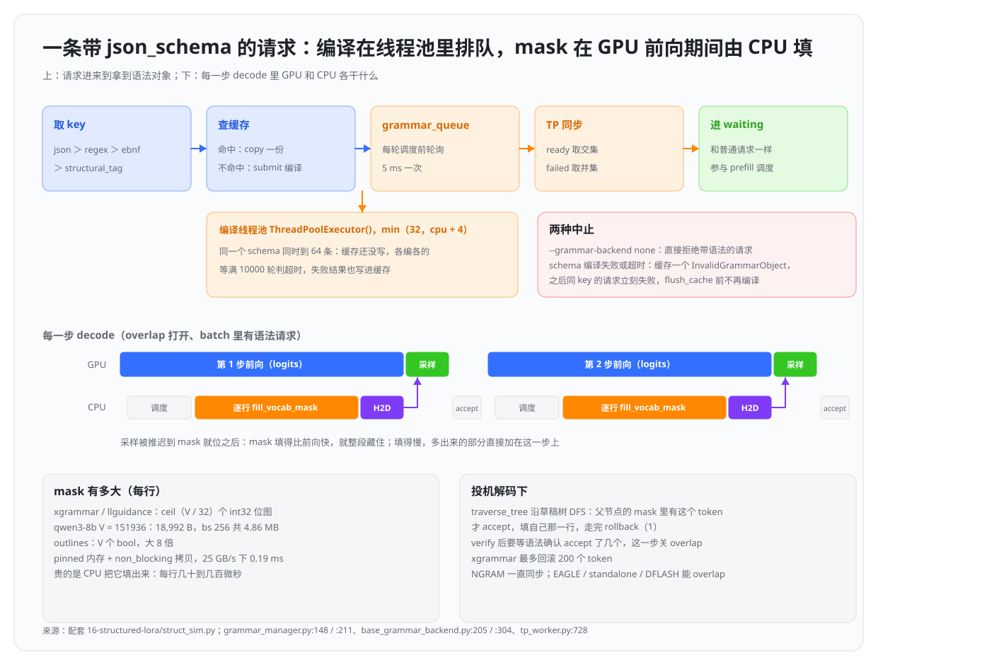
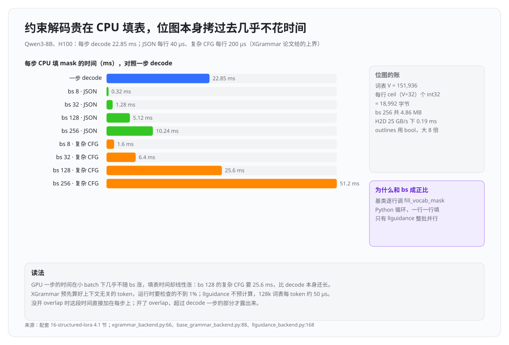
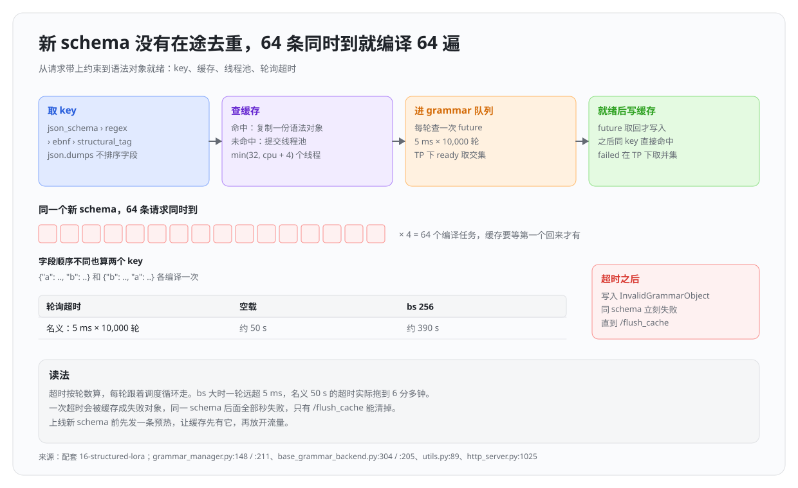
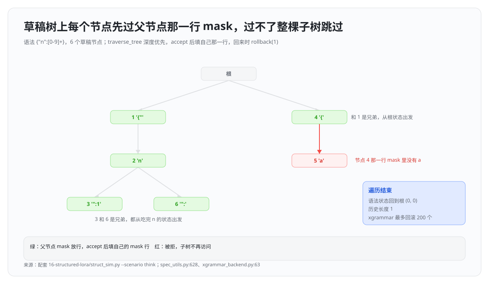
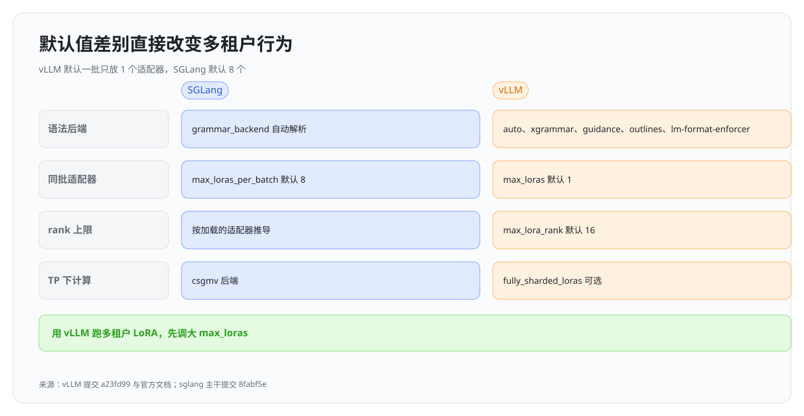
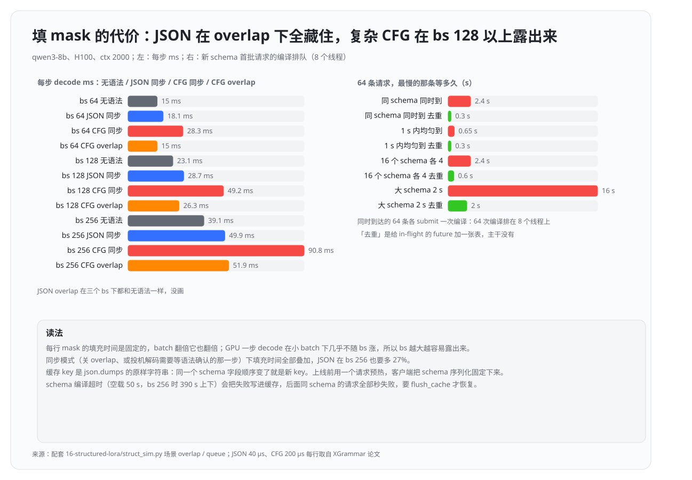
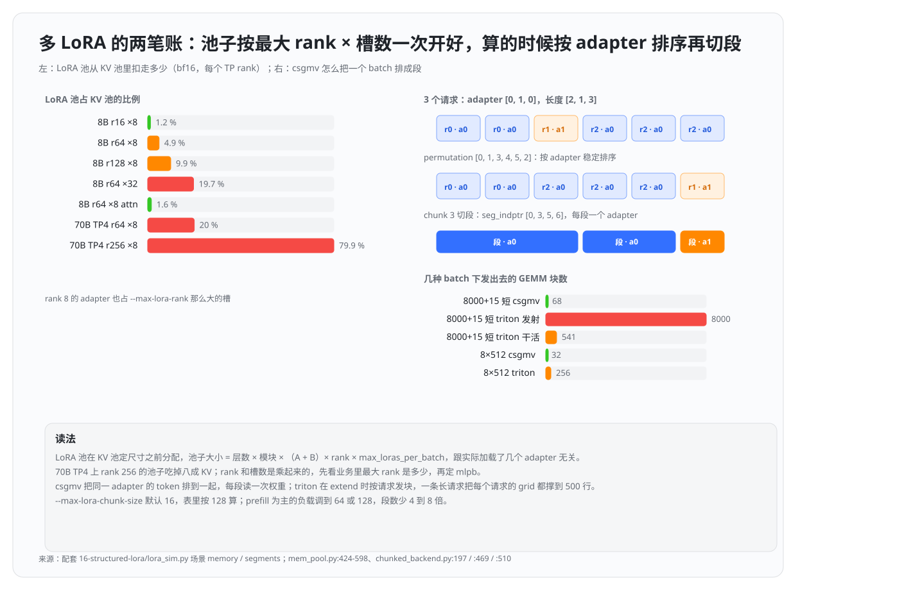
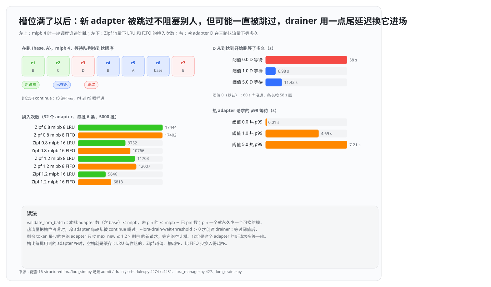

# SGL-16｜原理｜结构化输出与多 LoRA：约束解码和 adapter 批处理的代价

> 🎯 **遇到的问题**：Qwen3-8B 跑在一张 H100 上做工单抽取，每条请求带一份 json_schema，batch 稳定在 128。每步 decode 本来 23.05 ms，换成一份带嵌套和枚举的复杂语法后，CPU 逐行填 token mask 要 25.6 ms，比 GPU 一步前向还长，overlap 打开时每步 26.30 ms，关掉是 49.15 ms。
>
> 同一周上线了一个新 schema，64 条请求在同一秒到达，缓存还没写，64 条各提交一次编译，排在 8 个编译线程上，最慢的等了 2.4 秒。客户端每次随机字段顺序，缓存 key 又是原样序列化的字符串，这个 schema 永远不命中。
>
> 另一个团队在 Llama-3.1-8B 上挂了一批 rank 64 的 LoRA，--max-loras-per-batch 按默认开 8 个槽，池子先从 KV 里扣走 2.5 GiB，少了 20,480 个 token 的 KV。
>
> 换到 70B TP4、rank 256，LoRA 池吃掉八成 KV。三个热 adapter 加 base 占满 4 个槽后，第五个 adapter 的请求一分钟都没进 batch。
>
> XGrammar 把 JSON 的每 token 开销压到 40 µs 以内[[1]](https://arxiv.org/abs/2411.15100)，llguidance 在 128k 词表上约 50 µs[[2]](https://github.com/guidance-ai/llguidance)，多 LoRA 批处理从 Punica、S-LoRA 起就是推理服务的独立方向[[3]](https://arxiv.org/abs/2310.18547)[[4]](https://arxiv.org/abs/2311.03285)。
>
> 可这些代价都和 batch、schema 数、rank、槽位数绑在一起，平均值好看，线上露出来的是排队、尾延迟和被挤掉的 KV。这一篇讲带语法的请求和带 adapter 的请求各多走了哪几步，每一步的代价怎么算。
>
> **主线**：结构化输出和多 LoRA 都在每个 token 上多做一点事；这点开销和 batch、schema 数、rank、槽位数绑在一起，平均值好看，要看的是尾延迟。
>
> **读完这一篇**：能算出每步 token mask 多大、CPU 填它多久、overlap 藏不藏得住，查出新 schema 上线时 TTFT 尖峰的来源。能说清投机解码加语法和思考预算各怎么工作。能算出 LoRA 池从 KV 里扣走多少，判断 adapter 饿死该调哪个参数，认出 LoRA 组合报错是哪条校验拒的。
>
> **代码**：[zero-to-sglang/16-structured-lora](../16-structured-lora)。struct_sim.py 实现 mask 字节数和填充耗时、玩具正则语法的逐 token mask 与 rollback、编译线程池排队、思考预算和 think_end 的 KMP 匹配。lora_sim.py 实现 LoRA 池尺寸、准入、换入策略、csgmv 和 triton 的发块。resolve_sim.py 移植相关参数的校验链。只用标准库，行号按主干 8fabf5e 核对。

# 导读 · 结论先行

1. **语法约束落在采样前的一张位图上。**每条带语法的请求在每一步都有一行 mask，xgrammar 和 llguidance 用 ceil（V / 32）个 int32 位图，Qwen3 的 15 万词表一行 18,992 字节；采样前把不允许的 token 的 logits 置成负无穷。位图拷到 GPU 很便宜，贵的是 CPU 根据语法状态把它填出来，默认逐行，batch 越大越慢。
2. **编译只做一次，可第一次很贵。**请求带来的 schema 先查缓存，不命中就提交到编译线程池，请求进 grammar 队列，每轮调度前轮询一次，TP 各 rank 取交集以后才放进 waiting。同一 schema 同时到达的请求各编各的，编译失败或等满一万轮会把一个无效对象写进缓存，之后同 key 的请求立刻失败。
3. **overlap 能藏住填 mask 的时间，前提是填得比前向快。**有语法时 SGLang 把采样推迟到 mask 就位之后，CPU 在 GPU 前向期间填。JSON 这类简单语法在 bs 256 都藏得住；复杂 CFG 在 bs 128 以上会露出来。投机解码加语法时，verify 之后的那一步要等语法确认，overlap 被关掉。
4. **LoRA 的显存在启动时一次开好。**池子按 --max-lora-rank × --max-loras-per-batch × target modules 的并集分配，在 KV 池定尺寸之前，多出来的字节直接从 KV 里扣；rank 8 的 adapter 也占最大 rank 那么大的槽。
5. **槽位满了以后，调度靠跳过和排空。**本批 adapter 数（含 base）不能超过槽位数，放不下的请求被跳过，后面的照样进；热流量一直占满槽时冷 adapter 会一直被跳过，要开 drainer 让一个在跑的 adapter 停收新请求、跑空让槽。算的时候 csgmv 先按 adapter 把 token 排到一起再切段，同一个 adapter 只读一次权重。



上半部分是一条带 json_schema 的请求拿到语法对象之前的路：先按 json、regex、ebnf、structural_tag 的优先级取 key，查缓存，命中就复制一份，不命中就提交编译。请求停在 grammar 队列里，调度器每轮先轮询它，TP 各 rank 的结果取交集。就绪以后进 waiting，和普通请求一样参与 prefill 调度。

中间是编译线程池和两种中止。下半部分是有语法请求时每一步 decode 的时间线：GPU 在跑前向，CPU 在调度的同时逐行填 mask、拷到 GPU；采样被推迟到 mask 就位之后，再由语法对象 accept 采到的 token。底部两块是 mask 的尺寸和投机解码下的特殊处理。2.1 到 2.5 节逐条展开，LoRA 的部分从 2.7 节开始。

**📎 与系列其他文档的分工**：本篇讲挂在调度器边上的两件事：语法约束怎么变成每一步的 token mask，多个 LoRA 怎么共享一份底座。调度器的事件循环和 waiting 队列，见 [SGL-05｜原理｜调度器：waiting、running 与 KV 预算](./05-scheduler.md)，grammar 队列挂在它前面。KV 池怎么定尺寸，见 [SGL-07｜原理｜内存池与页表：req_to_token、token_to_kv 与 page size](./07-memory-pool.md)，LoRA 池在它之前分配。overlap 调度和推迟采样，见 [SGL-09｜原理｜Overlap 调度与 CUDA Graph：把 CPU 开销藏到 GPU 后面](./09-overlap-cudagraph.md)。投机解码的草稿树和 verify，见 [SGL-13｜原理｜投机解码：EAGLE、MTP、NGRAM 怎么选、怎么调](./13-speculative.md)。TP 下各 rank 怎么同步，见 [SGL-11｜原理｜并行：TP、DP Attention、EP 怎么组合](./11-parallelism.md)。

# 第 1 章 · 问题：约束解码和多 LoRA 的代价藏在哪

线上常见的情形：

- 开了 json_schema 以后，bs 小的时候每步几乎不变，bs 上到 200 多，ITL 涨了三成。
- 新 schema 上线的头几秒，TTFT 冲到两三秒，sglang:num_grammar_queue_reqs 堆到几十，之后又恢复正常。
- 同一个 schema，num_grammar_cache_hit_total 几乎不涨，grammar_schema_count 一直在加。
- 一个巨大的 schema 编译超时以后，同一个 schema 的请求全部秒失败，重启服务才好。
- 投机解码跑得好好的，加上结构化输出以后加速比明显下降。
- 文档里说 jump forward 能跳过确定的 token，翻遍参数找不到开关。
- 思考模型加了 max_thinking_tokens，返回 400；开了 --enable-strict-thinking，预算还是不生效。
- 让模型直接按 JSON 输出，格式全对，数学题的正确率却掉了。
- 挂了 LoRA 以后，同样的显存，日志里 max_total_num_tokens 少了几万。
- 四个 adapter 加 base 的流量，第五个 adapter 的请求排了一分多钟没动。
- 长 prompt 为主的 LoRA 服务，triton 后端的 prefill 比 csgmv 慢得多；冷 adapter 第一次被调度时，整批请求的 ITL 一起抖一下。

这些现象落在两条线上。结构化输出这条线有五件事：mask 的大小和填充代价，编译、缓存和排队，overlap 和推迟采样，投机解码和 rollback，思考段的约束；再加上格式约束对输出质量的影响。多 LoRA 这条线有四件事：池子的显存，准入、淘汰和排空，分段 kernel，异步加载。

| 想弄清的现象 | 看哪一节 |
|-|-|
| mask 有多大，填它要多久，bs 大了为什么慢 | 2.1、4.1 |
| 新 schema 上线的 TTFT 尖峰，缓存为什么不命中，超时以后为什么全失败 | 2.2、4.3 |
| overlap 能藏住多少，什么时候被关掉 | 2.3、4.4 |
| 投机解码加语法、jump forward 去哪了 | 2.4、4.2 |
| 思考预算和 strict thinking 怎么生效 | 2.5、4.2 |
| 格式约束会不会伤正确率 | 2.6 |
| LoRA 池从 KV 里扣走多少 | 2.7、4.5 |
| adapter 为什么进不了 batch，LRU 和 FIFO 差多少 | 2.8、4.6 |
| csgmv 和 triton 怎么选，chunk 调多大 | 2.9、4.5 |
| 冷 adapter 加载拖慢整批 | 2.10、4.6 |
| 启动报错和参数被改写 | 4.6 |

# 第 2 章 · 原理：一张 mask、一个编译队列、一池 adapter 槽位

## 2.1 约束解码落在哪：每一步一行位图

语言模型每一步输出一个词表大小的 logits 向量，采样从里面挑一个 token。约束解码在采样前插一步：根据当前的语法状态，算出哪些 token 接上去以后还能让输出保持合法，把其余 token 的 logits 置成负无穷。Outlines 最早把这件事做成正则和 JSON Schema 到有限状态机的编译，状态机的每个状态预先算好允许的 token 集合[[5]](https://arxiv.org/abs/2307.09702)；SGLang 论文里的压缩状态机把只有一条出边的状态串起来，一次跳过好几个确定的字符，也就是后来常说的 jump forward[[6]](https://arxiv.org/abs/2312.07104)[[7]](https://www.lmsys.org/blog/2024-02-05-compressed-fsm/)。

XGrammar 把语法推广到下推自动机，能表达嵌套的 JSON 和任意上下文无关文法，并且把词表切成「只看当前位置就能判断」和「要看栈」两类，上下文无关的那类预先算好缓存，需要运行时检查的 token 不到 1%，自适应缓存把一份 mask 的存储从 160 MB 压到 0.46 MB[[1]](https://arxiv.org/abs/2411.15100)[[8]](https://github.com/mlc-ai/xgrammar)。llguidance 走另一条路，用 Earley 解析器加词法层的派生正则，不做预计算，128k 词表上每 token 大约 50 µs，被 SGLang、vLLM、llama.cpp 集成，OpenAI 的结构化输出也采用了它[[2]](https://github.com/guidance-ai/llguidance)。

这一步在 SGLang 里是一个 mask 张量，每条带语法的请求一行。xgrammar 和 llguidance 用位图，每个 token 一位，一行 ceil（V / 32）个 int32，分配在 pinned 内存上[（xgrammar_backend.py:66）](https://github.com/sgl-project/sglang/blob/8fabf5e/python/sglang/srt/constrained/xgrammar_backend.py#L66)；outlines 后端用一个 V 长的 bool 张量[（outlines_backend.py:59）](https://github.com/sgl-project/sglang/blob/8fabf5e/python/sglang/srt/constrained/outlines_backend.py#L59)，大 8 倍。

Qwen3 的词表 151,936，位图一行 18,992 字节，bs 256 合计 4.86 MB，按 25 GB/s 的 H2D 带宽拷过去 0.19 ms，和一步 decode 比可以忽略。GPU 上用一个 kernel 按位把 logits 置负无穷[（:130）](https://github.com/sgl-project/sglang/blob/8fabf5e/python/sglang/srt/constrained/xgrammar_backend.py#L130)，也很便宜。

贵的是 CPU 把这张表填出来。调度器给 batch 里每条带语法的请求调一次 fill_vocab_mask，基类的 fill_vocab_mask_batched 就是一个 Python 循环逐行调[（base_grammar_backend.py:88）](https://github.com/sgl-project/sglang/blob/8fabf5e/python/sglang/srt/constrained/base_grammar_backend.py#L88)，只有 llguidance 在整批都是它的语法对象时改走原生的 fill_next_token_bitmask_par，多线程并行填[（llguidance_backend.py:168）](https://github.com/sgl-project/sglang/blob/8fabf5e/python/sglang/srt/constrained/llguidance_backend.py#L168)。

XGrammar 论文给的数是 JSON 每 token 40 µs 以内、XML 和 DSL 一类的复杂文法 200 µs 以内[[1]](https://arxiv.org/abs/2411.15100)。按这两个数，bs 128 时 JSON 每步要 5.1 ms，复杂 CFG 要 25.6 ms，而 Qwen3-8B 在 H100 上一步 decode 是 22.85 ms。GPU 一步的时间在小 batch 下几乎不随 bs 涨，填 mask 的时间却和 bs 成正比，所以 batch 越大越容易露出来，4.1 节把这张对照表算全。

还有一个容易混的地方：mask 判断的是整个 token 的字符串能不能被语法吃下，和语法单元的边界无关。BPE 词表里有大量跨边界的 token，比如「":」把 JSON 的引号和冒号合在一起。DOMINO 的论文专门讨论过这一点：如果约束只按语法单元切，模型被迫用不自然的子词拼出合法输出，分布偏了，准确率会掉；按子词对齐的约束几乎零开销，还能借着确定的子串加速到两倍左右[[9]](https://arxiv.org/abs/2403.06988)。4.2 节的玩具语法里有一个这样的 token。



## 2.2 编译、缓存和 grammar 队列

请求带着 json_schema、regex、ebnf 或 structural_tag 进来，调度器在 process_req_with_grammar 里按这个优先级取一个 key[（grammar_manager.py:148）](https://github.com/sgl-project/sglang/blob/8fabf5e/python/sglang/srt/constrained/grammar_manager.py#L148)。json_schema 的 key 是 json.dumps 的结果[（utils.py:89）](https://github.com/sgl-project/sglang/blob/8fabf5e/python/sglang/srt/utils.py#L89)，没有 sort_keys，字段顺序不同的两个 schema 是两个 key。启动时 --grammar-backend none 的服务直接中止带语法的请求；缓存里这个 key 对应的是一个无效对象，也直接中止。

查缓存在 get_cached_or_future_value[（base_grammar_backend.py:304）](https://github.com/sgl-project/sglang/blob/8fabf5e/python/sglang/srt/constrained/base_grammar_backend.py#L304)：命中就复制一份语法对象，每条请求要有自己的状态；不命中就往线程池提交一次编译，返回一个 future。线程池是不带参数的 ThreadPoolExecutor()[（:205）](https://github.com/sgl-project/sglang/blob/8fabf5e/python/sglang/srt/constrained/base_grammar_backend.py#L205)，大小是 min（32，cpu + 4）。

缓存要等 future 的结果被取回才写进去，中间这段时间里同一个 key 的请求再来，看到的还是不命中，又提交一次。所以没有 in-flight 去重，一个新 schema 第一次出现时同时到达的 64 条请求会编译 64 遍，排在同一个线程池上，后到的请求还要等前面的编完。

拿到 future 的请求进 grammar 队列。调度器每轮先调 get_ready_grammar_requests[（:211）](https://github.com/sgl-project/sglang/blob/8fabf5e/python/sglang/srt/constrained/grammar_manager.py#L211)：按 SGLANG_GRAMMAR_POLL_INTERVAL（默认 5 ms）等一下 future，好了的标成 ready，等满 SGLANG_GRAMMAR_MAX_POLL_ITERATIONS（默认 10,000）轮的标成 failed。

TP 下每个 rank 各自编译，各自判断，然后 ready 取交集、failed 取并集：最慢的 rank 说了算，一个 rank 超时就全体放弃。超时的 key 会以 InvalidGrammarObject("Grammar preprocessing timed out") 写进缓存，之后同一个 schema 的请求立刻失败，直到调 /flush_cache 清掉缓存[（http_server.py:1025）](https://github.com/sgl-project/sglang/blob/8fabf5e/python/sglang/srt/entrypoints/http_server.py#L1025)。

注意这里的超时是按轮数算的。空载时一轮约 5 ms，一万轮是 50 秒；可轮询夹在调度循环里，batch 大的时候一轮就是一步 decode 的时间，bs 256 时要 390 秒左右才判超时。

JSONSchemaBench 用 1 万份真实 schema 对比过 Guidance、Outlines、Llamacpp、XGrammar 和 OpenAI、Gemini 的结构化输出，从编译和生成效率、schema 覆盖率、输出质量三方面打分，各家在覆盖率上差别很大，不少真实 schema 要么编译很慢要么直接不支持{r("jsonschemabench")}。上线前拿业务里最大的那份 schema 单独压一次，比等线上超时再 flush 便宜得多。



## 2.3 overlap 和推迟采样

不开 overlap 时一步的顺序是：调度、填 mask、前向、采样、accept，填 mask 的时间整段加在每一步上。SGLang 默认开 overlap 调度，CPU 准备下一批的同时 GPU 跑这一批[SGL-09｜原理｜Overlap 调度与 CUDA Graph：把 CPU 开销藏到 GPU 后面](./09-overlap-cudagraph.md)。有语法请求时，tp_worker 会把采样从前向里拆出来，挂成一个推迟执行的函数[（tp_worker.py:728）](https://github.com/sgl-project/sglang/blob/8fabf5e/python/sglang/srt/managers/tp_worker.py#L728)：条件是开了 overlap、不是投机解码、batch 里有语法对象，或者显式设了 SGLANG_ENABLE_DELAY_SAMPLE。

GPU 先跑前向，CPU 在这段时间里填 mask，填完再由调度器发起采样[（scheduler.py:5112）](https://github.com/sgl-project/sglang/blob/8fabf5e/python/sglang/srt/managers/scheduler.py#L5112)，采样里调 update_regex_vocab_mask 把 mask 拷上去[（sampling_batch_info.py:382）](https://github.com/sgl-project/sglang/blob/8fabf5e/python/sglang/srt/sampling/sampling_batch_info.py#L382)。

结果是一个 max：填 mask 比前向快，就整段藏住；比前向慢，多出来的部分直接加在这一步上。XGrammar 论文里讲的「和 GPU 计算重叠，几乎零开销」，前提就是这个{r("xgrammar")}。4.4 节算出来，JSON 在 bs 256 时仍然完全藏住，复杂 CFG 在 bs 128 多 14%、bs 256 多 33%。同步模式下没有这个 max，JSON 在 bs 256 也要多 27%。

有两种情况 overlap 会被关掉。第一种是投机解码加语法：verify 之后接受了几个 token 要由语法确认，下一步的草稿要从确认后的状态出发，scheduler 在 decode 且结果队列非空时对这一步关 overlap[（scheduler.py:2139）](https://github.com/sgl-project/sglang/blob/8fabf5e/python/sglang/srt/managers/scheduler.py#L2139)。第二种是设了 SGLANG_DISABLE_CONSECUTIVE_PREFILL_OVERLAP，连续两批 prefill 之间不 overlap。第一种在实际部署里更常见，结构化输出加投机解码时，加速比下降有一部分就来自这里。

## 2.4 投机解码、rollback，以及 jump forward 去哪了

投机解码时草稿是一棵树，verify 之前要给树上每个节点填一行 mask。traverse_tree 沿草稿树做深度优先遍历[（spec_utils.py:628）](https://github.com/sgl-project/sglang/blob/8fabf5e/python/sglang/srt/speculative/spec_utils.py#L628)：到一个节点，先看父节点那一行 mask 里有没有这个 token，没有就整个子树跳过；有就 accept 进语法，填自己那一行，递归子节点，回来时 rollback（1）。走完一遍语法状态回到根，目标模型 verify 时在这些行上采样，被语法拒掉的分支不会被接受[SGL-13｜原理｜投机解码：EAGLE、MTP、NGRAM 怎么选、怎么调](./13-speculative.md)。

verify 拒掉一部分草稿以后，语法要退回去。xgrammar 的语法对象最多支持回滚 200 个 token[（xgrammar_backend.py:63）](https://github.com/sgl-project/sglang/blob/8fabf5e/python/sglang/srt/constrained/xgrammar_backend.py#L63)，草稿长度远小于这个数，够用。思考模型外面包的 Reasoner 也要能退，状态包括思考段计了多少 token、think_end 序列匹配到第几个、正文段计了多少，退回时三样一起退，4.2 节有一个跨过 think_end 再退回思考段的例子。

jump forward 是 SGLang 早期的卖点：语法状态确定时，后面几个字符只有一种写法，直接把它们拼上去，省掉几次前向[[7]](https://www.lmsys.org/blog/2024-02-05-compressed-fsm/)。主干上 xgrammar 后端仍然有 try_jump_forward 和 jump_and_retokenize 两个方法[（xgrammar_backend.py:168）](https://github.com/sgl-project/sglang/blob/8fabf5e/python/sglang/srt/constrained/xgrammar_backend.py#L168)，可在 constrained 目录以外没有任何调用方，调度器不再走这条路，也没有开关。

原因不难理解：跳过的字符要重新分词，和模型自己会生成的 token 序列对不上，DOMINO 讨论的子词错位在这里会更严重[[9]](https://arxiv.org/abs/2403.06988)；跳过的那几步在 overlap 和 CUDA Graph 下本来也很便宜。所以现在谈结构化输出的开销，只剩 mask 的填充和编译。



## 2.5 思考段：strict thinking 和预算

思考模型先输出一段思考，再输出正文。语法约束只该管正文，思考段要放开。SGLang 在 grammar backend 外面包一层 ReasonerGrammarBackend[（base_grammar_backend.py:448）](https://github.com/sgl-project/sglang/blob/8fabf5e/python/sglang/srt/constrained/base_grammar_backend.py#L448)，条件是同时设了 --reasoning-parser 且拿得到 think_end 的 token 序列[[10]](https://docs.sglang.io/docs/advanced_features/separate_reasoning)。

思考段里，正文的语法对象不接收 token，mask 全放开；think_end 匹配上以后，状态转给正文语法[（reasoner_grammar_backend.py:154）](https://github.com/sgl-project/sglang/blob/8fabf5e/python/sglang/srt/constrained/reasoner_grammar_backend.py#L154)。think_end 在很多模型里是多个 token，匹配用一个 KMP 状态机[（token_sequence_matcher.py:18）](https://github.com/sgl-project/sglang/blob/8fabf5e/python/sglang/srt/utils/token_sequence_matcher.py#L18)，部分匹配失败时退回最长前缀，而不是清零。

--enable-strict-thinking 在这上面再加两条[[11]](https://docs.sglang.io/docs/advanced_features/structured_outputs_for_reasoning_models)。第一条是思考段屏蔽一组 token，Qwen3 是 tool_call 的开闭标签、im_end 和 endoftext[（reasoning_parser.py:441）](https://github.com/sgl-project/sglang/blob/8fabf5e/python/sglang/srt/parser/reasoning_parser.py#L441)，防止模型在思考里调工具或者直接结束。

屏蔽用的是 set_token_filter，往位图里按白名单或黑名单写位[（token_filter_torch_ops.py:25）](https://github.com/sgl-project/sglang/blob/8fabf5e/python/sglang/srt/constrained/torch_ops/token_filter_torch_ops.py#L25)。第二条是请求可以带 max_thinking_tokens，tokenizer 把它写进 custom_params 的 thinking_budget，思考计数加上 think_end 已匹配的长度到了预算，每一步只放行 think_end 的下一个 token，逼模型收尾。

没开 strict thinking 的服务收到 max_thinking_tokens 直接返回错误[（tokenizer_manager.py:905）](https://github.com/sgl-project/sglang/blob/8fabf5e/python/sglang/srt/managers/tokenizer_manager.py#L905)；开了 strict thinking 却没写 --reasoning-parser，think_end 为空，Reasoner 不会挂上，预算静默不生效。grammar backend 设成 none 时 strict thinking 在启动时就被拒，它依赖 token 过滤。

预算到了以后的强制收尾是 mask 层面的硬约束，模型「想」继续写，采到的却是 think_end 的下一段。这会改变正文的分布：思考被截在半句话上，正文从一个模型没准备好的状态开始。预算定得太紧，省下的 token 可能换来更差的答案，按业务的正确率曲线来定，别按平均思考长度拍。

## 2.6 格式约束对质量的影响

约束解码保证格式合法，不保证内容对。Speak Freely 系统比较了几种格式限制下模型的推理表现，结论是格式限制会伤推理，限制越严伤得越多，直接要求 JSON 输出比先自由回答再转格式差一截[[12]](https://arxiv.org/abs/2408.02442)。DOMINO 从 token 层面给了另一个原因：约束和子词边界没对齐时，模型被迫走低概率的 token 路径[[9]](https://arxiv.org/abs/2403.06988)。JSONSchemaBench 的质量维度也显示，同一份 schema 在不同引擎上的下游任务准确率并不相同[[13]](https://arxiv.org/abs/2501.10868)。

落到工程上有三条做法。思考模型用 2.5 节的方式让思考段自由、只约束正文，SGLang 的结构化输出文档就是这么推荐的[[14]](https://docs.sglang.io/docs/advanced_features/structured_outputs)[[11]](https://docs.sglang.io/docs/advanced_features/structured_outputs_for_reasoning_models)。schema 里给模型留一个自由文本的字段放推理过程，放在答案字段前面，字段顺序就是生成顺序。上线前在业务评测集上对比有约束和无约束两种输出的正确率，而不是只看格式合法率。

## 2.7 LoRA 池：按最大 rank 和槽位数一次开好

LoRA 给一个线性层 W 加一个低秩修正 B·A，A 是 r × d_in，B 是 d_out × r，r 远小于隐藏维度，训练只更新 A 和 B[[15]](https://arxiv.org/abs/2106.09685)。服务时底座只有一份，每条请求按自己的 adapter 在底座输出上加 x·Aᵀ·Bᵀ。多 adapter 的难点在于同一个 batch 里不同请求的 A、B 不同，没法拼成一个大矩阵乘。

Punica 提出 SGMV，一个 kernel 按段处理不同 adapter 的请求[[3]](https://arxiv.org/abs/2310.18547)；S-LoRA 把 adapter 权重和 KV 放进统一分页的内存池，支持几千个 adapter 并发[[4]](https://arxiv.org/abs/2311.03285)。SGLang 的做法更接近 Punica，再加一个固定大小的槽位池[[16]](https://docs.sglang.io/docs/advanced_features/lora)。

池子在 LoRA manager 初始化时分配，这一步在 KV 池定尺寸之前[（model_runner.py:762）](https://github.com/sgl-project/sglang/blob/8fabf5e/python/sglang/srt/model_executor/model_runner.py#L762)，多出来的字节直接从 KV 里扣。每个目标模块每层分一块 A 缓冲和一块 B 缓冲，形状由 --max-lora-rank 和 --max-loras-per-batch 决定[（mem_pool.py:424）](https://github.com/sgl-project/sglang/blob/8fabf5e/python/sglang/srt/lora/mem_pool.py#L424)，q、k、v 合成一个 qkv_proj，gate 和 up 合成 gate_up_proj，A 的行数按 3 倍和 2 倍算[（lora/utils.py:330）](https://github.com/sgl-project/sglang/blob/8fabf5e/python/sglang/srt/lora/utils.py#L330)。

TP 下列并行层切 B、行并行层切 A。所以池子大小只跟最大 rank、槽位数和目标模块的并集有关，跟实际加载了几个 adapter、每个 adapter 的 rank 是多少无关，rank 8 的 adapter 也占一个 rank 128 的槽。

Llama-3.1-8B 挂全部模块、rank 64、8 个槽，池子 2.5 GiB，按 KV 每 token 128 KiB 折算少了 20,480 个 token；槽位调到 32 就是 10 GiB，占掉两成 KV。只挂 attention 的 q、k、v、o 时池子只有 0.81 GiB，MLP 的 gate_up 和 down 才是大头。--max-lora-rank 和 --lora-target-modules 不写时会从启动时加载的 adapter 推断，之后动态加载更大 rank 或更多模块的 adapter 会被拒，所以动态加载的服务要显式写这两个参数。

## 2.8 准入、淘汰和排空

--max-loras-per-batch（mlpb，默认 8）是一个 batch 里最多同时出现几种 adapter，base 模型也算一种。调度器每轮从 waiting 队列按顺序取请求，can_schedule_lora_req 依次检查：drainer 允不允许、这个 adapter 是否已经在本批里、异步加载器的状态、加上它以后 validate_lora_batch 是否通过[（scheduler.py:4481）](https://github.com/sgl-project/sglang/blob/8fabf5e/python/sglang/srt/managers/scheduler.py#L4481)。不通过的请求用 continue 跳过[（:4274）](https://github.com/sgl-project/sglang/blob/8fabf5e/python/sglang/srt/managers/scheduler.py#L4274)，后面的请求照样检查。所以 LoRA 请求之间没有队头阻塞，但被跳过的那个可能一直被跳过。

validate_lora_batch 除了总数不超过 mlpb，还要求未 pin 的 adapter 数不超过 mlpb 减去已 pin 的数[（lora_manager.py:427）](https://github.com/sgl-project/sglang/blob/8fabf5e/python/sglang/srt/lora/lora_manager.py#L427)。pin 住的 adapter 常驻一个槽，不在本批也占着，pin 一个就永久少一个可换的槽；pin 到 mlpb − 1 个时再 pin 会直接报错[（:378）](https://github.com/sgl-project/sglang/blob/8fabf5e/python/sglang/srt/lora/lora_manager.py#L378)，给 base 和未 pin 的 adapter 至少留一个。DP attention 下更严：所有 adapter 都必须 pin，后端只能是 triton，不能开异步加载[[16]](https://docs.sglang.io/docs/advanced_features/lora)。

本批需要的 adapter 不在槽里时，prepare_lora_batch 先找空槽，没有空槽就按淘汰策略踢一个不在本批里的[（mem_pool.py:780）](https://github.com/sgl-project/sglang/blob/8fabf5e/python/sglang/srt/lora/mem_pool.py#L780)，再从 CPU 拷进来。--lora-eviction-policy 有 lru 和 fifo 两种。槽比每批用到的 adapter 多时，空出来的槽就是缓存，换入次数取决于淘汰谁；4.6 节在 Zipf 流量下比较，32 个 adapter、16 个槽、Zipf 1.2 时 LRU 比 FIFO 少换入 17%。

热流量把槽位一直占满时，冷 adapter 每轮都被跳过，这是饥饿而不是慢。--lora-drain-wait-threshold 大于 0 才会创建 drainer[（scheduler.py:2404）](https://github.com/sgl-project/sglang/blob/8fabf5e/python/sglang/srt/managers/scheduler.py#L2404)。在跑的 adapter 数达到 mlpb 时，drainer 找等得最久、超过阈值的那个冷 adapter，从在跑的 adapter 里挑剩余 token 最少的一个，让它停收新请求，只放行 max_new_tokens 不超过剩余量 1.2 倍的请求[（lora_drainer.py:176）](https://github.com/sgl-project/sglang/blob/8fabf5e/python/sglang/srt/lora/lora_drainer.py#L176)，等它跑空让出槽位。默认阈值是 0，等于不开。

## 2.9 分段 kernel：csgmv 和 triton

LoRA 的计算分两段：shrink 把 x 乘 Aᵀ 压到 r 维，expand 再乘 Bᵀ 回到输出维度。batch 里不同 token 属于不同 adapter，kernel 要知道每一段 token 用哪个 adapter 的权重。默认后端 csgmv 先按 adapter 把 token 做稳定排序，得到一个 permutation[（chunked_backend.py:469）](https://github.com/sgl-project/sglang/blob/8fabf5e/python/sglang/srt/lora/backend/chunked_backend.py#L469)，再按 chunk 大小切段，每段只含一个 adapter[（:510）](https://github.com/sgl-project/sglang/blob/8fabf5e/python/sglang/srt/lora/backend/chunked_backend.py#L510)。

同一个 adapter 的 token 被排到一起，一段只读一次这个 adapter 的权重。chunk 大小按本批 token 数选：256 以上取 128，64 以上取 32，否则 16，再被 --max-lora-chunk-size 封顶[（:196）](https://github.com/sgl-project/sglang/blob/8fabf5e/python/sglang/srt/lora/backend/chunked_backend.py#L196)，这个参数默认是 16，所以默认配置下不管 batch 多大都是 16。

triton 后端在 decode 时也先按 adapter 排序，按 mlpb 个段发块，和 csgmv 差别不大；extend 时按请求发块，grid 的行数按最长那条请求算[（triton_backend.py:469）](https://github.com/sgl-project/sglang/blob/8fabf5e/python/sglang/srt/lora/backend/triton_backend.py#L469)，一条 8000 token 的长请求把每个请求的 grid 都撑到 500 行，短请求的块大量空转退出。SGLang 文档给的数是 csgmv 比 triton 快 20% 到 80%[[16]](https://docs.sglang.io/docs/advanced_features/lora)。

S-LoRA 的统一分页和 Punica 的 SGMV 解决的是「多 adapter 能不能放进一个 batch」；CaraServe 关注的是冷启动和 rank 差异：adapter 还在往 GPU 拷时先在 CPU 上算它的 prefill，调度时考虑不同 rank 的计算量不同，论文报告延迟最多降低 1.4 倍、SLO 达成率到 99%[[17]](https://arxiv.org/abs/2401.11240)。SGLang 没有 CPU 辅助计算，它对冷启动的回答是下一节的异步加载。

## 2.10 异步加载

同步加载时，prepare_lora_batch 在前向之前把新 adapter 的权重拷进槽，这一步整个 batch 的请求都要等。rank 64 的 Llama-3.1-8B adapter 是 320 MiB，按 25 GB/s 要 13.4 ms，比 bs 32 时一步 decode 还长。

--enable-lora-overlap-loading 把拷贝挪到一个 side stream 上[[18]](https://github.com/sgl-project/sglang/pull/15512)：try_overlap_load_lora 给每个 adapter 维护 NOT_LOADED、LOADING、LOADED 三个状态[（lora_overlap_loader.py:33）](https://github.com/sgl-project/sglang/blob/8fabf5e/python/sglang/srt/lora/lora_overlap_loader.py#L33)，第一次见到就在 side stream 上发起拷贝并记一个 event，event 完成前这个 adapter 的请求留在队列里，其他请求照常 decode。PR 里报告中位 TTFT 降低约 35%。

代价有两条。CPU 端的权重要 pin 住才能异步拷，所以 --max-loaded-loras 不能超过 2 × mlpb[（lora_hook.py:63）](https://github.com/sgl-project/sglang/blob/8fabf5e/python/sglang/srt/arg_groups/lora_hook.py#L63)，不写这个参数直接启动失败；还在拷的 adapter 也算进 validate_lora_batch 的槽位里，加载期间它占着一个槽却没有请求在跑。冷 adapter 本身要多等一到几步才进 batch，换来的是热请求的 ITL 不被打断。

## 2.11 vLLM 怎么做

vLLM 的结构化输出后端可选 auto、xgrammar、guidance、outlines 和 lm-format-enforcer，auto 会按 schema 特性挑一个能处理的[[19]](https://docs.vllm.ai/en/latest/features/structured_outputs.html)[[20]](https://github.com/vllm-project/vllm/blob/a23fd9903418de0e1d3757bb23e2f1697eb066f3/vllm/v1/structured_output/__init__.py)。语法掩码在调度器里按批生成，和前向重叠。多 LoRA 这边，max_loras 默认 1，表示一个 batch 里同时生效的适配器数；max_lora_rank 默认 16，max_cpu_loras 控制 CPU 侧缓存几个，fully_sharded_loras 在 TP 下把 LoRA 计算也切开[[21]](https://docs.vllm.ai/en/latest/features/lora.html)。

SGLang 的 grammar_backend 同样自动解析，max_loras_per_batch 默认 8，lora_backend 默认 csgmv。默认值的差别会直接改变线上行为：同样发来 4 个不同适配器的请求，vLLM 默认配置会把它们拆到不同 batch 里排队，SGLang 默认能放进同一批。用 vLLM 跑多租户 LoRA 时，第一件事就是调大 max_loras。

| 维度 | SGLang | vLLM | 差异的代价 |
|-|-|-|-|
| 语法后端 | grammar_backend 自动解析 | auto、xgrammar、guidance、outlines、lm-format-enforcer | 同一 schema 在不同后端支持度不同 |
| 同批适配器 | max_loras_per_batch 默认 8 | max_loras 默认 1 | vLLM 默认多租户会排队 |
| rank 上限 | 按加载的适配器推导 | max_lora_rank 默认 16 | rank 32 的适配器在 vLLM 要改参数 |
| TP 下计算 | csgmv 后端 | fully_sharded_loras 可选 | 大 rank 时切分更省显存 |



# 第 3 章 · 源码走读：语法请求和 LoRA 请求的 18 个落脚点

前 10 个按一条带语法的请求排：取 key、查缓存、编译、排队、TP 同步，然后是每一步的推迟采样、填 mask、草稿树和思考段；后 8 个按一条带 adapter 的请求排：池子分配、加载、准入、排空、换入、分段、异步加载，最后是启动校验。行号都对应主干 8fabf5e。

| # | 位置 | 发生了什么 |
|-|-|-|
| 1 | [constrained/grammar_manager.py:148](https://github.com/sgl-project/sglang/blob/8fabf5e/python/sglang/srt/constrained/grammar_manager.py#L148) | process_req_with_grammar：按 json、regex、ebnf、structural_tag 取 key。backend 为 none 或缓存里是无效对象就中止。strict thinking 且没有语法时走 init_strict_reasoning_grammar |
| 2 | [utils.py:89](https://github.com/sgl-project/sglang/blob/8fabf5e/python/sglang/srt/utils.py#L89) | convert_json_schema_to_str：json.dumps 原样序列化，不排序，字段顺序不同就是两个缓存 key |
| 3 | [constrained/base_grammar_backend.py:304](https://github.com/sgl-project/sglang/blob/8fabf5e/python/sglang/srt/constrained/base_grammar_backend.py#L304) | get_cached_or_future_value：命中复制一份，不命中往 :205 的 ThreadPoolExecutor() 提交编译；没有 in-flight 去重 |
| 4 | [constrained/grammar_manager.py:211](https://github.com/sgl-project/sglang/blob/8fabf5e/python/sglang/srt/constrained/grammar_manager.py#L211) | get_ready_grammar_requests：每 5 ms 轮询 future，满 10,000 轮算失败。TP 间 ready 取交集、failed 取并集。超时写 InvalidGrammarObject 进缓存 |
| 5 | [constrained/xgrammar_backend.py:66](https://github.com/sgl-project/sglang/blob/8fabf5e/python/sglang/srt/constrained/xgrammar_backend.py#L66) | \_allocate_token_bitmask：ceil（V / 32）个 int32，pinned 内存。:63 MAX_ROLLBACK_TOKENS=200。:168 try_jump_forward 在 constrained 目录外没有调用方 |
| 6 | [constrained/base_grammar_backend.py:88](https://github.com/sgl-project/sglang/blob/8fabf5e/python/sglang/srt/constrained/base_grammar_backend.py#L88) | fill_vocab_mask_batched：基类逐行调 fill_vocab_mask；llguidance_backend.py:168 整批都是它的对象时走原生并行填充 |
| 7 | [managers/tp_worker.py:728](https://github.com/sgl-project/sglang/blob/8fabf5e/python/sglang/srt/managers/tp_worker.py#L728) | 有语法且开 overlap、非投机时把采样拆成 delay_sample_func；scheduler.py:5112 launch_batch_sample_if_needed 在 mask 就位后发起采样 |
| 8 | [managers/scheduler.py:2139](https://github.com/sgl-project/sglang/blob/8fabf5e/python/sglang/srt/managers/scheduler.py#L2139) | is_disable_overlap_for_batch：投机解码加语法、decode 且结果队列非空时关这一步的 overlap；连续 prefill 的环境变量开关 |
| 9 | [speculative/spec_utils.py:628](https://github.com/sgl-project/sglang/blob/8fabf5e/python/sglang/srt/speculative/spec_utils.py#L628) | traverse_tree：沿草稿树 DFS，父节点 mask 里有这个 token 才 accept，填自己那一行，回来 rollback（1） |
| 10 | [constrained/reasoner_grammar_backend.py:154](https://github.com/sgl-project/sglang/blob/8fabf5e/python/sglang/srt/constrained/reasoner_grammar_backend.py#L154) | transfer_state：思考计数、think_end 匹配、正文计数三段状态。:421 strict thinking 下取要屏蔽的 token。token_sequence_matcher.py:18 是 KMP |
| 11 | [model_executor/model_runner.py:762](https://github.com/sgl-project/sglang/blob/8fabf5e/python/sglang/srt/model_executor/model_runner.py#L762) | maybe_init_lora_manager：在 KV 池定尺寸（:860）之前分配 LoRA 池，池子的字节从 KV 里扣 |
| 12 | [lora/mem_pool.py:424](https://github.com/sgl-project/sglang/blob/8fabf5e/python/sglang/srt/lora/mem_pool.py#L424) | get_lora_A_shape / B_shape：按最大 rank、槽位数、TP 切分算缓冲形状。:598 init_buffers 按目标模块逐层分配。lora/utils.py:330 qkv 和 gate_up 的堆叠倍数 |
| 13 | [lora/lora_manager.py:279](https://github.com/sgl-project/sglang/blob/8fabf5e/python/sglang/srt/lora/lora_manager.py#L279) | load_lora_adapter：动态加载。:378 pin 到 mlpb − 1 个时拒绝。:341 DP attention 要求全部 pin |
| 14 | [managers/scheduler.py:4481](https://github.com/sgl-project/sglang/blob/8fabf5e/python/sglang/srt/managers/scheduler.py#L4481) | can_schedule_lora_req：drainer、已在跑、异步加载器、validate_lora_batch 依次检查；:4274 不通过就 continue |
| 15 | [lora/lora_manager.py:427](https://github.com/sgl-project/sglang/blob/8fabf5e/python/sglang/srt/lora/lora_manager.py#L427) | validate_lora_batch：adapter 数（含 base）≤ mlpb，未 pin 的 ≤ mlpb − 已 pin 数 |
| 16 | [lora/lora_drainer.py:176](https://github.com/sgl-project/sglang/blob/8fabf5e/python/sglang/srt/lora/lora_drainer.py#L176) | can_schedule：被排空的 adapter 只收 max_new_tokens ≤ 剩余量 × 1.2 的请求。:101 在跑数达到 mlpb 时挑等得最久的冷 adapter。scheduler.py:2404 阈值 ＞ 0 才创建 |
| 17 | [lora/backend/chunked_backend.py:469](https://github.com/sgl-project/sglang/blob/8fabf5e/python/sglang/srt/lora/backend/chunked_backend.py#L469) | \_get_permutation 按 adapter 稳定排序。:510 \_get_segments_info 按 chunk 切段。:197 chunk 大小选择，被 --max-lora-chunk-size 封顶 |
| 18 | [lora/lora_overlap_loader.py:33](https://github.com/sgl-project/sglang/blob/8fabf5e/python/sglang/srt/lora/lora_overlap_loader.py#L33) | try_overlap_load_lora：side stream 拷贝加 event，三个状态；lora_hook.py:63 要求 max_loaded_loras ≤ 2 × mlpb |

我们读的时候分了两遍。第一遍看结构化输出：1 到 4 是请求拿到语法对象之前的路，重点看 3 号的缓存什么时候写，新 schema 的尖峰都出在这里；5 到 8 是每一步的开销，拿 4.1 和 4.4 节的数对照。第二遍看 LoRA：11、12 决定显存，14 到 16 决定谁进 batch，17 决定算得快不快。监控指标在 [metrics_collector.py:376](https://github.com/sgl-project/sglang/blob/8fabf5e/python/sglang/srt/observability/metrics_collector.py#L376)（grammar 队列长度）、[:895](https://github.com/sgl-project/sglang/blob/8fabf5e/python/sglang/srt/observability/metrics_collector.py#L895)（编译耗时直方图）、[:919](https://github.com/sgl-project/sglang/blob/8fabf5e/python/sglang/srt/observability/metrics_collector.py#L919)（缓存命中和 aborted、timeout 计数），LoRA 槽位的使用率在 :747 一带，第 5 章的排障都靠它们。

# 第 4 章 · 实验：在 CPU 上把约束解码和多 LoRA 算一遍

配套目录有三个脚本。struct_sim.py 管结构化输出：mask 字节、填 mask 和 decode 的对比、玩具语法和草稿树、编译排队、两种时间线、思考预算。lora_sim.py 管 LoRA：池子尺寸、准入和淘汰、分段、排空、异步加载。resolve_sim.py 管配置。

从源码移植的部分是 mask 的分配公式、set_token_filter 的位操作、traverse_tree、TP 同步、超时计数、KMP 匹配和 Reasoner 的状态转移、LoRA 缓冲形状、validate_lora_batch、调度循环里的 continue、csgmv 的排列和分段、drainer 的选择和容差、参数解析链，这些和代码逐行对得上；估算的部分是每行填 mask 的时间（取 XGrammar 论文的 40 µs 和 200 µs）、编译耗时、一步 decode 的时间（沿用 [SGL-02｜上手｜推理账本：显存、KV 与 Roofline](./02-ledger.md) 的账本）、H2D 带宽，4.7 节讲怎么用真机的数替换。

## 4.1 mask 有多大，填它要多久

```bash
cd zero-to-sglang/16-structured-lora
python3 struct_sim.py
```

```text
1）每行 mask 多大（字节）：
模型                     V    位图 int32      bool     bs=256 位图   bs=256 bool
qwen3-8b          151936       18992    151936        4.86MB       38.90MB
llama3.1-8b       128256       16032    128256        4.10MB       32.83MB
deepseek-v3       129280       16160    129280        4.14MB       33.10MB
gpt-oss-120b      201088       25136    201088        6.43MB       51.48MB

2）逐行填 mask 和 GPU 一步 decode 谁长（qwen3-8b / h100-sxm，ctx 2000）：
    bs   decode ms       JSON 40µs       CFG 200µs
     1        6.88      0.04 ( 1%)      0.20 ( 3%)
     8        7.76      0.32 ( 4%)      1.60 (21%)
    32       10.78      1.28 (12%)      6.40 (59%)
    64       14.80      2.56 (17%)     12.80 (86%)
   128       22.85      5.12 (22%)     25.60 (112%)
   256       38.95     10.24 (26%)     51.20 (131%)
```

第一张表说明搬运的开销可以忽略。词表最大的 gpt-oss-120b，bs 256 的位图也才 6.43 MB，pinned 内存加 non_blocking 拷贝不到 0.3 ms，还能和前向重叠。outlines 的 bool mask 大 8 倍，到 51 MB，拷贝时间也跟着涨 8 倍，这是选 xgrammar 或 llguidance 的一个理由。

第二张表是这一篇最重要的数。decode 一列从 bs 1 到 256 只涨了 5.7 倍，填 mask 的时间涨了 256 倍。JSON 语法在 bs 256 也只占一步的 26%，overlap 打开时完全藏得住；复杂 CFG 在 bs 64 已经占到 86%，bs 128 超过 100%，超出的部分会直接加在每一步上。所以「结构化输出开销很小」这句话要带条件：语法简单，或者 batch 不大。业务的语法到底是 40 µs 还是 200 µs，要在 4.7 节测。

## 4.2 玩具语法：一个 token 怎么过 mask，怎么退回去

```bash
python3 struct_sim.py --scenario fsm
python3 struct_sim.py --scenario think
```

```text
1）语法 {"n":[0-9]+}，词表 15 个 token。逐步 accept，每步可选的 token：
   状态 (0, 0)   可选 ['{', '{"']  -> 选 '{"'
   状态 (2, 0)   可选 ['n']  -> 选 'n'
   状态 (3, 0)   可选 ['"', '":', '":1']  -> 选 '":1'
   状态 (5, 1)   可选 ['1', '12', '3', '}']  -> 选 '12'
   状态 (5, 3)   可选 ['1', '12', '3', '}']  -> 选 '}'
   状态 (7, 0)   可选 ['<eos>']  -> 选 '<eos>'
   terminated=True。

2）rollback(3) 后状态回到 (5, 1)，可选 ['1', '12', '3', '}']

3）草稿树 traverse_tree：
   节点 1 '{"'   通过
   节点 2 'n'    通过
   节点 3 '":1'  通过
   节点 4 '{'    通过
   节点 5 'a'    被父节点的 mask 拒掉
   节点 6 '":'   通过
   遍历完语法状态回到根：(0, 0)，历史长度 1。

think_end 是三个 token「</ think >」，预算 max_thinking_tokens=6，屏蔽 <tool_call> 和 <|im_end|>：
  步  阶段  想要            实际                思考计数    已匹配     正文计数
  0  思考  想             想                    1      0       -1
  1  思考  先             先                    2      0       -1
  2  思考  <tool_call>   想                    3      0       -1  <- 被改写
  3  思考  </            </                   3      1       -1
  4  思考  再             再                    5      0       -1
  5  思考  想             想                    6      0       -1
  6  思考  算             </                   6      1       -1  <- 被改写
  7  思考  想             think                6      2       -1  <- 被改写
  8  思考  算             >                    6      0        0  <- 被改写
  9  正文  {"            {"                   6      0        1
 ...
 14  正文  <eos>         <eos>                6      0        6

回滚：accept 5 个 token 后状态 (1, 0, 1)，rollback(3) 后 (1, 1, -1)，和第 2 个 token 之后的 (1, 1, -1) 一致。
```

语法状态写成（正则位置，已匹配的数字个数）。第三步选的「":1」一个 token 跨了引号、冒号和第一个数字三个语法单元，mask 判断的是整串能不能被吃下，所以放行。如果约束只按语法单元切，模型只能先出「"」再出「:」再出「1」，这正是 DOMINO 说的子词错位。

rollback（3）把最后三个 token 退掉，状态回到刚吃完「":1」的样子。草稿树那一段，节点 4 的「{」能通过是因为它挂在根下面，和节点 1 是兄弟，从根状态出发；节点 5 的「a」挂在节点 4 下面，节点 4 那一行 mask 里没有「a」，整棵子树被跳过。遍历结束状态回到根，历史长度 1，下一步 verify 从这里开始。

思考段那张表要按列看。第 2 步模型想调工具，strict thinking 把 tool_call 屏蔽了，采到的是次优的「想」。第 3 步出了「」，正文计数从 0 开始，正文语法接手。回滚那一行说明投机解码拒掉跨过 think_end 的草稿时，状态能完整退回思考段。

## 4.3 新 schema 上线：编译排队和缓存

```bash
python3 struct_sim.py --scenario queue
```

```text
1）编译线程池：ThreadPoolExecutor() 默认 min(32, cpu + 4)，本机 4 核 -> 8 个线程。
负载                                    编译次数    p50 等待      最慢等待      假如去重
64 个同 schema 同时到达                       64     1.50s     2.40s     0.30s
64 个同 schema 1 s 内均匀到达                  20     0.00s     0.65s     0.30s
16 个不同 schema 各 4 个                     64     1.50s     2.40s     0.60s
64 个同 schema，大 schema 编 2 s             64    10.00s    16.00s     2.00s

2）缓存 key 是 json.dumps 的原样字符串，不排序：
   {"type": "object", "properties": {"n": {"type": "integer"}, "s": {"type": "string"}}}
   {"properties": {"s": {"type": "string"}, "n": {"type": "integer"}}, "type": "object"}
   语义相同，key 相同？False。

3）TP=3 的三份本地结果 [({0, 1, 2}, set()), ({0, 2}, set()), ({0, 1, 2}, {3})]
   同步后 ready={0, 2}（交集）failed={3}（并集）

4）多久算超时（wait_ct ≥ 10000）：
   bs=1    一步   6.88 ms   overlap    68.8 s   非 overlap   118.8 s
   bs=64   一步  14.80 ms   overlap   148.0 s   非 overlap   198.0 s
   bs=256  一步  38.95 ms   overlap   389.5 s   非 overlap   439.5 s
```

编译耗时假设一个普通 schema 0.3 秒。64 条同时到达，缓存没写，64 次编译排在 8 个线程上，排 8 轮，最慢的等 2.4 秒；假如有 in-flight 去重，只编一次，所有人等 0.3 秒。1 秒内均匀到达时，前 0.3 秒里到的 20 条各编一次，之后缓存写好，后面的都命中。第三行有意思：16 个不同的 schema 各来 4 条，编译次数也是 64，去重以后是 16 次，最慢 0.6 秒。最后一行是大 schema，单次编译 2 秒，64 次排队最慢等 16 秒，这已经是用户能明显感知的失败。

主干没有去重这一层，线上可以从两头补：上线新 schema 之前先用一个请求预热，让缓存写进去；或者在网关把相同 schema 的首批请求串行化。第二段说明了另一个常见坑：客户端如果每次随机字段顺序，或者不同语言的 SDK 序列化顺序不同，缓存就永远不命中，每条请求都要编译，监控上的表现是 grammar_schema_count 一直涨、cache_hit 不涨。第四段是超时的真实时长，按轮数算，batch 越大越长。

## 4.4 同步和推迟采样

```bash
python3 struct_sim.py --scenario overlap
```

```text
qwen3-8b / h100-sxm，ctx 2000，每步 ms（括号是相对无语法的增幅）：
   bs      无语法         JSON 同步      JSON overlap          CFG 同步       CFG overlap
    8     7.96     8.78 (+ 10%)     7.96 (+  0%)    10.06 (+ 26%)     7.96 (+  0%)
   64    15.00    18.06 (+ 20%)    15.00 (+  0%)    28.30 (+ 89%)    15.00 (+  0%)
  128    23.05    28.67 (+ 24%)    23.05 (+  0%)    49.15 (+113%)    26.30 (+ 14%)
  256    39.15    49.89 (+ 27%)    39.15 (+  0%)    90.85 (+132%)    51.90 (+ 33%)
```

无语法一列比 4.1 节多 0.1 到 0.2 ms，是采样和 H2D 的固定开销。JSON overlap 一列在四个 bs 下都和无语法一样，填 mask 被前向完全盖住。CFG overlap 在 bs 128 多出 3.25 ms，正好是 25.6 ms 的填充减去 22.35 ms 左右的前向；bs 256 多出 12.75 ms。同步的两列是投机解码加语法那一步、或者显式关了 overlap 时的样子，JSON 在 bs 256 也要多 27%。

读这张表时把它和业务的 batch 分布放在一起看。小 batch 的服务不用担心，复杂语法也藏得住；大 batch 的结构化抽取服务，复杂 CFG 每步多三分之一，吞吐直接掉三分之一，这时候要么简化语法，要么换 llguidance 走并行填充，要么限制 max_running_requests。



左边四组条形是每步 ms：灰色无语法、蓝色 JSON 同步、红色 CFG 同步、橙色 CFG overlap，JSON overlap 和无语法一样所以没画。右边是 64 条请求里最慢那条等多久，红色是主干，绿色是假如有去重。

## 4.5 LoRA 池吃掉多少 KV，csgmv 怎么切段

```bash
python3 lora_sim.py
python3 lora_sim.py --scenario segments
```

```text
LoRA 池在 KV 池定尺寸之前分配（model_runner.py:762），多出来的字节直接从 KV 里扣。
bf16，每个 TP rank 的数字：
模型             TP  rank  mlpb        模块    池 GiB    单个 MiB   少 KV token   占 KV 池
llama3.1-8b     1    16     8       all     0.62      80.0        5,120     1.2%
llama3.1-8b     1    64     8       all     2.50     320.0       20,480     4.9%
llama3.1-8b     1   128     8       all     5.00     640.0       40,960     9.9%
llama3.1-8b     1    64    32       all    10.00     320.0       81,920    19.7%
llama3.1-8b     1    64     8      attn     0.81     104.0        6,656     1.6%
qwen3-8b        1    64     8       all     2.60     333.0       18,944     5.2%
llama3.1-70b    4    64     8       all     6.37     815.0       83,456    20.0%
llama3.1-70b    4   256     8       all    25.47    3260.0      333,824    79.9%

1）源码 docstring 的例子：adapter [0, 1, 0]，长度 [2, 1, 3]
   permutation [0, 1, 3, 4, 5, 2]   排序后 [0, 0, 0, 0, 0, 1]
   chunk=3 切段 -> 每段 adapter [0, 0, 1]  seg_indptr [0, 3, 5, 6]

2）几种 batch 下两种后端各发多少个 GEMM 块（shrink，按 token 维）：
batch                               token chunk  csgmv 段  triton 发射  triton 干活
decode 64 请求 / 4 adapter               64    32        4         32          4
decode 64 请求 / 1 adapter               64    32        2         32          4
prefill 8 个各 512 / 3 adapter         4096   128       32        256        256
prefill 1×8000 + 15 个短               8544   128       68       8000        541
```

池子的字节数和 rank、槽位数都是线性的：rank 16 到 64 涨 4 倍，槽位 8 到 32 也涨 4 倍，两者一起涨就是 16 倍。70B TP4 每个 rank 的池子在 rank 256 时 25 GiB，把 KV 吃掉八成，这台机器基本只剩跑短请求的能力。只挂 attention 时池子只有全模块的三分之一。上线前先看业务里最大的 rank 是多少，大 rank 的 adapter 只有一两个时，单独部署比把所有槽位都按最大 rank 开划算。

分段那一段，docstring 的例子说明排列的作用：请求 0 和请求 2 都用 adapter 0，排列以后它们的 5 个 token 挨在一起，切成两段，adapter 1 单独一段。下面那张表按 chunk 128 算（实际默认是 16）。decode 时两个后端都先按 adapter 排序，差别不大。prefill 时差别出来了：8 条 512 的请求，csgmv 32 段，triton 256 块全在干活，因为 triton 每个请求单独发块、块小。

1 条 8000 加 15 条短请求，triton 的 grid 按最长那条撑到 500 行乘 16 个请求，8000 个块里只有 541 个干活，其余都在空转退出。默认 chunk 16 时 csgmv 的段数会多 8 倍，长 prefill 为主的负载把 --max-lora-chunk-size 调到 64 或 128。



左边是不同配置下 LoRA 池占 KV 池的比例，绿色在 4% 以下，橙色在 15% 以下，红色超过 15%。右边上半是 docstring 例子的排列和切段，下半是两种 prefill batch 下发出去的 GEMM 块数。

## 4.6 准入、饥饿、异步加载和启动校验

```bash
python3 lora_sim.py --scenario admit
python3 lora_sim.py --scenario drain
python3 lora_sim.py --scenario overlap
python3 resolve_sim.py
```

```text
1）--max-loras-per-batch 4（含 base），在跑 {None, A}，等待队列按到达顺序：
   r1  B    进（新占一个槽）
   r2  C    进（新占一个槽）
   r3  D    跳过
   r4  B    进（已在跑）
   r5  A    进（已在跑）
   r6  None 进（已在跑）
   r7  E    跳过
   本轮之后在跑 ['A', 'B', 'C', None]。

2）A 被 pin，num_pinned=1：
   ['A', 'B', None]            能放
   ['A', 'B', 'C', None]       能放
   ['B', 'C', 'D']             能放
   ['B', 'C', 'D', None]       放不下

3）32 个 adapter 按 Zipf 分布到达，每批 6 个请求，5000 批，统计换入次数：
  Zipf s  mlpb    LRU 换入    FIFO 换入      每批平均 adapter
     0.8     8     17444      17402               5.1
     0.8    16      9752      10766               5.1
     1.2     8     11703      12007               4.5
     1.2    16      5646       6813               4.4

mlpb=4，A、B、C、base 四路流量持续不断，槽位一直满；D 在 t=2 s 来一个请求。每步 20 ms。
--lora-drain-wait-threshold         D 开始时刻      D 等了    热 adapter 等待 p50     p99
0.0                                     没进    > 58 s                7 ms   0.01s
1.0                                 8.98 s    6.98 s                7 ms   4.69s
5.0                                13.42 s   11.42 s                7 ms   7.21s

llama3.1-8b / h100-sxm：一个冷 adapter 第一次被调度，batch 里已有 bs 个请求在 decode。
  rank    拷贝 MiB    加载 ms   bs    一步 ms         同步：整批多等         异步：只有它等
    16        80      3.4   32    10.25          3.4 ms          1 步后进
    64       320     13.4   32    10.25         13.4 ms          2 步后进
    64       320     13.4  128    20.98         13.4 ms          1 步后进
   128       640     26.8   32    10.25         26.8 ms          3 步后进

lora-paths 两个                 grammar: None -> xgrammar  enable_lora: None -> True  overlap: None -> False
                                WARN --enable-lora is set to True because --lora-paths is provided.
只开 enable-lora                启动失败：When no initial --lora-paths is provided, you need to specify both --max-lora-rank and --lora-target-modules for LoRA initialization.
overlap 无 max_loaded          启动失败：Enabling LoRA overlap loading requires pinning LoRA adapter weights in CPU memory, so --max-loaded-loras must be less than or equal to double --max-loras-per-batch: 16
pinned 8 个, mlpb 8            启动失败：Failed to load LoRA adapter a7 as a pinned adapter. It is not allowed to pin all slots in the LoRA memory pool to avoid starvation for unpinned adapters and base models.
EAGLE + LoRA + plan stream    启动失败：LoRA with EAGLE/NEXTN/EAGLE3 speculative decoding does not support SGLANG_ENABLE_OVERLAP_PLAN_STREAM=1.
STANDALONE + LoRA             启动失败：LoRA is only compatible with NGRAM, EAGLE, NEXTN, EAGLE3, DFLASH, or DSPARK speculative decoding, not STANDALONE.
triton_v2 + DPA               启动失败：--lora-backend triton_v2 does not yet support DP-attention with --attn-dp-size > 1
strict 无 parser               grammar: None -> xgrammar
                                WARN 没有 --reasoning-parser，think_end_ids 为空，ReasonerGrammarBackend 不会挂上，strict thinking 不生效
UNO + strict                  启动失败：UNO does not support --enable-strict-thinking because it requires grammar decoding.
```

第一段是一轮调度。槽位 4 个，已经有 base 和 A，B、C 各占一个新槽以后满了，D 被跳过，排在它后面的 B、A、base 照样进，E 又被跳过。第二段是 pin 的代价：A 被 pin 以后，即使本批没有 A，未 pin 的也最多 3 个，所以 B、C、D 加 base 放不下。

第三段是淘汰策略。8 个槽、每批平均 5 个 adapter 时空槽很少，LRU 和 FIFO 几乎一样；16 个槽时空槽变成缓存，Zipf 0.8 下 LRU 少换入 9%，Zipf 1.2 下少 17%。每次换入是 320 MiB、13.4 ms，5000 批里少换 1167 次，就是 15 秒的拷贝。

第四段是饥饿。阈值 0 是默认值，D 在 60 秒的模拟里一直没进；阈值 1 秒时，D 等过阈值后 drainer 挑剩余 token 最少的在跑 adapter 排空，D 在 7 秒后进场，代价是被排空的那个 adapter 新请求多等一轮，热请求的 p99 从 0.01 秒抬到 4.7 秒。阈值越大，D 等得越久，热请求被排空的那一轮也越长。业务上要先想清楚冷 adapter 的 SLO 是多少，再定阈值。

第五段是加载。同步加载时这一步整批请求都要多等加载时间，rank 128 是 26.8 ms，比 bs 32 一步 decode 的两倍还多；异步加载时只有冷 adapter 自己多等一到三步。最后一段挑了几条启动校验，全部 20 条的结果在 README 里，其中 12 条启动失败。要记住的是三条：开异步加载必须写 --max-loaded-loras 且不超过 2 × mlpb。pin 的 adapter 最多 mlpb − 1 个。LoRA 和投机解码组合时只支持 NGRAM、EAGLE 系列、DFLASH、DSPARK。



左上是一轮调度的结果，绿色新占槽、蓝色已在跑、红色跳过。左下是 LRU 和 FIFO 的换入次数。右边是冷 adapter D 在不同阈值下等了多久，和热 adapter 请求的 p99 等待。

> 💡 **实验记录**：三个脚本的全部场景、命令和期望输出见 [README.md](../16-structured-lora/README.md)，76 个边界用例见 [test_struct_lora.py](../16-structured-lora/test_struct_lora.py)，包括位图向上取整、bool 和位图的 8 倍关系、白名单和黑名单两种 token filter、跨语法单元的 token、终态才放行 eos、rollback 上限、越界的草稿 token、去重前后的编译次数、TP 同步、KMP 的部分匹配回退、思考段不喂给正文语法、LoRA 缓冲的 TP 切分、pin 占槽、LRU 和 FIFO 的淘汰顺序、全部 pin 满时报错、chunk 大小的阈值、分段覆盖全部 token、drainer 的容差边界、各种参数改写和启动失败的组合。

## 4.7 在真机上校准

模拟里有三类数是估的：每行填 mask 的时间、编译时间、LoRA 加载的 H2D 带宽。下面的命令在一台 H100 上分别测结构化输出和多 LoRA，最后看指标。

```bash
# 1. 结构化输出：同一个模型，起一个带 metrics 的服务
python3 -m sglang.launch_server --model-path Qwen/Qwen3-8B --reasoning-parser qwen3 \
  --enable-strict-thinking --enable-metrics --port 30000 > s.log 2>&1 &

# 2. 用业务里最大的 schema 单独测一次编译时间（第一次是编译，第二次是命中）
for i in 1 2; do
  curl -s -o /dev/null -w '%{time_starttransfer}\n' localhost:30000/generate -H 'Content-Type: application/json' \
    -d '{"text":"抽取工单","sampling_params":{"max_new_tokens":1,"json_schema":"'"$(cat big_schema.json | jq -c . | sed 's/"/\\"/g')"'"}}'
done

# 3. 有无约束各压一遍，batch 拉到业务的上限，对比 ITL
python3 -m sglang.benchmark.serving --backend sglang --port 30000 \
  --dataset-name random --random-input-len 1024 --random-output-len 256 \
  --num-prompts 2000 --max-concurrency 256
python3 -m sglang.benchmark.serving --backend sglang --port 30000 \
  --dataset-name random --random-input-len 1024 --random-output-len 256 \
  --num-prompts 2000 --max-concurrency 256 --extra-request-body '{"json_schema":"..."}'

# 4. grammar 相关指标
curl -s localhost:30000/metrics | grep -E 'grammar_(queue|compilation|cache_hit|aborted|timeout|schema_count)'

# 5. 多 LoRA：Llama-3.1-8B，动态加载，显式写 rank 和模块
python3 -m sglang.launch_server --model-path meta-llama/Llama-3.1-8B-Instruct \
  --enable-lora --max-lora-rank 64 --lora-target-modules all --max-loras-per-batch 8 \
  --max-loaded-loras 16 --enable-lora-overlap-loading --max-lora-chunk-size 128 \
  --lora-drain-wait-threshold 5 --enable-metrics --port 30001 > l.log 2>&1 &
grep -E 'max_total_num_tokens|LoRA' l.log | head
for i in $(seq 0 15); do
  curl -s localhost:30001/load_lora_adapter -H 'Content-Type: application/json' \
    -d "{\"lora_name\":\"a$i\",\"lora_path\":\"/ckpt/a$i\"}"
done

# 6. 偏斜的 adapter 分布压测，OpenAI 接口里用 model="base:adapter" 也能选 adapter
python3 -m sglang.benchmark.serving --backend sglang --port 30001 \
  --dataset-name random --random-input-len 2048 --random-output-len 256 --num-prompts 2000 \
  --request-rate 20 --lora-name $(seq -s ' ' -f 'a%g' 0 15) \
  --lora-request-distribution skewed --lora-zipf-alpha 1.5
curl -s localhost:30001/metrics | grep -E 'lora_pool_(slots_used|slots_total|utilization)'
```

第 2 步两次请求的首 token 时间之差就是这份 schema 的编译时间，把它填进 4.3 节的场景就能算出新 schema 上线时最慢的请求等多久。第 3 步两组的 ITL 之比，除以 bs，就是每行填 mask 的真实开销，和 40 µs、200 µs 对一下，判断业务语法落在哪一档；如果设了 --enable-metrics 的服务里 grammar_compilation_time 的 p99 已经接近秒级，先从 schema 下手。

第 5 步启动日志里 max_total_num_tokens 和不开 LoRA 时比一下，差值就是 4.5 节表里的「少 KV token」。第 6 步的 Zipf 参数要求大于 1，压完看 lora_pool_utilization，长期接近 1 说明槽位紧，换入次数会多，可以加 mlpb 或者把大 rank 的 adapter 拆出去。指标的完整含义见生产指标文档[[22]](https://docs.sglang.io/docs/references/production_metrics)。

## 4.8 自己训一个 LoRA adapter

4.5 到 4.7 的模拟和真机步骤都假设 `/ckpt` 下已经有 adapter。这一节从零训一个，再检查它能不能被 SGLang 和 vLLM 加载。代码在 [16-structured-lora](../16-structured-lora) 的 `train_lora.py` 和 `check_adapter.py`。训练依赖 torch、transformers 和 peft，CPU 就能跑，和推理环境分开装；检查脚本只用标准库。

```bash
pip install -r ../requirements-lora.txt
python3 train_lora.py
python3 train_lora.py --base Qwen/Qwen3-0.6B --steps 80 --lr 1e-3 --out loras/qwen-city-r8
python3 train_lora.py --base Qwen/Qwen3-0.6B --rank 64 --out loras/qwen-city-r64
python3 check_adapter.py loras/*
python3 test_lora_adapter.py
```

第一条命令用随机权重的小 Llama 跑几秒，只验证流程；第三条换 rank 64，给 4.5 节的「按最大 rank 开池子」凑一个大档位，r8 和 r64 一起加载时池子按 64 开。任务是让模型把「城市：巴黎」答成一行 JSON：数据是 40 对城市和国家，最后 4 对留出不参与训练。底座不会自发输出这个格式，训完的 adapter 会，加不加 adapter 一眼就能看出差别。

在 Apple M4 Pro 的 CPU 上实跑 Qwen3-0.6B（float32，batch 8，80 步，学习率 1e-3，r=8，alpha=16，只训 q/k/v/o_proj）：用时 73.3 秒，训练 loss 从 2.3322 降到 0.0005；留出的 4 条 loss 从 2.338 降到 0.057，完全答对从 0 条变成 3 条。可训练参数 2,293,760 个，占总参数 598,343,680 的 0.383%，adapter 文件 9.2 MB、224 个张量。探针「城市：巴西利亚」训练前答成「时间：2023年」，训练后答成 `{"city": "巴西利亚", "country": "巴西"}`。

```plaintext
== qwen-city-r8
  底座      Qwen/Qwen3-0.6B
  r / alpha 8 / 16
  声明模块  ['v_proj', 'k_proj', 'o_proj', 'q_proj']
  实际模块  ['k_proj', 'o_proj', 'q_proj', 'v_proj']（224 个张量）
  vLLM    可以加载
  SGLang  可以加载
  vLLM    --enable-lora --max-lora-rank 8 --lora-modules qwen-city-r8=/绝对路径/loras/qwen-city-r8
  SGLang  --enable-lora --max-lora-rank 8 --lora-target-modules k_proj o_proj q_proj v_proj --lora-paths qwen-city-r8=/绝对路径/loras/qwen-city-r8
```

检查脚本按两家的加载规则逐条核对，SGLang 这边最容易踩的有三处：

- 不传 `--max-lora-rank` 时，池子按启动时所有 adapter 里最大的 r 开（[srt/lora/lora_manager.py](https://github.com/sgl-project/sglang/blob/8fabf5e/python/sglang/srt/lora/lora_manager.py) 第 896 行）。之后用 `/load_lora_adapter` 热加载更大 rank 的 adapter 会报 incompatible，所以 4.7 节的启动命令显式写了这个参数。
- `--lora-target-modules` 会把 q/k/v_proj 归一成 `qkv_proj`、gate/up_proj 归一成 `gate_up_proj`（[srt/lora/utils.py](https://github.com/sgl-project/sglang/blob/8fabf5e/python/sglang/srt/lora/utils.py) 第 277 行）；只写 `qkv_proj` 而 adapter 还训了 `o_proj`，加载失败。
- 训练时往词表里加了 token（目录里有 `added_tokens.json`，或 id 超出底座词表）的 adapter，SGLang 拒绝加载（`lora_manager.py` 第 337 行）；DoRA 两家都不支持。

vLLM 那边多两条限制：`--max-lora-rank` 只能取 1、8、16、32、64、128、256、320、512，`modules_to_save` 只接受分类头，检查脚本会一并报出来。把训好的目录换成 4.7 节里的 `/ckpt/a$i`，就能接着做第 5 步和第 6 步。训练和检查在 CPU 上实跑过；GPU 上的加载、输出质量和压测本节没有实测。

# 第 5 章 · 调过的参数和踩过的坑

## 5.1 动过的参数

| 参数 | 默认 | 管什么 | 什么时候动它 |
|-|-|-|-|
| --grammar-backend | xgrammar | 语法后端：xgrammar、outlines、llguidance、none | 复杂 CFG 加大 batch、填 mask 露出来时试 llguidance 的并行填充；完全不用结构化输出的服务设 none，但 strict thinking 会被拒 |
| --enable-strict-thinking | 关 | 思考段屏蔽工具调用和结束 token，允许请求带 max_thinking_tokens | 要给思考段定预算时开，必须同时写 --reasoning-parser |
| --reasoning-parser | 无 | 按模型取 think_end 序列，挂上 ReasonerGrammarBackend | 思考模型加结构化输出时必写，否则语法从第一个 token 就开始约束 |
| --constrained-json-disable-any-whitespace / -max-whitespace-cnt | 关 / 无 | JSON 里允许多少空白 | 小模型在 JSON 里刷空格刷到 max_new_tokens 时开，xgrammar 用这个参数限个数 |
| --max-loras-per-batch | 8 | 一个 batch 里几种 adapter（含 base），也是池子的槽位数 | 每批平均用到的 adapter 数加几个余量；涨一倍池子涨一倍，先按 4.5 节算 KV 代价 |
| --max-lora-rank | 从启动 adapter 推断 | 池子每个槽按多大 rank 开 | 动态加载必须显式写，取业务里最大的 rank；个别大 rank 的 adapter 单独部署 |
| --lora-target-modules | 从启动 adapter 推断 | 池子给哪些模块开缓冲 | 动态加载必须显式写；只训了 attention 的就别写 all，MLP 占大头 |
| --lora-backend | csgmv | 分段 kernel：csgmv、triton、triton_v2 等 | 默认就好；DP attention 只能 triton |
| --max-lora-chunk-size | 16 | csgmv 每段最多多少 token，取 16 到 128 的 2 的幂 | 长 prefill 为主时调到 64 或 128，decode 为主不用动 |
| --max-loaded-loras | 无 | CPU 上最多常驻几个 adapter | 开异步加载时必写，不超过 2 × mlpb；adapter 多、CPU 内存紧时也写 |
| --enable-lora-overlap-loading | 关 | side stream 异步拷 adapter | 冷 adapter 多、热请求 ITL 抖动明显时开 |
| --lora-eviction-policy | lru | 槽满时踢谁：lru、fifo | 基本不动，Zipf 流量下 LRU 更好 |
| --lora-drain-wait-threshold | 0（不开） | 冷 adapter 等多少秒后排空一个在跑的 | 槽位常满、adapter 数多于槽位时设成冷 adapter 能接受的等待，秒级起步 |
| SGLANG_GRAMMAR_POLL_INTERVAL / MAX_POLL_ITERATIONS | 0.005 / 10000 | grammar 队列每轮等多久、等多少轮判超时 | 超时按轮数算，大 batch 下实际很长；想让大 schema 早点失败就调小轮数 |
| SGLANG_ENABLE_DELAY_SAMPLE | 关 | 没有语法请求也推迟采样 | 一般不动，调试推迟采样的路径时用 |
| SGLANG_DISABLE_CONSECUTIVE_PREFILL_OVERLAP | 关 | 连续两批 prefill 之间不 overlap | 怀疑 prefill 之间 overlap 出问题时排查用 |

参数的完整说明见服务参数文档[[23]](https://docs.sglang.io/docs/advanced_features/server_arguments)，和整体调参的关系见调参文档[[24]](https://docs.sglang.io/docs/advanced_features/hyperparameter_tuning)。这一组参数里最贵的是 LoRA 的三个尺寸参数：--max-lora-rank、--max-loras-per-batch、--lora-target-modules 乘在一起决定池子，池子从 KV 里扣，KV 少了 batch 就上不去，所以改它们之前先拿 4.5 节的表算一遍。结构化输出这边几乎没有尺寸参数，代价都在运行时，看指标比看参数有用：grammar 队列长度、编译耗时、缓存命中、aborted 和 timeout 计数，含义见可观测性文档[[25]](https://docs.sglang.io/docs/advanced_features/observability)。投机解码和语法一起用时的行为，见投机解码文档[[26]](https://docs.sglang.io/docs/advanced_features/speculative_decoding)。

## 5.2 踩过的坑

> 💡 **踩过的坑**：**我们的客户端每次随机字段顺序。**缓存 key 是 json.dumps 的原样字符串，字段顺序不同就是两个 key，每条请求都要编译一遍。监控上 grammar_schema_count 一直涨、缓存命中不涨。后来在客户端或网关上把 schema 规范化成固定顺序，或者干脆把 schema 定义成常量复用。

> 💡 **踩过的坑**：**我们的新 schema 没预热就放量了。**主干没有 in-flight 去重，首批同时到达的请求各编各的，排在一个 min（32，cpu + 4）的线程池上，大 schema 能排到十几秒。现在上线前先发一条带这个 schema 的请求，max_new_tokens 设 1，等它返回再放流量。

> 💡 **踩过的坑**：**编译超时以后我们重启了服务。**超时的 key 被写成无效对象进了缓存，同一个 schema 之后立刻失败，可调 /flush_cache 就能清掉，不用重启。根子还是 schema 太大，后来拆小或者去掉深层嵌套和大枚举，再预热。

> 💡 **踩过的坑**：**用 bs 8 的压测结论推大 batch。**填 mask 的时间和 bs 成正比，GPU 一步在小 batch 下几乎不涨。复杂 CFG 在 bs 8 只占一步的 21%，bs 128 就超过 100%，overlap 也藏不住。现在压测压到业务的 batch 上限，而且用真实的 schema。

> 💡 **踩过的坑**：**以为投机解码和结构化输出的收益能叠加。**投机解码加语法时，decode 且结果队列非空的那一步会关掉 overlap，填 mask 的时间整段露出来，草稿树每个节点还要多填一行。两者一起开以后重新测了加速比，有时关掉投机解码反而更快。

> 💡 **踩过的坑**：**我们找过 jump forward 的开关。**主干的调度器已经不调 try_jump_forward，也没有参数能打开。旧文章里「结构化输出比普通生成还快」的结论来自早期版本，现在不按它做容量规划。

> 💡 **踩过的坑**：**开了 strict thinking 没写 reasoning parser。**think_end 为空，Reasoner 不挂，预算静默不生效，启动日志里也没有报错。现在思考模型的服务把 --reasoning-parser 当成必填项，开服后发一条带 max_thinking_tokens 的请求看思考段有没有被截断。

> 💡 **踩过的坑**：**按平均思考长度定预算。**预算到了是硬截断，模型半句话被逼出 think_end，正文从一个没准备好的状态开始。后来在评测集上扫几档预算画正确率曲线，取曲线开始平的那一档。

> 💡 **踩过的坑**：**我们让模型直接按 JSON 回答推理题。**格式全对不代表答案对，Speak Freely 和 DOMINO 都给了正确率下降的证据。现在思考模型让思考段自由、只约束正文；非思考模型在 schema 最前面放一个自由文本的推理字段。

> 💡 **踩过的坑**：**把 --max-lora-rank 按「以后可能用到」写大了。**池子按最大 rank 乘槽位数一次开好，rank 8 的 adapter 也占一个 rank 256 的槽。70B TP4 写 rank 256，LoRA 池吃掉八成 KV。后来按现有 adapter 的最大 rank 写，个别大 rank 的单独起实例。

> 💡 **踩过的坑**：**我们的 adapter 比槽位多，drain 阈值还是 0。**默认不开 drainer，热流量把槽占满以后冷 adapter 会一直被跳过，监控上看不到报错，只有这个 adapter 的请求一直不出 token。后来设了一个和冷 adapter SLO 相当的阈值，同时接受热 adapter 尾延迟变高。

> 💡 **踩过的坑**：**我们长 prefill 为主的负载用了默认 chunk 16。**默认值下不管 batch 多大 csgmv 都按 16 个 token 切段，长 prompt 的段数是 chunk 128 时的 8 倍。后来 RAG、长文档抽取这类负载把 --max-lora-chunk-size 调到 64 或 128 再压一次。

> 💡 **踩过的坑**：**我们开异步加载没写 --max-loaded-loras，也试过 pin 到满。**不写上限启动直接失败，CPU 端要 pin 的权重数量必须有上限。pin 到满在第 mlpb 个 pin 时报错，因为 base 和未 pin 的 adapter 至少要留一个槽。现在 pin 只给真正常驻的一两个热 adapter。

## 5.3 我们的看法

结构化输出的开销常被说成「几乎为零」，这句话在单条请求、简单 JSON 的条件下成立。线上真正出问题的地方有两个，都不在 mask 本身。一个是填 mask 和 batch 成正比，复杂语法在大 batch 下比前向还长，overlap 的 max 一旦翻过去就每步都多；另一个是编译的第一次，没有去重、key 不排序、超时按轮数算还会写进缓存，这些叠在一起，新 schema 上线就是一次小事故。编译慢靠压测和简化语法解决，缓存问题靠规范化和预热解决，都是工程纪律，不需要改代码。

多 LoRA 的取舍更像容量规划。槽位、rank、模块一次定死，换来的是运行时没有显存碎片、kernel 形状固定，代价是 KV 被提前扣掉，而且按最大值扣。S-LoRA 的统一分页省显存，可 kernel 和调度复杂得多；SGLang 选了简单的一侧，再用 drainer 和异步加载去补饥饿和冷启动。我们的经验是 adapter 数量在几十个以内、rank 相近时，一个实例加合理的 mlpb 足够；rank 跨度大、或者有一两个流量特别大的 adapter，把它们拆出去单独部署，比在一个池子里调参省心。

两条线往后会越来越近。Agent 的工具调用要结构化输出，多租户的定制要 LoRA，同一条请求同时带 schema 和 adapter 已经很常见，这时候两边的代价是叠加的：LoRA 让每步前向变长，反而给填 mask 留出了更多的重叠时间；结构化输出让 batch 拉不大，又让 LoRA 池扣掉的 KV 显得没那么可惜。上线前把两者放在一起压一次，不再分开测完相加。

# 第 6 章 · 上线核对和下一步

> 📌 **上线前逐条核对**
> - 把业务里最大的 schema 单独测过编译时间，第一次和第二次请求的首 token 时间差有记录，大于 1 秒的已经拆小或预热
> - 在客户端或网关把 schema 规范化成固定字段顺序，压测时 grammar_schema_count 稳定、缓存命中持续上涨
> - 把有约束和无约束在业务的 batch 上限下各压过一遍，ITL 的差值除以 bs 算出了每行填 mask 的开销，确认了语法落在 40 µs 还是 200 µs 那一档
> - 思考模型写了 --reasoning-parser；需要预算的开了 --enable-strict-thinking，预算按评测集上的正确率曲线定
> - 结构化输出和投机解码一起开时，重新测过加速比；格式约束对正确率的影响在业务评测集上对比过
> - 显式写了 LoRA 的 --max-lora-rank、--lora-target-modules，启动日志里的 max_total_num_tokens 和不开 LoRA 时比过，差值和 4.5 节的估算对得上
> - adapter 数多于槽位时设了 --lora-drain-wait-threshold，冷 adapter 的最长等待和热 adapter 的 p99 都压测过；长 prefill 负载调过 --max-lora-chunk-size
> - 新 adapter 上线前跑过 check_adapter.py，rank 不超过 --max-lora-rank，target 模块被 --lora-target-modules 覆盖，词表没有新增 token
> - 用线上参数跑过三个脚本，resolve_sim.py 的输出里没有启动失败，WARN 每一行都查清了原因；监控里有 grammar 队列、编译耗时、aborted、timeout 和 lora_pool_utilization

> 🔑 **学到的**：结构化输出在每一步采样前给每条带语法的请求填一行位图，位图拷到 GPU 很便宜，贵的是 CPU 逐行填，时间和 batch 成正比；overlap 能把它藏在前向后面，藏不住的部分直接加在每一步上，复杂 CFG 在 bs 128 以上就藏不住。语法对象第一次要编译，主干没有 in-flight 去重，缓存 key 不排序，超时按轮数算还会写进缓存，新 schema 上线的尖峰都出在这里。投机解码加语法时 verify 之后那一步关 overlap，jump forward 已经不在调度路径上。思考模型靠 Reasoner 让思考段自由、只约束正文，strict thinking 加预算要配 reasoning parser。多 LoRA 的池子按最大 rank、槽位数和模块并集在 KV 之前一次开好，直接从 KV 里扣。调度时 adapter 数（含 base）不超过槽位，放不下的被跳过，冷 adapter 靠 drainer 排空让槽。csgmv 按 adapter 排序切段，长 prefill 要调大 chunk。异步加载让冷 adapter 自己等，不拖累整批。

下一步：[SGL-17｜实战｜参数调优手册：从日志倒推配置](./17-tuning.md) 讲调参。前面十几篇每篇都留了一张参数表，可线上调参很少只动一个参数：mem_fraction_static 决定 KV 有多大，chunked prefill 的大小决定 prefill 和 decode 怎么分一步的时间，max_running_requests 和 CUDA Graph 的 bs 决定 decode 的上限，它们互相牵制。下一篇按「先定显存、再定调度、最后定 kernel」的顺序把这些参数串起来，给一套从压测数据倒推配置的方法。

# 参考文献

按正文首次引用顺序编号，资料截至 2026 年 10 月底。源码以 sgl-project/sglang 主干提交 8fabf5e（2026 年 10 月 28 日）和 v0.5.22 发行版为准。

[1] Dong Y, et al. XGrammar: Flexible and Efficient Structured Generation Engine for Large Language Models. MLSys (2025) [https://arxiv.org/abs/2411.15100](https://arxiv.org/abs/2411.15100)

[2] guidance-ai. llguidance. GitHub [https://github.com/guidance-ai/llguidance](https://github.com/guidance-ai/llguidance)

[3] Chen L, et al. Punica: Multi-Tenant LoRA Serving. MLSys (2024) [https://arxiv.org/abs/2310.18547](https://arxiv.org/abs/2310.18547)

[4] Sheng Y, et al. S-LoRA: Serving Thousands of Concurrent LoRA Adapters. MLSys (2024) [https://arxiv.org/abs/2311.03285](https://arxiv.org/abs/2311.03285)

[5] Willard B T, Louf R. Efficient Guided Generation for Large Language Models. arXiv (2023) [https://arxiv.org/abs/2307.09702](https://arxiv.org/abs/2307.09702)

[6] Zheng L, et al. SGLang: Efficient Execution of Structured Language Model Programs. NeurIPS (2024) [https://arxiv.org/abs/2312.07104](https://arxiv.org/abs/2312.07104)

[7] LMSYS. Fast JSON Decoding for Local LLMs with Compressed Finite State Machine. LMSYS Blog (2024-02-05) [https://www.lmsys.org/blog/2024-02-05-compressed-fsm/](https://www.lmsys.org/blog/2024-02-05-compressed-fsm/)

[8] mlc-ai. XGrammar. GitHub [https://github.com/mlc-ai/xgrammar](https://github.com/mlc-ai/xgrammar)

[9] Beurer-Kellner L, et al. Guiding LLMs The Right Way: Fast, Non-Invasive Constrained Generation. ICML (2024) [https://arxiv.org/abs/2403.06988](https://arxiv.org/abs/2403.06988)

[10] SGLang 文档. Reasoning Parser [https://docs.sglang.io/docs/advanced_features/separate_reasoning](https://docs.sglang.io/docs/advanced_features/separate_reasoning)

[11] SGLang 文档. Structured Outputs For Reasoning Models [https://docs.sglang.io/docs/advanced_features/structured_outputs_for_reasoning_models](https://docs.sglang.io/docs/advanced_features/structured_outputs_for_reasoning_models)

[12] Tam Z R, et al. Let Me Speak Freely? A Study on the Impact of Format Restrictions on Performance of Large Language Models. EMNLP Industry (2024) [https://arxiv.org/abs/2408.02442](https://arxiv.org/abs/2408.02442)

[13] Geng S, et al. JSONSchemaBench: A Rigorous Benchmark of Structured Outputs for Language Models. arXiv (2025) [https://arxiv.org/abs/2501.10868](https://arxiv.org/abs/2501.10868)

[14] SGLang 文档. Structured Outputs [https://docs.sglang.io/docs/advanced_features/structured_outputs](https://docs.sglang.io/docs/advanced_features/structured_outputs)

[15] Hu E J, et al. LoRA: Low-Rank Adaptation of Large Language Models. ICLR (2022) [https://arxiv.org/abs/2106.09685](https://arxiv.org/abs/2106.09685)

[16] SGLang 文档. LoRA Serving [https://docs.sglang.io/docs/advanced_features/lora](https://docs.sglang.io/docs/advanced_features/lora)

[17] Li S, et al. CaraServe: CPU-Assisted and Rank-Aware LoRA Serving for Generative LLM Inference. arXiv (2024) [https://arxiv.org/abs/2401.11240](https://arxiv.org/abs/2401.11240)

[18] SGLang PR #15512. LoRA overlap loading [https://github.com/sgl-project/sglang/pull/15512](https://github.com/sgl-project/sglang/pull/15512)

[19] vLLM Docs. Structured Outputs [https://docs.vllm.ai/en/latest/features/structured_outputs.html](https://docs.vllm.ai/en/latest/features/structured_outputs.html)

[20] vllm-project/vllm. vllm/v1/structured_output/\_\_init\_\_.py（a23fd99） [https://github.com/vllm-project/vllm/blob/a23fd9903418de0e1d3757bb23e2f1697eb066f3/vllm/v1/structured_output/\_\_init\_\_.py](https://github.com/vllm-project/vllm/blob/a23fd9903418de0e1d3757bb23e2f1697eb066f3/vllm/v1/structured_output/__init__.py)

[21] vLLM Docs. LoRA Adapters [https://docs.vllm.ai/en/latest/features/lora.html](https://docs.vllm.ai/en/latest/features/lora.html)

[22] SGLang 文档. Production Metrics [https://docs.sglang.io/docs/references/production_metrics](https://docs.sglang.io/docs/references/production_metrics)

[23] SGLang 文档. Server Arguments [https://docs.sglang.io/docs/advanced_features/server_arguments](https://docs.sglang.io/docs/advanced_features/server_arguments)

[24] SGLang 文档. Hyperparameter Tuning [https://docs.sglang.io/docs/advanced_features/hyperparameter_tuning](https://docs.sglang.io/docs/advanced_features/hyperparameter_tuning)

[25] SGLang 文档. Observability [https://docs.sglang.io/docs/advanced_features/observability](https://docs.sglang.io/docs/advanced_features/observability)

[26] SGLang 文档. Speculative Decoding [https://docs.sglang.io/docs/advanced_features/speculative_decoding](https://docs.sglang.io/docs/advanced_features/speculative_decoding)

---

[在 Colab 里跑本章 CPU 练习](https://colab.research.google.com/github/zyaochen/zero-to-sglang/blob/main/colab/16-structured-lora.ipynb) · 上一章：[SGL-15｜原理｜PD 分离：prefill 和 decode 拆到两组卡上](./15-pd-disagg.md) · [目录](./README.md) · 下一章：[SGL-17｜实战｜参数调优手册：从日志倒推配置](./17-tuning.md)
