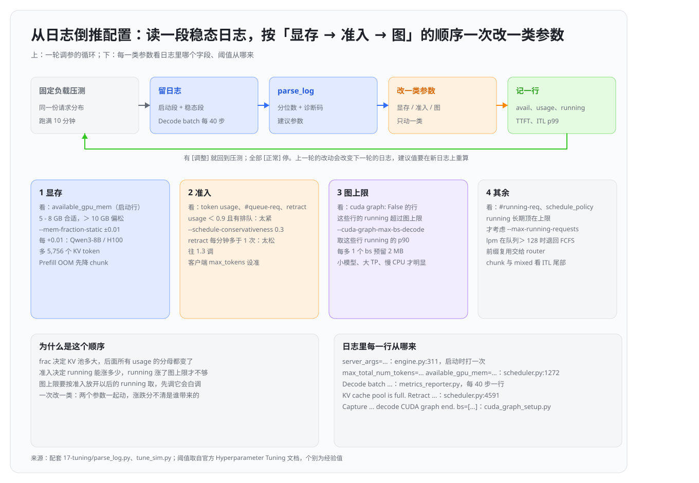
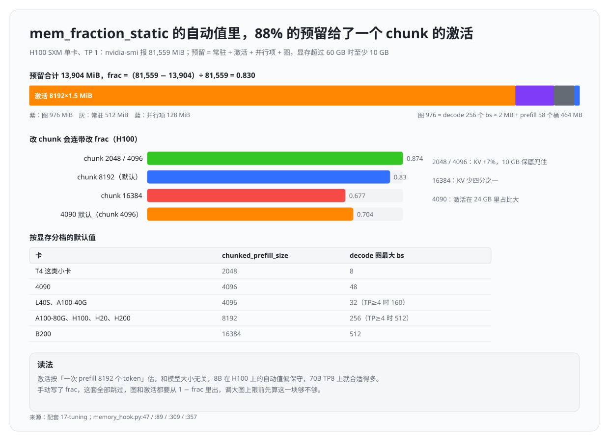
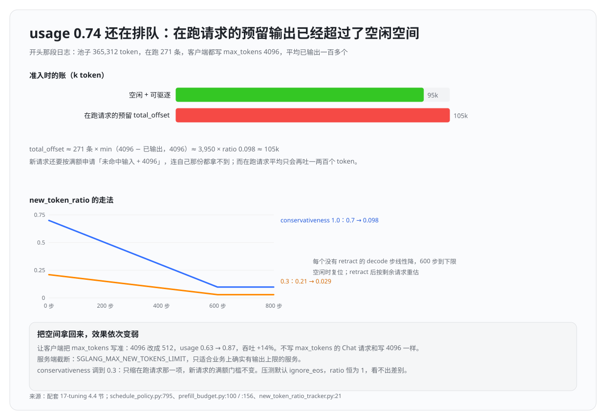
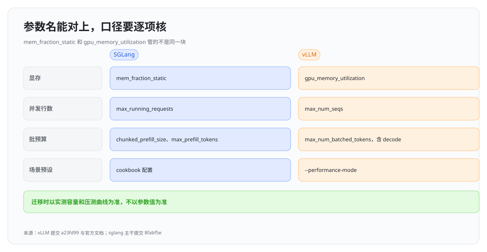
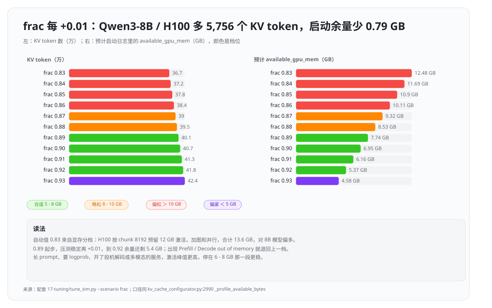
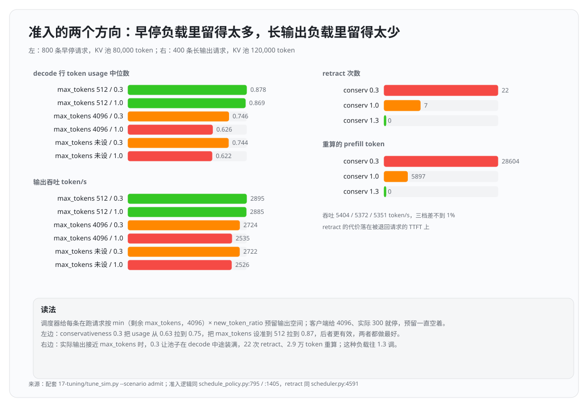
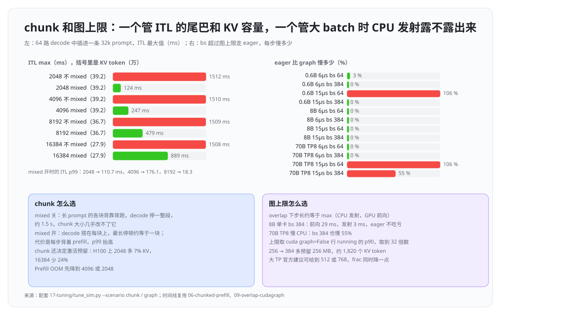

# SGL-17｜实战｜参数调优手册：从日志倒推配置

> 🎯 **遇到的问题**：Qwen3-8B 跑在一张 H100 上，参数几乎全是默认值，只加了 --schedule-policy lpm。压测请求的 prompt 300 到 900 token，实际输出 50 到 500 token 就停，客户端的 max_tokens 一律写 4096。
>
> 十分钟稳态日志里，#running-req 中位数 271，#queue-req 中位数 270，token usage 中位数只有 0.74：两百多条请求一直在等，KV 池却空着四分之一。
>
> 65% 的 Decode batch 行写着 cuda graph: False，这些行的 running 都超过 256。启动行里 available_gpu_mem=12.26 GB，官方文档建议 5 到 8 GB[[1]](https://docs.sglang.io/docs/advanced_features/hyperparameter_tuning)。
>
> 每个数字都指向一个参数。显存余量多了 4 到 7 GB，是 mem_fraction_static 给少了。usage 低却在排队，是准入给在跑请求留的输出空间太多。graph=False 说明 decode 图上限不够，队列长期超过 128 条，说明 lpm 早已退回 FCFS。
>
> 按「显存、准入、图」的顺序改三轮，running 中位数到 364，usage 0.91，graph=False 归零，生成吞吐从 12,080 涨到 13,177 token/s。SGLang 有两百多个服务参数[[2]](https://docs.sglang.io/docs/advanced_features/server_arguments)，线上要动的不到十个，难在看懂日志说的是哪一个。这一篇讲这几个参数在源码里各管什么、怎么互相牵制，再给一套从日志倒推配置的做法和脚本。
>
> **主线**：两百多个参数里线上真正要动的不到十个；按显存、准入、图的顺序从日志倒推，每一轮只改一个数。
>
> **读完这一篇**：拿到一段日志，能读出显存余量、KV 用量、准入和 decode 图的状况，给出带理由的参数改动。能说清 mem_fraction_static 的自动值、输出预留公式、max_running_requests 的默认值和 chunk 的双重影响。记住 bench_serving 默认 ignore_eos，不拿它测准入参数。
>
> **代码**：[zero-to-sglang/17-tuning](../17-tuning)。parse_log.py 解析服务日志的全部字段，按 24 种诊断码给出建议参数。tune_sim.py 调参前先算账，覆盖默认值、frac 换 KV、准入方向、chunk 时间线和掉回 eager 的代价。另有调参记录模板、两份夹具日志和 83 个测试用例。只用标准库，行号按主干 8fabf5e 核对。

# 导读 · 结论先行

1. **显存先定：frac 决定 KV 池多大，启动余量是验收标准。**mem_fraction_static 不给时按 nvidia-smi 显存分档自动算，H100 预留 13.6 GB，其中 12 GB 是按 chunk 8192 估的激活。对 8B 模型这个预留偏多，启动日志里 available_gpu_mem 落在 12 GB 左右；往上调到余量 5 到 8 GB，KV 能多拿一成。
2. **准入其次：调度器按 max_tokens 给在跑请求留空间。**每条在跑请求按 min（剩余 max_tokens，4096）× new_token_ratio 预留，ratio 从 0.7 × conservativeness 开始，每步衰减，retract 后被拉回。客户端 max_tokens 写得远大于实际输出时，留出来的空间一直空着，usage 上不去，队列里的请求却进不来。
3. **图上限最后：按准入放开以后的 running 取。**decode 的 batch 超过 --cuda-graph-max-bs-decode 就走 eager。8B 单卡大 batch 时前向比 CPU 发射长得多，eager 几乎不吃亏；小模型、大 TP、慢 CPU 才明显。准入一放开 running 就涨，所以图上限要在准入调完的日志上取。
4. **chunk、mixed、max_running 看尾延迟。**chunk 小了 ITL 尾巴短、KV 还多一点；mixed 不开时一条长 prompt 能让 decode 停一秒半。max_running_requests 默认就是 2048 到 4096 的并发上限，真正卡并发的是 KV 池和准入，只有要压 ITL 时才往小了封。
5. **一次只改一类，每轮重新读日志。**上一轮的改动会改变下一轮的日志：frac 改了 usage 的分母，准入改了 running，running 改了图够不够。所以每轮都在新日志上重算建议值，配一份固定的压测和一张调参记录表。



上半部分是一轮调参的循环：固定负载压测，留下启动段和稳态段日志，用 parse_log 算分位数和诊断码，只改一类参数，把关键字段记一行，回到压测。中间四列是每一类参数在日志里看哪个字段、阈值从哪来、往哪边改。左下说明为什么是这个顺序，右下是日志里每一行在源码里由谁打出来。2.1 到 2.8 节按这个顺序展开。

**📎 与系列其他文档的分工**：显存账本怎么算，见 [SGL-02｜上手｜推理账本：显存、KV 与 Roofline](./02-ledger.md)。TTFT、ITL 和吞吐怎么测，见 [SGL-03｜上手｜指标与压测：TTFT、TPOT、ITL 与 goodput](./03-bench.md)。调度器的准入和 retract，见 [SGL-05｜原理｜调度器：waiting、running 与 KV 预算](./05-scheduler.md)。chunked prefill 和 mixed chunk，见 [SGL-06｜原理｜Chunked prefill：切块大小、mixed chunk 与 TTFT / ITL 的取舍](./06-chunked-prefill.md)。KV 池怎么定尺寸，见 [SGL-07｜原理｜内存池与页表：req_to_token、token_to_kv 与 page size](./07-memory-pool.md)。overlap 调度和 CUDA Graph，见 [SGL-09｜原理｜Overlap 调度与 CUDA Graph：把 CPU 开销藏到 GPU 后面](./09-overlap-cudagraph.md)。多卡和 DP 下参数的变化，见 [SGL-11｜原理｜并行：TP、DP Attention、EP 怎么组合](./11-parallelism.md)。这一篇把这些篇里的参数表串成一套顺序。

# 第 1 章 · 问题：参数多，日志里的信号却很少

线上常见的情形：

- 队列里一直有几百条请求在等，日志里 token usage 却只有 0.6 到 0.7，GPU 利用率也不满。
- mem_fraction_static 从 0.83 改到 0.92，跑了半天没事，一条带 logprob 的长 prompt 进来，Prefill out of memory。
- 日志里隔一会儿出现一行 KV cache pool is full. Retract requests，一分钟好几次，TTFT 的 p99 一起变差。
- 我们把 --schedule-conservativeness 从 1.0 改到 0.3，用 bench_serving 压了一遍，前后几乎没区别。
- 同样的显存，换了一个 128k 上下文的模型，max_running_requests 从 4096 变成 2048；手动给了 4096，日志说 was reduced。
- Decode batch 行里时而 cuda graph: True、时而 False，False 的那些步明显慢。
- 开了 lpm 想让前缀相同的请求排在一起，cache hit rate 没变化。
- 一条 32k 的 prompt 进来，其他几十路 decode 卡了一秒多，chunk 从 8192 改到 2048 也没用。
- 我们把 chunk 从 8192 改到 16384 想加快长 prompt，启动日志里 max_total_num_tokens 少了四分之一。
- 同一组参数，在 4090 上起不来，在 H200 上又显得浪费。

这些现象落在四类参数上：显存（frac、chunk 对预留的连带影响），准入（conservativeness、客户端 max_tokens、max_running），图（decode 图上限），尾延迟（chunk、mixed、调度策略）。日志里能直接看到的信号只有几个字段，下面这张表把现象对到章节。

| 想弄清的现象 | 看哪一节 |
|-|-|
| frac 的自动值从哪来，换卡以后为什么变 | 2.1、4.2 |
| 启动余量多少合适，frac 每档换多少 KV | 2.2、4.2 |
| usage 低却在排队，retract 频繁，conservativeness 怎么调 | 2.3、4.4 |
| bench_serving 测不出 conservativeness 的作用 | 2.3、5.2 |
| max_running_requests 的默认值和 reduced 警告 | 2.4、4.3 |
| 长 prompt 让 decode 卡顿，chunk 改了没用 | 2.5、4.5 |
| cuda graph: False 要不要管，图上限调多大 | 2.6、4.5 |
| lpm 为什么没效果 | 2.7 |
| 日志里每个字段是什么意思，对应哪个指标 | 2.8、4.1 |
| 一轮完整的调参怎么做、怎么记 | 4.6、4.7 |

# 第 2 章 · 原理：显存、准入、图，三笔账各记在哪

## 2.1 mem_fraction_static 的自动值：按显存分档算出来的

不给 --mem-fraction-static 时，handle_gpu_memory_settings 先按 nvidia-smi 报的显存分档[（memory_hook.py:47）](https://github.com/sgl-project/sglang/blob/8fabf5e/python/sglang/srt/arg_groups/memory_hook.py#L47)：20 GB 以下、20 到 35、35 到 60、60 到 90、90 到 160、160 以上，每档定一个默认的 chunked_prefill_size 和 decode 图的最大 bs[（:89）](https://github.com/sgl-project/sglang/blob/8fabf5e/python/sglang/srt/arg_groups/memory_hook.py#L89)。

T4 这类小卡是 2048 和 8。4090 是 4096 和 48。L40S、A100-40G 是 4096 和 32（TP≥4 时 160）。A100-80G、H100、H20、H200 都是 8192 和 256（TP≥4 时 512）。B200 是 16384 和 512。

接着算要给权重和 KV 之外留多少显存[（:309）](https://github.com/sgl-project/sglang/blob/8fabf5e/python/sglang/srt/arg_groups/memory_hook.py#L309)：

```text
reserved_mem（MiB） = 512                              # attention backend 的常驻元数据
                   + max(chunk, 2048) × 1.5            # 一个 chunk 的前向激活
                   + tp × pp / 8 × 1024                # 大并行的额外开销
                   + reserve_for_graph_mb              # decode 每个 bs 2 MB，prefill 每个桶 8 MB
显存 ＞ 60 GB 时 reserved_mem 至少 10 GB
mem_fraction_static = round((显存 − reserved_mem) / 显存, 3)
```

H100 SXM 单卡代进去：nvidia-smi 报 81,559 MiB，激活 8192 × 1.5 = 12,288，并行 128，decode 图 256 × 2 = 512 加上 prefill 的 58 个桶 464，图合计 976[（:357）](https://github.com/sgl-project/sglang/blob/8fabf5e/python/sglang/srt/arg_groups/memory_hook.py#L357)，再加 512，预留 13,904 MiB，frac = 0.830。

12 GB 的激活占了预留的 88%，这是按「一次 prefill 8192 个 token」估的工作集，和模型大小无关。8B 模型 hidden 只有 4096，真实的激活峰值远小于这个数，所以 8B 在 H100 上的自动值普遍偏保守；同样的公式用在 70B TP8 上就合适得多。

这套公式有三个推论。第一个，手动改 chunk 会连带改 frac：H100 上 chunk 从 8192 降到 4096 或 2048，激活预留变小，可 10 GB 保底兜住，frac 变成 0.874，KV 多出约 7%；chunk 提到 16384，激活预留翻倍到 24 GB，frac 掉到 0.677，KV 少了四分之一，第 1 章那条「max_total_num_tokens 少了四分之一」就是这么来的。

第二个，小卡的自动值反而更低：4090 的 frac 是 0.704，比 H100 低 0.13，因为 4096 × 1.5 的激活在 24 GB 里占的比例大。第三个，手动给了 frac，上面这套全部跳过，图和激活的显存都要从 1 − frac 那一块里出，我们调图上限时吃过这个亏。

还有一条旁路：环境变量 SGLANG_ENABLE_POST_CAPTURE_KV_SIZING 打开以后，预留只剩 1536 MiB 加并行项[（:294）](https://github.com/sgl-project/sglang/blob/8fabf5e/python/sglang/srt/arg_groups/memory_hook.py#L294)，KV 池等图捕获完再按实测剩余显存定尺寸。主干默认关[（environ.py:642）](https://github.com/sgl-project/sglang/blob/8fabf5e/python/sglang/srt/environ.py#L642)，这一篇按默认路径讲。



## 2.2 启动余量：available_gpu_mem 是验收标准

KV 池的预算在 \_profile_available_bytes 里算[（kv_cache_configurator.py:2990）](https://github.com/sgl-project/sglang/blob/8fabf5e/python/sglang/srt/mem_cache/kv_cache_configurator.py#L2990)：权重加载完以后量一次空闲显存，减掉「加载前空闲 × （1 − frac）」，剩下的全给 KV。frac 实际控制的是「加载前空闲显存里留多少不给 KV」，这一块叫 slack。sample_before.log 里加载前空闲 78.93 GB，frac 0.83，slack = 78.93 × 0.17 = 13.42 GB，日志里 Memory pool end 那一行的 avail 是 13.45 GB，对得上。

slack 里要装的东西有：prefill 和 decode 的图（这里 0.41 + 0.63 GB），每个前向的激活，带 logprob 请求的 logits（SGLANG_LOGPROB_CHUNK_SIZE 默认 2048，Qwen3 的词表 151,936，一块 fp32 logits 就是 1.24 GB），req_to_token 表（2.4 节，0.63 GB），NCCL 缓冲和 cuBLAS workspace。

启动行里的 available_gpu_mem 在图捕获之后量[（scheduler.py:1267）](https://github.com/sgl-project/sglang/blob/8fabf5e/python/sglang/srt/managers/scheduler.py#L1267)，打印在 :1272，图已经扣掉了，剩下的才是运行时激活能用的余量。

官方调参文档给的标准是 5 到 8 GB 正常，10 到 20 GB 偏高，也可以每次把 frac 加 0.01 压测，直到出现 OOM 再退一档[[1]](https://docs.sglang.io/docs/advanced_features/hyperparameter_tuning)。frac 每加 0.01，slack 少 78.93 × 0.01 = 0.79 GB，这块显存进 KV 池。Qwen3-8B 每个 token 的 KV 是 36 层 × 8 个 KV 头 × 128 维 × K、V 两份 × 2 字节 = 144 KB，0.79 GB 正好换 5,756 个 token，池子多 1.6%。

从 0.83 到 0.89，余量从 12.5 GB 降到 7.7 GB，KV 多 9.4%。到 0.92 余量还有 5.4 GB。0.93 只剩 4.6 GB，一条带 logprob 的长 prompt 就可能 Prefill out of memory[（allocation.py:239）](https://github.com/sgl-project/sglang/blob/8fabf5e/python/sglang/srt/mem_cache/allocation.py#L239)。

余量的下限要按业务定。纯文本、不要 logprob、chunk 8192 的服务，5 GB 够用；要 input logprob（打分、RL 的 reference）、开了投机解码、多模态、或者 TP 下 NCCL 缓冲大的，激活峰值都会往上走，停在 6 到 8 GB 那一段更稳。

OOM 的文字分两种：Prefill out of memory 是一个 prefill batch 的激活放不下，先降 chunk；Decode out of memory 在 :613，是 decode 时 KV 不够又退不出请求，先降 max_running_requests 或 frac{r("docs_tune")}。

## 2.3 准入：调度器按 max_tokens 给在跑请求留空间

continuous batching 每一步都可以往 batch 里加新请求[[3]](https://www.usenix.org/conference/osdi22/presentation/yu)，代价是调度器要猜：加进来的请求将来要吐多少 token，KV 够不够。SGLang 的猜法在 PrefillAdder 里。构造时先把在跑请求将来的输出扣掉[（schedule_policy.py:683）](https://github.com/sgl-project/sglang/blob/8fabf5e/python/sglang/srt/managers/schedule_policy.py#L683)：

```text
total_offset = Σ 在跑请求 min(max_new_tokens − 已输出, 4096) × new_token_ratio        # :795
新请求要的   = 未命中的输入 + min(max_new_tokens − 已输出, 4096) + 每请求开销          # :1405
能进的条件   = 新请求要的 ＜ 空闲 + 可驱逐 − total_offset                            # prefill_budget.py:100 / :128
进来以后     total_offset += 输入 + 1 页 + min(max_new_tokens, 4096)                  # prefill_budget.py:167
```

4096 是 SGLANG_CLIP_MAX_NEW_TOKENS_ESTIMATION 的默认值[（:89）](https://github.com/sgl-project/sglang/blob/8fabf5e/python/sglang/srt/managers/schedule_policy.py#L89)。注意两处的折扣不一样：在跑请求乘 new_token_ratio，刚收进来的这一条在这一轮按满额扣[（prefill_budget.py:156）](https://github.com/sgl-project/sglang/blob/8fabf5e/python/sglang/srt/mem_cache/prefill_budget.py#L156)，下一轮才变成在跑请求，开始打折。所以一条新请求想进来，池子里得先空出「输入 + 4096」这么多，客户端写多大的 max_tokens 直接决定这个门槛。

new_token_ratio 由一个小对象管[（new_token_ratio_tracker.py:21）](https://github.com/sgl-project/sglang/blob/8fabf5e/python/sglang/srt/managers/scheduler_components/new_token_ratio_tracker.py#L21)：初值 min（0.7 × conservativeness，1），下限是初值的 0.14，每个没有 retract 的 decode 步线性往下降一点，600 步降到下限[（scheduler.py:4607）](https://github.com/sgl-project/sglang/blob/8fabf5e/python/sglang/srt/managers/scheduler.py#L4607)。

服务空闲时复位到初值[（:5392）](https://github.com/sgl-project/sglang/blob/8fabf5e/python/sglang/srt/managers/scheduler.py#L5392)。conservativeness 1.0 时 ratio 从 0.7 走到 0.098，0.3 时从 0.21 走到 0.029。decode 时 KV 真不够了，retract_decode 把一部分请求退回队列，剩下的请求重新估 ratio[（schedule_batch.py:3543）](https://github.com/sgl-project/sglang/blob/8fabf5e/python/sglang/srt/managers/schedule_batch.py#L3543)：

```text
new_token_ratio = min(1, (剩余请求已输出之和 + 20 × 剩余条数) / (剩余请求 max_new_tokens 之和 + 1))     # new_token_ratio_tracker.py:41
```

然后打一行 KV cache pool is full. Retract requests，带着 #retracted_reqs、#new_tokens_gained 和 ratio 的前后值[（scheduler.py:4590）](https://github.com/sgl-project/sglang/blob/8fabf5e/python/sglang/srt/managers/scheduler.py#L4590)。被退回的请求下次要重新 prefill，已经吐出的 token 跟着输入一起重算，这和 vLLM 的 recompute 式抢占是一回事[[4]](https://arxiv.org/abs/2309.06180)。环境变量的默认值都在 environ.py:650 到 :655。

拿开头那段日志粗算一遍，就知道 usage 0.74 为什么还在排队。池子 365,312 个 token，usage 0.74，空闲加可驱逐约 95k。在跑 271 条，客户端都写 max_tokens 4096，平均已经吐了一百多个，每条的剩余输出按 4096 截断后约 3,950。

稳态下 ratio 早降到 0.098 附近，total_offset ≈ 271 × 3,950 × 0.098 ≈ 105k，已经超过 95k。这时候新请求连自己那份「输入 + 4096」都申请不到，只能等在跑请求结束腾地方。实际上这些请求平均只再吐一两百个 token，预留的 105k 里绝大部分永远用不上。

有三种办法把这块空间拿回来，效果依次变弱。我们最后发现最有效的是让客户端把 max_tokens 设准，4.4 节的模拟里 4096 改成 512，usage 从 0.63 涨到 0.87，吞吐涨 14%。客户端改不动时，服务端有一个硬办法：环境变量 SGLANG_MAX_NEW_TOKENS_LIMIT 把所有请求的 max_new_tokens 截到上限，超过的打一行 Capping max_new_tokens 的警告（scheduler.py:2760），代价是真要长输出的请求会被截断，只适合业务上确实有输出上限的服务。

第三种是 --schedule-conservativeness 往下调，官方文档的说法是 usage 低于 0.9 且有排队时设成 0.3{r("docs_tune")}，它只缩在跑请求那一项，新请求的满额门槛不变，所以追回的比改 max_tokens 少。

max_tokens 不写也会被当成大数。Chat 接口的 max_completion_tokens 和 max_tokens 都默认 None[（protocol.py:928）](https://github.com/sgl-project/sglang/blob/8fabf5e/python/sglang/srt/entrypoints/openai/protocol.py#L928)，到调度器 init_req_max_new_tokens 里变成 1 ＜＜ 30，再截到「上下文长度 − 输入 − 1」（scheduler.py:2753），准入时又按 4096 截断，结果和写 4096 一样。

反过来，Completions 接口不写 max_tokens 默认 16（protocol.py:378），原生 /generate 默认 128[（sampling_params.py:149）](https://github.com/sgl-project/sglang/blob/8fabf5e/python/sglang/srt/sampling/sampling_params.py#L149)，这两种是输出被截短，排查「回答只有半句」时先看这里。

conservativeness 往下调也有反方向的风险。实际输出接近 max_tokens 的负载（长文生成、代码补全、RL rollout 固定长度），ratio 压低以后调度器塞进太多请求，decode 中途池子满，只能 retract。官方的建议是 retract 频繁时往 1.3 调，每分钟一次左右可以接受[[1]](https://docs.sglang.io/docs/advanced_features/hyperparameter_tuning)。开了 DP attention 时，服务端会自动把 conservativeness 乘 0.3[（parallel_hook.py:318）](https://github.com/sgl-project/sglang/blob/8fabf5e/python/sglang/srt/arg_groups/parallel_hook.py#L318)，手动写的 1.0 实际生效的是 0.3，在这个基础上再调要心里有数。

压测工具会把这条线索整个藏掉。python3 -m sglang.benchmark.serving 默认给每条请求带 ignore_eos=True[（serving.py:628）](https://github.com/sgl-project/sglang/blob/8fabf5e/python/sglang/benchmark/serving.py#L628)，源码里有一行注释直说 set ignore_eos True by default（:289）。ignore_eos 的请求在 total_offset 里 ratio 恒为 1.0[（schedule_policy.py:795）](https://github.com/sgl-project/sglang/blob/8fabf5e/python/sglang/srt/managers/schedule_policy.py#L795)，radix cache 关掉时 add_one_req 还直接走 add_one_req_ignore_eos 那条路（:1412）。

默认参数压出来的就是「每条请求都吐满」的长输出负载，conservativeness 只影响一个衰减得很快的初值，改了几乎看不出差别，第 1 章那条「从 1.0 改到 0.3 前后没区别」就是这样。测早停负载要加 --disable-ignore-eos（:2556），并且让 --random-output-len 和客户端的 max_tokens 分开[[5]](https://docs.sglang.io/docs/developer_guide/bench_serving)。



## 2.4 max_running_requests：默认值几乎总是 2048 到 4096

不写 --max-running-requests 时，resolve_max_num_reqs 按 KV 池能装几条满上下文的请求估一个值[（kv_cache_configurator.py:3119）](https://github.com/sgl-project/sglang/blob/8fabf5e/python/sglang/srt/mem_cache/kv_cache_configurator.py#L3119)：tokens ÷ context_len × 512，夹在 2048 和 4096 之间，再不超过 tokens 的一半。

Qwen3-8B / H100 是 366,669 ÷ 40,960 × 512 = 4,583，取 4096。128k 上下文的 Llama 3.1 8B 算出来 1,622，抬到 2048。4090 上池子只有 8,813 个 token，算出来 110，也抬到 2048。除了小到几千 token 的池子，结果总在 2048 到 4096 之间，和真实能并发多少条几乎没有关系。

手动给的值只有一个约束：不超过池子 token 数的一半，被压低时打 max_running_requests was reduced from the requested … （:3167）。这个值决定 req_to_token 表有多大，表按（max_running + 1）×（context + 4）个 int32 开，4096 条 × 40k 上下文是 0.63 GB，2048 条 × 128k 是 1.00 GB。这张表在 KV 预算算完以后才建，吃的是 slack，所以 max_running 写成 8192、上下文又长，启动余量会少一两 GB。

线上真正卡并发的是 KV 池和 2.3 节的准入，max_running 很少顶格。日志里 #running-req 长期等于 max_running 时（parse_log 的 RUNNING_CAP），才说明它在限制吞吐。主动往小了封的理由通常是延迟：decode 一步的时间随 batch 涨，封住 running 就封住了 ITL 的上限，代价是排队变长、TTFT 变差。

还有一个相邻的参数 --max-queued-requests，默认不限，队列满了新请求直接收到 The request queue is full（scheduler.py:3612），适合前面有重试和负载均衡的部署，用快速失败换掉长时间排队。

## 2.5 chunk 和 mixed：一个管激活和块数，一个管 decode 会不会停

chunked prefill 把一条长 prompt 切成 chunk 大小的块，每轮最多算一块，Sarathi-Serve 的论文论证了切块能把 prefill 的长尾摊开，前提是 decode 能搭在块上一起跑[[6]](https://arxiv.org/abs/2403.02310)。

SGLang 的默认路径里没有这个前提：调度循环有新的 prefill batch 就先跑 prefill，没有才跑 decode，一条 32k 的 prompt 切成 4 块，这 4 块背靠背跑完，在跑的 decode 全程等着。4.5 节的模拟里，64 路 decode 中插进一条 32k prompt，chunk 从 2048 到 16384，ITL 最大值都在 1.5 s 左右，chunk 大小几乎不影响停顿，只影响块数。

decode 搭车要开 --enable-mixed-chunk，默认关[（fields/schedule.py:208）](https://github.com/sgl-project/sglang/blob/8fabf5e/python/sglang/srt/arg_groups/fields/schedule.py#L208)。开了以后调度器把在跑的 decode 请求拼进 prefill batch 一起算[（scheduler.py:4442）](https://github.com/sgl-project/sglang/blob/8fabf5e/python/sglang/srt/managers/scheduler.py#L4442)，最长停顿变成一块的耗时：chunk 2048 时 ITL 最大 124 ms，8192 时 479 ms。

代价是背着 prefill 块的那些步都变慢，chunk 2048 时 p99 从 13.6 ms 涨到 111 ms，因为块数多、被拖慢的步也多。有三种情况 mixed 不生效：本批或在跑请求里有要 logprob 的、请求带 input_embeds、在跑请求里有 beam search 组，碰到时就退回 prefill 和 decode 交替。

chunk 还连着 2.1 节的显存账。chunk 8192 改成 2048，单块的激活和 logits 都小了，Prefill out of memory 时官方第一个建议就是降到 4096 或 2048[[1]](https://docs.sglang.io/docs/advanced_features/hyperparameter_tuning)，H100 上还因为 10 GB 保底多出 7% 的 KV；改成 16384 则 KV 少四分之一，长 prompt 的块数从 4 降到 2，TTFT 只快了几毫秒，很少划算。--max-prefill-tokens（默认 16384）是一个 prefill batch 里所有请求的输入总量上限，和 chunk 一起决定一轮 prefill 有多重，一般不用动。

## 2.6 decode 图上限：超过就走 eager

decode 图按一组 bs 捕获：1、2、4、8、12，16 到 256 每隔 8，272 到 511 每隔 16，512 以上每隔 32，截到上限为止[（cuda_graph_hook.py:500）](https://github.com/sgl-project/sglang/blob/8fabf5e/python/sglang/srt/arg_groups/cuda_graph_hook.py#L500)。

batch 的 bs 落在两个桶之间就补齐到上面那个桶，超过上限就找不到图，走 eager，Decode batch 行里的 cuda graph 字段变成 False（metrics_reporter.py:782）。上限由 --cuda-graph-max-bs-decode 给[（fields/exec\_.py:632）](https://github.com/sgl-project/sglang/blob/8fabf5e/python/sglang/srt/arg_groups/fields/exec_.py#L632)，不给就用 2.1 节分档里的值，H100 单卡 256，TP≥4 时 512。

掉回 eager 损失多少，看 CPU 发射和 GPU 前向谁长。overlap 调度下这两件事并行，一步的时间约等于两者取大（[SGL-09｜原理｜Overlap 调度与 CUDA Graph：把 CPU 开销藏到 GPU 后面](./09-overlap-cudagraph.md)）。8B 单卡 bs 384 时，GPU 前向 29 ms，eager 逐个发射 kernel 只要 3 到 8 ms，被盖得严严实实，eager 和 graph 一样快；0.6B 这样的小模型、70B TP8 这样把前向切薄的部署，或者每个 kernel 发射要 15 µs 的慢 CPU，发射就露出来，4.5 节的模拟里慢 55% 到 106%。所以 graph=False 的比例高，先看是什么模型和并行度，再决定要不要调。

调大上限的显存账在 reserve_for_graph_mb 里：decode 每个 bs 2 MB[（memory_hook.py:357）](https://github.com/sgl-project/sglang/blob/8fabf5e/python/sglang/srt/arg_groups/memory_hook.py#L357)，DP attention 还要再加 bs × dp × 3 MB。H100 单卡从 256 提到 384，多 256 MB，折成 Qwen3-8B 的 KV 约 1,820 个 token，不到池子的 0.5%。

图的捕获时间也跟着变长，sample_before.log 里 256 的上限捕获了 7.86 s。上限要按准入调完以后的 running 取，第 0 轮日志里 graph=False 的行 running 在 259 到 336，准入放开以后 running 中位数到了 364，按第 0 轮取 320 就不够。官方文档的建议是大 TP 时可以给到 512 或 768，同时把 frac 降一点[[1]](https://docs.sglang.io/docs/advanced_features/hyperparameter_tuning)。

torch.compile 是另一个方向的选项：--enable-torch-compile 对小模型、小 batch 有效，只编到 --torch-compile-max-bs，默认 32[（fields/exec\_.py:701）](https://github.com/sgl-project/sglang/blob/8fabf5e/python/sglang/srt/arg_groups/fields/exec_.py#L701)，大 batch 的吞吐场景基本用不上。

## 2.7 lpm 为什么常常不生效

--schedule-policy 默认 fcfs[（fields/schedule.py:86）](https://github.com/sgl-project/sglang/blob/8fabf5e/python/sglang/srt/arg_groups/fields/schedule.py#L86)。设成 lpm（最长前缀优先）时，调度器每轮按前缀命中长度给等待队列排序，让共享前缀的请求挨着进 batch，减少 radix cache 被冲掉的机会[[7]](https://arxiv.org/abs/2312.07104)。可 \_determine_active_policy 里有一个阈值[（schedule_policy.py:314）](https://github.com/sgl-project/sglang/blob/8fabf5e/python/sglang/srt/managers/schedule_policy.py#L314)：队列超过 128 条（WAITING_QUEUE_PREFIX_MATCH_MAX，:137），LPM 和 HRRN 都退回 FCFS，源码注释写的理由是前缀匹配和排序太贵。

这和需要 lpm 的时机正好错开：队列短的时候来一条进一条，排不排序差别不大；队列长到排序有意义的时候，策略已经退回了 FCFS。开头那段日志 89% 的时间队列超过 128 条，lpm 等于没开。退回 FCFS 以后 radix cache 照常工作，相同前缀照样命中，只是不再按命中长度插队。多副本部署时，前缀复用更依赖路由层：SGLang 的 Model Gateway 有 cache-aware 路由，把前缀相同的请求送到同一个副本[[8]](https://docs.sglang.io/docs/advanced_features/sgl_model_gateway)，比单副本里排序有效得多。

## 2.8 日志里的字段和对应的指标

调参用到的信号都在四类日志行里。启动行在 scheduler.py:1272，一次性给出 max_total_num_tokens、chunked_prefill_size、max_prefill_tokens、max_running_requests、context_len 和 available_gpu_mem。server_args 的完整字典在 engine.py:311。decode 图捕获完打一行 bs=[…]（cuda_graph_setup.py:789），最后一个数就是图上限。

Decode batch 行默认每 40 个 decode 步打一次[（fields/observability.py:136）](https://github.com/sgl-project/sglang/blob/8fabf5e/python/sglang/srt/arg_groups/fields/observability.py#L136)，判断在 metrics_reporter.py:934，字段依次是 #running-req、#token、token usage、cuda graph、gen throughput、#queue-req[（metrics_reporter.py:963）](https://github.com/sgl-project/sglang/blob/8fabf5e/python/sglang/srt/managers/scheduler_components/metrics_reporter.py#L963)，开了投机解码还有 accept len。

Prefill batch 行多出 #new-seq、#new-token、#cached-token 和 #pending-token。token usage 的分子是「池子总量 − 空闲 − 可驱逐」[（pool_stats_observer.py:238）](https://github.com/sgl-project/sglang/blob/8fabf5e/python/sglang/srt/managers/scheduler_components/pool_stats_observer.py#L238)，radix cache 里没人引用的前缀算作可用，所以 usage 0.74 的意思是还有 26% 空着或者随时能腾出来。SWA 和 Mamba 混合模型会分别打 full、swa、mamba 的 usage，取最大的那个做判断。

开 --enable-metrics 以后同样的量以 Prometheus 指标暴露[[9]](https://docs.sglang.io/docs/references/production_metrics)：sglang:num_running_reqs、sglang:num_queue_reqs、sglang:token_usage、sglang:gen_throughput、sglang:cache_hit_rate[（metrics_collector.py:365）](https://github.com/sgl-project/sglang/blob/8fabf5e/python/sglang/srt/observability/metrics_collector.py#L365)，retract 是 sglang:num_retracted_requests_total 和 num_retracted_input_tokens_total（:559、:564），延迟看 time_to_first_token_seconds、inter_token_latency_seconds 和 queue_time_seconds 三个直方图。

日志适合调参时逐行看，指标适合上线后做面板和告警[[10]](https://docs.sglang.io/docs/advanced_features/observability)。两者采样的时机相同，都按 decode_log_interval，40 步在 bs 300 时大约一秒一次，足够看稳态；看瞬时抖动要把间隔调小，代价是日志量。

## 2.9 vLLM 怎么做

从 SGLang 切到 vLLM，或者在两边做公平对比，第一步是把参数对上。mem_fraction_static 对应 gpu_memory_utilization，但口径不同，mem_fraction_static 管静态占用，gpu_memory_utilization 管整实例。max_running_requests 对应 max_num_seqs。

chunked_prefill_size 大致对应 max_num_batched_tokens，但 vLLM 的预算里还包含 decode token；max_total_tokens 对应 kv_cache_memory_bytes 或 --num-gpu-blocks-override[[11]](https://docs.vllm.ai/en/latest/configuration/engine_args.html)。

vLLM 近来加了 --performance-mode，取 balanced、interactivity 或 throughput，一次改一组相关默认值，作用相当于 SGLang 里按场景抄一套 cookbook 配置[[12]](https://docs.vllm.ai/en/latest/configuration/optimization.html)。调参顺序两边一致：先定显存和容量，再定批预算，最后调图和投机。不同的是 vLLM 的抢占告警会直接点出该调哪几个参数，SGLang 这边我们只能从 #retracted_reqs 和 token usage 自己推。

| 维度 | SGLang | vLLM | 差异的代价 |
|-|-|-|-|
| 显存 | mem_fraction_static | gpu_memory_utilization | 同值不同义，迁移时按实测 KV 容量对齐 |
| 并发行数 | max_running_requests | max_num_seqs | 基本等价 |
| 批预算 | chunked_prefill_size、max_prefill_tokens | max_num_batched_tokens，含 decode | vLLM 的预算要多留 decode 份额 |
| 场景预设 | cookbook 配置 | --performance-mode | 预设只是起点，仍需压测 |



# 第 3 章 · 源码走读：从启动到每一步调度的 18 个落脚点

前 7 个按启动顺序排：显存分档、预留、图的预算、KV 池的 slack、max_running、启动行、图的 bs 列表。中间 8 个按一轮调度排：准入预留、新请求的门槛、策略回退、ratio 的衰减和复位、retract、mixed chunk。最后 3 个是日志、usage 的口径和压测工具的默认值。行号都对应主干 8fabf5e。

| # | 位置 | 发生了什么 |
|-|-|-|
| 1 | [arg_groups/memory_hook.py:89](https://github.com/sgl-project/sglang/blob/8fabf5e/python/sglang/srt/arg_groups/memory_hook.py#L89) | 按 nvidia-smi 显存分六档，每档定默认 chunked_prefill_size 和 decode 图的最大 bs，TP≥4 时图上限再翻一倍 |
| 2 | [arg_groups/memory_hook.py:309](https://github.com/sgl-project/sglang/blob/8fabf5e/python/sglang/srt/arg_groups/memory_hook.py#L309) | reserved_mem = 512 + max（chunk，2048）× 1.5 + tp × pp / 8 × 1024 + 图。显存 ＞ 60 GB 时至少 10 GB。:325 算出 mem_fraction_static，手动给了就整段跳过 |
| 3 | [arg_groups/memory_hook.py:357](https://github.com/sgl-project/sglang/blob/8fabf5e/python/sglang/srt/arg_groups/memory_hook.py#L357) | reserve_for_graph_mb：decode 每个 bs 2 MB，DP attention 再加 bs × dp × 3 MB；:386 prefill 每个桶 8 MB |
| 4 | [mem_cache/kv_cache_configurator.py:2990](https://github.com/sgl-project/sglang/blob/8fabf5e/python/sglang/srt/mem_cache/kv_cache_configurator.py#L2990) | \_profile_available_bytes：加载后空闲减去「加载前空闲 ×（1 − frac）」，剩下的给 KV；frac 实际管的是 slack |
| 5 | [mem_cache/kv_cache_configurator.py:3119](https://github.com/sgl-project/sglang/blob/8fabf5e/python/sglang/srt/mem_cache/kv_cache_configurator.py#L3119) | resolve_max_num_reqs：tokens ÷ context × 512 夹在 2048 和 4096 之间，不超过 tokens 的一半；:3167 手动值被压低时打 reduced |
| 6 | [managers/scheduler.py:1272](https://github.com/sgl-project/sglang/blob/8fabf5e/python/sglang/srt/managers/scheduler.py#L1272) | 启动行：max_total_num_tokens、chunked_prefill_size、max_running_requests、context_len、available_gpu_mem；:1267 在图捕获之后量显存 |
| 7 | [arg_groups/cuda_graph_hook.py:500](https://github.com/sgl-project/sglang/blob/8fabf5e/python/sglang/srt/arg_groups/cuda_graph_hook.py#L500) | decode 图的 bs 列表：1、2、4、8、12，16 到 256 每隔 8，272 到 511 每隔 16，512 以上每隔 32；cuda_graph_setup.py:789 打印出来 |
| 8 | [managers/schedule_policy.py:795](https://github.com/sgl-project/sglang/blob/8fabf5e/python/sglang/srt/managers/schedule_policy.py#L795) | PrefillAdder 构造时累加 total_offset：在跑请求 min（剩余输出，4096）× new_token_ratio，ignore_eos 的请求 ratio 恒为 1 |
| 9 | [managers/schedule_policy.py:1405](https://github.com/sgl-project/sglang/blob/8fabf5e/python/sglang/srt/managers/schedule_policy.py#L1405) | add_one_req：新请求要「未命中输入 + min（max_new，4096）」；:1412 关 radix cache 时 ignore_eos 走单独的路 |
| 10 | [mem_cache/prefill_budget.py:156](https://github.com/sgl-project/sglang/blob/8fabf5e/python/sglang/srt/mem_cache/prefill_budget.py#L156) | 收进来的请求按满额 max_new 记账，这一轮不打折；:100 和 :128 是能不能进的判断 |
| 11 | [managers/schedule_policy.py:314](https://github.com/sgl-project/sglang/blob/8fabf5e/python/sglang/srt/managers/schedule_policy.py#L314) | \_determine_active_policy：队列超过 128 条（:137）时 LPM 和 HRRN 退回 FCFS |
| 12 | [scheduler_components/new_token_ratio_tracker.py:21](https://github.com/sgl-project/sglang/blob/8fabf5e/python/sglang/srt/managers/scheduler_components/new_token_ratio_tracker.py#L21) | ratio 初值 min（0.7 × conservativeness，1），下限是初值的 0.14；:34 每步线性衰减，:37 复位 |
| 13 | [managers/scheduler.py:4607](https://github.com/sgl-project/sglang/blob/8fabf5e/python/sglang/srt/managers/scheduler.py#L4607) | 没有 retract 的 decode 步调一次衰减；:5392 服务空闲时复位到初值 |
| 14 | [managers/schedule_batch.py:3543](https://github.com/sgl-project/sglang/blob/8fabf5e/python/sglang/srt/managers/schedule_batch.py#L3543) | retract_decode：池子不够时按策略退回请求，new_token_ratio_tracker.py:41 用剩余请求重估 ratio |
| 15 | [managers/scheduler.py:4590](https://github.com/sgl-project/sglang/blob/8fabf5e/python/sglang/srt/managers/scheduler.py#L4590) | 打 KV cache pool is full. Retract requests，带 #retracted_reqs、#new_tokens_gained 和 ratio 前后值 |
| 16 | [managers/scheduler.py:4442](https://github.com/sgl-project/sglang/blob/8fabf5e/python/sglang/srt/managers/scheduler.py#L4442) | 开了 --enable-mixed-chunk 时把在跑 decode 拼进 prefill batch；有 logprob、input_embeds、beam search 时不拼 |
| 17 | [scheduler_components/metrics_reporter.py:963](https://github.com/sgl-project/sglang/blob/8fabf5e/python/sglang/srt/managers/scheduler_components/metrics_reporter.py#L963) | Decode batch 行的字段。:934 每 decode_log_interval 步打一次。pool_stats_observer.py:238 usage =（总量 − 空闲 − 可驱逐）÷ 总量 |
| 18 | [benchmark/serving.py:628](https://github.com/sgl-project/sglang/blob/8fabf5e/python/sglang/benchmark/serving.py#L628) | 压测请求默认 ignore_eos = not disable_ignore_eos；:289 的注释写明默认开，:2556 是关掉它的开关 |

读的时候分两遍。第一遍顺着启动读 1 到 7，拿 sample_before.log 的启动行逐个对数：13,904 MiB 的预留、0.83 的 frac、13.45 GB 的 slack、4096 的 max_running、256 的图上限，每个数都能在这几行里算出来。第二遍读 8 到 15，这是一轮调度里「能不能再收一条」的全部判断，2.3 节的公式就是从这几处抄的。

改 conservativeness 和 max_tokens 之前，先在 8、10、12 三处确认改的是哪一项。指标的定义在 [metrics_collector.py:365](https://github.com/sgl-project/sglang/blob/8fabf5e/python/sglang/srt/observability/metrics_collector.py#L365) 一带，retract 的计数在 :559 和 :564，延迟直方图在 :838（排队）、:2041（TTFT）和 :2051（ITL）。

# 第 4 章 · 实验：用配套脚本从日志倒推一组参数

配套目录有两个脚本。parse_log.py 读服务日志，tune_sim.py 在改参数之前算账。parse_log 的解析规则按 8fabf5e 的日志格式写：启动行、server_args 字典、decode 图的 bs 列表、Prefill 和 Decode batch 的全部字段、retract、OOM、reduced 和 Capping 警告，诊断阈值来自官方调参文档[[1]](https://docs.sglang.io/docs/advanced_features/hyperparameter_tuning)和源码里的常量。

tune_sim 里从源码移植的是显存分档和预留公式、resolve_max_num_reqs、req_to_token 的尺寸、图的 bs 列表和显存，准入那部分复用 [SGL-05｜原理｜调度器：waiting、running 与 KV 预算](./05-scheduler.md) 的调度器模拟，chunk 和图的时间线复用 [SGL-06｜原理｜Chunked prefill：切块大小、mixed chunk 与 TTFT / ITL 的取舍](./06-chunked-prefill.md) 和 [SGL-09｜原理｜Overlap 调度与 CUDA Graph：把 CPU 开销藏到 GPU 后面](./09-overlap-cudagraph.md)；估算的是一步前向和 kernel 发射的时间，4.7 节讲怎么换成真机的数。两份夹具日志 sample_before.log 和 sample_after.log 按 8fabf5e 的格式构造，数值来自开头那次调参。

## 4.1 读一段调参前的日志

```bash
cd zero-to-sglang/17-tuning
python3 parse_log.py sample_before.log
```

```text
== 启动 ==
  mem_fraction_static=0.83，max_running_requests=None，max_queued_requests=None，chunked_prefill_size=8192，max_prefill_tokens=16384，schedule_policy=lpm，schedule_conservativeness=1.0，cuda_graph_max_bs_decode=256，tp_size=1，dp_size=1，enable_mixed_chunk=False，context_length=None，page_size=1，stream_interval=1，speculative_algorithm=None，kv_cache_dtype=auto，disable_radix_cache=False
  max_total_num_tokens=365312，chunk=8192，max_running=4096，context_len=40960，available_gpu_mem=12.26 GB，decode 图最大 bs=256
== 稳态（#running-req > 0 的 decode 行）==
  120 行 decode、30 行 prefill，跨度 600 s
  #running-req p50/p90/max = 271/307/336；#queue-req p50/max = 270/439，queue=0 占 3%
  token usage p50/max = 0.74/0.86；usage<0.9 且有排队占 97%
  cuda graph=False 占 65%（这些行 running ≥ 259）
  gen throughput p50 = 12080 token/s；retract 1 次，0.10 次/分
== 诊断 ==
  [调整] AVAIL_HIGH：启动时 available_gpu_mem=12.26 GB，官方建议 5 - 8 GB。mem_fraction_static 0.83 -> 0.89 能多给 KV 约 4.8 GB；改完按 +0.01 步进压测，到 OOM 前一档停
  [调整] ADMIT_TIGHT：97% 的 decode 行 token usage < 0.9 且队列里有请求，usage 中位数 0.74：准入按 max_new_tokens 留的余量太多，多半是请求的 max_tokens 很大而实际早早停了。conservativeness 1.0 -> 0.3，或让客户端把 max_tokens 设准
  [调整] GRAPH_FALLBACK：65% 的 decode 行 cuda graph=False，这些行 #running-req 都大于 256（decode 图的最大 bs）：超过就走 eager。--cuda-graph-max-bs-decode 提到 320，多捕获的图约占 128 MB，frac 相应少给一点
  [提示] LPM_FALLBACK：schedule_policy=lpm，但 89% 的时间队列超过 128 条，这时调度器退回 FCFS（schedule_policy.py:314），前缀排序没生效。前缀复用靠 router 的 cache-aware 路由更稳
== 建议改动 ==
  --mem-fraction-static 0.89
  --schedule-conservativeness 0.3
  --cuda-graph-max-bs-decode 320
```

输出分四段。启动段把 server_args 里和调参有关的十几个字段抄出来，第二行是启动行和图的 bs 列表，这两行决定了后面的诊断拿什么做分母。稳态段只统计 #running-req 大于 0 的 decode 行，空闲时的行会把 usage 和吞吐拉低。分位数之外有三个比例最有用：usage＜0.9 且有排队的比例（97%）说明准入在卡。cuda graph=False 的比例（65%）和这些行 running 的最小值（259），说明恰好是超过 256 的那些步掉回了 eager。queue 超过 128 的比例（89%，在诊断里）说明 lpm 没生效。

诊断的级别有三档，[调整] 是建议改的，[提示] 是知道就好，[正常] 是这一项通过。每条诊断都写了依据和建议值：AVAIL_HIGH 按「把余量收到 7 GB」反推，（12.26 − 7）÷ 显存总量约等于 0.066，向下取两位得 0.89。ADMIT_TIGHT 给的是 conservativeness，因为脚本看不到客户端的 max_tokens，真改的时候优先改客户端。

GRAPH_FALLBACK 按 graph=False 那些行 running 的 p90（311）向上取到 32 的倍数，给 320。这三个建议值都是一轮的起点，4.6 节会看到图上限最后没用 320。--json 输出同样的内容，stats 里多出 graph_false_p90、queue_over_lpm 这些中间量，方便接到自己的脚本里。

## 4.2 显存：frac 的自动值和每一档换多少

```bash
python3 tune_sim.py                    # 默认 --scenario tier
```

```text
== 默认值从哪来：按 nvidia-smi 显存分档（memory_hook.py handle_gpu_memory_settings）==
  GPU            MiB  TP  chunk  max_bs      激活     图    并行    预留 MiB   10G 保底   frac
  T4           15360   1   2048       8    3072   352   128      4064           0.735
  RTX 4090     24564   1   4096      48    6144   496   128      7280           0.704
  L40S         46068   1   4096      32    6144   464   128      7248           0.843
  L40S         46068   8   4096     160    6144   720  1024      8400           0.818
  A100-40G     40960   1   4096      32    6144   464   128      7248           0.823
  A100-40G     40960   8   4096     160    6144   720  1024      8400           0.795
  A100-80G     81920   1   8192     256   12288   976   128     13904           0.830
  A100-80G     81920   8   8192     512   12288  1488  1024     15312           0.813
  H100-SXM     81559   1   8192     256   12288   976   128     13904           0.830
  H100-SXM     81559   8   8192     512   12288  1488  1024     15312           0.812
  H20          97871   1   8192     256   12288   976   128     13904           0.858
  H20          97871   8   8192     512   12288  1488  1024     15312           0.844
  H200        143771   1   8192     256   12288   976   128     13904           0.903
  H200        143771   8   8192     512   12288  1488  1024     15312           0.893
  B200        183359   1  16384     512   24576  1616   128     26832           0.854
  B200        183359   8  16384     512   24576  1616  1024     27728           0.849
  读法：预留 = 512 + 激活（chunk x 1.5 MB）+ 并行（tp x pp / 8 GB）+ 图；frac = (显存 - 预留) / 显存
  激活是大头。手动改 chunk 会连带改 frac，手动给 frac 则上面这套全部跳过
```

这张表是 2.1 节的公式在各张卡上的展开。读的时候看三列：激活、10G 保底、frac。80 GB 那一档激活是 12,288 MiB，占预留的 88%。T4 和 4090 的激活在显存里占比最大，frac 最低。H200 显存多出 60 GB，预留却和 H100 一样，frac 到了 0.903。B200 的 chunk 是 16384，激活翻倍，frac 反而比 H200 低。TP 8 的行多出约 1.4 GB，来自并行项和翻倍的图上限。

```bash
python3 tune_sim.py --scenario frac
```

```text
== mem_fraction_static：Qwen3-8B on 1 x h100-sxm，自动值 0.83 ==
    frac  KV 池 GiB   KV token     比自动值   预计 avail GB  档位
   0.830     50.35    366,669    +0.0%         12.48  偏松，KV 池少拿了
   0.840     51.14    372,425    +1.6%         11.69  偏松，KV 池少拿了
   0.850     51.94    378,181    +3.1%         10.90  偏松，KV 池少拿了
   0.860     52.73    383,937    +4.7%         10.11  偏松，KV 池少拿了
   0.870     53.52    389,693    +6.3%          9.32  略松，可再 +0.01
   0.880     54.31    395,449    +7.8%          8.53  略松，可再 +0.01
   0.890     55.10    401,205    +9.4%          7.74  合适
   0.900     55.89    406,961   +11.0%          6.95  合适
   0.910     56.68    412,717   +12.6%          6.16  合适
   0.920     57.47    418,473   +14.1%          5.37  合适
   0.930     58.26    424,229   +15.7%          4.58  偏紧，长 prompt、logprob 请求易 OOM
  每 +0.01 多 5,756 token（0.79 GiB / 144 KB 每 token）
  落在 5 - 8 GB 的 frac：0.89 - 0.92。从自动值往上调到 0.89 起步，压测稳定再 +0.01，出现 OOM 退回上一档
  预计 avail = 加载前空闲 x (1 - frac) - 图实际占用。日志里的 available_gpu_mem 是图捕获之后量的，
  和这里同一个口径；差出来的部分是 NCCL buffer、cuBLAS workspace 这类本模型没算的东西
```

每一行的 KV 池字节按 [SGL-02｜上手｜推理账本：显存、KV 与 Roofline](./02-ledger.md) 的账本算，预计 avail 用的是和启动行相同的口径：slack 减去图的预留。自动值那一行预计 12.48 GB，夹具日志里是 12.26 GB，差的 0.2 GB 来自图的实际占用比预留多出的部分和 cuBLAS workspace 这类模型没算的东西。

表里 0.89 到 0.92 落在 5 到 8 GB，sample_after.log 用了 0.89，日志里 7.27 GB，max_total_num_tokens 从 365,312 涨到 399,744，多 9.4%，和这张表的 +9.4% 对得上。要换模型或换卡，在 common/specs.py 里加一行，再传参数跑这个场景。



左边是 KV 池随 frac 线性涨，每格 5,756 个 token；右边是启动余量随 frac 线性降，每格 0.79 GB，颜色是档位。线上从绿色那一段的左端起步，压测稳定再往右挪一格。

## 4.3 max_running_requests：默认值和显存

```bash
python3 tune_sim.py --scenario running
```

```text
== max_running_requests：默认值和被压低的条件（kv_cache_configurator.py resolve_max_num_reqs）==
  场景                            KV token  context     手动给     结果   reduced 警告 req_to_token
  qwen3-8b / H100 默认             366,669    40960       -   4096                    0.63 G
  qwen3-8b / H100 给 1024         366,669    40960    1024   1024                    0.16 G
  qwen3-8b / 4090 默认               8,813    40960       -   2048                    0.31 G
  qwen3-8b / 4090 给 4096           8,813    40960    4096   4096                    0.63 G
  llama-8b / H100 默认（128k）       415,401   131072       -   2048                    1.00 G
  小池子 6000 token 给 4096            6,000    40960    4096   3000            是       0.46 G
  读法：
  - 默认值几乎总是 2048 - 4096，它只是并发上限，真正卡并发的是 KV 池和准入；
  - 手动给的值只会被压到 KV token 的一半，压低时日志打 max_running_requests was reduced；
  - req_to_token 表按 (max_running + 1) x (context + 4) 个 int32 开，128k 上下文、4096 并发就是 2 GB，
    这块显存在 frac 留出的余量里，调大 max_running 等于从激活余量里拿
  - 什么时候该手动调小：要压 ITL 上限、或者 decode 显存不够反复 retract；调大只在日志里 #running-req 长期顶格时有用
```

六个场景里默认值有两个结果：池子大的 4096，池子小或上下文长的 2048。4090 的池子只有 8,813 个 token，默认值照样是 2048，远超过池子能装下的请求数，真正限制并发的是准入。手动给的值只在超过 tokens 一半时被压，最后一行 6000 个 token 给 4096，压到 3000，日志打 reduced。req_to_token 那一列在启动行之前就从 slack 里扣掉了：128k 上下文的 Llama 默认 2048 条已经是 1 GB，手动写成 4096 就是 2 GB，启动余量跟着少。

## 4.4 准入：max_tokens 和 conservativeness 的两个方向

```bash
python3 tune_sim.py --scenario admit --dump
python3 parse_log.py sim_admit.log
```

```text
== 准入松紧（早停负载）：800 条请求 t=0 到达，输入 750 - 1500，实际输出 50 - 400 后 EOS，KV 池 80000 token ==
   max_tokens conserv decode usage  峰值 running    总时长 s  输出 tok/s  TTFT 均值 s retract
          512     0.3        0.878          65    63.38      2895      28.71       1
          512     1.0        0.869          64    63.58      2885      29.04       0
         4096     0.3        0.746          54    67.34      2724      31.25       0
         4096     1.0        0.626          46    72.38      2535      34.25       0
          未设置     0.3        0.744          54    67.40      2722      31.27       0
          未设置     1.0        0.622          45    72.61      2526      34.33       0
  读法：调度器按 min(max_tokens, 4096) x new_token_ratio 给每条在跑请求留输出空间。
  max_tokens 远大于实际输出时，留出来的空间一直空着，usage 上不去，新请求却进不来；
  conservativeness 0.3 把 ratio 初值从 0.7 压到 0.21，追回一部分；把 max_tokens 设准追回得更多。没设 max_tokens 时按 4096 截断估，和 4096 几乎一样

== 准入太松（长输出负载）：400 条，输入 512 - 1024，max_tokens 1024，实际输出 512 - 1024，KV 池 120000 ==
   conserv  retract 次     退回请求   重算 token decode usage  输出 tok/s
       0.3         22       22     28,604        0.790      5404
       1.0          7        7      5,897        0.760      5372
       1.3          0        0          0        0.749      5351
  读法：实际输出接近 max_tokens 时，0.3 让调度器塞进太多请求，decode 中途池子满，只能退回请求重算 prefill。
  这时该往 1.3 调。两种负载方向相反，所以 conservativeness 没有通用最优值，要看日志：usage 低且排队就往下，retract 频繁就往上
  已写 sim_admit.log（814 行），用 python3 parse_log.py sim_admit.log 读
```

第一张表是早停负载，和开头的场景同一类：实际输出 50 到 400，max_tokens 给多少决定预留多少。max_tokens 4096、conservativeness 1.0 时 usage 0.626。只改 conservativeness 到 0.3，usage 0.746，吞吐 +7%。只把 max_tokens 设成 512，usage 0.869，吞吐 +14%。两个都做，再好一点。

max_tokens 未设置和 4096 几乎一样，因为准入按 4096 截断估。第二张表是长输出负载，实际输出接近 max_tokens，0.3 让调度器多收了请求，decode 中途池子满，22 次 retract、2.9 万个 token 要重算 prefill；往 1.3 调就没有 retract，吞吐只差 1%。这两张表合在一起，就是「conservativeness 没有通用最优值」的意思。

```text
== 启动 ==
  max_running_requests=None，chunked_prefill_size=8192，schedule_policy=fcfs，schedule_conservativeness=1.0
== 稳态（#running-req > 0 的 decode 行）==
  116 行 decode、698 行 prefill，跨度 72 s
  #running-req p50/p90/max = 43/44/46；#queue-req p50/max = 360/782，queue=0 占 8%
  token usage p50/max = 0.69/0.74；usage<0.9 且有排队占 92%
  cuda graph=False 占 0%
  gen throughput p50 = 2562 token/s；retract 0 次，0.00 次/分
== 诊断 ==
  [调整] ADMIT_TIGHT：92% 的 decode 行 token usage < 0.9 且队列里有请求，usage 中位数 0.69：准入按 max_new_tokens 留的余量太多，多半是请求的 max_tokens 很大而实际早早停了。conservativeness 1.0 -> 0.3，或让客户端把 max_tokens 设准
== 建议改动 ==
  --schedule-conservativeness 0.3
```

--dump 把 max_tokens 4096、conservativeness 1.0 那一次的调度日志写成 8fabf5e 的格式，parse_log 读出来是同一个诊断 ADMIT_TIGHT。这一步用来确认 parse_log 的判断和调度器的行为对得上：模拟里已知原因是 max_tokens 给大了，诊断也指向准入。模拟里 prefill 行多，是因为 800 条请求同时到达、每轮都在收新请求。



左边两组柱子是早停负载的 usage 和吞吐，max_tokens 设准比改 conservativeness 有效；右边是长输出负载，conservativeness 越低 retract 越多。看日志时这两种情况的信号不同：短输出负载是 usage 低且排队，长输出负载是 retract 行频繁出现。

## 4.5 chunk、mixed 和图上限

```bash
python3 tune_sim.py --scenario chunk
python3 tune_sim.py --scenario graph
```

```text
== chunked_prefill_size：64 路 decode 中途插进一条 32k prompt（qwen3-8b / H100，复用 ../06）==
   chunk mixed   frac  KV token  长 TTFT ms  ITL p99  ITL max   块数
    2048     关  0.874   391,995       1499     13.6   1512.1   16
    2048     开  0.874   391,995       1533    110.7    123.5   17
    4096     关  0.874   391,995       1503     13.6   1509.7    8
    4096     开  0.874   391,995       1516    176.1    246.6    9
    8192     关  0.830   366,669       1499     13.6   1508.5    4
    8192     开  0.830   366,669       1510     18.3    479.1    5
   16384     关  0.677   278,601       1497     13.6   1507.9    2
   16384     开  0.677   278,601       1505     13.6    889.5    3
  读法：
  - mixed 关：各块背靠背跑，decode 停顿约等于整条 prompt 的 prefill（ITL max 约 1.5 s），chunk 大小几乎不改；
  - mixed 开：decode 搭在每块上，最长停顿约等于一块的耗时，chunk 越小 ITL max 越小，但每步都背着 prefill，p99 抬高；
  - chunk 同时决定激活预留：H100 上 8192 → 2048 因为 10 GB 保底多出约 7% KV，16384 则少约 24%；
  - Prefill out of memory 时官方建议先降到 4096 或 2048，这是最便宜的一招
```

64 路 decode 跑到第 3 秒插进一条 32k 的 prompt。mixed 关时，不管 chunk 多大，ITL 最大值都在 1.51 s，长请求的 TTFT 也都在 1.5 s 左右，chunk 只改了块数。mixed 开以后最长停顿约等于一块：2048 是 124 ms，8192 是 479 ms，16384 是 890 ms。p99 的变化不单调，2048 和 4096 被拖慢的步多，进了 p99；8192 块数少，被拖的几步落在 1% 以外。frac 和 KV token 两列是 2.1 节说的连带效应：2048 多 7%，16384 少 24%。

```text
== decode 图上限：bs 超过 --cuda-graph-max-bs-decode 就走 eager（overlap 开，复用 ../09 的时间线）==
  preset          每 kernel µs   bs  eager 发射   GPU 前向  eager 步长  graph 步长     慢多少
  qwen3-0.6b                6   64     2.39ms    3.47ms     3.56ms     3.47ms      3%
  qwen3-0.6b                6  384     2.39ms   18.43ms    18.43ms    18.43ms      0%
  qwen3-0.6b               15   64     5.97ms    3.47ms     7.14ms     3.47ms    106%
  qwen3-0.6b               15  384     5.97ms   18.43ms    18.43ms    18.43ms      0%
  qwen3-8b                  6   64     3.06ms    9.87ms     9.87ms     9.87ms      0%
  qwen3-8b                  6  384     3.06ms   29.10ms    29.10ms    29.10ms      0%
  qwen3-8b                 15   64     7.65ms    9.87ms     9.82ms     9.87ms     -1%
  qwen3-8b                 15  384     7.65ms   29.10ms    29.10ms    29.10ms      0%
  llama-70b-tp8             6   64     7.72ms    9.91ms     9.85ms     9.91ms     -1%
  llama-70b-tp8             6  384     7.72ms   15.63ms    15.63ms    15.63ms      0%
  llama-70b-tp8            15   64    19.29ms    9.91ms    20.46ms     9.91ms    106%
  llama-70b-tp8            15  384    19.29ms   15.63ms    24.30ms    15.63ms     55%
  读法：overlap 下 CPU 发射和 GPU 前向并行，步长约等于两者取大。
  bs 大、模型大、TP 小时 GPU 前向更长，eager 发射被盖住；TP 8 把前向切薄，或 CPU 慢（每 kernel 15 µs）时发射露出来

== 调大上限的显存账（reserve_for_graph_mb：decode 每 bs 2 MB）==
  qwen3-8b / H100：256 → 320，多预留 128 MB，约 910 个 KV token（池子共 366,669）
  qwen3-8b / H100：256 → 384，多预留 256 MB，约 1,820 个 KV token（池子共 366,669）
  qwen3-8b / H100：256 → 512，多预留 512 MB，约 3,640 个 KV token（池子共 366,669）
  上限按日志里 cuda graph=False 那些行的 #running-req p90 取，向上取到 32 的倍数；超过 256 后桶间距 16，补齐浪费也不大
  大 TP 上官方建议可以给到 512 或 768，同时把 frac 降一点
```

graph 场景回答「graph=False 要不要管」。qwen3-8b 单卡这一组全是 0%，因为 GPU 前向比 CPU 发射长，overlap 下发射被盖住，8B 单卡上 graph=False 的步几乎不慢。0.6B 小 batch、70B TP8 加慢 CPU，发射露出来，慢 55% 到 106%。所以在 8B 单卡上调图上限是顺手的事，花 256 MB、少 0.5% 的 KV；在小模型和大 TP 上它是主要矛盾。



左边是 chunk 和 mixed 的八种组合下的 ITL 最大值，括号里是 KV token；右边是十二种组合下 eager 比 graph 慢多少，只有发射比前向长的那几格是红的。

## 4.6 三轮调参的记录

第 0 轮的诊断给了三条建议，我们按「显存、准入、图」分三轮改，每轮跑同一份压测，日志交给 parse_log，数抄进 tuning_record.md。第 1 轮 frac 0.83 改成 0.89，lpm 改回 fcfs（反正没生效，fcfs 少一次排序）。第 2 轮 conservativeness 改成 0.3，客户端 max_tokens 改成 768。第 3 轮在第 2 轮的日志上重新跑 parse_log，准入放开以后 graph=False 那些行 running 的 p90 落进 352 到 384 之间，向上取到 32 的倍数，图上限给 384。最后一轮的日志：

```bash
python3 parse_log.py sample_after.log
```

```text
== 启动 ==
  mem_fraction_static=0.89，max_running_requests=None，max_queued_requests=None，chunked_prefill_size=8192，max_prefill_tokens=16384，schedule_policy=fcfs，schedule_conservativeness=0.3，cuda_graph_max_bs_decode=384，tp_size=1，dp_size=1，enable_mixed_chunk=False，context_length=None，page_size=1，stream_interval=1，speculative_algorithm=None，kv_cache_dtype=auto，disable_radix_cache=False
  max_total_num_tokens=399744，chunk=8192，max_running=4096，context_len=40960，available_gpu_mem=7.27 GB，decode 图最大 bs=384
== 稳态（#running-req > 0 的 decode 行）==
  120 行 decode、30 行 prefill，跨度 600 s
  #running-req p50/p90/max = 364/373/381；#queue-req p50/max = 110/211，queue=0 占 2%
  token usage p50/max = 0.91/0.97；usage<0.9 且有排队占 36%
  cuda graph=False 占 0%
  gen throughput p50 = 13177 token/s；retract 2 次，0.20 次/分
== 诊断 ==
  [正常] AVAIL_OK：available_gpu_mem=7.27 GB，在 5 - 8 GB 内
  [正常] RETRACT_OK：retract 2 次（0.2 次/分），官方认为每分钟一次以内可以接受
  [正常] USAGE_OK：token usage 中位数 0.91，KV 池用满了
== 建议改动 ==
  无
```

| 轮 | 改了什么 | 启动 avail | KV token | running p50 | usage p50 | queue p50 | graph=False | gen tok/s |
|-|-|-|-|-|-|-|-|-|
| 0 | 默认 + lpm | 12.26 GB | 365,312 | 271 | 0.74 | 270 | 65% | 12,080 |
| 1 | frac 0.89，fcfs |  |  |  |  |  |  |  |
| 2 | conservativeness 0.3，max_tokens 768 |  |  |  |  |  |  |  |
| 3 | 图上限 384 | 7.27 GB | 399,744 | 364 | 0.91 | 110 | 0% | 13,177 |

中间两轮在模板里留空，填自己的数。结果是 running 中位数涨了 34%，生成吞吐涨了 9%，队列从 270 降到 110。吞吐涨得比 running 少，是因为 decode 一步的时间随 batch 涨，batch 从 271 到 364，每步也慢了；用户感受到的变化主要在排队：同样的到达率下排队的请求少了一半多，TTFT 跟着降。retract 从 0.1 次/分涨到 0.2 次/分，是 conservativeness 调低的代价，还在官方说的每分钟一次以内。usage＜0.9 且有排队的比例还有 36%，可以再往下压 max_tokens，这时候改的是客户端，服务端参数已经到位。

> 💡 **实验记录**：两个脚本的全部场景、命令和期望输出见 [README.md](../17-tuning/README.md)，调参记录模板见 [tuning_record.md](../17-tuning/tuning_record.md)，83 个边界用例见 [test_tuning.py](../17-tuning/test_tuning.py)，包括真机和模拟两种时间戳、带 DP 标签的行、CPU 上的启动行、chunk 关掉时的写法、Mamba 的 retract 行、测试用的 retraction 不计数、prefill 图和 decode 图的区分、OOM、reduced、Capping 和 400 拒绝的识别、server_args 的字典和旧版 repr 两种写法、SWA 和 Mamba 的分池 usage、空闲行不进统计、retract 频率在没有时间戳时的退化、graph 分组和图上限取整到 32、各档余量的诊断、队列空时不报准入、running 顶格、retract 频繁时不报 USAGE_OK、lpm 回退、投机解码接受长度偏低，以及 tune_sim 的 resolve_max_num_reqs 上下界、frac 单调、两种负载下准入的方向、图掉回 eager 只在发射受限时变慢、sim_admit.log 回读以后诊断不变。

## 4.7 在真机上校准

模拟里估的数有两类：一步前向和 kernel 发射的时间、slack 里 NCCL 和 workspace 占多少。前向和发射时间决定图上限值不值得调，slack 的构成决定 frac 能推到哪。下面这组命令在一台 H100 上把第 0 轮的情况复现出来，再按诊断改一轮。

```bash
# 1. 起服务：开 metrics，日志写文件；先不加任何调参参数
python3 -m sglang.launch_server --model-path Qwen/Qwen3-8B --enable-metrics \
  --port 30000 > server.log 2>&1 &

# 2. 启动段：KV 池、余量、图上限
grep -E 'max_total_num_tokens|available_gpu_mem' server.log
grep -E 'decode CUDA graph end' server.log | tail -1

# 3. 早停负载：一定要 --disable-ignore-eos，否则每条请求都吐满 output_len
#    output_len 就是请求里的 max_tokens；想模拟「max_tokens 4096、实际几百就停」，
#    用 ShareGPT 这类自带真实回答的数据集，并用 extra-request-body 覆盖 max_tokens
python3 -m sglang.benchmark.serving --backend sglang-oai --port 30000 \
  --dataset-name sharegpt --num-prompts 4000 --request-rate 30 \
  --disable-ignore-eos --extra-request-body '{"max_tokens": 4096}'

# 4. 读日志：稳态分位数和诊断，机器可读的一份留档
python3 parse_log.py server.log
python3 parse_log.py server.log --json > round_0.json

# 5. 同一时刻的指标
curl -s localhost:30000/metrics | grep -E \
  'sglang:(num_running_reqs|num_queue_reqs|token_usage|gen_throughput|cache_hit_rate|num_retracted_requests_total)'

# 6. 按诊断只改一类参数，重启、重压、重读
python3 -m sglang.launch_server --model-path Qwen/Qwen3-8B --enable-metrics \
  --mem-fraction-static 0.89 --port 30000 > server.log 2>&1 &
```

有三处要对照。第一处是启动余量：tune_sim 的预计 avail 和日志的 available_gpu_mem 差多少，就是这台机器上模型没算到的 workspace，把这个差值记下来，以后在 frac 的表上直接减。第二处是压测命令：用 sglang-oai 后端时，extra-request-body 里的 max_tokens 会覆盖数据集的输出长度（serving.py:323 的 payload.update 在最后），而原生 sglang 后端把输出长度写进 sampling_params.max_new_tokens，覆盖不掉。

不加 --disable-ignore-eos，前面的准入诊断都会失真。第三处是日志和指标的口径：sglang:token_usage 和 Decode batch 行的 token usage 是同一个数，都按 decode_log_interval 刷新[[9]](https://docs.sglang.io/docs/references/production_metrics)，面板上的 usage 曲线和 parse_log 的分位数对不上时，先看两边取的时间段是否一致。

# 第 5 章 · 调过的参数和踩过的坑

## 5.1 动过的参数

| 参数 | 默认 | 管什么 | 什么时候动它 |
|-|-|-|-|
| --mem-fraction-static | 按显存分档自动算，H100 0.83 | KV 池以外留多少显存（slack） | 启动余量高于 8 GB 时往上调，每 +0.01 在 H100 上换 0.79 GB；出现 OOM 退回上一档 |
| --chunked-prefill-size | 按显存分档，80 GB 卡 8192 | 长 prompt 每块多大，同时决定自动 frac 里的激活预留 | Prefill out of memory 先降到 4096 或 2048；想用 16384 前先看 KV 少多少 |
| --enable-mixed-chunk | 关 | decode 搭在 prefill 块上一起算 | 有长 prompt 混进来、ITL 最大值上秒级时开；p99 会抬高 |
| --schedule-conservativeness | 1.0 | new_token_ratio 的初值，0.7 × 它 | usage 低于 0.9 且排队时往 0.3 调。retract 一分钟多次时往 1.3 调。DP attention 下已经自动乘 0.3 |
| --max-running-requests | clamp（tokens ÷ context × 512，2048，4096） | 同时在跑的请求上限，也决定 req_to_token 表大小 | 要封 ITL 上限时往小调；#running-req 长期顶格才往大调 |
| --max-queued-requests | 不限 | 等待队列上限，满了直接拒 | 前面有重试和负载均衡、宁可快速失败时设 |
| --cuda-graph-max-bs-decode | 按显存分档，H100 单卡 256 | decode 图捕获到多大的 bs | 准入调完以后 graph=False 超过两成时，按那些行 running 的 p90 取到 32 的倍数 |
| --schedule-policy | fcfs | 等待队列怎么排 | 队列常在 128 条以内、前缀复用多时才试 lpm；多副本的前缀复用交给路由 |
| --max-prefill-tokens | 16384 | 一个 prefill batch 的输入总量上限 | 一般不动；prefill batch 太重拖慢 decode 时和 chunk 一起往下调 |
| --decode-log-interval | 40 | Decode batch 行和指标多少步刷新一次 | 看瞬时抖动时调小，日志量跟着涨 |
| --enable-torch-compile / --torch-compile-max-bs | 关 / 32 | 对小 batch 的前向做编译 | 小模型、小 batch、延迟敏感时试；大 batch 吞吐场景用不上 |
| SGLANG_INIT_NEW_TOKEN_RATIO / MIN_NEW_TOKEN_RATIO_FACTOR / NEW_TOKEN_RATIO_DECAY_STEPS | 0.7 / 0.14 / 600 | ratio 的初值、下限比例、衰减步数 | 基本不动，用 conservativeness 调初值就够 |
| SGLANG_CLIP_MAX_NEW_TOKENS_ESTIMATION | 4096 | 准入估算时 max_new_tokens 截到多少 | 输出普遍很短而客户端改不动时可以调小，等于给所有请求打一个估算折扣 |
| SGLANG_MAX_NEW_TOKENS_LIMIT | 不限 | 把所有请求的 max_new_tokens 硬截到上限 | 业务确有输出上限时设，超过的请求会被截断 |

参数的完整说明见服务参数文档[[2]](https://docs.sglang.io/docs/advanced_features/server_arguments)，官方给的调参顺序和阈值见调参文档[[1]](https://docs.sglang.io/docs/advanced_features/hyperparameter_tuning)。这一组参数在显存上互相牵连：chunk 改了自动 frac 跟着变，图上限和 max_running 吃的是 slack，手动给了 frac 以后这些都要从 1 − frac 那一块里出，所以每次改完先看启动行的 max_total_num_tokens 和 available_gpu_mem。上线以后，running、queue、usage、吞吐和 retract 都有对应的 Prometheus 指标，面板和告警的做法见可观测性文档[[10]](https://docs.sglang.io/docs/advanced_features/observability)。

## 5.2 踩过的坑

> 💡 **踩过的坑**：**我们曾用 bench_serving 的默认参数测准入。**默认 ignore_eos 开着，每条请求都吐满 output_len，准入估算的 ratio 恒为 1，conservativeness 改多少都只影响一个很快衰减掉的初值。后来测早停负载时加了 --disable-ignore-eos，并且让请求里的 max_tokens 和实际输出长度分开，否则压出来的结论和线上相反。

> 💡 **踩过的坑**：**把 frac 一次推到 0.93。**短 prompt 的压测可能一直不出事，一条带 input logprob 的长 prompt 进来，一块 fp32 logits 就是 1.24 GB，Prefill out of memory。现在从余量 8 GB 的那一档起步，每次 +0.01，压测里一定混进业务里最长的 prompt 和带 logprob 的请求。

> 💡 **踩过的坑**：**手动写了 frac，又把 chunk 和图上限调大。**手动 frac 跳过了整套预留计算，chunk 16384 的激活和 512 的图都要从 slack 里出，启动时不报错，跑起来 OOM。后来调大 chunk 或图上限的同时把 frac 往下让，或者干脆不写 frac 让它重算。

> 💡 **踩过的坑**：**看到 usage 0.7 就以为 KV 够用、问题在别处。**usage 低且队列长，恰恰说明准入在卡：在跑请求按 min（max_tokens，4096）× ratio 预留的空间没被用上。现在先看客户端的 max_tokens 是不是远大于实际输出，再决定改 conservativeness 还是改客户端。

> 💡 **踩过的坑**：**以为不写 max_tokens 就没有预留。**Chat 接口不写时变成上下文长度减输入，准入按 4096 截断，结果和写 4096 一样。反过来，Completions 接口不写默认 16、/generate 默认 128，回答只有半句时先查这里。

> 💡 **踩过的坑**：**retract 频繁时我们还在继续调低 conservativeness。**长输出负载下 ratio 压低会让调度器多收请求，decode 中途池子满，退回的请求要重算 prefill，TTFT 尾巴变长。现在看日志里 KV cache pool is full 的频率，一分钟超过一次就往 1.3 调。

> 💡 **踩过的坑**：**开了 DP attention 还按 1.0 去理解 conservativeness。**DP attention 下服务端自动乘 0.3，写 1.0 实际生效的是 0.3，再写 0.3 就成了 0.09。现在看 retract 行里 ratio 的前后值，确认实际生效的初值。

> 💡 **踩过的坑**：**按第 0 轮日志定图上限。**准入放开以后 running 会涨，第 0 轮 p90 311 给 320，第 2 轮 running 中位数已经到了 364，320 又不够。后来图上限放到最后一轮，在准入调完的日志上取。

> 💡 **踩过的坑**：**看见 cuda graph: False 就调图上限。**8B 单卡大 batch 时 GPU 前向远长于 CPU 发射，overlap 把 eager 的发射盖住了，调了也看不出吞吐变化。现在先算 eager 发射和前向谁长，这个参数的主场是小模型、大 TP、慢 CPU。

> 💡 **踩过的坑**：**指望把 chunk 调小来消除长 prompt 的卡顿。**mixed 不开时各块背靠背跑，decode 停一整条 prompt 的 prefill 时间，chunk 只改块数。要压 ITL 最大值，最后开了 --enable-mixed-chunk，再用 chunk 控制每块多重。

> 💡 **踩过的坑**：**开了 lpm 等前缀命中变好。**队列超过 128 条时 lpm 退回 FCFS，而队列短的时候排序本来就没什么用。前缀复用多的服务，单副本靠 radix cache 本身，多副本靠路由层的 cache-aware 调度。

> 💡 **踩过的坑**：**一次改了三个参数。**frac 改了 usage 的分母，准入改了 running，running 改了图够不够，三个一起改以后吞吐变了也说不清是谁的功劳，出了 OOM 也不知道退哪个。现在一轮只改一类，用同一份压测，在调参记录里留一行。

> 💡 **踩过的坑**：**把 max_running_requests 写成 8192 图个保险。**它几乎从来不是并发的瓶颈，却决定 req_to_token 表的大小，长上下文下写大了直接吃掉一两 GB 的 slack。现在没有压 ITL 的需求就不写。

## 5.3 我们的看法

调参这件事常被当成搜索问题：参数空间很大，跑一组压测、换一组参数、再跑一组。学术上也是这个路子，SCOOT 用贝叶斯优化在 vLLM 和 TensorRT-LLM 的参数空间里按 SLO 搜，再用随机森林学出哪些组合会启动失败或 OOM[[13]](https://arxiv.org/abs/2408.04323)；Vidur 先把引擎的每一步建成模拟器，在模拟器里搜部署配置，省掉大部分真机时间[[14]](https://arxiv.org/abs/2405.05465)。这两条路都有效，可它们解决的是「已经知道要调哪些参数、只是不知道取多少」。线上更常见的情况是，日志里已经写着答案，只是没人去读：启动余量 12 GB，usage 0.74 却排着两百条，graph=False 占六成五，每一条都直接对应一个参数和一个方向。

我们的做法是先读日志、后搜索。读日志能把十几个参数收窄到两三个，方向也定了，剩下的取值用二分或者每次一档的步进就够，不需要贝叶斯优化。真正需要搜的是多个目标互相冲突的时候，比如吞吐和 ITL 的 p99 同时有要求，这时候 max_running、chunk 和 mixed 之间是一条帕累托前沿，读日志只能看出在前沿的哪一边。还有一类参数不该交给搜索：frac 推到哪里由最坏的那条请求决定，压测里没出现过的请求形态，搜出来的最优值在线上就是一次 OOM。

最后是尾延迟。这一篇的大部分改动是为了吞吐，可吞吐涨了，排队短了，ITL 却因为 batch 变大而变长，retract 也多了一点。Dean 和 Barroso 讲过，服务规模一大，用户感受到的是尾部，平均值说明不了什么[[15]](https://research.google/pubs/the-tail-at-scale/)；推理服务的尾部来自长 prompt 插队、retract 重算、eager 步和偶发的大 batch。所以调参记录里一定要有 TTFT 和 ITL 的 p99，每一轮的结论同时写吞吐涨了多少、尾巴变了多少，两者一起看才知道这一轮该不该留。

# 第 6 章 · 上线核对和下一步

> 📌 **上线前逐条核对**
> - 启动行里的 available_gpu_mem 落在 5 到 8 GB；frac 是从自动值按 +0.01 步进推上来的，压测里混了业务最长的 prompt 和带 logprob 的请求，没有 OOM
> - 压测命令带了 --disable-ignore-eos，请求的 max_tokens 和实际输出分布都和线上一致；压测命令、请求分布、到达率写进了调参记录，前后各轮没变过
> - 客户端 max_tokens 按业务的真实上限设了；Decode batch 行里 usage 中位数在 0.85 以上，usage＜0.9 且排队的比例查清了原因
> -  retract 每分钟不超过一次；conservativeness 的取值和负载类型对得上，开 DP attention 时按自动乘 0.3 之后的值理解
> - 没写 max_running_requests，或者写了并且明确是为了封 ITL；启动日志里没有 was reduced
> - 测过长 prompt 混进来时的 ITL 最大值，需要压时开了 --enable-mixed-chunk，chunk 按 ITL 和 KV 的取舍定
> - 图上限在准入调完以后的日志上取，graph=False 的比例在两成以下，或者算过 eager 在这个模型和并行度下不吃亏
> - 用 parse_log.py 跑最后一轮日志，没有 [调整] 级别的诊断；监控里有 num_running_reqs、num_queue_reqs、token_usage、gen_throughput、num_retracted_requests_total 和三个延迟直方图

> 🔑 **学到的**：线上调参真正要动的参数不到十个，按显存、准入、图三类排顺序。显存看启动行的 available_gpu_mem：mem_fraction_static 的自动值按显存分档算，H100 预留 13.6 GB，其中 12 GB 是按 chunk 8192 估的激活，对 8B 模型偏多；往上调到余量 5 到 8 GB，每 +0.01 换 0.79 GB 的 KV。准入看 usage 和队列：调度器给在跑请求按 min（剩余 max_tokens，4096）× new_token_ratio 留输出空间，新请求按满额算，客户端 max_tokens 写大了，usage 低却排队；早停负载先改 max_tokens，再把 conservativeness 往 0.3 调，长输出负载反过来往 1.3 调，bench_serving 默认 ignore_eos 会把这条线索藏掉。图看 graph=False 的比例，上限要在准入调完以后取，8B 单卡上 eager 几乎不吃亏，小模型和大 TP 才明显。max_running_requests 默认就在 2048 到 4096，很少是瓶颈。chunk 只改块数，长 prompt 让 decode 停顿要靠 mixed chunk。lpm 在队列超过 128 条时退回 FCFS。一轮只改一类，每轮在新日志上重算建议值。

下一步：[SGL-18｜实战｜可观测与 profiling：从指标到 kernel](./18-observability.md) 讲可观测与 profiling。这一篇读的是调度器每 40 步打一行的汇总日志，能指出哪类参数不对；可一步 decode 为什么是 29 ms 而不是 20 ms、哪个 kernel 慢、CPU 在哪里等 GPU，汇总日志回答不了。下一篇从 Prometheus 指标和请求级的时间戳讲到 torch profiler 和 Nsight Systems，把一次慢请求从 HTTP 入口追到具体的 kernel。

# 参考文献

按正文首次引用顺序编号，资料截至 2026 年 10 月底。源码以 sgl-project/sglang 主干提交 8fabf5e（2026 年 10 月 28 日）和 v0.5.22 发行版为准。

[1] SGLang 文档. Hyperparameter Tuning [https://docs.sglang.io/docs/advanced_features/hyperparameter_tuning](https://docs.sglang.io/docs/advanced_features/hyperparameter_tuning)

[2] SGLang 文档. Server Arguments [https://docs.sglang.io/docs/advanced_features/server_arguments](https://docs.sglang.io/docs/advanced_features/server_arguments)

[3] Yu G-I, et al. Orca: A Distributed Serving System for Transformer-Based Generative Models. OSDI (2022) [https://www.usenix.org/conference/osdi22/presentation/yu](https://www.usenix.org/conference/osdi22/presentation/yu)

[4] Kwon W, et al. Efficient Memory Management for Large Language Model Serving with PagedAttention. SOSP (2023) [https://arxiv.org/abs/2309.06180](https://arxiv.org/abs/2309.06180)

[5] SGLang 文档. Bench Serving Guide [https://docs.sglang.io/docs/developer_guide/bench_serving](https://docs.sglang.io/docs/developer_guide/bench_serving)

[6] Agrawal A, et al. Taming Throughput-Latency Tradeoff in LLM Inference with Sarathi-Serve. OSDI (2024) [https://arxiv.org/abs/2403.02310](https://arxiv.org/abs/2403.02310)

[7] Zheng L, et al. SGLang: Efficient Execution of Structured Language Model Programs. NeurIPS (2024) [https://arxiv.org/abs/2312.07104](https://arxiv.org/abs/2312.07104)

[8] SGLang 文档. SGL Model Gateway [https://docs.sglang.io/docs/advanced_features/sgl_model_gateway](https://docs.sglang.io/docs/advanced_features/sgl_model_gateway)

[9] SGLang 文档. Production Metrics [https://docs.sglang.io/docs/references/production_metrics](https://docs.sglang.io/docs/references/production_metrics)

[10] SGLang 文档. Observability [https://docs.sglang.io/docs/advanced_features/observability](https://docs.sglang.io/docs/advanced_features/observability)

[11] vLLM Docs. Engine Arguments [https://docs.vllm.ai/en/latest/configuration/engine_args.html](https://docs.vllm.ai/en/latest/configuration/engine_args.html)

[12] vLLM Docs. Optimization and Tuning [https://docs.vllm.ai/en/latest/configuration/optimization.html](https://docs.vllm.ai/en/latest/configuration/optimization.html)

[13] Cheng K, et al. SCOOT: SLO-Oriented Performance Tuning for LLM Inference Engines. arXiv (2024) [https://arxiv.org/abs/2408.04323](https://arxiv.org/abs/2408.04323)

[14] Agrawal A, et al. Vidur: A Large-Scale Simulation Framework For LLM Inference. MLSys (2024) [https://arxiv.org/abs/2405.05465](https://arxiv.org/abs/2405.05465)

[15] Dean J, Barroso L A. The Tail at Scale. CACM (2013) [https://research.google/pubs/the-tail-at-scale/](https://research.google/pubs/the-tail-at-scale/)

---

[在 Colab 里跑本章 CPU 练习](https://colab.research.google.com/github/zyaochen/zero-to-sglang/blob/main/colab/17-tuning.ipynb) · 上一章：[SGL-16｜原理｜结构化输出与多 LoRA：约束解码和 adapter 批处理的代价](./16-structured-lora.md) · [目录](./README.md) · 下一章：[SGL-18｜实战｜可观测与 profiling：从指标到 kernel](./18-observability.md)
