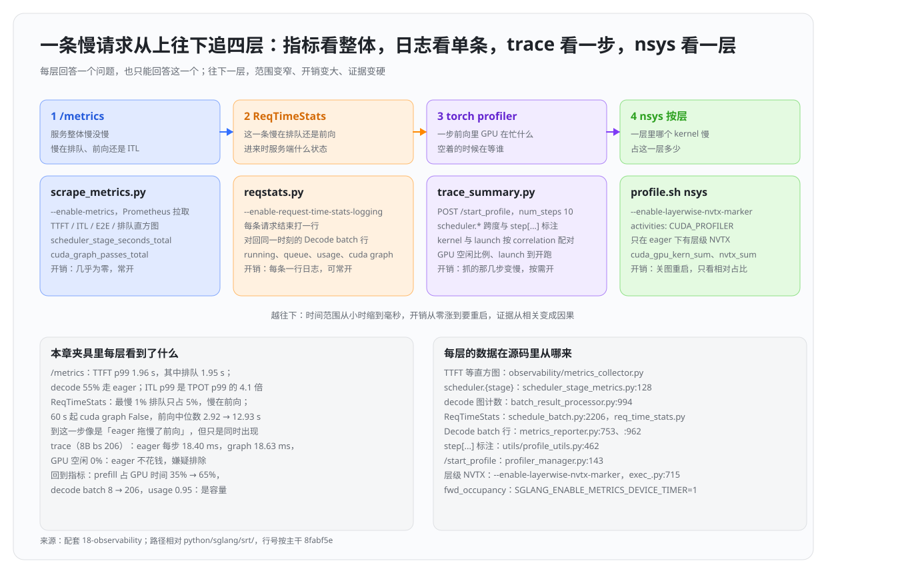
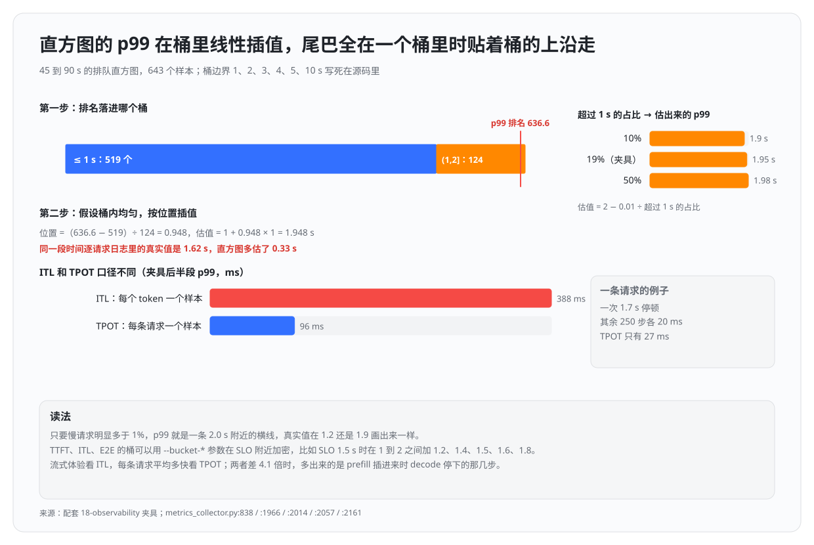
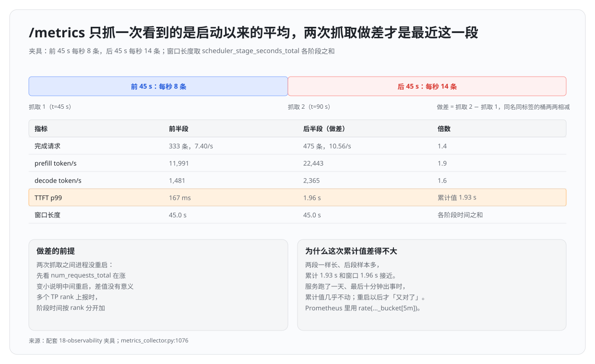
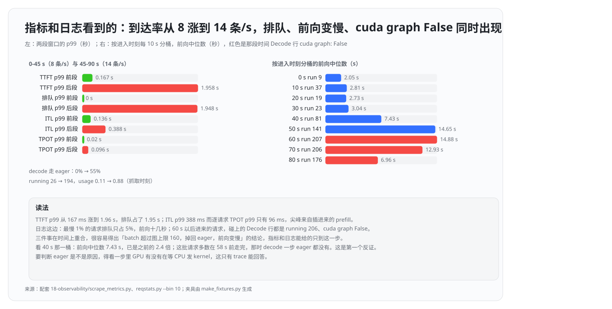
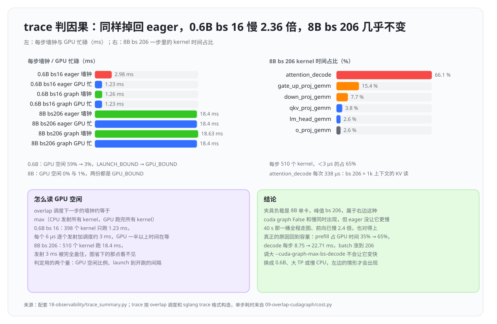
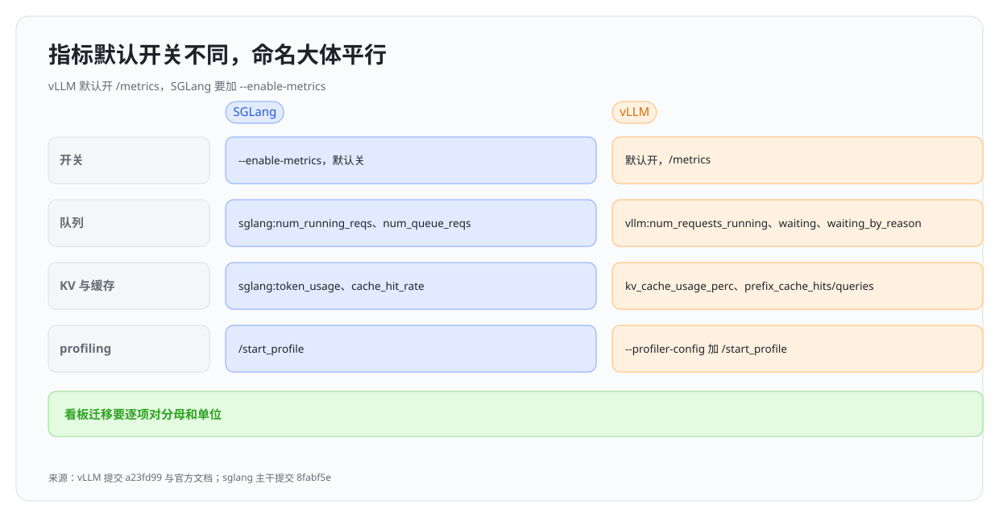
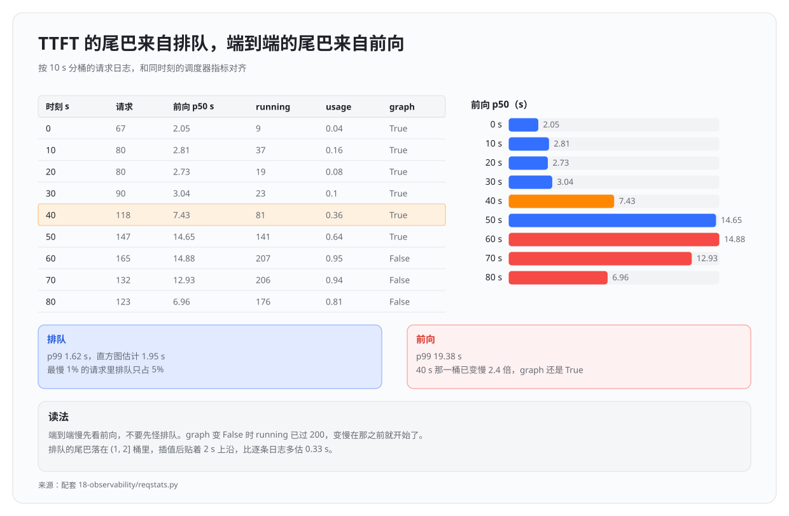
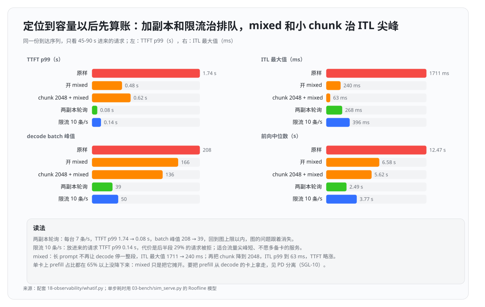

# SGL-18｜实战｜可观测与 profiling：从指标到 kernel

> 🎯 **遇到的问题**：Qwen3-8B 跑在一张 H100 上，decode 图上限设成 160。前 45 秒每秒 8 条请求，TTFT 的 p99 是 167 ms。
>
> 后 45 秒到达率涨到每秒 14 条，TTFT p99 变成 1.96 s，几乎全是排队，端到端 p99 从 5.74 s 涨到 29.44 s。同一段时间里，cuda_graph_passes_total 显示 55% 的 decode 步没走 CUDA graph。
>
> 逐请求日志里，最慢那条请求排队 1.71 s、前向 19.74 s，进来时 Decode batch 行写着 running 206、cuda graph: False。三件事时间上重合，看上去像「batch 超过 160 掉回 eager，前向变慢」，顺手的改法是把 --cuda-graph-max-bs-decode 调到 256。
>
> 可抓一段 torch profiler trace 就会发现，bs 206 时 eager 每步 18.40 ms，CUDA graph 回放 18.63 ms，GPU 两边都几乎没空过；掉回 eager 之前的 40 s 那一桶，请求的前向中位数已经是之前的 2.4 倍。
>
> 原因是到达率上来后 prefill 占掉 65% 的 GPU 时间，decode 一步从 8.75 ms 涨到 22.71 ms，调图上限没用。这一篇把四层观测排成一条链：/metrics 看整体，ReqTimeStats 看单条，torch profiler 看一步，Nsight Systems 看一层，讲清每层数据从哪来、能回答什么、开销多大，再用一组夹具追一遍这条慢请求。
>
> **主线**：指标只告诉我们什么和什么同时发生，profiling 才回答谁导致了谁。四层观测从整体到单条、单步、单层，逐层缩小嫌疑范围。
>
> **读完这一篇**：能用两次 /metrics 抓取算出窗口内的延迟分位数和误差，读懂调度循环的时间去向。能把一条慢请求拆成排队和前向，对回当时的 batch。能从 trace 判断一步卡在 CPU 发射还是 GPU。最要紧的是分清哪些结论只是相关、哪些已有因果证据。
>
> **代码**：[zero-to-sglang/18-observability](../18-observability)。scrape_metrics.py 按 histogram_quantile 的规则估分位数并给出诊断码，reqstats.py 把慢请求对回同一时刻的 batch 日志，trace_summary.py 判定 LAUNCH_BOUND、CPU_GAP 或 GPU_BOUND，whatif.py 估几种改法的收益，profile.sh 在真机上一次采齐。夹具重跑字节级一致，另有 41 个测试用例。只用标准库，行号按主干 8fabf5e 核对。

# 导读 · 结论先行

1. **四层各答一个问题。**/metrics 回答服务整体慢没慢、慢在排队还是前向。ReqTimeStats 回答这一条请求慢在哪、进来时服务端什么状态。torch profiler 回答一步前向里 GPU 在忙什么、空着的时候在等谁。nsys 回答一层里哪个 kernel 占了多少。往下一层，时间范围变窄，开销变大，证据变硬。
2. **指标要做差。**Counter 和直方图都是从启动开始累计的，单次抓取看到的是平均掉的历史；两次抓取做差得到的是这段时间。窗口长度不用自己记，调度器把每一秒都记在某个阶段上，各阶段加起来就是墙钟。直方图的分位数是桶内线性插值，p99 落在 (1, 2] 里时误差能到半个桶。
3. **日志能对齐状态。**ReqTimeStats 给出每条请求的排队、前向和进入时刻，Decode batch 行每 40 步打一次 running、queue、usage 和 cuda graph。两边按时间戳对上，就知道这条请求是在什么样的 batch 里跑完的。
4. **相关靠指标和日志，因果靠 trace。**排队、前向变慢、cuda graph False 同时出现，可它们可能都是同一个原因的结果。一段 trace 里看 GPU 空闲比例和 launch 到开跑的间隔，就能判断 eager 有没有让 GPU 等 CPU；8B 单卡 bs 206 时 GPU 前向远长于发射，eager 不花钱。
5. **定位以后先算账。**根因是容量时，加副本和限流治排队，mixed 和小 chunk 治 ITL 尖峰，prefill 干扰 decode 的根本解法是 PD 分离。几个办法先在模拟器上比方向和量级，再上真机。



上面四个框是四层观测，从左往右越来越细。每个框下面是本章配套的脚本、要打开的开关、能看到的字段和开销。左下是夹具里每一层看到的现象：前两层把排队、前向变慢和 eager 联系在一起，trace 层把 eager 排除掉，回到指标层找到容量这个原因。右下是每层数据在源码里的出处，第 3 章逐个走读。

**📎 与系列其他文档的分工**：TTFT、ITL、吞吐的定义和压测方法，见 [SGL-03｜上手｜指标与压测：TTFT、TPOT、ITL 与 goodput](./03-bench.md)。调度器、准入和 retract，见 [SGL-05｜原理｜调度器：waiting、running 与 KV 预算](./05-scheduler.md)。chunked prefill 和 mixed chunk，见 [SGL-06｜原理｜Chunked prefill：切块大小、mixed chunk 与 TTFT / ITL 的取舍](./06-chunked-prefill.md)。overlap 调度和 CUDA Graph，见 [SGL-09｜原理｜Overlap 调度与 CUDA Graph：把 CPU 开销藏到 GPU 后面](./09-overlap-cudagraph.md)。PD 分离，见 [SGL-15｜原理｜PD 分离：prefill 和 decode 拆到两组卡上](./15-pd-disagg.md)。路由和多副本，见 [SGL-19｜实战｜集群与 RL rollout：路由、权重同步与长尾](./19-cluster-rl.md)。从日志倒推参数，见 [SGL-17｜实战｜参数调优手册：从日志倒推配置](./17-tuning.md)。这一篇讲怎么拿到证据、怎么读，参数怎么改回到这些篇。

# 第 1 章 · 问题：慢的时候，数据很多，结论很少

我们线上出问题时常见的情形：

- Grafana 上 TTFT 的 p99 一直是一条整齐的 2.0 s 横线，压测工具算出来却是 1.7 s。
- /metrics 抓下来，TTFT p99 只有 300 ms，用户却在抱怨首字慢；重启以后又对了。
- 看监控里 sglang:utilization 想知道 GPU 忙不忙，它永远是 0。
- TPOT 的 p99 只有 96 ms，流式输出时用户能明显感到一卡一卡的。
- 调度循环里 process_batch_result 占了 93% 的时间，看上去是结果处理太慢。
- 日志里一段时间 cuda graph: False，同一时间请求变慢，把图上限调大以后几乎没变化。
- 抓了一段 torch profiler trace，几百 MB，打开以后不知道看哪。
- nsys 里想按层看 kernel，NVTX 范围全没了。
- PD 分离部署，prefill 节点的 ReqTimeStats 里 attempts 不是 0，不知道是好是坏。
- 一条请求 20 秒才回来，想知道它当时排在什么样的 batch 里。

这些问题分别落在四层观测里。有的是指标本身的口径（直方图插值、累计与窗口、没赋值的 gauge），有的是读法（TPOT 摊平了尖峰、process_batch_result 包含等 GPU），有的是工具的限制（图回放里没有 NVTX），最后一类是推理方法：从同时出现推不出谁导致谁。

| 想弄清的现象 | 看哪一节 |
|-|-|
| 分位数和压测工具对不上，p99 是一条横线 | 2.1、4.1 |
| 单次抓取和两次抓取的差别，窗口多长 | 2.2、4.2 |
| process_batch_result 为什么占九成，utilization 为什么是 0 | 2.3、5.2 |
| TPOT 正常、ITL 尖峰 | 2.1、4.2 |
| 一条慢请求慢在排队还是前向，当时服务端什么状态 | 2.4、4.3 |
| eager 到底有没有让它变慢 | 2.5、2.6、4.4 |
| trace 里先看什么，怎么判 LAUNCH_BOUND | 2.6、4.4 |
| nsys 按层看 kernel | 2.7、4.6 |
| 定位到容量以后怎么选办法 | 2.8、4.5 |
| 真机上一次采齐所有数据 | 4.6 |

# 第 2 章 · 原理：四层数据各从哪来，能回答什么

## 2.1 直方图的分位数：桶内线性插值，尾巴落在哪个桶决定误差

SGLang 的延迟指标都是 Prometheus 直方图：每个桶是一个累计计数器，记「小于等于 le 的样本有多少条」，外加 \_sum 和 \_count。分位数在查询时才算，histogram_quantile 先找到排名 q × N 落进哪个桶，再假设样本在桶内均匀分布，按位置线性插值[[1]](https://prometheus.io/docs/practices/histograms/)。拿 45 到 90 s 的排队直方图走一遍：643 个样本，p99 的排名是 636.6。

小于等于 1 s 的有 519 个，小于等于 2 s 的有 643 个，排名落在 (1, 2] 里，桶内 124 个样本，位置是 (636.6 − 519) ÷ 124 = 0.948，估出来 1 + 0.948 × 1 = 1.948 s。同一段时间逐请求日志里的真实值是 1.62 s，直方图多估了 0.33 s。

这条公式还能解释第 1 章那条「p99 是一条整齐的 2.0 s 横线」。尾巴全落在 (1, 2] 这个桶里时，估值等于 2 − 0.01 ÷（大于 1 s 的样本占比），只和「有多少样本超过 1 s」有关，和它们在桶里实际停在哪无关。夹具里超过 1 s 的排队占 19%，估值 1.95。占 50% 时估值 1.98。占 10% 时估值 1.90。只要慢请求明显多于 1%，p99 就贴着桶的上沿走，看上去是一条横线，真实值在 1.2 还是 1.9 都画成一样。压测工具按逐条请求排序取分位数，没有这层插值，两边对不上是常态。

改桶是唯一的根治办法。TTFT 默认 18 个桶，0.1、0.2、0.4、0.6、0.8、1、2、4 一直到 400 秒[（metrics_collector.py:1966）](https://github.com/sgl-project/sglang/blob/8fabf5e/python/sglang/srt/observability/metrics_collector.py#L1966)，ITL 和逐请求 TPOT 共用一组从 2 ms 到 8 s 的桶（:2014），E2E 在 TTFT 那组后面加了 600 到 2400 秒。

这三组都能在启动时改：--bucket-time-to-first-token、--bucket-inter-token-latency、--bucket-e2e-request-latency[（fields/observability.py:104）](https://github.com/sgl-project/sglang/blob/8fabf5e/python/sglang/srt/arg_groups/fields/observability.py#L104)，按自己的 SLO 在阈值附近加密，比如 TTFT 的 SLO 是 1.5 s，就在 1 到 2 之间放 1.2、1.4、1.5、1.6、1.8。排队直方图的桶写死在源码里[（:838）](https://github.com/sgl-project/sglang/blob/8fabf5e/python/sglang/srt/observability/metrics_collector.py#L838)，1 s 以后是 1、2、3、4、5、10，改不了，要精确值只能读逐请求日志（2.4 节）。桶多了每个标签组合的时间序列跟着多，按需加，别一口气加几十个。

ITL 和 TPOT 的口径不一样，这是第 1 章「TPOT 正常却一卡一卡」的来源。ITL 在每次往客户端吐 token 时记一次：两次输出之间的间隔除以这次新出的 token 数，再按 token 数重复记那么多次[（:2161）](https://github.com/sgl-project/sglang/blob/8fabf5e/python/sglang/srt/observability/metrics_collector.py#L2161)，一个 50 万 token 的窗口就有 50 万个样本，每一次卡顿都留在分布里。

TPOT 是每条请求记一个：（完成时刻 − 首 token 时刻）÷（输出长度 − 1）（:2057），一条请求里有一次 1.7 s 的停顿、其余 250 步各 20 ms，TPOT 只有 27 ms。夹具后半段 ITL p99 388 ms，TPOT p99 96 ms，差 4.1 倍，多出来的就是 prefill 插进来时 decode 停下的那几步。流式输出的体验看 ITL，算每条请求平均多快看 TPOT，两者对不上时先怀疑 prefill 干扰（[SGL-06｜原理｜Chunked prefill：切块大小、mixed chunk 与 TTFT / ITL 的取舍](./06-chunked-prefill.md)）。



## 2.2 累计和窗口：两次抓取做差，窗口长度从调度阶段里来

Counter 和直方图的桶都从进程启动开始累计。只抓一次，看到的是「从启动到现在」的平均，前面跑得越久，最近这段的变化被稀释得越厉害。夹具里前 45 s 每秒 8 条，TTFT p99 167 ms。后 45 s 每秒 14 条，窗口里的 p99 是 1.96 s，单看 90 s 时的累计抓取是 1.93 s，这里两段一样长、后段样本多，所以差得不大。换成服务跑了一天、最后十分钟出事，累计值几乎不动。第 1 章那条「/metrics 上 p99 只有 300 ms，重启以后又对了」就是这样：重启清零了历史，累计值才开始反映最近的状态。

Prometheus 里的做法是 histogram_quantile(0.99, rate(...\_bucket[5m]))，rate 先把每个桶在窗口内的增量算出来，计数器因为重启归零时它会自动接上[[1]](https://prometheus.io/docs/practices/histograms/)。手里只有两次 curl 的文本时，自己按桶做差：同名、同标签的桶两两相减，得到的还是一组合法的累计桶，照样插值。前提是两次抓取之间进程没重启过，先看 num_requests_total 是不是在涨，变小了说明中间重启，差值没有意义。

窗口多长不用自己记。scheduler_stage_seconds_total 按阶段记调度循环的墙钟，文档写的是 exclusively attributed to each stage[（:1076）](https://github.com/sgl-project/sglang/blob/8fabf5e/python/sglang/srt/observability/metrics_collector.py#L1076)，每一秒只记在一个阶段上，空闲时记在 idle 里。所有 category 加起来就是这段时间调度器活着的墙钟，夹具两次都是 45.0 s。

有了窗口长度，请求数、token 数、各类计数都能换成每秒：后半段完成 475 条、每秒 10.56 条，prefill 每秒算 22,443 个 token，decode 每秒出 2,365 个，分别是前半段的 1.4 倍、1.9 倍和 1.6 倍。多个 TP rank 都上报时（2.3 节），各 rank 的阶段时间要按 rank 分开加，不能全部加总。



## 2.3 调度阶段和 GPU 忙不忙：哪些指标能信

Google SRE 书里把监控收成四个黄金信号：延迟、流量、错误、饱和度[[2]](https://sre.google/sre-book/monitoring-distributed-systems/)；Brendan Gregg 的 USE 方法换了个角度，对每一种资源问利用率、饱和度、错误[[3]](https://www.brendangregg.com/usemethod.html)。对到 SGLang 上，延迟是 TTFT、ITL、E2E 和排队四个直方图。流量是 num_requests_total、prompt 和 generation 的 token 计数。

错误是 num_aborted_requests_total 和 grammar 的 abort 计数。饱和度是 token_usage、num_queue_reqs 和 num_running_reqs。资源这一侧最要紧的是 GPU 和 KV 池：KV 池看 token_usage，GPU 忙不忙，现成的指标里有两个坑。

第一个坑是 sglang:utilization。名字看着就是 GPU 利用率，可它要靠 max_running_requests_under_SLO 算，这个属性在 8fabf5e 上没有赋值的地方，源码里留着一行 TODO[（metrics_reporter.py:1307）](https://github.com/sgl-project/sglang/blob/8fabf5e/python/sglang/srt/managers/scheduler_components/metrics_reporter.py#L1307)，所以它恒为 0，PD 分离的 prefill 节点上恒为 −1，不能拿来做告警。

第二个坑是 fwd_occupancy 和 forward_execution_seconds_total：fwd_occupancy 是窗口内 GPU 前向时间除以墙钟（:217），forward_execution_seconds_total 是 GPU 执行前向的累计秒数[（metrics_collector.py:1055）](https://github.com/sgl-project/sglang/blob/8fabf5e/python/sglang/srt/observability/metrics_collector.py#L1055)，这两个反映的是 GPU 实际的忙碌度，可它们都靠一个在每次前向前后打 CUDA event 的 DeviceTimer 记，只有设了环境变量 SGLANG_ENABLE_METRICS_DEVICE_TIMER=1 才打开[（metrics_reporter.py:68）](https://github.com/sgl-project/sglang/blob/8fabf5e/python/sglang/srt/managers/scheduler_components/metrics_reporter.py#L68)，默认 fwd_occupancy 是 NaN，forward_execution_seconds_total 根本不出现。生产上要看 GPU 忙不忙，起服务时就把它带上，开销是每步两个 event。

没开 device timer 时，调度阶段的分布可以间接回答。夹具后半段 process_batch_result 占 92.8%，run_batch 5.4%，看上去「结果处理」是瓶颈，其实这里装的主要是等 GPU。overlap 调度下循环先把第 N+1 步发出去，再回头处理第 N 步的结果（[SGL-09｜原理｜Overlap 调度与 CUDA Graph：把 CPU 开销藏到 GPU 后面](./09-overlap-cudagraph.md)），而处理结果的第一件事就是等第 N 步的输出拷回 CPU：decode 在 [batch_result_processor.py:958](https://github.com/sgl-project/sglang/blob/8fabf5e/python/sglang/srt/managers/scheduler_components/batch_result_processor.py#L958) 调 copy_done.synchronize()，prefill 在 :267。

GPU 越忙，等得越久，这段时间全记在 process_batch_result 上。所以 overlap 开着时 process_batch_result 占九成是 GPU 跑满的信号，真正属于 CPU 的是 run_batch、get_next_batch_to_run、recv_requests 这些阶段，夹具里加起来不到 8%。调度进程 CPU 时间除以墙钟是 0.98，也不说明 CPU 打满：同步默认是忙等，等 GPU 的时候 CPU 也在空转。

scheduler_stage_seconds_total 还带一个 forward_overlap 标签，取 full、partial、none，标出这段阶段时间和 GPU 前向重叠的程度，配合 device timer 看 CPU 阶段有没有被前向盖住。

另一个常被忽略的开关是 --enable-metrics-for-all-schedulers[（fields/observability.py:82）](https://github.com/sgl-project/sglang/blob/8fabf5e/python/sglang/srt/arg_groups/fields/observability.py#L82)：默认只有 TP0 的调度器记请求级指标，开了 DP attention 以后各个 DP rank 各自调度，不开这个开关，所有请求的指标看上去都来自 TP0，排队和吞吐按 rank 的差别全看不出来。

## 2.4 ReqTimeStats：一条请求拆成排队和前向，再对回当时的 batch

--enable-request-time-stats-logging 打开以后[（fields/observability.py:140）](https://github.com/sgl-project/sglang/blob/8fabf5e/python/sglang/srt/arg_groups/fields/observability.py#L140)，每条请求结束时调度器打一行[（schedule_batch.py:2206）](https://github.com/sgl-project/sglang/blob/8fabf5e/python/sglang/srt/managers/schedule_batch.py#L2206)：

```text
ReqTimeStats(rid=3990ea27a157…, input_len=1188, cached_input_len=0, output_len=253, attempts=0, type=unified): queue_duration=1710.00ms, forward_duration=19740.00ms, entry_time=1793325668.123
```

unified 模式下三个时间的定义在 [req_time_stats.py:1099](https://github.com/sgl-project/sglang/blob/8fabf5e/python/sglang/srt/observability/req_time_stats.py#L1099)：queue_duration 是在等待队列里待的时间，被 retract 退回再排一次的话会累加。forward_duration 从第一次被调度进 batch 算到请求完成，prefill 和所有 decode 步都在里面。entry_time 是进入等待队列时的 unix 墙钟。

这三个数加上输入输出长度，就能把一条慢请求先拆一刀：排队长是准入或容量问题，前向长再看输出长度和每步多慢。夹具里最慢的那条前向 19.74 s、输出 253 个 token，平均每个 token 78 ms，而 60 到 80 s 之间 decode 一步只要 28.36 ms。差出来的部分在 prefill 上：这段时间 GPU 有 64% 在跑 prefill，decode 只拿到 35%，28.36 ÷ 0.353 = 80 ms，和 78 ms 对得上。

PD 分离时格式会变。prefill 节点打 type=prefill，多出 bootstrap_room、bootstrap_duration、传输速度和传输总量；decode 节点打 type=decode，多出 alloc_wait_duration 和 transfer_duration（[SGL-15｜原理｜PD 分离：prefill 和 decode 拆到两组卡上](./15-pd-disagg.md)）。

attempts 是 prefill_attempt_count[（:1449）](https://github.com/sgl-project/sglang/blob/8fabf5e/python/sglang/srt/managers/schedule_batch.py#L1449)，只有 prefill 节点的乐观预填会加：KV 还在等 decode 侧分配时先算，算完对方没准备好就让出来重排，每让一次加一[（disaggregation/prefill.py:1843）](https://github.com/sgl-project/sglang/blob/8fabf5e/python/sglang/srt/disaggregation/prefill.py#L1843)。unified 模式下它恒为 0，retract 也不改它。所以 prefill 节点上 attempts 大于 1 说明乐观预填被让出过，偶尔出现正常，比例高就对照 sglang:num_prefill_retries_total 看重试率，再查 decode 侧的显存。

单看 ReqTimeStats 只知道这条请求慢，不知道当时服务端是什么状态。调度器另外每 decode_log_interval 步（默认 40）打一行 Decode batch[（metrics_reporter.py:963）](https://github.com/sgl-project/sglang/blob/8fabf5e/python/sglang/srt/managers/scheduler_components/metrics_reporter.py#L963)，带 #running-req、token usage、cuda graph、gen throughput 和 #queue-req；每次 prefill 打一行 Prefill batch（:754），带 #new-seq、#new-token、#queue-req 和 #pending-token。

两边都有时间戳，按 entry_time 找它之前最近的一行，就知道这条请求进来时 batch 有多大、队列多长、有没有走图。对齐时有两个细节：日志行首的时间是本地时区的 asctime，只精确到秒，entry_time 是 unix 墙钟，要先把时区差对掉；40 步打一行，batch 小的时候一行隔几百毫秒，batch 大、prefill 插得多时隔一两秒，对出来的是附近的状态，不是精确的那一刻。

跨进程、跨节点追一条请求，ReqTimeStats 就不够了。SGLang 内置 OpenTelemetry 的请求级追踪：--enable-trace 打开，--trace-modules 选 request 或 mooncake，--otlp-traces-endpoint 指向 collector[（fields/observability.py:164）](https://github.com/sgl-project/sglang/blob/8fabf5e/python/sglang/srt/arg_groups/fields/observability.py#L164)。

思路和 Dapper 一样，一条请求从 HTTP 入口到 tokenizer、调度器、detokenizer 各段是一个个 span，靠同一个 trace id 串起来[[4]](https://research.google/pubs/dapper-a-large-scale-distributed-systems-tracing-infrastructure/)，导出走 OTLP 协议，任何兼容的后端都能看[[5]](https://opentelemetry.io/docs/concepts/signals/traces/)。它适合 PD 分离、多副本加路由这种一条请求要经过好几个进程的部署；单机单副本时 ReqTimeStats 加 batch 日志已经够用，开销也小得多。

## 2.5 相关的陷阱：三件事同时发生，不等于谁导致了谁



指标和日志能给出的证据到上图为止。到达率从每秒 8 条涨到 14 条以后，四件事几乎同时出现：排队从 0 涨到 p99 1.95 s，decode 有 55% 的步走了 eager，60 s 以后进来的请求碰上的 Decode 行都是 running 206、cuda graph False，它们的前向中位数从之前的 2.92 s 涨到 12.93 s。最顺手的解读是一条因果链：batch 超过图上限 160，掉回 eager，每步变慢，前向变长，在跑请求走得慢，新请求排队。这条链每一环听上去都合理，可从指标和日志里只能读出「同时」，读不出「导致」。

先找反例。因果链要求前向变慢发生在掉回 eager 之后，日志里 batch 第一次超过 160 是在 60.34 s。看 40 s 那一桶：118 条请求，前向中位数 7.43 s，已经是 30 s 那一桶的 2.4 倍；这批请求 85% 在 60.34 s 之前就结束了，它们的前向时间 93% 落在 eager 出现之前。前向变慢先于 eager，eager 至少不是唯一的原因。

再看同一段时间的步长：30 到 40 s decode 一步 9.45 ms，prefill 占 GPU 时间 38%。40 到 50 s 一步 9.87 ms，prefill 占比 52.7%。50 到 60 s 一步 19.0 ms，平均 batch 117，prefill 占比 66.7%。到达率上来以后，prefill 先挤占了 decode 的时间，在跑请求走得慢，batch 越堆越大，最后才越过图上限。

这时候 eager 的嫌疑还没排除，只是降了级：它可能在 60 s 以后叠加了一份变慢，也可能完全不花钱。要回答这个问题，得看一步里 GPU 有没有因为 eager 逐个发射 kernel 而空等，这只能去 trace 里看。分析的顺序也就定了：指标和日志负责提出嫌疑、给出时间段，trace 负责判定。

## 2.6 读 trace：GPU 空闲比例和 launch 到开跑的间隔

torch profiler 抓的是一段时间里 CPU 和 GPU 两条时间线[[6]](https://docs.pytorch.org/docs/stable/profiler.html)。SGLang 用 POST /start_profile 触发，常用参数：output_dir，不给时落到环境变量 SGLANG_TORCH_PROFILER_DIR，再没有就是 /tmp[（profiler_manager.py:130）](https://github.com/sgl-project/sglang/blob/8fabf5e/python/sglang/srt/managers/scheduler_components/profiler_manager.py#L130)。num_steps 抓几步前向就自动停（:146）。

start_step 按进程启动以来的全局前向计数算（:143），取它和「当前计数 + 1」的较大值，服务跑过一阵以后写个小数字等于马上开始，要等压测进入稳态，晚点发这个请求更直接。activities 选 CPU、GPU、MEM 或 CUDA_PROFILER。with_stack 和 record_shapes 带上调用栈和张量形状，trace 会大很多。detailed_annotations 让每一步的标注带上 batch 的聚合量[[7]](https://docs.sglang.io/docs/developer_guide/benchmark_and_profiling)。抓出来的 \*.trace.json.gz 可以拖进 Perfetto 看[[8]](https://perfetto.dev/docs/)，也可以直接用脚本读。

trace 里有三样东西能对上号。CPU 线程上是 scheduler.recv_requests、scheduler.run_batch 这样的跨度，就是 2.3 节那几个调度阶段[（scheduler_stage_metrics.py:128）](https://github.com/sgl-project/sglang/blob/8fabf5e/python/sglang/srt/observability/scheduler_stage_metrics.py#L128)。每次前向有一个 step[DECODE bs=206 g_sq=206 g_sk=210944] 这样的标注，CPU 和 GPU 流上各一份[（profile_utils.py:462）](https://github.com/sgl-project/sglang/blob/8fabf5e/python/sglang/srt/utils/profile_utils.py#L462)，g_sk 是这一步所有请求的上下文长度之和。

GPU 流上是一个个 kernel，每个 kernel 带一个 correlation id，和 CPU 侧发射它的 cudaLaunchKernel 或 cudaGraphLaunch 对上。几百 MB 的 trace 打开以后先别看 kernel 排行，先算两个量。

第一个量是每步的 GPU 空闲比例：一步的墙钟里，有多少时间 GPU 上一个 kernel 都没在跑。第二个量是 launch 到开跑的间隔：CPU 的 cudaLaunchKernel 返回以后，过了多久这个 kernel 才在 GPU 上开始。GPU 一空、kernel 一发就跑，间隔接近 0，说明 GPU 在等 CPU 发下一个，是发射受限（LAUNCH_BOUND）。GPU 几乎不空、kernel 发出去要排很久才轮到，说明 CPU 早就跑到前面去了，是 GPU 受限（GPU_BOUND）。用着 CUDA graph 还空闲很多，空隙在两步之间的调度和结果处理上（CPU_GAP）。



这两份 trace 的差别可以直接算出来。overlap 调度下一步的墙钟约等于 CPU 发射所有 kernel 和 GPU 跑完所有 kernel 两者取大（[SGL-09｜原理｜Overlap 调度与 CUDA Graph：把 CPU 开销藏到 GPU 后面](./09-overlap-cudagraph.md)）。eager 时每个 kernel 的发射加 Python 开销按 6 µs 算，CUDA graph 一次回放约 80 µs[[9]](https://developer.nvidia.com/blog/cuda-graphs/)[[10]](https://pytorch.org/blog/accelerating-pytorch-with-cuda-graphs/)。0.6B、bs 16 一步 398 个 kernel，发射 2.39 ms，加上调度约 3 ms，GPU 只要 1.23 ms，GPU 有 59% 的时间在等，71% 的 kernel 在 launch 返回 2 µs 内就开跑，典型的发射受限。

换成图回放，一步 1.26 ms，快 2.36 倍，GPU 忙碌时间一点没变，省下的全是空隙。8B、bs 206 一步 510 个 kernel，发射 3.06 ms，GPU 要跑 18.40 ms，发射被完全盖住，GPU 空闲 0%，launch 到开跑的中位数 22 ms，kernel 发出去要排一整步才轮到；图回放 18.63 ms，和 eager 一样。夹具的负载就是后面这种，所以 cuda graph False 和变慢只是同时出现，eager 没有让它更慢，调大 --cuda-graph-max-bs-decode 也不会变快。

GPU 受限以后再看 kernel 排行。8B bs 206 时 attention_decode 占 66%，每次 337.7 µs。Qwen3-8B 每层每个 token 的 KV 是 8 个头 × 128 维 × K、V 两份 × 2 字节 = 4 KB，这一步 g_sk = 210,944，一层要读 864 MB，除以 337.7 µs 是 2.56 TB/s，H100 SXM 标称带宽 3.35 TB/s 的 76%。

按 Roofline 模型，这个 kernel 已经贴着带宽上限在跑[[11]](https://dl.acm.org/doi/10.1145/1498765.1498785)，优化 kernel 能拿回的空间很小；要让一步变短，只能少读 KV，也就是 batch 小一点或者上下文短一点，问题又回到了容量。

## 2.7 Nsight Systems 按层看：要关图，只看相对占比

torch profiler 能指出一步里哪些 kernel 慢，想知道第 17 层的 MLP 比第 3 层慢多少，要换 Nsight Systems 配合 NVTX 范围[[12]](https://docs.nvidia.com/nsight-systems/UserGuide/index.html)。--enable-layerwise-nvtx-marker[（fields/exec\_.py:715）](https://github.com/sgl-project/sglang/blob/8fabf5e/python/sglang/srt/arg_groups/fields/exec_.py#L715) 给模型的每一层、每个子模块套上 NVTX 范围，nsys 的时间线上就能按层展开。

限制在于 CUDA graph：捕获时 NVTX 调用不会被录进图，回放时时间线上只有 kernel 没有层级标注[[7]](https://docs.sglang.io/docs/developer_guide/benchmark_and_profiling)，所以按层看必须关图。8fabf5e 上 --disable-cuda-graph 已经弃用[（server_args.py:411）](https://github.com/sgl-project/sglang/blob/8fabf5e/python/sglang/srt/server_args.py#L411)，换成 --cuda-graph-backend-decode disabled 和 --cuda-graph-backend-prefill disabled（exec\_.py:616）。

抓的范围用 nsys 的 --capture-range=cudaProfilerApi 控制：服务起在 nsys 下，平时不录；需要时 POST /start_profile 带 activities 为 CUDA_PROFILER，SGLang 调 cudaProfilerStart，num_steps 步以后调 cudaProfilerStop，nsys 只录这一段[[7]](https://docs.sglang.io/docs/developer_guide/benchmark_and_profiling)。

录完用 nsys stats 出 cuda_gpu_kern_sum 和 nvtx_sum 两张表，一张按 kernel 汇总，一张按 NVTX 范围汇总。关了图以后，小模型、大 TP 的部署会变成发射受限，每层的绝对耗时比线上大；8B bs 206 这种 GPU 受限的负载差别不大。所以 nsys 按层的结果只看同一份 trace 里的相对占比：attention 占一层多少、哪一层明显比别的层慢、通信 kernel 占多少，绝对毫秒数以 torch profiler 在图模式下抓的为准。

## 2.8 定位到容量以后：几种办法各治什么

夹具的根因是容量：到达率涨到每秒 14 条以后，prefill 占 GPU 时间从 35% 涨到 65%，decode 一步从 8.75 ms 涨到 22.71 ms，在跑请求走得慢，batch 越堆越大。对症的办法有三类，治的东西不一样。加副本和入口限流治排队：两副本按轮询分流[（round_robin.rs）](https://github.com/sgl-project/sglang/blob/8fabf5e/sgl-model-gateway/src/policies/round_robin.rs)，每台每秒 7 条，回到前半段的负载。

限流把超出的请求在网关直接拒掉，放进来的请求延迟正常，代价是一部分用户拿到 429（[SGL-19｜实战｜集群与 RL rollout：路由、权重同步与长尾](./19-cluster-rl.md)）。mixed chunk 和小 chunk 治 ITL 尖峰：decode 搭在 prefill 块上一起算，不再停一整段（[SGL-06｜原理｜Chunked prefill：切块大小、mixed chunk 与 TTFT / ITL 的取舍](./06-chunked-prefill.md)），这是 Sarathi-Serve 的核心做法[[13]](https://arxiv.org/abs/2403.02310)。

这两类都没把 prefill 从 decode 的卡上拿走，单卡上 prefill 占比开了 mixed 以后还是 65% 以上，只是摊得更均匀。prefill 和 decode 抢同一张卡的问题，根本的解法是 PD 分离，DistServe 的论文论证了两个阶段分开放、各自按 SLO 配资源，goodput 比合在一起高[[14]](https://arxiv.org/abs/2401.09670)，SGLang 这边的做法见 [SGL-15｜原理｜PD 分离：prefill 和 decode 拆到两组卡上](./15-pd-disagg.md)。几个办法先在模拟器上比方向和量级，4.5 节给出同一份到达序列下的对比，再挑一两个上真机验证。

## 2.9 vLLM 怎么做

vLLM 的 Prometheus 指标默认开启，直接挂在服务端口的 /metrics 上；SGLang 要显式加 --enable-metrics。

vLLM 常用的几项是 vllm:num_requests_running、vllm:num_requests_waiting、vllm:kv_cache_usage_perc（0 到 1）、vllm:prefix_cache_hits 与 vllm:prefix_cache_queries、vllm:num_preemptions，以及 TTFT 和 ITL 直方图[[15]](https://docs.vllm.ai/en/latest/usage/metrics.html)。KV 块的生命周期、驱逐前空闲时长、复用间隔也有直方图，--enable-mfu-metrics 还能估算 MFU。

profiling 两边都走 HTTP 接口：vLLM 用 --profiler-config 配好输出目录后调 /start_profile 和 /stop_profile[[16]](https://docs.vllm.ai/en/latest/contributing/profiling.html)，SGLang 也有 /start_profile。SGLang 的指标更细地拆到了调度内部，比如 DP 注意力的 token 不均衡、HiCache 的预取等待；vLLM 的 waiting_by_reason 能看出请求在等什么。我们迁移看板时逐项重新对过口径，比如 kv_cache_usage_perc 是比例，sglang:token_usage 也是比例，但分母的定义不完全一样。

| 维度 | SGLang | vLLM | 差异的代价 |
|-|-|-|-|
| 开关 | --enable-metrics，默认关 | 默认开，/metrics | SGLang 忘开就没有历史数据 |
| 队列 | sglang:num_running_reqs、num_queue_reqs | vllm:num_requests_running、waiting、waiting_by_reason | vLLM 多了等待原因 |
| KV 与缓存 | sglang:token_usage、cache_hit_rate | kv_cache_usage_perc、prefix_cache_hits/queries | 命中率要自己相除 |
| profiling | /start_profile | --profiler-config 加 /start_profile | trace 格式都是 torch profiler |



# 第 3 章 · 源码走读：四层数据的 18 个出处

前 8 个是指标：直方图的定义和桶、ITL 的记法、调度阶段和 GPU 时间两个计数器、CUDA graph 计数、overlap 下的同步点、恒为 0 的 utilization。中间 5 个是日志：ReqTimeStats 的打印和口径、PD 的 attempts、batch 行。后 5 个是 trace 和开关。行号都对应主干 8fabf5e。

| # | 位置 | 发生了什么 |
|-|-|-|
| 1 | [observability/metrics_collector.py:838](https://github.com/sgl-project/sglang/blob/8fabf5e/python/sglang/srt/observability/metrics_collector.py#L838) | sglang:queue_time_seconds 排队直方图，桶写死在源码里，1 s 以后是 1、2、3、4、5、10、15、20、30 |
| 2 | [observability/metrics_collector.py:1966](https://github.com/sgl-project/sglang/blob/8fabf5e/python/sglang/srt/observability/metrics_collector.py#L1966) | TTFT 默认桶 0.1 到 400 s，:1988 E2E 在后面加 600 到 2400，:2014 ITL 和 TPOT 共用 2 ms 到 8 s；三组都能被 --bucket-\* 覆盖 |
| 3 | [observability/metrics_collector.py:2041](https://github.com/sgl-project/sglang/blob/8fabf5e/python/sglang/srt/observability/metrics_collector.py#L2041) | TTFT 直方图带 is_streaming 标签；:2051 ITL，:2057 逐请求 TPOT，documentation 里写着（完成 − 首 token）÷（输出 − 1），:2068 E2E |
| 4 | [observability/metrics_collector.py:2161](https://github.com/sgl-project/sglang/blob/8fabf5e/python/sglang/srt/observability/metrics_collector.py#L2161) | observe_inter_token_latency：间隔除以这次新出的 token 数，再按 token 数重复 observe，所以 ITL 的样本数等于输出 token 数 |
| 5 | [observability/metrics_collector.py:1076](https://github.com/sgl-project/sglang/blob/8fabf5e/python/sglang/srt/observability/metrics_collector.py#L1076) | scheduler_stage_seconds_total，标签 category 和 forward_overlap；:1055 forward_execution_seconds_total，只在 device timer 打开时有值 |
| 6 | [observability/scheduler_stage_metrics.py:128](https://github.com/sgl-project/sglang/blob/8fabf5e/python/sglang/srt/observability/scheduler_stage_metrics.py#L128) | record() 把墙钟独占地记到当前阶段，嵌套阶段临时替换父阶段；同一处打 scheduler.{stage} 的 profile 范围，trace 里看到的 CPU 跨度就是它 |
| 7 | [observability/metrics_collector.py:1527](https://github.com/sgl-project/sglang/blob/8fabf5e/python/sglang/srt/observability/metrics_collector.py#L1527) | increment_decode_cuda_graph_pass：decode_cuda_graph 或 decode_none；batch_result_processor.py:994 每个 decode 步调一次 |
| 8 | [managers/scheduler_components/batch_result_processor.py:958](https://github.com/sgl-project/sglang/blob/8fabf5e/python/sglang/srt/managers/scheduler_components/batch_result_processor.py#L958) | decode 结果处理的第一步 copy_done.synchronize()，prefill 在 :267；overlap 下等 GPU 的时间全记在 process_batch_result 上 |
| 9 | [scheduler_components/metrics_reporter.py:68](https://github.com/sgl-project/sglang/blob/8fabf5e/python/sglang/srt/managers/scheduler_components/metrics_reporter.py#L68) | ENABLE_METRICS_DEVICE_TIMER 读环境变量；:325 打开 DeviceTimer，:217 fwd_occupancy = GPU 前向时间 ÷ 墙钟 |
| 10 | [scheduler_components/metrics_reporter.py:1307](https://github.com/sgl-project/sglang/blob/8fabf5e/python/sglang/srt/managers/scheduler_components/metrics_reporter.py#L1307) | \_calculate_utilization：max_running_requests_under_SLO 没有赋值的地方，TODO 注明 utilization 恒为 0；PD prefill 节点直接写 −1 |
| 11 | [managers/schedule_batch.py:2206](https://github.com/sgl-project/sglang/blob/8fabf5e/python/sglang/srt/managers/schedule_batch.py#L2206) | log_time_stats：overlap 下会被调两次，has_log_time_stats 去重；前缀带 rid、input_len、cached_input_len、output_len、attempts、type |
| 12 | [observability/req_time_stats.py:1099](https://github.com/sgl-project/sglang/blob/8fabf5e/python/sglang/srt/observability/req_time_stats.py#L1099) | convert_to_duration：unified 模式输出 queue_duration、forward_duration（forward_entry_time 到 completion_time）、entry_time；PD 两种模式各有一套字段 |
| 13 | [disaggregation/prefill.py:1843](https://github.com/sgl-project/sglang/blob/8fabf5e/python/sglang/srt/disaggregation/prefill.py#L1843) | 乐观预填被让出时 prefill_attempt_count 加一，同时打一行 optimistic prefill yielded；:531 和 :542 是另外两处 |
| 14 | [scheduler_components/metrics_reporter.py:963](https://github.com/sgl-project/sglang/blob/8fabf5e/python/sglang/srt/managers/scheduler_components/metrics_reporter.py#L963) | Decode batch 行：running、token usage、cuda graph、gen throughput、queue；:934 每 decode_log_interval 步才打，:754 是 Prefill batch 行 |
| 15 | [scheduler_components/profiler_manager.py:130](https://github.com/sgl-project/sglang/blob/8fabf5e/python/sglang/srt/managers/scheduler_components/profiler_manager.py#L130) | /start_profile 的落盘目录：参数、SGLANG_TORCH_PROFILER_DIR、/tmp 依次回退；:143 start_step 和当前前向计数取大，:146 num_steps |
| 16 | [utils/profile_utils.py:462](https://github.com/sgl-project/sglang/blob/8fabf5e/python/sglang/srt/utils/profile_utils.py#L462) | build_step_span_name：step[DECODE bs=…]，EXTEND 多一个 toks；detailed_annotations 打开时追加 g_sq、g_sk 这些聚合量 |
| 17 | [arg_groups/fields/exec\_.py:715](https://github.com/sgl-project/sglang/blob/8fabf5e/python/sglang/srt/arg_groups/fields/exec_.py#L715) | --enable-layerwise-nvtx-marker。:616 和 :625 两个 cuda_graph_backend，取 disabled 关图。:632 decode 图的最大 bs |
| 18 | [arg_groups/fields/observability.py:70](https://github.com/sgl-project/sglang/blob/8fabf5e/python/sglang/srt/arg_groups/fields/observability.py#L70) | 观测相关的开关都在这个文件：enable_metrics、:82 all_schedulers、:104 三组桶、:136 decode_log_interval、:140 时间统计日志、:164 OpenTelemetry |

读的时候分两遍。第一遍顺着一条请求的生命周期读 11、12、3、4：进队列记 entry_time，被调度进 batch 记 forward_entry_time，出首 token 记一次 TTFT，之后每次吐 token 记若干次 ITL，结束时记 TPOT、E2E 并打 ReqTimeStats。把这几个时刻在纸上画成一条线，2.1 节 ITL 和 TPOT 的差别、2.4 节排队和前向的切法就都清楚了。

第二遍顺着调度循环读 6、8、7、14：每一轮先进 recv_requests，再 get_next_batch_to_run、run_batch，回头 process_batch_result 时先同步；decode 步记一次图计数，每 40 步打一行 Decode batch。这一遍读完，scrape_metrics 输出里「调度循环的时间去向」那一段每个数字都能对上源码。9 和 10 两处记住结论就行：线上要看 GPU 忙不忙，得开 device timer，别看 utilization。

# 第 4 章 · 实验：用配套脚本从指标追到 kernel

配套目录有四个脚本，按观测的层次排。夹具是一台 Qwen3-8B / 1×H100 的服务，输入 1024 到 2048、输出 128 到 256，前 45 s 每秒 8 条，后 45 s 每秒 14 条，decode 图上限 160。metrics_t0.txt 和 metrics_t1.txt 是 45 s 和 90 s 两次 /metrics 抓取，按 8fabf5e 的指标名和标签构造，指标的含义见官方的生产指标文档[[17]](https://docs.sglang.io/docs/references/production_metrics)。

server_reqstats.log 是同一段时间的 1002 条 ReqTimeStats 加 Prefill、Decode batch 行。四个 trace 按 sglang 导出的格式构造，单步耗时来自 [SGL-09｜原理｜Overlap 调度与 CUDA Graph：把 CPU 开销藏到 GPU 后面](./09-overlap-cudagraph.md) 的发射模型。所有夹具由 make_fixtures.py 用 [SGL-03｜上手｜指标与压测：TTFT、TPOT、ITL 与 goodput](./03-bench.md) 的服务模拟器生成。

## 4.1 单次抓取：从启动累计的平均

```bash
cd zero-to-sglang/18-observability
python3 scrape_metrics.py metrics_t0.txt
```

```text
== 窗口 ==
  单次抓取（从启动累计），时长 45.0 s（scheduler_stage_seconds_total 各阶段之和）
== 吞吐 ==
  完成请求 333 条，7.40 条/s；输出 1417 token/s（按完成请求计）
  实时：prefill 计算 11991 token/s，decode 1481 token/s，前缀命中 0 token/s
  窗口内前缀命中率 0.0%（prefill_effective_tokens_total）
== 延迟（直方图估计）==
  指标                  样本        均值       p50       p90       p99   p99 所在桶
  TTFT               359     51 ms     52 ms     93 ms    167 ms   (0.1, 0.2]
  ITL              66632     14 ms      9 ms     14 ms    136 ms   (0.1, 0.2]
  TPOT（逐请求）      333     14 ms     14 ms     19 ms     20 ms   (0.015, 0.02]
  E2E                333    2.75 s    2.88 s    3.94 s    5.74 s   (4, 6]
  排队               359      0 ms      0 ms      0 ms      0 ms   (0, 0]
  prefill 前向       359     51 ms     45 ms     87 ms    132 ms   (0.124494, 0.201681]
== 调度循环的时间去向（scheduler_stage_seconds_total）==
  process_batch_result        42.39 s   94.2%
  run_batch                    1.28 s    2.8%
  get_next_batch_to_run        1.19 s    2.6%
  recv_requests                0.07 s    0.2%
  idle                         0.04 s    0.1%
  调度进程 CPU 时间 / 墙钟 = 0.98
== CUDA graph ==
  decode_cuda_graph 3360，prefill_cuda_graph 331；decode 走 eager 0.0%
== 抓取时刻的瞬时值 ==
  #running-req 26，#queue-req 0，token usage 0.11，gen throughput 2046 token/s，is_cuda_graph 1
== 诊断 ==
  [正常] QUEUE_OK：排队 p99 0 ms，占 TTFT p99 的 0%
  [提示] ITL_SPIKES：ITL p99 136 ms 是逐请求 TPOT p99 20 ms 的 6.8 倍：TPOT 把卡顿摊平了，尖峰来自插进来的 prefill。流式体验看 ITL；要压尖峰看 SGL-06 的 chunk 与 mixed
  [正常] GRAPH_OK：decode 走 eager 的比例 0.0%
  [正常] STAGES_OK：CPU 阶段占 3%，idle 0%，process_batch_result 94%（overlap 调度下它包含等 GPU 的同步时间，占比高说明 GPU 是瓶颈）
  [提示] BUCKET_COARSE：TTFT p99 落在 (0.1, 0.2] 这个桶里，桶宽是下界的 100%，插值误差可能有半个桶；要精确值看逐请求日志（reqstats.py），或启动时用 --bucket-time-to-first-token 加密
  [提示] NO_DEVICE_TIMER：sglang:forward_execution_seconds_total 不在，fwd_occupancy 是 NaN：这两项要设环境变量 SGLANG_ENABLE_METRICS_DEVICE_TIMER=1 才记，GPU 实际前向时间只能靠 profiler
  [提示] UTILIZATION_ZERO：sglang:utilization 恒为 0：8fabf5e 上这个 gauge 没有赋值的地方（metrics_reporter.py:1307 的 TODO），别拿它做告警
```

只给一个文件时，脚本把它当作从启动累计的快照，窗口长度取 scheduler_stage_seconds_total 各阶段之和，这里是 45.0 s。前 45 s 负载轻，延迟段里排队全是 0，TTFT p99 167 ms 落在 (0.1, 0.2] 这个桶里，桶宽和下界一样大，诊断给了 BUCKET_COARSE。

ITL p99 136 ms 是 TPOT p99 20 ms 的 6.8 倍：每条请求里偶尔被 prefill 挡一下，摊到整条请求上看不见。调度阶段这一段 process_batch_result 占 94.2%，按 2.3 节的读法这是 GPU 在忙，CPU 阶段合计 3%。

诊断里的最后两条在每台没开 device timer 的机器上都会出现：forward_execution_seconds_total 不在、utilization 恒为 0。它们是提示，不影响结论，但说明这台服务的 GPU 忙碌度只能靠 profiler 看。prefill 前向那一行的桶边界是 0.124494、0.201681 这种数，那是 per-stage 直方图按指数生成的桶，读的时候知道桶边界不整齐就行。

## 4.2 两次抓取做差：只看后 45 s

```bash
python3 scrape_metrics.py metrics_t0.txt metrics_t1.txt
# 现抓两次也行：python3 scrape_metrics.py http://127.0.0.1:30000/metrics --interval 60
```

```text
== 窗口 ==
  两次抓取之差，时长 45.0 s（scheduler_stage_seconds_total 各阶段之和）
== 吞吐 ==
  完成请求 475 条，10.56 条/s；输出 2028 token/s（按完成请求计）
  实时：prefill 计算 22443 token/s，decode 2365 token/s，前缀命中 0 token/s
  窗口内前缀命中率 0.0%（prefill_effective_tokens_total）
== 延迟（直方图估计）==
  指标                  样本        均值       p50       p90       p99   p99 所在桶
  TTFT               643    605 ms    592 ms    1.58 s    1.96 s   (1, 2]
  ITL             106412     70 ms     30 ms    165 ms    388 ms   (0.2, 0.4]
  TPOT（逐请求）      475     68 ms     68 ms     79 ms     96 ms   (0.08, 0.1]
  E2E                475   13.49 s   14.14 s   19.01 s   29.44 s   (20, 40]
  排队               643    508 ms    496 ms    1.48 s    1.95 s   (1, 2]
  prefill 前向       643     97 ms     87 ms    194 ms    323 ms   (0.201681, 0.326723]
== 调度循环的时间去向（scheduler_stage_seconds_total）==
  process_batch_result        41.77 s   92.8%
  run_batch                    2.44 s    5.4%
  get_next_batch_to_run        0.70 s    1.6%
  process_input_requests       0.05 s    0.1%
  调度进程 CPU 时间 / 墙钟 = 0.98
== CUDA graph ==
  decode_cuda_graph 316，decode_none 384，prefill_cuda_graph 405；decode 走 eager 54.9%
== 抓取时刻的瞬时值 ==
  #running-req 194，#queue-req 0，token usage 0.88，gen throughput 2814 token/s，is_cuda_graph 0
== 诊断 ==
  [调整] QUEUE_DOMINANT：TTFT p99 1.96 s，其中排队 p99 1.95 s（100%）。慢在等调度，prefill 本身 p99 323 ms：先看 token usage 和 #running-req 是否到顶，到顶是容量问题（加副本、限流或按 SGL-17 放宽准入），没到顶再查准入和 chunk
  [提示] ITL_SPIKES：ITL p99 388 ms 是逐请求 TPOT p99 96 ms 的 4.1 倍：TPOT 把卡顿摊平了，尖峰来自插进来的 prefill。流式体验看 ITL；要压尖峰看 SGL-06 的 chunk 与 mixed
  [提示] EAGER_DECODE：55% 的 decode 前向没走 CUDA graph（cuda_graph_passes_total mode=decode_none），batch 超过了 decode 图的最大 bs。吃不吃亏看 GPU 前向和 CPU 发射谁长：小模型、大 TP 发射露出来，8B 单卡大 batch 几乎不吃亏。抓一段 trace 用 trace_summary.py 看 eager 步的 GPU 空闲，空闲高再把 --cuda-graph-max-bs-decode 调到稳态峰值之上，当前 #running-req 194（见 SGL-09、SGL-17）
  [正常] STAGES_OK：CPU 阶段占 2%，idle 0%，process_batch_result 93%（overlap 调度下它包含等 GPU 的同步时间，占比高说明 GPU 是瓶颈）
  [提示] BUCKET_COARSE：TTFT p99 落在 (1, 2] 这个桶里，桶宽是下界的 100%，插值误差可能有半个桶；要精确值看逐请求日志（reqstats.py），或启动时用 --bucket-time-to-first-token 加密
  [提示] BUCKET_COARSE：排队 p99 落在 (1, 2] 这个桶里，桶宽是下界的 100%，插值误差可能有半个桶；要精确值看逐请求日志（reqstats.py），这组桶写死在 metrics_collector.py 里，改不了
  [提示] NO_DEVICE_TIMER：sglang:forward_execution_seconds_total 不在，fwd_occupancy 是 NaN：这两项要设环境变量 SGLANG_ENABLE_METRICS_DEVICE_TIMER=1 才记，GPU 实际前向时间只能靠 profiler
  [提示] UTILIZATION_ZERO：sglang:utilization 恒为 0：8fabf5e 上这个 gauge 没有赋值的地方（metrics_reporter.py:1307 的 TODO），别拿它做告警
```

给两个文件时，脚本把同名同标签的计数器和桶两两相减，窗口还是从阶段时间推出来的 45.0 s。和单次抓取比，三处变化最大。延迟段里 TTFT p99 从 167 ms 涨到 1.96 s，排队 p99 1.95 s，诊断给 QUEUE_DOMINANT：首字慢几乎全是在等调度，prefill 本身 p99 323 ms。CUDA graph 段里 decode_none 384 次，占 decode 步的 54.9%，诊断给 EAGER_DECODE，并且直接写了「吃不吃亏看 GPU 前向和 CPU 发射谁长」。瞬时值里 running 从 26 涨到 194，usage 0.88。

这时候能下的结论只有一句：后半段服务变慢，慢在排队，同时 decode 一半走了 eager。看到 EAGER_DECODE 就去改图上限是第 1 章那条「调大以后几乎没变化」的来源。诊断给的是 [提示] 而不是 [调整]，就是因为脚本从指标里分不出 eager 是原因还是结果。2.1 节那个 1.948 s 的插值例子用的就是这份输出里排队的四个桶。

## 4.3 逐请求日志：拆开最慢的几条

```bash
python3 reqstats.py server_reqstats.log --top 3 --bin 10
```

```text
== 请求 ==
  1002 条 ReqTimeStats，类型 unified 1002
  日志时钟与 entry_time 的差 +0.00 h（按时区自动对齐）
== 分布（秒）==
                 p50     p90     p99     max
  排队          0.00    1.09    1.61    1.71
  前向          9.41   16.57   19.38   20.57
  合计          9.73   17.19   19.98   21.45
  最慢 1% 的请求里，排队占 5%
== 最慢的几条，和它进来时的服务端状态 ==
  rid=3990ea27a157… 输入 1188 输出 253：排队 1.71 s + 前向 19.74 s = 21.45 s，进入于 06:01:08
    最近的 Decode 行：#running-req 206，#queue-req 15，token usage 0.94，cuda graph False
    最近的 Prefill 行：#queue-req 22，#pending-token 34578
  rid=033fc84a27ca… 输入 1908 输出 249：排队 1.58 s + 前向 19.48 s = 21.07 s，进入于 06:01:08
    最近的 Decode 行：#running-req 206，#queue-req 15，token usage 0.94，cuda graph False
    最近的 Prefill 行：#queue-req 22，#pending-token 34578
  rid=db16f20870c6… 输入 1106 输出 249：排队 1.62 s + 前向 19.31 s = 20.93 s，进入于 06:01:08
    最近的 Decode 行：#running-req 206，#queue-req 15，token usage 0.94，cuda graph False
    最近的 Prefill 行：#queue-req 22，#pending-token 34578
== 按进入时刻分桶 ==
    t s    请求    排队 p50    排队 max    前向 p50  running  queue  usage  graph
    0.0    67      0.00      0.00      2.05        9      0   0.04  True
   10.0    80      0.00      0.00      2.81       37      0   0.16  True
   20.0    80      0.00      0.00      2.73       19      0   0.08  True
   30.0    90      0.00      0.00      3.04       23      0    0.1  True
   40.0   118      0.00      0.00      7.43       81      0   0.36  True
   50.0   147      0.00      0.00     14.65      141      0   0.64  True
   60.0   165      0.88      1.71     14.88      207     26   0.95  False
   70.0   132      0.90      1.65     12.93      206     12   0.94  False
   80.0   123      0.70      1.06      6.96      176      0   0.81  False
== 诊断 ==
  [提示] SLOW_BY_FORWARD：最慢 1% 的请求里排队只占 5%，慢在前向：输出长，或 decode batch 大导致每步慢，对照下面的分桶看 cuda graph 是否掉成 False
  [调整] EAGER_WINDOW：3 个时间桶里最近一行 Decode batch 是 cuda graph: False，从第 60.0 s 起；这段时间进来的请求前向中位数 12.93 s，之前是 2.92 s。前向变慢也可能只是 batch 变大、prefill 插得多，eager 是不是原因要抓 trace 看
```

日志时钟和 entry_time 的差是 +0.00 h，夹具里两边用的是同一个时区；真机上日志行首是本地时间，脚本按两边差的整数小时自动对齐，东八区会显示 +8.00 h。分布段里排队 p99 1.61 s，比 4.2 节直方图估的 1.95 s 低 0.34 s，就是 2.1 节说的桶内插值误差。最慢 1% 的请求里排队只占 5%，前向十几秒，诊断给 SLOW_BY_FORWARD：TTFT 的尾巴来自排队，端到端的尾巴来自前向，这是两件事。

最慢的三条都是 06:01:08 进来的，那时的 Decode 行写着 running 206、queue 15、usage 0.94、cuda graph False，Prefill 行里还有 34,578 个 token 在等。分桶段把时间线摊开：0 到 30 s 前向中位数 2 到 3 s。

40 s 那一桶涨到 7.43 s，running 81，graph 还是 True。50 s 那一桶 14.65 s。60 s 起 graph 变成 False。诊断 EAGER_WINDOW 给的是 [调整]，同时写了「eager 是不是原因要抓 trace 看」。40 s 那一桶就是 2.5 节反证的出处：前向已经变慢 2.4 倍，图还一直在走。



## 4.4 trace：eager 吃不吃亏

```bash
python3 trace_summary.py trace_eager.json.gz trace_graph.json.gz
```

```text
== trace_eager.json.gz ==
  跨度 29.52 ms，10 个 step，3980 个 kernel，3980 次发射（其中 cudaGraphLaunch 0）
  稳态每步：墙钟 2.98 ms，GPU 忙 1.23 ms，GPU 空闲 59%，每步 398 个 kernel
  step 标注：DECODE bs=16, g_sq=16, g_sqsq=16, g_sqsk=16384, g_sk=16384, forward_id=0
  kernel 排行（共 12.25 ms GPU 时间，<3 µs 的小 kernel 占个数的 86%）
    attention_decode               280 次      5.93 ms   48.4%  均    21.2 µs
    gate_up_proj_gemm              280 次      1.11 ms    9.1%  均     4.0 µs
    lm_head_gemm                    10 次      0.98 ms    8.0%  均    98.1 µs
    qkv_proj_gemm                  280 次      0.74 ms    6.0%  均     2.6 µs
    down_proj_gemm                 280 次      0.56 ms    4.5%  均     2.0 µs
    o_proj_gemm                    280 次      0.37 ms    3.0%  均     1.3 µs
    input_rmsnorm                  280 次      0.28 ms    2.3%  均     1.0 µs
    q_rmsnorm                      280 次      0.28 ms    2.3%  均     1.0 µs
  CPU 侧（占跨度）：scheduler.run_batch 81%，scheduler.get_next_batch_to_run 10%，scheduler.process_batch_result 8%，scheduler.recv_requests 1%；发射调用 40%，同步等待 0%
  launch 返回到 kernel 开跑：p50 0.0 µs，<2 µs 的占 71%
  [调整] LAUNCH_BOUND：GPU 空闲 59%，71% 的 kernel 在 launch 返回后 2 µs 内就开跑：GPU 一直在等 CPU 发下一个 kernel。小 kernel 占 86%。该走 CUDA graph（检查 bs 是否超过 --cuda-graph-max-bs-decode）或做算子融合
== trace_graph.json.gz ==
  跨度 12.65 ms，10 个 step，3980 个 kernel，10 次发射（其中 cudaGraphLaunch 10）
  稳态每步：墙钟 1.26 ms，GPU 忙 1.23 ms，GPU 空闲 3%，每步 398 个 kernel
  step 标注：DECODE bs=16, g_sq=16, g_sqsq=16, g_sqsk=16384, g_sk=16384, forward_id=0
  kernel 排行（共 12.25 ms GPU 时间，<3 µs 的小 kernel 占个数的 86%）
    attention_decode               280 次      5.93 ms   48.4%  均    21.2 µs
    gate_up_proj_gemm              280 次      1.11 ms    9.1%  均     4.0 µs
    lm_head_gemm                    10 次      0.98 ms    8.0%  均    98.1 µs
    qkv_proj_gemm                  280 次      0.74 ms    6.0%  均     2.6 µs
    down_proj_gemm                 280 次      0.56 ms    4.5%  均     2.0 µs
    o_proj_gemm                    280 次      0.37 ms    3.0%  均     1.3 µs
    input_rmsnorm                  280 次      0.28 ms    2.3%  均     1.0 µs
    q_rmsnorm                      280 次      0.28 ms    2.3%  均     1.0 µs
  CPU 侧（占跨度）：scheduler.process_batch_result 62%，scheduler.get_next_batch_to_run 23%，scheduler.run_batch 6%，scheduler.recv_requests 2%；发射调用 1%，同步等待 42%
  [提示] GPU_BOUND：CUDA graph 回放，GPU 空闲 3%：GPU 是瓶颈，往下看 kernel 排行
== 对比 ==
  trace_eager.json.gz：每步 2.98 ms，GPU 空闲 59%
  trace_graph.json.gz：每步 1.26 ms，GPU 空闲 3%
  步长比 2.36x，GPU 忙碌时间比 1.00x（kernel 本身没变，差在空隙）
```

第一对 trace 是 Qwen3-0.6B、bs 16 的 10 步 decode，用来看发射露出来是什么样子。eager 那份每步墙钟 2.98 ms，GPU 只忙 1.23 ms，空闲 59%；launch 返回到 kernel 开跑的中位数是 0，71% 在 2 µs 以内，GPU 一直空着等下一个 kernel。

CPU 侧 scheduler.run_batch 占 81%，发射调用占 40%，CPU 全在发 kernel。小 kernel 占个数的 86%，398 个 kernel 里大部分只跑一两微秒。graph 那份发射只有 10 次 cudaGraphLaunch，每步 1.26 ms，GPU 空闲 3%，CPU 侧变成同步等待占 42%。对比段里 GPU 忙碌时间比是 1.00 倍：kernel 一个没变，省下的全是空隙。

```bash
python3 trace_summary.py trace_8b_eager.json.gz trace_8b_graph.json.gz --top 4
```

```text
== trace_8b_eager.json.gz ==
  跨度 185.14 ms，10 个 step，5100 个 kernel，5100 次发射（其中 cudaGraphLaunch 0）
  稳态每步：墙钟 18.40 ms，GPU 忙 18.40 ms，GPU 空闲 0%，每步 510 个 kernel
  step 标注：DECODE bs=206, g_sq=206, g_sqsq=206, g_sqsk=210944, g_sk=210944, forward_id=0
  kernel 排行（共 184.04 ms GPU 时间，<3 µs 的小 kernel 占个数的 65%）
    attention_decode               360 次    121.59 ms   66.1%  均   337.7 µs
    gate_up_proj_gemm              360 次     28.33 ms   15.4%  均    78.7 µs
    down_proj_gemm                 360 次     14.17 ms    7.7%  均    39.3 µs
    qkv_proj_gemm                  360 次      7.08 ms    3.8%  均    19.7 µs
  CPU 侧（占跨度）：scheduler.process_batch_result 69%，scheduler.run_batch 17%，scheduler.get_next_batch_to_run 6%，scheduler.recv_requests 0%；发射调用 8%，同步等待 60%
  launch 返回到 kernel 开跑：p50 22100.3 µs，<2 µs 的占 0%
  [提示] GPU_BOUND：GPU 空闲 0%：GPU 是瓶颈，往下看 kernel 排行，对照 Roofline 判断是带宽还是算力
== trace_8b_graph.json.gz ==
  跨度 185.20 ms，10 个 step，5100 个 kernel，10 次发射（其中 cudaGraphLaunch 10）
  稳态每步：墙钟 18.63 ms，GPU 忙 18.40 ms，GPU 空闲 1%，每步 510 个 kernel
  step 标注：DECODE bs=206, g_sq=206, g_sqsq=206, g_sqsk=210944, g_sk=210944, forward_id=0
  kernel 排行（共 184.04 ms GPU 时间，<3 µs 的小 kernel 占个数的 65%）
    attention_decode               360 次    121.59 ms   66.1%  均   337.7 µs
    gate_up_proj_gemm              360 次     28.33 ms   15.4%  均    78.7 µs
    down_proj_gemm                 360 次     14.17 ms    7.7%  均    39.3 µs
    qkv_proj_gemm                  360 次      7.08 ms    3.8%  均    19.7 µs
  CPU 侧（占跨度）：scheduler.process_batch_result 85%，scheduler.get_next_batch_to_run 6%，scheduler.run_batch 0%，scheduler.recv_requests 0%；发射调用 0%，同步等待 76%
  [提示] GPU_BOUND：CUDA graph 回放，GPU 空闲 1%：GPU 是瓶颈，往下看 kernel 排行
== 对比 ==
  trace_8b_eager.json.gz：每步 18.40 ms，GPU 空闲 0%
  trace_8b_graph.json.gz：每步 18.63 ms，GPU 空闲 1%
  步长比 0.99x，GPU 忙碌时间比 1.00x（kernel 本身没变，差在空隙）
```

第二对是夹具那台 8B 在 bs 206 时的情形。eager 每步 18.40 ms、GPU 空闲 0%，launch 到开跑的中位数 22,100 µs，一个 kernel 发出去要排一整步才轮到，CPU 早就跑到前面去了。graph 回放 18.63 ms，比 eager 还慢 0.23 ms，那是一次回放的固定开销和步间的同步。

两份的判定都是 GPU_BOUND。拿这个结论回到 4.3：60 s 以后那些请求碰上的 cuda graph False 不是它们变慢的原因，调大 --cuda-graph-max-bs-decode 不会变快。kernel 排行里 attention_decode 占 66.1%，2.6 节按 g_sk 算出它跑到了 H100 带宽的 76%。

真机的 trace 和夹具有两处不同。kernel 名不一样：夹具里是 attention_decode、gate_up_proj_gemm 这种整理过的名字，真机上是 FlashInfer、cuBLAS、Triton 的原始 kernel 名，很长，脚本按原名聚合，排行一样能读。

切步的方式也要留意：overlap 调度下一步的 GPU 时间和 CPU 时间是错开的，step 标注在 CPU 流和 GPU 流上各一份，脚本按 GPU 流上的标注切步；真机上抓的前一两步可能只有半步，所以稳态值从第二步开始算。用 Perfetto 打开同一份文件[[8]](https://perfetto.dev/docs/)，对着脚本的数看一遍时间线，比直接在几百 MB 的 trace 里找问题快得多。

## 4.5 定位到容量以后：算几种办法

```bash
python3 whatif.py
```

```text
同一份到达序列，只看 45-90 s 进来的请求（秒；ITL 毫秒）
  办法                卡  TTFT p99  排队 p99   ITL p99   ITL max  前向 p50   E2E p99  prefill 占比  bs max  超图上限
  原样                 1      1.74      1.62       272      1711     12.47     20.43           65%     208       55%
  开 mixed             1      0.48      0.24       225       240      6.58     12.39           67%     166        2%
  chunk 2048 + mixed   1      0.62      0.50        63        63      5.62     10.17           68%     136        0%
  两副本轮询           2      0.08      0.00        92       268      2.49      3.92           32%      39        0%
  限流 10 条/s         1      0.14      0.00       166       396      3.77      5.38           46%      50        0%
  两副本：TTFT p99 1.74 → 0.08 s，前向中位数 12.47 → 2.49 s，decode batch 峰值 208 → 39，图上限不用动
  mixed：ITL max 1711 → 240 ms；decode 搭在 prefill 上不再停，请求走得快，running 峰值 208 → 166，TTFT p99 也跟着降到 0.48 s
  限流：放进来的请求 TTFT p99 0.14 s，代价是后半段 29% 的请求被拒
```



whatif 用同一份到达序列跑五种办法，单步耗时用 [SGL-03｜上手｜指标与压测：TTFT、TPOT、ITL 与 goodput](./03-bench.md) 的 Roofline 模型，和造夹具是同一套。原样那一行 TTFT p99 1.74 s、ITL 最大 1711 ms，batch 峰值 208，55% 的 decode 步超过图上限，和指标里的 54.9% 对得上。两副本轮询把每台的到达率降回每秒 7 条，TTFT p99 0.08 s，batch 峰值 39，图的问题跟着没了，这又从另一个方向说明 eager 是容量的结果。限流到每秒 10 条，放进来的请求 TTFT p99 0.14 s，代价是后半段 29% 的请求被拒。

mixed 的结果容易被低估。它本来是治 ITL 尖峰的，ITL 最大值 1711 降到 240 ms；可 decode 搭在 prefill 上不再停，在跑请求走得快，batch 峰值降到 166，TTFT p99 也降到 0.48 s。再把 chunk 降到 2048，ITL p99 只剩 63 ms，TTFT 略涨到 0.62 s，因为长 prompt 要分更多块。prefill 占比这一列五种办法里只有加副本和限流降下来了：mixed 只是把 prefill 摊开，单卡总的 prefill 工作量没变。这些数用来比方向和量级，挑出一两个办法以后，要在真机上用 4.6 节的流程验证。

## 4.6 在真机上采一次

profile.sh 把一次完整的采集拆成四步，每步各自能跑。命令和参数按 8fabf5e 写，可观测相关的开关见官方的可观测性文档[[18]](https://docs.sglang.io/docs/advanced_features/observability)，profiling 的接口见 benchmark 与 profiling 文档[[7]](https://docs.sglang.io/docs/developer_guide/benchmark_and_profiling)。

```bash
# 终端 1：带指标、逐请求日志和 device timer 起服务，图上限故意设小来复现本章的现象
SGLANG_ENABLE_METRICS_DEVICE_TIMER=1 SGLANG_TORCH_PROFILER_DIR=$PWD/obs \
python3 -m sglang.launch_server --model-path Qwen/Qwen3-8B --port 30000 \
  --enable-metrics --enable-request-time-stats-logging \
  --cuda-graph-max-bs-decode 160 2>&1 | tee logs/server.log
# 即 bash profile.sh serve

# 终端 2：抓 /metrics、压测、中途抓 10 步 trace、再抓 /metrics
curl -s localhost:30000/metrics > obs/metrics_t0.txt
python3 -m sglang.benchmark.serving --backend sglang --port 30000 \
  --dataset-name random --random-input-len 2048 --random-output-len 256 \
  --random-range-ratio 0.5 --num-prompts 1200 --request-rate 14 &
sleep 60
curl -s -X POST localhost:30000/start_profile -H 'Content-Type: application/json' \
  -d '{"output_dir": "'$PWD'/obs", "num_steps": 10, "activities": ["CPU", "GPU"],
       "detailed_annotations": true}'
wait; curl -s localhost:30000/metrics > obs/metrics_t1.txt
# 即 bash profile.sh load

# 三个脚本读产物，即 bash profile.sh analyze
python3 scrape_metrics.py obs/metrics_t0.txt obs/metrics_t1.txt
python3 reqstats.py logs/server.log --top 5
python3 trace_summary.py obs/*TP-0*.trace.json.gz --top 12
```

有四处要留意。trace 按 profile_id 和 TP rank 命名，多卡时每个 rank 一份，先看 TP-0；with_stack 不传时默认打开，trace 会大好几倍，只看 kernel 和阶段时在请求体里加 "with_stack": false。sleep 60 是因为start_step 按进程启动以来的前向计数算，服务跑过一阵以后写小了等于立即开始，等压测进入稳态再发请求最省事。

开了 device timer 以后，scrape_metrics 的 NO_DEVICE_TIMER 提示会消失，fwd_occupancy 有值，可以直接回答 GPU 忙不忙。reqstats 读的是同一份服务日志，日志级别要是 info，ReqTimeStats 和 batch 行才会打出来。

```bash
# 按层看 kernel：在 nsys 下重启服务，关图，平时不录
nsys profile --trace-fork-before-exec=true --cuda-graph-trace=node \
  --capture-range=cudaProfilerApi --capture-range-end=stop -o obs/layerwise \
  python3 -m sglang.launch_server --model-path Qwen/Qwen3-8B --port 30000 \
    --enable-layerwise-nvtx-marker \
    --cuda-graph-backend-decode disabled --cuda-graph-backend-prefill disabled
# 另一个终端：只录 10 步，再压一小段负载（即 bash profile.sh nsys-start）
curl -s -X POST localhost:30000/start_profile -H 'Content-Type: application/json' \
  -d '{"num_steps": 10, "activities": ["CUDA_PROFILER"]}'
nsys stats --report cuda_gpu_kern_sum,nvtx_sum obs/layerwise.nsys-rep
```

CUDA_PROFILER 只在每台机器的第一个 rank 上调 cudaProfilerStart 和 Stop，多卡时 nsys 也只要套一次。nvtx_sum 那张表按层和子模块汇总，看的是 2.7 节说的相对占比。最后跑一遍测试，确认脚本在本机的 Python 上行为一致：

```bash
python3 -m unittest test_obs -v
```

```text
test_deterministic (test_obs.TestFixtures.test_deterministic) ... ok
test_buckets_sum_across_ranks_sorted (test_obs.TestParse.test_buckets_sum_across_ranks_sorted) ... ok
test_by_label_merges_other_labels (test_obs.TestParse.test_by_label_merges_other_labels) ... ok
test_escaped_quote_in_label (test_obs.TestParse.test_escaped_quote_in_label) ... ok
test_labels_and_special_values (test_obs.TestParse.test_labels_and_special_values) ... ok
test_multi_rank_sum (test_obs.TestParse.test_multi_rank_sum) ... ok
test_delta_window (test_obs.TestQuantile.test_delta_window) ... ok
test_empty_and_malformed (test_obs.TestQuantile.test_empty_and_malformed) ... ok
test_first_bucket_lower_bound_zero (test_obs.TestQuantile.test_first_bucket_lower_bound_zero) ... ok
test_flat_bucket_returns_upper_bound (test_obs.TestQuantile.test_flat_bucket_returns_upper_bound) ... ok
test_inf_bucket_returns_last_finite (test_obs.TestQuantile.test_inf_bucket_returns_last_finite) ... ok
test_interpolate_in_bucket (test_obs.TestQuantile.test_interpolate_in_bucket) ... ok
test_batch_line_fields (test_obs.TestReqStats.test_batch_line_fields) ... ok
test_fixture_story (test_obs.TestReqStats.test_fixture_story) ... ok
test_missing_reqtimestats (test_obs.TestReqStats.test_missing_reqtimestats) ... ok
test_pd_decode_line (test_obs.TestReqStats.test_pd_decode_line) ... ok
test_pd_prefill_line (test_obs.TestReqStats.test_pd_prefill_line) ... ok
test_state_at_picks_latest_before (test_obs.TestReqStats.test_state_at_picks_latest_before) ... ok
test_tz_offset (test_obs.TestReqStats.test_tz_offset) ... ok
test_unified_attempts_zero_not_counted (test_obs.TestReqStats.test_unified_attempts_zero_not_counted) ... ok
test_unified_line (test_obs.TestReqStats.test_unified_line) ... ok
test_delta_counts_consistent (test_obs.TestScrape.test_delta_counts_consistent) ... ok
test_device_timer_present_clears_hint (test_obs.TestScrape.test_device_timer_present_clears_hint) ... ok
test_empty_exposition (test_obs.TestScrape.test_empty_exposition) ... ok
test_json_clean (test_obs.TestScrape.test_json_clean) ... ok
test_manual_window_overrides (test_obs.TestScrape.test_manual_window_overrides) ... ok
test_phase_a_healthy (test_obs.TestScrape.test_phase_a_healthy) ... ok
test_phase_b_findings (test_obs.TestScrape.test_phase_b_findings) ... ok
test_window_from_stage_seconds (test_obs.TestScrape.test_window_from_stage_seconds) ... ok
test_fixture_8b_eager_is_cheap (test_obs.TestTrace.test_fixture_8b_eager_is_cheap) ... ok
test_fixture_eager_vs_graph (test_obs.TestTrace.test_fixture_eager_vs_graph) ... ok
test_gpu_bound_with_graph (test_obs.TestTrace.test_gpu_bound_with_graph) ... ok
test_graph_with_big_gap_is_cpu_gap (test_obs.TestTrace.test_graph_with_big_gap_is_cpu_gap) ... ok
test_launch_bound (test_obs.TestTrace.test_launch_bound) ... ok
test_list_form_and_gzip (test_obs.TestTrace.test_list_form_and_gzip) ... ok
test_no_kernels (test_obs.TestTrace.test_no_kernels) ... ok
test_parse_step (test_obs.TestTrace.test_parse_step) ... ok
test_union_len (test_obs.TestTrace.test_union_len) ... ok
test_capacity_fixes_queue (test_obs.TestWhatIf.test_capacity_fixes_queue) ... ok
test_mixed_and_chunk_cut_itl_tail (test_obs.TestWhatIf.test_mixed_and_chunk_cut_itl_tail) ... ok
test_report_runs (test_obs.TestWhatIf.test_report_runs) ... ok

----------------------------------------------------------------------
Ran 41 tests in 1.410s

OK
```

> 💡 **实验记录**：四个脚本的全部参数和期望输出见 [README.md](../18-observability/README.md)，真机采集见 [profile.sh](../18-observability/profile.sh)，41 个边界用例见 [test_obs.py](../18-observability/test_obs.py)，包括多 rank 求和、转义引号的标签、+Inf 桶、空直方图、跨时区的日志、PD 两种格式的 ReqTimeStats、unified 下 attempts 恒为 0、CUDA graph 回放下的 CPU_GAP 和 gzip 与列表两种 trace 格式。

# 第 5 章 · 调过的开关和踩过的坑

## 5.1 碰过的开关

| 开关 | 默认 | 管什么 | 什么时候动它 |
|-|-|-|-|
| --enable-metrics | 关 | /metrics 暴露 Prometheus 指标 | 生产常开，开销几乎为零 |
| --enable-metrics-for-all-schedulers | 关 | 所有 TP rank 的调度器都记请求级指标，不只 TP0 | 开了 DP attention、想看各 DP rank 的排队和吞吐时开 |
| --bucket-time-to-first-token / --bucket-inter-token-latency / --bucket-e2e-request-latency | 0.1 到 400 s / 2 ms 到 8 s / 0.1 到 2400 s | 三组延迟直方图的桶 | 按 SLO 在阈值附近加密，比如 TTFT SLO 1.5 s 就在 1 到 2 之间放四五个桶；排队直方图的桶改不了 |
| SGLANG_ENABLE_METRICS_DEVICE_TIMER | 0 | 每次前向前后打 CUDA event，记 forward_execution_seconds_total 和 fwd_occupancy | 要在监控里看 GPU 忙不忙时设 1，每步多两个 event |
| --decode-log-interval | 40 | Decode batch 行和一部分指标多少步刷新一次 | 要和逐请求日志对齐得更细时调小，日志量跟着涨 |
| --enable-request-time-stats-logging | 关 | 每条请求结束打一行 ReqTimeStats | 排查慢请求时开；每条一行 info 日志，量不大可以常开 |
| --enable-trace / --trace-modules / --otlp-traces-endpoint | 关 / request / localhost:4317 | OpenTelemetry 请求级追踪，导出到 OTLP collector | PD 分离、多副本加路由这类跨进程部署时开；详细程度按文档调 trace level |
| SGLANG_TORCH_PROFILER_DIR | /tmp | /start_profile 不给 output_dir 时 trace 落在哪 | 容器里 /tmp 常是小盘或不持久，起服务时设到数据盘 |
| /start_profile 的 num_steps、activities、with_stack、detailed_annotations | 不停 / CPU+GPU / 开 / 关 | 抓几步、抓哪些活动、要不要调用栈、step 标注带不带聚合量 | num_steps 给 5 到 20。只看 kernel 时关 with_stack。按 g_sk 算带宽时开 detailed_annotations |
| --enable-layerwise-nvtx-marker | 关 | 给每一层、每个子模块套 NVTX 范围 | 只在 nsys 按层分析时开，必须同时关图 |
| --cuda-graph-backend-decode / --cuda-graph-backend-prefill | 自动 | 取 disabled 关掉对应阶段的图，替代弃用的 --disable-cuda-graph | 按层 profiling，或怀疑图引入了数值或显存问题时关 |
| --cuda-graph-max-bs-decode | 按显存分档，H100 单卡 256 | decode 图捕获到多大的 bs | trace 证明 eager 步 GPU 空闲高以后再调，见 SGL-09、SGL-17 |

参数的完整说明见服务参数文档[[19]](https://docs.sglang.io/docs/advanced_features/server_arguments)。这组开关按开销分三档：metrics、ReqTimeStats、device timer 可以常开，平时就把数据攒着，出事时直接做差。trace 和 OpenTelemetry 按需开，开一段抓一段。nsys 按层要关图重启，只在离线环境做。调参相关的参数怎么改见调参文档[[20]](https://docs.sglang.io/docs/advanced_features/hyperparameter_tuning)和 [SGL-17｜实战｜参数调优手册：从日志倒推配置](./17-tuning.md)，这一篇的开关只管看，不改服务的行为，nsys 那一档除外。

## 5.2 踩过的坑

> 💡 **踩过的坑**：**我们曾拿 /metrics 的单次抓取看最近的状态。**Counter 和直方图都是从启动累计的，服务跑了一天，最后十分钟的变化在累计值里几乎看不出来。后来在 Prometheus 里用 rate(...[5m])，手里只有 curl 时抓两次做差，并先确认 num_requests_total 在涨、中间没重启。

> 💡 **踩过的坑**：**把 histogram_quantile 的 p99 当成精确值。**尾巴落在 (1, 2] 这种宽桶里时，估值只取决于有多少样本超过 1 s，夹具里排队 p99 估 1.95 s，逐请求日志里是 1.61 s。现在 SLO 告警的阈值附近都加密桶，要精确值就读 ReqTimeStats。

> 💡 **踩过的坑**：**用 TPOT 判断流式体验。**TPOT 每条请求记一个平均值，一次 1.7 s 的停顿摊到 250 个 token 上只剩 7 ms。现在用户感到的卡顿看 ITL 的 p99 和最大值，夹具后半段两者差 4.1 倍。

> 💡 **踩过的坑**：**看到 process_batch_result 占九成就去优化结果处理。**overlap 调度下它一开头就同步等 GPU，GPU 越忙占比越高。后来 CPU 实际花的时间看 run_batch、get_next_batch_to_run、recv_requests 这几项，调度进程 CPU 时间接近 1 也只是忙等。

> 💡 **踩过的坑**：**拿 sglang:utilization 做 GPU 利用率告警。**8fabf5e 上它恒为 0，PD prefill 节点恒为 −1。现在要看 GPU 忙不忙，起服务时设 SGLANG_ENABLE_METRICS_DEVICE_TIMER=1，看 fwd_occupancy 和 forward_execution_seconds_total。

> 💡 **踩过的坑**：**开了 DP attention 却只看 TP0 的指标。**默认只有 TP0 记请求级指标，各 DP rank 的排队和吞吐差异全被藏起来，一个 rank 堵住时总量看上去正常。后来开了 --enable-metrics-for-all-schedulers，按 rank 分开看。

> 💡 **踩过的坑**：**把同时出现当成了因果。**排队、前向变慢、cuda graph False 一起出现，最顺的解释是 eager 拖慢了前向，可 40 s 那一桶在掉回 eager 之前就慢了 2.4 倍。现在先找时间上的反例，再用 trace 判定，最后才改参数。

> 💡 **踩过的坑**：**我们一打开 trace 就看 kernel 排行。**排行只回答哪个 kernel 占时间最多，回答不了 GPU 是不是在等。现在先算每步 GPU 空闲比例和 launch 到开跑的间隔，判定是 LAUNCH_BOUND 还是 GPU_BOUND，再决定看排行还是看 CPU 侧。

> 💡 **踩过的坑**：**在服务刚启动、或负载刚变的时候抓了 trace。**前几步可能还在捕获图、预热 JIT，batch 也没稳定，抓出来的是过渡态。现在等压测进入稳态再发 /start_profile，num_steps 给 10 左右，读的时候丢掉第一步和最后一步。

> 💡 **踩过的坑**：**我们让 with_stack 默认开着抓了长 trace。**不传时它是开的，trace 会大好几倍，几百 MB 的文件 Perfetto 打开都慢。现在只看 kernel 和调度阶段时，在请求体里写 "with_stack": false，要查某个 Python 调用慢再打开。

> 💡 **踩过的坑**：**拿 nsys 关图时的绝对耗时和线上比。**关了图以后小模型、大 TP 变成发射受限，每层都比线上慢；nsys 的结果只看同一份 trace 里的相对占比，绝对值以 torch profiler 在图模式下抓的为准。

> 💡 **踩过的坑**：**把 ReqTimeStats 和 batch 行按字面时间直接对。**日志行首是本地时区的 asctime，entry_time 是 unix 墙钟，差着整数小时；batch 行 40 步才一行。后来先把时区差对掉，对出来的是附近的状态，不是那一刻的精确状态。

## 5.3 我们的看法

推理服务的观测常被做成一面大屏：几十个面板，每个指标一条线，出事时所有线一起抖。这样的大屏能报出事了，却很少能说清为什么。Etalon 的作者分析过，TTFT、TPOT 这类汇总指标会把不同的问题压成同一个数，TPOT 尤其会把 decode 中途的停顿抹平，他们因此提出按 token 的到达时间去衡量流式体验[[21]](https://arxiv.org/abs/2407.07000)。

这和 2.1 节 ITL 与 TPOT 的差别是同一件事。我们的做法是大屏只放四个黄金信号，每个信号后面挂一条往下钻的路径：延迟异常就做差看排队还是前向，前向异常就拉 ReqTimeStats 看是哪段时间、什么样的 batch，batch 正常而步长异常就抓 trace。每一层只回答一个问题，答完了才往下走。

第二点是因果。这一篇的夹具故意做成三件事同时出现，因为线上几乎总是这样：一个根因会同时推高好几个指标，而最显眼的那个往往是结果。指标和日志适合提出嫌疑、给出时间段，判定要靠能直接观察机制的证据，在 GPU 上就是 trace。另一条路是模拟：Vidur 把推理引擎的每一步建成模拟器，用 profile 出来的算子耗时预测不同配置下的延迟[[22]](https://arxiv.org/abs/2405.05465)，whatif.py 走的是同一个思路，只是简化得多。模拟器能回答「换一个办法会怎样」，这是任何观测手段都回答不了的反事实问题，可它的前提是单步耗时模型准，所以每次结论都要回到真机上验证一次。

最后是尾延迟和效率。Dean 和 Barroso 讲过，服务规模一大，用户感受到的是尾部[[23]](https://research.google/pubs/the-tail-at-scale/)，所以我们的告警和 SLO 都挂在 p99 和最大值上，不挂平均。可尾部只说明有问题，判断这台机器还有没有余量，要看效率：decode 阶段读权重和 KV 是带宽受限的，Databricks 用 MBU（实际带宽 ÷ 峰值带宽）衡量它[[24]](https://www.databricks.com/blog/llm-inference-performance-engineering-best-practices)，2.6 节 attention_decode 跑到 76% 就是一个 MBU。MBU 已经很高、延迟仍然超标时，问题在容量，加卡、限流或者拆 PD；MBU 低时，先找 GPU 空着的原因。压测时这些数怎么采，见官方的压测指南[[25]](https://docs.sglang.io/docs/developer_guide/bench_serving)和 [SGL-03｜上手｜指标与压测：TTFT、TPOT、ITL 与 goodput](./03-bench.md)。

# 第 6 章 · 上线核对和下一步

> 📌 **上线前逐条核对**
> - 服务带 --enable-metrics 启动，Prometheus 按 15 到 30 s 抓取；面板里的分位数用 histogram_quantile 配 rate，没有直接画累计值
> - 把 TTFT、ITL、E2E 三组桶按 SLO 在阈值附近加密过；排队直方图的桶改不了，要精确值读 ReqTimeStats
> - 面板同时有 ITL 和 TPOT，流式服务的告警挂在 ITL p99 上；两者差几倍时先怀疑 prefill 干扰
> - 设了 SGLANG_ENABLE_METRICS_DEVICE_TIMER=1，GPU 忙碌度看 fwd_occupancy；没有任何告警依赖 sglang:utilization
> - 调度阶段面板按 category 分开画，process_batch_result 单独一条，CPU 阶段另算；开了 DP attention 时打开了 --enable-metrics-for-all-schedulers
> - 服务日志级别是 info，打开了 --enable-request-time-stats-logging，日志落盘并保留够排查的时长；日志时区和 entry_time 的对齐方法写进了手册
> -  SGLANG_TORCH_PROFILER_DIR 指向数据盘，在线上演练过一次 /start_profile：num_steps 10、关 with_stack，trace_summary.py 能读出 GPU 空闲比例和判定
> - 排查慢请求时按「指标做差、日志定时间段、trace 判因果、模拟器算办法、真机验证」的顺序走，每一步的结论和证据写进记录

> 🔑 **学到的**：SGLang 的观测分四层，每层回答一个问题。/metrics 看整体：直方图的分位数在查询时按桶内线性插值估出来，尾巴落在宽桶里时误差能到半个桶。Counter 和桶都从启动累计，两次抓取做差得到的是这段时间，窗口长度等于 scheduler_stage_seconds_total 各阶段之和。ITL 每个 token 记一次，TPOT 每条请求记一次平均，流式体验看 ITL。overlap 调度下 process_batch_result 包含等 GPU 的同步。utilization 恒为 0，GPU 忙碌度要开 device timer。ReqTimeStats 看单条：把请求拆成排队和前向，按 entry_time 对回同一时刻的 Decode batch 行。torch profiler 看一步：先算 GPU 空闲比例和 launch 到开跑的间隔，判定 LAUNCH_BOUND 还是 GPU_BOUND，再看 kernel 排行。nsys 看一层：要关图，只看相对占比。指标和日志只能读出几件事同时发生，夹具里排队、前向变慢和 cuda graph False 一起出现，40 s 那一桶的反例和 8B 的 trace 说明 eager 不花钱，根因是 prefill 占掉了 65% 的 GPU 时间；定位到容量以后，加副本和限流治排队，mixed 和小 chunk 治 ITL 尖峰，根本的解法是 PD 分离。

下一步：[SGL-19｜实战｜集群与 RL rollout：路由、权重同步与长尾](./19-cluster-rl.md) 讲集群与 RL rollout。这一篇的观测都在一台服务里，从指标追到 kernel；到了多机多副本、再加上强化学习训练里成批生成 rollout 的场景，问题变成了权重怎么在训练和推理之间同步、一批请求的长尾怎么不拖住整个训练步、几十台推理服务怎么编排。下一篇从 SGLang 在 RL 框架里的角色讲起，看它和 slime、verl 这些框架怎么配合。

# 参考文献

按正文首次引用顺序编号，资料截至 2026 年 10 月底。源码以 sgl-project/sglang 主干提交 8fabf5e（2026 年 10 月 28 日）和 v0.5.22 发行版为准。

[1] Prometheus 文档. Histograms and summaries [https://prometheus.io/docs/practices/histograms/](https://prometheus.io/docs/practices/histograms/)

[2] Ewaschuk R. Monitoring Distributed Systems. In: Site Reliability Engineering, O'Reilly (2016) [https://sre.google/sre-book/monitoring-distributed-systems/](https://sre.google/sre-book/monitoring-distributed-systems/)

[3] Gregg B. The USE Method [https://www.brendangregg.com/usemethod.html](https://www.brendangregg.com/usemethod.html)

[4] Sigelman B H, et al. Dapper, a Large-Scale Distributed Systems Tracing Infrastructure. Google Technical Report (2010) [https://research.google/pubs/dapper-a-large-scale-distributed-systems-tracing-infrastructure/](https://research.google/pubs/dapper-a-large-scale-distributed-systems-tracing-infrastructure/)

[5] OpenTelemetry 文档. Traces [https://opentelemetry.io/docs/concepts/signals/traces/](https://opentelemetry.io/docs/concepts/signals/traces/)

[6] PyTorch 文档. torch.profiler [https://docs.pytorch.org/docs/stable/profiler.html](https://docs.pytorch.org/docs/stable/profiler.html)

[7] SGLang 文档. Benchmark and Profiling [https://docs.sglang.io/docs/developer_guide/benchmark_and_profiling](https://docs.sglang.io/docs/developer_guide/benchmark_and_profiling)

[8] Perfetto 文档. Perfetto UI and Trace Processor [https://perfetto.dev/docs/](https://perfetto.dev/docs/)

[9] Gray A. Getting Started with CUDA Graphs. NVIDIA Technical Blog (2019) [https://developer.nvidia.com/blog/cuda-graphs/](https://developer.nvidia.com/blog/cuda-graphs/)

[10] Nguyen V, et al. Accelerating PyTorch with CUDA Graphs. PyTorch Blog (2021) [https://pytorch.org/blog/accelerating-pytorch-with-cuda-graphs/](https://pytorch.org/blog/accelerating-pytorch-with-cuda-graphs/)

[11] Williams S, Waterman A, Patterson D. Roofline: An Insightful Visual Performance Model for Multicore Architectures. CACM (2009) [https://dl.acm.org/doi/10.1145/1498765.1498785](https://dl.acm.org/doi/10.1145/1498765.1498785)

[12] NVIDIA. Nsight Systems User Guide [https://docs.nvidia.com/nsight-systems/UserGuide/index.html](https://docs.nvidia.com/nsight-systems/UserGuide/index.html)

[13] Agrawal A, et al. Taming Throughput-Latency Tradeoff in LLM Inference with Sarathi-Serve. OSDI (2024) [https://arxiv.org/abs/2403.02310](https://arxiv.org/abs/2403.02310)

[14] Zhong Y, et al. DistServe: Disaggregating Prefill and Decoding for Goodput-optimized Large Language Model Serving. OSDI (2024) [https://arxiv.org/abs/2401.09670](https://arxiv.org/abs/2401.09670)

[15] vLLM Docs. Metrics [https://docs.vllm.ai/en/latest/usage/metrics.html](https://docs.vllm.ai/en/latest/usage/metrics.html)

[16] vLLM Docs. Profiling vLLM [https://docs.vllm.ai/en/latest/contributing/profiling.html](https://docs.vllm.ai/en/latest/contributing/profiling.html)

[17] SGLang 文档. Production Metrics [https://docs.sglang.io/docs/references/production_metrics](https://docs.sglang.io/docs/references/production_metrics)

[18] SGLang 文档. Observability [https://docs.sglang.io/docs/advanced_features/observability](https://docs.sglang.io/docs/advanced_features/observability)

[19] SGLang 文档. Server Arguments [https://docs.sglang.io/docs/advanced_features/server_arguments](https://docs.sglang.io/docs/advanced_features/server_arguments)

[20] SGLang 文档. Hyperparameter Tuning [https://docs.sglang.io/docs/advanced_features/hyperparameter_tuning](https://docs.sglang.io/docs/advanced_features/hyperparameter_tuning)

[21] Agrawal A, et al. Etalon: Holistic Performance Evaluation Framework for LLM Inference Systems. arXiv (2024) [https://arxiv.org/abs/2407.07000](https://arxiv.org/abs/2407.07000)

[22] Agrawal A, et al. Vidur: A Large-Scale Simulation Framework For LLM Inference. MLSys (2024) [https://arxiv.org/abs/2405.05465](https://arxiv.org/abs/2405.05465)

[23] Dean J, Barroso L A. The Tail at Scale. CACM (2013) [https://research.google/pubs/the-tail-at-scale/](https://research.google/pubs/the-tail-at-scale/)

[24] Databricks. LLM Inference Performance Engineering: Best Practices (2023) [https://www.databricks.com/blog/llm-inference-performance-engineering-best-practices](https://www.databricks.com/blog/llm-inference-performance-engineering-best-practices)

[25] SGLang 文档. Bench Serving Guide [https://docs.sglang.io/docs/developer_guide/bench_serving](https://docs.sglang.io/docs/developer_guide/bench_serving)

---

[在 Colab 里跑本章 CPU 练习](https://colab.research.google.com/github/chenziyaos/zero-to-sglang/blob/main/colab/18-observability.ipynb) · 上一章：[SGL-17｜实战｜参数调优手册：从日志倒推配置](./17-tuning.md) · [目录](./README.md) · 下一章：[SGL-19｜实战｜集群与 RL rollout：路由、权重同步与长尾](./19-cluster-rl.md)
