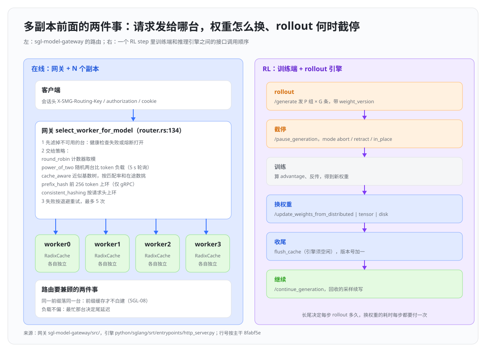
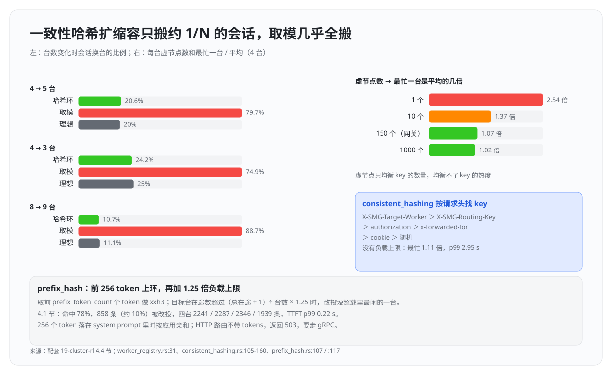
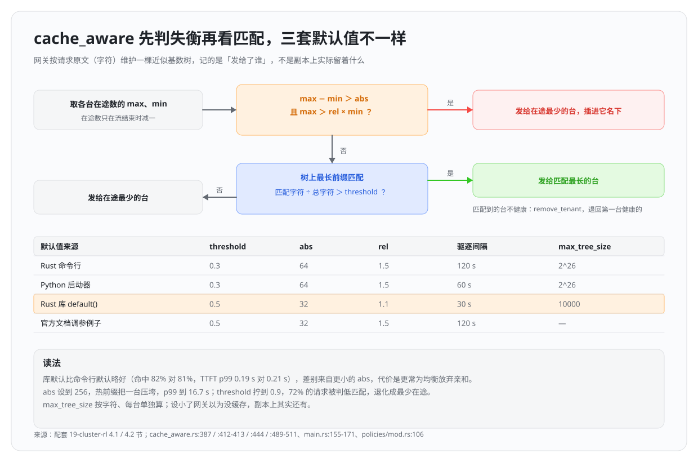
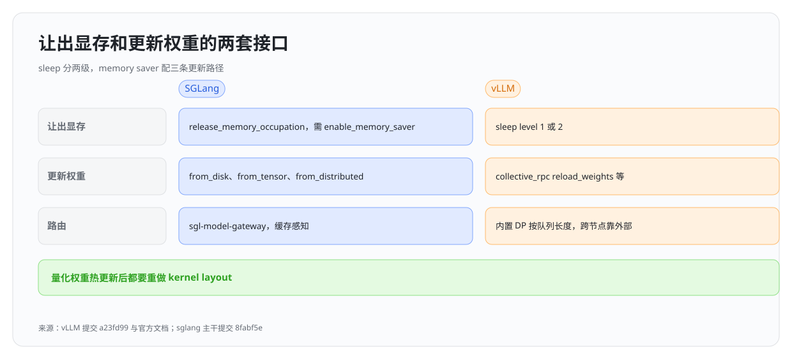
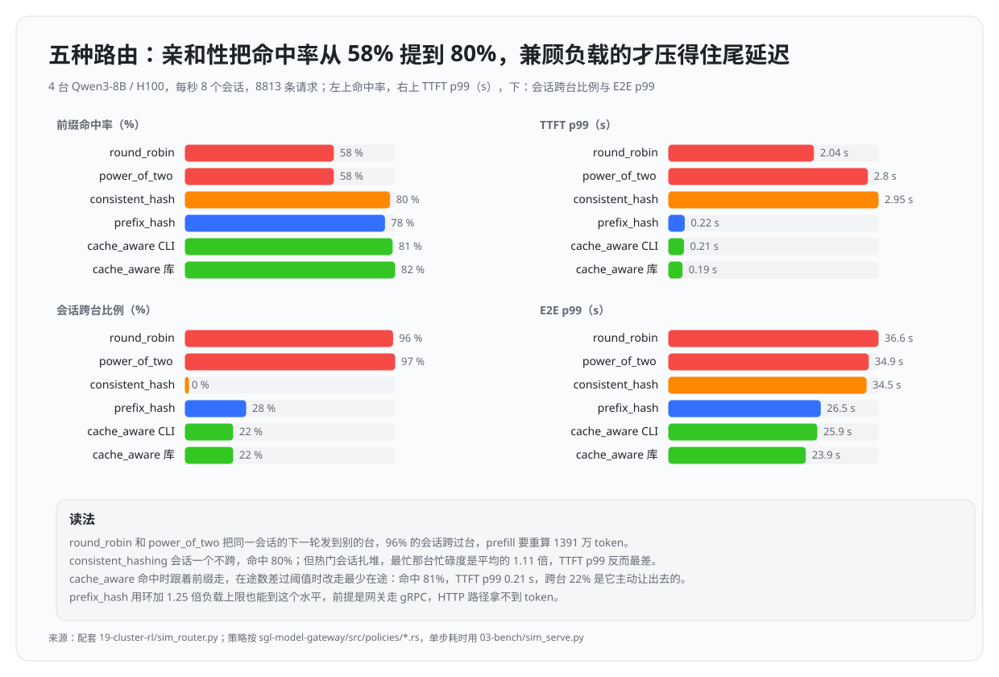
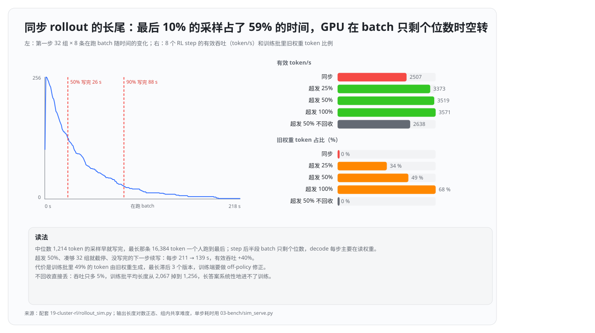
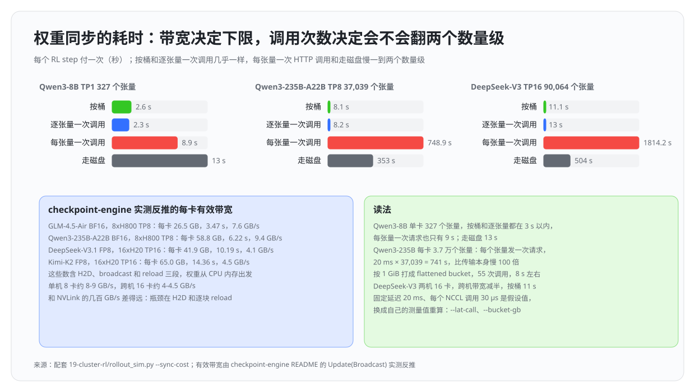

# SGL-19｜实战｜集群与 RL rollout：路由、权重同步与长尾

> 🎯 <p><b>遇到的问题</b>：四台 H100 各跑一个 Qwen3-8B，前面挂一个网关，服务一个多轮对话产品：8 个应用各有一段 1000 到 3000 token 的 system prompt，每个会话聊 2 到 10 轮，每轮 prompt 都带着前面所有问答，中位数 3,548 token。</p><p>网关用 round_robin 时，96% 的会话被发到过不止一台机器，每换一台，前面几千 token 就要在新机器上重算，前缀命中率 58%，prefill 共算了 1,391 万 token，TTFT p99 2.04 s。换成 cache_aware，命中率 81%，prefill 少了一半多，TTFT p99 0.21 s，四台机器一样忙。</p><p>同一批机器给 RL 训练做 rollout，又是另一类问题。一步 32 个 prompt、每个采 8 条，输出中位数 1,214 token，最长那条写满 16,384，一半采样 26 s 就写完，最后 10% 的采样占了这一步 59% 的时间，后半段 batch 只剩个位数。</p><p>每步之间还要把新权重灌进引擎，Qwen3-235B 每卡 3.7 万个张量，一个张量发一次 HTTP 请求要 749 s，打成 1 GiB 的桶只要 8 s。这一篇拆两件事：多副本前面的路由怎么在缓存亲和和负载均衡之间取舍，SGLang 做 rollout 引擎时长尾和权重同步这两笔账怎么算、接口怎么调。</p><p><b>主线</b>：多副本服务要在缓存亲和和负载均衡之间取舍，RL rollout 要对付长尾采样和权重同步；两笔账都决定 GPU 有多少时间在空转。</p><p><b>读完这一篇</b>：能说清网关五种策略怎么挑机器、cache_aware 的阈值往哪边拧，按会话、前缀和负载给业务选策略。能理清一个 RL step 里暂停、更新权重、清缓存、恢复生成的调用顺序，估出权重同步要几秒，判断 APRIL 式超发截停值不值得用。</p><p><b>代码</b>：<a href="../19-cluster-rl">zero-to-sglang/19-cluster-rl</a>。sim_router.py 模拟 4 个副本加一个网关，按 8fabf5e 的 policies 目录实现五种策略，能扫参数、中途摘机、算哈希环搬走多少 key。rollout_sim.py 模拟 GRPO rollout 的三种做法，估四种权重同步路径的耗时。单步耗时取自 [SGL-03｜上手｜指标与压测：TTFT、TPOT、ITL 与 goodput](./03-bench.md) 的服务模拟器，39 个测试用例，只用标准库，行号按主干 8fabf5e 核对。</p>

# 导读 · 结论先行

1. **路由同时要两样东西。**同一前缀落同一台，前缀缓存才不白建；负载不偏，最忙那台才不拖尾。round_robin 和 power_of_two 只管负载，命中率掉到 58%。按会话头上环的 consistent_hashing 只管亲和，热会话扎堆，TTFT p99 最差。cache_aware 和带负载上限的 prefix_hash 两样都管，TTFT p99 降到 0.2 s。
2. **cache_aware 先看失衡再看匹配。**在途请求数的差超过 abs、最大又超过最小的 rel 倍，就去最闲的台；否则匹配率超过 cache_threshold 去匹配最长的台，不然也去最闲的台。abs 拧太大会把热前缀全压在一台上，TTFT p99 涨到 16.7 s；cache_threshold 拧到 0.9 等于退化成最少在途。
3. **默认值有三套。**Rust 命令行 0.3 / 64 / 1.5 / 120 s，Python 启动器只有驱逐间隔是 60 s，库里的 CacheAwareConfig::default() 是 0.5 / 32 / 1.1 / 30 s / 10000。同一个策略名，用哪种方式起网关，行为就不一样。
4. **RL rollout 的时间被最长的几条采样决定。**同步 rollout 的后半段 batch 只剩个位数，decode 每步主要在读权重。超发 50%、凑够就截停、没写完的下一步续写，每步从 211 s 降到 139 s，代价是训练批里 49% 的 token 出自旧权重；直接丢掉没写完的，长答案进不了训练。
5. **权重同步的下限是带宽，上限是调用次数。**每卡有效带宽单机 8 到 9 GB/s、跨机 4 GB/s 左右，几十 GB 的权重要几秒到十几秒；MoE 每卡几万个张量，一个张量一次调用就是几百秒。按桶打包，放进一个 begin 和 end 之间的 session，flush 之前先用 retract 把引擎清空。



左边是在线服务的路径：客户端请求进网关，先滤掉健康检查失败或熔断打开的台，再交给策略挑一台，失败按退避重试。四台副本的 RadixCache 各管各的，网关看不到它们的真实内容，只能靠自己维护的近似树或哈希去猜。右边是 RL 训练里一步的接口顺序：rollout 发请求，凑够了截停，训练算出新权重，换权重，收尾，继续。每一步都要付一次长尾和一次换权重的时间，这两笔账在第 2 章的后半部分展开。

**📎 与系列其他文档的分工**：RL 算法和训练侧架构不在本系列范围内，这里只讲 SGLang 作为 rollout 引擎要提供什么。前缀缓存怎么匹配、驱逐，见 [SGL-08｜原理｜RadixAttention：基数树的匹配、插入、加锁与驱逐](./08-radix-attention.md)。调度器的准入和 retract，见 [SGL-05｜原理｜调度器：waiting、running 与 KV 预算](./05-scheduler.md)。PD 分离和它的路由，见 [SGL-15｜原理｜PD 分离：prefill 和 decode 拆到两组卡上](./15-pd-disagg.md)。多副本的指标怎么采、怎么对，见 [SGL-18｜实战｜可观测与 profiling：从指标到 kernel](./18-observability.md)。压测方法，见 [SGL-03｜上手｜指标与压测：TTFT、TPOT、ITL 与 goodput](./03-bench.md)。这一篇只讲网关层和 RL 接口层，单台引擎内部的机制回到这些篇。

# 第 1 章 · 问题：一台变多台，一次推理变成一个训练循环

副本数上来、或者接上 RL 框架以后，常见的情形：

- 加了一倍机器，吞吐没涨一倍，每台的前缀命中率都比单台时低一截。
- 网关配了 cache_aware，有一台忙得冒烟，另外几台闲着。
- 照着文档的调参例子把 cache_threshold 写成 0.5，发现和不写时行为不一样。
- 换成 prefix_hash，所有请求都回 503。
- 用 power_of_two，看监控两台机器的排队一长一短，网关却一直往长的那台发。
- 扩了一台副本，命中率掉了一大截，过了好几分钟才回来。
- RL 一步 rollout 要三分多钟，看 GPU 利用率后半段只有百分之十几。
- 训练端调完 update_weights_from_distributed，接口回 400，说要在 begin 和 end 之间调。
- 换完权重调 flush_cache，回 false，日志说还有请求在跑。
- 开了超发截停，吞吐上去了，奖励曲线却开始抖。
- 235B 的 MoE 每步换权重要十几分钟，比 rollout 还长。

前五条是路由策略的口径问题：不同策略看的负载不一样，默认值随启动方式变，有的策略只在某种协议下才有输入。第六条是哈希和扩缩容。后五条是 RL 循环里的接口语义和两笔账：长尾决定一步要多久，权重同步决定每步额外付多少，截停和回收换来的是 off-policy。

| 想弄清的现象 | 看哪一节 |
|-|-|
| 多台以后命中率变低，路由到底在权衡什么 | 2.1、4.1 |
| power_of_two 往忙的那台发 | 2.2、5.2 |
| 一致性哈希扩缩容搬多少 key，热点怎么来的 | 2.3、4.4 |
| prefix_hash 全部 503 | 2.4、5.2 |
| cache_aware 偏载、调参例子和默认值对不上 | 2.5、4.2 |
| 摘掉或加上一台以后命中率怎么变 | 2.3、4.3 |
| RL step 里接口该按什么顺序调，400 和 flush 失败 | 2.6、2.8 |
| rollout 后半段 GPU 空转，超发截停的收益和代价 | 2.7、4.5 |
| 换权重要多久，慢在哪 | 2.8、4.6 |

# 第 2 章 · 原理：网关怎么挑机器，RL 循环里引擎做什么

## 2.1 路由要兼顾的两件事：前缀落在哪台，最忙那台多忙

单台 SGLang 里，RadixCache 把见过的前缀留在显存里，下一条请求只要前缀对得上，就跳过那一段 prefill（[SGL-08｜原理｜RadixAttention：基数树的匹配、插入、加锁与驱逐](./08-radix-attention.md)）。副本一多，每台的树各管各的，网关不知道哪台缓存了什么。多轮对话里第二轮的 prompt 是 system prompt 加第一轮问答加新问题，如果第二轮被发到另一台，前面几千 token 要在那台上从头算。4.1 节的负载里，round_robin 让 96% 的会话跨过台，命中率 58%；同一份负载、只要同会话尽量回原台，命中率就到 80% 以上，prefill 总量少一半。

只管亲和又会偏载。热门应用的会话多，按前缀固定到一台，那台的队列就比别人长，而用户看到的尾延迟取决于最忙那台。Dean 和 Barroso 讲过，规模上去以后服务的延迟由尾部决定，一个慢节点就能把整体的 p99 拖下来[[1]](https://research.google/pubs/the-tail-at-scale/)。所以路由同时在两个目标之间取舍：同一前缀落同一台，和每台的负载接近。

Preble 把这个问题形式化成多 GPU 上的 prompt 调度，按前缀命中的收益和各卡负载一起打分[[2]](https://arxiv.org/abs/2407.00023)；SGLang 网关里的 cache_aware 和 prefix_hash 是这个取舍的两种工程实现，round_robin、power_of_two 只看负载，consistent_hashing 只看亲和。

网关挑台的入口在 [router.rs:134](https://github.com/sgl-project/sglang/blob/8fabf5e/sgl-model-gateway/src/routers/http/router.rs#L134) 的 select_worker_for_model：先拿到这个模型的全部 HTTP worker，再用 is_available() 滤一遍，健康检查失败或熔断器打开的台都不进候选；剩下的交给策略。策略返回 None 时，路由直接回 503 no_available_workers（:287-291）。请求失败按指数退避重试，命令行默认最多 5 次、初始 50 ms、乘数 1.5，熔断器连续失败 10 次打开、60 s 后半开试探（[main.rs:363](https://github.com/sgl-project/sglang/blob/8fabf5e/sgl-model-gateway/src/main.rs#L363)、:388）。网关的完整用法见官方文档[[3]](https://docs.sglang.io/docs/advanced_features/sgl_model_gateway)。

## 2.2 round_robin 和 power_of_two：只看负载，看的还是旧负载

round_robin 就是一个原子计数器对健康台数取模[（round_robin.rs:31）](https://github.com/sgl-project/sglang/blob/8fabf5e/sgl-model-gateway/src/policies/round_robin.rs#L31)，不看负载也不看内容。power_of_two 来自 Mitzenmacher 的经典结果：n 个球随机扔进 n 个桶，最满的桶约有 log n / log log n 个；每次随机看两个桶、扔进轻的那个，最满的桶降到 log log n / log 2 加常数，多看一个选择换来指数级的改善[[4]](https://doi.org/10.1109/71.963420)。网关的实现在 [power_of_two.rs:105](https://github.com/sgl-project/sglang/blob/8fabf5e/sgl-model-gateway/src/policies/power_of_two.rs#L105)：随机挑两台不同的，比较负载，小于等于时取第一台。

关键是它比的是哪个负载。默认的 Tokens 口径用网关后台轮询来的数：WorkerManager 每 load_check_interval_secs 秒（命令行固定 5 s，[main.rs:775](https://github.com/sgl-project/sglang/blob/8fabf5e/sgl-model-gateway/src/main.rs#L775)）向每台发一次 /v1/loads，取 num_total_tokens（[worker_manager.rs:240](https://github.com/sgl-project/sglang/blob/8fabf5e/sgl-model-gateway/src/core/worker_manager.rs#L240)），而且只在配了 power_of_two 时才拉。两台的 token 数相等或缺失时退回比在途请求数（:120-124）。问题出在两处。

一处是时效：5 s 里网关可能发出几十条请求，这期间所有人看到的都是同一份旧快照，轻的那台在快照刷新前会一直被选中，等它变重了又集体涌向下一台，负载在几台之间来回摆。另一处是回退：HTTP 路由只给 cache_aware 和 manual 两个策略挂在途计数（[router.rs:300-302](https://github.com/sgl-project/sglang/blob/8fabf5e/sgl-model-gateway/src/routers/http/router.rs#L300)），power_of_two 在 HTTP 下的回退比较拿到的都是 0，平局取第一台。4.1 节里 power_of_two 的命中率和 round_robin 一样是 58%，TTFT p99 却从 2.04 s 涨到 2.80 s，就是这种摆动的结果。

环境变量 SGLANG_ROUTER_P2C_LOAD_METRIC 可以把口径换成 requests（先比在途数，平局再比 token）或 least_requests（在所有有轮询数据的台里挑最少的），但改不了「轮询数据 5 s 才刷新一次」这件事。负载变化快、请求长短差异大的业务，power_of_two 的收益比教科书里小得多。

## 2.3 哈希环：扩缩容只搬 1/N 的 key，热点要靠负载上限

按会话固定到一台，最直接的办法是 hash(key) % N，可 N 一变几乎所有 key 都换台：4 台加到 5 台，80% 的会话落点变了，缓存全部作废。Karger 等人提出的一致性哈希把机器和 key 都哈希到同一个环上，key 顺时针找到的第一台机器就是它的归属；加一台机器只接走它在环上那一段的 key，期望搬走 1/(N+1)[[5]](https://doi.org/10.1145/258533.258660)。4.4 节实测 4→5 台搬 20.6%，取模搬 79.7%。

每台机器只在环上放一个点时，各台分到的弧长差别很大，4 台里最忙的一台能拿到平均的 2.5 倍。所以每台放很多个虚节点，SGLang 网关是每台 150 个、用 blake3 哈希[（worker_registry.rs:31）](https://github.com/sgl-project/sglang/blob/8fabf5e/sgl-model-gateway/src/core/worker_registry.rs#L31)，4 台时最忙一台降到平均的 1.07 倍。虚节点只解决 key 数量的均衡，解决不了 key 热度的不均：一个热会话发的请求再多，也只落在一台上。Mirrokni 等人给出的修正是给每台设负载上限，超过平均的 (1+ε) 倍就顺着环往下找[[6]](https://arxiv.org/abs/1608.01350)，Google 和 Vimeo 都在负载均衡里用过这个办法。

SGLang 的 consistent_hashing 策略按请求头找 key（[consistent_hashing.rs:105-160](https://github.com/sgl-project/sglang/blob/8fabf5e/sgl-model-gateway/src/policies/consistent_hashing.rs#L105)）：X-SMG-Target-Worker 直接指定第几台，其次是 X-SMG-Routing-Key，再往后依次试 authorization、x-forwarded-for、cookie，都没有就随机。

它没有负载上限，所以热点会话扎堆，4.1 节里最忙那台是平均的 1.11 倍，TTFT p99 2.95 s，五种策略里最差。它也不在 Rust 二进制的 --policy 列表里（[main.rs:150](https://github.com/sgl-project/sglang/blob/8fabf5e/sgl-model-gateway/src/main.rs#L150)），要用 Python 启动器 sglang_router.launch_router 才能选（[router_args.py:20-34](https://github.com/sgl-project/sglang/blob/8fabf5e/sgl-model-gateway/bindings/python/src/sglang_router/router_args.py#L20)）。它的长处在扩缩容：4.3 节摘掉一台以后，它的命中率不降反升，因为只有被摘那台的会话换了地方。



## 2.4 prefix_hash：前 256 个 token 上环，再加 1.25 倍负载上限

prefix_hash 不看请求头，取请求前 prefix_token_count 个 token（默认 256）做 xxh3 哈希，在同一个 150 虚节点的环上找台（[prefix_hash.rs:107](https://github.com/sgl-project/sglang/blob/8fabf5e/sgl-model-gateway/src/policies/prefix_hash.rs#L107)）。找到以后用 load_ok 检查负载（:117）：平均负载按（总在途数 + 1）÷ 台数算，再乘 load_factor（默认 1.25），目标台不超过这个数就用它，超过了就在没超载的台里挑在途最少的。这就是有界负载一致性哈希的简化版，只是溢出时没有顺着环找下一台，直接挑最闲的。

两个细节决定它的行为。先说粒度：256 个 token 落在 system prompt 里时，同一个应用的所有会话哈希值相同，亲和的粒度是应用；要按会话亲和，prefix_token_count 得超过 system prompt 的长度，同时不超过第一轮问题结束的位置，否则同一会话前后两轮的前缀不一样。再说输入：它需要 token。

HTTP 路由传给策略的 tokens 是 None（router.rs:176，注释原文是「HTTP doesn't have tokens, use gRPC for PrefixHash」），策略返回 NoTokens 分支，选不出台，路由回 503。用 HTTP 起网关配 prefix_hash，每条请求都会失败；要用它时，worker 用 --grpc-mode 启动，网关的 --worker-urls 写 grpc:// 地址，并给网关 --model-path 让它自己分词。

4.1 节里，按应用亲和加 1.25 倍上限，命中率 78%，有 858 条请求（约 10%）因为目标台超载被改投，四台的请求数是 2241、2287、2346、1939，TTFT p99 0.22 s，和 cache_aware 几乎一样。它比 cache_aware 便宜：网关不用维护一棵树，每条请求只算一次哈希。

## 2.5 cache_aware：网关自己维护一棵近似树，先判失衡再看匹配

cache_aware 是 SGLang v0.4 引入的缓存感知负载均衡，LMSYS 的测试里它把吞吐提高到 1.9 倍、命中率提高到 3.8 倍[[7]](https://www.lmsys.org/blog/2024-12-04-sglang-v0-4/)。网关看不到副本里真实的 RadixCache，于是自己按请求原文（字符，不是 token）维护一棵近似基数树，每个节点记着哪些台（tenant，用 worker 的 URL 表示）最近见过这段文本（[tree.rs:362](https://github.com/sgl-project/sglang/blob/8fabf5e/sgl-model-gateway/src/policies/tree.rs#L362)）。

每路由一条请求，就把它的原文插到被选中那台的名下，所以这棵树记的是「网关把什么发给了谁」，不是副本上实际留着什么。后台任务每 eviction_interval 秒按 LRU 把每台名下的字符数压到 max_tree_size 以内（:718）。

挑台的逻辑在 [cache_aware.rs:387](https://github.com/sgl-project/sglang/blob/8fabf5e/sgl-model-gateway/src/policies/cache_aware.rs#L387)，顺序是：

1. 取所有台的在途请求数，算最大和最小。差值超过 balance_abs_threshold 且最大超过最小的 balance_rel_threshold 倍，判为失衡（:412-413），直接去在途最少的台，平局随机，并把这条请求插到那台名下。
2. 不失衡时，在树上做最长前缀匹配，匹配率 = 匹配上的字符数 ÷ 请求总字符数。匹配率大于 cache_threshold（:444），去匹配最长的那台；不然去在途最少的台。
3. 匹配到的台已经不健康或被摘掉，就把它从树上整个删掉（remove_tenant），退回第一台健康的台（:489-511）。

有两处和直觉不一样。文件头注释写的是低匹配时去「树最小的台（缓存空间最多）」，代码走的是在途最少；读代码以代码为准。在途数来自 WorkerLoadGuard，请求进来加一、响应体读完减一，流式请求要等流结束才减；这个计数只在 cache_aware 和 manual 下维护，前面说过。

默认值有三套。Rust 命令行是 cache_threshold 0.3、balance_abs 64、balance_rel 1.5、驱逐间隔 120 s、max_tree_size 2^26（[main.rs:155-171](https://github.com/sgl-project/sglang/blob/8fabf5e/sgl-model-gateway/src/main.rs#L155)）。Python 启动器除了驱逐间隔是 60 s，其余相同（[router_args.py:59-63](https://github.com/sgl-project/sglang/blob/8fabf5e/sgl-model-gateway/bindings/python/src/sglang_router/router_args.py#L59)）。

Rust 库里 CacheAwareConfig::default() 是 0.5 / 32 / 1.1 / 30 s / 10000（[policies/mod.rs:106](https://github.com/sgl-project/sglang/blob/8fabf5e/sgl-model-gateway/src/policies/mod.rs#L106)），自己用库嵌网关时拿到的是这一套。官方文档的参数表写的是 0.3，调参例子写的是 0.5 / 32 / 1.5 / 120，照抄例子会悄悄换掉阈值。4.1 节里库默认比命令行默认略好（命中 82% 对 81%，TTFT p99 0.19 s 对 0.21 s），差别来自更小的 abs，代价是更频繁地为均衡让出亲和。

三个参数的作用方向是清楚的。balance_abs_threshold 管多大的不均可以容忍：太小，稍有波动就放弃亲和；太大，热前缀会把一台压垮，4.2 节 abs=256 时 TTFT p99 到了 16.7 s。cache_threshold 管多像才算命中：多轮对话的匹配率通常远高于 0.3，0.1 到 0.5 之间几乎没有差别，拧到 0.9 时 72% 的请求被判为低匹配，退化成最少在途。max_tree_size 按字符计，每台单独算，设小了树记不住长会话，网关以为没缓存，实际副本上还有。



## 2.6 RL 循环里的 SGLang：一组采样、一套控制接口

GRPO 对每个 prompt 采一组 G 条回答，用组内奖励的均值和标准差把每条的奖励归一化成优势，不再需要价值网络[[8]](https://arxiv.org/abs/2402.03300)。对推理引擎来说，这意味着每个 RL step 要生成 P × G 条采样，同组的 G 条共享 prompt（前缀缓存正好用上），而且一组必须凑齐才能算优势。DeepSeek-R1 以后，推理类任务的输出越来越长，rollout 占掉了 RL 训练的大部分时间，APRIL 的作者测到 90% 以上[[9]](https://arxiv.org/abs/2509.18521)。

slime、verl、miles 这些 RL 框架都把 SGLang 当 rollout 引擎[[10]](https://github.com/THUDM/slime)[[11]](https://github.com/verl-project/verl)[[12]](https://github.com/radixark/miles)。verl 背后的 HybridFlow 把训练和推理放在同一组卡上分时复用（co-located），也支持分开部署[[13]](https://arxiv.org/abs/2409.19256)；slime 用 SGLang 的网关把多轮 rollout 分到多台服务上。SGLang 给 RL 准备的接口集中在 RL 文档里[[14]](https://docs.sglang.io/docs/advanced_features/sglang_for_rl)，按一个 step 的顺序是：

1. **rollout**：训练端经网关向引擎发 /generate，请求里可以带 weight_version，返回的 meta_info.weight_versions 按 token 区间标出每段由哪个版本的权重生成。
2. **截停**：/pause_generation 让引擎停下推理，只处理控制命令。mode 有三种，abort 把所有请求中止并返回，retract 把在跑的请求撤回等待队列、释放它们的 KV，in_place 原地冻住、KV 留着。
3. **换权重**：/begin_weight_update 开一个会话，然后按部署方式调 update_weights_from_distributed、update_weights_from_tensor 或 update_weights_from_disk，可以调很多次，最后 /end_weight_update 收尾。
4. **收尾**：旧权重算出来的 KV 要作废，更新接口默认 flush_cache=True，在更新成功后清空前缀缓存和 KV 池；版本号由更新接口的 weight_version 参数或 /update_weight_version 设置。
5. **继续**：/continue_generation 恢复推理，retract 回队列的请求重新 prefill，用新权重接着写。

co-located 部署还要一对接口：训练时 /release_memory_occupation 把引擎的权重和 KV 显存交出来，训练完 /resume_memory_occupation 拿回去，tags 可以只放 weights 或 kv_cache。这要求引擎用 --enable-memory-saver 启动，底层是 torch_memory_saver：在 CUDA 虚拟内存上保留地址、释放物理页，恢复时映射回同一个地址，CUDA graph 里记下的指针不用重新捕获[[15]](https://github.com/fzyzcjy/torch_memory_saver)。release 要求引擎里没有在跑的请求。

几个语义容易踩。flush 只在引擎空闲时成功（[scheduler.py:5600](https://github.com/sgl-project/sglang/blob/8fabf5e/python/sglang/srt/managers/scheduler.py#L5600)），暂停状态下等待队列不算，在跑的请求算；所以 retract 以后能 flush，in_place 以后 running 里还有请求，flush 一定失败，这时更新接口会返回 false 和一句「Retract or finish them, then call /flush_cache」，可权重其实已经换了（[weight_updater.py:120](https://github.com/sgl-project/sglang/blob/8fabf5e/python/sglang/srt/managers/scheduler_components/weight_updater.py#L120)）。

update_weights_from_tensor 和 update_weights_from_distributed 必须在 begin 和 end 之间调，否则回 HTTP 400、权重不动；会话的意义在于量化层的 process_weights_after_loading（Marlin 重排、MXFP8 shuffle 这类）每次 refit 只做一次，而不是每个桶做一次。

/update_weight_version 的 abort_all_requests 默认是 True，在 retract 之后单独调它，会把撤回队列里等着续写的请求一起中止，版本号随更新接口的 weight_version 参数一起给。

## 2.7 长尾：最后 10% 的采样占一半以上的时间

同步 rollout 发出 P × G 条请求，等全部写完才交给训练。输出长度大致是对数正态，难题整组都长，少数采样会一直写到 max_new_tokens。开头 batch 很大，decode 一步摊到很多条请求上；随着短的写完，batch 越来越小，而 decode 一步的耗时主要是读一遍权重，bs 从 141 掉到 5，每步时间几乎不变，有效吞吐掉了几十倍。4.5 节的第一步里，一半采样 26 s 写完，最后一条到 218 s，最后 10% 的采样占了 59% 的时间。

APRIL（Active Partial Rollouts）的办法是超发、截停、回收：每步多发一些 prompt，凑够需要的组数就截停，没写完的采样带着已生成的部分进回收池，下一步先续写它们[[9]](https://arxiv.org/abs/2509.18521)。论文在 GRPO、DAPO、GSPO 上测得 rollout 吞吐平均提高 22.5%、最高 44%，最终准确率平均高 2.1%，实现就在 slime 里，SGLang 文档的 Easy To Postpone Generation 一节说的也是这个流程（[sglang_for_rl.mdx:612](https://github.com/sgl-project/sglang/blob/8fabf5e/docs/docs/advanced_features/sglang_for_rl.mdx#L612)）。Kimi K2 的 RL 基础设施用了同样的思路，长尾任务暂停，下一轮迭代接着跑[[16]](https://arxiv.org/abs/2507.20534)。

代价是 off-policy。续写的采样前半段是旧权重写的，后半段是新权重写的，滞后几个版本取决于它被截停了几次；4.5 节超发 50% 时训练批里 49% 的 token 出自旧权重，最长滞后 3 个版本。训练端要用重要性采样截断这类修正去补，SGLang 的 weight_versions 字段就是为这个准备的：它告诉训练端每个 token 来自哪个版本。

更激进的做法是 AReaL，rollout 和训练完全异步，用带陈旧度控制的 PPO 变体吸收版本差，在推理任务上提速最高 2.77 倍[[17]](https://arxiv.org/abs/2505.24298)。反过来，如果连这种偏差都不能接受，SGLang 有 --enable-deterministic-inference，miles 用它做训练和推理逐位一致的 true on-policy。

还有一个省事的做法是截停后直接丢掉没写完的采样，不回收。吞吐几乎没涨（4.5 节只有 +5%），因为丢掉的 token 白算了；更糟的是长答案系统性地进不了训练批，训练批平均长度从 2,067 掉到 1,256，模型会被推向写短。

## 2.8 权重同步：带宽给下限，调用次数决定上限

RL 文档把 refit 分成三条路（[sglang_for_rl.mdx:106](https://github.com/sgl-project/sglang/blob/8fabf5e/docs/docs/advanced_features/sglang_for_rl.mdx#L106)）。disk：训练端存一份 checkpoint，引擎 /update_weights_from_disk 读进来，最慢，但训练和推理之间只靠文件系统耦合，引擎可以随时加减，适合弹性和高可用。tensor：co-located 时训练进程和引擎在同一张卡上，把张量的句柄序列化后交给引擎，不走网络。

distributed：训练和推理分开部署，先 /init_weights_update_group 建一个 NCCL 组（训练端 rank 0 加上引擎的所有 rank，rank_offset 和 world_size 由训练端给），之后每次 /update_weights_from_distributed 告诉引擎张量的名字、dtype 和形状，训练端在组里广播，引擎边收边 load_weights。

一次 refit 的耗时可以拆成：每卡要收的字节 ÷ 有效带宽，加上调用次数 × 每次的固定开销，加上 end_weight_update 的收尾。前一项是下限，几十 GB 的权重在单机 NVLink 上也要几秒，因为实际瓶颈不在 NVLink，在 H2D 拷贝和逐块 load。后一项决定会不会翻两个数量级：MoE 的专家权重是一个个独立张量，Qwen3-235B 每卡 3.7 万个，每个张量发一次 HTTP 请求，按 20 ms 算就是 741 s。

SGLang 的解法是 flattened_bucket：训练端把一批张量拼成一个连续的大张量，附上每个张量的名字、形状和偏移，引擎收到后按偏移切回去（[tensor_bucket.py:19](https://github.com/sgl-project/sglang/blob/8fabf5e/python/sglang/srt/weight_sync/tensor_bucket.py#L19)、[weight_updater.py:275](https://github.com/sgl-project/sglang/blob/8fabf5e/python/sglang/srt/model_executor/model_runner_components/weight_updater.py#L275)），1 GiB 一个桶，3.7 万个张量变成 55 次调用。

Moonshot 开源的 checkpoint-engine 是这条路做到极致的样子：权重从训练端的 CPU 内存出发，分 H2D、广播、reload 三段流水，在几千张卡上更新 1T 参数的 Kimi-K2 约 20 s[[18]](https://github.com/MoonshotAI/checkpoint-engine)，Kimi K2 论文里写的是全量更新不到 30 s[[16]](https://arxiv.org/abs/2507.20534)。

它的 README 给了几组实测，按每卡字节数反推，单机 8 卡每卡有效带宽 7.6 到 9.4 GB/s，两机 16 卡 4.1 到 4.5 GB/s，4.6 节的估算就用这组数校准。和 NVLink 几百 GB/s 的标称值比，这个数说明 refit 的瓶颈在 H2D 和 reload，优化方向是流水和重叠，不是换更快的互联。

## 2.9 vLLM 怎么做

RL rollout 需要推理引擎让出显存、接收新权重。vLLM 的 sleep mode 分两级：level 1 把权重卸到 CPU、丢弃 KV，醒来时拷回；level 2 权重和 KV 都丢，醒来后要通过 collective_rpc 调 reload_weights 重新加载[[19]](https://docs.vllm.ai/en/latest/features/sleep_mode.html)。

SGLang 用 --enable-memory-saver 开启后，通过 /release_memory_occupation 和 /resume_memory_occupation 释放与恢复，权重更新有 update_weights_from_disk、from_tensor、from_distributed 三条路。

level 1 适合权重不变、只是暂时让出显存的场景，level 2 适合每轮都要换权重的训练循环，省掉一次无用的 CPU 拷贝。SGLang 的三条更新路径按权重来源划分，训练和推理同机时 from_tensor 最快，跨机用 from_distributed 走 NCCL。路由侧，SGLang 有缓存感知的 sgl-model-gateway；vLLM 的内置 DP 只按队列长度均衡，跨节点的缓存感知路由要靠外部组件。

| 维度 | SGLang | vLLM | 差异的代价 |
|-|-|-|-|
| 让出显存 | release_memory_occupation，需 enable_memory_saver | sleep level 1 或 2 | level 2 醒来必须重载权重 |
| 更新权重 | from_disk、from_tensor、from_distributed | collective_rpc reload_weights 等 | 量化权重更新后都要重做 layout |
| 路由 | sgl-model-gateway，缓存感知 | 内置 DP 按队列长度，跨节点靠外部 | 多轮会话缓存亲和要额外设计 |



# 第 3 章 · 源码走读：网关和 RL 接口的 18 个位置

前 10 个在 sgl-model-gateway：挑台入口、在途计数、五种策略、哈希环、近似树和三套默认值；后 8 个在 sglang 引擎：RL 用到的 HTTP 接口、请求结构、暂停和 flush 的判定、权重会话和按桶接收。行号都对应主干 8fabf5e。

| # | 位置 | 发生了什么 |
|-|-|-|
| 1 | [routers/http/router.rs:134](https://github.com/sgl-project/sglang/blob/8fabf5e/sgl-model-gateway/src/routers/http/router.rs#L134) | select_worker_for_model：取这个模型的 HTTP worker，:153 用 is_available() 滤掉不健康和熔断的台。:176 给策略的 tokens 写死 None，注释说 PrefixHash 要用 gRPC。:287-291 策略返回 None 时回 503 no_available_workers |
| 2 | [routers/http/router.rs:300](https://github.com/sgl-project/sglang/blob/8fabf5e/sgl-model-gateway/src/routers/http/router.rs#L300) | load_guard 只给 cache_aware 和 manual 创建；其他策略在 HTTP 路径下 worker.load() 一直是 0。gRPC 路径在 request_execution.rs:75 无条件创建 |
| 3 | [core/worker.rs:1147](https://github.com/sgl-project/sglang/blob/8fabf5e/sgl-model-gateway/src/core/worker.rs#L1147) | WorkerLoadGuard：new 时 increment_load，drop 时 decrement_load，生命周期绑在响应体上，流式请求要等流读完才减；:229 is_available = 健康 且 熔断器允许 |
| 4 | [policies/round_robin.rs:31](https://github.com/sgl-project/sglang/blob/8fabf5e/sgl-model-gateway/src/policies/round_robin.rs#L31) | 原子计数器对健康台数取模 |
| 5 | [policies/power_of_two.rs:39](https://github.com/sgl-project/sglang/blob/8fabf5e/sgl-model-gateway/src/policies/power_of_two.rs#L39) | SGLANG_ROUTER_P2C_LOAD_METRIC 选 tokens / requests / least_requests；:105-109 随机两台不同的，:120-124 token 数不同才比 token，否则比在途数，:128 小于等于取第一台 |
| 6 | [core/worker_manager.rs:240](https://github.com/sgl-project/sglang/blob/8fabf5e/sgl-model-gateway/src/core/worker_manager.rs#L240) | parse_load 从 /v1/loads 取 num_total_tokens；:362 monitor_loop 按 load_check_interval_secs 轮询，main.rs:775 固定 5 s |
| 7 | [core/worker_registry.rs:31](https://github.com/sgl-project/sglang/blob/8fabf5e/sgl-model-gateway/src/core/worker_registry.rs#L31) | VIRTUAL_NODES_PER_WORKER = 150，:43 HashRing 用 blake3；consistent_hashing.rs:105 按 X-SMG-Target-Worker、X-SMG-Routing-Key、authorization、x-forwarded-for、cookie 的顺序取 key |
| 8 | [policies/prefix_hash.rs:107](https://github.com/sgl-project/sglang/blob/8fabf5e/sgl-model-gateway/src/policies/prefix_hash.rs#L107) | 前 prefix_token_count 个 token 的 xxh3。:117 load_ok 用（总在途 + 1）÷ 台数 × load_factor 当上限。:213 没有 token 时返回 NoTokens |
| 9 | [policies/cache_aware.rs:387](https://github.com/sgl-project/sglang/blob/8fabf5e/sgl-model-gateway/src/policies/cache_aware.rs#L387) | select_worker：:412 失衡判定，:444 匹配率和 cache_threshold 比，:489-511 匹配到的台失效时删租户、退回第一台健康的；:20-40 的文件头注释说低匹配去树最小的台，和代码不符 |
| 10 | [main.rs:150](https://github.com/sgl-project/sglang/blob/8fabf5e/sgl-model-gateway/src/main.rs#L150) | Rust 二进制的 --policy 列表没有 consistent_hashing。:155-171 cache_aware 的命令行默认。router_args.py:20-34 和 :59-63 是 Python 启动器的列表和默认，policies/mod.rs:106 是库默认 |
| 11 | [entrypoints/http_server.py:1831](https://github.com/sgl-project/sglang/blob/8fabf5e/python/sglang/srt/entrypoints/http_server.py#L1831) | /pause_generation 和 :1844 /continue_generation；:1458 和 :1473 begin / end_weight_update，:1488 update_weights_from_distributed，:1404 init_weights_update_group，:1527 update_weight_version |
| 12 | [managers/io_struct.py:1927](https://github.com/sgl-project/sglang/blob/8fabf5e/python/sglang/srt/managers/io_struct.py#L1927) | PauseGenerationReqInput，mode 默认 abort，docstring 写明 in_place 下 flush 会失败、retract 下可以 flush 并在 continue 后重算 |
| 13 | [managers/io_struct.py:2002](https://github.com/sgl-project/sglang/blob/8fabf5e/python/sglang/srt/managers/io_struct.py#L2002) | UpdateWeightsFromDistributedReqInput：names、dtypes、shapes、group_name、flush_cache=True、abort_all_requests=False、weight_version、load_format。:1970 disk 版多了 keep_pause、recapture_cuda_graph。:2155 UpdateWeightVersion 的 abort_all_requests 默认 True |
| 14 | [managers/scheduler.py:5902](https://github.com/sgl-project/sglang/blob/8fabf5e/python/sglang/srt/managers/scheduler.py#L5902) | pause_generation：in_place 只置标志；retract 先把 overlap 队列里的结果处理掉，再把 running、上一轮 extend 和 chunked 请求撤回，PD decode 端连已传完 KV 的也撤回 |
| 15 | [managers/scheduler.py:5600](https://github.com/sgl-project/sglang/blob/8fabf5e/python/sglang/srt/managers/scheduler.py#L5600) | flush_cache：is_fully_idle(ignore_waiting=暂停中) 才清树、清两级池；否则打一行 warning 返回 False |
| 16 | [scheduler_components/weight_updater.py:120](https://github.com/sgl-project/sglang/blob/8fabf5e/python/sglang/srt/managers/scheduler_components/weight_updater.py#L120) | flush_cache_after_weight_update：更新成功但 flush 失败时整体返回 False 和提示语；:187 会话外调 distributed 直接拒绝 |
| 17 | [model_runner_components/weight_updater.py:260](https://github.com/sgl-project/sglang/blob/8fabf5e/python/sglang/srt/model_executor/model_runner_components/weight_updater.py#L260) | receive_weights_from_distributed：逐张量 torch.empty 加异步 broadcast，:275 flattened_bucket 走按桶接收；:312 和 :317 begin / end，:354 tensor 路径的按桶分支 |
| 18 | [weight_sync/tensor_bucket.py:19](https://github.com/sgl-project/sglang/blob/8fabf5e/python/sglang/srt/weight_sync/tensor_bucket.py#L19) | FlattenedTensorBucket：把一批张量拼成一块连续显存，记下名字、形状、dtype 和偏移，接收端按元数据切回原张量 |

读的时候分两遍。第一遍顺着一条在线请求读 1、2、3、9：进入挑台入口，过滤可用性，交给 cache_aware。它先看在途数判失衡，再看树上的匹配率。选中以后挂上 load guard，响应读完计数减一。这一遍读完，就知道为什么只有 cache_aware 和 manual 能看到真实的在途数，以及 power_of_two 在 HTTP 下比的到底是什么。

第二遍顺着一个 RL step 读 11、12、14、16、17、15：暂停时 retract 把请求撤回，begin 开会话，distributed 按桶收权重，end 收尾，更新接口顺带调 flush，flush 判断引擎是不是空了。把这六处的返回值连起来，2.6 节列的几种失败都能在代码里找到出处。

# 第 4 章 · 实验：用两个模拟器算路由和 rollout 的账

配套目录有两个模拟器。sim_router.py 模拟 4 台 Qwen3-8B / H100 和一个网关：8 个应用各有一段 system prompt，热度按 Zipf 分布，会话按泊松过程到达，每个会话 2 到 10 轮，下一轮在上一轮答完、隔一段思考时间后才发。

副本带按 16 token 一块近似的 RadixCache、prefill 优先调度和 KV 准入，网关按 8fabf5e 的 policies 目录实现五种策略。rollout_sim.py 模拟一台引擎上的 GRPO rollout 和权重同步的耗时。单步耗时取自 [SGL-03｜上手｜指标与压测：TTFT、TPOT、ITL 与 goodput](./03-bench.md) 的服务模拟器（Roofline 下限加固定开销），绝对值和真机有出入，策略之间的相对关系和量级可信。

## 4.1 五种策略，同一份负载

```bash
cd zero-to-sglang/19-cluster-rl
python3 sim_router.py
```

```text
负载：1469 个会话、8813 条请求，prompt 中位数 3,548 token、最长 8,860，最热的应用占 36% 的会话；4 台 Qwen3-8B / H100，每台 KV 池 366,669 token
五种策略，同一份负载（秒）
  策略                      命中率  prefill 千 token  TTFT p50  TTFT p99  E2E p99  忙碌 max/mean  会话跨台
  round_robin                  58%            13,913      0.06      2.04     36.6           1.01       96%
  power_of_two                 58%            13,743      0.09      2.80     34.9           1.01       97%
  consistent_hashing           80%             6,431      0.03      2.95     34.5           1.11        0%
  prefix_hash                  78%             7,064      0.03      0.22     26.5           1.01       28%
  cache_aware（CLI 默认）      81%             6,119      0.03      0.21     25.9           1.05       22%
  cache_aware（库默认）        82%             5,869      0.03      0.19     23.9           1.02       22%
  cache_aware 分支：命中 93%、低匹配走最少在途 0%、失衡走最少在途 7%；网关树估的匹配率 81%，副本上实际命中 81%
  prefix_hash 分支：环上目标台 7955、超载改投 858；每台请求数 [2241, 2287, 2346, 1939]
  每台忙碌比例：round_robin 90% / 89% / 90% / 90%，cache_aware 85% / 94% / 87% / 90%，prefix_hash 90% / 87% / 89% / 90%
```



先看前两行。round_robin 和 power_of_two 都不看内容，会话的下一轮大概率落到别的台，96% 的会话跨过台，prefill 总量 1,391 万 token，是 cache_aware 的 2.3 倍。power_of_two 的命中率和 round_robin 一样，TTFT p99 反而更差：它比的是 5 s 前的 token 快照，一段时间里所有请求都涌向快照里最轻的那台。忙碌比例四台都在 90% 上下，说明这时候的瓶颈是 prefill 算力被重算吃掉，不是哪台偏载。

consistent_hashing 按会话头上环，会话一个都不跨，命中 80%。可热门应用的会话多，环上 150 个虚节点均衡的是 key 的个数，均衡不了每个 key 的请求量，最忙那台忙碌度是平均的 1.11 倍，TTFT p99 2.95 s，五种里最差。prefix_hash 按前 256 token 哈希，这份负载里等于按应用亲和，加上 1.25 倍的负载上限，858 条请求被改投，命中 78%、TTFT p99 0.22 s，和 cache_aware 基本持平。

cache_aware 那几行的分支统计说明了它是怎么做到的：93% 的请求走命中路径，7% 因为失衡被改投到最闲的台，低匹配一条都没有，因为多轮对话里 system prompt 就占了大头，匹配率总是高于 0.3。网关树估的匹配率 81%，副本上实际命中 81%，两边对得上；这个对齐在树太小或副本 KV 太小时会失效，4.2 节的 tree=200k 就是例子。跨台的 22% 是它为了均衡主动让出去的，命中率只比完全不跨的 consistent_hashing 高一点，尾延迟低一个数量级。

## 4.2 cache_aware 的三个参数往哪边拧

```bash
python3 sim_router.py --sweep
```

```text
负载：1469 个会话、8813 条请求，prompt 中位数 3,548 token、最长 8,860，最热的应用占 36% 的会话；4 台 Qwen3-8B / H100，每台 KV 池 366,669 token
cache_aware 调参（其余参数取 CLI 默认 0.3 / 64 / 1.5）
  策略                      命中率  prefill 千 token  TTFT p50  TTFT p99  E2E p99  忙碌 max/mean  会话跨台
  abs=4                        81%             6,098      0.03      0.21     24.3           1.02       25%
                              分支：命中 92% / 低匹配 0% / 失衡 8%；树估匹配率 79%
  abs=16                       82%             5,935      0.03      0.20     24.0           1.02       27%
                              分支：命中 91% / 低匹配 0% / 失衡 8%；树估匹配率 80%
  abs=64                       81%             6,119      0.03      0.21     25.9           1.05       22%
                              分支：命中 93% / 低匹配 0% / 失衡 7%；树估匹配率 81%
  abs=256                      76%             7,791      0.03     16.74     48.6           1.37        6%
                              分支：命中 98% / 低匹配 0% / 失衡 2%；树估匹配率 86%
  th=0.1                       81%             6,119      0.03      0.21     25.9           1.05       22%
                              分支：命中 93% / 低匹配 0% / 失衡 7%；树估匹配率 81%
  th=0.5                       81%             6,119      0.03      0.21     25.9           1.05       22%
                              分支：命中 93% / 低匹配 0% / 失衡 7%；树估匹配率 81%
  th=0.9                       67%            10,756      0.05      0.30     31.4           1.02       95%
                              分支：命中 28% / 低匹配 72% / 失衡 0%；树估匹配率 87%
  tree=200k                    77%             7,585      0.03      0.26     28.7           1.03       42%
                              分支：命中 86% / 低匹配 4% / 失衡 10%；树估匹配率 67%
```

abs 从 4 到 64，结果几乎一样：rel 是 1.5，在途数小的时候差 4 个也很难同时满足两个条件，失衡分支一直在 7% 到 8%。abs 拧到 256，失衡几乎不再触发（2%），热门应用的前缀被死死钉在一台上，那台忙碌度是平均的 1.37 倍，TTFT p99 从 0.21 s 涨到 16.7 s，命中率反而掉到 76%：那台的 KV 池装不下，前缀被驱逐，树还以为它在。这是 abs 设太大的典型症状，监控上表现为一台副本的排队一直很长、其余几台闲着。

cache_threshold 取 0.1 和 0.5 和默认 0.3 完全一样，多轮对话的匹配率远高于这几个值。取 0.9 时，72% 的请求被判为低匹配，走最少在途，会话跨台 95%，命中率掉到 67%。匹配率阈值只有在请求之间共享的前缀比例不高时才是个敏感参数，比如 RAG 类负载，system prompt 短、检索段落各不相同。

max_tree_size 设成 20 万字符，相当于每台只记得几十个会话，树估的匹配率掉到 67%，比实际低，网关以为没缓存就往别处发，会话跨台 42%，命中率 77%。默认的 2^26 字符（约 6700 万）对单个模型绰绰有余；真要调小，盯着树估匹配率和副本 cache_hit_rate 的差，差开了就是树太小。

## 4.3 摘掉一台：哪种策略的缓存活下来

```bash
python3 sim_router.py --remove
```

```text
负载：869 个会话、5116 条请求，prompt 中位数 3,528 token、最长 8,666，最热的应用占 35% 的会话；4 台 Qwen3-8B / H100，每台 KV 池 366,669 token
第 90 s 摘掉 worker1，手上的请求由网关重试到其余三台
  策略                  摘前命中  摘后命中  摘后 TTFT p99  重试请求  会话跨台
  round_robin                70%       65%           0.20        38       95%
  consistent_hashing         84%       87%           0.11        49        9%
  cache_aware                85%       85%           0.23        55       23%
```

到达率降到每秒 4.8 个会话，剩下三台才接得住。第 90 s 摘掉 worker1，它手上的请求按网关的重试逻辑发到其余三台。round_robin 本来就不靠亲和，摘台后命中率从 70% 降到 65%，因为每台要轮到的会话变多，KV 池更挤。consistent_hashing 只有落在 worker1 那几段弧上的会话换了台，其余会话原地不动，命中率反而升到 87%：台数少了，每台见到同一会话的概率更高。cache_aware 的树里 worker1 被 remove_tenant 删掉，原先匹配到它的请求按最少在途重新分配，命中率持平在 85%。

扩容是反过来的过程。consistent_hashing 新加一台只接走约 1/N 的会话；cache_aware 的新台树是空的，新会话会因为在途最少被分过去，老会话仍然跟着树走，新台要等一段时间才热起来。真机上加减台用网关的 POST /workers 和 DELETE /workers/{id}，不用重启网关。

## 4.4 哈希环：搬走多少 key，虚节点要几个

```bash
python3 sim_router.py --ring
```

```text
哈希环：2 万个会话 key，扩缩容时换了落点的比例
  变化    环（150 虚节点）  取模 hash % N   理想
  4->5             20.6%          79.7%   20.0%
  4->3             24.2%          74.9%   25.0%
  8->9             10.7%          88.7%   11.1%
  4 台时最忙一台的 key 数 / 平均：1 虚节点 2.54，10 虚节点 1.37，150 虚节点 1.07，1000 虚节点 1.02
```

2 万个会话 key，4 台加到 5 台，环上 20.6% 的 key 换了台，理想值是 1/5；取模换了 79.7%，也就是几乎所有会话的缓存都作废。减台时环上只搬走被摘那台的 key，24.2% 对理想的 25%。8 台加到 9 台，环搬 10.7%，取模搬 88.7%，台数越多差距越大。下面一行是虚节点的作用：每台 1 个点时最忙一台的 key 数是平均的 2.54 倍，150 个降到 1.07 倍，再加到 1000 个也只到 1.02，150 是查找开销和均衡之间的一个合理点。

## 4.5 rollout 的长尾和超发截停

```bash
python3 rollout_sim.py
```

```text
第一步同步 rollout：32 组 x 8 条，Qwen3-8B / 1xH100
  输出长度中位数 1,214 token，最长 16,384，截断在 16,384 的 1 条
  一半采样 25.7 s 写完，90% 在 88.1 s，最后一条在 217.5 s；最后 10% 的采样占了 59% 的时间
  在跑 batch 随时间：10% 处 141，25% 处 63，50% 处 17，75% 处 5，90% 处 1
  decode 时间加权的平均 batch 46，retract 0 次、重算 0 token
同一串难度的 prompt，跑 8 个 RL step（时间只算 rollout，秒）
  方式                每步 rollout  有效 token/s  平均 batch  训练批平均长度  含旧权重的采样  旧权重 token  最大滞后  丢弃 token
  同步                       211.1         2,507          47           2,067              0%            0%         0           0
  超发 25%                   149.9         3,373          87           1,975             17%           34%         2           0
  超发 50%                   138.6         3,519         116           1,905             30%           49%         3           0
  超发 100%                  134.1         3,571         143           1,870             55%           68%         4           0
  超发 50% 不回收            121.9         2,638         142           1,256              0%            0%         0   1,138,116
  有效 token/s = 进了训练批的采样的输出 token / rollout 时间（训练和权重同步的时间另算）
  超发 25%：有效吞吐 +35%，训练批平均长度 2,067 → 1,975，续写时重算 728,689 token、retract 0 次
  超发 50%：有效吞吐 +40%，训练批平均长度 2,067 → 1,905，续写时重算 1,294,223 token、retract 11 次
  超发 100%：有效吞吐 +42%，训练批平均长度 2,067 → 1,870，续写时重算 2,083,067 token、retract 59 次
  超发 50% 不回收：有效吞吐 +5%，训练批平均长度 2,067 → 1,256，续写时重算 0 token、retract 0 次
```



第一段是同步 rollout 的一步。在跑的 batch 在 10% 时刻是 141，到 50% 时刻只剩 17，75% 时刻剩 5；decode 一步的耗时主要是读一遍 16 GB 的权重，bs 从 141 降到 5，每步时间几乎不变，算力利用率跟着掉到原来的几十分之一。按 decode 时间加权的平均 batch 只有 46，256 条采样的 step 大部分时间在为最后几条跑。这里没有发生 retract：一张 H100 的 KV 池装得下这 256 条。

第二段跑 8 个 RL step。超发 25% 就拿到了大部分收益，每步从 211 s 降到 150 s，有效吞吐 +35%；超发 50% 是 +40%，超发 100% 是 +42%，收益递减而代价递增：旧权重 token 的比例从 34% 到 49% 到 68%，最大滞后从 2 个版本到 4 个，续写时重算的 token 也越来越多，超发 100% 时 KV 不够，出现了 59 次 retract。

这里的 +40% 比 APRIL 论文的平均 +22.5% 高，因为模拟的长度分布尾巴更重、max_new_tokens 更长，长尾越重，截停越划算。训练批平均长度从 2,067 降到 1,905，是因为最长的那些采样在被截停、续写的过程中晚了几步才进训练批，长度分布本身没有被截断。

最后一行是截停但不回收。吞吐只涨了 5%：超发的那部分算了一半就扔，114 万 token 白算。训练批平均长度掉到 1,256，写得长的采样一条都进不来，这是一种比 off-policy 更难察觉的偏差，奖励曲线可能看着正常，模型却在学着写短。

## 4.6 换一次权重要多久

```bash
python3 rollout_sim.py --sync-cost
```

```text
checkpoint-engine 实测反推的每卡有效带宽（Update Broadcast，权重从 CPU 内存出发，含 H2D）
  模型                    设备          每卡 GB    秒   有效 GB/s
  GLM-4.5-Air BF16        8xH800 TP8       26.5  3.47        7.6
  Qwen3-235B-A22B BF16    8xH800 TP8       58.8  6.22        9.4
  DeepSeek-V3.1 FP8       16xH20 TP16      41.9 10.19        4.1
  Kimi-K2 FP8             16xH20 TP16      65.0 14.36        4.5
估算（单机有效带宽 9.0 GB/s、跨机 4.3 GB/s；每个张量的 NCCL 调用 30 µs、每次 HTTP 调用 20 ms、桶 1.0 GiB、end_weight_update 0.5 s，后三个是假设值）
  模型              卡   每卡 GB   张量数  桶数  逐张量一次调用  按桶  每张量一次调用  走磁盘
  Qwen3-8B            1      16.4      327    16           2.3    2.6             8.9      13
  Qwen3-235B-A22B     8      58.8   37,039    55           8.2    8.1           748.9     353
  DeepSeek-V3        16      41.9   90,064    40          13.0   11.1          1814.2     504
  走磁盘按训练侧写 2 GB/s、推理侧读 4 GB/s 算整份 checkpoint，和卡数无关
```



第一段从 checkpoint-engine 的实测反推每卡有效带宽：单机 8 卡 7.6 到 9.4 GB/s，两机 16 卡 4.1 到 4.5 GB/s，取 9.0 和 4.3 当估算参数。第二段三种规模的模型，四条路径。Qwen3-8B 只有 327 个张量，怎么发都在 10 s 以内，带宽是主项，走磁盘也只要 13 s，小模型用 disk 路径换来的弹性很划算。

Qwen3-235B-A22B 每卡 3.7 万个张量，每个张量单独一次 HTTP 调用，光固定开销就 741 s，比传输本身慢两个数量级；同样的字节打成 55 个 1 GiB 的桶，8.1 s。DeepSeek-V3 跨两机，带宽减半，按桶 11.1 s。

「逐张量一次调用」这一列是把所有张量的元数据放进一次请求、在 NCCL 组里逐个广播，每个张量只多 30 µs 的 NCCL 调用开销，和按桶几乎一样；它的问题在于引擎要为每个张量单独分配一块显存，碎片多、峰值高，按桶只需要一块。固定开销 20 ms、NCCL 调用 30 µs、桶 1 GiB 都是假设值，用自己的测量值重跑：rollout_sim.py --sync-cost --lat-call 5 --bucket-gb 2。

## 4.7 在真机上验证

模拟器给的是方向和量级，结论要回到真机上验证。路由这一半：起四个副本和一个网关，用 bench_serving 的 generated-shared-prefix 数据集造多轮共享前缀的负载，换策略各压一遍，对比各副本的 cache_hit_rate 和网关侧的 TTFT。

```bash
# 四个副本，每张卡一个
for i in 0 1 2 3; do
  CUDA_VISIBLE_DEVICES=$i python3 -m sglang.launch_server --model-path Qwen/Qwen3-8B \
    --port $((30010 + i)) --enable-metrics > logs/w$i.log 2>&1 &
done

# 网关：Python 启动器能选全部策略；Rust 二进制没有 consistent_hashing
python3 -m sglang_router.launch_router --policy cache_aware \
  --worker-urls http://127.0.0.1:30010 http://127.0.0.1:30011 \
                http://127.0.0.1:30012 http://127.0.0.1:30013 \
  --cache-threshold 0.3 --balance-abs-threshold 64 --balance-rel-threshold 1.5 \
  --host 0.0.0.0 --port 30000

# 多轮共享前缀负载；--gsp-send-routing-key 带上 X-SMG-Routing-Key，给 consistent_hashing 用
python3 -m sglang.benchmark.serving --backend sglang --base-url http://127.0.0.1:30000 \
  --dataset-name generated-shared-prefix --gsp-num-groups 8 --gsp-prompts-per-group 64 \
  --gsp-system-prompt-len 2000 --gsp-question-len 200 --gsp-output-len 256 \
  --gsp-num-turns 4 --gsp-group-distribution zipf --gsp-send-routing-key \
  --request-rate 8 --num-prompts 2000

# 每台的前缀命中率
for i in 0 1 2 3; do curl -s localhost:$((30010 + i))/metrics | grep '^sglang:cache_hit_rate'; done
```

换策略时只改 --policy，其余不动；power_of_two 想改口径就在网关的环境变量里设 SGLANG_ROUTER_P2C_LOAD_METRIC。prefix_hash 要把副本改成 --grpc-mode、网关的 --worker-urls 改成 grpc:// 并加 --model-path，用 HTTP 起会全部 503，正好用来验证 2.4 节的说法。

RL 这一半：在一台引擎上手动走一遍 step 的接口顺序。下面用 disk 路径，不需要训练进程，只需要一份同结构的 checkpoint；distributed 路径的调用顺序相同，只是中间换成 init_weights_update_group 和按桶的 update_weights_from_distributed。

```bash
# 1. 压一批长请求进去，模拟 rollout 跑到一半
python3 -m sglang.benchmark.serving --backend sglang --port 30010 \
  --dataset-name random --random-input-len 512 --random-output-len 8192 \
  --num-prompts 256 --request-rate inf &
sleep 30

# 2. 截停：retract 把在跑的请求撤回队列，KV 可以清
curl -s -X POST localhost:30010/pause_generation -H 'Content-Type: application/json' \
  -d '{"mode": "retract"}'

# 3. 换权重：disk 路径不需要会话；flush_cache 默认 true，引擎已空，flush 会成功
curl -s -X POST localhost:30010/update_weights_from_disk -H 'Content-Type: application/json' \
  -d '{"model_path": "/ckpt/step_100", "weight_version": "100"}'

# 4. 继续：撤回的请求用新权重重新 prefill、接着写
curl -s -X POST localhost:30010/continue_generation -H 'Content-Type: application/json' -d '{}'

# 对照：把第 2 步换成 in_place，第 3 步会返回 success false 和 Retract or finish them 的提示
# 对照：直接调 update_weights_from_distributed 而不先 begin_weight_update，会回 400
```

续写完的请求，返回里的 meta_info.weight_versions 会把 token 分成两段，前一段是旧版本、后一段是 100。三处要留意。update_weights_from_disk 会在 abort_all_requests 为 false 时等在跑的请求，所以先 pause 再更新。

/update_weight_version 的 abort_all_requests 默认是 true，在 retract 之后单独调会把排队续写的请求中止。co-located 部署在训练前调 /release_memory_occupation，要求引擎里没有请求，同样要先 pause。最后跑一遍测试：

```bash
python3 -m unittest test_cluster -v
```

```text
test_evict_oldest_leaves_of_oversized_tenant (test_cluster.TestApproxTree.test_evict_oldest_leaves_of_oversized_tenant) ... ok
test_last_tenant_is_the_creator (test_cluster.TestApproxTree.test_last_tenant_is_the_creator) ... ok
test_remove_tenant_falls_back (test_cluster.TestApproxTree.test_remove_tenant_falls_back) ... ok
test_size_counts_per_tenant (test_cluster.TestApproxTree.test_size_counts_per_tenant) ... ok
test_cache_aware_follows_match (test_cluster.TestPolicies.test_cache_aware_follows_match) ... ok
test_cache_aware_ignores_dead_worker_load (test_cluster.TestPolicies.test_cache_aware_ignores_dead_worker_load) ... ok
test_cache_aware_imbalance_overrides_match (test_cluster.TestPolicies.test_cache_aware_imbalance_overrides_match) ... ok
test_cache_aware_low_match_goes_min_load (test_cluster.TestPolicies.test_cache_aware_low_match_goes_min_load) ... ok
test_cache_aware_stale_tenant_removed (test_cluster.TestPolicies.test_cache_aware_stale_tenant_removed) ... ok
test_power_of_two_falls_back_to_inflight_and_first_on_tie (test_cluster.TestPolicies.test_power_of_two_falls_back_to_inflight_and_first_on_tie) ... ok
test_power_of_two_prefers_polled_tokens (test_cluster.TestPolicies.test_power_of_two_prefers_polled_tokens) ... ok
test_prefix_hash_load_ok (test_cluster.TestPolicies.test_prefix_hash_load_ok) ... ok
test_round_robin_skips_unhealthy (test_cluster.TestPolicies.test_round_robin_skips_unhealthy) ... ok
test_evicts_leaf_before_parent_and_lru (test_cluster.TestPrefixCache.test_evicts_leaf_before_parent_and_lru) ... ok
test_locked_blocks_survive_eviction (test_cluster.TestPrefixCache.test_locked_blocks_survive_eviction) ... ok
test_match_stops_at_first_miss_and_limit (test_cluster.TestPrefixCache.test_match_stops_at_first_miss_and_limit) ... ok
test_add_moves_about_one_over_n (test_cluster.TestRing.test_add_moves_about_one_over_n) ... ok
test_empty_ring (test_cluster.TestRing.test_empty_ring) ... ok
test_find_skips_unhealthy (test_cluster.TestRing.test_find_skips_unhealthy) ... ok
test_mod_moves_most_keys (test_cluster.TestRing.test_mod_moves_most_keys) ... ok
test_removed_keys_only_move_from_removed_worker (test_cluster.TestRing.test_removed_keys_only_move_from_removed_worker) ... ok
test_vnodes_balance (test_cluster.TestRing.test_vnodes_balance) ... ok
test_april_faster_but_off_policy (test_cluster.TestRollout.test_april_faster_but_off_policy) ... ok
test_drop_biases_toward_short (test_cluster.TestRollout.test_drop_biases_toward_short) ... ok
test_lengths_deterministic_and_capped (test_cluster.TestRollout.test_lengths_deterministic_and_capped) ... ok
test_recycled_sample_mixes_versions (test_cluster.TestRollout.test_recycled_sample_mixes_versions) ... ok
test_retract_when_kv_small (test_cluster.TestRollout.test_retract_when_kv_small) ... ok
test_sync_tail (test_cluster.TestRollout.test_sync_tail) ... ok
test_sync_trains_everything_on_policy (test_cluster.TestRollout.test_sync_trains_everything_on_policy) ... ok
test_affinity_beats_round_robin (test_cluster.TestRun.test_affinity_beats_round_robin) ... ok
test_every_request_finishes (test_cluster.TestRun.test_every_request_finishes) ... ok
test_later_turns_extend_earlier_prefix (test_cluster.TestRun.test_later_turns_extend_earlier_prefix) ... ok
test_remove_retries_and_never_routes_to_dead (test_cluster.TestRun.test_remove_retries_and_never_routes_to_dead) ... ok
test_ring_report_json (test_cluster.TestRun.test_ring_report_json) ... ok
test_workload_deterministic (test_cluster.TestRun.test_workload_deterministic) ... ok
test_bandwidth_dominates_small_model (test_cluster.TestSync.test_bandwidth_dominates_small_model) ... ok
test_bucketing_beats_call_per_tensor (test_cluster.TestSync.test_bucketing_beats_call_per_tensor) ... ok
test_calibration (test_cluster.TestSync.test_calibration) ... ok
test_reports_run (test_cluster.TestSync.test_reports_run) ... ok

----------------------------------------------------------------------
Ran 39 tests in 3.358s

OK
```

> 💡 **实验记录**：两个模拟器的全部参数和期望输出见 [README.md](../19-cluster-rl/README.md)，策略实现见 [sim_router.py](../19-cluster-rl/sim_router.py)，rollout 和权重同步见 [rollout_sim.py](../19-cluster-rl/rollout_sim.py)，39 个用例见 [test_cluster.py](../19-cluster-rl/test_cluster.py)，包括 cache_aware 的失衡覆盖匹配、失效租户的删除、power_of_two 在 token 平局时退回在途数并取第一台、哈希环摘台时只有被摘那台的 key 移动、超发截停的采样混入两个版本、不回收时训练批偏短。

# 第 5 章 · 调过的开关和踩过的坑

## 5.1 碰过的开关

| 开关 | 默认 | 管什么 | 什么时候动它 |
|-|-|-|-|
| 网关 --policy | cache_aware | 挑台策略；Rust 二进制可选 random、round_robin、cache_aware、power_of_two、prefix_hash、manual，Python 启动器另有 bucket、consistent_hashing | 多轮对话、共享 system prompt 用 cache_aware。按用户粘住且常扩缩容用 consistent_hashing。只走 gRPC 且想省掉树时用 prefix_hash |
| --cache-threshold | 0.3（库默认 0.5） | 匹配率超过它才按树去匹配最长的台 | 共享前缀比例低的 RAG 类负载才敏感；拧到 0.9 等于退化成最少在途 |
| --balance-abs-threshold / --balance-rel-threshold | 64 / 1.5（库默认 32 / 1.1） | 在途数差多少、差几倍算失衡 | 有一台排队一直很长时调小 abs；命中率低、会话跨台多时调大，但 4.2 节 abs=256 时 TTFT p99 到了 16.7 s |
| --eviction-interval-secs / --max-tree-size | 120 s（Python 60 s）/ 2^26 字符 | 网关近似树多久按 LRU 压一次、每台最多记多少字符 | 树估匹配率明显低于副本 cache_hit_rate 时调大 max_tree_size；网关内存紧时才调小 |
| --prefix-token-count / --prefix-hash-load-factor | 256 / 1.25 | prefix_hash 取前多少个 token 上环、目标台超过平均几倍就改投 | 要按会话亲和时让 prefix_token_count 越过 system prompt；热点明显时把 load_factor 往 1.1 拧 |
| SGLANG_ROUTER_P2C_LOAD_METRIC | tokens | power_of_two 比 token 快照、在途数，还是全体最少在途 | 请求长短差异大时 tokens 更准，但都受 5 s 轮询的旧快照限制 |
| --retry-max-retries / --cb-failure-threshold / --cb-timeout-duration-secs | 5 / 10 / 60 s | 失败重试几次、连续失败几次熔断、多久半开试探 | 副本重启慢时把熔断超时调长，避免刚起来就被打满；长请求多时少重试，重试会放大负载 |
| --max-concurrent-requests / --queue-size | -1（不限）/ 100 | 网关层的并发上限和排队长度 | 副本 KV 已经顶满、retract 频繁时在网关限流，比让副本自己 retract 便宜 |
| 引擎 --grpc-mode | 关 | 副本走 gRPC，网关自己分词，策略能拿到 token | 用 prefix_hash 必须开；网关同时要 --model-path 和 grpc:// 地址 |
| --enable-memory-saver | 关 | release / resume_memory_occupation 能交出和拿回显存 | co-located 部署必开；分离部署不用开 |
| /pause_generation 的 mode | abort | abort 中止并返回，retract 撤回队列、释放 KV，in_place 原地冻住 | RL 换权重用 retract；只是短暂停一下、不换权重才用 in_place |
| flush_cache / abort_all_requests / weight_version | True / False / 无 | 更新后是否清缓存、是否中止在跑请求、新版本号 | 版本号随更新接口一起给；单独调 /update_weight_version 时要留意它的 abort_all_requests 默认 True |
| update_weights_from_distributed 的 load_format | 逐张量 | 设成 flattened_bucket 时按桶接收 | MoE 和张量数上万的模型必开，桶 1 GiB 左右 |
| --enable-deterministic-inference | 关 | 批次无关的确定性 kernel，训练和推理逐位对齐 | 需要 true on-policy 时开，吞吐会降 |

引擎参数的完整说明见服务参数文档[[20]](https://docs.sglang.io/docs/advanced_features/server_arguments)，网关参数见网关文档[[3]](https://docs.sglang.io/docs/advanced_features/sgl_model_gateway)，RL 相关接口的字段见 RL 文档[[14]](https://docs.sglang.io/docs/advanced_features/sglang_for_rl)。这组开关分两半：网关那一半只改请求落在哪台，不动副本内部，可以在线换策略对比；RL 那一半改的是引擎的状态，pause 模式、flush 和版本号三者的组合决定一次 refit 会不会悄悄留下旧 KV 或中止该续写的请求，换之前先在一台引擎上按 4.7 节的顺序手动走一遍。

## 5.2 踩过的坑

> 💡 **踩过的坑**：**我们照抄了文档的调参例子。**官方文档参数表里 cache_threshold 是 0.3，调参例子写的是 0.5 / 32 / 1.5 / 120，Rust 库默认又是 0.5 / 32 / 1.1 / 30 / 10000。现在先确认用哪种方式起网关，再决定写不写这几个参数，写了就全写，不只改一个。

> 💡 **踩过的坑**：**给 HTTP 网关配了 prefix_hash。**HTTP 路径传给策略的 tokens 是 None，策略选不出台，每条请求回 503 no_available_workers。后来要用它时，副本 --grpc-mode，网关写 grpc:// 地址并给 --model-path。

> 💡 **踩过的坑**：**以为 power_of_two 看的是实时负载。**它比的是 5 s 前从 /v1/loads 拉来的 token 数，HTTP 下回退比较拿到的在途数都是 0。短时间里所有请求涌向快照里最轻的那台，监控上看到的就是排队一长一短来回摆。

> 💡 **踩过的坑**：**用 Rust 二进制找 consistent_hashing。**main.rs 的 --policy 列表里没有它，要用 sglang_router.launch_router。它按请求头取 key，客户端不带 X-SMG-Routing-Key、也没有 authorization 时会退回随机，亲和就没了。

> 💡 **踩过的坑**：**按读注释理解 cache_aware 的低匹配分支。**文件头注释写去「树最小的台」，代码走的是在途最少。现在排查分配不均时以代码为准，盯在途数而不是树大小。

> 💡 **踩过的坑**：**把 abs 调得很大来保亲和。**热门应用的前缀会被钉在一台上，那台 KV 池装不下，前缀被驱逐而网关树还以为在，命中率和尾延迟一起变差。现在看到一台排队长、其余闲时，先查 balance_abs_threshold。

> 💡 **踩过的坑**：**用 in_place 暂停后换权重。**running 里还有请求，flush 一定失败，更新接口返回 false，可权重已经换了，旧 KV 还在被续写的请求用。后来换权重前用 retract，或者等请求跑完。

> 💡 **踩过的坑**：**在 retract 之后单独调了 /update_weight_version。**它的 abort_all_requests 默认是 True，会把撤回队列里等着续写的请求全部中止，超发回收的那部分就白算了。现在版本号随更新接口的 weight_version 参数一起给。

> 💡 **踩过的坑**：**在 session 外调 distributed 或 tensor 更新。**直接回 400、权重不动。begin 和 end 之间可以调很多次，量化层的后处理只在 end 时做一次。

> 💡 **踩过的坑**：**给 MoE 逐张量发权重。**每卡几万个张量，每个一次 HTTP 调用，固定开销比传输本身慢两个数量级。后来改用 flattened_bucket，几万次调用变成几十次。

> 💡 **踩过的坑**：**我们截停后直接丢掉了没写完的采样。**吞吐几乎不涨，长答案系统性地进不了训练批，训练批平均长度明显变短，奖励曲线却可能看着正常。现在要么回收续写，要么至少监控训练批的长度分布。

> 💡 **踩过的坑**：**开了超发截停却不做 off-policy 修正。**超发 50% 时训练批里约一半 token 出自旧权重。后来训练端读 meta_info.weight_versions，按版本做重要性采样截断，并限制最大滞后。

## 5.3 我们的看法

路由这层最容易被当成配置项，选一个策略名就完事。从源码看，五种策略的差别在于各自拿得到什么输入：power_of_two 只有 5 s 前的快照，prefix_hash 只在 gRPC 下有 token，consistent_hashing 依赖客户端带对请求头，cache_aware 看的是网关自己记的账，不是副本的真实缓存。选策略之前先问一句「这个策略在我们的部署方式下拿到的是什么数」，4.1 节那几种失效都能提前避开。

更进一步的方向是让路由看到副本的真实状态：Llumnix 在副本之间迁移请求来做负载均衡和碎片整理[[21]](https://arxiv.org/abs/2406.03243)，Mooncake 和 Dynamo 把 KV 的位置当成一等公民，由全局的 KV 索引来决定请求去哪[[22]](https://arxiv.org/abs/2407.00079)[[23]](https://github.com/ai-dynamo/dynamo)，llm-d 在 Kubernetes 上按 KV 命中做调度[[24]](https://github.com/llm-d/llm-d)。SGLang 网关后来独立成了 SMG 项目[[25]](https://github.com/smg-project/smg)，多角色的编排交给 RBG[[26]](https://github.com/sgl-project/rbg)，路由和编排正在从引擎里分出去。

RL 这一半，我们的判断是 rollout 的瓶颈会长期是长尾，而不是峰值吞吐。推理任务的输出长度还在变长，一步的时间由最长的几条决定，峰值吞吐再高，后半段 batch 只剩个位数时也用不上。APRIL 这类超发截停是在同步框架里最便宜的改法，几乎不改训练端；AReaL 那种完全异步收益更大，代价是训练算法要能吸收版本差[[17]](https://arxiv.org/abs/2505.24298)。两者都把问题从「推理快不快」挪到「训练能容忍多旧的数据」，所以 weight_versions 这个字段比看上去重要，它是训练端做修正的唯一依据，部署时要确认它一路传到了训练批里。

权重同步是最容易被低估的一笔账。小模型几秒钟，没人在意；到了几百 B 的 MoE，逐张量一次调用能比 rollout 还长。checkpoint-engine 的数据说明真实瓶颈在 H2D 和 reload，互联带宽反倒富余[[18]](https://github.com/MoonshotAI/checkpoint-engine)，所以优化顺序是先减调用次数（按桶），再做流水重叠，最后才轮到换网络。和 PD 分离一样[[27]](https://arxiv.org/abs/2401.09670)，训练和推理分开部署换来的是各自独立扩缩，付出的是一次跨进程的状态搬运；这笔搬运账算清楚了，分离还是 co-located 才有依据。估算方法见 4.6 节，参数换成自己的实测值重跑一遍就行。

# 第 6 章 · 上线核对和下一步

> 📌 **上线前逐条核对**
> - 确认网关的启动方式（Rust 二进制、Python 启动器、库嵌入），cache_aware 的阈值显式写全，没有依赖哪一套默认值
> - 用 prefix_hash 时副本是 --grpc-mode、网关是 grpc:// 加 --model-path；用 consistent_hashing 时客户端带了 X-SMG-Routing-Key
> - 监控里同时有各副本的 cache_hit_rate、在途数和网关侧 TTFT p99；树估匹配率和副本命中率的差有面板
> - 加减副本走网关的 POST /workers 和 DELETE /workers/{id}，演练过一次摘台，命中率和尾延迟的变化在预期内
> -  RL step 的接口顺序是 pause(retract) → begin → update×N → end → continue，flush 和版本号随更新接口一起给，没有在 retract 之后单独调 /update_weight_version
> - MoE 或张量数上万的模型用 flattened_bucket，量过一次 refit 的耗时，确认了慢在带宽还是调用次数
> - 开了超发截停时训练端读 weight_versions、做了 off-policy 修正并限制最大滞后；训练批的长度分布有监控
> -  co-located 部署带 --enable-memory-saver 启动，release 之前引擎里没有请求

> 🔑 **学到的**：多副本前面的网关要同时管两件事：同一前缀落同一台，各台负载接近。round_robin 和 power_of_two 只管负载，命中率 58%；power_of_two 比的是 5 s 前的 token 快照，HTTP 下在途数是 0。consistent_hashing 只管亲和，按请求头上 150 虚节点的环，扩缩容只搬约 1/N 的 key，但热会话扎堆，TTFT p99 最差，而且只有 Python 启动器能选。prefix_hash 取前 256 token 上环，加 1.25 倍负载上限，只在 gRPC 下有 token，HTTP 下全部 503。cache_aware 在网关维护按字符的近似树，先按在途数判失衡，再按匹配率挑台，默认值有三套，abs 太大会把热前缀压垮一台。RL rollout 里同步一步的时间被最后 10% 的采样占掉 59%，超发截停回收能把每步从 211 s 降到 139 s，代价是约一半 token 来自旧权重，要靠 weight_versions 和训练端修正；直接丢弃会让训练批偏短。换权重的顺序是 retract 暂停、begin、按桶更新、end、继续，in_place 下 flush 必然失败，/update_weight_version 默认会中止请求；refit 的下限是每卡有效带宽，上限是调用次数，MoE 必须按桶。

下一步：[SGL-20｜前沿｜42 天主干复盘：缓存寻址、PD 状态与投机解码的组合边界](./20-contrib.md) 是一篇前沿复盘。前面十九篇都在主干的某个提交上对过行号，我们手里已经有一张从入口到 kernel 的地图；最后一篇拿这张地图去读 42 天里合进主干的两千多个提交，看缓存寻址、PD 状态和投机解码这三处怎样一起变化，每个新开关的前提和代价是什么，同期 vLLM 又是怎么做的。读完它，就能用同样的方法跟踪之后每个月的主干。

# 参考文献

按正文首次引用顺序编号，资料截至 2026 年 10 月底。源码以 sgl-project/sglang 主干提交 8fabf5e（2026 年 10 月 28 日）和 v0.5.22 发行版为准。

[1] Dean J, Barroso L A. The Tail at Scale. CACM (2013) [https://research.google/pubs/the-tail-at-scale/](https://research.google/pubs/the-tail-at-scale/)

[2] Srivatsa V, et al. Preble: Efficient Distributed Prompt Scheduling for LLM Serving. arXiv (2024) [https://arxiv.org/abs/2407.00023](https://arxiv.org/abs/2407.00023)

[3] SGLang 文档. SGL Model Gateway [https://docs.sglang.io/docs/advanced_features/sgl_model_gateway](https://docs.sglang.io/docs/advanced_features/sgl_model_gateway)

[4] Mitzenmacher M. The Power of Two Choices in Randomized Load Balancing. IEEE TPDS (2001) [https://doi.org/10.1109/71.963420](https://doi.org/10.1109/71.963420)

[5] Karger D, et al. Consistent Hashing and Random Trees. STOC (1997) [https://doi.org/10.1145/258533.258660](https://doi.org/10.1145/258533.258660)

[6] Mirrokni V, Thorup M, Zadimoghaddam M. Consistent Hashing with Bounded Loads. SODA (2018) [https://arxiv.org/abs/1608.01350](https://arxiv.org/abs/1608.01350)

[7] LMSYS. SGLang v0.4: Zero-Overhead Batch Scheduler, Cache-Aware Load Balancer, Faster Structured Outputs. LMSYS Blog (2024-12-04) [https://www.lmsys.org/blog/2024-12-04-sglang-v0-4/](https://www.lmsys.org/blog/2024-12-04-sglang-v0-4/)

[8] Shao Z, et al. DeepSeekMath: Pushing the Limits of Mathematical Reasoning in Open Language Models. arXiv (2024) [https://arxiv.org/abs/2402.03300](https://arxiv.org/abs/2402.03300)

[9] Zhou Y, Li J, Su Y, et al. APRIL: Active Partial Rollouts in Reinforcement Learning to Tame Long-tail Generation. arXiv (2025) [https://arxiv.org/abs/2509.18521](https://arxiv.org/abs/2509.18521)

[10] THUDM. slime. GitHub [https://github.com/THUDM/slime](https://github.com/THUDM/slime)

[11] verl-project. verl. GitHub [https://github.com/verl-project/verl](https://github.com/verl-project/verl)

[12] radixark. Miles. GitHub [https://github.com/radixark/miles](https://github.com/radixark/miles)

[13] Sheng G, et al. HybridFlow: A Flexible and Efficient RLHF Framework. EuroSys (2025) [https://arxiv.org/abs/2409.19256](https://arxiv.org/abs/2409.19256)

[14] SGLang 文档. SGLang for RL [https://docs.sglang.io/docs/advanced_features/sglang_for_rl](https://docs.sglang.io/docs/advanced_features/sglang_for_rl)

[15] fzyzcjy. torch_memory_saver. GitHub [https://github.com/fzyzcjy/torch_memory_saver](https://github.com/fzyzcjy/torch_memory_saver)

[16] Kimi Team. Kimi K2: Open Agentic Intelligence. arXiv (2025) [https://arxiv.org/abs/2507.20534](https://arxiv.org/abs/2507.20534)

[17] Fu W, et al. AReaL: A Large-Scale Asynchronous Reinforcement Learning System for Language Reasoning. arXiv (2025) [https://arxiv.org/abs/2505.24298](https://arxiv.org/abs/2505.24298)

[18] MoonshotAI. checkpoint-engine. GitHub [https://github.com/MoonshotAI/checkpoint-engine](https://github.com/MoonshotAI/checkpoint-engine)

[19] vLLM Docs. Sleep Mode [https://docs.vllm.ai/en/latest/features/sleep_mode.html](https://docs.vllm.ai/en/latest/features/sleep_mode.html)

[20] SGLang 文档. Server Arguments [https://docs.sglang.io/docs/advanced_features/server_arguments](https://docs.sglang.io/docs/advanced_features/server_arguments)

[21] Sun B, et al. Llumnix: Dynamic Scheduling for Large Language Model Serving. OSDI (2024) [https://arxiv.org/abs/2406.03243](https://arxiv.org/abs/2406.03243)

[22] Qin R, et al. Mooncake: A KVCache-centric Disaggregated Architecture for LLM Serving. FAST (2025) [https://arxiv.org/abs/2407.00079](https://arxiv.org/abs/2407.00079)

[23] ai-dynamo. Dynamo. GitHub [https://github.com/ai-dynamo/dynamo](https://github.com/ai-dynamo/dynamo)

[24] llm-d. llm-d. GitHub [https://github.com/llm-d/llm-d](https://github.com/llm-d/llm-d)

[25] smg-project. SMG. GitHub [https://github.com/smg-project/smg](https://github.com/smg-project/smg)

[26] sgl-project. RoleBasedGroup (RBG). GitHub [https://github.com/sgl-project/rbg](https://github.com/sgl-project/rbg)

[27] Zhong Y, et al. DistServe: Disaggregating Prefill and Decoding for Goodput-optimized Large Language Model Serving. OSDI (2024) [https://arxiv.org/abs/2401.09670](https://arxiv.org/abs/2401.09670)

---

上一章：[SGL-18｜实战｜可观测与 profiling：从指标到 kernel](./18-observability.md) · [目录](./README.md) · 下一章：[SGL-20｜前沿｜42 天主干复盘：缓存寻址、PD 状态与投机解码的组合边界](./20-contrib.md)
