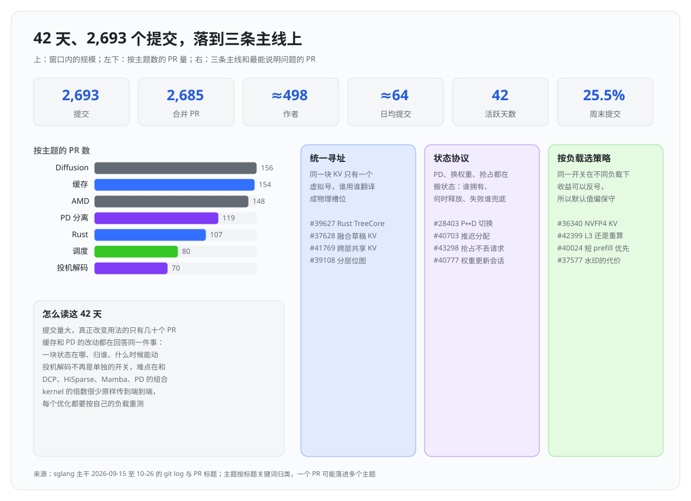
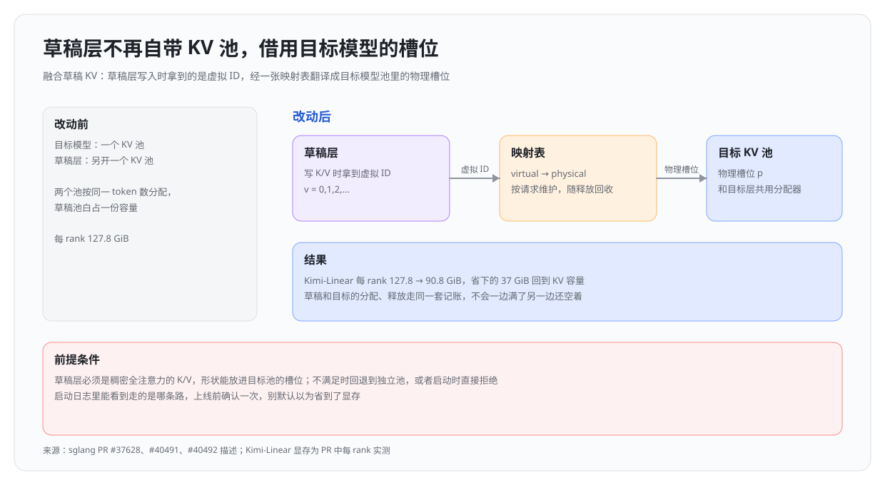
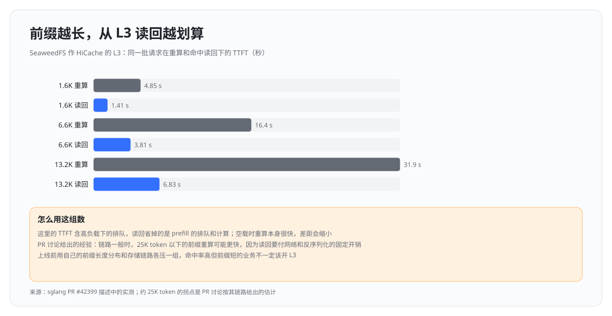
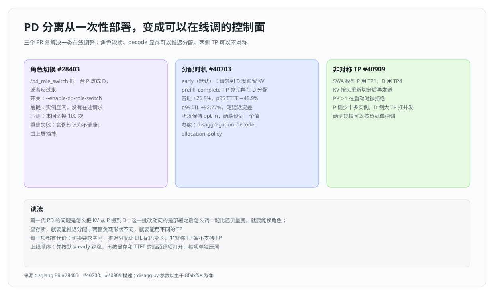
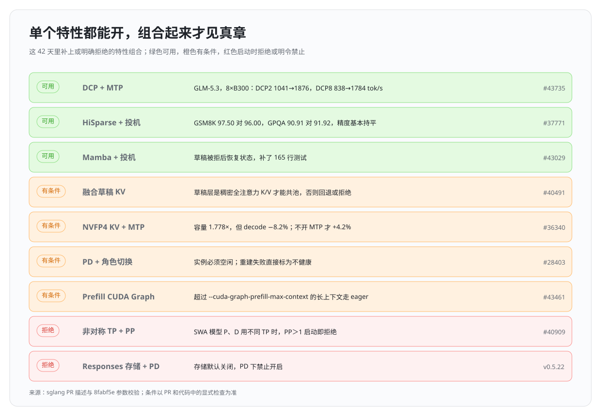
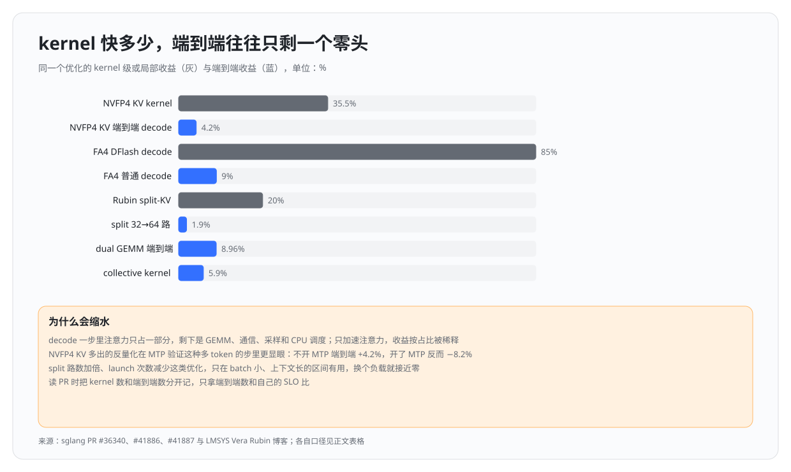
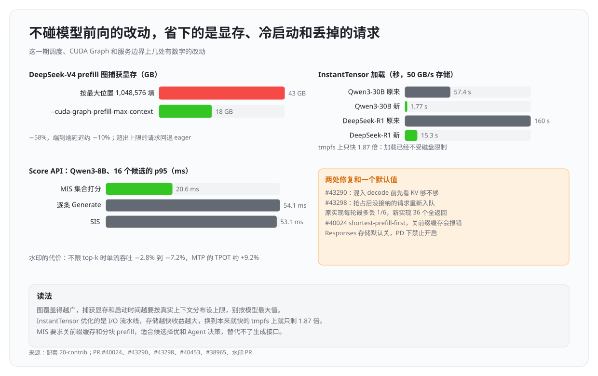
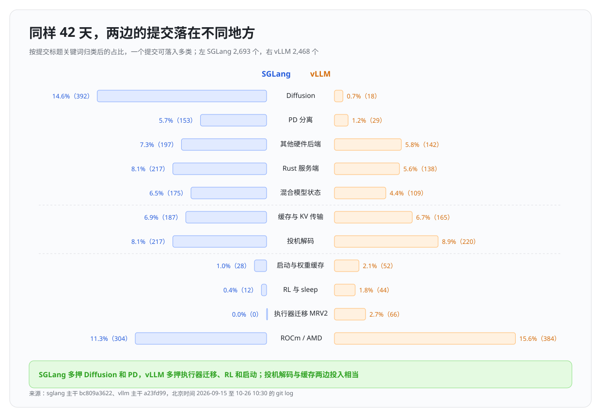
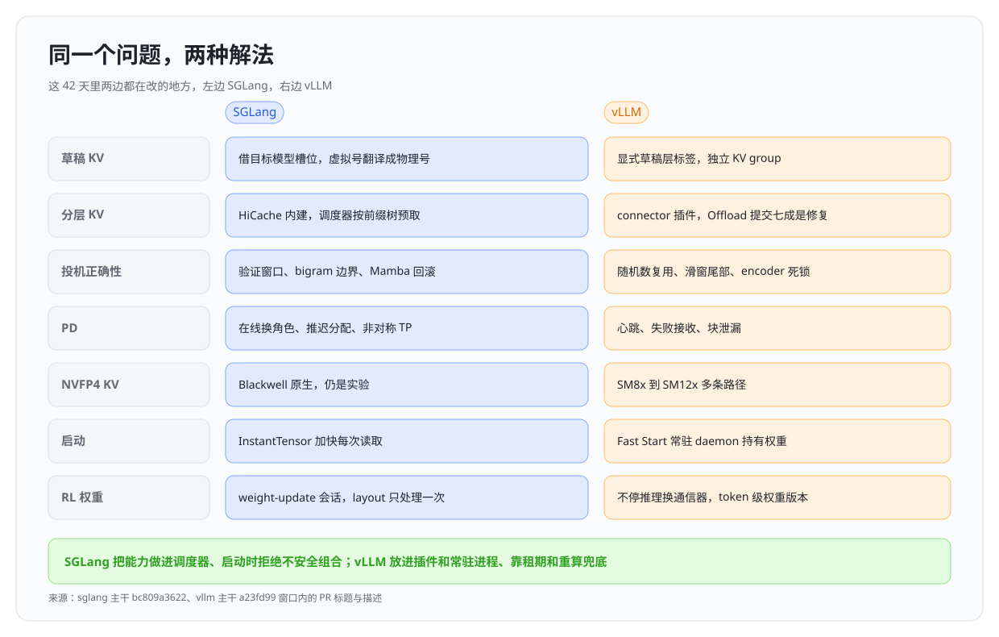
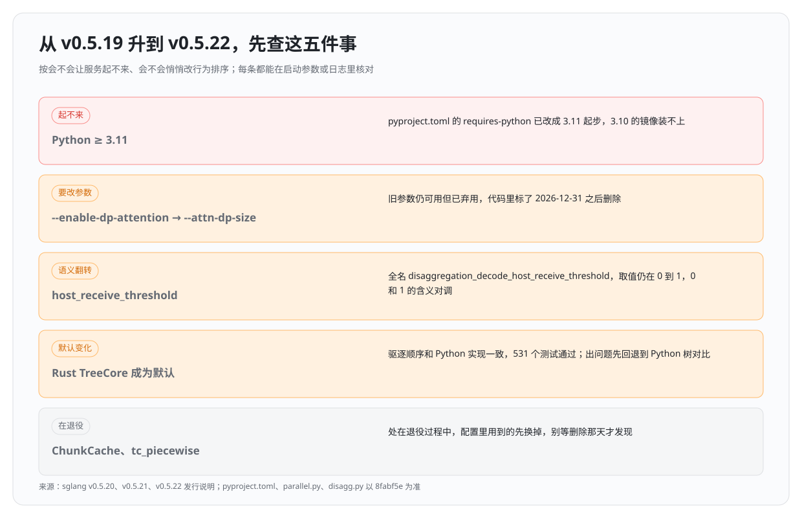

# SGL-20｜前沿｜42 天主干复盘：缓存寻址、PD 状态与投机解码的组合边界

> 🎯 <p><b>遇到的问题</b>：2026 年 9 月 15 日到 10 月 26 日这 42 天，SGLang 主干合进了 2,693 个提交，平均每天约 64 个。三份发行说明列出的是结果：新模型、NVFP4、AMD 适配、更高的 decode 吞吐<a href="https://github.com/sgl-project/sglang/releases/tag/v0.5.20">[1]</a><a href="https://github.com/sgl-project/sglang/releases/tag/v0.5.21">[2]</a><a href="https://github.com/sgl-project/sglang/releases/tag/v0.5.22">[3]</a>。上线前真正要问的是另外几件事：这个数在自己的负载上能不能复现，几个新特性能不能一起开，哪一项快了以后别处是不是变慢。</p><p>答案藏在 PR 的机制里：缓存地址怎样翻译，PD 换角色时哪些状态要重建，投机 token 被拒后状态怎样回滚，权重加载怎样绕开串行 I/O。这一篇按 42 天的代码变更做一次复盘，每个主题只问三件事：原来卡在哪，PR 加了什么机制，代价落在哪。</p><p><b>主线</b>：42 天的改动收敛到三件事：同一块状态只有一个地址，状态在实例之间搬运要有协议，开关的收益由负载决定；读 PR 时只信端到端数和组合条件。</p><p><b>读完这一篇</b>：拿到发行说明，能分清哪些改动影响自己的用法。能说清融合草稿 KV、Rust TreeCore、SeaweedFS L3、PD 角色切换和 prefill_complete 怎么开、何时被拒或回退、从哪行日志确认生效。能把 kernel 加速换算成端到端预期，升级到 v0.5.22 前查清哪些项会起不来、哪些会悄悄改行为。</p><p><b>代码</b>：这一篇不另写模拟器，实验用 sglang.benchmark.serving 和启动日志完成，压测方法沿用 [SGL-03｜上手｜指标与压测：TTFT、TPOT、ITL 与 goodput](./03-bench.md)。源码链接都指向主干 8fabf5e，例如分配策略在 <a href="https://github.com/sgl-project/sglang/blob/8fabf5e/python/sglang/srt/arg_groups/fields/disagg.py#L59">disagg.py:59</a>，角色切换的拒绝清单在 <a href="https://github.com/sgl-project/sglang/blob/8fabf5e/python/sglang/srt/arg_groups/pd_disaggregation_hook.py#L164">pd_disaggregation_hook.py:164</a>，融合草稿 KV 的判定在 <a href="https://github.com/sgl-project/sglang/blob/8fabf5e/python/sglang/srt/mem_cache/kv_cache_configurator.py#L1079">kv_cache_configurator.py:1079</a>，TreeCore 后端的选择在 <a href="https://github.com/sgl-project/sglang/blob/8fabf5e/python/sglang/srt/mem_cache/unified_cache/tree_core_registry.py#L109">tree_core_registry.py:109</a>。提交统计取自同一窗口的 git log，主干快照 bc809a3622。性能数字来自各 PR 描述和 LMSYS 博客，除特别说明外由项目方或合作方发布。</p>

# 导读 · 结论先行

1. **缓存开始统一寻址。**普通 KV、滑窗状态、Mamba 状态和草稿 KV 原先各有各的池和编号，现在收进同一套槽位，读写时由翻译器把虚拟号换成物理号。融合草稿 KV 让 Kimi-Linear 每 rank 从 127.8 GiB 降到 90.8 GiB，前提是草稿层是稠密全注意力。
2. **L3 读回不总比重算快。**SeaweedFS 作 L3 时，13.2K token 前缀的 TTFT 从 31.9 秒降到 6.83 秒；同一张 A10 上，约 25K token 以下的前缀直接重算仍可能更快。开不开 L3，看前缀长度分布和存储链路。
3. **PD 从部署拓扑变成控制面。**实例空闲时可以在线换角色，decode 端的 KV 可以推迟到 prefill 算完再分配，两侧 TP 可以不对称。推迟分配让吞吐涨 26.8%、p95 TTFT 降一半，代价是 p99 ITL 涨 92.77%，所以保持 opt-in。
4. **投机解码的难点转到组合上。**DCP + MTP 把 GLM-5.3 的生成吞吐从 1041 提到 1876 tok/s，HiSparse 和 Mamba 也接上了投机；同时 PD 角色切换、prefill_complete、HiCache 等组合在启动时被明确拒绝。拒绝清单本身就是能力矩阵。
5. **kernel 倍数到端到端会大幅缩水。**NVFP4 KV 的单步注意力 kernel 快 1.355 倍，整段 decode 只快 4.2%，开 MTP 反而慢 8.2%；Vera Rubin 上 split-KV 局部快 20%，再翻倍路数端到端只多 1.9%。读 PR 时把两类数分开记。



这张图把 42 天压成一页：上面是规模，左下是按主题归类的发行说明条目数，右边三栏是三条主线和最能说明问题的 PR。条目数只反映编辑关注度，一个 PR 可能同时被归到缓存和投机解码两类，不能相加。三条主线是后文的骨架，每一节都会落回其中一条。

**📎 与系列其他文档的分工**：这一篇只讲新东西，旧机制默认已经熟悉。HiCache 三层缓存的基本结构见 [SGL-14｜原理｜HiCache：显存、主机内存、远端存储三层 KV 缓存](./14-hicache.md)，PD 分离的传输和 bootstrap 见 [SGL-15｜原理｜PD 分离：prefill 和 decode 拆到两组卡上](./15-pd-disagg.md)，投机解码的接受率和验证成本见 [SGL-13｜原理｜投机解码：EAGLE、MTP、NGRAM 怎么选、怎么调](./13-speculative.md)，NVFP4 与 FP8 KV 的容量账见 [SGL-12｜原理｜量化：FP8、INT4 与 KV 量化怎么选](./12-quantization.md)，CUDA Graph 和 overlap 见 [SGL-09｜原理｜Overlap 调度与 CUDA Graph：把 CPU 开销藏到 GPU 后面](./09-overlap-cudagraph.md)，调度器的准入与抢占见 [SGL-05｜原理｜调度器：waiting、running 与 KV 预算](./05-scheduler.md)，前缀树的分裂和驱逐见 [SGL-08｜原理｜RadixAttention：基数树的匹配、插入、加锁与驱逐](./08-radix-attention.md)，指标与 profiling 见 [SGL-18｜实战｜可观测与 profiling：从指标到 kernel](./18-observability.md)，网关路由与 RL 权重更新见 [SGL-19｜实战｜集群与 RL rollout：路由、权重同步与长尾](./19-cluster-rl.md)，压测方法见 [SGL-03｜上手｜指标与压测：TTFT、TPOT、ITL 与 goodput](./03-bench.md)。这里只讲 42 天里这些机制变了什么，以及变化带来的新约束。

# 第 1 章 · 问题：清单越长，越难判断哪一条对自己有用

先看规模。窗口内主干新增 2,693 个提交，标题里能识别出 2,685 个不同的 PR 编号，说明绝大多数提交是 squash 合并的单个 PR。工作日 2,006 个，周末 687 个，周末约占四分之一。按邮箱能区分出 496 个作者身份，其中两个是合并和发版的自动化账号，仍能看出这个项目不靠少数维护者撑着。同时维护几十种模型结构、NVIDIA/AMD/Intel/Apple 多个硬件后端、LLM 和 Diffusion 两类负载，评审和 CI 的压力已经和写功能一样大。

| 统计项 | 数值 | 口径 |
|-|-|-|
| 提交 | 2,693 | 北京时间 2026-09-15 至 10-26，主干 git log |
| 可识别的 PR 编号 | 2,685 | 从提交标题中的 (#NNNNN) 提取，去重 |
| 日均提交 | 约 64 | 2,693 除以 42 天 |
| 周末提交 | 687，占 25.5% | 按提交时间的星期几计 |
| 作者身份 | 496 | 按作者邮箱去重，含 2 个自动化账号 |
| 发行说明覆盖 | 正文引用 1,779 个 PR，页面声明 2,442 个 | 三份发行说明合计；正文是编辑过的摘要，不是完整变更日志 |

发行说明只覆盖了一部分 PR，而且是按主题挑过的。按对应 PR 的合并时间过滤到这 42 天后，条目最多的几类是 Diffusion 156 条、缓存 154 条、AMD/ROCm 148 条、并行与 PD 119 条、Rust 服务端 107 条、调度 80 条、投机解码 70 条。三份发行说明还列了 184 条首次贡献者和 27 个新模型，但其中有窗口之前合并的工作，这里不当作 42 天的总量。

对使用者来说，清单越长越难用。下面这些现象都是我们在升级或评估新版本时碰到的，每一个都对应后文的一节：

- 开了 EAGLE3 和统一内存，显存没省下来，不知道融合草稿 KV 到底生效没有
- 接了 L3 存储，命中率很高，TTFT 却没降，短前缀请求甚至更慢
- PD 集群的 P、D 配比跟不上流量变化，想在线调整却不知道能不能换角色
- 换了 prefill_complete 以后 p95 TTFT 好看了，p99 ITL 却翻了一倍
- 投机解码和 PD、HiSparse、DCP 一起开，服务直接起不来
- PR 里写着 kernel 快 2 倍，换到自己的服务上只快了几个百分点
- 升级以后启动参数报弃用，或者某个阈值的含义悄悄反了

| 想弄清的现象 | 看哪一节 |
|-|-|
| 草稿 KV、滑窗、Mamba 状态怎么共用一个池，Rust TreeCore 什么时候回退 | 2.1 统一寻址 |
| L3 读回和重算谁更快，SeaweedFS 怎么配 | 2.2 L3 的价值取决于前缀长度 |
| PD 换角色、推迟分配、非对称 TP 的前提和代价 | 2.3 PD 变成控制面 |
| 投机解码和 DCP、HiSparse、Mamba 的组合 | 2.4 投机解码：正确性成了性能的一部分 |
| kernel 倍数为什么到端到端会缩水，NVFP4 KV 该不该开 | 2.5 专用 kernel 与端到端收益 |
| 调度新策略、Prefill CUDA Graph 的显存 | 2.6 调度器与 CUDA Graph |
| 加载、Score API、权重更新、默认值收紧 | 2.7 服务边界 |
| 同期 vLLM 的提交分布、同类问题的不同解法 | 2.8 同一个 42 天里的 vLLM |
| 新开关怎么验证、升级要查什么 | 第 4 章、第 6 章 |

# 第 2 章 · 原理：三条主线上的关键合并

## 2.1 统一寻址：一块状态只有一个地址

现代模型的缓存早就不只是普通的 K 和 V。MLA 存压缩后的 latent，滑窗注意力有窗口边界，Mamba、GDN、KDA 这类线性注意力层存的是循环状态，EAGLE 和 MTP 还有草稿模型自己的 KV。这些状态可能分别放在 GPU、主机内存和远端存储里。过去每类状态各有各的池、各有各的编号，前缀命中以后要分别去几个池里找；只恢复了 KV 而漏了循环状态，结果不会报错，只会悄悄算错。这个月缓存方向的主要工作，是把这些状态收进一套寻址和回收机制。

| PR | 改了什么 | 结果 |
|-|-|-|
| #39627 Rust TreeCore 默认化[[4]](https://github.com/sgl-project/sglang/pull/39627) | 前缀树的插入、分裂、驱逐、HiCache 回写和锁统一到 Rust 实现。Full、SWA、Mamba 共享一套树和回收接口。不支持的配置回退 Python | 531 个 CPU 测试和 43 个子测试通过，36 个 Python 与 Rust 回写场景结果一致 |
| #37628、#40491、#40492 融合草稿 KV[[5]](https://github.com/sgl-project/sglang/pull/37628)[[6]](https://github.com/sgl-project/sglang/pull/40491)[[7]](https://github.com/sgl-project/sglang/pull/40492) | 草稿 KV 嵌进目标模型的槽位；一个槽位同时寻址目标和草稿，读写经过虚拟号到物理号的翻译 | 支持 EAGLE、EAGLE3、DFlash、DSpark；Kimi-Linear 一组配置每 rank 127.8 → 90.8 GiB |
| #43868、#43870 预取流水线[[8]](https://github.com/sgl-project/sglang/pull/43868)[[9]](https://github.com/sgl-project/sglang/pull/43870) | 预取、staging、H2D 拷贝、前缀插入和锁释放拆成流水线上的独立操作；新增按块组命中 | 侧池可以整组命中；FULL 驱逐能一直走到分配目标 |
| #41769 跳过空的 index-K[[10]](https://github.com/sgl-project/sglang/pull/41769) | DSA 传输先按 PP 层对齐，再跳过不读取自己 index-K 的层 | GLM-5.2 Prefill KV 容量 +11.6%，Decode +13.7%，该测试吞吐基本不变 |
| #39108 网关分层位图[[11]](https://github.com/sgl-project/sglang/pull/39108) | 网关的缓存感知树为每个 worker 记 GPU、主机、磁盘、外部四层归属 | device 层驱逐不再抹掉主机层归属 |

### Rust TreeCore：先解决 CPU 侧的锁竞争

Rust TreeCore 不是一次单纯的语言替换。模型并行度上去以后，调度进程里前缀树的插入、分裂、加锁和驱逐会先于 GPU 成为瓶颈，所以这次把这些操作和 HiCache 回写、锁凭据一起收到统一接口里，连 T-LRU 驱逐时整数和浮点的比较顺序都要和 Python 版对齐，否则两边的驱逐结果会不同。默认后端由环境变量 SGLANG_UNIFIED_RADIX_TREE_CORE_BACKEND 决定，默认值是 rust（[environ.py:745](https://github.com/sgl-project/sglang/blob/8fabf5e/python/sglang/srt/environ.py#L745)）。

回退条件写在 [tree_core_registry.py:44](https://github.com/sgl-project/sglang/blob/8fabf5e/python/sglang/srt/mem_cache/unified_cache/tree_core_registry.py#L44)：开了会话感知缓存、用了 Full/SWA/Mamba 以外的组件、注册了自定义组件、非 Linux 平台、或者 torch 版本不在扩展支持的范围内，都会退回 Python 实现，并在启动日志打一行 Using the Python TreeCore 加原因（[tree_core_registry.py:119](https://github.com/sgl-project/sglang/blob/8fabf5e/python/sglang/srt/mem_cache/unified_cache/tree_core_registry.py#L119)）。KV 分片相关的启动检查也会读同一个变量（[kv_shard_hook.py:136](https://github.com/sgl-project/sglang/blob/8fabf5e/python/sglang/srt/arg_groups/kv_shard_hook.py#L136)）。升级后遇到驱逐行为可疑，第一步是把这个变量设成 python 对比一次。

### 融合草稿 KV：草稿层借目标模型的槽位



原来草稿模型有自己的 KV 池和第二套地址空间。两个池按同一个 token 数分配，一边满了另一边可能还空着，草稿池等于白占一份容量。新机制把草稿层的 K/V 行直接放在目标模型槽位的后面，一次分配、一次释放、一次整页搬迁就同时带走目标和草稿。

难点在地址。统一内存会在运行中压缩碎片，槽位的物理位置会变，所以请求手里拿的是虚拟号，注意力 kernel 要的是当前的物理号，两者在读写的入口由 KVIndexTranslator 转换（[kv_index_translator.py:119](https://github.com/sgl-project/sglang/blob/8fabf5e/python/sglang/srt/mem_cache/kv_index_translator.py#L119)）。草稿 KV 的布局规划在 [fused_draft.py](https://github.com/sgl-project/sglang/blob/8fabf5e/python/sglang/srt/mem_cache/layout/fused_draft.py)。

这套设计有明确的边界。判定函数 [kv_cache_configurator.py:1079](https://github.com/sgl-project/sglang/blob/8fabf5e/python/sglang/srt/mem_cache/kv_cache_configurator.py#L1079) 先看大前提：统一内存打开、宿主模型有可融合的全注意力池（滑窗或 Mamba 混合模型）、算法属于 EAGLE 或 DFlash 家族、草稿配置在启动时已加载。

然后逐项排除：草稿不是 MHA 结构、草稿跑的注意力后端不在支持翻译的列表里、K/V 不等宽而后端不支持、草稿自己有滑窗或循环层、KV dtype 不同、开了 DCP 或部分主机池模式。被排除时启动日志会打 fused draft KV disabled 加原因（[kv_cache_configurator.py:1436](https://github.com/sgl-project/sglang/blob/8fabf5e/python/sglang/srt/mem_cache/kv_cache_configurator.py#L1436)），有些组合则直接拒绝启动。上线前一定看这一行，不默认以为显存省到了。

### 跳过空的 index-K：容量收益只在有缓存压力时变成吞吐

GLM-5.2 有 78 个 DSA 层，其中 21 层负责产出 top-k 索引，其余 57 层只复用别人的索引，从来不读自己的 index-K。原来 HiCache 和 PD 传输仍然为这 57 层保留并搬运空条目。允许跳过后，Prefill 侧 KV 容量提高 11.6%，Decode 侧提高 13.7%。这组实验里吞吐没有明显变化，原因很简单：测试负载下 KV 容量本来就不是瓶颈。容量优化只有在缓存真的吃紧时才会转成吞吐，评估这类 PR 要先确认自己的服务是否受 KV 容量约束。

### 网关分层位图：别让 device 驱逐抹掉主机上的缓存

这是层次化缓存下一个隐蔽的错误。引擎在 device 副本被驱逐时会发出带层级标签的 KV 事件，可网关进程内的前缀树把任何 BlockRemoved 都理解为整段前缀消失。结果设备缓存周转一次，主机内存里还能快速读回的前缀就全部变成不可路由，实测主机命中只剩约 2.4%。

新树为每个 worker 维护四层位图，device 驱逐只清 GPU 那一位。#41974 又把亲和下沉到 worker 内部[[12]](https://github.com/sgl-project/sglang/pull/41974)：DP 各 rank 各自持有 KV 时，网关只在 worker 级选路，同一会话的下一轮可能落到没有缓存的 rank；新路径按会话键、最长前缀、最少在途依次选 rank，并剥掉客户端伪造的 rank 头。

## 2.2 L3 的价值取决于前缀长度

#42399 新增 SeaweedFS 作为 HiCache 的 L3 后端[[13]](https://github.com/sgl-project/sglang/pull/42399)。它的难点在对象语义，传文件本身不难：每个 KV page 是一个对象，page-first 布局下几个主机缓冲区连续写进同一个对象。读回时对象大小对不上就直接当作未命中，避免把错位的数据写进 KV。

MLA 各 rank 持有相同的 KV，可以共用一个 key，MHA 各 rank 的 KV 不同，key 必须按 TP、CP 分开。配置通过 --hicache-storage-backend-extra-config 传入，只有 endpoint 必填，bucket 默认 sglang-hicache（[SeaweedFSConfig](https://github.com/sgl-project/sglang/blob/8fabf5e/python/sglang/srt/mem_cache/storage/seaweedfs/seaweedfs_store.py#L44)，[memory.py:177](https://github.com/sgl-project/sglang/blob/8fabf5e/python/sglang/srt/arg_groups/fields/memory.py#L177)）。



零拷贝路径把 1.6K、6.6K、13.2K token 前缀的 L3 TTFT 从通用路径的 4.85、16.4、31.9 秒降到 1.41、3.81、6.83 秒，倍数在 3.5 到 4.7 之间。这组 TTFT 包含高负载下的排队，读回省下的是 Prefill 的计算和排队。同一张 A10、同一个 Qwen3-4B、page size 64 的对照里，小于约 25K token 的请求直接重算仍可能比从 L3 读回更快，因为读回要付网络往返和反序列化的固定开销。

这组数给出的结论很朴素：缓存值不值得读，取决于前缀长度、存储带宽和 Prefill 成本三者的比较。命中率高但前缀短的业务，开 L3 可能只是多了一条链路和一个故障点。小模型 Prefill 便宜，拐点更靠后；大模型 Prefill 贵，拐点会前移。上线前用自己的前缀长度分布压了一组。

## 2.3 PD 变成控制面

PD 分离把 Prefill 和 Decode 放到两组卡上，第一代的问题是怎么把 KV 从 P 搬到 D。可固定的角色很难跟上输入输出比例的波动：白天长文档多，P 不够；晚上聊天多，D 不够。这个月三个 PR 分别解决资源弹性、准入时机和异构并行[[14]](https://github.com/sgl-project/sglang/pull/28403)[[15]](https://github.com/sgl-project/sglang/pull/40703)[[16]](https://github.com/sgl-project/sglang/pull/40909)。



### 角色切换：只重建与角色有关的那部分

#28403 的前提是 Prefill 和 Decode 用的是同一种 KV 池，所以换角色时不需要重新分配 KV，也不碰模型权重。真正要换的只是与角色有关的数据面：bootstrap、sender/receiver、socket、RDMA 注册，最后重新派发事件循环。

100 次来回切换没有失败，权重、KV 和线程资源都保持平稳。入口是 POST /pd_role_switch（[http_server.py:1635](https://github.com/sgl-project/sglang/blob/8fabf5e/python/sglang/srt/entrypoints/http_server.py#L1635)），请求体由 PdRoleSwitchReqInput 定义，可以顺带给切到 decode 后要捕获的 CUDA Graph batch 档位（[io_struct.py:2265](https://github.com/sgl-project/sglang/blob/8fabf5e/python/sglang/srt/managers/io_struct.py#L2265)）。

几个约束都写在代码里。实例必须完全空闲，因为正在跑的 Decode 请求可能还持有上游 Prefill 写来的 KV。重建失败时实例直接标成不健康，不假装回滚到原状态，由上层摘掉。启动时用 --enable-pd-role-switch 打开（[disagg.py:121](https://github.com/sgl-project/sglang/blob/8fabf5e/python/sglang/srt/arg_groups/fields/disagg.py#L121)），而且和下面这些特性互斥：EP 大于 1、MoE all-to-all、PP 大于 1、DP 注意力的本地控制广播、DCP 大于 1、投机解码（[pd_disaggregation_hook.py:164](https://github.com/sgl-project/sglang/blob/8fabf5e/python/sglang/srt/arg_groups/pd_disaggregation_hook.py#L164)）。按负载自动触发切换的策略不在这个 PR 里，目前仍由运维或网关调用。

### 推迟分配：改的是时机，换来的是 p95 和 p99 的交换

#40703 把 Decode 端为请求预留 KV 的时间，从请求一到就预留推迟到最终 Prefill 结果被接受之后，对应新策略 prefill_complete；默认的 early 保持原行为。Prefill 就绪后发一个带 nonce 和归属信息的就绪信号，Decode 收到再分配。

在 GLM-5.2 NVFP4、Decode KV 吃紧的长短混合负载下，吞吐提高 26.8%，p95 TTFT 降低 48.9%。代价是 p99 ITL 上升 92.77%：KV 在源端停留更久，分块 Prefill 和传输之间的重叠也变少了。p95 和 p99 往相反方向走，所以这个策略保持 opt-in，没有改成默认。

参数是 --disaggregation-decode-allocation-policy，两端要设成同一个值（[disagg.py:59](https://github.com/sgl-project/sglang/blob/8fabf5e/python/sglang/srt/arg_groups/fields/disagg.py#L59)）。

它的限制比角色切换还多，校验函数 [pd_disaggregation_hook.py:199](https://github.com/sgl-project/sglang/blob/8fabf5e/python/sglang/srt/arg_groups/pd_disaggregation_hook.py#L199) 会拒绝：非 PD 部署、Mooncake 以外的传输后端、PP/注意力 CP/DCP 不为 1、注意力 TP 大于 1、PD 复用或解耦投机、角色切换、编码器分离、HiSparse、Decode 端主机缓冲、Decode 端的前缀树或 HiCache，以及 Prefill 端带存储或非 write_back 的 HiCache。KV 池类型目前只支持全注意力和 DSA（[conn.py:424](https://github.com/sgl-project/sglang/blob/8fabf5e/python/sglang/srt/disaggregation/common/conn.py#L424)）。

### 非对称 TP：滑窗状态要按头重新切

#40909 让 P 用 TP1、D 用 TP4 这类不对称部署成为可能。改传输接口远远不够：混合滑窗模型的窗口状态必须按 token 和 KV head 的归属重新切片，并保证目标 rank 上窗口字节和外围哨兵都正确。NIXL 和 Mooncake 各自实现了这条路径，TP1 和 TP4 双向请求都能通过；PP 大于 1 或缓冲布局不兼容时在启动时拒绝（[conn.py:1764](https://github.com/sgl-project/sglang/blob/8fabf5e/python/sglang/srt/disaggregation/common/conn.py#L1764)），PR 也没有宣称跨 TP 的数值完全等价。好处是两侧可以按负载形状分开定规模：P 侧少卡多实例，D 侧大 TP 扛并发。

### Prefill 不再走走停停

还有一个调度侧的改动直接影响 PD 的 Prefill 实例。#42035 之前[[17]](https://github.com/sgl-project/sglang/pull/42035)，Prefill 的 overlap 循环在 copy_done.synchronize() 上等结果，等的这段时间不接新请求，长 Prefill 会把接收变成一停一走。新实现把同步等待换成非阻塞查询，并在 TP 的 CPU 组上做一次 MIN 归约，让所有 rank 对最老的 batch 是否完成达成一致；结果未就绪时可以继续接收并准备下一个 batch。目前由环境变量开启，限于非投机、注意力 DP 和 CP 都为 1 的路径。

三项合起来，PD 已经从启动时选 Prefill 还是 Decode，变成一个涉及准入、状态、通信和故障边界的控制面。KV 传多快仍然重要，可新的难点是何时切、何时分配、失败后谁来恢复。我们的上线顺序是先用默认 early 跑稳，再按显存和 TTFT 的瓶颈逐项打开，每项单独压测。

## 2.4 投机解码：正确性成了性能的一部分

投机解码的表面指标是接受长度和 tok/s，代码里的复杂度来自草稿、目标、KV 和循环状态在每一步怎样对齐。这个月三个代表性 PR 分别对应生命周期、并行和边界条件。

| PR | 改了什么 | 结果 |
|-|-|-|
| #37771 HiSparse + 投机[[18]](https://github.com/sgl-project/sglang/pull/37771) | 多步的 gather 与 commit 换页接入 HiSparse；一次处理多步缺页、scratch 和已接受 token 的提交 | EAGLE/MTP + HiSparse 端到端可用；GSM8K 97.50% 对 96.00%，GPQA-Diamond 90.91% 对 91.92% |
| #43735 DCP + MTP[[19]](https://github.com/sgl-project/sglang/pull/43735) | 目标 KV 按位置条带化，index-K 复制。每个 rank 做局部 top-k，再按 LSE 合并。MTP 池按 DCP 复制 | GLM-5.3、8×B300：DCP2+MTP 1041 → 1876 gen tok/s，DCP8+MTP 838 → 1784 |
| #43029 Mamba 状态回滚[[20]](https://github.com/sgl-project/sglang/pull/43029) | 用已提交长度重算验证窗口，处理语法保留 token 和非草稿 token 的边界 | 修复跨区间时错误的 Mamba 状态恢复；新增 165 行边界测试 |

HiSparse 那项改动的分量在于生命周期。验证前的 scratch、多步的页映射、接受后的缓存提交、主机备份和请求清理，原先散在几处，现在放进同一条生命周期里管。DCP + MTP 要保证每个 rank 只看自己那一段 KV 做局部 top-k，最后通过 LSE 合并仍能得到全局注意力的结果。吞吐提升很明显，可 AIME26 pass@1 因采样和截断有波动，不能只看吞吐。PR 同时写明 HiCache、PD、树形草稿等组合仍会拒绝启动。

#43029 值得单独看。投机 token 被拒绝只是表面现象，决定验证窗口的是三样东西：结构化输出截断时保留的 token、不是草稿产生的 token、以及已提交长度。原逻辑在跨区间边界时，会把仍在同一轨道上的请求误判成跨页，从错误的位置恢复 Mamba 状态。修复只改了一小段分支，却用 165 行测试把各种保留和不保留的路径钉住。这类 bug 不会崩溃，只会让输出悄悄偏离。



这张矩阵把 42 天里补上或明确拒绝的组合放在一起。绿色已经可用，橙色有前提，红色在启动时就会被拒绝。对一个成熟的推理框架，支持哪些投机算法只是功能表，能说清状态怎样提交、怎样回滚、哪些组合为什么被拒绝，才决定它能不能进生产。拒绝比静默回退好：启动失败一眼就能看到，静默回退要等到压测数据对不上才会发现。

## 2.5 专用 kernel 与端到端收益

这个月最醒目的几组提升来自四条不同的模型路径。SGLang 不再追求一套通用 kernel 打天下，而是在统一接口下给热点组合建专用快路径，再用分派条件把不支持的组合挡在外面。

| PR | 改了什么 | 结果 |
|-|-|-|
| #41251[[21]](https://github.com/sgl-project/sglang/pull/41251) | DeepSeek-V4.1 在 Hopper 上调优 group32 GEMM，复用精确的 BF16 权重展开，用实时的分页索引长度，融合 mask、sort 和槽位映射 | 8×H200 每卡输出吞吐 2.1 到 2.3 倍 |
| #42175[[22]](https://github.com/sgl-project/sglang/pull/42175) | Qwen3.8-Flash-Next 让 HC gate 与 block 计算重叠，融合 norm，推迟 MoE finalize，换用更小的 GDN value tile | 4×B200、并发 1：242.4 → 271.0 tok/s，decode 图里的 kernel 数 1432 → 1241 |
| #42489[[23]](https://github.com/sgl-project/sglang/pull/42489) | GLM-5.3-Flash DFlash 复用 CPU 侧的 seq_len，一次构建池化页表，调优 KDA 递推和 gated norm 的启动 | 8×B300 decode 1091.9 → 1199.7 tok/s |
| #41886[[24]](https://github.com/sgl-project/sglang/pull/41886) | MiMo 在 SM100、SM103 上默认改用 FA4，保留显式指定后端的覆盖 | DFlash decode 1.85 倍，普通 decode +9%，TTFT −34.8% |

这几个 PR 的深度差别很大。#41886 只加了五行默认选择，让 MiMo 避开不合适的 Triton 回退路径；#42175 则深入到层边界，把 HC、共享 gate、MoE finalize 和 GDN tile 重新编排。提升来自不同层级，用一句 kernel 优化概括会丢掉最重要的信息。四组结果的模型、卡数和并行配置都不同，不能横向相加。

### 代价写在 PR 里

#41251 在 Hopper 上缓存了派生权重，模型加载后每卡显存从 72.71 GB 涨到 75.43 GB，max_total_num_tokens 从 16,012,800 降到 14,223,104，少了约 11.2%；在线更新权重时还要关掉这些派生缓存。#42175 的 MoE 专用路径只在 hidden 2560、512 个专家取 top-10、BF16、SM10x、TP4/EP1，并且没有 LoRA、投机解码和双 batch 重叠时才启用。快 2.3 倍的代价是 KV 容量和适用范围。

### NVFP4 KV：容量收益最大，Prefill 不一定更快

#36340 为 SM100、SM103 增加了原生 packed NVFP4 KV[[25]](https://github.com/sgl-project/sglang/pull/36340)。K/V 保持按槽位排列，注意力 kernel 通过跨步视图直接读取；K 的 scale 按 token 线性排列，V 的 scale 用四个 token 交织的布局，decode 在注意力 kernel 内部反量化，省掉一次单独的整块反量化读写。用 --kv-cache-dtype nvfp4 打开（[model.py:197](https://github.com/sgl-project/sglang/blob/8fabf5e/python/sglang/srt/arg_groups/fields/model.py#L197)），原生布局要求 page_size 能被 4 整除（[nvfp4_kv_cache.py:157](https://github.com/sgl-project/sglang/blob/8fabf5e/python/sglang/srt/layers/quantization/nvfp4_kv_cache.py#L157)）。

Qwen3.5-35B-A3B、GB300、1M 上下文的测试里，NVFP4 KV 每个 token 的 KV 字节比 FP8 少 43.75%，理论容量是 1.778 倍。可原生 FP4 的 Prefill 要 14.84 秒，FP8 是 13.36 秒，慢了约 10%；不开 MTP 的 decode 只快 4.2%，开 MTP 反而慢 8.2%。单步注意力 kernel 明明快了 1.355 倍，整段 decode 只剩 4.2%，因为 decode 一步里注意力只占一部分[[25]](https://github.com/sgl-project/sglang/pull/36340)。

LMSYS 博客用 Qwen3.8-27B 和 RTX PRO 6000 测出的又是另一组数[[26]](https://www.lmsys.org/blog/2026-09-16-nvfp4-kv-cache/)：同并发下 decode 吞吐提高 26% 到 30%；利用多出的容量加并发后，32K、160K、1M 上下文的峰值吞吐分别提高 37.37%、57.75%、78.46%。但同并发下 Prefill TTFT 略差 0.20% 到 0.40%，SWE-bench Verified 从 FP8 的 77.80% 降到 76.20%。

两组结果并不矛盾，模型、GPU 和执行路径都不同。它们共同说明，NVFP4 KV 最直接的收益是字节数和容量。Prefill 嫌慢时可以用 --prefill-kv-cache-dequant-dtype fp8_e4m3 让 Prefill 先反量化到临时的 FP8 工作区（[exec\_.py:246](https://github.com/sgl-project/sglang/blob/8fabf5e/python/sglang/srt/arg_groups/fields/exec_.py#L246)）。这项能力官方仍标为实验性。

### Vera Rubin 的提醒：20% 的 kernel 不等于 20% 的服务



Vera Rubin 博客给了一组很干净的对照[[27]](https://www.lmsys.org/blog/2026-10-09-vera-rubin)。同一个 Kimi K3 服务里，MLA 加深流水线后在 batch 16、128K 上下文下快 16%；split-KV 归约改了加载顺序后，batch 1 的全 FP8 MLA 快 20%。可 split-KV 从 32 路加到 64 路，端到端只多了 1.9%。另一边，把 MoE finalize、共享专家、all-reduce 和 RMSNorm 合成一个集合通信 kernel，每个 decode 步少 276 次 kernel 启动，端到端提升 5.9%。

框架越成熟，越需要把 microbenchmark 和请求级收益分开。局部热点只占整条 trace 的一部分，减少固定的启动开销有时比继续优化一次 GEMM 更值钱。读 PR 时，把 kernel 数和端到端数分两栏记，只拿端到端数和自己的 SLO 比。

### MoE 与 MLP：专用融合继续下沉

Blackwell 上的 MLP 也有了专用快路径。#41887 用 CuTe DSL 把 input 乘 gate 权重、input 乘 up 权重和 SiLU(gate) 乘 up 融进同一个 dual-GEMM kernel，B200 FP8、Qwen2-7B 上输出吞吐均值提高 8.96%[[28]](https://github.com/sgl-project/sglang/pull/41887)。

MegaMoE 补上了启动期的自动调优[[29]](https://github.com/sgl-project/sglang/pull/43789)：在 CUDA Graph 捕获之前准备好 decode 和 prefill 的容量档位，用同步后的 DP token 数让各 EP rank 选同一块工作区，并缓存调好的参数，首个真实 batch 不必承担调优抖动。硬件面也在扩张，除 AMD MI350/MI355 和 Intel 镜像外，Apple Silicon 补上了标准 PyTorch 后端，与已有的 MLX 路径并存[[30]](https://github.com/sgl-project/sglang/pull/36780)。

## 2.6 调度器与 CUDA Graph：别让流水线停下来

调度改动不碰模型前向，却直接决定 GPU 是不是一直有活干。#40024 新增 shortest-prefill-first[[31]](https://github.com/sgl-project/sglang/pull/40024)：按剩余未命中的 token 数挑请求，并为等着的短请求预留后续块的预算，避免一个长请求长期霸占 Prefill。它是 --schedule-policy 的一个新取值（[schedule.py:86](https://github.com/sgl-project/sglang/blob/8fabf5e/python/sglang/srt/arg_groups/fields/schedule.py#L86)），排序逻辑在 [schedule_policy.py:416](https://github.com/sgl-project/sglang/blob/8fabf5e/python/sglang/srt/managers/schedule_policy.py#L416)；这个策略依赖前缀缓存算剩余 token，关了前缀缓存会直接报错，其他缓存感知策略则会回退到 fcfs（[schedule_policy.py:343](https://github.com/sgl-project/sglang/blob/8fabf5e/python/sglang/srt/managers/schedule_policy.py#L343)）。

同月还修了两条会丢请求或打崩服务的路径。#43290 在把正在跑的 decode 混进分块 Prefill 之前，先检查 KV 装不装得下，不够就让 decode 推迟一步[[32]](https://github.com/sgl-project/sglang/pull/43290)。#43298 处理的是准入时为高优先级请求抢占了低优先级请求、最后却一个也没接纳的情况，修复后把被抢占的请求重新入队[[33]](https://github.com/sgl-project/sglang/pull/43298)。端到端测试里，原实现每轮最多丢六分之一的请求，新实现 36 个全部返回。

### CUDA Graph 从 decode 扩展到 prefill 和混合块

CUDA Graph 一直是 decode 的常规优化，这个月开始覆盖更复杂的 Prefill 路径[[34]](https://github.com/sgl-project/sglang/pull/36534)[[35]](https://github.com/sgl-project/sglang/pull/42845)[[36]](https://github.com/sgl-project/sglang/pull/43461)。DeepSeek-V4 的 C4 indexer 原先按模型最大位置 1,048,576 填充 logits，Prefill 图捕获到 16K batch 时，这块工作区就很大。

新参数 --cuda-graph-prefill-max-context 按实际部署的上下文裁剪（[exec\_.py:651](https://github.com/sgl-project/sglang/blob/8fabf5e/python/sglang/srt/arg_groups/fields/exec_.py#L651)），超出的请求回退 eager。捕获显存从 43 GB 降到 18 GB，少了 58%，端到端延迟约降 10%。GLM-5.3-Flash 的 KDA extend 也进了可中断的 Prefill 图并设为默认，完整 Prefill 图能接受混合块，在不耽误 decode 的前提下穿插处理新的 Prefill。

这条线的关键在回退设计。形状没捕获、上下文超预算、混合并行无法捕获时，请求要能干净地回到 eager。图覆盖得越广，启动时间、捕获显存和档位管理就越重要，部署时要按真实的上下文分布设上限，而不是按模型最大值。

## 2.7 服务边界：加载、接口和默认值

还有一批改动不发生在 GPU 前向里，却直接影响冷启动、接入方式和线上稳定性。

| PR | 改了什么 | 结果 |
|-|-|-|
| #40453[[37]](https://github.com/sgl-project/sglang/pull/40453) | InstantTensor 加载器：safe_open 流式迭代，接入进程组，I/O 参数可调 | 50 GB/s 存储下 Qwen3-30B 57.4 → 1.77 秒，DeepSeek-R1 160 → 15.3 秒 |
| #41766[[38]](https://github.com/sgl-project/sglang/pull/41766) | protobuf 直接映射到共享的前端请求，事件流再转回 protobuf | Rust 原生 gRPC 的 Text/Generate 可用，流式、取消和错误码语义保留 |
| #38965[[39]](https://github.com/sgl-project/sglang/pull/38965) | 多位置池化：候选只做一次 Prefill，每个锚点读分类头 | Qwen3-8B、16 个候选：MIS p95 20.6 ms，Generate 54.1 ms，SIS 53.1 ms |
| #42316[[40]](https://github.com/sgl-project/sglang/pull/42316) | /v1/messages 入口转内部 chat 请求，回复和 SSE 转成 Anthropic 格式 | Anthropic SDK 和 Claude Code 可直接接入，支持图片、工具、thinking 和流式 |
| #40777[[41]](https://github.com/sgl-project/sglang/pull/40777) | begin_weight_update / end_weight_update 会话，统一枚举目标和草稿的 runner | 一次 refit 跨多个桶只做一次 layout 后处理 |

InstantTensor 的收益高度依赖存储。50 GB/s 的存储上，DeepSeek-R1 从 160 秒降到 15.3 秒；换到 tmpfs 只剩 1.87 倍，因为加载已经不再受磁盘限制。它优化的是 I/O 流水线和并行读取，不是每台机器都能快十倍。加载器通过 --load-format 选择（[model.py:58](https://github.com/sgl-project/sglang/blob/8fabf5e/python/sglang/srt/arg_groups/fields/model.py#L58)）。

Score API 的核心是池化位置。候选集合放进同一个 prompt，每个候选后面放一个提取 token，一次前向在多个位置上池化；MIS 再把候选组成块对角注意力，共享查询前缀。调度器按池化模式拆分 Prefill batch，避免逐条打分和集合打分混批后改变结果。入口是 /v1/score（[http_server.py:2050](https://github.com/sgl-project/sglang/blob/8fabf5e/python/sglang/srt/entrypoints/http_server.py#L2050)）。集合打分要求关闭前缀缓存和分块 Prefill，低负载下也未必最快，它适合候选择优和 Agent 决策，替代不了生成接口。

### 权重更新：能加载不等于 layout 对了

训练侧更新权重时，如果只调 load_weights 而漏掉 postprocess_weights，参数形状能加载进去，kernel 读到的布局却已经错了。#40777 的会话在开始时把已经被 Marlin、MXFP8、NVFP4 等后处理改写过的权重恢复成可加载布局，结束时统一重做 kernel layout。目标和草稿的 runner 统一枚举，EAGLE、MTP、DFlash、DSpark 不再各走一套更新逻辑。PR 同时写明 W4A16 Triton MoE 等格式暂时不能安全 refit。

### 默认值在收紧

Responses 的存储改成默认关闭，PD 部署下禁止开启（[serving.py:26](https://github.com/sgl-project/sglang/blob/8fabf5e/python/sglang/srt/arg_groups/fields/serving.py#L26)），previous_response_id、background 和 PD 内建工具在准入阶段就返回错误。原因是这份存储没有 TTL 也没有容量上限，而且 Prefill 和 Decode 对状态存储的假设不一致。这个改动不提升吞吐，却消掉了一个无界内存泄漏和一条 Decode 可能永远等不到 KV 的故障路径。

API 还加了可选的 Aaronson-Gumbel 文本水印[[42]](https://github.com/sgl-project/sglang/pull/37577)。它不额外生成 token，检测只看 token ID 和密钥，覆盖普通 decode、EAGLE/NEXTN 和混合 batch，对 DFlash、PD、beam search 等不支持的组合直接拒绝，和自定义 logit processor 也互斥（[validation_hook.py:76](https://github.com/sgl-project/sglang/blob/8fabf5e/python/sglang/srt/arg_groups/validation_hook.py#L76)）。代价公开写着：有限 top-k 时影响在噪声内，不限 top-k 时单流吞吐损失 2.8% 到 7.2%，MTP 的 TPOT 约增加 9.2%。

### 可观测性下沉到单条请求

新增的请求级 TPOT 直方图让流式和非流式请求都能按请求统计输出间隔[[43]](https://github.com/sgl-project/sglang/pull/40275)。HiCache 的存储预取等待和 staging 等待直接写进请求的 meta info[[44]](https://github.com/sgl-project/sglang/pull/43946)。DP 注意力导出每个 rank 的 token 不均衡、空转步数和同步等待[[45]](https://github.com/sgl-project/sglang/pull/42755)。以后分析一条慢请求，可以分清它是在等存储、等最慢的 rank，还是本身生成就慢。

### 把并行语义从模型代码里抽出来

这组重构不出现在性能标题里，影响却更长远[[46]](https://github.com/sgl-project/sglang/pull/41547)[[47]](https://github.com/sgl-project/sglang/pull/41779)。过去每个 decoder 自己把 residual 穿过每一层，再手动把两个张量交给下一个 PP rank；注意力投影的 all-reduce 与 FFN 输入的融合、DP 注意力的 gather、辅助 hidden state 的捕获、最后一层 norm 也都散在各个模型里。

#41547 到 #41557 把这些收拢到统一的阶段边界，#41779 一次迁入 7 个模型。模型越来越多，每接一个都重写一遍并行通信，迟早会出现重复归约、错误的 PP 交接或漏掉辅助状态；验证过程中就顺手修好了 EXAONE 4.0 在 PP2 下起不来的问题。

### Diffusion：接入 ComfyUI 是一层翻译

Diffusion 是发行说明里条目最多的一类。新增模型之外，更有代表性的是 ComfyUI 集成模式怎样处理 checkpoint 和执行语义。#43504 让 MiniMax-H3 系列在 ComfyUI 中运行[[48]](https://github.com/sgl-project/sglang/pull/43504)，修了音频速度被重复缩放、去噪 mask 与音频变换顺序不一致的问题；8 步蒸馏的 FastH3 必须读原生的 sigma 网格，不能当普通 H3 跑。#43581 把 Qwen-Image 2.1 中 ComfyUI 行融合的 gate_up 拆开，处理参考图编辑时 latent 网格的半 token 偏移[[49]](https://github.com/sgl-project/sglang/pull/43581)。

社区 LoRA 和 GGUF 暴露的是同一类问题。#42174 发现热门 Qwen-Image 2.1 LoRA 里融合的 gate_up 参数被静默丢弃，实际只覆盖 160/224 个层；diffusers 把 lora_alpha 存在 metadata 里，此前被当成 rank 的默认值，导致只以一半强度生效[[50]](https://github.com/sgl-project/sglang/pull/42174)。

#39523 把 ComfyUI 折叠后的 patch embedding 形状恢复成原生 Conv3D 期望的形状，与原 BF16 checkpoint 的输出误差为 0[[51]](https://github.com/sgl-project/sglang/pull/39523)。最终 Qwen-Image 2.1 与原生 ComfyUI 的 latent 余弦相似度为 0.997 到 0.998，MiniMax-H3 为 0.982。支持一个新模型，要把命名、布局、采样网格、mask 顺序和注意力元数据逐项对齐，接口能加载文件不代表生成结果正确。



## 2.8 同一个 42 天里的 vLLM

把 vLLM 主干放进同一个窗口对照：北京时间 2026-09-15 零点到 10-26 10:30，截止时刻对齐 SGLang 快照 bc809a3622，vLLM 取主干 a23fd99 的 git log。两边都只按提交标题归类，一个提交可以同时落进几类，关键词也会漏判和误判，下面的数只用来比量级和相对差异。

| 统计项 | SGLang | vLLM | 口径 |
|-|-|-|-|
| 提交 | 2,693 | 2,468 | 同一窗口，按提交时间 |
| 作者身份 | 494 | 762 | 按邮箱去重，剔除合并和发版机器人 |
| 前 10 名作者的提交占比 | 39.8% | 19.6% | 同上，剔除机器人后计算 |
| 只提交过一次的作者 | 272 | 435 | 同上 |
| 机器人提交 | 151 | 0 | 邮箱含 bot 的账号 |
| 周末提交 | 687 | 424 | 按北京时间的星期几计 |
| 标题带修复标记 | 522，占 19.4% | 833，占 33.8% | [Fix]、[Bugfix] 等前缀，或以 fix 开头 |

规模接近，结构差得很远。vLLM 的作者多出一半以上，前十名只贡献两成提交。SGLang 前十名贡献四成，核心维护者更集中，另有 151 个提交来自合并和发版机器人。修复比例 vLLM 高出十几个百分点，其中一部分来自标题习惯：vLLM 2,468 个提交里 2,426 个带分类前缀，修复几乎都标 [Bugfix]。剩下的差距要放到主题里看，vLLM 的修复集中在 KV Offload、投机解码和 MRV2 迁移，正好是它这个月新功能落地最密的地方。



这张图把两边的提交按主题并排画成占比。虚线上面几类 SGLang 投入更多，下面几类 vLLM 更多，中间的投机解码、缓存与 KV 传输两边差不多。AMD 平台在两边都是大头，vLLM 标题带 [ROCm] 标签的提交就有 353 个，FLy 和 3-bit KV 这类新功能会先在 ROCm 上出现。

### 投入差得最远的几类

Diffusion 在 SGLang 占 14.6%，在 vLLM 主仓不到 1%，多模态生成这一块 vLLM 没有放在主仓推进。PD 的差距接近五倍：SGLang 有 153 个提交，做的是 2.3 节那些控制面能力。vLLM 只有 29 个，集中在 NIXL 和 Mooncake connector 的失败处理上，后面单独讲。

vLLM 这边最显眼的是执行器迁移。Model Runner V2 在这 42 天里接上了草稿模型投机[[52]](https://github.com/vllm-project/vllm/pull/43091)、Elastic EP[[53]](https://github.com/vllm-project/vllm/pull/53934)、PP 加 PCP[[54]](https://github.com/vllm-project/vllm/pull/59139) 和原生 torch.compile[[55]](https://github.com/vllm-project/vllm/pull/59079)，权重重载逻辑从旧执行器里剥离出来[[56]](https://github.com/vllm-project/vllm/pull/60937)，CI 也撤出了旧执行器[[57]](https://github.com/vllm-project/vllm/pull/61014)。迁移的代价同样写在提交里：MRV2 下不再套用投机解码的异步调度回退[[58]](https://github.com/vllm-project/vllm/pull/62521)，PP 下投机预热会死锁[[59]](https://github.com/vllm-project/vllm/pull/62129)，多层 MTP 要按模块各配一个 LM head[[60]](https://github.com/vllm-project/vllm/pull/58921)。SGLang 这个月没有同等规模的执行器重写，结构性改动都落在缓存寻址上。

启动路径上两边的思路正好相反。vLLM 的 Fast Start 把权重放进常驻的 weight cache daemon，引擎重启时直接从 daemon 取，这个月补齐了 DP[[61]](https://github.com/vllm-project/vllm/pull/57386)、EP[[62]](https://github.com/vllm-project/vllm/pull/55490) 和 PP[[63]](https://github.com/vllm-project/vllm/pull/55477)，MTP 草稿放进单独的 daemon 组[[64]](https://github.com/vllm-project/vllm/pull/57312)，daemon 之间还能互相预热[[65]](https://github.com/vllm-project/vllm/pull/63088)。SGLang 让每次读取更快，InstantTensor 把 DeepSeek-R1 的加载从 160 秒压到 15.3 秒（2.7 节），启动时的 kernel 调优也在补[[66]](https://github.com/sgl-project/sglang/pull/43927)。

常驻 daemon 的代价是显存。daemon 持有的权重要计入 gpu_memory_utilization[[67]](https://github.com/vllm-project/vllm/pull/57298)，缓存键还必须带上 MoE 和线性层的 kernel 后端[[68]](https://github.com/vllm-project/vllm/pull/63506)，否则换了后端会读到不匹配的布局。重启频繁、存储带宽一般的集群，daemon 更划算。存储够快时，InstantTensor 这条路少一个常驻进程要运维。

RL 方面 vLLM 有 44 个相关提交，SGLang 只有 12 个，两边盯的环节也不一样。SGLang 盯一次更新内部是否正确：weight-update 会话保证 layout 后处理只做一次[[41]](https://github.com/sgl-project/sglang/pull/40777)，pause_generation 和权重更新不再互相死锁[[69]](https://github.com/sgl-project/sglang/pull/40779)，缓存刷新被拒时明确返回失败[[70]](https://github.com/sgl-project/sglang/pull/43758)。vLLM 盯的是更新过程中服务不停：NCCL 元数据只发一次[[71]](https://github.com/vllm-project/vllm/pull/35911)，不停推理就能释放权重传输的通信器[[72]](https://github.com/vllm-project/vllm/pull/61060)，输出里带上 token 级的权重版本区间[[73]](https://github.com/vllm-project/vllm/pull/59582)[[74]](https://github.com/vllm-project/vllm/pull/61347)。

异步 RL 里一条长回答可能跨过两次权重更新，有了 token 级的版本区间，训练端才能判断哪一段来自旧策略。vLLM 的 sleep 模式也在扩：释放 CUDA Graph 显存池[[75]](https://github.com/vllm-project/vllm/pull/59160)，卸载 KV 初始化状态[[76]](https://github.com/vllm-project/vllm/pull/59158)，NIXL 和 Mooncake 的 connector 都支持了 sleep[[77]](https://github.com/vllm-project/vllm/pull/59635)[[78]](https://github.com/vllm-project/vllm/pull/59625)。SGLang 这个月在 Rust 服务端的 meta_info 里开始回报权重版本[[79]](https://github.com/sgl-project/sglang/pull/46205)。

### 同一个问题，两种解法

草稿 KV 放在哪，两边分歧最大。SGLang 让草稿层借目标模型的槽位，靠翻译器把虚拟号换成物理号（2.1 节）。vLLM 这个月用显式的草稿层标签替换了 EAGLE 分组的启发式判断[[80]](https://github.com/vllm-project/vllm/pull/61455)，草稿 KV 仍是独立的 KV cache group，于是要处理跨 group 的投机块预留[[81]](https://github.com/vllm-project/vllm/pull/59880)，MLA 目标配 GQA 草稿时还要在 NIXL 里按头切分草稿 KV[[82]](https://github.com/vllm-project/vllm/pull/58471)。SGLang 省下显存，换来一长串融合前提，不满足时只打一行告警。vLLM 多花显存，每个 group 的规则简单，connector 逐个 group 处理即可。

分层 KV 两边接的是同一类后端。UMBP 同时出现在两边的提交里，vLLM 是分十段合入的 connector 系列[[83]](https://github.com/vllm-project/vllm/pull/61789)[[84]](https://github.com/vllm-project/vllm/pull/61791)，SGLang 是 HiCache 的直连 linker[[85]](https://github.com/sgl-project/sglang/pull/38778)[[86]](https://github.com/sgl-project/sglang/pull/44929)。差别在谁决定预取。SGLang 的调度器握着前缀树，请求还在排队就能把块往上搬。vLLM 的 connector 只在调度回调里看到块，能做的是把 CPU 层的小命中改成本步同步加载[[87]](https://github.com/vllm-project/vllm/pull/61961)，再把 tiering 控制面挪出调度线程[[88]](https://github.com/vllm-project/vllm/pull/58168)。

vLLM 的 43 个 [KV Offload] 提交里有 31 个是修复。二级存储写失败改为当作背压处理[[89]](https://github.com/vllm-project/vllm/pull/61780)，缓存重置后先扣住提升、等在途任务回报[[90]](https://github.com/vllm-project/vllm/pull/62929)，请求从 token 0 重启时要重置写游标[[91]](https://github.com/vllm-project/vllm/pull/63010)，滑窗 chunk 里有空块就不写[[92]](https://github.com/vllm-project/vllm/pull/63652)。这些都是状态在多层之间移动时的边界条件。SGLang 同期缓存和 KV 传输相关的 187 个提交里也有 34 个修复，两边都还在补这类边界。

投机解码两边都在修静默错误，vLLM 的比例更高：220 个投机相关提交里 91 个是修复，SGLang 是 217 个里 46 个。vLLM 有一处很典型，块验证在不同轮次之间复用了随机数[[93]](https://github.com/vllm-project/vllm/pull/61161)。拒绝采样能做到无损，前提是每轮的随机数相互独立。复用以后服务照常出结果，接受下来的 token 分布却悄悄偏离了目标模型。

其余几处都落在投机和缓存、混合状态的交界。DFlash/DSpark 丢了最后一个前缀缓存块[[94]](https://github.com/vllm-project/vllm/pull/54163)，共享前缀的交汇处要保留 EAGLE 还会用到的滑窗尾部[[95]](https://github.com/vllm-project/vllm/pull/62206)，drafter 的前瞻让 encoder cache 死锁[[96]](https://github.com/vllm-project/vllm/pull/60553)，语法 mask 改由 GPU 上的 logit 数驱动[[97]](https://github.com/vllm-project/vllm/pull/52477)。

SGLang 同期修的是同一类位置：验证后 KV 搬运的目标改取验证窗口[[98]](https://github.com/sgl-project/sglang/pull/45491)，PD decode 恢复时把 EAGLE bigram 的边界 token 算进去[[99]](https://github.com/sgl-project/sglang/pull/45076)，还有 2.4 节的 Mamba 状态回滚。两个项目碰到的 bug 形态几乎一样，难点出在投机和缓存复用的交界，跟具体框架关系不大。

vLLM 在投机和缓存的交叉点上也加了能力。EAGLE 的前缀缓存有了预读块哈希[[100]](https://github.com/vllm-project/vllm/pull/61589)，没有请求能用草稿时直接跳过起草[[101]](https://github.com/vllm-project/vllm/pull/62784)，OffloadingConnector 开始处理 EAGLE、MTP 分组下不满块的尾部[[102]](https://github.com/vllm-project/vllm/pull/61019)，Kimi K3 的 KDA 层补了验证和提交时的状态恢复 kernel[[103]](https://github.com/vllm-project/vllm/pull/63045)。另有两个新方向：FLy 在 ROCm 上按草稿的熵决定是否推迟验证[[104]](https://github.com/vllm-project/vllm/pull/53987)，自回归 speculator 支持动态 K 后 kernel 快 1.2 到 1.3 倍[[105]](https://github.com/vllm-project/vllm/pull/57053)。

PD 的分歧在失败语义。SGLang 这个月加的是能力：在线换角色、推迟分配、非对称 TP，换角色时还复用启动时捕获的 decode graph[[106]](https://github.com/sgl-project/sglang/pull/43760)，组合不安全就在启动时拒绝。vLLM 的 NixlConnector 由 Decode 端拉 KV，Prefill 端给待拉取的块设租期[[107]](https://docs.vllm.ai/en/latest/features/nixl_connector_usage.html)，这个月的提交大多在回答一个问题：对端失联或传输失败时，KV 块归谁。

具体来说，心跳也算作远端活跃[[108]](https://github.com/vllm-project/vllm/pull/59873)。Mooncake 接收失败时要等所有 peer 结束再收尾，避免 KV 块释放后又被写入[[109]](https://github.com/vllm-project/vllm/pull/62282)。容错路径的块泄漏补上了[[110]](https://github.com/vllm-project/vllm/pull/56430)，P、D 块大小不同时的接收后处理也修了[[111]](https://github.com/vllm-project/vllm/pull/58860)，KV 拉取还加了分阶段指标[[112]](https://github.com/vllm-project/vllm/pull/58874)。vLLM 同样会拒绝不安全的组合，比如 NVFP4 KV 配异构 TP 的头切分[[113]](https://github.com/vllm-project/vllm/pull/61865)。

NVFP4 KV 是两边节奏差得最明显的一项。vLLM 一个月里铺到了 SM8x、SM12x 的 FlashInfer 路径[[114]](https://github.com/vllm-project/vllm/pull/46963)、SM90 的 fa2[[115]](https://github.com/vllm-project/vllm/pull/60620)、SM12x 的 XQA decode[[116]](https://github.com/vllm-project/vllm/pull/60452)，以及 DeepSeek-V4.1 的压缩 KV[[117]](https://github.com/vllm-project/vllm/pull/56935) 和 MiniMax-M3 的稀疏注意力路径[[118]](https://github.com/vllm-project/vllm/pull/59300)。Ampere 和 Hopper 没有原生 FP4 张量核，在这些卡上 NVFP4 只省容量，计算前仍要反量化。同期它还给 GLM5.3 Flash 默认开了 FP8 KV[[119]](https://github.com/vllm-project/vllm/pull/61228)，ROCm 上加了 3-bit KV[[120]](https://github.com/vllm-project/vllm/pull/59774)。

SGLang 先做 Blackwell 原生路径[[25]](https://github.com/sgl-project/sglang/pull/36340)，这个月接上了 DeepSeek-V4.1 的 FlashMLA[[121]](https://github.com/sgl-project/sglang/pull/43922) 和 MSA-v1 的 NVFP4 KV 池[[122]](https://github.com/sgl-project/sglang/pull/46141)。SM120 上 NVFP4 KV 的 GSM8K 门槛下调到 0.60[[123]](https://github.com/sgl-project/sglang/pull/41799)，说明消费级 Blackwell 上的精度损失还没收住，标成实验并不保守。

Rust 前端两边都在做，取舍一致。vLLM 的 Rust 前端拒绝那些会被静默丢弃的字段[[124]](https://github.com/vllm-project/vllm/pull/62434)，Python 专属的路由返回 501[[125]](https://github.com/vllm-project/vllm/pull/62432)。SGLang 的 Rust gRPC 对不支持的字段返回 UNIMPLEMENTED。明确拒绝比静默忽略更适合生产，两个项目在这一点上已经有共识。

| 维度 | SGLang 这 42 天 | vLLM 这 42 天 | 选型时看什么 |
|-|-|-|-|
| 草稿 KV | 借目标模型槽位，虚拟号翻译成物理号，条件不满足时告警回退 | 显式草稿层标签，独立 KV group，跨 group 预留块 | 显存账，融合是否生效看启动日志 |
| 分层 KV | HiCache 内建，调度器按前缀树预取，UMBP 直连 linker | connector 插件，UMBP 分十段合入，Offload 修复占七成 | 预取由谁决定，后端能否热换 |
| 投机正确性 | 验证窗口、bigram 边界、Mamba 回滚 | 随机数复用、滑窗尾部、encoder cache 死锁 | 压测之外加分布一致性测试 |
| PD | 在线换角色、推迟分配、非对称 TP | 心跳、失败接收、块泄漏、异构块大小 | 要扩缩容的灵活性，还是失败回收 |
| NVFP4 KV | Blackwell 原生，仍是实验 | SM8x 到 SM12x 多条路径，Hopper 及更早的卡只省容量 | 卡型和精度门槛 |
| 启动 | InstantTensor 加快每次读取 | Fast Start 常驻 daemon，权重计入显存预算 | 重启频率和存储带宽 |
| RL 权重更新 | weight-update 会话，layout 只后处理一次 | 不停推理换通信器，token 级权重版本 | 异步 RL 是否需要逐 token 追溯 |
| 执行器 | 无大规模重写 | MRV2 迁移，CI 撤出旧执行器 | 升级时核对 MRV2 下的行为变化 |
| Rust 前端 | 不支持的字段返回 UNIMPLEMENTED | 拒绝静默丢弃的字段，Python 专属路由 501 | 迁移客户端时按字段核对 |



### 落到选型和迁移上

1. **PD 配比要随流量调，或者 Diffusion 和 LLM 要同栈部署**：SGLang 这 42 天的投入更集中。
2. **异步 RL、训推同卡、引擎重启频繁**：vLLM 的权重版本区间、sleep 释放和 Fast Start 更贴近需求。
3. **要在 Ampere 或 Hopper 上用 NVFP4 KV 换容量**：vLLM 这个月在这些卡上补了 FlashInfer 和 fa2 路径，SGLang 的投入集中在 Blackwell 原生路径。精度都要在自己的评测集上验。
4. **两边互相迁移**：先核对草稿 KV 的显存账、PD 失败时的行为和权重更新接口，同名参数不代表同样语义。

两个项目在同一组问题上收敛，分歧落在默认值和失败语义上。SGLang 把能力做进调度器，用启动检查拒绝不安全的组合。vLLM 把能力放进插件和常驻进程，用租期、心跳和重算兜底，同时花了一个多月换执行器。42 天的提交只反映这段时间的投入方向，看不出能力总量，选型仍要回到自己的负载上压测。

# 第 3 章 · 源码：从开关追到判定逻辑

新特性最可靠的说明书是它的启动校验。下面这张表把本篇提到的开关和它们的判定位置对应起来。读的时候重点看两类代码：拒绝清单列出哪些组合不能开，回退分支说明哪些组合能开但没生效。

| 位置 | 是什么 | 读的时候盯什么 |
|-|-|-|
| [environ.py:745](https://github.com/sgl-project/sglang/blob/8fabf5e/python/sglang/srt/environ.py#L745) | SGLANG_UNIFIED_RADIX_TREE_CORE_BACKEND，默认 rust | 对比驱逐行为时改成 python |
| [tree_core_registry.py:44](https://github.com/sgl-project/sglang/blob/8fabf5e/python/sglang/srt/mem_cache/unified_cache/tree_core_registry.py#L44) | Rust TreeCore 的回退条件 | 会话缓存、自定义组件、平台和 torch 版本 |
| [tree_core_registry.py:119](https://github.com/sgl-project/sglang/blob/8fabf5e/python/sglang/srt/mem_cache/unified_cache/tree_core_registry.py#L119) | 回退时的日志 | 启动日志里搜 Using the Python TreeCore |
| [kv_shard_hook.py:136](https://github.com/sgl-project/sglang/blob/8fabf5e/python/sglang/srt/arg_groups/kv_shard_hook.py#L136) | KV 分片检查读取 TreeCore 后端 | 后端不同，分片约束不同 |
| [memory.py:78](https://github.com/sgl-project/sglang/blob/8fabf5e/python/sglang/srt/arg_groups/fields/memory.py#L78) | enable_unified_memory | 融合草稿 KV 的总开关 |
| [kv_cache_configurator.py:1079](https://github.com/sgl-project/sglang/blob/8fabf5e/python/sglang/srt/mem_cache/kv_cache_configurator.py#L1079) | \_fused_draft_decision | 大前提和逐项排除的顺序 |
| [kv_cache_configurator.py:1436](https://github.com/sgl-project/sglang/blob/8fabf5e/python/sglang/srt/mem_cache/kv_cache_configurator.py#L1436) | 融合被拒时的告警 | 搜 fused draft KV disabled |
| [kv_index_translator.py:119](https://github.com/sgl-project/sglang/blob/8fabf5e/python/sglang/srt/mem_cache/kv_index_translator.py#L119) | KVIndexTranslator | 虚拟号在哪一步换成物理号 |
| [fused_draft.py](https://github.com/sgl-project/sglang/blob/8fabf5e/python/sglang/srt/mem_cache/layout/fused_draft.py) | 草稿行在槽位里的布局 | 草稿层的形状限制 |
| [seaweedfs_store.py:44](https://github.com/sgl-project/sglang/blob/8fabf5e/python/sglang/srt/mem_cache/storage/seaweedfs/seaweedfs_store.py#L44) | SeaweedFSConfig | endpoint 必填，bucket 默认值 |
| [memory.py:177](https://github.com/sgl-project/sglang/blob/8fabf5e/python/sglang/srt/arg_groups/fields/memory.py#L177) | hicache_storage_backend_extra_config | L3 后端的 JSON 配置入口 |
| [disagg.py:59](https://github.com/sgl-project/sglang/blob/8fabf5e/python/sglang/srt/arg_groups/fields/disagg.py#L59) | disaggregation_decode_allocation_policy | 默认 early，两端要一致 |
| [disagg.py:121](https://github.com/sgl-project/sglang/blob/8fabf5e/python/sglang/srt/arg_groups/fields/disagg.py#L121) | enable_pd_role_switch | 角色切换的开关 |
| [pd_disaggregation_hook.py:164](https://github.com/sgl-project/sglang/blob/8fabf5e/python/sglang/srt/arg_groups/pd_disaggregation_hook.py#L164) | 角色切换的拒绝清单 | EP、a2a、PP、DCP、投机 |
| [pd_disaggregation_hook.py:199](https://github.com/sgl-project/sglang/blob/8fabf5e/python/sglang/srt/arg_groups/pd_disaggregation_hook.py#L199) | prefill_complete 的拒绝清单 | 传输后端、并行、HiCache |
| [conn.py:424](https://github.com/sgl-project/sglang/blob/8fabf5e/python/sglang/srt/disaggregation/common/conn.py#L424) | prefill_complete 的池类型限制 | 只支持全注意力和 DSA |
| [conn.py:1764](https://github.com/sgl-project/sglang/blob/8fabf5e/python/sglang/srt/disaggregation/common/conn.py#L1764) | 非对称 TP 的 PP 检查 | PP 大于 1 拒绝 |
| [http_server.py:1635](https://github.com/sgl-project/sglang/blob/8fabf5e/python/sglang/srt/entrypoints/http_server.py#L1635) | /pd_role_switch | 要求实例空闲，失败返回 400 |
| [io_struct.py:2265](https://github.com/sgl-project/sglang/blob/8fabf5e/python/sglang/srt/managers/io_struct.py#L2265) | PdRoleSwitchReqInput | new_role 和 decode 图档位 |
| [model.py:197](https://github.com/sgl-project/sglang/blob/8fabf5e/python/sglang/srt/arg_groups/fields/model.py#L197) | kv_cache_dtype | nvfp4 的取值 |
| [nvfp4_kv_cache.py:157](https://github.com/sgl-project/sglang/blob/8fabf5e/python/sglang/srt/layers/quantization/nvfp4_kv_cache.py#L157) | 原生 NVFP4 的 page_size 检查 | 必须能被 4 整除 |
| [exec\_.py:246](https://github.com/sgl-project/sglang/blob/8fabf5e/python/sglang/srt/arg_groups/fields/exec_.py#L246) | prefill_kv_cache_dequant_dtype | Prefill 是否先反量化到 FP8 |
| [exec\_.py:651](https://github.com/sgl-project/sglang/blob/8fabf5e/python/sglang/srt/arg_groups/fields/exec_.py#L651) | cuda_graph_prefill_max_context | 超出的上下文回退 eager |
| [schedule.py:86](https://github.com/sgl-project/sglang/blob/8fabf5e/python/sglang/srt/arg_groups/fields/schedule.py#L86) | schedule_policy 的取值 | shortest-prefill-first |
| [schedule_policy.py:343](https://github.com/sgl-project/sglang/blob/8fabf5e/python/sglang/srt/managers/schedule_policy.py#L343) | 缓存感知策略的回退 | 关了前缀缓存时直接报错 |
| [serving.py:26](https://github.com/sgl-project/sglang/blob/8fabf5e/python/sglang/srt/arg_groups/fields/serving.py#L26) | enable_response_store | 默认关，PD 下不支持 |
| [parallel.py:192](https://github.com/sgl-project/sglang/blob/8fabf5e/python/sglang/srt/arg_groups/fields/parallel.py#L192) | --enable-dp-attention 的弃用说明 | 改用 --attn-dp-size |

读这类代码有一个简单的原则：拒绝是好事，静默回退要警惕。启动时报错，问题当场暴露；静默回退会让服务照常起来，只在显存账、吞吐曲线或输出质量上露出一点痕迹。所以每打开一个新开关，都要在启动日志里找到对应的确认行或告警行。

# 第 4 章 · 实验：把新开关变成可验证的实验

这一章不追求复现 PR 里的绝对数字，那些数字依赖特定的模型、卡和负载。目标是用自己的模型和流量，验证每个新开关在自己的环境里是否生效、收益多大、代价落在哪。每组实验都只改一个变量。

## 4.1 融合草稿 KV 与 TreeCore：先确认生效

在一个滑窗或 Mamba 混合模型上打开统一内存和 EAGLE3，把启动日志存下来，搜两行关键字：

```bash
sglang serve MODEL_PATH \
  --speculative-algorithm EAGLE3 \
  --speculative-draft-model-path DRAFT_PATH \
  --enable-unified-memory 2>&1 | tee launch.log

grep -E "fused draft KV disabled|Using the Python TreeCore" launch.log
```

两行都没出现，说明融合草稿 KV 和 Rust TreeCore 都生效了。再对比关掉 --enable-unified-memory 时启动日志里的 max_total_num_tokens，差值就是草稿池原来占掉的容量。怀疑 Rust 树的驱逐行为时，用同一组请求跑一次 Python 后端：

```bash
SGLANG_UNIFIED_RADIX_TREE_CORE_BACKEND=python sglang serve MODEL_PATH ...
```

## 4.2 L3 读回还是重算：扫前缀长度

先起一个带 SeaweedFS L3 的实例，再按前缀长度分档压测。每档跑两遍：第一遍写入 L3，重启实例清掉 GPU 和主机缓存后跑第二遍，第二遍的 TTFT 就是从 L3 读回的成本。同样的请求在关掉 HiCache 的实例上再跑一遍，作为重算的基线。

```bash
sglang serve MODEL_PATH \
  --enable-hicache \
  --hicache-storage-backend seaweedfs \
  --hicache-storage-backend-extra-config '{"endpoint": "http://seaweedfs:8333", "bucket": "sglang-hicache"}'

for LEN in 2000 8000 16000 32000; do
  python -m sglang.benchmark.serving --backend sglang \
    --dataset-name random --random-input-len $LEN --random-output-len 128 \
    --num-prompts 200 --request-rate 2 --output-details
done
```

把两条 TTFT 曲线画在一起，交点就是自己环境里的拐点。交点以下的前缀开 L3 只增加故障面；业务的前缀长度分布大部分落在交点以上，L3 才值得上。请求率要按线上真实负载设，空载时重算本身很快，差距会被低估。

## 4.3 PD 推迟分配与角色切换

推迟分配要两端设同一个值，传输后端必须是 Mooncake：

```bash
# Prefill
sglang serve MODEL_PATH --disaggregation-mode prefill \
  --disaggregation-transfer-backend mooncake \
  --disaggregation-decode-allocation-policy prefill_complete

# Decode
sglang serve MODEL_PATH --disaggregation-mode decode \
  --disaggregation-transfer-backend mooncake \
  --disaggregation-decode-allocation-policy prefill_complete
```

同一组长短混合负载在 early 和 prefill_complete 下各压一次，同时记录 p95 TTFT 和 p99 ITL。只看 TTFT 会得出错误结论，PR 里 p99 ITL 涨了九成多。如果业务对流式输出的卡顿敏感，这个开关可能不划算。

角色切换要另起一组实例，启动时加 --enable-pd-role-switch，且不能带投机解码、EP、PP、DCP。等实例空闲后调用：

```bash
curl -X POST http://P_HOST:30000/pd_role_switch \
  -H "Content-Type: application/json" \
  -d '{"new_role": "decode"}'
```

返回 400 时看 message，最常见的原因是还有在途请求。切换成功后，网关要同步更新这台实例的角色，否则请求还会按旧角色发过来。

## 4.4 调度策略与 NVFP4 KV

shortest-prefill-first 要求前缀缓存开着。我们拿一组长短混合、长请求占比约一成的负载，对比默认策略和新策略的短请求 TTFT p99 与长请求的完成时间：

```bash
sglang serve MODEL_PATH --schedule-policy shortest-prefill-first
```

NVFP4 KV 只在 SM100、SM103 上走原生路径，page_size 要能被 4 整除。跑三组：FP8 KV 基线、NVFP4 KV、NVFP4 KV 加 Prefill 反量化到 FP8：

```bash
sglang serve MODEL_PATH --kv-cache-dtype nvfp4 --page-size 64

sglang serve MODEL_PATH --kv-cache-dtype nvfp4 --page-size 64 \
  --prefill-kv-cache-dequant-dtype fp8_e4m3
```

每组记录启动日志里的 max_total_num_tokens、Prefill TTFT、decode 吞吐，再用业务评测集跑一次精度。容量涨了但精度掉了，或者 Prefill 慢到超出 SLO，都要回到 FP8。DeepSeek-V4 一类模型开 Prefill CUDA Graph 时，用 --cuda-graph-prefill-max-context 把上限设到实际部署的上下文长度，对比捕获显存的变化。

# 第 5 章 · 掉过的坑和我们的看法

## 5.1 踩过的坑

> 💡 **踩过的坑**：**我们以为开了统一内存就省了草稿显存。**融合草稿 KV 有一长串前提，不满足时只在启动日志打一行告警，服务照常起来。现在先搜 fused draft KV disabled，再对比 max_total_num_tokens。

> 💡 **踩过的坑**：**按命中率决定开不开 L3。**命中率高只说明前缀被复用，读回是否比重算快取决于前缀长度和存储链路。我们的短前缀业务开 L3 反而更慢。

> 💡 **踩过的坑**：**只看 p95 就把 prefill_complete 推上线。**它的收益是 p95 TTFT 降一半，代价是 p99 ITL 涨九成多。两端还必须设同一个值，只改一端行为不可预期。

> 💡 **踩过的坑**：**在忙碌的实例上调了 /pd_role_switch。**实例必须完全空闲，否则返回 400；重建失败时实例会被标为不健康，网关要能把它摘掉。

> 💡 **踩过的坑**：**把 PR 里的 kernel 倍数当成服务收益。**NVFP4 KV 的注意力 kernel 快 1.355 倍，整段 decode 只快 4.2%，开 MTP 反而慢 8.2%。几组倍数来自不同模型和卡，更不能相乘。

> 💡 **踩过的坑**：**给量化模型 refit 时只调了 load_weights。**形状能加载，kernel 读到的布局却是错的。后来用 begin_weight_update 和 end_weight_update 包住整个更新，并确认量化格式支持 refit。

## 5.2 我们的看法

这个月最该跟的方向是统一寻址。KV、滑窗状态、Mamba 状态和草稿 KV 收进同一套槽位以后，虚拟号、物理号和翻译器就成了公共基础设施。下一步很自然会走到跨实例的缓存归属和压缩后继续复用。存得下只是第一步，难的是迁移以后还能正确地读回来。

状态协议会成为功能发布的硬门槛。这个月已经出现了投机、Mamba、结构化输出三者交叉的 bug，也出现了 PD、HiSparse、DCP、HiCache 大量互相拒绝的配置。光靠增加兼容开关不够，更需要的是可视化的能力矩阵、明确的状态归属、跨 batch 的一致性测试和自动回退。我们的做法是把要用的组合列成矩阵，逐格压测。

默认性能会继续让位于按负载选策略。shortest-prefill-first 改的是调度顺序，prefill_complete 改的是 KV 准入时机，分层位图改的是缓存亲和，NVFP4 改的是容量和 Prefill 的平衡，这些都没有统一的最优值。cookbook 正在从说明文档变成策略配置，评估指标也在从单卡 tok/s 转向完成一次任务的时间、token 和缓存命中。

接下来一个月，我们会盯三件事：统一内存是否开始跨实例。网关是否把 GPU、主机、L3 的分层信号真正用到选路上。新增的 TPOT、存储等待和 DP 不均衡指标能否反馈到自动调度。如果三条同时推进，SGLang 的竞争对象就不只是别的推理引擎，而是 Agent 负载下的内存、缓存和调度基础设施。

# 第 6 章 · 升级检查和上线核对



从 v0.5.19 升到 v0.5.22，有五项要先核对。Python 最低版本改成 3.11，3.10 的镜像装不上。--enable-dp-attention 已改用 --attn-dp-size，旧写法暂时可用，代码里标注 2026 年 12 月 31 日之后删除（[parallel.py:192](https://github.com/sgl-project/sglang/blob/8fabf5e/python/sglang/srt/arg_groups/fields/parallel.py#L192)）。

disaggregation_decode_host_receive_threshold 取值仍在 0 到 1，但 0 和 1 的含义对调了。Rust TreeCore 成为默认，驱逐顺序与 Python 版一致，出问题先切回 Python 对比。ChunkCache 和 tc_piecewise 正在退役，配置里用到的先换掉。

> 📌 **上线前逐条核对**
> - 镜像的 Python 不低于 3.11，启动参数里没有 --enable-dp-attention，host_receive_threshold 按新语义重新核对过
> - 打开统一内存和投机解码后，启动日志里没有 fused draft KV disabled，max_total_num_tokens 的变化符合预期
> - 启动日志里没有意外的 Using the Python TreeCore；如有，原因已查清
> - 开 L3 之前按前缀长度分档压过读回和重算，知道自己环境的拐点
> -  PD 两端的 disaggregation_decode_allocation_policy 一致；用 prefill_complete 时同时盯 p95 TTFT 和 p99 ITL
> - 把要用的特性组合列成矩阵，每一格都启动过、压过，没有被拒绝或静默回退
> -  NVFP4 KV 在业务评测集上验过精度，Prefill TTFT 在 SLO 内
> - 验收记录 p50/p95/p99 TTFT、TPOT、p99 ITL、任务准确率、缓存命中率、冷启动和恢复时间，不只看吞吐

> 🔑 **学到的**：42 天、2,693 个提交，真正改变用法的是几十个 PR，它们收敛到三条主线。统一寻址把普通 KV、滑窗、Mamba 状态和草稿 KV 收进一套槽位，融合草稿 KV 省下大块显存，前提是草稿层是稠密全注意力，生效与否要看启动日志。状态协议让 PD 能在线换角色、推迟分配、跑非对称 TP，也让投机解码接上 DCP、HiSparse 和 Mamba，同时用拒绝清单划出组合边界。按负载选策略意味着同一个开关在不同负载下收益可以反号：L3 在短前缀上不如重算，prefill_complete 用 p99 ITL 换 p95 TTFT，NVFP4 KV 用 Prefill 速度和一点精度换容量。同一窗口 vLLM 合进 2,468 个提交，精力压在执行器迁移、常驻权重缓存和 RL 权重同步上，NVFP4 KV 铺的卡型更多，PD 和 Diffusion 的投入远少于 SGLang。读 PR 时只信端到端数和组合条件，上线前用自己的负载逐项压测。

前十九篇讲的是单台引擎和多副本的每一层机制，这一篇示范的是怎样用这些机制去读一个月的变更：从发行说明找到 PR，从 PR 找到开关，从开关找到启动校验和回退分支，再用 [SGL-03｜上手｜指标与压测：TTFT、TPOT、ITL 与 goodput](./03-bench.md) 的压测方法在自己的负载上验证。主干每个月都会变，这套读法可以一直用下去。下一篇把时间拉长到两年，看 DeepSeek 的开源怎样一步步改写 SGLang，见 [SGL-21｜前沿｜DeepSeek 开源如何改写 SGLang：从 kernel 到 DeepInfer](./21-deepseek.md)。

# 参考文献

按正文首次引用顺序编号，资料截至 2026 年 10 月底。提交统计取自 2026-09-15 至 10-26（北京时间）的 git log，主干快照 bc809a3622。源码行号以 sgl-project/sglang 主干提交 8fabf5e 和 v0.5.22 发行版为准。vLLM 的提交统计取自同一窗口的主干 git log，快照 a23fd99，截止时刻与 bc809a3622 对齐，两边都按提交标题关键词归类。除特别说明外，性能数据由项目方或合作方发布，不是独立第三方评测。

[1] sgl-project/sglang. Release v0.5.20 [https://github.com/sgl-project/sglang/releases/tag/v0.5.20](https://github.com/sgl-project/sglang/releases/tag/v0.5.20)

[2] sgl-project/sglang. Release v0.5.21 [https://github.com/sgl-project/sglang/releases/tag/v0.5.21](https://github.com/sgl-project/sglang/releases/tag/v0.5.21)

[3] sgl-project. SGLang v0.5.22 发行说明. GitHub (2026-10-19) [https://github.com/sgl-project/sglang/releases/tag/v0.5.22](https://github.com/sgl-project/sglang/releases/tag/v0.5.22)

[4] sgl-project/sglang. PR #39627: [Radix Cache] Sync Rust TreeCore and make it the default [https://github.com/sgl-project/sglang/pull/39627](https://github.com/sgl-project/sglang/pull/39627)

[5] sgl-project/sglang. PR #37628: [unified-memory] Fuse the draft model KV into the target page envelope [https://github.com/sgl-project/sglang/pull/37628](https://github.com/sgl-project/sglang/pull/37628)

[6] sgl-project/sglang. PR #40491: [unified-memory] fused draft KV follow-up [https://github.com/sgl-project/sglang/pull/40491](https://github.com/sgl-project/sglang/pull/40491)

[7] sgl-project/sglang. PR #40492: [unified-memory] fused draft KV follow-up [https://github.com/sgl-project/sglang/pull/40492](https://github.com/sgl-project/sglang/pull/40492)

[8] sgl-project/sglang. PR #43868: [HiCache] block-group pool hits [https://github.com/sgl-project/sglang/pull/43868](https://github.com/sgl-project/sglang/pull/43868)

[9] sgl-project/sglang. PR #43870: [HiCache] pipelined prefetch and staging [https://github.com/sgl-project/sglang/pull/43870](https://github.com/sgl-project/sglang/pull/43870)

[10] sgl-project/sglang. PR #41769: DSA index-K elision under HiCache/PD [https://github.com/sgl-project/sglang/pull/41769](https://github.com/sgl-project/sglang/pull/41769)

[11] sgl-project/sglang. PR #39108: Router KV-event storage tiers [https://github.com/sgl-project/sglang/pull/39108](https://github.com/sgl-project/sglang/pull/39108)

[12] sgl-project/sglang. PR #41974: DP-rank sticky routing [https://github.com/sgl-project/sglang/pull/41974](https://github.com/sgl-project/sglang/pull/41974)

[13] sgl-project/sglang. PR #42399: [HiCache] Add SeaweedFS L3 storage backend [https://github.com/sgl-project/sglang/pull/42399](https://github.com/sgl-project/sglang/pull/42399)

[14] sgl-project/sglang. PR #28403: [PD] Introduce runtime role switching between prefill and decode [https://github.com/sgl-project/sglang/pull/28403](https://github.com/sgl-project/sglang/pull/28403)

[15] sgl-project/sglang. PR #40703: [PD] Add opt-in prefill-complete decode KV allocation [https://github.com/sgl-project/sglang/pull/40703](https://github.com/sgl-project/sglang/pull/40703)

[16] sgl-project/sglang. PR #40909: [PD] Support heterogeneous TP for hybrid SWA KV transfer [https://github.com/sgl-project/sglang/pull/40909](https://github.com/sgl-project/sglang/pull/40909)

[17] sgl-project/sglang. PR #42035: PD keep ingesting while prefill forward pending [https://github.com/sgl-project/sglang/pull/42035](https://github.com/sgl-project/sglang/pull/42035)

[18] sgl-project/sglang. PR #37771: [HiSparse] spec decoding with multi-step KV cache swapping [https://github.com/sgl-project/sglang/pull/37771](https://github.com/sgl-project/sglang/pull/37771)

[19] sgl-project/sglang. PR #43735: [DCP] Decode context parallelism for DSA with MTP [https://github.com/sgl-project/sglang/pull/43735](https://github.com/sgl-project/sglang/pull/43735)

[20] sgl-project/sglang. PR #43029: [Scheduler] committed length in spec mamba track boundary check [https://github.com/sgl-project/sglang/pull/43029](https://github.com/sgl-project/sglang/pull/43029)

[21] sgl-project/sglang. PR #41251: [Perf] DeepSeek V4.1 Flash Hopper paths [https://github.com/sgl-project/sglang/pull/41251](https://github.com/sgl-project/sglang/pull/41251)

[22] sgl-project/sglang. PR #42175: Qwen3.8-Flash-Next BF16 decode on Blackwell [https://github.com/sgl-project/sglang/pull/42175](https://github.com/sgl-project/sglang/pull/42175)

[23] sgl-project/sglang. PR #42489: GLM-5.3-Flash DFlash on Blackwell [https://github.com/sgl-project/sglang/pull/42489](https://github.com/sgl-project/sglang/pull/42489)

[24] sgl-project/sglang. PR #41886: FA4 default for MiMo on SM100 [https://github.com/sgl-project/sglang/pull/41886](https://github.com/sgl-project/sglang/pull/41886)

[25] sgl-project/sglang. PR #36340: SM100 NVFP4 GenMHA and spec decoding [https://github.com/sgl-project/sglang/pull/36340](https://github.com/sgl-project/sglang/pull/36340)

[26] LMSYS Org. Accelerating Long-Context and Agentic Inference with NVFP4 KV Cache (2026) [https://www.lmsys.org/blog/2026-09-16-nvfp4-kv-cache/](https://www.lmsys.org/blog/2026-09-16-nvfp4-kv-cache/)

[27] LMSYS Org. SGLang and Miles on NVIDIA Vera Rubin (2026) [https://www.lmsys.org/blog/2026-10-09-vera-rubin](https://www.lmsys.org/blog/2026-10-09-vera-rubin)

[28] sgl-project/sglang. PR #41887: CuTe DSL dual-GEMM [https://github.com/sgl-project/sglang/pull/41887](https://github.com/sgl-project/sglang/pull/41887)

[29] sgl-project/sglang. PR #43789: MegaMoE autotune [https://github.com/sgl-project/sglang/pull/43789](https://github.com/sgl-project/sglang/pull/43789)

[30] sgl-project/sglang. PR #36780: Apple MPS platform [https://github.com/sgl-project/sglang/pull/36780](https://github.com/sgl-project/sglang/pull/36780)

[31] sgl-project/sglang. PR #40024: shortest-prefill-first scheduling [https://github.com/sgl-project/sglang/pull/40024](https://github.com/sgl-project/sglang/pull/40024)

[32] sgl-project/sglang. PR #43290: hold back decode rows on mixed step when KV pool is short [https://github.com/sgl-project/sglang/pull/43290](https://github.com/sgl-project/sglang/pull/43290)

[33] sgl-project/sglang. PR #43298: requeue preempted when admission admits nothing [https://github.com/sgl-project/sglang/pull/43298](https://github.com/sgl-project/sglang/pull/43298)

[34] sgl-project/sglang. PR #36534: prefill CUDA graph [https://github.com/sgl-project/sglang/pull/36534](https://github.com/sgl-project/sglang/pull/36534)

[35] sgl-project/sglang. PR #42845: breakable prefill CUDA graph [https://github.com/sgl-project/sglang/pull/42845](https://github.com/sgl-project/sglang/pull/42845)

[36] sgl-project/sglang. PR #43461: mixed chunk prefill on Full prefill CUDA graph [https://github.com/sgl-project/sglang/pull/43461](https://github.com/sgl-project/sglang/pull/43461)

[37] sgl-project/sglang. PR #40453: InstantTensor loader [https://github.com/sgl-project/sglang/pull/40453](https://github.com/sgl-project/sglang/pull/40453)

[38] sgl-project/sglang. PR #41766: Rust gRPC server [https://github.com/sgl-project/sglang/pull/41766](https://github.com/sgl-project/sglang/pull/41766)

[39] sgl-project/sglang. PR #38965: Score API setwise [https://github.com/sgl-project/sglang/pull/38965](https://github.com/sgl-project/sglang/pull/38965)

[40] sgl-project/sglang. PR #42316: /v1/messages endpoint [https://github.com/sgl-project/sglang/pull/42316](https://github.com/sgl-project/sglang/pull/42316)

[41] sgl-project/sglang. PR #40777: weight-update sessions [https://github.com/sgl-project/sglang/pull/40777](https://github.com/sgl-project/sglang/pull/40777)

[42] sgl-project/sglang. PR #37577: Aaronson-Gumbel watermarking [https://github.com/sgl-project/sglang/pull/37577](https://github.com/sgl-project/sglang/pull/37577)

[43] sgl-project/sglang. PR #40275: request-level TPOT histogram [https://github.com/sgl-project/sglang/pull/40275](https://github.com/sgl-project/sglang/pull/40275)

[44] sgl-project/sglang. PR #43946: storage prefetch/staging wait metrics [https://github.com/sgl-project/sglang/pull/43946](https://github.com/sgl-project/sglang/pull/43946)

[45] sgl-project/sglang. PR #42755: DP imbalance metrics [https://github.com/sgl-project/sglang/pull/42755](https://github.com/sgl-project/sglang/pull/42755)

[46] sgl-project/sglang. PR #41547: [Refactor] Group communicator fusion and CP adapters [https://github.com/sgl-project/sglang/pull/41547](https://github.com/sgl-project/sglang/pull/41547)

[47] sgl-project/sglang. PR #41779: [Refactor] Build seven more decoders from stage boundaries [https://github.com/sgl-project/sglang/pull/41779](https://github.com/sgl-project/sglang/pull/41779)

[48] sgl-project/sglang. PR #43504: MiniMax-H3 in ComfyUI [https://github.com/sgl-project/sglang/pull/43504](https://github.com/sgl-project/sglang/pull/43504)

[49] sgl-project/sglang. PR #43581: Qwen-Image 2.1 [https://github.com/sgl-project/sglang/pull/43581](https://github.com/sgl-project/sglang/pull/43581)

[50] sgl-project/sglang. PR #42174: Qwen-Image 2.1 LoRA gate_up [https://github.com/sgl-project/sglang/pull/42174](https://github.com/sgl-project/sglang/pull/42174)

[51] sgl-project/sglang. PR #39523: GGUF patch embedding reshape [https://github.com/sgl-project/sglang/pull/39523](https://github.com/sgl-project/sglang/pull/39523)

[52] vllm-project/vllm. PR #43091: [Model Runner V2][Spec Decode] Support spec decode with draft model [https://github.com/vllm-project/vllm/pull/43091](https://github.com/vllm-project/vllm/pull/43091)

[53] vllm-project/vllm. PR #53934: [Elastic EP] Support Model Runner V2 [https://github.com/vllm-project/vllm/pull/53934](https://github.com/vllm-project/vllm/pull/53934)

[54] vllm-project/vllm. PR #59139: [Feat] Support PP with PCP in GPU Model Runner V2 [https://github.com/vllm-project/vllm/pull/59139](https://github.com/vllm-project/vllm/pull/59139)

[55] vllm-project/vllm. PR #59079: [MRV2] Support stock torch.compile mode [https://github.com/vllm-project/vllm/pull/59079](https://github.com/vllm-project/vllm/pull/59079)

[56] vllm-project/vllm. PR #60937: [MRV2] Detatch weight-reload logic from MRV1 [https://github.com/vllm-project/vllm/pull/60937](https://github.com/vllm-project/vllm/pull/60937)

[57] vllm-project/vllm. PR #61014: [MRV2] Switch CI tests still running on MRV1 unnecessarily [https://github.com/vllm-project/vllm/pull/61014](https://github.com/vllm-project/vllm/pull/61014)

[58] vllm-project/vllm. PR #62521: [Core] Don't apply spec decode async scheduling fallbacks with MRV2 [https://github.com/vllm-project/vllm/pull/62521](https://github.com/vllm-project/vllm/pull/62521)

[59] vllm-project/vllm. PR #62129: [Bugfix][MRV2] Fix speculative warmup deadlock with pipeline parallelism [https://github.com/vllm-project/vllm/pull/62129](https://github.com/vllm-project/vllm/pull/62129)

[60] vllm-project/vllm. PR #58921: [Bugfix][Spec Decode] Per-module LM heads for multi-layer MTP on Model Runner V2 [https://github.com/vllm-project/vllm/pull/58921](https://github.com/vllm-project/vllm/pull/58921)

[61] vllm-project/vllm. PR #57386: [Fast Start] Support data parallelism in the weight cache daemon [https://github.com/vllm-project/vllm/pull/57386](https://github.com/vllm-project/vllm/pull/57386)

[62] vllm-project/vllm. PR #55490: [Fast Start] support ep [https://github.com/vllm-project/vllm/pull/55490](https://github.com/vllm-project/vllm/pull/55490)

[63] vllm-project/vllm. PR #55477: [Fast Start] Support PP [https://github.com/vllm-project/vllm/pull/55477](https://github.com/vllm-project/vllm/pull/55477)

[64] vllm-project/vllm. PR #57312: [Fast Start] Cache the MTP draft model in a separate daemon group [https://github.com/vllm-project/vllm/pull/57312](https://github.com/vllm-project/vllm/pull/57312)

[65] vllm-project/vllm. PR #63088: [Fast Start] Add daemon-to-daemon warmup cache seeding for Preload [https://github.com/vllm-project/vllm/pull/63088](https://github.com/vllm-project/vllm/pull/63088)

[66] sgl-project/sglang. PR #43927: [Feat] runtime: Include FlashInfer’s default tactic in startup tuning. [https://github.com/sgl-project/sglang/pull/43927](https://github.com/sgl-project/sglang/pull/43927)

[67] vllm-project/vllm. PR #57298: [Fast Start] Charge daemon-held weights against \`gpu_memory_utilization\` [https://github.com/vllm-project/vllm/pull/57298](https://github.com/vllm-project/vllm/pull/57298)

[68] vllm-project/vllm. PR #63506: [Fast Start] Key the weight cache on MoE and linear kernel backends [https://github.com/vllm-project/vllm/pull/63506](https://github.com/vllm-project/vllm/pull/63506)

[69] sgl-project/sglang. PR #40779: [RL] Keep pause_generation and weight updates from deadlocking each other [https://github.com/sgl-project/sglang/pull/40779](https://github.com/sgl-project/sglang/pull/40779)

[70] sgl-project/sglang. PR #43758: [RL] Return a failed weight update when the cache flush is refused [https://github.com/sgl-project/sglang/pull/43758](https://github.com/sgl-project/sglang/pull/43758)

[71] vllm-project/vllm. PR #35911: [RL] Send NCCL weight metadata once and reuse it [https://github.com/vllm-project/vllm/pull/35911](https://github.com/vllm-project/vllm/pull/35911)

[72] vllm-project/vllm. PR #61060: [RL] Release weight-transfer communicators without stopping inference [https://github.com/vllm-project/vllm/pull/61060](https://github.com/vllm-project/vllm/pull/61060)

[73] vllm-project/vllm. PR #59582: [RL][Frontend] Return token-level weight-version spans on final outputs [https://github.com/vllm-project/vllm/pull/59582](https://github.com/vllm-project/vllm/pull/59582)

[74] vllm-project/vllm. PR #61347: [RL][Frontend] Return weight-version spans on OpenAI completions and chat [https://github.com/vllm-project/vllm/pull/61347](https://github.com/vllm-project/vllm/pull/61347)

[75] vllm-project/vllm. PR #59160: [Feature] Release the CUDA graph pool on sleep [https://github.com/vllm-project/vllm/pull/59160](https://github.com/vllm-project/vllm/pull/59160)

[76] vllm-project/vllm. PR #59158: [Feature] Offload KV-init runtime state on sleep [https://github.com/vllm-project/vllm/pull/59158](https://github.com/vllm-project/vllm/pull/59158)

[77] vllm-project/vllm. PR #59635: [KV Connector] Support sleep mode with the NIXL pull connector [https://github.com/vllm-project/vllm/pull/59635](https://github.com/vllm-project/vllm/pull/59635)

[78] vllm-project/vllm. PR #59625: [KV Connector] Support sleep mode with MooncakeConnector over RDMA [https://github.com/vllm-project/vllm/pull/59625](https://github.com/vllm-project/vllm/pull/59625)

[79] sgl-project/sglang. PR #46205: [Feat] rust-server: Report weight versions and media token counts in generate meta_info [https://github.com/sgl-project/sglang/pull/46205](https://github.com/sgl-project/sglang/pull/46205)

[80] vllm-project/vllm. PR #61455: [Core][Spec Decode] Replace EAGLE group heuristics with explicit draft-layer tags [https://github.com/vllm-project/vllm/pull/61455](https://github.com/vllm-project/vllm/pull/61455)

[81] vllm-project/vllm. PR #59880: [Bugfix][KV Connector] Fix speculative block reservations across KV cache groups [https://github.com/vllm-project/vllm/pull/59880](https://github.com/vllm-project/vllm/pull/59880)

[82] vllm-project/vllm. PR #58471: [Bugfix][KV Connector][NIXL] Shard a GQA draft's KV by head under an MLA target [https://github.com/vllm-project/vllm/pull/58471](https://github.com/vllm-project/vllm/pull/58471)

[83] vllm-project/vllm. PR #61789: UMBP 1/10: shared connector and request lifecycle [https://github.com/vllm-project/vllm/pull/61789](https://github.com/vllm-project/vllm/pull/61789)

[84] vllm-project/vllm. PR #61791: [UMBP][3/10] Add shared lookup, transfer, hybrid, and observability [https://github.com/vllm-project/vllm/pull/61791](https://github.com/vllm-project/vllm/pull/61791)

[85] sgl-project/sglang. PR #38778: [Unified Cache] Dedup replicated MLA/DSA KV in the UMBP direct linker [https://github.com/sgl-project/sglang/pull/38778](https://github.com/sgl-project/sglang/pull/38778)

[86] sgl-project/sglang. PR #44929: [Fix] cache: Accept packed draft layer mappings in the UMBP linker [https://github.com/sgl-project/sglang/pull/44929](https://github.com/sgl-project/sglang/pull/44929)

[87] vllm-project/vllm. PR #61961: load small CPU-tier hits synchronously within the step [https://github.com/vllm-project/vllm/pull/61961](https://github.com/vllm-project/vllm/pull/61961)

[88] vllm-project/vllm. PR #58168: [KV Offload] Expose OffloadingManager.lock()/unlock() and service the tiering control plane off the scheduler thread [https://github.com/vllm-project/vllm/pull/58168](https://github.com/vllm-project/vllm/pull/58168)

[89] vllm-project/vllm. PR #61780: [Bugfix][KV Offload] Treat failed secondary-tier stores as back-pressure [https://github.com/vllm-project/vllm/pull/61780](https://github.com/vllm-project/vllm/pull/61780)

[90] vllm-project/vllm. PR #62929: [Bugfix][KV Offload] Hold promotions after a cache reset until jobs report [https://github.com/vllm-project/vllm/pull/62929](https://github.com/vllm-project/vllm/pull/62929)

[91] vllm-project/vllm. PR #63010: [Bugfix][KV Offload] Reset the store cursor when a request restarts from token 0 [https://github.com/vllm-project/vllm/pull/63010](https://github.com/vllm-project/vllm/pull/63010)

[92] vllm-project/vllm. PR #63652: [Bugfix][KV Offload] Do not store sliding-window chunks with null blocks [https://github.com/vllm-project/vllm/pull/63652](https://github.com/vllm-project/vllm/pull/63652)

[93] vllm-project/vllm. PR #61161: [Bugfix][Spec Decode] Avoid reusing random draws across block verification rounds [https://github.com/vllm-project/vllm/pull/61161](https://github.com/vllm-project/vllm/pull/61161)

[94] vllm-project/vllm. PR #54163: [Bugfix][Spec Decode] DFlash/DSpark no longer drop the last prefix-cache block (mamba align context recompute) [https://github.com/vllm-project/vllm/pull/54163](https://github.com/vllm-project/vllm/pull/54163)

[95] vllm-project/vllm. PR #62206: [Bugfix][Core] Keep the EAGLE-reachable SWA tail at a shared-prefix junction [https://github.com/vllm-project/vllm/pull/62206](https://github.com/vllm-project/vllm/pull/62206)

[96] vllm-project/vllm. PR #60553: [Bugfix][Scheduler] Fix encoder cache deadlock with drafter look-ahead [https://github.com/vllm-project/vllm/pull/60553](https://github.com/vllm-project/vllm/pull/60553)

[97] vllm-project/vllm. PR #52477: [Bugfix][Spec Decode][Structured Output] Drive grammar masks from GPU logit counts [https://github.com/vllm-project/vllm/pull/52477](https://github.com/vllm-project/vllm/pull/52477)

[98] sgl-project/sglang. PR #45491: [Fix] spec: Take post-verify KV move targets from the verify window [https://github.com/sgl-project/sglang/pull/45491](https://github.com/sgl-project/sglang/pull/45491)

[99] sgl-project/sglang. PR #45076: [Fix] hicache: Count the EAGLE bigram boundary token in PD decode restores [https://github.com/sgl-project/sglang/pull/45076](https://github.com/sgl-project/sglang/pull/45076)

[100] vllm-project/vllm. PR #61589: lookahead block hashes for EAGLE prefix caching [https://github.com/vllm-project/vllm/pull/61589](https://github.com/vllm-project/vllm/pull/61589)

[101] vllm-project/vllm. PR #62784: MRV2 skip drafting when no request can use drafts [https://github.com/vllm-project/vllm/pull/62784](https://github.com/vllm-project/vllm/pull/62784)

[102] vllm-project/vllm. PR #61019: OffloadingConnector partial tails with EAGLE/MTP groups [https://github.com/vllm-project/vllm/pull/61019](https://github.com/vllm-project/vllm/pull/61019)

[103] vllm-project/vllm. PR #63045: Kimi K3 KDA RecoverSSM verify/commit kernels [https://github.com/vllm-project/vllm/pull/63045](https://github.com/vllm-project/vllm/pull/63045)

[104] vllm-project/vllm. PR #53987: [Spec Decode][ROCm] Add FLy: entropy-gated deferred verification for draft-model speculative decoding [https://github.com/vllm-project/vllm/pull/53987](https://github.com/vllm-project/vllm/pull/53987)

[105] vllm-project/vllm. PR #57053: [Bugfix][MRV2][Spec Decode] Honor dynamic K in autoregressive speculators, 1.2\~1.3x kernel perf improvement [https://github.com/vllm-project/vllm/pull/57053](https://github.com/vllm-project/vllm/pull/57053)

[106] sgl-project/sglang. PR #43760: [Fix] disaggregation: Reuse startup decode graphs across PD role switches [https://github.com/sgl-project/sglang/pull/43760](https://github.com/sgl-project/sglang/pull/43760)

[107] vLLM Docs. NixlConnector Usage Guide [https://docs.vllm.ai/en/latest/features/nixl_connector_usage.html](https://docs.vllm.ai/en/latest/features/nixl_connector_usage.html)

[108] vllm-project/vllm. PR #59873: [Bugfix][NIXL] Count heartbeats as remote engine activity [https://github.com/vllm-project/vllm/pull/59873](https://github.com/vllm-project/vllm/pull/59873)

[109] vllm-project/vllm. PR #62282: [Bugfix][KV Connector][Mooncake] Wait for all peers before completing failed receives to avoid potential KV block write-after-free [https://github.com/vllm-project/vllm/pull/62282](https://github.com/vllm-project/vllm/pull/62282)

[110] vllm-project/vllm. PR #56430: KV block leak fix with fault tolerance in P/D [https://github.com/vllm-project/vllm/pull/56430](https://github.com/vllm-project/vllm/pull/56430)

[111] vllm-project/vllm. PR #58860: [Bugfix][NIXL] Fix receive post-process for different P/D block sizes [https://github.com/vllm-project/vllm/pull/58860](https://github.com/vllm-project/vllm/pull/58860)

[112] vllm-project/vllm. PR #58874: [Metrics][P/D] Add KV-fetch stage gauges for async KV loads [https://github.com/vllm-project/vllm/pull/58874](https://github.com/vllm-project/vllm/pull/58874)

[113] vllm-project/vllm. PR #61865: [KV Connector][NIXL] Reject NVFP4 KV cache with heterogeneous TP head split [https://github.com/vllm-project/vllm/pull/61865](https://github.com/vllm-project/vllm/pull/61865)

[114] vllm-project/vllm. PR #46963: [Attention] Support NVFP4 KV cache on SM8x and SM12x with FlashInfer [https://github.com/vllm-project/vllm/pull/46963](https://github.com/vllm-project/vllm/pull/46963)

[115] vllm-project/vllm. PR #60620: [Attention] Allow an NVFP4 KV cache on SM90 with fa2 [https://github.com/vllm-project/vllm/pull/60620](https://github.com/vllm-project/vllm/pull/60620)

[116] vllm-project/vllm. PR #60452: [Attention] Decode an NVFP4 KV cache with XQA on SM12x [https://github.com/vllm-project/vllm/pull/60452](https://github.com/vllm-project/vllm/pull/60452)

[117] vllm-project/vllm. PR #56935: [Model][DSv4.1] FlashMLA mega attention and the NVFP4 compressed KV cache [https://github.com/vllm-project/vllm/pull/56935](https://github.com/vllm-project/vllm/pull/56935)

[118] vllm-project/vllm. PR #59300: [Attention][MiniMax-M3] NVFP4 KV cache on the MSA sparse attention path [https://github.com/vllm-project/vllm/pull/59300](https://github.com/vllm-project/vllm/pull/59300)

[119] vllm-project/vllm. PR #61228: FP8 KV default for GLM5.3 Flash [https://github.com/vllm-project/vllm/pull/61228](https://github.com/vllm-project/vllm/pull/61228)

[120] vllm-project/vllm. PR #59774: ROCm 3-bit KV [https://github.com/vllm-project/vllm/pull/59774](https://github.com/vllm-project/vllm/pull/59774)

[121] sgl-project/sglang. PR #43922: [Perf] deepseek-v4.1: Integrate FlashMLA MegaAttention with NVFP4 KV [https://github.com/sgl-project/sglang/pull/43922](https://github.com/sgl-project/sglang/pull/43922)

[122] sgl-project/sglang. PR #46141: [Feat] attention: Add the MSA-v1 sparse backend and NVFP4 KV pool [https://github.com/sgl-project/sglang/pull/46141](https://github.com/sgl-project/sglang/pull/46141)

[123] sgl-project/sglang. PR #41799: [Test] Lower the SM120 NVFP4 KV GSM8K threshold to 0.60 [https://github.com/sgl-project/sglang/pull/41799](https://github.com/sgl-project/sglang/pull/41799)

[124] vllm-project/vllm. PR #62434: [Rust Frontend] reject silently dropped fields [https://github.com/vllm-project/vllm/pull/62434](https://github.com/vllm-project/vllm/pull/62434)

[125] vllm-project/vllm. PR #62432: [Rust Frontend] return 501 for Python-only routes [https://github.com/vllm-project/vllm/pull/62432](https://github.com/vllm-project/vllm/pull/62432)

---

上一章：[SGL-19｜实战｜集群与 RL rollout：路由、权重同步与长尾](./19-cluster-rl.md) · [目录](./README.md) · 下一章：[SGL-21｜前沿｜DeepSeek 开源如何改写 SGLang：从 kernel 到 DeepInfer](./21-deepseek.md)
