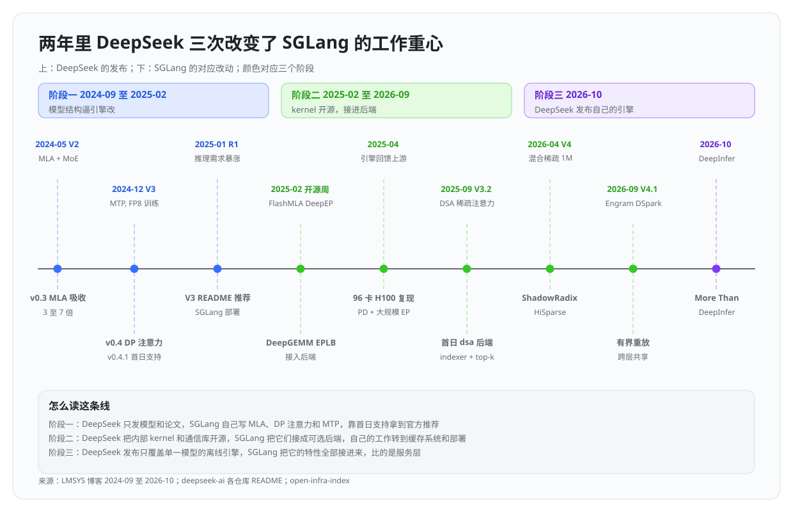
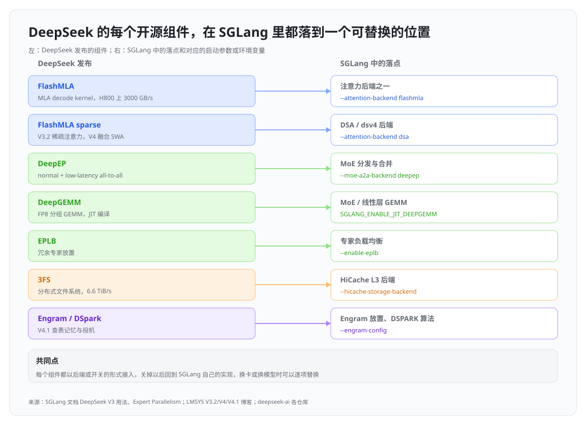
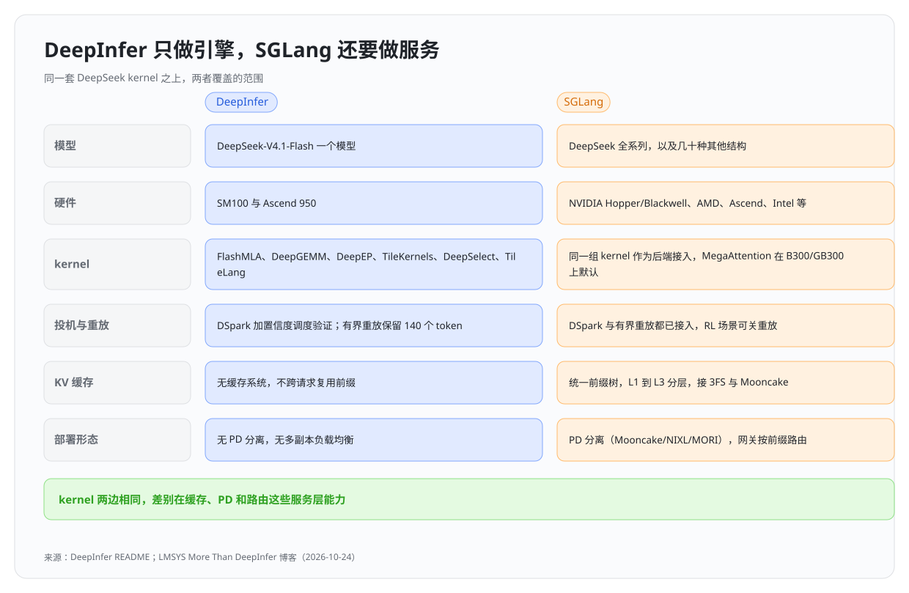
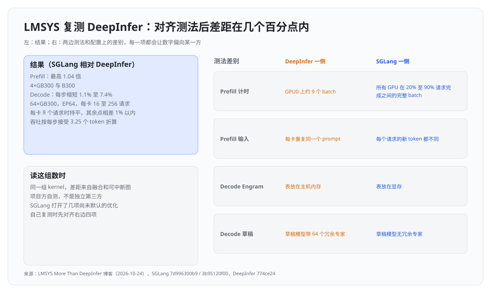

# SGL-21｜前沿｜DeepSeek 开源如何改写 SGLang：从 kernel 到 DeepInfer

> 🎯 <p><b>遇到的问题</b>：从 2024 年 5 月 DeepSeek-V2 发布 MLA，到 2026 年 10 月 DeepSeek 开源 DeepInfer，SGLang 的好几次大改动都能追到 DeepSeek 的某一次发布。</p><p>MLA 逼出了权重吸收和新的注意力后端，V3 的 MoE 规模逼出了 DP 注意力和大规模 EP，开源周的 FlashMLA、DeepEP、DeepGEMM 变成了可选后端，V4 的混合稀疏注意力又逼着缓存系统重写<a href="https://arxiv.org/abs/2405.04434">[1]</a><a href="https://arxiv.org/abs/2412.19437">[2]</a><a href="https://github.com/deepseek-ai/open-infra-index">[3]</a><a href="https://www.lmsys.org/blog/2026-04-25-deepseek-v4/">[4]</a>。DeepInfer 出来以后，问题换成了另一个：同一套 kernel 之上，SGLang 还多做了什么。</p><p><b>主线</b>：DeepSeek 先用模型结构逼 SGLang 改引擎，再开源 kernel 让它接进来，最后自己发了一个引擎；SGLang 从推荐引擎变成引擎加服务系统，比的是谁能把同一套 kernel 放进更完整的线上系统。</p><p><b>读完这一篇</b>：能说清 DeepSeek 每个开源组件在 SGLang 里落到哪个开关，关掉以后回到什么实现。能从 V4、V4.1 的 Day 0 博客里认出哪些改动进了缓存系统，哪些只对这一个模型有效。拿到 DeepInfer 和 SGLang 的对比数字，知道先对齐哪几项测法再下结论。</p><p><b>代码</b>：这一篇不另写模拟器，实验只用 sglang.benchmark.serving 和启动日志，压测方法沿用 [SGL-03｜上手｜指标与压测：TTFT、TPOT、ITL 与 goodput](./03-bench.md)。源码链接指向主干 8fabf5e，例如 MLA 注意力在 <a href="https://github.com/sgl-project/sglang/blob/8fabf5e/python/sglang/srt/models/deepseek_v2.py#L2013">deepseek_v2.py:2013</a>，DeepEP 分发在 <a href="https://github.com/sgl-project/sglang/blob/8fabf5e/python/sglang/srt/layers/moe/token_dispatcher/deepep.py#L983">deepep.py:983</a>，有界重放的开关在 <a href="https://github.com/sgl-project/sglang/blob/8fabf5e/python/sglang/srt/arg_groups/fields/exec_.py#L168">exec_.py:168</a>，Engram 的配置在 <a href="https://github.com/sgl-project/sglang/blob/8fabf5e/python/sglang/srt/arg_groups/engram_config.py#L41">engram_config.py:41</a>。数字来自 DeepSeek 官方仓库、LMSYS 博客和 DeepInfer README，大多是项目方自测。</p>

# 导读 · 结论先行

1. **模型结构先于 kernel 改写了引擎。**V2 的 MLA 让 v0.3 做了权重吸收，DeepSeek 模型的 decode 最多快 7 倍。V3 的 671B MoE 让 v0.4 加了 DP 注意力，v0.4.1 首日支持 V3，V3 的 README 把 SGLang 列为推荐的推理方式[[5]](https://www.lmsys.org/blog/2024-09-04-sglang-v0-3/)[[6]](https://www.lmsys.org/blog/2024-12-04-sglang-v0-4/)[[7]](https://github.com/sgl-project/sglang/releases/tag/v0.4.1)[[8]](https://github.com/deepseek-ai/DeepSeek-V3)。
2. **开源周交出了 kernel，SGLang 把它们接成后端。**FlashMLA、DeepEP、DeepGEMM、EPLB、3FS 各自落到一个开关上，关掉就回到 SGLang 自己的实现。LMSYS 用这套组件在 96 张 H100 上复现了 PD 分离加大规模 EP，每节点输入 52.3k、输出 22.3k tok/s。
3. **V4 把压力转到缓存系统。**滑窗加两种压缩注意力让一条请求同时持有几类长度不同的状态，ShadowRadix 用一棵树管住它们，10k token 的请求只留 128 个滑窗 token。V4.1 的 Engram、跨层共享和有界重放又加了新状态。这条线最后汇入了统一寻址。
4. **DeepInfer 只覆盖引擎这一层。**它只跑 V4.1-Flash，做离线推理，没有 KV 缓存系统、PD 分离和多副本负载均衡。LMSYS 把它的特性接进 SGLang 后复测，prefill 最高快 1.04 倍，decode 每步短 1.1% 至 7.4%。
5. **竞争点从 kernel 移到了服务层。**两边的 kernel 一样，差别在前缀缓存、PD、路由、多硬件和 RL 支持。读这类对比时先对齐测法，项目方自测的几个百分点不够决定选型。



时间线上方是 DeepSeek 的发布，下方是 SGLang 的对应改动，三种颜色对应三个阶段。阶段一里 DeepSeek 只发模型和论文，引擎侧的活全由 SGLang 自己做。阶段二里 kernel 和通信库开源，SGLang 的工作重心从写 kernel 转到接后端、做缓存和部署。阶段三里 DeepSeek 发了自己的引擎，两边开始在同一套 kernel 上比服务能力。

**📎 与系列其他文档的分工**：这一篇只讲 DeepSeek 带来的变化，各层机制默认已经熟悉。注意力后端的选择和 CUDA Graph 接入见 [SGL-10｜原理｜注意力后端：FlashInfer、FA3、Triton、TRTLLM 怎么选、怎么接进 CUDA Graph](./10-attention-backend.md)，TP、DP 注意力和 EP 的组合见 [SGL-11｜原理｜并行：TP、DP Attention、EP 怎么组合](./11-parallelism.md)，FP8 与 KV 量化见 [SGL-12｜原理｜量化：FP8、INT4 与 KV 量化怎么选](./12-quantization.md)，MTP 和投机解码的接受率见 [SGL-13｜原理｜投机解码：EAGLE、MTP、NGRAM 怎么选、怎么调](./13-speculative.md)，HiCache 三层缓存见 [SGL-14｜原理｜HiCache：显存、主机内存、远端存储三层 KV 缓存](./14-hicache.md)，PD 分离的传输见 [SGL-15｜原理｜PD 分离：prefill 和 decode 拆到两组卡上](./15-pd-disagg.md)，统一寻址和最近一个月的主干改动见 [SGL-20｜前沿｜42 天主干复盘：缓存寻址、PD 状态与投机解码的组合边界](./20-contrib.md)。

# 第 1 章 · 问题：一串 DeepSeek 专用开关，各自对应什么

部署 DeepSeek 模型时，SGLang 文档里会出现一串别的模型用不上的参数：--attention-backend flashmla、--moe-a2a-backend deepep、--enable-eplb、环境变量 SGLANG_ENABLE_JIT_DEEPGEMM，到了 V4.1 又多出 --engram-config 和 --speculative-algorithm DSPARK[[9]](https://docs.sglang.ai/basic_usage/deepseek_v3.html)[[10]](https://docs.sglang.io/docs/advanced_features/expert_parallelism)[[11]](https://docs.sglang.io/cookbook/autoregressive/DeepSeek/DeepSeek-V4_1)。每个参数背后都是 DeepSeek 的一次开源或一种模型结构。不知道它们的来历，就很难判断哪个能关、关了掉多少、换卡以后还能不能用。

我们在部署和评估时碰到的问题，大致是下面这些，每一个对应后文的一节：

- 同样是 MLA，Hopper 上默认后端是 FA3，换成 flashmla 以后 page size 被改成 64，前缀缓存的命中粒度跟着变了
- DeepEP 的 normal 和 low_latency 两种模式，PD 分离以后 prefill 和 decode 该各用哪种
- DeepSeek 公布每节点 decode 14.8k tok/s、理论利润率 545%，自己的集群差得很远，不知道差在哪
- V4 博客里的 ShadowRadix、HiSparse 和 HiCache、前缀树是什么关系
- V4.1 的有界重放默认开着，RL rollout 的 logprob 和训练端对不上
- DeepInfer 发布以后，有人说 DeepSeek 自己的引擎更快，要不要换

| 想弄清的现象 | 看哪一节 |
|-|-|
| MLA 为什么要专门的后端，DP 注意力解决什么 | 2.1 |
| 每个开源组件落到哪个开关，默认开没开 | 2.2、第 3 章 |
| DeepSeek 的线上数字和自己的差距从哪来 | 2.3 |
| V3.2 稀疏注意力、V4 ShadowRadix、HiSparse | 2.4、2.5 |
| V4.1 的 Engram、DSpark、有界重放 | 2.6、4.2 |
| DeepInfer 和 SGLang 的范围、复测结果和测法差别 | 2.7、2.8、4.3 |
| vLLM 在同一条线上怎么做 | 2.9 |

# 第 2 章 · 原理：三个阶段，三种影响方式

## 2.1 阶段一：模型结构逼引擎改

DeepSeek-V2 的 MLA 把每层的 K、V 压成一个低秩 latent，再加一小段带 RoPE 的键，V2 配置里是 512 加 64 维。论文报告相对 DeepSeek 67B，KV cache 降了 93.3%[[1]](https://arxiv.org/abs/2405.04434)。容量省下来了，计算却变了形状：按论文的写法，每一步都要先把 latent 升维成每个头的 K、V 再算注意力，decode 时这一步的访存比注意力本身还重。

SGLang v0.3 的做法是权重吸收：把 K 的升维矩阵并进 query 一侧，把 V 的升维矩阵并进输出投影，注意力直接在 512 维 latent 上算，所有头共享同一份 KV。配合分组 decode kernel、FP8 批量矩阵乘和 FP8 KV cache，DeepSeek 模型的 decode 吞吐比之前最多快 7 倍[[5]](https://www.lmsys.org/blog/2024-09-04-sglang-v0-3/)。这两块吸收后的权重在源码里叫 w_kc 和 w_vc（[deepseek_v2.py:2231](https://github.com/sgl-project/sglang/blob/8fabf5e/python/sglang/srt/models/deepseek_v2.py#L2231)）。从这时起，MLA 在 SGLang 里就有了独立于普通 MHA 的后端族。

V3 把总参数推到 671B，MLA 又带来一个并行上的问题：latent 只有一份，TP 按头切分时每张卡都得存完整的 latent KV，切得越多浪费越多。v0.4 的 DP 注意力让注意力部分按数据并行，每个 DP rank 只存自己那批请求的 KV，MoE 和 FFN 仍按 TP 或 EP 切，文档报告 decode 吞吐最高提升 1.9 倍[[6]](https://www.lmsys.org/blog/2024-12-04-sglang-v0-4/)[[9]](https://docs.sglang.ai/basic_usage/deepseek_v3.html)。参数现在叫 --attn-dp-size，旧的 --enable-dp-attention 还能用，代码里标了 2026 年底删除（[parallel.py:192](https://github.com/sgl-project/sglang/blob/8fabf5e/python/sglang/srt/arg_groups/fields/parallel.py#L192)）。

V3 训练时带了 MTP 模块，推理时可以直接当投机解码的草稿层用[[2]](https://arxiv.org/abs/2412.19437)[[12]](https://arxiv.org/abs/2404.19737)。SGLang 把它接进 EAGLE 框架（[deepseek_nextn.py:248](https://github.com/sgl-project/sglang/blob/8fabf5e/python/sglang/srt/models/deepseek_nextn.py#L248)），文档报告 batch 1 时快 1.8 倍、batch 32 时快 1.5 倍。2024 年 12 月 26 日的 v0.4.1 在 NVIDIA 和 AMD 上首日支持 V3，V3 的 README 在本地运行一节把 SGLang 列为推荐方式。

| DeepSeek 发布 | SGLang 的对应改动 | 效果（项目方报告） |
|-|-|-|
| V2，MLA（2024-05） | v0.3 权重吸收、分组 decode kernel、FP8 BMM 与 FP8 KV | DeepSeek 模型 decode 最多快 7 倍 |
| V3，671B MoE（2024-12） | v0.4 DP 注意力 | decode 吞吐最高 1.9 倍 |
| V3，MTP 模块 | MTP 作为 EAGLE 草稿 | batch 1 快 1.8 倍，batch 32 快 1.5 倍 |
| V3 发布当天 | v0.4.1 首日支持 NVIDIA 与 AMD | V3 README 列为推荐 |

这一阶段的特点是 DeepSeek 只给结构和论文，引擎侧的 kernel、并行方式和投机接入都由 SGLang 自己写。谁先把新结构跑快，谁就拿到模型方的推荐和第一批用户。

## 2.2 阶段二：kernel 开源，接成后端

2025 年 2 月 24 日起的开源周，DeepSeek 连续放出了 FlashMLA、DeepEP、DeepGEMM、DualPipe 与 EPLB、3FS[[3]](https://github.com/deepseek-ai/open-infra-index)。这些是 DeepSeek 自己线上在用的组件，对 SGLang 来说，它们正好补上了 MLA decode、MoE 通信和 FP8 GEMM 三块最难写的 kernel。

| 组件 | DeepSeek 报告的数字 | SGLang 中的位置 |
|-|-|-|
| FlashMLA | H800 上访存受限场景 3000 GB/s，计算受限 580 TFLOPS，page size 64[[13]](https://github.com/deepseek-ai/FlashMLA) | 注意力后端之一，--attention-backend flashmla |
| DeepEP | normal 模式面向 prefill 的高吞吐，low-latency 模式面向 decode，只走 RDMA[[14]](https://github.com/deepseek-ai/DeepEP) | MoE 分发与合并，--moe-a2a-backend deepep |
| DeepGEMM | FP8 细粒度缩放，核心约 300 行，JIT 编译，H800 上 1350+ TFLOPS[[15]](https://github.com/deepseek-ai/DeepGEMM) | MoE 与线性层 GEMM，默认开启 |
| EPLB | 按专家负载复制冗余专家并重新放置[[16]](https://github.com/deepseek-ai/EPLB) | --enable-eplb，--ep-num-redundant-experts |
| 3FS | 分布式文件系统，集群读吞吐 6.6 TiB/s[[17]](https://github.com/deepseek-ai/3FS) | HiCache 的 L3 后端之一 |



这些组件进 SGLang 的方式是同一个模式：作为可选后端或开关，关掉以后回到 SGLang 自己的实现。FlashMLA 是 MLA 后端族里的一员，Hopper 上默认仍是 FA3，选 flashmla 时 page size 固定为 64（[flashmla_backend.py:64](https://github.com/sgl-project/sglang/blob/8fabf5e/python/sglang/srt/layers/attention/flashmla_backend.py#L64)）。

DeepEP 的 --deepep-mode 默认 auto，decode batch 走 low_latency，prefill batch 走 normal（[exec\_.py:901](https://github.com/sgl-project/sglang/blob/8fabf5e/python/sglang/srt/arg_groups/fields/exec_.py#L901)）。DeepGEMM 由 SGLANG_ENABLE_JIT_DEEPGEMM 控制，默认为真（[environ.py:1358](https://github.com/sgl-project/sglang/blob/8fabf5e/python/sglang/srt/environ.py#L1358)），第一次遇到新形状时会 JIT 编译，冷启动要算进去。3FS 在 HiCache 的存储后端工厂里注册为 hf3fs（[backend_factory.py:194](https://github.com/sgl-project/sglang/blob/8fabf5e/python/sglang/srt/mem_cache/storage/backend_factory.py#L194)）。

留着回退路径有实际用处。FlashMLA、DeepEP 和 DeepGEMM 最初都只支持 NVIDIA Hopper，SGLang 要同时支持 AMD、Ascend 和更早的卡，每个组件都必须能单独换掉。换卡或换模型时，先逐项关掉 DeepSeek 组件对比，就能看出每一项各贡献了多少。

## 2.3 DeepSeek 的线上数字和 LMSYS 的复现

开源周第六天，DeepSeek 公布了 V3/R1 推理系统的概况[[18]](https://github.com/deepseek-ai/open-infra-index/blob/main/202502OpenSourceWeek/day_6_one_more_thing_deepseekV3R1_inference_system_overview.md)。prefill 用 4 个节点组成 EP32，decode 用 18 个节点组成 EP144，用双 micro-batch 让通信和计算重叠。24 小时统计里峰值占用 278 个节点，日成本约 87,072 美元。

输入 6080 亿 token，其中 56.3% 命中磁盘上的 KV cache；平均每个 H800 节点 prefill 约 73.7k tok/s（含缓存命中），decode 约 14.8k tok/s。按 R1 定价算出的理论利润率是 545%，文中同时说明实际收入低得多，因为 V3 定价更低、网页和 App 免费、夜间还有折扣。

2025 年 5 月，LMSYS 用 12 个节点共 96 张 H100 复现了这套部署：PD 分离，prefill 和 decode 都用大规模 EP，接入 DeepEP、DeepGEMM 和 EPLB[[19]](https://www.lmsys.org/blog/2025-05-05-large-scale-ep/)。2000 token 输入时，每节点输入 52.3k tok/s、输出 22.3k tok/s，按自建成本折算每百万输出 token 约 0.20 美元，比同规模 TP 最多快 5 倍。稠密 FFN 层没有用 TP 切，原因是 18432 除以 32 等于 576，不是 128 的倍数，DeepGEMM 的块对不齐，就改成了 DP。

这两组数不能直接比。DeepSeek 的数来自真实线上流量，上下文更长、缓存命中率很高，LMSYS 的是固定 2000 token 输入的压测。自己的集群差得远时，先比输入长度分布、缓存命中率和 EP 规模，三项对齐之前比单节点 tok/s 没有意义。

2025 年 4 月，DeepSeek 说明了不开源内部推理引擎的原因：这个引擎早期从 vLLM 分叉，之后改动很大，又依赖内部基础设施，团队也没有精力长期维护一个公开项目[[20]](https://github.com/deepseek-ai/open-infra-index/blob/main/OpenSourcing_DeepSeek_Inference_Engine/README.md)。他们选择把可复用的组件和优化贡献给上游开源引擎，并承诺新模型发布时在上游做到首日支持。从结果看，之后 V3.2、V4、V4.1 的 Day 0 支持都在 SGLang 里落地了。

## 2.4 V3.2：稀疏注意力进了后端

2025 年 9 月 29 日的 V3.2 引入 DSA：先用一个轻量的 lightning indexer 给历史 token 打分，再让每个 query 只对 top-k 个 token 做注意力，长上下文下的复杂度从 O(L²) 降到 O(Lk)[[21]](https://www.lmsys.org/blog/2025-09-29-deepseek-V32/)。SGLang 首日给出了 dsa 注意力后端，indexer 的 KV 按 page 64 管理，稀疏注意力按 page 1 取 token，kernel 用 FlashMLA 和 FA3 的稀疏版本，并在 H200、MI350 和昇腾 NPU 上同时跑通。

后端名起初叫 nsa，现在统一为 dsa，nsa 保留为已弃用的别名（[choices.py:74](https://github.com/sgl-project/sglang/blob/8fabf5e/python/sglang/srt/arg_groups/choices.py#L74)）。这一次 DeepSeek 在发布模型的同时开源了稀疏 kernel，SGLang 的工作集中在调度和缓存一侧：indexer 和主 KV 两套 page 粒度不同，前缀缓存要同时管住两者。

## 2.5 V4：一条请求里的几类状态

2026 年 4 月的 V4 分 Pro（1.6T）和 Flash（284B）两档，支持 1M 上下文[[4]](https://www.lmsys.org/blog/2026-04-25-deepseek-v4/)。每层注意力由三部分组成：最近 128 个 token 的滑窗注意力，加上两种压缩注意力之一，C4 把 4 个 token 压成 1 个再取 top-512 稀疏，C128 把 128 个 token 压成 1 个做稠密注意力。于是一条请求同时持有长度固定的滑窗 KV、约为 L/4 的 C4 KV 和约为 L/128 的 C128 KV，还有 indexer 的键。

前缀树原本只认一种按 token 对齐的 KV。ShadowRadix 的做法是在虚拟的全长 token 槽位上建一棵树，每个物理池在树上有一份影子。token 滑出窗口后，它的滑窗槽位被打上墓碑并释放，C4 和 C128 的影子仍留在树上供后续请求共享（[unified_hybrid_swa.py:601](https://github.com/sgl-project/sglang/blob/8fabf5e/python/sglang/srt/mem_cache/allocator/unified_hybrid_swa.py#L601)）。

节点上有两个引用计数，full_lock_ref 管全长部分，swa_lock_ref 管滑窗部分。一条 10k token 的请求，滑窗只占 128 个 token 的物理空间。滑窗用环形槽位，地址是 swa_page × ring_size + pos % ring_size，开投机解码时环要加倍，C4 从 8 变 16，C128 从 128 变 256。

HiSparse 只把 C4 的 KV 卸到主机内存，滑窗和 C128 留在显存，在 2 张 B200、200K 输入、20K 输出时最多快 3 倍（[hisparse.py:302](https://github.com/sgl-project/sglang/blob/8fabf5e/python/sglang/srt/mem_cache/allocator/hisparse.py#L302)）。它和 [SGL-14｜原理｜HiCache：显存、主机内存、远端存储三层 KV 缓存](./14-hicache.md) 的 HiCache 管的是两件事：HiCache 按前缀整段搬运，HiSparse 按稀疏选择的结果按需取回。

V4 的 Day 0 还带来一批专用 kernel。Flash Compressor 把压缩时的 HBM 往返从 5 次降到 2 次，用到约 80% 的带宽，比原实现快 10 倍以上。Lightning TopK 在 256K 候选上约 15 µs，原实现要 100 µs 以上。DeepGEMM 的 Mega MoE 把分发、两次 GEMM、SwiGLU 和合并融成一个 kernel。MTP 的元数据放进 CUDA Graph 以后，上下文从 4K 拉到 900K，decode 吞吐降不到 10%：B200 从 199 降到 180 tok/s，H200 从 266 降到 240 tok/s。

## 2.6 V4.1：Engram、跨层共享和有界重放

2026 年 9 月的 V4.1 又加了三类东西[[22]](https://www.lmsys.org/blog/2026-09-10-deepseek-v41/)[[11]](https://docs.sglang.io/cookbook/autoregressive/DeepSeek/DeepSeek-V4_1)。跨层共享让少数源层的 KV 和 indexer 结果被后面的层复用，KV 有 4 个源层，indexer 有 8 个；第 20 层发布 2,048 个块，每块 8 个位置，总预算 16,384 个位置。Engram 是放在第 1 层和第 14 层的查表记忆，fp8 的表共 189 GiB。把表放到主机内存，4 张 GB300 上可用 KV 多出 36%，28 条贪心生成和放显存时逐字一致。

有界重放针对缓存命中后的重算。encoder 一侧命中前缀时只重算最后 128 个 token 来重建滑窗；decoder 一侧第 0 至 20 层算全部 token，第 21 至 39 层只算最后不超过 128 个 token（[deepseek_v4_replay_tail.py:136](https://github.com/sgl-project/sglang/blob/8fabf5e/python/sglang/srt/models/deepseek_v4_replay_tail.py#L136)）。

8 张 H200 上快 1.56 倍，4 张 GB300 上快 1.37 倍，AIME 开关前后都是 453/480。它在数值上和完整 prefill 不等价，开关说明里写明了这一点，并建议 RL rollout 用 --no-enable-decoder-swa-bounded-replay 保留完整 prefill（[exec\_.py:173](https://github.com/sgl-project/sglang/blob/8fabf5e/python/sglang/srt/arg_groups/fields/exec_.py#L173)）。

DSpark 是 V4.1 配套的投机算法，SGLang 里是 SpeculativeAlgorithm.DSPARK（[spec_info.py:41](https://github.com/sgl-project/sglang/blob/8fabf5e/python/sglang/srt/speculative/spec_info.py#L41)），--speculative-dspark-block-size 设草稿块大小 γ，验证窗口是 γ+1（[spec.py:78](https://github.com/sgl-project/sglang/blob/8fabf5e/python/sglang/srt/arg_groups/fields/spec.py#L78)）。Miles 用 SGLang 做 rollout 时，V4.1 的训推 KL 在 0.0012 至 0.0017 之间。

从 V4 到 V4.1，模型每多一种状态，前缀树、分配器和 PD 传输就要多认一种。ShadowRadix 的虚拟槽位加物理影子，后来推广成 [SGL-20｜前沿｜42 天主干复盘：缓存寻址、PD 状态与投机解码的组合边界](./20-contrib.md) 讲的统一寻址：普通 KV、滑窗、Mamba 状态和草稿 KV 都收进同一套槽位。DeepSeek 的模型结构在这里推动的是缓存系统的整体设计，影响面超出了这一个模型。

## 2.7 阶段三：DeepInfer 只做引擎

2026 年 10 月，DeepSeek 开源了 DeepInfer，Apache-2.0 协议[[23]](https://github.com/deepseek-ai/DeepInfer)。按 README，它只支持 DeepSeek-V4.1-Flash，做离线推理，硬件是 NVIDIA SM100 和昇腾 950。

kernel 用 FlashMLA、DeepGEMM、DeepEP、TileKernels、DeepSelect 和 TileLang，注意力用 DP 或均衡 CP，MoE 用 EP 加 EPLB。功能上有 DSpark 加按置信度调度的验证、有界重放（保留最后 140 个 token，要覆盖滑窗加最大回退长度）、异步调度、batch 不变模式和确定性采样（后两项仅 NVIDIA）、结构化输出。

README 也列了没有做的部分：没有 KV 缓存系统，不跨请求复用前缀。也没有 VE/P/D 分离和多副本之间的负载均衡。它写明最初主要基于 vLLM 构建，也参考了 SGLang 和 TensorRT-LLM，并把异步调度的思路归功于 SGLang。



媒体报道里还有几条补充：DeepSeek 线上每天处理约 155 万亿 token，prefill 用 EP2 至 8，decode 用 EP64 至 128。DSpark 让需要验证的 token 少约 30%，吞吐多 4% 至 7%。公开版 FlashMLA 比内部版慢 5% 至 10%，端到端差距在 5% 以内[[24]](https://ccleaks.com/news/deepseek-deepinfer-open-source-inference-oct-2026)。这些数没有官方出处，只作参考。

把 DeepInfer 放回两年的时间线上看，它覆盖的是 DeepSeek 自己线上最需要的那部分：一个模型、两种硬件、最快的 kernel 组合。缓存、PD、路由这些服务层能力，DeepSeek 内部另有系统，没有放进这个仓库。

## 2.8 LMSYS 复测：对齐测法后差距在几个百分点内

10 月 24 日，LMSYS 发文说明已把 DeepInfer 的特性接进 SGLang，并用 DeepInfer 自己的基准做了对比[[25]](https://www.lmsys.org/blog/2026-10-24-dsv41-deepinfer)。接入的部分包括 Mega 系列 kernel（MegaAttention 在 B300 和 GB300 上默认开启）、DEP4 prefill 与 DEP64 decode、DSpark、两侧有界重放、两种 Engram 放置，以及按 deepseek-recipe 渲染对话（[deepseek_recipe_renderer.py](https://github.com/sgl-project/sglang/blob/8fabf5e/python/sglang/srt/parser/deepseek_recipe_renderer.py)）。

Engram 的放置由环境变量控制：SGLANG_ENABLE_DSV41_ENGRAM_HOST_TABLE 每节点在主机内存放一份，SGLANG_OPT_DSV41_ENGRAM_PEER_SHARDS 把表切到各卡上通过 NVLink 互读（[environ.py:1848](https://github.com/sgl-project/sglang/blob/8fabf5e/python/sglang/srt/environ.py#L1848)）。



结果是 prefill 最高 1.04 倍：4 张 GB300 上 4K、32K、64K 领先，8K、16K 持平；4 张 B300 上 4K、8K、32K 领先，16K、64K 持平。decode 在 64 张 GB300、EP64 上，每卡 16 至 256 个请求时每步短 1.1% 至 7.4%，每卡 8 个请求时持平，吞吐按每步接受 3.25 个 token 折算。SGLang 给出的原因是 Mega-mHC 直接喂给 MegaMoE、注意力直接输出 MXFP8、压缩器和 KV 拷贝融合，以及每卡 8K 以内的 prefill 用可中断的 CUDA Graph。

这组数要和测法一起读。prefill 的计时，DeepInfer 只看 GPU0 上约 9 个 batch，SGLang 统计所有 GPU 在 20% 至 90% 请求完成之间的完整 batch。输入上，DeepInfer 每卡重复同一个 prompt，SGLang 每个请求的新 token 都不同。

decode 的 Engram，DeepInfer 放主机内存，SGLang 放显存；草稿模型 DeepInfer 带 64 个冗余专家，SGLang 不带。SGLang 一侧还打开了几项尚未默认的优化。复测提交是 SGLang 7d996300b9（prefill）和 3b95120f00（decode），DeepInfer 774ce24。

这是项目方的自测，社区文章的转述也基于同一组数[[26]](https://dev.to/echakiri/sglang-runs-deepseeks-own-benchmarks-against-deepinfer-and-matches-it-1dfb)。几个百分点的差距落在测法差异能解释的范围里，能确认的结论只有一条：同一套 kernel 之上，两边的单模型引擎性能相当。

## 2.9 vLLM 怎么做

vLLM 和这条线的关系更早：DeepSeek 内部引擎和 DeepInfer 都从 vLLM 起步。vLLM 同样接入了 DeepSeek 的组件，专家并行文档里有 DeepEP 的两种 all-to-all 后端和 EPLB，PD 分离通过 NixlConnector 等连接器实现，注意力部分也有 FlashMLA 后端[[27]](https://docs.vllm.ai/en/latest/serving/expert_parallel_deployment.html)[[28]](https://docs.vllm.ai/en/latest/serving/data_parallel_deployment.html)[[29]](https://docs.vllm.ai/en/latest/features/disagg_prefill.html)[[30]](https://docs.vllm.ai/en/latest/features/nixl_connector_usage.html)。

| 维度 | SGLang | vLLM | 差异的代价 |
|-|-|-|-|
| MLA 与 DP 注意力 | v0.3 起权重吸收，v0.4 起 DP 注意力，--attn-dp-size | 支持 MLA 吸收和注意力 DP，通过数据并行部署配置 | 两边都要按 DP 规模算 KV 容量，参数名不同，迁移时逐项对照 |
| DeepEP 与 EPLB | --moe-a2a-backend deepep，--deepep-mode auto 按 batch 类型切换 | all-to-all 后端选 DeepEP 的高吞吐或低延迟版，--enable-eplb | SGLang 的 auto 按 batch 自动选；vLLM 的后端选择更接近按部署角色固定 |
| PD 分离 | Mooncake、NIXL、MORI 传输，网关按前缀路由 | NixlConnector 等 KV 连接器 | 传输层可以对齐，前缀路由和缓存分层的实现不同 |
| DeepSeek Day 0 | V3.2、V4、V4.1 均有 LMSYS Day 0 博客与 cookbook | V3.2 等版本也有首日支持 | 首日能跑通和首日有完整部署配方是两件事，看 cookbook 覆盖的硬件与特性组合 |

对使用者来说，DeepSeek 组件在两个引擎里都是可插拔的，选哪个引擎主要取决于缓存、PD 和路由这些服务层能力，以及团队已有的运维经验。

# 第 3 章 · 源码：从 DeepSeek 组件追到 SGLang 的判定逻辑

下表按组件列出入口位置。读的时候先找开关在哪里被解析，再找它在哪里回退到默认实现，这两处决定了“开了但没生效”时去哪里查。

| 位置 | 是什么 | 读的时候盯什么 |
|-|-|-|
| [deepseek_v2.py:2013](https://github.com/sgl-project/sglang/blob/8fabf5e/python/sglang/srt/models/deepseek_v2.py#L2013) | DeepseekV2AttentionMLA | absorb 路径和 normal 路径的分支条件，prefill 与 decode 走哪条 |
| [deepseek_v2.py:2231](https://github.com/sgl-project/sglang/blob/8fabf5e/python/sglang/srt/models/deepseek_v2.py#L2231) | w_kc、w_vc | 吸收后的权重何时生成，量化格式下怎样处理 |
| [deepseek_nextn.py:248](https://github.com/sgl-project/sglang/blob/8fabf5e/python/sglang/srt/models/deepseek_nextn.py#L248) | DeepseekV3ForCausalLMNextN | MTP 草稿层复用目标模型哪些权重 |
| [flashmla_backend.py:64](https://github.com/sgl-project/sglang/blob/8fabf5e/python/sglang/srt/layers/attention/flashmla_backend.py#L64) | FlashMLABackend | 继承自 FlashInfer MLA 后端，元数据怎样准备，page size 64 的约束 |
| [dsa_backend.py:492](https://github.com/sgl-project/sglang/blob/8fabf5e/python/sglang/srt/layers/attention/dsa_backend.py#L492) | DeepseekSparseAttnBackend | indexer 与主 KV 两套 page 粒度 |
| [choices.py:74](https://github.com/sgl-project/sglang/blob/8fabf5e/python/sglang/srt/arg_groups/choices.py#L74) | 注意力后端的可选值 | dsa 与已弃用别名 nsa |
| [deepep.py:983](https://github.com/sgl-project/sglang/blob/8fabf5e/python/sglang/srt/layers/moe/token_dispatcher/deepep.py#L983) | DeepEPDispatcher | normal 与 low_latency 两个实现（548、746 行）怎样按 batch 选 |
| [exec\_.py:839](https://github.com/sgl-project/sglang/blob/8fabf5e/python/sglang/srt/arg_groups/fields/exec_.py#L839) | --moe-a2a-backend | deepep、mooncake、nixl、mori、megamoe 等可选值 |
| [configurer.py:35](https://github.com/sgl-project/sglang/blob/8fabf5e/python/sglang/srt/layers/deep_gemm_wrapper/configurer.py#L35) | DeepGEMM 的启用判断 | SGLANG_ENABLE_JIT_DEEPGEMM 为假时回退到哪条 GEMM 路径 |
| [eplb_manager.py:96](https://github.com/sgl-project/sglang/blob/8fabf5e/python/sglang/srt/eplb/eplb_manager.py#L96) | EPLBManager.rebalance | 冗余专家多久重排一次，重排时是否阻塞服务 |
| [backend_factory.py:194](https://github.com/sgl-project/sglang/blob/8fabf5e/python/sglang/srt/mem_cache/storage/backend_factory.py#L194) | hf3fs 存储后端 | 3FS 作为 HiCache L3 的注册方式 |
| [unified_hybrid_swa.py:601](https://github.com/sgl-project/sglang/blob/8fabf5e/python/sglang/srt/mem_cache/allocator/unified_hybrid_swa.py#L601) | 滑窗墓碑路径 | 释放滑窗物理槽位、保留虚拟号 |
| [hisparse.py:302](https://github.com/sgl-project/sglang/blob/8fabf5e/python/sglang/srt/mem_cache/allocator/hisparse.py#L302) | DeepSeekV4HiSparseTokenToKVPoolAllocator | 只卸载 C4 KV 的分配逻辑 |
| [deepseek_v4.py:4623](https://github.com/sgl-project/sglang/blob/8fabf5e/python/sglang/srt/models/deepseek_v4.py#L4623) | DeepseekV4ForCausalLM | V4 与 V4.1 共用的模型入口 |
| [deepseek_v4_replay_tail.py:136](https://github.com/sgl-project/sglang/blob/8fabf5e/python/sglang/srt/models/deepseek_v4_replay_tail.py#L136) | DecoderReplayTail | decoder 一侧有界重放怎样只算尾部 token |
| [exec\_.py:168](https://github.com/sgl-project/sglang/blob/8fabf5e/python/sglang/srt/arg_groups/fields/exec_.py#L168) | 两侧有界重放开关 | encoder 默认关，decoder 对支持的配置默认开 |
| [engram_config.py:41](https://github.com/sgl-project/sglang/blob/8fabf5e/python/sglang/srt/arg_groups/engram_config.py#L41) | EngramConfig | placement、replication、lookup 三项及其互相约束 |
| [deepseek_v4_hook.py:166](https://github.com/sgl-project/sglang/blob/8fabf5e/python/sglang/srt/arg_groups/deepseek_v4_hook.py#L166) | V4 注意力后端解析 | auto 何时解析为 flashmla_mega，何时退回 flashmla |
| [spec_info.py:41](https://github.com/sgl-project/sglang/blob/8fabf5e/python/sglang/srt/speculative/spec_info.py#L41) | SpeculativeAlgorithm.DSPARK | DSpark 与 EAGLE、MTP 共用的投机框架 |

Engram 的配置校验里有一条容易踩：lookup 设为 peer_read 时会直接报错，除非 placement 是 gpu，因为互读的对象是各卡上的分片（[engram_config.py:58](https://github.com/sgl-project/sglang/blob/8fabf5e/python/sglang/srt/arg_groups/engram_config.py#L58)）。V4 注意力后端的 auto 规则也写在开关说明里：不支持 flashmla_mega 的卡，或者非 PD 场景下注意力 TP 大于 1 时，解析为 flashmla，其余情况用 flashmla_mega，而 flashmla_mega 要求 V4.1 加 SM100 或 SM103（[deepseek_v4_hook.py:173](https://github.com/sgl-project/sglang/blob/8fabf5e/python/sglang/srt/arg_groups/deepseek_v4_hook.py#L173)）。

# 第 4 章 · 实验：逐项关掉 DeepSeek 组件，再对齐测法

## 4.1 V3 上逐项关掉组件

先在 8 卡 Hopper 上起一个 V3 或 R1 的基线，再一次只改一项，看每个组件的贡献。注意力后端和 DeepGEMM 可以单卡组内对比，DeepEP 需要开 EP：

```bash
# 基线：DP 注意力 + 默认 MLA 后端
sglang serve MODEL_PATH --tp 8 --attn-dp-size 8 --enable-dp-lm-head

# 换 FlashMLA，page size 会被固定为 64
sglang serve MODEL_PATH --tp 8 --attn-dp-size 8 --enable-dp-lm-head \
  --attention-backend flashmla

# 关 DeepGEMM
SGLANG_ENABLE_JIT_DEEPGEMM=0 sglang serve MODEL_PATH --tp 8 --attn-dp-size 8 --enable-dp-lm-head

# 打开 DeepEP 与 EPLB
sglang serve MODEL_PATH --tp 8 --attn-dp-size 8 --enable-dp-lm-head \
  --ep 8 --moe-a2a-backend deepep --deepep-mode auto \
  --enable-eplb --ep-num-redundant-experts 32
```

每组用同一份负载压测，记录启动日志里的 max_total_num_tokens、实际选中的注意力后端、TTFT 和 decode 吞吐。DeepGEMM 第一次遇到新形状会 JIT 编译，压测前先预热，否则首轮数据会被编译时间拖低。

```bash
python -m sglang.benchmark.serving --backend sglang \
  --dataset-name random --random-input-len 2000 --random-output-len 500 \
  --random-range-ratio 1.0 --num-prompts 2000 --max-concurrency 256
```

输入固定 2000 token，是为了和 LMSYS 96 卡复现的输入长度对齐，方便判断自己的结果在不在同一量级。

## 4.2 V4.1：DSpark、Engram 放置和有界重放

V4.1 的 cookbook 建议不要手动覆盖注意力和 MoE 后端，GB300 上会自动解析为 dsv4、flashinfer_mxfp4 和 flashinfer_cutedsl。要调的是投机、Engram 和重放三项：

```bash
# DSpark 投机，草稿块大小 5
sglang serve MODEL_PATH --tp 4 \
  --speculative-algorithm DSPARK --speculative-dspark-block-size 5

# Engram 表放主机内存，换更多 KV 容量
sglang serve MODEL_PATH --tp 4 \
  --speculative-algorithm DSPARK --speculative-dspark-block-size 5 \
  --engram-config '{"placement":"cpu"}'

# Engram 留在显存，按 NVLink 互读分片
sglang serve MODEL_PATH --tp 4 \
  --speculative-algorithm DSPARK --speculative-dspark-block-size 5 \
  --engram-config '{"placement":"gpu","lookup":"peer_read"}'

# RL rollout：关掉 decoder 一侧有界重放，保留完整 prefill
sglang serve MODEL_PATH --tp 4 --no-enable-decoder-swa-bounded-replay
```

前三组对比 max_total_num_tokens 和 decode 吞吐，看主机放置多出的 KV 容量能不能抵掉查表变慢的代价。第四组和默认配置各跑一次同一批 prompt，比较 prompt logprob 和训练端的差异。cookbook 还提到，这个后端会拒绝 --enable-deterministic-inference。DSpark 加 PD 分离时，必须用 Mooncake 或 NIXL 传输、静态验证、CP 为 1。B300 和 GB300 上 MegaAttention 可以用 --dsv4-attn-backend flashmla_mega 显式指定。

## 4.3 复测 DeepInfer 时对齐什么

想在自己的环境复测两边，先按 2.8 节的四项把测法对齐，再加两项配置：投机的草稿 token 数和验证方式，冗余专家数。decode 用共享前缀的负载更接近 LMSYS 的设置：

```bash
python -m sglang.benchmark.serving --backend sglang \
  --dataset-name generated-shared-prefix \
  --gsp-num-groups 64 --gsp-prompts-per-group 16 \
  --gsp-system-prompt-len 120000 --gsp-question-len 4000 --gsp-output-len 1000
```

prefill 统计所有 GPU 的完整 batch，避开开头和结尾的不满载区间；每个请求的新 token 要不同，否则重复 prompt 会让某些路径受益。两边的 Engram 放在同一个位置，草稿模型的冗余专家数一致。把这几项写进复测报告，结论才可复查。

# 第 5 章 · 调过的开关和踩过的坑

## 5.1 踩过的坑

> 💡 **踩过的坑**：**以为 MLA 模型默认就用 FlashMLA。**Hopper 上 MLA 默认后端是 FA3。手动换成 flashmla 后 page size 固定为 64，前缀缓存的命中粒度跟着变粗，短前缀业务的命中率会掉。现在先看启动日志里实际选中的后端和 page size，再决定换不换。

> 💡 **踩过的坑**：**DeepGEMM 的 JIT 编译算进了压测。**第一次遇到新的 GEMM 形状要现场编译，首轮压测的 TTFT 被拉高一截，看起来像 DeepGEMM 比回退路径慢。后来固定先跑一轮预热。

> 💡 **踩过的坑**：**拿 545% 和 14.8k tok/s 当目标。**545% 是按 R1 定价算的理论值，DeepSeek 自己写明实际收入低得多。14.8k tok/s 是线上长上下文、高缓存命中下的平均数。对齐输入长度和命中率之前，这两个数不适合当目标。

> 💡 **踩过的坑**：**V4.1 的 RL rollout 没关有界重放。**decoder 一侧的有界重放对支持的配置默认开启，数值上和完整 prefill 不等价，rollout 的 logprob 和训练端对不上。RL 场景加 --no-enable-decoder-swa-bounded-replay。

> 💡 **踩过的坑**：**Engram 设了 peer_read 却放在主机内存。**服务直接起不来，报错说 peer_read 读的是 GPU 分片，需要 placement 为 gpu。两项要一起改。

> 💡 **踩过的坑**：**拿 LMSYS 和 DeepInfer 两边的数直接比。**两边的 prefill 计时窗口、输入是否重复、Engram 放置、冗余专家数都不同。只看结论里的倍数，会把测法差异当成引擎差异。

## 5.2 我们的看法

DeepSeek 对 SGLang 的影响，前后换了三种方式。最早是模型结构，MLA、大规模 MoE 和 MTP 让引擎必须改，SGLang 靠首日支持拿到了推荐。然后是 kernel，开源周把最难写的几块直接给了出来，SGLang 的工作从写 kernel 转到接后端、做部署。最近是引擎，DeepInfer 把 DeepSeek 自己认为最好的单模型推理路径公开了。

kernel 开源以后，引擎之间在 DeepSeek 模型上的单机性能差距会越来越小。DeepInfer 的复测已经说明了这一点：同一组 kernel，差距只剩融合和调度上的几个百分点，而且在测法差异的范围内。能拉开差距的是 kernel 之外的部分，前缀缓存跨请求复用、PD 分离、按前缀路由、多硬件支持、RL 训推一致，这些 DeepInfer 都没有覆盖。

V4 和 V4.1 的意义比单个模型大。混合稀疏注意力、Engram、跨层共享让一条请求的状态从一种变成好几种，ShadowRadix 和后来的统一寻址就是为了管住这些状态。以后别的模型方再出新的注意力结构，SGLang 要改的地方会少很多。从这个角度看，DeepSeek 的模型在替 SGLang 提前做压力测试。

接下来要盯的是 DeepSeek 下一代模型还在不在 SGLang 上做 Day 0，DeepInfer 会不会补上缓存和 PD，以及新开源的 kernel 是否继续先在 SGLang 里成为默认后端。如果 DeepInfer 开始做服务层，两边的关系会从上下游变成直接竞争。

# 第 6 章 · 部署 DeepSeek 模型前的核对

> 📌 **上线前逐条核对**
> - 启动日志里确认实际选中的注意力后端和 page size，和预期一致
> - 压测前预热过 DeepGEMM 的 JIT 编译，首轮数据不计入结果
> - 开 DeepEP 时确认 --deepep-mode 的选择；PD 分离下 prefill 和 decode 各自用的模式清楚
> - 用 EPLB 时冗余专家数与显存预算匹配，重排周期内的延迟抖动在 SLO 内
> - 和 DeepSeek 或 LMSYS 的数字对比前，先对齐输入长度、缓存命中率和 EP 规模
> -  V4.1 的 RL rollout 关掉了 decoder 一侧有界重放，logprob 与训练端核对过
> -  Engram 的 placement 和 lookup 搭配合法，主机放置换来的 KV 容量有压测数据支撑
> - 复测 DeepInfer 或其他引擎时，计时窗口、输入是否重复、Engram 放置、冗余专家数四项已对齐并写进报告

> 🔑 **学到的**：两年里 DeepSeek 用三种方式改变了 SGLang。模型结构先行，MLA 逼出权重吸收和专门的后端族，671B MoE 逼出 DP 注意力和大规模 EP，SGLang 靠首日支持拿到推荐。开源周交出 FlashMLA、DeepEP、DeepGEMM、EPLB 和 3FS，每个都以后端或开关的形式接入，关掉能回到 SGLang 自己的实现，工作重心转到缓存和部署。V4、V4.1 的混合稀疏注意力和 Engram 让一条请求持有几类状态，ShadowRadix 管住了它们，后来推广成统一寻址。DeepInfer 只覆盖单模型引擎，对齐测法后两边差距在几个百分点内，差别在缓存、PD 和路由这些服务层能力。读任何引擎对比，先对齐测法，再看倍数。

这一篇用两年时间线回看了前面各章讲过的机制：[SGL-10｜原理｜注意力后端：FlashInfer、FA3、Triton、TRTLLM 怎么选、怎么接进 CUDA Graph](./10-attention-backend.md) 的注意力后端、[SGL-11｜原理｜并行：TP、DP Attention、EP 怎么组合](./11-parallelism.md) 的并行组合、[SGL-13｜原理｜投机解码：EAGLE、MTP、NGRAM 怎么选、怎么调](./13-speculative.md) 的投机解码、[SGL-14｜原理｜HiCache：显存、主机内存、远端存储三层 KV 缓存](./14-hicache.md) 的分层缓存、[SGL-15｜原理｜PD 分离：prefill 和 decode 拆到两组卡上](./15-pd-disagg.md) 的 PD 分离、[SGL-20｜前沿｜42 天主干复盘：缓存寻址、PD 状态与投机解码的组合边界](./20-contrib.md) 的统一寻址，几乎每一层都有一部分是被 DeepSeek 的某次发布推着改的。下一篇 [SGL-22｜实战｜DeepSeek-V4.1-Flash：消费级显卡与 H20 上的 SGLang 部署](./22-dsv41-deploy.md) 把其中的 Engram 配置、有界重放和 DSpark 落到消费级显卡和 H20 的启动命令上。之后模型方再有新的开源，可以照同样的方法去读：它发了什么，SGLang 改了哪一层，那一层由哪个开关控制。

# 参考文献

按正文首次引用顺序编号，资料截至 2026 年 10 月底。源码行号以 sgl-project/sglang 主干提交 8fabf5e 为准。DeepInfer 的数据以其 README 和 LMSYS 2026-10-24 博客为准，复测提交为 SGLang 7d996300b9 与 3b95120f00、DeepInfer 774ce24。媒体报道的数字没有官方出处，正文已注明。除特别说明外，性能数据由项目方或合作方发布，不是独立第三方评测。

[1] DeepSeek-AI. DeepSeek-V2: A Strong, Economical, and Efficient Mixture-of-Experts Language Model. arXiv (2024) [https://arxiv.org/abs/2405.04434](https://arxiv.org/abs/2405.04434)

[2] DeepSeek-AI. DeepSeek-V3 Technical Report. arXiv (2024) [https://arxiv.org/abs/2412.19437](https://arxiv.org/abs/2412.19437)

[3] deepseek-ai. open-infra-index: Open Source Week (2025-02). GitHub [https://github.com/deepseek-ai/open-infra-index](https://github.com/deepseek-ai/open-infra-index)

[4] LMSYS. SGLang and Miles Day-0 Support for DeepSeek-V4. LMSYS Blog (2026-04-25) [https://www.lmsys.org/blog/2026-04-25-deepseek-v4/](https://www.lmsys.org/blog/2026-04-25-deepseek-v4/)

[5] LMSYS. SGLang v0.3 Release. LMSYS Blog (2024-09-04) [https://www.lmsys.org/blog/2024-09-04-sglang-v0-3/](https://www.lmsys.org/blog/2024-09-04-sglang-v0-3/)

[6] LMSYS. SGLang v0.4: Zero-Overhead Batch Scheduler, Cache-Aware Load Balancer, Faster Structured Outputs. LMSYS Blog (2024-12-04) [https://www.lmsys.org/blog/2024-12-04-sglang-v0-4/](https://www.lmsys.org/blog/2024-12-04-sglang-v0-4/)

[7] sgl-project/sglang. Release v0.4.1: day-one DeepSeek-V3 support (2024-12-26) [https://github.com/sgl-project/sglang/releases/tag/v0.4.1](https://github.com/sgl-project/sglang/releases/tag/v0.4.1)

[8] deepseek-ai. DeepSeek-V3 README §6 How to Run Locally. GitHub [https://github.com/deepseek-ai/DeepSeek-V3](https://github.com/deepseek-ai/DeepSeek-V3)

[9] SGLang 文档. DeepSeek V3/V3.1/R1 Usage [https://docs.sglang.ai/basic_usage/deepseek_v3.html](https://docs.sglang.ai/basic_usage/deepseek_v3.html)

[10] SGLang 文档. Expert Parallelism [https://docs.sglang.io/docs/advanced_features/expert_parallelism](https://docs.sglang.io/docs/advanced_features/expert_parallelism)

[11] SGLang Cookbook. DeepSeek-V4.1 [https://docs.sglang.io/cookbook/autoregressive/DeepSeek/DeepSeek-V4_1](https://docs.sglang.io/cookbook/autoregressive/DeepSeek/DeepSeek-V4_1)

[12] Gloeckle F, et al. Better & Faster Large Language Models via Multi-token Prediction. ICML (2024) [https://arxiv.org/abs/2404.19737](https://arxiv.org/abs/2404.19737)

[13] deepseek-ai. FlashMLA. GitHub [https://github.com/deepseek-ai/FlashMLA](https://github.com/deepseek-ai/FlashMLA)

[14] deepseek-ai. DeepEP: an efficient expert-parallel communication library. GitHub [https://github.com/deepseek-ai/DeepEP](https://github.com/deepseek-ai/DeepEP)

[15] deepseek-ai. DeepGEMM: clean and efficient FP8 GEMM kernels with fine-grained scaling. GitHub [https://github.com/deepseek-ai/DeepGEMM](https://github.com/deepseek-ai/DeepGEMM)

[16] deepseek-ai. EPLB: Expert Parallelism Load Balancer. GitHub [https://github.com/deepseek-ai/EPLB](https://github.com/deepseek-ai/EPLB)

[17] deepseek-ai. 3FS. GitHub [https://github.com/deepseek-ai/3FS](https://github.com/deepseek-ai/3FS)

[18] deepseek-ai. Day 6: DeepSeek-V3 / R1 Inference System Overview. open-infra-index (2025-03-01) [https://github.com/deepseek-ai/open-infra-index/blob/main/202502OpenSourceWeek/day_6_one_more_thing_deepseekV3R1_inference_system_overview.md](https://github.com/deepseek-ai/open-infra-index/blob/main/202502OpenSourceWeek/day_6_one_more_thing_deepseekV3R1_inference_system_overview.md)

[19] LMSYS. Deploying DeepSeek with PD Disaggregation and Large-Scale Expert Parallelism on 96 H100 GPUs. LMSYS Blog (2025-05-05) [https://www.lmsys.org/blog/2025-05-05-large-scale-ep/](https://www.lmsys.org/blog/2025-05-05-large-scale-ep/)

[20] deepseek-ai. The Path to Open-Sourcing the DeepSeek Inference Engine. open-infra-index (2025-04) [https://github.com/deepseek-ai/open-infra-index/blob/main/OpenSourcing_DeepSeek_Inference_Engine/README.md](https://github.com/deepseek-ai/open-infra-index/blob/main/OpenSourcing_DeepSeek_Inference_Engine/README.md)

[21] LMSYS. SGLang Day 0 Support for DeepSeek-V3.2 with Sparse Attention. LMSYS Blog (2025-09-29) [https://www.lmsys.org/blog/2025-09-29-deepseek-V32/](https://www.lmsys.org/blog/2025-09-29-deepseek-V32/)

[22] LMSYS. SGLang and Miles Day-0 Support for DeepSeek-V4.1. LMSYS Blog (2026-09-10) [https://www.lmsys.org/blog/2026-09-10-deepseek-v41/](https://www.lmsys.org/blog/2026-09-10-deepseek-v41/)

[23] deepseek-ai. DeepInfer. GitHub (2026-10) [https://github.com/deepseek-ai/DeepInfer](https://github.com/deepseek-ai/DeepInfer)

[24] CCLeaks. DeepSeek open-sources DeepInfer inference engine (2026-10) [https://ccleaks.com/news/deepseek-deepinfer-open-source-inference-oct-2026](https://ccleaks.com/news/deepseek-deepinfer-open-source-inference-oct-2026)

[25] LMSYS. More Than DeepInfer: SGLang on DeepSeek-V4.1. LMSYS Blog (2026-10-24) [https://www.lmsys.org/blog/2026-10-24-dsv41-deepinfer](https://www.lmsys.org/blog/2026-10-24-dsv41-deepinfer)

[26] DEV Community. SGLang runs DeepSeek's own benchmarks against DeepInfer and matches it (2026-10) [https://dev.to/echakiri/sglang-runs-deepseeks-own-benchmarks-against-deepinfer-and-matches-it-1dfb](https://dev.to/echakiri/sglang-runs-deepseeks-own-benchmarks-against-deepinfer-and-matches-it-1dfb)

[27] vLLM Docs. Expert Parallel Deployment [https://docs.vllm.ai/en/latest/serving/expert_parallel_deployment.html](https://docs.vllm.ai/en/latest/serving/expert_parallel_deployment.html)

[28] vLLM Docs. Data Parallel Deployment [https://docs.vllm.ai/en/latest/serving/data_parallel_deployment.html](https://docs.vllm.ai/en/latest/serving/data_parallel_deployment.html)

[29] vLLM Docs. Disaggregated Prefilling [https://docs.vllm.ai/en/latest/features/disagg_prefill.html](https://docs.vllm.ai/en/latest/features/disagg_prefill.html)

[30] vLLM Docs. NixlConnector Usage Guide [https://docs.vllm.ai/en/latest/features/nixl_connector_usage.html](https://docs.vllm.ai/en/latest/features/nixl_connector_usage.html)

---

上一章：[SGL-20｜前沿｜42 天主干复盘：缓存寻址、PD 状态与投机解码的组合边界](./20-contrib.md) · [目录](./README.md) · 下一章：[SGL-22｜实战｜DeepSeek-V4.1-Flash：消费级显卡与 H20 上的 SGLang 部署](./22-dsv41-deploy.md)
