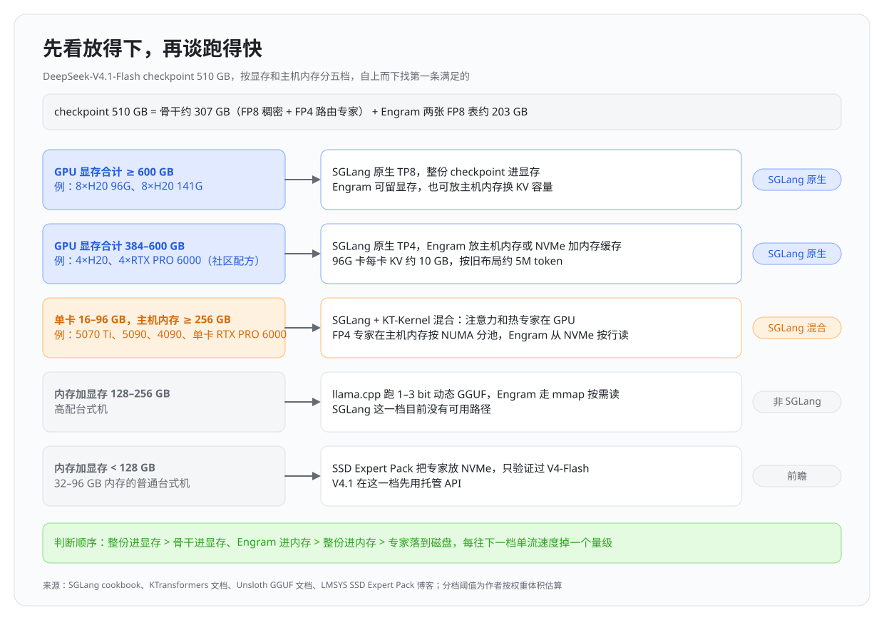
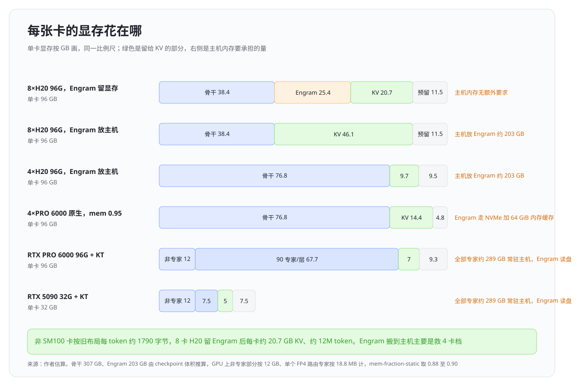

# SGL-22｜实战｜DeepSeek-V4.1-Flash：消费级显卡与 H20 上的 SGLang 部署

> 🎯 <p><b>遇到的问题</b>：DeepSeek-V4.1-Flash 的 checkpoint 有 510 GB，比 V4-Flash 的 159 GB 大了两倍多，原来两张 A100 能跑 V4-Flash 的机器，换成 V4.1 直接放不下<a href="https://codersera.com/blog/run-deepseek-v4-flash-locally-full-2026-setup-guide/">[1]</a><a href="https://huggingface.co/deepseek-ai/DeepSeek-V4.1-Flash">[2]</a>。</p><p>SGLang 官方预览镜像只验证了 H200、B200、B300 和 GB300，H20 和消费级显卡都不在列表里<a href="https://docs.sglang.io/cookbook/autoregressive/DeepSeek/DeepSeek-V4_1">[3]</a>。这一篇把社区里能跑通的几条路线整理成可以照抄的步骤，从一张 16 GB 的 5070 Ti 一直排到 8 卡 H20。</p><p><b>主线</b>：先按 checkpoint 的三块构成算账，再按显存和内存把机器分档：消费级卡靠 CPU 或 SSD 托住专家和 Engram，H20 靠 TP8 放下整模型，再用 Engram 放置和 DSpark 在 KV 容量与单流速度之间取舍。</p><p><b>读完这一篇</b>：拿到一台机器，能先算出它落在哪一档，再选对引擎和启动参数。消费级卡知道专家、Engram 和 KV 各放哪一层存储，H20 知道 Engram 放置和 DSpark 两个开关分别换来什么。拿到别人的 tok/s，知道先对齐硬件、模型版本和测法再比较。</p><p><b>数据来源</b>：8×H20-3e 有一组 SGLang 维护者贴出的公开实测<a href="https://github.com/sgl-project/sglang/issues/46310">[4]</a>，4×RTX PRO 6000 有一个社区部署仓库和一份同机对照报告<a href="https://github.com/sybil-solutions/deepseek-v4.1-flash-4x-rtx-pro-6000">[5]</a><a href="https://github.com/commdata2338/deepseek-v4.1-flash-1017-4x-rtx-pro-6000-benchmark">[6]</a>，消费级单卡和双卡来自两个社区仓库。H20 96G 版本没有同卡数据，它的数字和各档显存预算按带宽、权重体积推算，正文标为<b>估算</b>。压测方法沿用 [SGL-03｜上手｜指标与压测：TTFT、TPOT、ITL 与 goodput](./03-bench.md)。</p><p><b>代码</b>：配套实验在 <a href="../22-dsv41-deploy">zero-to-sglang/22-dsv41-deploy</a>。<a href="../22-dsv41-deploy/plan.py">plan.py</a> 输入卡型、卡数和主机内存，算出档位、每卡显存账和启动命令，有公开实测的配置会把实测行一起打出来。<a href="../22-dsv41-deploy/host_setup.sh">host_setup.sh</a> 是 3.1 节的三项主机设置，<a href="../22-dsv41-deploy/bench_h20.sh">bench_h20.sh</a> 是 4.7 节的并发扫描，跑完自动汇总每档的吞吐、TTFT 和 ITL。<a href="../22-dsv41-deploy/smoke.py">smoke.py</a> 是第 7 章的冒烟测试。plan.py 和 test_plan.py 只用标准库，plan.py 带 21 个单测，离线就能跑，不需要 GPU；smoke.py 和 bench_h20.sh 要对着已起好的服务跑。</p>

# 导读 · 结论先行

1. **先看放得下，再谈跑得快。**510 GB 分成两块：骨干约 307 GB，含 FP8 稠密层和 FP4 路由专家，Engram 两张 FP8 查找表约 203 GB[[7]](https://unsloth.ai/docs/models/deepseek-v4.1-flash)[[8]](https://www.modemguides.com/blogs/ai-infrastructure/run-deepseek-v4-1-flash-locally-hardware-reality-check)。Engram 每个 token 只按行读几条，可以放主机内存甚至 NVMe，骨干里的路由专家也能放主机内存，所以消费级机器的门槛落在主机内存上，显卡反而只要 16 GB[[9]](https://github.com/05yuki/deepseek-v4.1-flash-1017-ktransformers)。
2. **KV 每 token 890 字节只在 SM100 上成立。**这个数是 V4.1 原生 KV 格式下的体积[[8]](https://www.modemguides.com/blogs/ai-infrastructure/run-deepseek-v4-1-flash-locally-hardware-reality-check)，SGLang 只在 SM100 和 SM103 上用它，H20 和 RTX 50 系默认退回 V4 的旧布局。本篇在非 SM100 卡上按每 token 约 1790 字节估，8 卡 H20 留 Engram 后每卡约 20.7 GB KV、约 1200 万 token（**估算**），容量依然宽裕。
3. **H20-3e 已经有实测。**8 卡 TP8 加 DSpark，8K 输入、8 并发总输出 984 tok/s，TPOT 5.56 ms。输入拉到 64K 掉到 217 tok/s，长上下文输给另一个引擎 25%，瓶颈在索引器和旧 KV 布局[[4]](https://github.com/sgl-project/sglang/issues/46310)。96G 版本带宽低约 17%，按比例打折估。
4. **四张 RTX PRO 6000 可以走 SGLang 原生 TP4。**社区配方把 Engram 放 NVMe 加 64 GiB 内存缓存，128 GB 内存的机器就能起服务，8K 输入单流 196 tok/s、8 并发 705 tok/s[[5]](https://github.com/sybil-solutions/deepseek-v4.1-flash-4x-rtx-pro-6000)。同一台机器上，一个 vLLM 分支快 1.34 至 2.58 倍[[6]](https://github.com/commdata2338/deepseek-v4.1-flash-1017-4x-rtx-pro-6000-benchmark)。少于四张卡就走 SGLang 加 KT-Kernel，两张 5070 Ti 加 512 GB DDR4 单流 37 至 50 tok/s[[9]](https://github.com/05yuki/deepseek-v4.1-flash-1017-ktransformers)。
5. **后端显式写出来，再到日志里核对。**手动把后端改错，FP8 GEMM 会退回 Triton 实现，单流吞吐掉一大半[[3]](https://docs.sglang.io/cookbook/autoregressive/DeepSeek/DeepSeek-V4_1)。H20 不在验证矩阵里，第 7 章列了启动日志里要逐行核对的几条，每次部署先看这些。



图里五档自上而下判断，找第一条满足的。前两档是 SGLang 原生路径，四张 RTX PRO 6000 按社区配方归在第二档。第三档是 SGLang 加 KT-Kernel 的混合路径。后两档 SGLang 目前没有可用方案，列出来是为了说明边界：内存加显存不到 256 GB 的机器，要么换 llama.cpp 跑低比特 GGUF，要么用托管 API。每往下一档，单流速度大约掉一个量级，能用的并发也跟着降。

**📎 与系列其他文档的分工**：显存和带宽的算法见 [SGL-02｜上手｜推理账本：显存、KV 与 Roofline](./02-ledger.md)，TP 和 EP 的取舍见 [SGL-11｜原理｜并行：TP、DP Attention、EP 怎么组合](./11-parallelism.md)，FP8 与 FP4 的量化格式见 [SGL-12｜原理｜量化：FP8、INT4 与 KV 量化怎么选](./12-quantization.md)，DSpark 背后的投机解码原理见 [SGL-13｜原理｜投机解码：EAGLE、MTP、NGRAM 怎么选、怎么调](./13-speculative.md)，HiCache 见 [SGL-14｜原理｜HiCache：显存、主机内存、远端存储三层 KV 缓存](./14-hicache.md)，PD 分离见 [SGL-15｜原理｜PD 分离：prefill 和 decode 拆到两组卡上](./15-pd-disagg.md)。V4 和 V4.1 在 SGLang 里引入的 ShadowRadix、有界重放和 Engram 配置的来龙去脉见 [SGL-21｜前沿｜DeepSeek 开源如何改写 SGLang：从 kernel 到 DeepInfer](./21-deepseek.md)。本篇只讲部署：哪台机器用哪条路线，命令怎么写，数字怎么验。

# 第 1 章 · 部署前先回答的问题

V4.1-Flash 发布以后，社区里集中出现了下面几类问题。每一类在本篇都有对应的小节。

| 现象 | 原因 | 对应小节 |
|-|-|-|
| pip 装的 sglang 加载 V4.1 报错 | 正式发行版还不能服务 V4.1，要用 dev-dsv41 预览镜像或社区固定的主干提交 | 3.1、4.1 |
| 24 GB 显卡加 64 GB 内存的台式机起不来 | 骨干加 Engram 超过 500 GB，这台机器离最低门槛差一个数量级 | 2.1、3.5 |
| H20 上启动成功但单流只有十几 tok/s | 后端被手动改错，FP8 GEMM 退回 Triton | 4.3、7.2 |
| 4 卡 H20 一加载就 OOM | 骨干每卡 76.8 GB，Engram 留显存就超了 | 2.3、4.5 |
| H20 上 KV 池比按 890 字节算的小一半 | 非 SM100 卡默认走 V4 旧布局 | 2.2、6.1 |
| Engram 查表很慢，日志提示没有大页 | 主机没开透明大页，查表慢约 10 倍 | 6.1、7.2 |
| 消费级卡 prefill 一个长 prompt 时其他请求全卡住 | KT 路径的 prefill 在 CPU 和 GPU 之间串行，131K 的 prompt 会挡住其他请求一分钟 | 3.1 |
| 返回的 content 里混着 DSML 标记 | 没开 reasoning parser 和 tool-call parser | 4.3、7.3 |
| RL rollout 的 logprob 和训练端对不上 | 有界重放默认开启，数值上和完整 prefill 不等价 | 6.1 |

# 第 2 章 · 先算账：510 GB 由哪几块组成

## 2.1 checkpoint 的三块构成

从 config.json 能把模型拆清楚：40 层，hidden 5120，每层 384 个路由专家加 1 个共享专家，每 token 激活 6 个，专家中间维度 2304。权重量化是 FP8 稠密层（32×32 分块，ue8m0 缩放）加 FP4 路由专家。另有两层 Engram（第 1 层和第 14 层），每层约 3.84 亿条嵌入，以及 3 层 DSpark 草稿头和一个 32 层的视觉塔[[2]](https://huggingface.co/deepseek-ai/DeepSeek-V4.1-Flash)。

按文件分，48 个分片共 510.30 GB，最后两个分片是 Engram，约 189 GiB[[8]](https://www.modemguides.com/blogs/ai-infrastructure/run-deepseek-v4-1-flash-locally-hardware-reality-check)。Unsloth 的拆法是 552B 骨干加 196B Engram 参数，Engram 表在 FP8 下约 202.8 GB[[7]](https://unsloth.ai/docs/models/deepseek-v4.1-flash)。两边口径一致：骨干约 307 GB，Engram 约 203 GB。骨干里路由专家又占了绝大部分，按 384×40 个专家、每个 FP4 专家约 18.8 MB 算，专家合计约 289 GB，稠密部分只有十几 GB（**估算**）。

这三块的访问模式完全不同，决定了它们能放在哪：

| 部分 | 体积 | 每 token 读多少 | 能放在哪 |
|-|-|-|-|
| 稠密层（注意力、共享专家、嵌入） | 约 12 至 18 GB | 全部 | 只能放 GPU |
| FP4 路由专家 | 约 289 GB | 每层 6 个，约 4.5 GB | GPU、主机内存（KT-Kernel 在 CPU 上算）、NVMe（SSD Expert Pack） |
| Engram 两张表 | 约 203 GB | 每层按哈希读几行，KB 级 | GPU、主机内存、NVMe（mmap 或按行直读） |

表里的体积和每 token 读取量是**估算**，由 config 和 checkpoint 体积推算。结论很直接：Engram 体积大但读得少，最适合下放。路由专家体积最大，每 token 也要读几 GB，下放到主机内存后必须在 CPU 上就地计算，不能每步搬回 GPU。

## 2.2 KV 为什么这么小，以及在哪些卡上没那么小

V4.1 每层每个位置只存一个 512 维的 KV 隐向量，同时当 key 和 value 用。第 2 至 19 层按 2:1 压缩，第 20 层起 1:1，再叠一个 128 位置的滑动窗口。全模型只有 4 个 KV 源层和 8 个索引层，其他层跨层共享，长程检索用 top-512[[3]](https://docs.sglang.io/cookbook/autoregressive/DeepSeek/DeepSeek-V4_1)[[2]](https://huggingface.co/deepseek-ai/DeepSeek-V4.1-Flash)。

折算下来，全局 KV 每 token 约 890 字节，V4-Flash 是 3514 字节，100 万 token 不到 1 GB[[8]](https://www.modemguides.com/blogs/ai-infrastructure/run-deepseek-v4-1-flash-locally-hardware-reality-check)。这个数对应 V4.1 的原生格式：窗口 KV 是 32 元素分块的 FP8，压缩 KV 是 16 元素分块的 FP4。

SGLang 选 KV 布局的逻辑在 [deepseek_v4_memory_pool.py:198](https://github.com/sgl-project/sglang/blob/8fabf5e/python/sglang/srt/mem_cache/deepseek_v4_memory_pool.py#L198)。环境变量 SGLANG_DSV4_KV_LAYOUT 默认是 v4（[environ.py:1801](https://github.com/sgl-project/sglang/blob/8fabf5e/python/sglang/srt/environ.py#L1801)），设成 auto 时只有 SM100 和 SM103 会用 V4.1 原生布局，显式设成 v41 又会断言架构必须是这两种。

H20 和 RTX 50 系因此都跑旧布局，单是压缩 KV 每 token 就要 584 字节。社区 KT 仓库给 SM120 打了补丁读原生格式，压缩 KV 降到 288 字节，decode 注意力从 16 至 18 µs 降到 10 至 11 µs[[9]](https://github.com/05yuki/deepseek-v4.1-flash-1017-ktransformers)，这个补丁不在上游。

[plan.py](../22-dsv41-deploy/plan.py) 在非 SM100 卡上按每 token 约 1790 字节估，取的是 vLLM 旧布局 fp8_ds_mla 的体积，偏保守。这么算 token 容量大约减半，但显存账依然几乎全由权重决定：一张卡只要放得下自己那份权重，剩下的空间放 KV 绰绰有余，并发上限通常卡在算力、max-running-requests 和 CUDA Graph 的 batch 档位上。

## 2.3 每张卡的显存预算



图中六行都是**估算**。H20 三行和 4×PRO 6000 原生一行，按骨干 307 GB、Engram 203 GB 平均切到 TP 各卡，mem-fraction-static 取 0.88 至 0.95，剩下的给 KV。KT 两行按 GPU 上非专家部分 12 GB、单个 FP4 专家 18.8 MB 计，单卡 RTX PRO 6000 每层放 90 个专家，5090 每层放 10 个。

| 配置 | 每卡骨干 | 每卡 Engram | 每卡 KV | 主机内存要承担的 |
|-|-|-|-|-|
| 8×H20 96G，Engram 留显存 | 38.4 GB | 25.4 GB | 约 20.7 GB | 无额外要求 |
| 8×H20 96G，Engram 放主机 | 38.4 GB | 0 | 约 46.1 GB | Engram 约 203 GB |
| 4×H20 96G，Engram 放主机 | 76.8 GB | 0 | 约 9.7 GB | Engram 约 203 GB |
| 4×H20 141G，Engram 留显存 | 76.8 GB | 50.8 GB | 不足 1 GB | 无额外要求，但几乎没有 KV 空间，不推荐 |
| 4×RTX PRO 6000 原生，mem 0.95 | 76.8 GB | 0 | 约 14.4 GB | Engram 走 NVMe 加 64 GiB 内存缓存 |
| 单卡 RTX PRO 6000 96G + KT | 非专家 12 GB + 专家 67.7 GB | 0 | 约 7 GB | 专家约 289 GB 常驻，Engram 读盘 |
| RTX 5090 32G + KT | 非专家 12 GB + 专家 7.5 GB | 0 | 约 5 GB | 同上 |

8 卡 H20 留 Engram 后的 20.7 GB KV，按旧布局每 token 约 1790 字节算能放约 1200 万 token，远超实际并发需要（**估算**）。所以 8 卡档 Engram 放不放主机都行，放主机换来的是更大的 CUDA Graph batch 和激活空间。4 卡档没得选，Engram 必须离开显存。4×PRO 6000 原生配方把 mem-fraction-static 提到 0.95，每卡 KV 约 14.4 GB，社区仓库实测的 token 池是 420 万[[5]](https://github.com/sybil-solutions/deepseek-v4.1-flash-4x-rtx-pro-6000)，和这里的估算同一量级。

## 2.4 FP4 专家在 Hopper 上怎么算

H20 是 SM90，没有原生 FP4 张量核。V4 系列的 FP4 专家在 Hopper 上走 W4A16，权重以 FP4 存储，计算前反量化到 BF16，后端是 Marlin 或 FlashInfer 的 SM90 CUTLASS runner。FlashInfer 0.6.18 起可以用 --moe-runner-backend flashinfer_mxfp4 --flashinfer-mxfp4-moe-precision fp8 切到 W4A8，激活用 FP8 算[[10]](https://www.lmsys.org/blog/2026-04-25-deepseek-v4/)。

4.2 节的 H20-3e 实测用的正是这组 W4A8 开关，路由专家 GEMM 每轮 4.741 ms，比对照引擎的 7.786 ms 快[[4]](https://github.com/sgl-project/sglang/issues/46310)。V4.1 cookbook 同时提醒不要随手覆盖 --moe-runner-backend[[3]](https://docs.sglang.io/cookbook/autoregressive/DeepSeek/DeepSeek-V4_1)，两条放在一起，H20 上的做法是照抄实测命令显式写出后端，启动后到日志里确认 FP8 GEMM 没有退回 Triton。注意力侧，FlashMLA 的混合稀疏路径支持 SM90 和 SM100，Hopper 上要求 head 数是 64 的倍数，SGLang 会自动补齐[[10]](https://www.lmsys.org/blog/2026-04-25-deepseek-v4/)[[11]](https://github.com/deepseek-ai/FlashMLA)，实现在 [flashmla_backend.py](https://github.com/sgl-project/sglang/blob/8fabf5e/python/sglang/srt/layers/attention/flashmla_backend.py)。

## 2.5 vLLM 怎么做

vLLM 的 V4.1 recipe 写的最低显存是 614 GB，这个数默认 Engram 也在显存里[[12]](https://github.com/vllm-project/vllm/blob/0d6f92a/recipes/models/deepseek-ai/DeepSeek-V4.1-Flash.yaml)。实际代码里 EngramConfig 的 cpu_offload 默认打开，Engram 表放在 pinned 主机内存，GPU 通过 UVA 直接读[[13]](https://github.com/vllm-project/vllm/blob/0d6f92a/vllm/config/engram.py#L37)。分配 pinned 内存时大小向上取到 2 的幂，188.83 GiB 的表会占掉 264 GiB 锁页内存[[14]](https://github.com/vllm-project/vllm/blob/0d6f92a/vllm/models/deepseek_v41/common/engram.py#L1122)，主机内存要按这个数准备。启动日志里 Total CPU offloaded parameters 一行给出实际下放的体积[[15]](https://github.com/vllm-project/vllm/blob/0d6f92a/vllm/model_executor/offloader/uva.py#L69)。

同硬件对比目前最直接的数据来自 4×RTX PRO 6000。同一台机器、同一天，一个带 B12X kernel 和 DSpark 7 的 vLLM 分支对 SGLang 社区配方，单流快 2.2 至 2.6 倍，8 并发快 1.3 至 2.1 倍，冷 prefill 快 1.5 至 1.8 倍[[6]](https://github.com/commdata2338/deepseek-v4.1-flash-1017-4x-rtx-pro-6000-benchmark)，细节见 3.4 节。

数据中心卡上，Lambda 在 V4-Flash 上测 8192 输入、1024 输出、32 并发，B200 上 vLLM 1469 tok/s，SGLang 1222 tok/s[[16]](https://lambda.ai/inference-models/deepseek-ai/deepseek-v4-flash)。H20 上 GPUStack 用 vLLM 加 DSpark 跑 V4-Flash-0731，报告单并发超过 600 TPS[[17]](https://zhuanlan.zhihu.com/p/2068657693875779128)，原文没有给输入输出长度，模型也比 V4.1 小三分之二，只能作为量级参考。

单卡这一档反过来。vLLM 靠 UVA 把放不下的权重留在主机内存，每步通过 PCIe 读，《VLLM-23｜实战｜DeepSeek-V4.1-Flash 部署：消费级显卡与 H20》 记录的单张 PRO 6000 单流约 11 tok/s。同样的卡走 KT-Kernel 在 CPU 上就地算专家，batch 1 有 52.5 至 64 tok/s[[18]](https://github.com/andreasgru/ds41-flash-hybrid)。

那篇的结论和这里一致：四张卡以上、整份能进显存时 vLLM 更快，单卡加大内存时 SGLang 加 KT-Kernel 更快。SGLang 在这一档的优势来自 KT-Kernel 这类异构后端可以直接接进来[[19]](https://github.com/kvcache-ai/ktransformers/blob/main/doc/en/DeepSeek-V4-Flash.md)，调度器、前缀缓存和 OpenAI 接口照常可用。

# 第 3 章 · 消费级和工作站卡：KT-Kernel 混合与四卡原生

## 3.1 主线：16 GB 显卡加 512 GB 内存

目前最完整的消费级方案是一个社区部署仓库，固定了 SGLang 主干 20036b7a、KTransformers 95009ea、torch 2.14.1+cu130、FlashInfer 0.7.2 和 CUDA 13.1，针对 V4.1-Flash-1017 这个版本[[9]](https://github.com/05yuki/deepseek-v4.1-flash-1017-ktransformers)。硬件要求如下：

- **显卡**：每卡 16 GB。两卡时每卡放 6.9 GB 权重（半数稠密层加每层一个常驻专家），外加 1M token 的 KV 池。单卡时权重 11.7 GB，压缩 KV 挪到主机内存。原生支持 SM90 及以上，SM89 走 Triton 回退。
- **内存**：服务常驻约 420 GiB，主要是放在 2 MB 大页上的 MXFP4 专家。单个 NUMA 节点不足 370 GiB 时，启用大小为节点内存减 50 GiB 的专家缓存，其余专家从盘上读。
- **CPU**：kt-kernel 需要 AVX2，按 CPUINFER_CPU_INSTRUCT=NATIVE 编译。
- **磁盘**：checkpoint 476 GiB，虚拟环境 8.6 GB，建议 1 TB NVMe。Engram 不进内存，服务时直接从盘上的 checkpoint 读。

主机侧有三项设置，不改的话专家池分配大页会失败，或者跑一阵被内存回收拖慢。配套的 [host_setup.sh](../22-dsv41-deploy/host_setup.sh) 把这三条写在一起，需要 root：

```bash
# 让 shmem 按需用透明大页，专家池放在 2 MB 页上
echo advise | sudo tee /sys/kernel/mm/transparent_hugepage/shmem_enabled
# 给内核留 8 GB 空闲页，避免大页分配时卡在直接回收
sudo sysctl -w vm.min_free_kbytes=8388608
# 关 swap，专家页被换出去 decode 会掉到个位数
sudo swapoff -a
```

起服务两步。setup.sh 拉源码、打补丁、编译 kt-kernel，serve.sh 起 OpenAI 兼容服务，默认监听 127.0.0.1:8080、一次只跑一个请求：

```bash
MODEL=/models/dsv41-1017 ./setup.sh
MODEL=/models/dsv41-1017 ./serve.sh

# 允许 4 个请求并发，并对外提供服务
SGLANG_MAX_RUNNING_REQUESTS=4 SGLANG_HOST=0.0.0.0 SGLANG_API_KEY=xxx \
  MODEL=/models/dsv41-1017 ./serve.sh

# 只有一个 256 GB 的 socket 时绑到 node 0
KT_THREADPOOL_COUNT=1 numactl -N 0 -m 0 ./serve.sh
```

补丁分三级。tier0 管正确性，包括 1017 版本在 wo_a 之前对 o 做 FP8 量化再反量化（SGLANG_DSV4_O_FP8_QDQ_BLOCK，块大小 32）、SM12x 上索引器的 torch 路径，以及 SM120 读 V4.1 原生 KV 格式（SGLANG_DSV4_KV_LAYOUT=v41），第 0 层误差从 3.8% 降到 1.0%。

tier1 是性能，包括流式 prefill、把热专家借进空闲的 KV 页（KT_KV_HOT_SPARE_FLOOR_MB）和主机 KV。tier2 是没有 P2P 时的 all-reduce。只打到 tier0 的话 prefill 约 40 tok/s，decode 约 11 tok/s[[9]](https://github.com/05yuki/deepseek-v4.1-flash-1017-ktransformers)。

首次启动要编译和标定 prefill 分块，约 15 分钟，之后约 3 分钟。启动 OOM 时先调小 SGLANG_CONTEXT_LENGTH。思考模式默认关，请求里带 chat_template_kwargs 的 thinking 为 true 打开，parser 用 --tool-call-parser deepseekv41 --reasoning-parser deepseek-v41[[9]](https://github.com/05yuki/deepseek-v4.1-flash-1017-ktransformers)。

> 💡 **实验记录**：仓库作者在 2×EPYC 7452、512 GB DDR4、2×RTX 5070 Ti 16 GB 上的结果[[9]](https://github.com/05yuki/deepseek-v4.1-flash-1017-ktransformers)：

| 配置 | 单流 decode | prefill |
|-|-|-|
| 两卡 | 37.3 至 50.0 tok/s（日文散文 50，Python 37.4） | 35K 输入 1736 tok/s（20 秒），131K 1872 tok/s，1M 1068 tok/s（16 分钟） |
| 单卡 | 29.4 至 33.4 tok/s | 35K 1052 tok/s，1M 807 tok/s（21 分钟） |
| 单 socket 256 GB，201 GiB 专家缓存，NVMe 6.5 GB/s | 15.0 至 20.2 tok/s | 2K 147 tok/s，1M 625 tok/s（27 分钟） |

多流时，4 条同类文本合计 74 tok/s，混合文本只有 47 tok/s，因为不同请求激活的专家重叠少，CPU 侧算力被摊薄。一个 131K 的 prompt 会挡住其他请求 62 秒。精度上，参考 NLL 0.7185，服务输出 0.7192[[9]](https://github.com/05yuki/deepseek-v4.1-flash-1017-ktransformers)。按这些数，这一档适合一个人用 Agent 或长文档问答，团队共用要排队。

## 3.2 单张 5090：KTransformers 官方路径

KTransformers 官方文档给的是 V4-Flash-0731 在单张 RTX 5090 上的配置，单流超过 20 tok/s，启动 4 至 5 分钟[[19]](https://github.com/kvcache-ai/ktransformers/blob/main/doc/en/DeepSeek-V4-Flash.md)。V4.1 的专家数和 Engram 都不同，命令里的 kt 参数可以照搬，模型路径和上下文要按 V4.1 重配，主机内存也要从 V4-Flash 的两百 GB 级提到 3.1 节的 420 GiB 级。

```bash
export FLASHINFER_CUDA_ARCH_LIST=12.0a
export TORCH_CUDA_ARCH_LIST="12.0+PTX"
python -m sglang.launch_server --host 0.0.0.0 --port 30000 \
  --model /path/DeepSeek-V4-Flash-0731 --kt-weight-path /path/DeepSeek-V4-Flash-0731 \
  --kt-method MXFP4 --kt-num-gpu-experts 10 --kt-cpuinfer 60 --kt-threadpool-count 2 \
  --kt-gpu-prefill-token-threshold 4096 --kt-enable-dynamic-expert-update \
  --tensor-parallel-size 1 --context-length 16384 --attention-backend flashinfer \
  --mem-fraction-static 0.85 --chunked-prefill-size 2048 --max-prefill-tokens 2048 \
  --max-running-requests 2 --watchdog-timeout 1200 --disable-shared-experts-fusion \
  --trust-remote-code --cuda-graph-bs 1 --cuda-graph-max-bs 1 \
  --disable-radix-cache --skip-server-warmup
```

几个参数的含义：

- **--kt-num-gpu-experts 10**：每层 10 个专家常驻 GPU，其余在 CPU 算。--kt-enable-dynamic-expert-update 按访问频率换入热专家。显存每多 1 GB，大约能多放每层 1 个专家（估算，按 40 层、每个专家 18.8 MB）。
- **--kt-cpuinfer 60 --kt-threadpool-count 2**：60 个 CPU 推理线程，两个 NUMA 节点各一个线程池。线程数按物理核数设，超线程帮助不大。
- **--kt-gpu-prefill-token-threshold 4096**：prefill 超过 4096 token 时把专家权重搬到 GPU 上算，短 prompt 留在 CPU。
- **--cuda-graph-max-bs 1、--max-running-requests 2**：这一档本来就是单流，CUDA Graph 只捕获 batch 1，省显存和启动时间。

tilelang 要用 pip install tilelang "apache-tvm-ffi<0.1.12" 安装，0.1.12 和自带的运行时冲突。打开 MTP 大约能快 1.2 倍，文档里 8×5090 从 26.5 tok/s 提到 32.74 tok/s，接受率 90%[[19]](https://github.com/kvcache-ai/ktransformers/blob/main/doc/en/DeepSeek-V4-Flash.md)。

## 3.3 单张 96 GB 工作站卡

另一个社区仓库把 V4.1-Flash 跑在一张 RTX PRO 6000 Max-Q 96 GB、2×EPYC 7302、约 499 GiB 内存上[[18]](https://github.com/andreasgru/ds41-flash-hybrid)。配置思路是尽量多放专家：上下文 524288，token 池 180 万，chunk 16384，SWA 与全量比例 0.0625，mem-fraction-static 0.90，每层 90 个 GPU 专家，28 个 CPU 线程，最多 12 个请求，CUDA Graph 捕获 batch 1 至 12，HiCache 和投机都关。服务进程限制在 480 GiB 以内，不开 swap。

仓库记录的历史数据：batch 1 约 52.5 至 64 tok/s，8 个相同 prompt 合计 166 tok/s，8 个对齐后的不同请求合计约 120 至 133 tok/s，自建题集 88 题对 77 题，算术 36 题全对。9 月 28 日的满载测试跑了 649 个请求，平均 35.11 tok/s，目标是不低于 40，TTFT p95 57.88 秒，目标是不超过 30 秒，判定为不通过[[18]](https://github.com/andreasgru/ds41-flash-hybrid)。

这组数据有两点要注意。仓库 README 自己写明，公开版本的源码重建、GPU 执行和服务启动都没有重新测过，表里是历史数字。满载失败说明一张卡加 CPU 专家的组合在多人同时用时，TTFT 会先崩，比单流速度先成为问题。照这个方案部署，要把并发上限压到 4 左右再压测（估算）。

## 3.4 四张 RTX PRO 6000：SGLang 原生 TP4

四张 96 GB 卡合计 384 GB，放得下 307 GB 骨干，Engram 放不下。一个社区仓库在 4×RTX PRO 6000（PCIe，功耗墙 275 W）、128 GB DDR5 的机器上跑通了 SGLang 原生 TP4/EP4 加 DSpark 5，Engram 用 64 GiB 内存缓存加 NVMe 按需读，整份放内存要约 213 GiB[[5]](https://github.com/sybil-solutions/deepseek-v4.1-flash-4x-rtx-pro-6000)。仓库自己标为实验配方，不在官方镜像的验证矩阵里。

```bash
# 默认配置：上下文 409600，mem 0.85，8 个槽位，chunk 2048，监听 127.0.0.1:8010
docker compose up --build -d
# 实测候选配置：mem 0.95，上下文 524288，token 池约 420 万
docker compose -f compose.yaml -f compose.measured.yaml up --build -d
# 冒烟
docker compose exec deepseek python3 /opt/dsv41/boot.py smoke
```

> 💡 **实验记录**：仓库在实测候选配置下的扫描，输出长度 8192，DSpark 接受率 74% 至 88%[[5]](https://github.com/sybil-solutions/deepseek-v4.1-flash-4x-rtx-pro-6000)：

| 输入 | 并发 | 总 decode tok/s | 备注 |
|-|-|-|-|
| 512 | 1 | 200.9 | TTFT 0.26 s |
| 512 | 8 | 713.5 |  |
| 8K | 1 | 196.4 | TTFT 1.12 s，prefill 7337 tok/s |
| 8K | 4 | 538.8 |  |
| 8K | 8 | 704.5 | 每请求 89.9，TTFT 5.32 s |
| 64K | 1 | 231.6 | TTFT 8.92 s |
| 64K | 8 | 712.3 |  |
| 128K | 1 | 203.4 | TTFT 18.55 s |
| 400K | 1 | 220.2 |  |
| 500K | 8 | 599.7 |  |

另一份报告在同一台机器、同一天，把这个配方和一个 vLLM 分支（B12X kernel 加 DSpark 7）放在一起测，两边都是 8 个槽位、上下文 409600、Engram 放主机[[6]](https://github.com/commdata2338/deepseek-v4.1-flash-1017-4x-rtx-pro-6000-benchmark)：

| 测试 | vLLM 分支 tok/s | SGLang tok/s | 倍数 |
|-|-|-|-|
| 散文 c1 / c8 | 247 / 814 | 112 / 529 | 2.20 / 1.54 |
| 代码 c1 / c8 | 494 / 1188 | 191 / 790 | 2.58 / 1.50 |
| 计数 c1 / c8 | 449 / 1442 | 207 / 681 | 2.17 / 2.12 |
| JSON c1 / c8 | 416 / 1277 | 176 / 952 | 2.36 / 1.34 |
| 冷 prefill 8K / 64K / 262K | 11241 / 14580 / 11987 | 7406 / 8128 / 7388 | 1.52 / 1.79 / 1.62 |

差距的来源报告里列了几条[[6]](https://github.com/commdata2338/deepseek-v4.1-flash-1017-4x-rtx-pro-6000-benchmark)。SGLang 锁了 189.1 GiB 的 Engram 表，常驻率只有 86.1% 至 87.5%，跑起来还在以每秒 50 至 60 MB 从盘上读，对照组整份常驻。SGLang 的 wo_a 用 BF16 算，没有 1017 版本要求的 FP8 量化再反量化。流式请求带 return_token_ids 会被 HTTP 400 拒掉。好的一面是 60 分钟浸泡 571 个请求全部成功。

这份报告在 250 W 功耗墙下单请求复测，512、8K、64K 输入的 prefill 是 3013、7526、8015 tok/s，第 129 至 641 个 token 的 decode 稳定在 146.6 至 155.6 tok/s[[6]](https://github.com/commdata2338/deepseek-v4.1-flash-1017-4x-rtx-pro-6000-benchmark)，比仓库 README 的 196 至 232 低，后者是 275 W 加 9 月权重测的。拿这一档的数字对比，先对齐功耗墙和模型版本。

## 3.5 内存不够 256 GB 时

内存加显存在 128 至 256 GB 之间，SGLang 没有能用的方案，可以换 llama.cpp 跑 Unsloth 的动态 GGUF。Engram 表留在 SSD 上用 mmap 按需读，内存只需放骨干[[7]](https://unsloth.ai/docs/models/deepseek-v4.1-flash)：

| 量化 | 文件体积 | 内存加显存需求 | wiki 文本 KL / top-1 一致率 |
|-|-|-|-|
| UD-IQ1_S | 233.0 GB | 128 至 145 GB | 0.457 / 82.8% |
| UD-Q2_K_XL | 334.8 GB | 176 至 205 GB | 0.138 / 91.5% |
| UD-IQ3_XXS | 394.7 GB | 256 至 290 GB | 0.0625 / 94.6% |
| UD-Q4_K_XL | 500.7 GB | 约 305 GB | 0.009 / 98.2% |

1-bit 和 2-bit 的 top-1 一致率掉到 80% 至 90%，推理链会变长，实际答题耗时不一定比高比特短。Unsloth 建议 temperature 1.0、top_p 1.0[[7]](https://unsloth.ai/docs/models/deepseek-v4.1-flash)。两台 DGX Spark 互联的方案，散文 55 至 75 tok/s，代码 90 至 110 tok/s，prefill 1700 至 2200 tok/s，24 GB 显存加 64 GB 内存的机器任何量化都跑不起来[[8]](https://www.modemguides.com/blogs/ai-infrastructure/run-deepseek-v4-1-flash-locally-hardware-reality-check)。

内存不到 128 GB 的普通台式机，可以关注 LMSYS 的 SSD Expert Pack。它用 --load-format expert_pack 把专家打包放 NVMe，用 O_DIRECT 直接读进 4096 字节对齐的 pinned 缓冲，省掉页缓存到 pinned 内存的一次拷贝，GPU 上按字节预算做 LFU/LRU 专家缓存。

缓存未命中时读盘在关键路径上，单步耗时约等于未命中专家的读取时间加 GPU 计算时间。博客在 32 GB 内存、一块 2 TB NVMe 和一张 5090 上验证了 V4-Flash，输出和 Ollama 语义一致[[20]](https://www.lmsys.org/blog/2026-08-29-sglang-ssd-expert-pack/)。V4.1 还没有对应的 pack，这一档目前先用托管 API。

# 第 4 章 · H20：公开实测和三套配置

## 4.1 镜像与硬件

H20 是 Hopper 架构的数据中心卡，96G 版本显存带宽 4.0 TB/s，141G 版本（常称 H20-3e）4.8 TB/s，FP8 稠密算力都在 296 TFLOPS 左右，卡间 NVLink 900 GB/s。和 H200 比，算力约四分之一，带宽相当或略低。decode 在小 batch 下受带宽限制，H20 和 H200 差距不大。batch 一大就转成受算力限制，H20 的吞吐上限明显更低。

软件用官方预览镜像。正式发行版的 pip 包还不能服务 V4.1[[3]](https://docs.sglang.io/cookbook/autoregressive/DeepSeek/DeepSeek-V4_1)：

```bash
docker pull lmsysorg/sglang:dev-dsv41
docker run --gpus all --shm-size 32g --ipc=host -p 30000:30000 \
  -v /models:/models \
  lmsysorg/sglang:dev-dsv41 \
  sglang serve /models/DeepSeek-V4.1-Flash <下面各节的参数>
```

镜像的验证矩阵里没有 H20。H20 和 H200 同为 SM90，注意力走同一套 FlashMLA 路径。默认后端的选择在 [deepseek_v4_hook.py:54](https://github.com/sgl-project/sglang/blob/8fabf5e/python/sglang/srt/arg_groups/deepseek_v4_hook.py#L54)：只有 V4.1 跑在 SM100、KV 用 fp8_e4m3、没有注意力 TP 时才选 flashmla_mega，其他情况都是 flashmla，flashmla_mega 本身也要求 SM100 或 SM103（[deepseek_v4_hook.py:180](https://github.com/sgl-project/sglang/blob/8fabf5e/python/sglang/srt/arg_groups/deepseek_v4_hook.py#L180)）。H20 上看到 flashmla 是正常的。V4.1 的 Day 0 支持细节见 LMSYS 博客[[21]](https://www.lmsys.org/blog/2026-09-10-deepseek-v41/)。

## 4.2 H20-3e 上的公开实测

SGLang 仓库的 #46310 贴出了 V4.1-Flash-1017 在 8×H20-3e 上的完整测法和结果[[4]](https://github.com/sgl-project/sglang/issues/46310)。环境是 SGLang 02b9836、FlashInfer 0.7.2、torch 2.14.1+cu130，主机 64 核、512 GiB 内存。负载是固定 8 并发，输出 1024，每个输入长度 80 个请求，关掉前缀缓存。启动命令把后端全部显式写出来：

```bash
export SGLANG_RAGGED_VERIFY_MODE=static
export SGLANG_ENABLE_DSV41_ENGRAM_HOST_TABLE=0
export SGLANG_JIT_DEEPGEMM_PRECOMPILE=0
python -m sglang.launch_server --model-path "$MODEL" --trust-remote-code \
  --language-model-only --tp-size 8 --ep-size 8 --dp-size 1 \
  --attn-dp-size 1 --attn-cp-size 8 --enable-prefill-cp --cp-strategy interleave \
  --attention-backend dsv4 --dsv4-attn-backend flashmla \
  --moe-a2a-backend none --moe-runner-backend flashinfer_mxfp4 \
  --flashinfer-mxfp4-moe-precision fp8 \
  --speculative-algorithm DSPARK --speculative-dspark-block-size 5 \
  --cuda-graph-backend-decode full --cuda-graph-max-bs-decode 8 \
  --cuda-graph-backend-prefill disabled \
  --context-length 131072 --max-running-requests 8 \
  --chunked-prefill-size 8192 --max-prefill-tokens 8192 \
  --mem-fraction-static 0.85 --disable-radix-cache --random-seed 42 \
  --enable-cp-decode-attn-tp
```

> 💡 **实验记录**：8×H20-3e，c8，输出 1024，SGLang 和对照引擎 DeepInfer 同机对比[[4]](https://github.com/sgl-project/sglang/issues/46310)：

| 输入 | SGLang tok/s | DeepInfer tok/s | 差距 | TTFT SG / DI | TPOT SG / DI |
|-|-|-|-|-|-|
| 8K | 984.13 | 827.92 | +18.9% | 1.172 / 0.431 s | 5.562 / 7.250 ms |
| 16K | 684.70 | 648.89 | +5.5% | 2.020 / 0.759 s | 8.054 / 9.820 ms |
| 32K | 396.04 | 468.92 | −15.5% | 4.115 / 1.415 s | 14.121 / 13.516 ms |
| 64K | 217.09 | 291.88 | −25.6% | 7.999 / 2.743 s | 27.020 / 23.143 ms |

短输入 SGLang 赢在 decode：DSpark 每次验证产出 4.34 至 4.82 个 token，接受率 66.9% 至 76.4%，路由专家 GEMM 每轮 4.741 ms，对照组 7.786 ms。SGLang 用的是静态 5+1 验证（SGLANG_RAGGED_VERIFY_MODE 默认 static，[environ.py:1612](https://github.com/sgl-project/sglang/blob/8fabf5e/python/sglang/srt/environ.py#L1612)），对照组按置信度变长验证[[4]](https://github.com/sgl-project/sglang/issues/46310)。

长输入输在两处。TTFT 是对照组的 2.7 至 2.9 倍，prefill 吃亏。索引器每轮耗时 8K 时是 1.364 ms 对 0.294 ms，64K 时拉到 9.368 ms 对 1.016 ms，报告把差距归到 SM90 跑的旧 KV 布局和索引器 kernel 上[[4]](https://github.com/sgl-project/sglang/issues/46310)。命令最后的 --enable-cp-decode-attn-tp 默认关闭（[parallel.py:180](https://github.com/sgl-project/sglang/blob/8fabf5e/python/sglang/srt/arg_groups/fields/parallel.py#L180)），打开后 8K 从 937.62 提到 984.13 tok/s，16K、32K、64K 分别提升 7.50%、2.75%、3.73%。这组测试没有做精度评测。

几个数要会换算。8K 时 TPOT 5.562 ms，单请求 decode 约 180 tok/s，8 并发纯 decode 是 1438 tok/s，实测总吞吐 984 是因为每个请求还要摊 1.17 s 的 prefill。H20 96G 带宽低约 17%，按比例折算 8K c8 约 820 tok/s（**估算**），prefill 受算力限制，TTFT 差不多。[plan.py](../22-dsv41-deploy/plan.py) 对 8×H20 96G 会把这组数作为近邻数据一起打出来。

## 4.3 低延迟：TP8 加 DSpark

单用户或少量并发的 Agent、代码补全，优先单流速度。8 卡 TP8，Engram 留显存，开 DSpark。下面是 plan.py 给出的最小命令：

```bash
sglang serve /models/DeepSeek-V4.1-Flash \
  --tp 8 \
  --reasoning-parser auto --tool-call-parser auto \
  --speculative-algorithm DSPARK --speculative-dspark-block-size 5 \
  --mem-fraction-static 0.88 \
  --max-running-requests 8 \
  --host 0.0.0.0 --port 30000
```

- **DSpark**：V4.1 的投机路径只有 DSPARK，没有 EAGLE 或 MTP，也没有 --speculative-num-steps。batch 1 时的收益约等于接受长度除以固定的单步开销，调 block size 换不来吞吐。数学和代码接受率最高，聊天其次，Agent 轨迹最低[[3]](https://docs.sglang.io/cookbook/autoregressive/DeepSeek/DeepSeek-V4_1)。
- **parser**：auto 会解析成 deepseek-v41 和 deepseekv41。思考模式默认关（SGLANG_DEFAULT_THINKING=false），请求里带 reasoning_effort 就会打开，low、high、xhigh、max 分别对应 50、75、75、100，SGLANG_DSV41_REASONING_EFFORT 可以改默认值[[3]](https://docs.sglang.io/cookbook/autoregressive/DeepSeek/DeepSeek-V4_1)。
- **后端**：最小命令交给默认选择。想锁死后端，照 4.2 节的命令把 --attention-backend dsv4、--dsv4-attn-backend flashmla、--moe-runner-backend flashinfer_mxfp4 和 W4A8 开关一起加上，再加 --enable-cp-decode-attn-tp。两种写法起来以后都按 7.2 节的表核对日志。

H20 96G 上这套配置的单流速度**估算**约 130 至 180 tok/s，代码类偏高、Agent 轨迹偏低。依据是 4.2 节 c8 时单请求 decode 约 180 tok/s，单流时 batch 更小，带宽再打八三折。GPUStack 报告的 8 卡 H20 单并发超过 600 TPS[[17]](https://zhuanlan.zhihu.com/p/2068657693875779128)，用的是更小的 V4-Flash-0731，原文没有写清 TPS 是否计入输入 token，这里不拿它当基准。

## 4.4 高吞吐：关投机，整份权重留在显存

批量离线任务或多租户 API，看的是总吞吐和 p99。cookbook 的高吞吐配方都关掉投机，因为 batch 大了以后验证开销盖过收益[[3]](https://docs.sglang.io/cookbook/autoregressive/DeepSeek/DeepSeek-V4_1)。8 卡 H20 属于第 1 档，整份权重（含 Engram）本来就放得进显存，所以这一档不再把 Engram 下放到主机，mem-fraction 从低延迟的 0.88 提到 0.90，把省下的空间给 KV 和更大的 CUDA Graph batch。

plan.py 的 throughput 命令同样不下 placement=cpu，主机内存为 0 也能跑。真正需要把 Engram 放主机的是第 2 档（4 卡 H20、SM120 多卡），见 4.5 节，而且 plan.py 会先校验主机内存至少 256 GB，不够直接报错而不是生成一条跑不起来的命令：

```bash
sglang serve /models/DeepSeek-V4.1-Flash \
  --tp 8 \
  --reasoning-parser auto --tool-call-parser auto \
  --mem-fraction-static 0.90 \
  --max-running-requests 64 \
  --schedule-policy fcfs \
  --host 0.0.0.0 --port 30000
```

Engram 有三种放法，输出逐位一致[[3]](https://docs.sglang.io/cookbook/autoregressive/DeepSeek/DeepSeek-V4_1)，配置定义在 [engram_config.py:41](https://github.com/sgl-project/sglang/blob/8fabf5e/python/sglang/srt/arg_groups/engram_config.py#L41)。旧的环境变量写法已经废弃，用了会在日志里报 deprecated（[deepseek_v4_hook.py:110](https://github.com/sgl-project/sglang/blob/8fabf5e/python/sglang/srt/arg_groups/deepseek_v4_hook.py#L110)）：

| 写法 | 放在哪 | 代价 | 适合 |
|-|-|-|-|
| 默认 | GPU，按行分片到各卡 | 每个 Engram 层一次集合通信 | 8 卡低延迟和高吞吐 |
| {"placement": "cpu"} | 主机内存，每个 rank 一份大页分片 | 加载更久，每卡省约 25 GB，主机要开透明大页且至少 256 GB | 4 卡必选，8 卡一般不需要 |
| {"lookup": "peer_read"} | GPU，各卡直接读对端分片 | 去掉集合通信，要求 placement 为 gpu | 8 卡、NVLink 全互联 |

--max-running-requests 和 --schedule-policy 的起点可以参考 cookbook 的 Agent 负载表。那张表在 MI355X 上按并发 1、2、4、8、16、32 分别给出 2 至 64 的 max-running-requests，前缀尾巴 --swa-prefix-tails 从 128 加到 2048，--prefill-decode-interval 从 192 降到 32，并发 16 以下用 lpm、以上用 fcfs[[3]](https://docs.sglang.io/cookbook/autoregressive/DeepSeek/DeepSeek-V4_1)。

H20 的算力更低，同样的并发档位，prefill-decode-interval 可以先取表里的值，再看 ITL 的 p99 往回调。max-running-requests 一定要写，不写的话日志会提示自动设成 256（[deepseek_v4_hook.py:226](https://github.com/sgl-project/sglang/blob/8fabf5e/python/sglang/srt/arg_groups/deepseek_v4_hook.py#L226)），H20 扛不住这么多。

H20 96G 8 卡在 8192 输入、1024 输出下的吞吐**估算**：32 并发约 800 至 1100 tok/s，64 并发约 1100 至 1500 tok/s。参照点有两个：4.2 节 H20-3e 开 DSpark 的 c8 已有 984 tok/s，Lambda 在 H100 TP8 上跑 V4-Flash 32 并发 1262 tok/s[[16]](https://lambda.ai/inference-models/deepseek-ai/deepseek-v4-flash)。H20 的 FP8 算力约是 H100 的三分之一，模型又更大，大 batch 吞吐涨得比 H100 慢。

## 4.5 只有 4 张 H20

4 卡 TP4 时骨干每卡 76.8 GB，Engram 必须放主机，主机内存至少 256 GB，建议 384 GB 以上留出页缓存：

```bash
sglang serve /models/DeepSeek-V4.1-Flash \
  --tp 4 \
  --reasoning-parser auto --tool-call-parser auto \
  --engram-config '{"placement": "cpu"}' \
  --mem-fraction-static 0.90 \
  --max-running-requests 16 \
  --cuda-graph-max-bs 16 \
  --host 0.0.0.0 --port 30000
```

每卡剩约 9.7 GB 给 KV，按旧布局约 500 万 token（**估算**），紧的是 CUDA Graph 和激活。max-running-requests 和 cuda-graph-max-bs 先设 16，OOM 就减半。H20 141G 版本 4 卡时每卡多出 45 GB，正好够塞下 Engram 的分片，但 KV 和激活几乎没有空间，仍然建议放主机。

## 4.6 长上下文和多机

多轮对话或 Agent 的前缀很长时，开 HiCache 把 KV 下放到主机内存，命令加 --enable-hierarchical-cache --hicache-ratio 2。默认写策略是 write_through，另有 write_through_selective 和 write_back 可选[[3]](https://docs.sglang.io/cookbook/autoregressive/DeepSeek/DeepSeek-V4_1)[[22]](https://docs.sglang.io/docs/advanced_features/hicache_design)。V4.1 的 KV 本来就小，HiCache 主要用在几十个并发会话、每个都带几十万 token 历史的场景。

两台以上 H20 做 PD 分离时，prefill 和 decode 两侧的 --dsv4-attn-backend 和 SGLANG_DSV4_KV_LAYOUT 必须一致。decode 不在 SM100 上时，prefill 也要加 --dsv4-attn-backend flashmla。

Mooncake 传输需要容器加 --device /dev/infiniband --cap-add IPC_LOCK --ulimit memlock=-1，没有 RDMA 就设 MOONCAKE_PROTOCOL=tcp MC_FORCE_TCP=1。PD 下开 DSpark 要求 Mooncake 或 NIXL、静态验证和 CP=1[[3]](https://docs.sglang.io/cookbook/autoregressive/DeepSeek/DeepSeek-V4_1)。

## 4.7 压测和结果表

压测用 sglang.benchmark.serving，固定输入输出长度，按并发扫一遍。服务起来以后先跑一轮预热，第一轮的 JIT 编译会拉高 TTFT。[bench_h20.sh](../22-dsv41-deploy/bench_h20.sh) 就是下面这段，末尾多一步汇总：

```bash
# 预热
python -m sglang.benchmark.serving --backend sglang --port 30000 \
  --dataset-name random --random-input-len 2048 --random-output-len 256 \
  --num-prompts 16 --max-concurrency 4

# 扫并发
for c in 1 4 8 16 32 64; do
  python -m sglang.benchmark.serving --backend sglang --port 30000 \
    --dataset-name random --random-input-len 8192 --random-output-len 1024 \
    --random-range-ratio 1.0 --num-prompts $((c * 8)) --max-concurrency $c \
    --output-file h20_c${c}.jsonl
done

# 用脚本时一行搞定，汇总读每个 jsonl 最后一行的
# output_throughput、median_ttft_ms、median_itl_ms
PORT=30000 OUT=results ./bench_h20.sh
```

下表给 8×H20 96G 和 4×H20 的参考值，H20-3e 一行是 4.2 节的实测，其余是按它和带宽比例折算的**估算**。偏离超过三成，先按 7.2 节查后端、Engram 放置和 DSpark 接受长度，再查 batch 档位。

| 配置 | 并发 | 输出 tok/s | TTFT p50 | TPOT 或 ITL p50 | 来源 |
|-|-|-|-|-|-|
| 8×H20-3e TP8/CP8 + DSpark | 8 | 984 | 1.17 s | 5.56 ms | 实测 |
| 8×H20 96G TP8 + DSpark，Engram 留显存 | 1 | 130 至 180 | 约 1.2 s | 约 6 至 8 ms | 估算 |
| 8×H20 96G TP8 + DSpark，Engram 留显存 | 8 | 约 820 | 约 1.2 至 1.4 s | 约 6.7 ms | 估算 |
| 8×H20 96G TP8 + DSpark，输入 64K | 8 | 约 180 | 约 8 s | 约 32 ms | 估算 |
| 8×H20 96G TP8，无投机，整份留显存（4.4 高吞吐档） | 32 | 800 至 1100 | 约 3 s | 约 30 ms | 估算 |
| 8×H20 96G TP8，无投机，整份留显存（4.4 高吞吐档） | 64 | 1100 至 1500 | 约 5 s | 约 45 ms | 估算 |
| 4×H20 TP4，无投机，Engram 放主机 | 1 | 50 至 65 | 约 1.8 s | 约 17 ms | 估算 |
| 4×H20 TP4，无投机，Engram 放主机 | 16 | 300 至 420 | 约 4 s | 约 45 ms | 估算 |

除第一行外都是估算，输入 8192、输出 1024，思考模式关闭。TTFT 包括 8K token 的 prefill，H20 的 prefill 受算力限制，TTFT 在这张表里比 decode 更难看，4.2 节 SGLang 的 TTFT 也比对照组高两倍多。真正上线前，用自己的 prompt 分布替换 random 数据集再测一遍。

# 第 5 章 · 选卡：每一档的最佳卡型

前三章按手头已有的机器给路线。这一章反过来，从还没买卡、要做预算的角度，把能跑 V4.1-Flash 的卡型排一遍。硬件参数取厂商公开规格，数据中心卡取 SXM 或 OAM 版本的 FP8 稠密算力，最少卡数按第 2 章的账推算。先看有公开实测的几套配置：

| 场景 | 推荐配置 | 关键参数 | 公开实测 |
|-|-|-|-|
| 数据中心低延迟 | 8×H20-3e TP8/CP8 | DSpark 5，W4A8，--enable-cp-decode-attn-tp | 8K c8 984 tok/s，64K c8 217 tok/s[[4]](https://github.com/sgl-project/sglang/issues/46310) |
| 小团队共用 | 4×RTX PRO 6000 原生 TP4/EP4 | DSpark 5，Engram 走 NVMe 加 64 GiB 内存缓存，mem 0.95 | 8K c1 196 tok/s，c8 705 tok/s[[5]](https://github.com/sybil-solutions/deepseek-v4.1-flash-4x-rtx-pro-6000) |
| 单卡工作站 | 1×RTX PRO 6000 + KT | 每层 90 个 GPU 专家，约 499 GiB 内存 | batch 1 约 52.5 至 64 tok/s，历史数据[[18]](https://github.com/andreasgru/ds41-flash-hybrid) |
| 个人整机 | 2×RTX 5070 Ti + KT | 512 GB DDR4，8 通道 | 单流 37 至 50 tok/s[[9]](https://github.com/05yuki/deepseek-v4.1-flash-1017-ktransformers) |
| 内存不足 256 GB | llama.cpp + 动态 GGUF | UD-IQ1_S 至 UD-Q2_K_XL | 两台 DGX Spark 散文 55 至 75 tok/s[[8]](https://www.modemguides.com/blogs/ai-infrastructure/run-deepseek-v4-1-flash-locally-hardware-reality-check) |

## 5.1 判断一张卡合不合适

- **放得下**：骨干约 307 GB 平摊到各卡，加上 Engram 留不留显存，决定最少要几张卡。mem-fraction-static 按 0.9 算，每卡至少还要剩 5 GB 以上给 KV 和 CUDA Graph，否则只能把 batch 压到个位数。
- **架构**：SM100 和 SM103 原生支持 FP4 张量核，也能直接读 V4.1 的原生 KV 格式，默认跑 MegaAttention（flashmla_mega）[[3]](https://docs.sglang.io/cookbook/autoregressive/DeepSeek/DeepSeek-V4_1)。SM90 的 FP4 专家要反量化到 BF16 或走 W4A8，KV 走旧布局，见 2.2 和 2.4 节。FlashMLA 的稀疏路径只支持 SM90 和 SM100[[11]](https://github.com/deepseek-ai/FlashMLA)，A100 这类 SM80 卡和 L20、L40S 这类 SM89 卡都不在里面。SM120 靠社区配方跑原生路径，见 3.4 节。
- **带宽**：决定小 batch 的 decode 上限。cookbook 提到 V4.1 的 decode kernel 在小 token 数下受启动开销限制，带宽未必跑满[[3]](https://docs.sglang.io/cookbook/autoregressive/DeepSeek/DeepSeek-V4_1)，所以不同卡之间单流的差距会比带宽比例小，H20 和 H200 在 batch 1 上尤其接近。
- **算力**：决定大 batch 吞吐和 prefill，TTFT 基本由它决定。H20 在前三项都不差，吃亏全在这一项，4.2 节 TTFT 是对照组两倍多就是这个原因之一。

## 5.2 数据中心卡

下表的最少卡数和定位是**估算**，验证一列指 SGLang cookbook 的部署矩阵[[3]](https://docs.sglang.io/cookbook/autoregressive/DeepSeek/DeepSeek-V4_1)。

| 卡型 | 架构 / 显存 / 带宽 / FP8 稠密 | 最少卡数 | cookbook 验证 | 定位 |
|-|-|-|-|-|
| B300、GB300 | SM103 / 288 GB / 8 TB/s / 约 4.5 PFLOPS | 2 张（Engram 放主机，每卡剩约 100 GB 给 KV），4 张全放显存 | 是 | 综合最佳。原生 FP4 和原生 KV 格式，2 张就能起服务 |
| B200 | SM100 / 180 GB / 8 TB/s / 约 4.5 PFLOPS | 2 张很紧，每卡只剩约 8 GB，建议 4 张 | 是 | 高吞吐首选，4 卡 TP4 全放显存还剩三十多 GB 给 KV |
| MI355X | gfx950 / 288 GB / 8 TB/s / 约 5 PFLOPS | 2 张（Engram 放主机） | 是 | cookbook 用 TP2 覆盖 1 至 32 个并发会话，适合 Agent 长上下文 |
| H200 | SM90 / 141 GB / 4.8 TB/s / 约 0.99 PFLOPS | 4 张（Engram 放主机），8 张全放显存 | 是 | Hopper 里最好的选择，低延迟和吞吐都均衡 |
| H100、H800 | SM90 / 80 GB / 3.35 TB/s / 约 0.99 PFLOPS | 8 张，Engram 建议放主机 | 否 | 已有存量可以用。H800 的 NVLink 只有 400 GB/s，TP8 的 all-reduce 更慢 |
| H20 141G（H20-3e） | SM90 / 141 GB / 4.8 TB/s / 约 0.30 PFLOPS | 4 张（Engram 放主机），8 张全放显存 | 否 | 有公开实测，见 4.2 节。单流接近 H200，批量吞吐约四分之一 |
| H20 96G | SM90 / 96 GB / 4.0 TB/s / 约 0.30 PFLOPS | 4 张（Engram 放主机），8 张全放显存 | 否 | 只能买到 H20 时的方案，适合低并发长输出，见第 4 章 |
| A100 80G | SM80 / 80 GB / 2.0 TB/s / 无 FP8 张量核 | 不适用 | 否 | 不推荐。没有 FP8 张量核，FlashMLA 稀疏路径也不支持 |
| L20、L40S | SM89 / 48 GB / 0.86 TB/s | 8 张且 Engram 放主机，每卡也只剩约 5 GB | 否 | 不推荐。显存小，注意力只能走回退实现 |

SM100 一代的卡单卡显存够大，2 至 4 张就能放下整个模型。卡数少，TP 通信就少，单流和吞吐同时受益，这是它综合最佳的主要原因。同样 8 卡，H200 的批量吞吐约为 H20 的三倍多（**估算**，按 FP8 算力比），单流只快 20% 左右，预算有限又以单用户 Agent 为主时，H20 并不吃亏。H100 要单独留意，它的显存比 H20 96G 还小，8 卡全放显存每卡只剩约 8 GB，Lambda 在 H100 TP8 上测的 V4-Flash 数字[[16]](https://lambda.ai/inference-models/deepseek-ai/deepseek-v4-flash)不能直接搬到 V4.1。

## 5.3 消费级和工作站卡

消费级这一档，四张 RTX PRO 6000 走 3.4 节的原生 TP4，其余走 3.1 至 3.3 节的 KT-Kernel 路径，FP4 专家大部分在 CPU 上算。KT 路径下显卡决定能常驻几个专家、注意力用哪套 kernel、prefill 时专家搬上 GPU 有多快，决定单流 decode 速度的主要是主机内存带宽。

| 卡型 | 架构 / 显存 / 带宽 | SGLang 路径 | 单流 decode | 定位 |
|-|-|-|-|-|
| RTX PRO 6000 96G ×4 | SM120 / 4×96 GB / 1.79 TB/s | 3.4 节原生 TP4/EP4，社区实验配方 | 8K 输入 196 tok/s，250 W 下约 155 tok/s[[6]](https://github.com/commdata2338/deepseek-v4.1-flash-1017-4x-rtx-pro-6000-benchmark) | 小团队共用首选，128 GB 内存即可，同机 vLLM 分支更快 |
| RTX 5070 Ti、5080 | SM120 / 16 GB / 约 0.9 TB/s | 3.1 节社区仓库，单卡或两卡 | 两卡 37 至 50 tok/s，单卡 29 至 33 tok/s | 性价比最佳，16 GB 已经够用，5080 相对 5070 Ti 提升有限（估算） |
| RTX 5090 | SM120 / 32 GB / 1.79 TB/s | 3.2 节官方 kt 参数 | V4-Flash 单卡超过 20 tok/s[[19]](https://github.com/kvcache-ai/ktransformers/blob/main/doc/en/DeepSeek-V4-Flash.md)，V4.1 需要重测 | 每层多常驻约 10 个专家，长上下文 KV 更宽裕 |
| RTX PRO 6000 96G ×1 | SM120 / 96 GB / 1.79 TB/s | 3.3 节，每层 90 个 GPU 专家 | batch 1 约 52.5 至 64 tok/s，历史数据 | 单卡最快，能撑 4 人左右并发 |
| RTX 4090 | SM89 / 24 GB / 约 1.0 TB/s | 3.1 节仓库的 Triton 回退 | 仓库未给数据 | 存量卡可以用，注意力走回退实现，比 SM120 慢 |
| RTX 3090 | SM86 / 24 GB / 约 0.94 TB/s | 社区仓库只写了 SM89 及以上 | 无 | 不推荐，改用 3.5 节的 llama.cpp 路线 |
| DGX Spark ×2 | GB10 / 每台 128 GB 统一内存 | llama.cpp 跑 GGUF，SGLang 暂无方案 | 散文 55 至 75 tok/s，代码 90 至 110 tok/s | 桌面安静方案，量化精度要按 3.5 节的表取舍 |

内存带宽的账可以这样算（**估算**）。每 token 要读 6 个专家乘 40 层，约 4.5 GB，几乎都在 CPU 侧。3.1 节的测试机是两路 EPYC 7452，8 通道 DDR4-3200，理论带宽合计约 410 GB/s，对应单流上限约 90 tok/s，实测 50 tok/s 大约是理论值的一半多，[plan.py](../22-dsv41-deploy/plan.py) 加 --mem-bw 410 会算出同样的上限。

换成 12 通道 DDR5 的 EPYC 9004 或 9005，单路带宽 460 至 576 GB/s，理论上限翻倍还多，实测提升要按 CPU 算力和 NUMA 跨节点访问打折。所以 KT 路径的整机预算，优先花在内存通道数和容量上，显卡买到 16 GB 的 SM120 就够了。

显卡的 PCIe 代数影响长 prompt 的 prefill。超过 --kt-gpu-prefill-token-threshold 的 prefill 要把专家权重搬上 GPU 算[[19]](https://github.com/kvcache-ai/ktransformers/blob/main/doc/en/DeepSeek-V4-Flash.md)，每层专家约 7.2 GB，PCIe 5.0 x16 约 64 GB/s，一层要搬 0.1 秒多，PCIe 4.0 再慢一倍（**估算**）。RTX 50 系是 PCIe 5.0，4090 和 3090 是 PCIe 4.0，这也是同档内存下 50 系 prefill 更快的原因之一。

## 5.4 按场景选

| 场景 | 首选 | 次选 | 不建议 |
|-|-|-|-|
| 个人工作站，单人 Agent 和长文档问答 | 1 至 2 张 RTX 5070 Ti 或 5090，加 512 GB 以上、8 通道以上内存 | RTX PRO 6000 96G 单卡加同样的内存 | 24 GB 显卡配 128 GB 以下内存的台式机 |
| 小团队共用，4 至 8 人 | 4 张 RTX PRO 6000 原生 TP4，按 3.4 节配方 | 4 张 H20 TP4，Engram 放主机 | 消费级卡加 KT 直接开到 8 个以上并发 |
| 线上低延迟，单用户速度优先 | 4 张 B200 或 2 张 B300，开 DSpark | 8 张 H20-3e 或 H200，按 4.2 节命令开 DSpark | H100 或 H800 新采购 |
| 线上高吞吐，批量和多租户 | 4 张以上 B200、B300 或 GB300，关投机 | 2 张 MI355X，按 cookbook 的 Agent 表调参 | H20 承担大批量离线任务 |
| 只能采购 H20 | 8 张 H20-3e TP8，按第 4 章两套配置分开部署 | 8 张 H20 96G TP8 | 4 张 H20 96G 承担多人并发 |

预算不设限，选 B300 或 B200，卡少、FP4 原生、cookbook 验证过。Hopper 里选 H200。只能买 H20，优先 141G 版本，带宽高、有公开实测可对照，把它用在低并发长输出的负载上。小团队选四张 RTX PRO 6000 走原生路径，个人部署选 16 GB 的 RTX 50 系显卡，钱留给内存。表里的定位按公开数据和第 2 章的账推算，下单前先找同型号机器按 4.7 节的脚本压一次。

# 第 6 章 · 调过的开关和踩过的坑

## 6.1 踩过的坑

> 💡 **踩过的坑**：**H20 上照旧笔记改了 attention backend。**照着旧的 V3 部署笔记加了 --attention-backend fa3，服务能起来，单流只剩十几 tok/s。cookbook 写明后端选错会退到 Triton 的 \_w8a8_block_fp8_matmul，吃掉 bs=1 的大部分吞吐[[3]](https://docs.sglang.io/cookbook/autoregressive/DeepSeek/DeepSeek-V4_1)。现在的做法是要么全交给默认选择，要么照 4.2 节的实测命令把后端整套写出来，两种都在日志里核对，不再零散地改单个参数。

> 💡 **踩过的坑**：**拿 890 字节算 H20 的 KV 池。**按每 token 890 字节估 token 容量，起来以后日志里的 max_total_num_tokens 只有一半左右。H20 默认走 V4 旧布局（[deepseek_v4_memory_pool.py:198](https://github.com/sgl-project/sglang/blob/8fabf5e/python/sglang/srt/mem_cache/deepseek_v4_memory_pool.py#L198)），890 字节只在 SM100 和 SM103 上成立。非 SM100 卡按约 1790 字节做容量规划，最终以日志为准。

> 💡 **踩过的坑**：**Engram 放主机，但主机没开大页。**日志里出现 No huge pages: expect \~10x slower lookups（[engram.py:803](https://github.com/sgl-project/sglang/blob/8fabf5e/python/sglang/srt/layers/engram.py#L803)），TTFT 和 decode 都被查表拖慢。--engram-config 的 placement 设为 cpu 时，先确认透明大页可用，再看日志里 huge pages 的占比。

> 💡 **踩过的坑**：**还在用旧的 Engram 环境变量。**照着早期笔记用环境变量控制 Engram 放置，日志报 deprecated; use --engram-config（[deepseek_v4_hook.py:110](https://github.com/sgl-project/sglang/blob/8fabf5e/python/sglang/srt/arg_groups/deepseek_v4_hook.py#L110)）。统一改成 --engram-config 的 JSON 写法。4.2 节命令里的 SGLANG_ENABLE_DSV41_ENGRAM_HOST_TABLE=0 是实测时的环境，照抄前先看日志里 Engram 表最终放在哪。

> 💡 **踩过的坑**：**消费级机器没改 THP 和 min_free_kbytes。**专家池分配大页时失败，退回 4 KB 页，decode 掉了一半，跑几个小时后又因为直接回收出现几秒的卡顿。3.1 节的三条主机设置要写进开机脚本。

> 💡 **踩过的坑**：**4 卡 H20 照抄 8 卡命令。**Engram 留在显存，加载到一半 OOM。4 卡档 --engram-config 的 placement 必须是 cpu。另外 peer_read 只能配 GPU 放置，和 cpu 一起写服务直接拒绝启动。

> 💡 **踩过的坑**：**四卡 PRO 6000 的 Engram 没有全部常驻。**Engram 表锁了 189.1 GiB，常驻率只有 86% 至 87%，服务时还在从盘上读，吞吐比同机的 vLLM 分支低一截[[6]](https://github.com/commdata2338/deepseek-v4.1-flash-1017-4x-rtx-pro-6000-benchmark)。内存在 256 GB 以上的机器，考虑把 Engram 整份放内存。客户端流式请求带 return_token_ids 会被 HTTP 400 拒掉，接 RL 或评测框架前先关掉这个字段。

> 💡 **踩过的坑**：**RL rollout 没关有界重放。**decoder 一侧的有界重放默认开启，和完整 prefill 数值上不等价，rollout 的 logprob 与训练端对不上。RL 场景加 --no-enable-decoder-swa-bounded-replay，开关定义在 [exec\_.py:168](https://github.com/sgl-project/sglang/blob/8fabf5e/python/sglang/srt/arg_groups/fields/exec_.py#L168)。这个后端也拒绝 --enable-deterministic-inference。

> 💡 **踩过的坑**：**V4-Flash 的数字直接套到 V4.1。**V4-Flash checkpoint 159 GB，V4.1-Flash 510 GB，骨干更大，还多了 Engram。KTransformers 文档和 SSD Expert Pack 的结果都是 V4-Flash 上的，挪到 V4.1 要按内存和带宽重新估。1017 版本换了 Engram 表，旧版本的 checkpoint 要整份重下。

> 💡 **踩过的坑**：**首次启动当成了卡死。**KT 路径首次启动要编译 kernel、标定 prefill 分块，约 15 分钟，H20 上 DeepGEMM 的 JIT 也要几分钟。watchdog 超时设得太短会把还在编译的进程杀掉，--watchdog-timeout 至少给 1200 秒。

## 6.2 我们的看法

V4.1-Flash 的体积把部署门槛从显卡挪到了主机内存。Engram 和 FP4 路由专家这两块，一个读得少，一个可以在 CPU 上就地算，所以一张 16 GB 显卡加 512 GB 内存就能跑满 1M 上下文。代价是并发：CPU 上的专家计算在多个请求激活不同专家时被摊薄，长 prompt 会挡住所有人。这一档的定位是个人工作站，做团队服务不合适。

H20 有了公开实测以后，位置清楚了很多。8 卡 H20-3e 在 8K 输入、8 并发下 984 tok/s，短上下文的 decode 已经做得不错。弱点在长上下文和 prefill：64K 时比对照引擎慢 25%，TTFT 高两倍多，原因落在索引器和 SM90 的旧 KV 布局上[[4]](https://github.com/sgl-project/sglang/issues/46310)。适合的负载是中短上下文、低并发、长输出的 Agent 任务，DSpark 在这里收益最大。

和 vLLM 的分工也比较清楚。四张卡以上、能整份进显存时，同机数据里 vLLM 分支更快[[6]](https://github.com/commdata2338/deepseek-v4.1-flash-1017-4x-rtx-pro-6000-benchmark)。单卡加大内存时，SGLang 接 KT-Kernel 在 CPU 上算专家，比 vLLM 走 UVA 每步搬权重快几倍，《VLLM-23｜实战｜DeepSeek-V4.1-Flash 部署：消费级显卡与 H20》 的结论一致。我选引擎时先看卡数，再看内存。

接下来值得盯三件事：dev-dsv41 镜像的验证矩阵会不会加入 H20 和 SM120，SM90 和 SM120 能不能用上 V4.1 原生 KV 布局，以及 SSD Expert Pack 会不会出 V4.1 的 pack。第二件直接决定 H20 长上下文能追回多少。第三件一旦落地，128 GB 以下的台式机也能跑 V4.1，消费级部署的分档要整体往下挪一档。

# 第 7 章 · 实验：先算账，再起服务，再压测

## 7.1 不开 GPU 先算账

[plan.py](../22-dsv41-deploy/plan.py) 把第 2、3、5 章的账写成了代码，输入卡型、卡数和主机内存，输出档位、每卡显存账、KT 路径的常驻专家数和单流上限、GGUF 量化档，以及和本篇一致的启动命令：

```bash
cd zero-to-sglang/22-dsv41-deploy
python3 plan.py --gpu h20-96 --n 8                      # 第 1 档，附 H20-3e 近邻实测
python3 plan.py --gpu h20-96 --n 8 --mode throughput    # 仍是第 1 档，64 并发 FCFS，Engram 不下主机
python3 plan.py --gpu h20-96 --n 4 --host-mem 384       # 第 2 档，每卡 KV 约 9.7 GB
python3 plan.py --gpu rtx-pro-6000 --n 4 --host-mem 128 # 社区原生 TP4，附 3.4 节实测
python3 plan.py --gpu rtx5070ti --n 2 --host-mem 512 --mem-bw 410
python3 -m unittest test_plan.py -v                     # 21 个用例
```

第一条的输出里，Engram 留显存时每卡 KV 约 20.7 GB、约 1200 万 token，Engram 放主机时约 46.1 GB。两张 B200 值得对比着看：显存合计 360 GB 比骨干大，但 Engram 再进显存后每卡 KV 不到 5 GB，plan.py 会把它归到 Engram 放主机的第 2 档。

## 7.2 起服务，核对日志

服务起来以后，先别急着压测，按下表把启动日志过一遍。H20 和 SM120 都不在官方验证矩阵里，这些行是唯一能确认实际跑了哪条路径的地方。

| 日志 | 位置 | 看什么 |
|-|-|-|
| server_args= | [engine.py:311](https://github.com/sgl-project/sglang/blob/8fabf5e/python/sglang/srt/entrypoints/engine.py#L311) | 最终生效的全部参数，确认后端、TP、Engram 配置没被覆盖 |
| 默认注意力后端的选择 | [deepseek_v4_hook.py:54](https://github.com/sgl-project/sglang/blob/8fabf5e/python/sglang/srt/arg_groups/deepseek_v4_hook.py#L54) | H20 上应为 flashmla，只有 SM100 加 V4.1 才是 flashmla_mega |
| DeepSeek-V4.1 Engram tables | [deepseek_v4_hook.py:140](https://github.com/sgl-project/sglang/blob/8fabf5e/python/sglang/srt/arg_groups/deepseek_v4_hook.py#L140) | Engram 表最终放在 GPU 还是主机 |
| deprecated; use --engram-config | [deepseek_v4_hook.py:110](https://github.com/sgl-project/sglang/blob/8fabf5e/python/sglang/srt/arg_groups/deepseek_v4_hook.py#L110) | 出现就说明还在用旧环境变量 |
| Setting max_running_requests to 256 | [deepseek_v4_hook.py:226](https://github.com/sgl-project/sglang/blob/8fabf5e/python/sglang/srt/arg_groups/deepseek_v4_hook.py#L226) | 出现就说明没写 --max-running-requests |
| engram host table ... in huge pages | [engram.py:796](https://github.com/sgl-project/sglang/blob/8fabf5e/python/sglang/srt/layers/engram.py#L796) | Engram 放主机时大页的占比，越接近 100% 越好 |
| No huge pages: expect \~10x slower lookups | [engram.py:803](https://github.com/sgl-project/sglang/blob/8fabf5e/python/sglang/srt/layers/engram.py#L803) | 出现就去开透明大页 |
| max_total_num_tokens | [scheduler.py:1272](https://github.com/sgl-project/sglang/blob/8fabf5e/python/sglang/srt/managers/scheduler.py#L1272) | KV 池实际容量，和 2.3 节的估算对一下 |
| accept len、accept rate | [metrics_reporter.py:1005](https://github.com/sgl-project/sglang/blob/8fabf5e/python/sglang/srt/managers/scheduler_components/metrics_reporter.py#L1005) | DSpark 接受长度，4.2 节实测在 4.3 至 4.8 |
| \_w8a8_block_fp8_matmul | [fp8_kernel.py:55](https://github.com/sgl-project/sglang/blob/8fabf5e/python/sglang/kernels/ops/gemm/fp8_kernel.py#L55) | 出现在 profile 或报错栈里，说明 FP8 GEMM 退回了 Triton |

## 7.3 冒烟和压测

压测之前先跑 [smoke.py](../22-dsv41-deploy/smoke.py)。它只用标准库，问一次 17×19，答案里要有 323，content 里不能混着 DSML 之类的原始标记，再带一个 get_weather 工具问天气，要能解析出工具调用。parser 没开或者聊天模板不对，这一步就会露出来：

```bash
python3 smoke.py --url http://127.0.0.1:30000
# 算术： 323
# 工具调用： ['get_weather']
# 通过

PORT=30000 OUT=results ./bench_h20.sh
```

压测结果和 4.7 节的表对照着看。H20-3e 8K c8 的总吞吐达到实测 984 的六成以上算正常。低于四成先查两处：日志里 MoE runner 和 FP8 GEMM 是不是退回了 Triton，DSpark 的接受长度是不是掉到 3 以下。接受长度低，先换成代码或数学类 prompt 再测一次，排除负载本身的影响。

# 第 8 章 · 上线前核对

> 📌 **上线前逐条核对**
> - 用 plan.py 或按 2.1 节算过这台机器的显存和主机内存，确认落在路线图的哪一档
> - 新采购的卡型对照过 5.2 和 5.3 节的表，SM 架构在 FlashMLA 支持范围内，KT 路径的整机确认了内存通道数
> - 模型版本写清是 V4.1-Flash 还是 1017，checkpoint 完整校验过，1017 不能和旧版本混用分片
> - 消费级机器：THP shmem 为 advise，min_free_kbytes 为 8 GB，swap 关闭，三项写进开机脚本
> - H20：后端要么全交给默认，要么照 4.2 节整套显式写出，7.2 节表里的日志逐行核对过，没有 Triton 回退
> - 非 SM100 卡的 KV 容量按约 1790 字节规划，日志里的 max_total_num_tokens 已核对
> - Engram 用 --engram-config 配置，4 卡 H20 的 placement 为 cpu，主机内存留出至少 256 GB，大页占比已核对
> - 写了 --max-running-requests，日志里没有自动设成 256 的提示
> - 低延迟配置开了 DSpark，高吞吐配置关了投机，两套配置分开压测
> - smoke.py 通过，reasoning parser 和 tool-call parser 已开启，思考模式的默认值和 reasoning_effort 映射符合业务预期
> - RL rollout 关掉了 decoder 一侧有界重放
> - 压测前预热过，用 bench_h20.sh 按并发扫过，结果和 4.7 节的实测或估算偏差在三成以内，超出的找到了原因
> - 对外报的数字注明了硬件、功耗墙、模型版本、输入输出长度和是否开 DSpark

> 🔑 **学到的**：V4.1-Flash 的 510 GB 由约 307 GB 骨干和约 203 GB Engram 组成，显存账几乎全是权重。KV 每 token 890 字节只在 SM100 上成立，H20 和 RTX 50 系走旧布局，按约 1790 字节估。Engram 读得少，可以放主机内存或 NVMe。FP4 路由专家可以放主机内存，用 KT-Kernel 在 CPU 上算，消费级卡因此只要 16 GB，门槛转到 512 GB 主机内存，单流 30 至 50 tok/s。四张 RTX PRO 6000 能走 SGLang 原生 TP4，8K 单流 196 tok/s、8 并发 705 tok/s，同机 vLLM 分支更快。8 卡 H20-3e 开 DSpark，8K 输入 8 并发 984 tok/s，64K 掉到 217，长上下文受索引器和旧布局拖累。H20 96G 按带宽打八三折估。任何一档都先用 plan.py 算账，起服务后按日志表核对后端和 Engram，跑过 smoke.py 再压测。

这一篇是 [SGL-21｜前沿｜DeepSeek 开源如何改写 SGLang：从 kernel 到 DeepInfer](./21-deepseek.md) 的落地篇：那一篇讲 DeepSeek 的开源怎样一层层改写 SGLang，这一篇把其中的 Engram 配置、有界重放、FlashMLA 后端和 DSpark 落到具体机器的启动命令上。读者手里换成别的大 MoE 模型，可以沿用同一套做法：先按访问模式拆 checkpoint，再按显存和内存分档，最后用启动日志和压测验证。稠密模型的部署见 [SGL-23｜实战｜Qwen3-32B：单卡到两卡的 SGLang 部署，以及迁到 Qwen3.8-27B](./23-qwen32b-deploy.md)：Qwen3-32B 的权重几乎哪张卡都放得下，难点换成了剩下的显存够不够装 KV。

# 参考文献

按正文首次引用顺序编号，资料截至 2026 年 10 月底。8×H20-3e 的数字来自 sglang issue #46310，为维护者自测，没有精度评测。4×RTX PRO 6000 的数字来自 sybil-solutions 仓库和 commdata2338 同机对照报告，前者自标为实验配方。消费级 KT 部分来自两个社区部署仓库和 KTransformers 文档，均为项目作者自测，其中单卡 RTX PRO 6000 仓库自述公开版本未重新验证。

H20 96G 的吞吐、延迟、各档显存预算和 4.7 节表中标为估算的行，为作者按带宽、权重体积和 H20-3e 实测推算，没有在 H20 96G 上实测。第 5 章其他卡型的硬件参数来自 NVIDIA、AMD 公开规格，最少卡数和场景推荐为作者按第 2 章的显存账推算。vLLM 单卡 UVA 的数字转引自内部文档《VLLM-23》。源码链接以 sgl-project/sglang 主干提交 8fabf5e 为准。

[1] Codersera. Run DeepSeek V4 Flash Locally: Full 2026 Setup Guide [https://codersera.com/blog/run-deepseek-v4-flash-locally-full-2026-setup-guide/](https://codersera.com/blog/run-deepseek-v4-flash-locally-full-2026-setup-guide/)

[2] deepseek-ai. DeepSeek-V4.1-Flash. Hugging Face model card (2026-09) [https://huggingface.co/deepseek-ai/DeepSeek-V4.1-Flash](https://huggingface.co/deepseek-ai/DeepSeek-V4.1-Flash)

[3] SGLang Cookbook. DeepSeek-V4.1 [https://docs.sglang.io/cookbook/autoregressive/DeepSeek/DeepSeek-V4_1](https://docs.sglang.io/cookbook/autoregressive/DeepSeek/DeepSeek-V4_1)

[4] sgl-project/sglang. Issue #46310: [Performance] DeepSeek-V4.1-Flash-1017 on 8x H20-3e: SGLang vs DeepInfer measurements and profiling (2026-10-24) [https://github.com/sgl-project/sglang/issues/46310](https://github.com/sgl-project/sglang/issues/46310)

[5] sybil-solutions. DeepSeek-V4.1-Flash on 4 x RTX PRO 6000. GitHub (2026-10) [https://github.com/sybil-solutions/deepseek-v4.1-flash-4x-rtx-pro-6000](https://github.com/sybil-solutions/deepseek-v4.1-flash-4x-rtx-pro-6000)

[6] commdata2338. DeepSeek-V4.1-Flash-1017 on four RTX PRO 6000 Blackwell GPUs. GitHub (2026-10-18) [https://github.com/commdata2338/deepseek-v4.1-flash-1017-4x-rtx-pro-6000-benchmark](https://github.com/commdata2338/deepseek-v4.1-flash-1017-4x-rtx-pro-6000-benchmark)

[7] Unsloth. DeepSeek-V4.1-Flash: Run Locally Guide (2026-10) [https://unsloth.ai/docs/models/deepseek-v4.1-flash](https://unsloth.ai/docs/models/deepseek-v4.1-flash)

[8] ModemGuides. DeepSeek V4.1 Flash Hardware Requirements: Run Locally Reality Check (2026) [https://www.modemguides.com/blogs/ai-infrastructure/run-deepseek-v4-1-flash-locally-hardware-reality-check](https://www.modemguides.com/blogs/ai-infrastructure/run-deepseek-v4-1-flash-locally-hardware-reality-check)

[9] deepseek-v4.1-flash-1017-ktransformers: community deployment notes. GitHub (2026-10) [https://github.com/05yuki/deepseek-v4.1-flash-1017-ktransformers](https://github.com/05yuki/deepseek-v4.1-flash-1017-ktransformers)

[10] LMSYS. SGLang and Miles Day-0 Support for DeepSeek-V4. LMSYS Blog (2026-04-25) [https://www.lmsys.org/blog/2026-04-25-deepseek-v4/](https://www.lmsys.org/blog/2026-04-25-deepseek-v4/)

[11] deepseek-ai. FlashMLA. GitHub [https://github.com/deepseek-ai/FlashMLA](https://github.com/deepseek-ai/FlashMLA)

[12] vllm-project/vllm. recipes/models/deepseek-ai/DeepSeek-V4.1-Flash.yaml (commit 0d6f92a) [https://github.com/vllm-project/vllm/blob/0d6f92a/recipes/models/deepseek-ai/DeepSeek-V4.1-Flash.yaml](https://github.com/vllm-project/vllm/blob/0d6f92a/recipes/models/deepseek-ai/DeepSeek-V4.1-Flash.yaml)

[13] vllm-project/vllm. vllm/config/engram.py: EngramConfig.cpu_offload (commit 0d6f92a) [https://github.com/vllm-project/vllm/blob/0d6f92a/vllm/config/engram.py#L37](https://github.com/vllm-project/vllm/blob/0d6f92a/vllm/config/engram.py#L37)

[14] vllm-project/vllm. vllm/models/deepseek_v41/common/engram.py: pinned host table allocation (commit 0d6f92a) [https://github.com/vllm-project/vllm/blob/0d6f92a/vllm/models/deepseek_v41/common/engram.py#L1122](https://github.com/vllm-project/vllm/blob/0d6f92a/vllm/models/deepseek_v41/common/engram.py#L1122)

[15] vllm-project/vllm. vllm/model_executor/offloader/uva.py (commit 0d6f92a) [https://github.com/vllm-project/vllm/blob/0d6f92a/vllm/model_executor/offloader/uva.py#L69](https://github.com/vllm-project/vllm/blob/0d6f92a/vllm/model_executor/offloader/uva.py#L69)

[16] Lambda. deepseek-ai/DeepSeek-V4-Flash inference benchmarks [https://lambda.ai/inference-models/deepseek-ai/deepseek-v4-flash](https://lambda.ai/inference-models/deepseek-ai/deepseek-v4-flash)

[17] GPUStack 部署 DeepSeek-V4-Flash-0731 双平台实测. 知乎 (2026) [https://zhuanlan.zhihu.com/p/2068657693875779128](https://zhuanlan.zhihu.com/p/2068657693875779128)

[18] ds41-flash-hybrid: DeepSeek-V4.1-Flash on one RTX PRO 6000 with SGLang and KT-Kernel. GitHub (2026-10) [https://github.com/andreasgru/ds41-flash-hybrid](https://github.com/andreasgru/ds41-flash-hybrid)

[19] kvcache-ai/ktransformers. Running DeepSeek-V4-Flash with SGLang and KT-Kernel [https://github.com/kvcache-ai/ktransformers/blob/main/doc/en/DeepSeek-V4-Flash.md](https://github.com/kvcache-ai/ktransformers/blob/main/doc/en/DeepSeek-V4-Flash.md)

[20] LMSYS. Running DeepSeek-V4-Flash and Kimi-K3 on Consumer Hardware with SSD Expert Pack. LMSYS Blog (2026-08-29) [https://www.lmsys.org/blog/2026-08-29-sglang-ssd-expert-pack/](https://www.lmsys.org/blog/2026-08-29-sglang-ssd-expert-pack/)

[21] LMSYS. SGLang and Miles Day-0 Support for DeepSeek-V4.1. LMSYS Blog (2026-09-10) [https://www.lmsys.org/blog/2026-09-10-deepseek-v41/](https://www.lmsys.org/blog/2026-09-10-deepseek-v41/)

[22] SGLang 文档. HiCache Design [https://docs.sglang.io/docs/advanced_features/hicache_design](https://docs.sglang.io/docs/advanced_features/hicache_design)

---

[在 Colab 里跑本章 CPU 练习](https://colab.research.google.com/github/chenziyaos/zero-to-sglang/blob/main/colab/22-dsv41-deploy.ipynb) · 上一章：[SGL-21｜前沿｜DeepSeek 开源如何改写 SGLang：从 kernel 到 DeepInfer](./21-deepseek.md) · [目录](./README.md) · 下一章：[SGL-23｜实战｜Qwen3-32B：单卡到两卡的 SGLang 部署，以及迁到 Qwen3.8-27B](./23-qwen32b-deploy.md)
