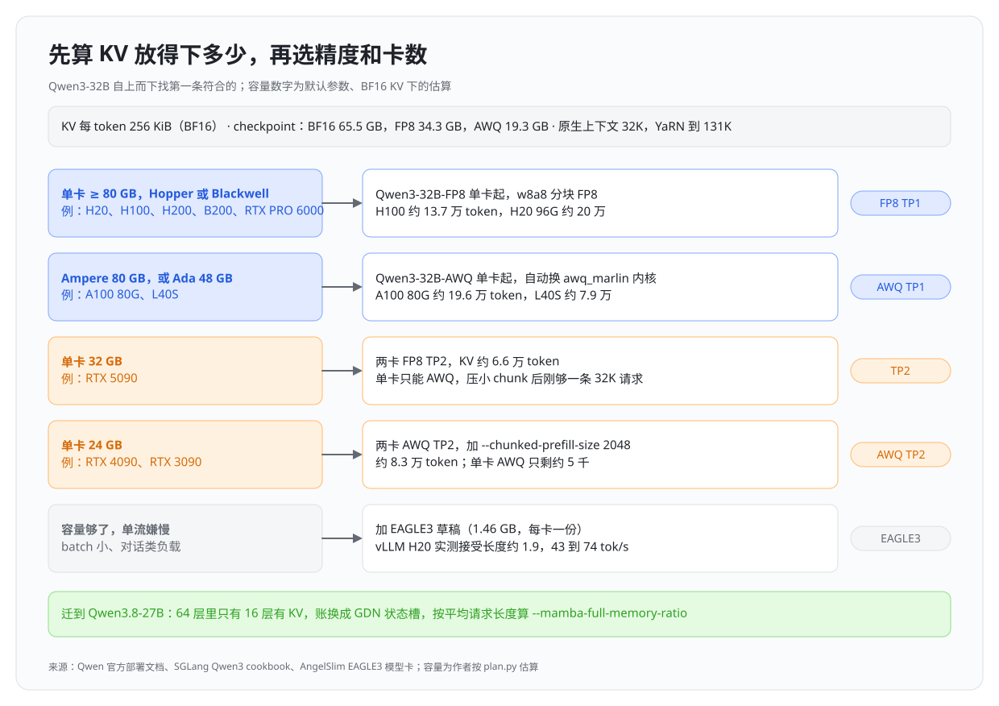
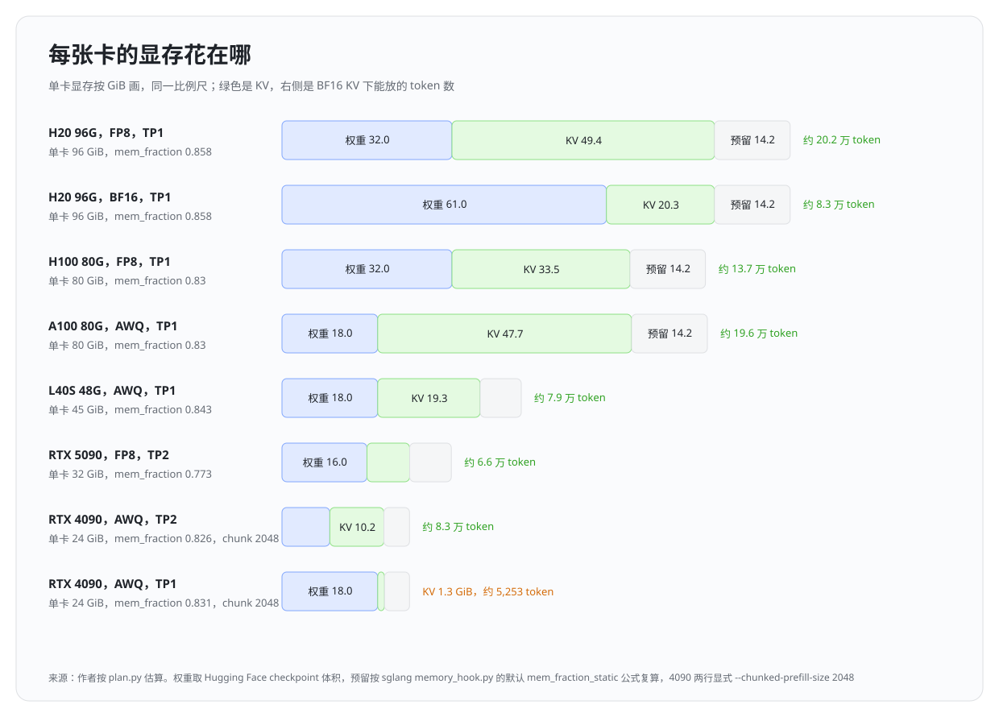

# SGL-23｜实战｜Qwen3-32B：单卡到两卡的 SGLang 部署，以及迁到 Qwen3.8-27B

> 🎯 <p><b>遇到的问题</b>：Qwen3-32B 是稠密模型，BF16 权重 65.5 GB，一张 80 GB 的 H100 装得下权重，却装不下几条 32K 请求的 KV<a href="https://huggingface.co/Qwen/Qwen3-32B">[1]</a><a href="https://huggingface.co/Qwen/Qwen3-32B/blob/main/config.json">[2]</a>。同一个模型在 H20 上 FP8 单卡能放约 20 万 token，在 4090 上 AWQ 单卡默认参数直接起不来。</p><p>SGLang 的 cookbook 只写了 H100、H200、B200 一类数据中心卡用 TP1<a href="https://docs.sglang.io/cookbook/autoregressive/Qwen/Qwen3">[3]</a>，Ampere、Ada 和消费级卡怎么配要自己算。这一篇把账从显存一路算到启动命令，再说明迁到 Qwen3.8-27B 时哪一笔账变了。</p><p><b>主线</b>：先按每 token 256 KiB 的 KV 算出一张卡能放多少 token，再按架构选精度：Hopper 和 Blackwell 走 FP8，Ampere 和 24 GB 卡走 AWQ。单卡放不下或 KV 不够就上 TP2，单流慢再加 EAGLE3。迁到 Qwen3.8-27B 时，账从 KV 换成 GDN 状态槽。</p><p><b>读完这一篇</b>：拿到一张卡，能算出 SGLang 默认会留多少显存、KV 还剩多少 token，按架构选 FP8 还是 AWQ、单卡还是两卡。能写出带 parser、YaRN 和 EAGLE3 的启动命令，知道每个开关在日志里怎么核对。换到 Qwen3.8-27B，知道 GDN 状态槽为什么让默认配比压低并发，平衡值怎么算。</p><p><b>数据来源</b>：H20 上的速度来自 Qwen 官方的 SGLang 基准<a href="https://qwen.readthedocs.io/en/latest/getting_started/speed_benchmark.html">[4]</a>，EAGLE3 的加速比和量化精度来自 AngelSlim 的公开评测<a href="https://huggingface.co/AngelSlim/Qwen3-32B_eagle3">[5]</a>，Qwen3.8-27B 的配比和 5090 数据来自 SGLang 和 vLLM 的 cookbook。跨引擎的吞吐对比取自 GPUStack、JarvisLabs 的公开压测和 vLLM 仓库里的几个 issue，第 6 章逐条注明硬件、版本和负载。各卡型的 KV 容量和理论上限没有逐卡实测，按 config.json、checkpoint 体积和 SGLang 的默认值公式推算，正文标为<b>估算</b>，2.3 节拿公开数据对过一遍。压测方法沿用 [SGL-03｜上手｜指标与压测：TTFT、TPOT、ITL 与 goodput](./03-bench.md)。</p><p><b>代码</b>：配套实验在 <a href="../23-qwen32b-deploy">zero-to-sglang/23-qwen32b-deploy</a>。<a href="../23-qwen32b-deploy/plan.py">plan.py</a> 输入卡型，复算 SGLang 默认的 mem_fraction_static，给出精度、卡数、KV 容量和启动命令。<a href="../23-qwen32b-deploy/smoke.py">smoke.py</a> 是 7.3 节的冒烟测试，<a href="../23-qwen32b-deploy/bench.sh">bench.sh</a> 是第 6 章的并发扫描。全部只用标准库，plan.py 带 25 个单测，不需要 GPU。Qwen3.8-27B 的配比计算器在 [SGL-24｜实战｜Qwen3.8-27B：混合 GDN 视觉模型的 SGLang 部署](./24-qwen38-27b-deploy.md) 的配套目录里。</p>

# 导读 · 结论先行

1. **先算 KV 还剩多少，再选精度。**Qwen3-32B 有 64 层、8 个 KV 头，KV 每 token 256 KiB，一条 32K 请求就是 8 GiB[[2]](https://huggingface.co/Qwen/Qwen3-32B/blob/main/config.json)。H100 跑 BF16 单卡，SGLang 默认留出 13.6 GiB 给激活和 CUDA Graph，KV 只剩约 1.8 万 token（**估算**），连一条满长请求都放不下。
2. **mem_fraction_static 的默认值是算出来的。**SGLang 按 chunked_prefill_size 和 CUDA Graph 档数预留显存，大于 60 GiB 的卡至少留 10 GiB。小卡把 chunk 压到 2048，默认值会跟着升高，4090 从 0.704 升到 0.831，这一步比手调 mem_fraction_static 稳。
3. **按架构选精度。**Hopper 和 Blackwell 用 FP8，走分块 FP8 GEMM。Ampere 没有 FP8 算力，FP8 退成 Marlin 仅权重量化，选 AWQ 更划算。Ada 支持 FP8，但分块 FP8 在 SM89 上落到 Triton 内核，24 GB 的 4090 用 AWQ 两卡更合适。
4. **单流慢先开 EAGLE3。**AngelSlim 的 1 层草稿只有 1.46 GB，H20 单卡 batch 1 平均从 43 tok/s 提到 74 tok/s，接受长度 1.91[[5]](https://huggingface.co/AngelSlim/Qwen3-32B_eagle3)。代价是每张卡多一份草稿权重和草稿 KV，KV 紧的卡要先算清楚。
5. **迁到 Qwen3.8-27B，账从 KV token 换成状态槽。**64 层里有 48 层是 Gated DeltaNet，每条请求固定占一块状态，--mamba-full-memory-ratio 决定状态和 KV 怎么分。默认 0.9 给 KV 分得太多，状态槽先用完而 KV 池空着；平衡配比和钉死并发的算法见第 8 章，完整数字与实战在 [SGL-24｜实战｜Qwen3.8-27B：混合 GDN 视觉模型的 SGLang 部署](./24-qwen38-27b-deploy.md)[[6]](https://lmsysorg.mintlify.app/cookbook/autoregressive/Qwen/Qwen3.8-27B)。



图里五行自上而下判断，找第一条满足的。80 GB 以上的 Hopper 和 Blackwell 卡用 FP8 单卡。A100 80G 和 48 GB 的 Ada 卡用 AWQ 单卡。32 GB 的 5090 单卡放不下 FP8 权重和够用的 KV，用两卡 FP8。24 GB 的卡用两卡 AWQ，再把 chunk 压到 2048。任何一档单流速度不够，再叠 EAGLE3。最底下一行是 Qwen3.8-27B，它的状态槽账在第 8 章单独算。

**📎 与系列其他文档的分工**：显存和带宽的算法见 [SGL-02｜上手｜推理账本：显存、KV 与 Roofline](./02-ledger.md)，CUDA Graph 见 [SGL-09｜原理｜Overlap 调度与 CUDA Graph：把 CPU 开销藏到 GPU 后面](./09-overlap-cudagraph.md)，FP8 和 AWQ 的格式见 [SGL-12｜原理｜量化：FP8、INT4 与 KV 量化怎么选](./12-quantization.md)，EAGLE3 的原理见 [SGL-13｜原理｜投机解码：EAGLE、MTP、NGRAM 怎么选、怎么调](./13-speculative.md)，参数调优的通用做法见 [SGL-17｜实战｜参数调优手册：从日志倒推配置](./17-tuning.md)。本篇只讲部署：一张卡该用哪种精度、几张卡，命令怎么写，数字怎么验。

# 第 1 章 · 部署前先回答的问题

Qwen3-32B 上线以后，社区里反复出现下面几类问题，每一类在本篇都有对应的小节。

| 现象 | 原因 | 对应小节 |
|-|-|-|
| H100 跑 BF16 起得来，但 32K 请求排队 | KV 只剩约 1.8 万 token，放不下一条满长请求 | 2.3、7.1 |
| 4090 单卡 AWQ 报 Not enough memory | 默认预留后 KV 预算是负数 | 2.2、7.1 |
| A100 上 FP8 能跑但不快 | Ampere 没有 FP8 算力，走的是 Marlin 仅权重量化 | 3.1 |
| FP8 开大 TP 报 not divisible by block_n = 128 | TP 切开后每片不是 128 的整数倍，Qwen3-32B 在 TP8 以内不会撞上，同系列其他尺寸会 | 3.3 |
| content 里混着思考过程 | 没开 --reasoning-parser qwen3 | 4.3、7.3 |
| 工具调用返回在 content 里，tool_calls 为空 | 没开 --tool-call-parser qwen25 | 4.3、7.3 |
| 开了 YaRN 以后短文本效果变差 | SGLang 的 YaRN 是静态缩放，对所有长度都生效 | 4.2 |
| 两张 3090 或 4090 跑 TP2，并发一上来进程退出 | CUDA Graph 大档位回放出错，vLLM #40121 报过 Xid 13 | 4.4 |
| 开 EAGLE3 后吞吐反而下降 | 高并发下草稿开销盖过收益，KV 也被草稿占掉一块 | 5.2 |
| 网上 SGLang 和 vLLM 的对比结论相反 | 负载和版本不同，短对话高并发差距在三成以内，长输入和分块 FP8 差距最大 | 6.3 |
| Qwen3.8-27B 并发上不去，KV 池却很大 | 默认 --mamba-full-memory-ratio 0.9 给 KV 分多了 | 8.2 |

# 第 2 章 · 先算账：一张卡能放多少 token

## 2.1 模型、KV 和 checkpoint

config.json 给出的结构：64 层，hidden 5120，FFN 中间维度 25600，64 个 Q 头、8 个 KV 头，head_dim 128，词表 151936，max_position_embeddings 40960[[2]](https://huggingface.co/Qwen/Qwen3-32B/blob/main/config.json)。参数量 32.8B，去掉嵌入是 31.2B。原生上下文 32K，开 YaRN 可到 131K[[1]](https://huggingface.co/Qwen/Qwen3-32B)。SGLang 里对应的类是 [Qwen3ForCausalLM](https://github.com/sgl-project/sglang/blob/8fabf5e/python/sglang/srt/models/qwen3.py#L543)，要求 sglang 0.4.6.post1 以上。

KV 每 token 的体积按 2（K 和 V）× 层数 × KV 头数 × head_dim × 字节数算：2 × 64 × 8 × 128 × 2 = 256 KiB。KV 用 FP8 存，减半到 128 KiB。一条 32K 请求的 KV 是 8 GiB，131K 是 32 GiB。TP2 时 8 个 KV 头每卡分 4 个，每卡每 token 128 KiB。

Hugging Face 上常用的几个 checkpoint：

| checkpoint | 文件体积 | 格式 | 适合的架构 |
|-|-|-|-|
| Qwen/Qwen3-32B | 65.52 GB | BF16 | 显存够大的任何卡，单卡要 96 GB 以上才有像样的 KV |
| Qwen/Qwen3-32B-FP8 | 34.32 GB | e4m3，权重 128×128 分块缩放，激活动态量化 | Hopper、Blackwell，Ada 能跑但内核弱 |
| Qwen/Qwen3-32B-AWQ | 19.33 GB | INT4 权重，W4A16 | Ampere、Ada、24 GB 消费级卡 |
| AngelSlim NVFP4 | 20.67 GB | FP4 权重 | Blackwell |

Qwen 官方用 Transformers 测过加载后的显存：BF16 62751 MB，FP8 33379 MB，AWQ 19109 MB[[4]](https://qwen.readthedocs.io/en/latest/getting_started/speed_benchmark.html)。本篇按 checkpoint 体积换算成 GiB 当作权重占用，BF16 约 61.0 GiB，FP8 约 32.0 GiB，AWQ 约 18.0 GiB。

拿体积除以 32.8B 参数，BF16 每参数 16.0 bit，FP8 是 8.4 bit，AWQ 是 4.7 bit。FP8 和 AWQ 都比标称位宽多出一截，多出来的主要是没量化的部分。词嵌入和 lm_head 各是 151936 × 5120，合计约 1.56B 参数，两个 checkpoint 里都按 BF16 存，约 2.9 GiB，剩下的是分块缩放、零点和 RMSNorm 权重。估算显存时直接用文件体积，按 4 bit 或 8 bit 乘参数量会少算两三 GiB，24 GB 的卡上这两三 GiB 就是一半的 KV。

## 2.2 SGLang 默认留多少显存

不写 --mem-fraction-static 时，SGLang 在 [handle_gpu_memory_settings](https://github.com/sgl-project/sglang/blob/8fabf5e/python/sglang/srt/arg_groups/memory_hook.py#L47) 里推一个默认值。先按显存大小定 chunked_prefill_size 和 decode CUDA Graph 的 max_bs，再在 [memory_hook.py:309](https://github.com/sgl-project/sglang/blob/8fabf5e/python/sglang/srt/arg_groups/memory_hook.py#L309) 算预留：512 MiB，加 max(chunk, 2048) × 1.5 MiB 的激活，加 TP × PP / 8 × 1024 MiB，再加 CUDA Graph 的预留。

CUDA Graph 预留在 [memory_hook.py:357](https://github.com/sgl-project/sglang/blob/8fabf5e/python/sglang/srt/arg_groups/memory_hook.py#L357)，是 decode max_bs × 2 加预填图档数 × 8，单位 MiB。显存大于 60 GiB 时预留至少 10 GiB，最后在 [memory_hook.py:325](https://github.com/sgl-project/sglang/blob/8fabf5e/python/sglang/srt/arg_groups/memory_hook.py#L325) 取（显存 − 预留）÷ 显存，保留三位小数。

这个默认值一般比手写的保守。[memory_hook.py:290](https://github.com/sgl-project/sglang/blob/8fabf5e/python/sglang/srt/arg_groups/memory_hook.py#L290) 附近还有一条按实际抓图后的显存回算的分支，默认关闭（[environ.py:642](https://github.com/sgl-project/sglang/blob/8fabf5e/python/sglang/srt/environ.py#L642)），本篇不考虑。plan.py 复算的结果：

| 卡型 | TP | chunk | decode max_bs | 预填图档数 | 预留 | 默认 mem_fraction_static |
|-|-|-|-|-|-|-|
| H20 96G | 1 | 8192 | 256 | 58 | 13.6 GiB | 0.858 |
| H100 80G | 1 | 8192 | 256 | 58 | 13.6 GiB | 0.83 |
| H200 | 1 | 8192 | 256 | 58 | 13.6 GiB | 0.903 |
| B200 | 1 | 16384 | 512 | 74 | 26.2 GiB | 0.854 |
| L40S | 1 | 4096 | 32 | 50 | 7.1 GiB | 0.843 |
| RTX 5090 | 1 | 4096 | 48 | 50 | 7.1 GiB | 0.777 |
| RTX 4090 | 1 | 4096 | 48 | 50 | 7.1 GiB | 0.704 |
| RTX 4090 | 1 | 2048（显式） | 48 | 42 | 4.0 GiB | 0.831 |
| RTX 4090 | 2 | 2048（显式） | 48 | 42 | 4.2 GiB | 0.826 |

最后三行对小卡最有用。4090 默认 chunk 4096，预留 7.1 GiB，在 24 GB 里占了近三成。只写一个 --chunked-prefill-size 2048，SGLang 按它重算，预留降到 4.0 GiB，默认值升到 0.831，KV 多出 3 GiB。代价是长 prompt 的 prefill 要多切几块，TTFT 稍长。手写 --mem-fraction-static 0.88 也能挤出空间，但 CUDA Graph 的余量不够时会在抓图阶段 OOM，压 chunk 让 SGLang 自己重算更稳。

## 2.3 每卡显存账

KV 预算 = 加载前的空闲显存 × mem_fraction_static − 每卡权重，再除以每卡每 token 的 KV 字节数，就是能放的 token 数。加载前的空闲显存按标称显存减约 800 MiB 的 CUDA 上下文估。下图把几种典型配置画在一起，灰色是预留，深色是权重，浅色是 KV：



| 配置 | 每卡权重 | 每卡 KV 预算 | KV token | batch 1 理论上限 |
|-|-|-|-|-|
| H100 BF16 TP1，默认 | 61.0 GiB | 4.4 GiB | 约 1.8 万 | 51 tok/s |
| H100 BF16 TP1，chunk 2048 | 61.0 GiB | 7.9 GiB | 约 3.2 万 | 51 tok/s |
| H100 BF16 TP2 | 30.5 GiB | 34.8 GiB | 约 28.5 万 | 102 tok/s |
| H100 FP8 TP1 | 32.0 GiB | 33.5 GiB | 约 13.7 万 | 98 tok/s |
| H20 96G BF16 TP1 | 61.0 GiB | 20.3 GiB | 约 8.3 万 | 61 tok/s |
| H20 96G FP8 TP1 | 32.0 GiB | 49.4 GiB | 约 20.2 万 | 117 tok/s |
| A100 80G AWQ TP1 | 18.0 GiB | 47.7 GiB | 约 19.6 万 | 103 tok/s |
| RTX 5090 FP8 TP2 | 16.0 GiB | 8.0 GiB | 约 6.6 万 | 104 tok/s |
| RTX 4090 AWQ TP1，默认 | 18.0 GiB | −1.7 GiB | 起不来 | – |
| RTX 4090 AWQ TP2，chunk 2048 | 9.0 GiB | 10.2 GiB | 约 8.3 万 | 103 tok/s |

表里的 token 数都是**估算**，真实值以启动日志 [scheduler.py:1272](https://github.com/sgl-project/sglang/blob/8fabf5e/python/sglang/srt/managers/scheduler.py#L1272) 打出的 max_total_num_tokens 为准。理论上限按 batch 1 每步把本卡权重从显存读一遍算，等于带宽除以每卡权重，TP2 时每卡只读一半，所以翻倍。实际 decode 还要读 KV、跑 all-reduce，能到理论值的四到六成就算正常。

H100 BF16 单卡那两行说明，80 GB 的卡装下 65 GB 的权重以后，KV 已经不够一条 32K 请求。想要 BF16 的精度，就上 TP2，每卡权重减半，KV 从 4.4 GiB 涨到 34.8 GiB。不在乎那一点精度，换 FP8 单卡更省。4090 单卡 AWQ 默认预留 7.1 GiB，加上 18 GiB 权重已经超过 22.9 GiB 的可用显存，KV 是负数，启动时报 ["Not enough memory. Please try to increase --mem-fraction-static."](https://github.com/sgl-project/sglang/blob/8fabf5e/python/sglang/srt/model_executor/pool_configurator.py#L96)。

这张表能拿公开数据对上两处。Spheron 用 vLLM 测过，4090 装得下约 20 GB 的 Qwen3-32B AWQ 权重，默认上下文下 OOM，要把 --max-model-len 压到 2048 才起得来[[7]](https://www.spheron.network/blog/rtx-5090-vs-rtx-4090/)，和表里 4090 单卡 −1.7 GiB 的结论同向。Spheron 的 Qwen3 部署指南说 H100 上 FP8 权重约 32 GB，KV 还剩约 34 GB[[8]](https://www.spheron.network/blog/deploy-qwen3-gpu-cloud/)，表里 H100 FP8 单卡的 KV 预算是 33.5 GiB，约 36 GB，两边差在 SGLang 和 vLLM 预留的口径不同（见 2.4 节）。两处都只能核对量级，最终数字还是看启动日志。

## 2.4 vLLM 怎么做

vLLM 的思路不同：--gpu-memory-utilization 默认 0.9，启动时实际跑一次最大 batch 的前向，量出激活峰值，剩下的全给 KV[[9]](https://docs.vllm.ai/en/latest/configuration/engine_args.html)。CUDA Graph 抓图发生在 KV 分配之后，能用的只有 0.9 之外那一成余量，小卡上容易在这一步 OOM，这时候加 --enforce-eager 关掉 CUDA Graph，或者调小 --max-num-seqs。Qwen 的 vLLM 文档给 Qwen3 用的工具 parser 是 hermes，思考内容用 --reasoning-parser qwen3 分出来[[10]](https://qwen.readthedocs.io/en/latest/deployment/vllm.html)。

两边的差别落到选卡上：SGLang 先按公式留足 CUDA Graph，再把剩下的给 KV，KV 少一点但起得来。vLLM 量完激活把剩余显存都给 KV，KV 多一点，余量全靠 0.9 那一成。同一张 24 GB 的卡，两个引擎报的 KV 容量差个一两 GiB 是正常的。

# 第 3 章 · 按架构选精度

## 3.1 FP8 在每种架构上走哪条内核

Qwen3-32B-FP8 用的是 128×128 分块缩放，SGLang 在 [dispatch_w8a8_block_fp8_linear](https://github.com/sgl-project/sglang/blob/8fabf5e/python/sglang/srt/layers/quantization/fp8_utils.py#L704) 里选内核，自动选择的顺序在 [\_dispatch_auto_backend](https://github.com/sgl-project/sglang/blob/8fabf5e/python/sglang/srt/layers/quantization/fp8_utils.py#L1170)：DeepGEMM、FlashInfer（Blackwell 数据中心卡）、CUTLASS（SM120）、AITER、NPU、XPU，最后是 Triton。

Hopper 走 DeepGEMM[[11]](https://github.com/deepseek-ai/DeepGEMM)，B200 走 FlashInfer，RTX 5090 和 RTX PRO 6000 走 CUTLASS。Ada 架构前面几项都不满足，落到 Triton 内核，能用但比 AWQ 的 Marlin 内核慢。

Ampere 没有 FP8 张量核。[can_auto_enable_marlin_fp8](https://github.com/sgl-project/sglang/blob/8fabf5e/python/sglang/srt/layers/quantization/fp8_utils.py#L2794) 在 80 ≤ SM < 89 时打开 Marlin，[fp8.py:514](https://github.com/sgl-project/sglang/blob/8fabf5e/python/sglang/srt/layers/quantization/fp8.py#L514) 据此把 FP8 权重当成仅权重量化来算，启动时打出 [Your GPU does not have native support for FP8 computation](https://github.com/sgl-project/sglang/blob/8fabf5e/python/sglang/srt/layers/quantization/marlin_utils_fp8.py#L105) 的警告[[12]](https://arxiv.org/abs/2408.11743)。

这条路线省了显存，但计算是 BF16，权重 32 GiB 比 AWQ 的 18 GiB 多读近一倍，batch 1 更慢。vLLM 的说明一致：计算能力 8.9 以上 FP8 走 W8A8，Ampere 走 Marlin W8A16[[10]](https://qwen.readthedocs.io/en/latest/deployment/vllm.html)[[13]](https://docs.vllm.ai/en/latest/features/quantization/)。

GPUStack 在单张 A100 SXM 80GB 上实测过这一点。vLLM v0.11.0 跑 ShareGPT 1000 条请求，BF16 总吞吐 1730.98 tok/s，换 FP8 checkpoint 降到 1563.33，平均 TPOT 从 149.67 ms 涨到 339.76 ms，AWQ 是 1767.21，比 BF16 略高。

同一页里 TensorRT-LLM 加载 FP8 直接报 Unsupported SM version for FP8 block scaling GEMM[[14]](https://docs.gpustack.ai/2.0/performance-lab/qwen3-32b/a100/)。这是 vLLM 的数字，SGLang 在 Ampere 上同样走 Marlin FP8，方向一致。

AWQ 在 Ampere 以上会被自动改成 awq_marlin：[override_quantization_method](https://github.com/sgl-project/sglang/blob/8fabf5e/python/sglang/srt/layers/quantization/awq/awq.py#L333) 检查能否转换，能转就打出 [Using awq_marlin kernel](https://github.com/sgl-project/sglang/blob/8fabf5e/python/sglang/srt/layers/quantization/awq/awq.py#L340) 这一行[[15]](https://arxiv.org/abs/2306.00978)。强行写 --quantization awq 会走旧内核，[awq.py:348](https://github.com/sgl-project/sglang/blob/8fabf5e/python/sglang/srt/layers/quantization/awq/awq.py#L348) 有对应警告。部署时不写 --quantization，让 SGLang 从 checkpoint 自己识别最稳[[16]](https://docs.sglang.io/docs/advanced_features/quantization)。

| 架构 | 代表卡 | FP8 走的内核 | AWQ 走的内核 | 建议 |
|-|-|-|-|-|
| Blackwell 数据中心 | B200 | FlashInfer 分块 FP8 | awq_marlin | FP8 |
| Blackwell 消费级 SM120 | RTX 5090、RTX PRO 6000 | CUTLASS 分块 FP8 | awq_marlin | FP8 |
| Hopper | H100、H200、H20 | DeepGEMM | awq_marlin | FP8 |
| Ada | L40S、RTX 4090 | Triton 分块 FP8 | awq_marlin | AWQ |
| Ampere | A100、RTX 3090 | Marlin 仅权重 FP8 | awq_marlin | AWQ |

## 3.2 精度损失有多大

AngelSlim 在同一套评测上比过几种量化[[5]](https://huggingface.co/AngelSlim/Qwen3-32B_eagle3)：

| 精度 | CEVAL | MMLU | GSM8K | HumanEval |
|-|-|-|-|-|
| BF16 | 86.55 | 82.00 | 74.53 | 37.80 |
| FP8-Static | 86.92 | 81.78 | 70.20 | 39.63 |
| FP8-Dynamic | 86.55 | 81.89 | 70.43 | 38.41 |
| INT4-GPTQ | 86.18 | 81.01 | – | 43.29 |
| INT4-AWQ | 86.18 | 81.54 | – | 36.59 |

知识类的 CEVAL 和 MMLU 几种精度差不到 1 分，GPUStack 对 FP8 的总结也是多数模型精度损失在 1% 以内[[17]](https://docs.gpustack.ai/2.0/performance-lab/qwen3-32b/h100/)。GSM8K 上 FP8 掉了约 4 分，是表里最明显的一处，数学推理多的业务上线前要用自己的题再测一遍。HumanEval 样本少，几分的波动不能说明 INT4 更好。官方 FP8 checkpoint 是动态激活量化，对应表里 FP8-Dynamic 那一行[[18]](https://arxiv.org/abs/2209.05433)。

## 3.3 FP8 和 TP 的约束

FP8 权重按 128×128 分块存缩放，TP 切开以后每一片也要是 128 的整数倍，否则加载时报 not divisible by weight quantization block_n = 128[[10]](https://qwen.readthedocs.io/en/latest/deployment/vllm.html)[[19]](https://github.com/QwenLM/Qwen3/discussions/1674)。Qwen3-32B 的 FFN 中间维度 25600 = 128 × 200，TP2 每片 12800 = 128 × 100，可以。

TP4 每片 6400 = 128 × 50，也整除，TP8 每片 3200 = 128 × 25，同样整除。注意力一侧的 Q 投影是 64 × 128 = 8192，TP8 每片 1024，也没问题，所以这个模型 FP8 在 TP8 以内都能切。换到别的模型要先算这一步，中间维度除以 TP 后不是 128 的整数倍，加载就会报错。plan.py 的 fp8_tp_ok 做的就是这个检查。

# 第 4 章 · 启动命令

## 4.1 单卡和两卡

H20、H100、H200、B200 用 FP8 单卡，命令最短。cookbook 在 H100、H200、B200、B300 和 MI300X 上都用 TP1，上下文开到 128000 也没问题[[3]](https://docs.sglang.io/cookbook/autoregressive/Qwen/Qwen3)：

```bash
sglang serve Qwen/Qwen3-32B-FP8 \
  --reasoning-parser qwen3 --tool-call-parser qwen25 \
  --context-length 32768 \
  --host 0.0.0.0 --port 30000
```

一定要 BF16 的，H100 和 A100 80G 用两卡。4090、3090 用 AWQ 两卡，同时把 chunk 压到 2048，原因见 2.2 节：

```bash
# H100 / A100 80G 跑 BF16
sglang serve Qwen/Qwen3-32B --tp 2 \
  --reasoning-parser qwen3 --tool-call-parser qwen25 \
  --context-length 32768 --host 0.0.0.0 --port 30000

# RTX 4090 / 3090 两卡
sglang serve Qwen/Qwen3-32B-AWQ --tp 2 \
  --reasoning-parser qwen3 --tool-call-parser qwen25 \
  --context-length 32768 --chunked-prefill-size 2048 \
  --host 0.0.0.0 --port 30000
```

几个参数在源码里的位置：--mem-fraction-static 在 [schedule.py:27](https://github.com/sgl-project/sglang/blob/8fabf5e/python/sglang/srt/arg_groups/fields/schedule.py#L27)，--chunked-prefill-size 在 [schedule.py:52](https://github.com/sgl-project/sglang/blob/8fabf5e/python/sglang/srt/arg_groups/fields/schedule.py#L52)，--context-length 在 [model.py:110](https://github.com/sgl-project/sglang/blob/8fabf5e/python/sglang/srt/arg_groups/fields/model.py#L110)，--quantization 在 [model.py:177](https://github.com/sgl-project/sglang/blob/8fabf5e/python/sglang/srt/arg_groups/fields/model.py#L177)，--kv-cache-dtype 在 [model.py:197](https://github.com/sgl-project/sglang/blob/8fabf5e/python/sglang/srt/arg_groups/fields/model.py#L197)[[20]](https://docs.sglang.io/docs/advanced_features/server_arguments)。

KV 紧的卡可以加 --kv-cache-dtype fp8_e4m3 把 KV 减半，5090 单卡 AWQ 加 chunk 2048 时 KV 从约 3.7 万 token 涨到约 7.5 万（**估算**）。FP8 KV 对精度有影响，长上下文检索类任务上线前要测[[21]](https://docs.sglang.io/docs/advanced_features/quantized_kv_cache)。

## 4.2 YaRN 和长上下文

config.json 里 max_position_embeddings 是 40960，Qwen 的解释是 32768 留给输出、8192 留给输入。超过 32K 要打开 YaRN[[22]](https://arxiv.org/abs/2309.00071)，在 SGLang 里通过 [--json-model-override-args](https://github.com/sgl-project/sglang/blob/8fabf5e/python/sglang/srt/arg_groups/fields/model.py#L152) 改 rope_scaling[[23]](https://qwen.readthedocs.io/en/latest/deployment/sglang.html)：

```bash
sglang serve Qwen/Qwen3-32B-AWQ \
  --reasoning-parser qwen3 --tool-call-parser qwen25 \
  --json-model-override-args '{"rope_scaling":{"rope_type":"yarn","factor":4.0,"original_max_position_embeddings":32768}}' \
  --context-length 131072 --host 0.0.0.0 --port 30000
```

SGLang 和 vLLM 的 YaRN 都是静态的，缩放系数对所有长度生效，短文本的效果会受一点影响。Qwen 的建议是只在确实需要长上下文时打开，平均请求在 65536 以内就把 factor 改成 2.0。131K 一条请求的 KV 是 32 GiB，A100 80G AWQ 单卡的 KV 预算 47.7 GiB，只够一条多一点。真要做长文档服务，至少上 H200 或者两卡。

## 4.3 parser、采样和思考模式

Qwen3 的输出里思考过程夹在 think 标签里，工具调用是 Qwen2.5 的格式。--reasoning-parser qwen3 用 [Qwen3Detector](https://github.com/sgl-project/sglang/blob/8fabf5e/python/sglang/srt/parser/reasoning_parser.py#L441) 把思考内容拆进 reasoning_content[[24]](https://docs.sglang.io/docs/advanced_features/separate_reasoning)，--tool-call-parser qwen25 对应 [function_call_parser.py:105](https://github.com/sgl-project/sglang/blob/8fabf5e/python/sglang/srt/function_call/function_call_parser.py#L105)，把工具调用拆进 tool_calls[[25]](https://docs.sglang.io/docs/advanced_features/tool_parser)。两个都不写，客户端拿到的 content 是原样文本。vLLM 那边工具 parser 写 hermes，读的是同一种格式[[10]](https://qwen.readthedocs.io/en/latest/deployment/vllm.html)。

采样参数按 Qwen 的推荐：思考模式 temperature 0.6、top_p 0.95、top_k 20、min_p 0，不要用贪心解码，容易陷入重复。非思考模式 temperature 0.7、top_p 0.8、top_k 20，vLLM 文档还加了 presence_penalty 1.5 防重复[[1]](https://huggingface.co/Qwen/Qwen3-32B)[[10]](https://qwen.readthedocs.io/en/latest/deployment/vllm.html)。SGLang 的 [--sampling-defaults](https://github.com/sgl-project/sglang/blob/8fabf5e/python/sglang/srt/arg_groups/fields/serving.py#L232) 默认值是 model，会读 checkpoint 里的 generation_config.json，客户端不传采样参数时就用模型自带的这一组。

思考开关在请求里给：chat_template_kwargs 带 enable_thinking 为 false 就关掉思考。在 enable_thinking 为 true 的前提下，用户消息末尾写 /think 或 /no_think 可以逐轮切换，enable_thinking 为 false 时这两个指令不起作用[[26]](https://arxiv.org/abs/2505.09388)。思考模式输出长，32K 的上下文里 prompt 加思考很容易顶满，这也是 context-length 不要压得太小的原因。

## 4.4 两张卡：TP2 还是两个副本

手里有两张卡、单卡又装得下的时候，还有一个选择：不切模型，每张卡各起一份，SGLang 里写 --dp-size 2（[parallel.py:73](https://github.com/sgl-project/sglang/blob/8fabf5e/python/sglang/srt/arg_groups/fields/parallel.py#L73)），由内置的路由把请求分给两个副本。两种做法的账：

| 卡型和精度 | TP2：KV token / batch 1 上限 | 两个副本：每份 KV token / 每份 batch 1 上限 | 说明 |
|-|-|-|-|
| H100 FP8 | 约 40.4 万 / 195 | 约 13.7 万 / 98 | TP2 每卡权重少 16 GiB，KV 比两份合计多近五成 |
| A100 80G AWQ | 约 46.4 万 / 207 | 约 19.6 万 / 103 | 单份约 19.6 万 token，够六条 32K 请求 |
| RTX 5090 AWQ | 约 12.3 万 / 185 | 约 3.7 万 / 93（chunk 2048） | 单份放不下两条 32K 请求 |
| RTX 4090 AWQ | 约 8.3 万 / 103（chunk 2048） | 起不来 | 只能 TP2 |

表里都是**估算**。TP2 的 batch 1 上限翻倍，是因为每卡每步只读一半权重，代价是每步前向要做 128 次 all-reduce（64 层，注意力和 FFN 后各一次）。batch 1 时每次只传 5120 个 BF16，约 10 KiB，耗时由延迟决定，和带宽关系不大。有 NVLink 的数据中心卡，这部分开销很小。

PCIe 上的两张卡，SGLang 的自定义 all-reduce 要求卡间能 P2P，测不通时打出 [platform lacks GPU P2P capability](https://github.com/sgl-project/sglang/blob/8fabf5e/python/sglang/srt/distributed/device_communicators/custom_all_reduce_utils.py#L506) 的警告，退回 NCCL，每次 all-reduce 的固定延迟更高。理论上限翻倍的那部分，在消费级卡上能兑现多少要实测。

选哪种按两条判断。单卡的 KV 放得下目标长度的请求，又更在意总吞吐，用两个副本，两张卡之间没有通信，高并发时总吞吐接近单卡的两倍。单卡 KV 不够，或者单流延迟要压低，用 TP2。H100 和 A100 80G 两种都能选，5090 和 4090 基本只能 TP2。

消费级卡跑 TP2 还有一个公开的坑。vLLM 的 #40121 在两张 NVLink 互联的 3090 上跑 Qwen3-32B-AWQ TP2，CUDA Graph 在 batch 大于 8 的档位回放时触发 Xid 13 非法地址访问，进程直接退出。作者最后只抓 1、2、4、8 四档，每流约 22 tok/s，32 并发总吞吐约 720 tok/s。全关 CUDA Graph 每流约 21 tok/s，但总吞吐掉到约四分之一。

不走 Marlin 的旧 AWQ 内核每流只有约 4.8 tok/s[[27]](https://github.com/vllm-project/vllm/issues/40121)。这是 vLLM 上的报告，SGLang 遇到同样的症状，对应的开关是 [--cuda-graph-max-bs-decode](https://github.com/sgl-project/sglang/blob/8fabf5e/python/sglang/srt/arg_groups/fields/exec_.py#L632) 限制最大档位，或者 [--cuda-graph-bs-decode](https://github.com/sgl-project/sglang/blob/8fabf5e/python/sglang/srt/arg_groups/fields/exec_.py#L643) 直接列出要抓的档位，例如 1 2 4 8。显存小于 35 GiB 的卡，SGLang 默认 decode 图抓到 48（[memory_hook.py:102](https://github.com/sgl-project/sglang/blob/8fabf5e/python/sglang/srt/arg_groups/memory_hook.py#L102)）。

# 第 5 章 · EAGLE3 投机解码

## 5.1 草稿模型和命令

Qwen3-32B 没有自带 MTP 头，用 AngelSlim 训的 EAGLE3 草稿 AngelSlim/Qwen3-32B_eagle3。它是 1 层的 Llama 结构，权重 1.46 GB，草稿词表 32000[[5]](https://huggingface.co/AngelSlim/Qwen3-32B_eagle3)[[28]](https://arxiv.org/abs/2503.01840)。SGLang 里对应 [LlamaForCausalLMEagle3](https://github.com/sgl-project/sglang/blob/8fabf5e/python/sglang/srt/models/llama_eagle3.py#L272)，参数在 [spec.py:31](https://github.com/sgl-project/sglang/blob/8fabf5e/python/sglang/srt/arg_groups/fields/spec.py#L31) 到 [spec.py:66](https://github.com/sgl-project/sglang/blob/8fabf5e/python/sglang/srt/arg_groups/fields/spec.py#L66)[[29]](https://docs.sglang.io/docs/advanced_features/speculative_decoding)：

```bash
sglang serve Qwen/Qwen3-32B-FP8 \
  --reasoning-parser qwen3 --tool-call-parser qwen25 \
  --context-length 32768 \
  --speculative-algorithm EAGLE3 --speculative-draft-model-path AngelSlim/Qwen3-32B_eagle3 \
  --speculative-num-steps 3 --speculative-eagle-topk 1 --speculative-num-draft-tokens 4 \
  --host 0.0.0.0 --port 30000
```

3、1、4 这组值和 cookbook 的推荐一致[[3]](https://docs.sglang.io/cookbook/autoregressive/Qwen/Qwen3)。草稿每走一步只出 1 个候选，3 步加上目标模型自己那一个 token，一次验证最多 4 个。topk 大于 1 会变成树形草稿，接受长度能高一点，但验证开销也大，Qwen3-32B 这种稠密模型收益不明显。

AngelSlim 在 1 张 H20 上用 vLLM v0.11.2 测的结果，num_speculative_tokens 为 2，batch 1，输出 1024：

| 数据集 | 无投机 tok/s | EAGLE3 tok/s | 加速比 | 接受长度 |
|-|-|-|-|-|
| GSM8K | 43.49 | 80.43 | 1.85 | 2.01 |
| Alpaca | 43.38 | 72.49 | 1.67 | 1.90 |
| HumanEval | 43.19 | 71.57 | 1.66 | 1.86 |
| MT-bench | 43.30 | 74.10 | 1.71 | 1.86 |
| 平均 | 43.32 | 74.10 | 1.71 | 1.91 |

数学题接受长度最高，开放式对话最低，和草稿模型训练数据的分布一致。这是 vLLM 的数字，SGLang 里步数用 3，接受长度会再高一些，但每步多一次草稿前向，最终加速比要自己测。

## 5.2 草稿占掉的显存和适用范围

草稿权重每张卡都放一份，TP2 不会切开。草稿也有自己的 KV，SGLang 给目标和草稿一起分 KV 池。H20 FP8 单卡开 EAGLE3，plan.py 按每卡权重 33.3 GiB 算，KV 从约 20.2 万降到约 19.7 万 token，影响很小。H100 FP8 从约 13.7 万降到约 13.2 万（**估算**）。开投机后 decode CUDA Graph 的档数也会变，[--cuda-graph-max-bs-decode](https://github.com/sgl-project/sglang/blob/8fabf5e/python/sglang/srt/arg_groups/fields/exec_.py#L632) 一般不用手动改。

投机解码换的是单流延迟。并发上来以后，GPU 本来就在满负荷算大 batch，草稿多出的前向和被拒的 token 都是额外开销，吞吐可能反而下降。实际做法是按并发分两套配置：交互式、低并发的服务开 EAGLE3，离线批量、高并发的服务关掉。中间地带用第 6 章的压测脚本两套各扫一遍，看交叉点落在多少并发。

# 第 6 章 · 性能：官方基准和自己怎么测

## 6.1 Qwen 官方的 H20 基准

Qwen 官方用 SGLang 0.4.6.post1 在 H20 96G 上测过 batch 1 的速度，输出固定 2048 token，速度定义是（输入 + 输出）÷ 总耗时[[4]](https://qwen.readthedocs.io/en/latest/getting_started/speed_benchmark.html)。这个口径把 prefill 也算进去了，输入越长数字越大，看不出 decode 快不快。表里最后一列按输出 2048 ÷（输入 + 2048）折回只算输出的速度：

| 输入长度 | BF16 | FP8 | AWQ | 只算输出 BF16 / FP8 / AWQ |
|-|-|-|-|-|
| 1 | 20.72 | 46.17 | 47.67 | 20.7 / 46.1 / 47.6 |
| 6144 | 77.82 | 165.71 | 159.99 | 19.5 / 41.4 / 40.0 |
| 14336 | 143.08 | 287.60 | 260.44 | 17.9 / 36.0 / 32.6 |
| 30720 | 240.75 | 436.59 | 366.84 | 15.0 / 27.3 / 22.9 |
| 63488 | 342.96 | 532.18 | 425.23 | 10.7 / 16.6 / 13.3 |
| 129024 | 711.40（TP2） | 491.45 | 395.96 | 11.1 / 7.7 / 6.2 |

短输入时 FP8 是 BF16 的 2.2 倍，基本就是权重体积之比，batch 1 的 decode 是读权重的带宽活。AWQ 权重更小，短输入时却只和 FP8 持平，W4A16 每步要先反量化，Hopper 上省下的带宽被这一步吃掉了。输入变长以后，AWQ 掉得比 FP8 快，prefill 是算力活，W4A16 用 BF16 张量核算，FP8 用 FP8 张量核，算力差一倍。

H20 FP8 的理论上限是 4.0 TB/s ÷ 32 GiB ≈ 117 tok/s（**估算**），实测 46 tok/s，约四成。差距来自 KV 读取、kernel 启动和调度开销，batch 1 下这些固定成本占比最大。这组数字是 0.4.6.post1 测的，现在的版本 CUDA Graph 和 DeepGEMM 都有改进，自己测出来高一些是正常的。129024 那一行 BF16 单卡放不下 KV，官方改用了 TP2，不能和另外两列直接比。

## 6.2 用 bench.sh 扫并发

[bench.sh](../23-qwen32b-deploy/bench.sh) 先用 2048 进 256 出预热一轮，触发 CUDA Graph 和 DeepGEMM 的 JIT 编译，再按并发 1、4、8、16、32、64 扫 6144 进 2048 出，每档 8 倍并发数的请求，结果写成 qwen_c\*.jsonl，最后汇总输出吞吐、TTFT 和 ITL 的中位数[[30]](https://docs.sglang.io/docs/developer_guide/bench_serving)。6144 进 2048 出和上表的一行对齐，1 并发那一行可以直接和官方数字比。

扫并发时每档都带了 --flush-cache（[serving.py:2697](https://github.com/sgl-project/sglang/blob/8fabf5e/python/sglang/benchmark/serving.py#L2697)）。random 数据集按种子 42 从 ShareGPT 抽对话，再截断或重复到指定长度（[random.py:85](https://github.com/sgl-project/sglang/blob/8fabf5e/python/sglang/benchmark/datasets/random.py#L85)），抽样顺序和请求条数无关，并发 4 那一档的前 4 条里就有并发 1 测过的那条。客户端计时前还会拿第一条请求预热一次（[serving.py:1468](https://github.com/sgl-project/sglang/blob/8fabf5e/python/sglang/benchmark/serving.py#L1468)）。不清缓存，这些请求在 radix 树里整段命中，TTFT 偏低，吞吐偏高。客户端默认 ignore_eos（[serving.py:289](https://github.com/sgl-project/sglang/blob/8fabf5e/python/sglang/benchmark/serving.py#L289)），输出长度固定，对应 vLLM bench 的 --ignore-eos。

```bash
PORT=30000 OUT=results ./bench.sh
# 并发  输出 tok/s  TTFT p50 ms  ITL p50 ms
#    1        ...          ...         ...
```

下表是可以拿来对照的数字。实测行来自公开基准，估算行由 plan.py 按带宽推出，只用来判断量级：

| 配置 | 并发 | 输出 tok/s | 来源 |
|-|-|-|-|
| H20 96G BF16 TP1，6144 进 2048 出 | 1 | 19.5 | 实测，Qwen 官方，SGLang 0.4.6.post1 |
| H20 96G FP8 TP1，6144 进 2048 出 | 1 | 41.4 | 实测，Qwen 官方，SGLang 0.4.6.post1 |
| H20 96G AWQ TP1，6144 进 2048 出 | 1 | 40.0 | 实测，Qwen 官方，SGLang 0.4.6.post1 |
| H20 单卡 + EAGLE3，输出 1024 | 1 | 74.1 | 实测，AngelSlim，vLLM v0.11.2 |
| H20 96G FP8 TP1，理论上限 | 1 | 117 | 估算 |
| H200 FP8 TP1，理论上限 | 1 | 140 | 估算 |
| RTX 4090 AWQ TP2，理论上限 | 1 | 103 | 估算 |

Spheron 给 H100 FP8 单流列的是 65 到 80 tok/s，并注明是 2026 年 vLLM 的估算[[8]](https://www.spheron.network/blog/deploy-qwen3-gpu-cloud/)，按 98 的上限折算是六到八成，可以当作新版本能接近的上沿。

拿自己的数字对照时，1 并发达到理论上限的四成以上算正常。低于两成，先看启动日志里 FP8 是不是走了 DeepGEMM、CUDA Graph 有没有抓上。并发往上扫，输出吞吐应该近似线性增长，直到 ITL 明显变长或 KV 池打满，日志里出现请求排队。拐点所在的并发，就是这张卡在这组输入输出长度下的合理上限。

## 6.3 公开的跨引擎数据

选引擎之前，常有人拿网上的对比当依据。下表是几组公开的 Qwen3-32B 数据，硬件、版本和负载都不同，括号里是平均 TPOT，单位 ms：

| 来源和硬件 | 精度和负载 | SGLang | vLLM | TensorRT-LLM |
|-|-|-|-|-|
| GPUStack，1×H100 SXM，SGLang 0.5.5.post1、vLLM 0.11.0、TRT-LLM 1.2.0rc1[[17]](https://docs.gpustack.ai/2.0/performance-lab/qwen3-32b/h100/) | BF16，ShareGPT 1000 条一次发完，总吞吐 tok/s | 1690.84（57.86） | 2352.82（88.09） | 2659.50（61.90） |
| GPUStack，1×A100 SXM 80GB，版本同上[[14]](https://docs.gpustack.ai/2.0/performance-lab/qwen3-32b/a100/) | 同上 | 1398.38（75.11） | 1730.98（149.67） | 2054.21（89.01） |
| JarvisLabs，2×H100，TP2，2026 年 5 月[[31]](https://jarvislabs.ai/blog/vllm-sglang-trtllm-comparison) | BF16，ShareGPT 1000 条，输出固定 256，并发 60，输出吞吐 tok/s | 2022.69（27.82） | 2583.01（20.80） | 2389.57（22.71） |
| 同上 | 同上，并发 600 | 3829.56 | 4226.41 | 3186.86 |
| vLLM #18136，4×A10G，TP4，SGLang 0.4.6.post2、vLLM 0.8.5 开发版[[32]](https://github.com/vllm-project/vllm/issues/18136) | AWQ（awq_marlin），随机 25000 进 1024 出，50 条一次发完，总吞吐 tok/s | 748.92（153.73） | 178.15（1013.04） | – |
| vLLM #17852，2×H20 96G，TP2，SGLang 0.4.5.post1、vLLM 0.8.5[[33]](https://github.com/vllm-project/vllm/issues/17852) | 随机 512 进 512 出，并发 32，平均 TPOT ms：FP8 checkpoint / 在线 FP8 / BF16 | 16 / 24 / 30 | 32 / 26 / 32 | – |

先看负载。GPUStack 和 JarvisLabs 都是 ShareGPT 短对话、高并发，比的是调度和大 batch 的吞吐。这类负载下 SGLang 的吞吐比 vLLM 低：H100 单卡低约 28%，TP2 并发 60 低约 22%，到并发 600 只差约 9%。

GPUStack 单卡这组 SGLang 的平均 TPOT 却最低，1000 条请求一次发完、没有并发上限时，各引擎在 prefill 和 decode 之间的取舍不同，吞吐和 TPOT 要放在一起看。GPUStack 页面上 FP8 那一节标题写的是 TensorRT-LLM，贴出的命令却是 sglang.launch_server，按页末的增益汇总反算，4005.32 tok/s 是 TensorRT-LLM 的数字，本文没有把它算给 SGLang。

两个 issue 是另一类负载。#18136 每条输入 25000 token，长 prefill 占了大头，SGLang 的总吞吐是 vLLM 的 4.2 倍。#17852 在 H20 上跑 FP8 checkpoint，SGLang 的 TPOT 只有 vLLM 的一半，同一台机器换成 BF16 两边只差约 6%，评论里把差距归到 SGLang 用 DeepGEMM 做分块 FP8 GEMM。这两组都是 2025 年上半年的版本，vLLM 之后也接入了 DeepGEMM，换到当前版本差距未必还在。

落到选型上，这张表只能看方向。短对话高并发，三家的差距在三成以内，精度和卡数的影响更大，GPUStack 的优化汇总里换引擎带来 13%，换 FP8 带来 51%。长输入和 Hopper 上的分块 FP8，SGLang 有过明显优势，要用当前版本复测。真要比，就在同一台机器上用同一份数据、同样的输出长度各跑一遍，每轮计时前清前缀缓存。sglang.benchmark.serving 也能压 vLLM，写 --backend vllm 即可，清缓存时它对 vLLM 调的是开发模式下的 /reset_prefix_cache（[serving.py:1014](https://github.com/sgl-project/sglang/blob/8fabf5e/python/sglang/benchmark/serving.py#L1014)），两边用的是同一个客户端。

# 第 7 章 · 选卡和上线验证

## 7.1 用 plan.py 选卡

[plan.py](../23-qwen32b-deploy/plan.py) 的 choose 按三步选：先试卡数少的，TP 从 1 往上加。同一个 TP 下按架构偏好排精度，SM89 及以上先 FP8 再 AWQ，更老的先 AWQ。同一种精度先用全默认参数，KV 不到目标再把 chunk 压到 2048。目标默认是 65536 token，也就是能同时放下两条满长请求：

```bash
cd zero-to-sglang/23-qwen32b-deploy
python3 plan.py --gpu h20-96                       # FP8 单卡，附 Qwen 官方实测
python3 plan.py --gpu h100 --precision bf16        # BF16 单卡放不下，提示加卡
python3 plan.py --gpu rtx4090                      # AWQ 两卡，chunk 2048
python3 plan.py --gpu rtx4090 --n 1 --precision awq
python3 plan.py --gpu a100-80 --target-tokens 131072 --context 131072
python3 plan.py --gpu h20-96 --spec                # 命令里加上 EAGLE3
python3 -m unittest test_plan -v                   # 25 个用例
```

第一条的输出：

```text
卡型：H20 96G，SM90，97871 MiB，带宽 4.0 TB/s
选择：FP8，TP1，FP8 内核：w8a8 分块 FP8（Hopper 走 DeepGEMM，Blackwell 数据中心卡走 FlashInfer）
chunked_prefill_size 8192（默认），decode 图 max_bs 256，预填图 58 档
sglang 推出的 mem_fraction_static 0.858，预留 13.6 GiB 给激活和 CUDA Graph
每卡权重 32.0 GiB，KV 预算 49.4 GiB
KV 每 token 每卡 256 KiB，可放约 202,227 token（估算）
batch 1 decode 理论上限 117 tok/s
Qwen 官方 H20 实测（0.4.6.post1，batch 1）：46.17 tok/s
```

各卡型跑一遍 choose 的结果：

| 卡型 | 架构 / 显存 / 带宽 | 选择 | mem_fraction | KV token | batch 1 上限 |
|-|-|-|-|-|-|
| B200 | SM100 / 180 GB / 8.0 TB/s | FP8 TP1 | 0.854 | 约 49.3 万 | 233 |
| H200、H20 141G | SM90 / 141 GB / 4.8 TB/s | FP8 TP1 | 0.903 | 约 38.5 万 | 140 |
| H20 96G | SM90 / 96 GB / 4.0 TB/s | FP8 TP1 | 0.858 | 约 20.2 万 | 117 |
| RTX PRO 6000 | SM120 / 96 GB / 1.79 TB/s | FP8 TP1 | 0.858 | 约 20.2 万 | 52 |
| H100 80G | SM90 / 80 GB / 3.35 TB/s | FP8 TP1 | 0.83 | 约 13.7 万 | 98 |
| A100 80G | SM80 / 80 GB / 2.0 TB/s | AWQ TP1 | 0.83 | 约 19.6 万 | 103 |
| L40S | SM89 / 48 GB / 0.86 TB/s | AWQ TP1 | 0.843 | 约 7.9 万 | 44 |
| A100 40G | SM80 / 40 GB / 1.56 TB/s | AWQ TP1，chunk 2048 | 0.9 | 约 7.1 万 | 81 |
| RTX 5090 | SM120 / 32 GB / 1.79 TB/s | FP8 TP2 | 0.773 | 约 6.6 万 | 104 |
| RTX 4090 | SM89 / 24 GB / 1.0 TB/s | AWQ TP2，chunk 2048 | 0.826 | 约 8.3 万 | 103 |
| RTX 3090 | SM86 / 24 GB / 0.94 TB/s | AWQ TP2，chunk 2048 | 0.826 | 约 8.3 万 | 97 |

表里的容量和上限都是**估算**。L40S 选了 AWQ：它支持 FP8，但 48 GB 放下 32 GiB 的 FP8 权重后 KV 只剩约 5.3 GiB、2.2 万 token，不到目标，FP8 内核在 SM89 上又是 Triton，AWQ 单卡更合适。5090 单卡 AWQ 加 chunk 2048 只有约 3.7 万 token，choose 宁可加卡也不先动 KV 精度，所以落到 FP8 两卡。愿意接受 FP8 KV 的，5090 单卡 AWQ 加 --kv-cache-dtype fp8_e4m3 能到约 7.5 万 token，省一张卡。

昇腾 NPU 上 SGLang 也有 Qwen3-32B 的部署教程，BF16 权重 65.54 GB，W8A8 量化后 42.77 GB[[34]](https://docs.sglang.io/docs/hardware-platforms/ascend-npus/model-deployment/tutorials/qwen3_32b)。内核和显存公式都和 CUDA 不同，plan.py 不覆盖，按教程的参数起。

| 场景 | 首选 | 次选 | 不建议 |
|-|-|-|-|
| 在线服务，要精度，有 H 系卡 | H200 或 H20 FP8 单卡 | H100 BF16 两卡 | H100 BF16 单卡 |
| 在线服务，Ampere 存量卡 | A100 80G AWQ 单卡 | A100 80G BF16 两卡 | A100 跑 FP8 |
| 低延迟交互，单流要快 | H20 或 H200 FP8 加 EAGLE3 | B200 FP8 | 24 GB 卡加 EAGLE3 |
| 个人或小团队，消费级卡 | 两张 4090 AWQ，chunk 2048 | 两张 5090 FP8 | 单张 4090 AWQ |
| 长文档 131K | H200 FP8 单卡加 YaRN | A100 80G AWQ 加 YaRN，并发很低 | 24 GB 卡 |

消费级卡能对上的公开数据不多。Spheron 用 vLLM 在单张 5090 上跑 AWQ，吞吐约 1100 tok/s，显存占用约 22 GB，同样的配置 4090 约 650 tok/s，但默认上下文下 OOM，被标为不推荐[[7]](https://www.spheron.network/blog/rtx-5090-vs-rtx-4090/)。页面没有写并发和输入输出长度，只能说明 5090 单卡 AWQ 起得来，和上表 5090 AWQ 单卡约 3.7 万 token 的估算不矛盾。

## 7.2 起服务，核对日志

服务起来以后先别急着压测，按下表把启动日志过一遍。精度、内核和 KV 容量都只有日志能确认：

| 日志 | 位置 | 看什么 |
|-|-|-|
| server_args= | [engine.py:311](https://github.com/sgl-project/sglang/blob/8fabf5e/python/sglang/srt/entrypoints/engine.py#L311) | 最终生效的参数，确认 mem_fraction_static、chunked_prefill_size、parser 是不是预期值 |
| Using awq_marlin kernel | [awq.py:340](https://github.com/sgl-project/sglang/blob/8fabf5e/python/sglang/srt/layers/quantization/awq/awq.py#L340) | AWQ checkpoint 应该看到这一行，没有就是走了旧内核 |
| Your GPU does not have native support for FP8 | [marlin_utils_fp8.py:105](https://github.com/sgl-project/sglang/blob/8fabf5e/python/sglang/srt/layers/quantization/marlin_utils_fp8.py#L105) | 出现在 Ampere 上，说明 FP8 退成了仅权重量化，换 AWQ |
| max_total_num_tokens | [scheduler.py:1272](https://github.com/sgl-project/sglang/blob/8fabf5e/python/sglang/srt/managers/scheduler.py#L1272) | KV 池真实 token 数，和 2.3 节的估算对，对不上先查口径差异（padding 槽、投机缓冲），不要把估算当精确值 |
| Not enough memory | [pool_configurator.py:96](https://github.com/sgl-project/sglang/blob/8fabf5e/python/sglang/srt/model_executor/pool_configurator.py#L96) | KV 预算为负，按 2.2 节压 chunk 或加卡 |
| accept len | [metrics_reporter.py:1005](https://github.com/sgl-project/sglang/blob/8fabf5e/python/sglang/srt/managers/scheduler_components/metrics_reporter.py#L1005) | EAGLE3 的接受长度，对话类负载在 1.9 上下，明显低于 1.5 先查草稿路径 |

压测时再看 decode 日志（[Decode batch](https://github.com/sgl-project/sglang/blob/8fabf5e/python/sglang/srt/managers/scheduler_components/metrics_reporter.py#L963)），每隔一段打一行 #running-req、token usage 和 #queue-req。SGLang 的调参文档给了两条判据：token usage 大于 0.9 说明 KV 池用满了，#queue-req 在 100 到 2000 之间算健康[[35]](https://docs.sglang.io/docs/advanced_features/hyperparameter_tuning)。

token usage 低于 0.9 而 #queue-req 大于 0，说明调度预留得太保守，把 --schedule-conservativeness（[schedule.py:139](https://github.com/sgl-project/sglang/blob/8fabf5e/python/sglang/srt/arg_groups/fields/schedule.py#L139)，默认 1.0）调到 0.3。日志里反复出现 KV cache pool is full. Retract requests（[scheduler.py:4591](https://github.com/sgl-project/sglang/blob/8fabf5e/python/sglang/srt/managers/scheduler.py#L4591)），说明放进来的请求太多，跑到一半被撤回，往 1.3 调。24 GB 卡两卡 TP2 只有约 8.3 万 token，撤回比大卡常见。

## 7.3 冒烟测试

压测之前先跑 [smoke.py](../23-qwen32b-deploy/smoke.py)，只用标准库，查三件事。关思考问一次 17×19，content 里要有 323，reasoning_content 为空。开思考再问一次，reasoning_content 要非空，content 里不能出现 think 标签。最后带一个 get_weather 工具问北京天气，tool_calls 里要有这个函数。parser 没开或者聊天模板不对，这一步就会露出来，脚本会提示该查哪个参数：

```bash
python3 smoke.py --url http://127.0.0.1:30000
# 模型： Qwen/Qwen3-32B-FP8
# 关思考： 323 | reasoning_content 空
# 开思考： 323 | reasoning_content 412 字
# 工具调用： ['get_weather']
# 通过
```

开思考那一项 reasoning_content 的字数每次都不一样，非零就行。三项都过，再用 bench.sh 压测。

# 第 8 章 · 迁到 Qwen3.8-27B：KV 账变成状态槽账

## 8.1 结构上变了什么

Qwen3.8-27B 在 SGLang 里是 [Qwen3_5ForConditionalGeneration](https://github.com/sgl-project/sglang/blob/8fabf5e/python/sglang/srt/models/qwen3_5.py#L2406)，按视觉语言模型的路径加载。64 层分成 16 组，每组 3 层 Gated DeltaNet 加 1 层门控注意力。GDN 层用 48 个 V 头、16 个 QK 头，head_dim 128，实现在 [Qwen3_5GatedDeltaNet](https://github.com/sgl-project/sglang/blob/8fabf5e/python/sglang/srt/models/qwen3_5.py#L363)，所在的解码层在 [qwen3_5.py:1143](https://github.com/sgl-project/sglang/blob/8fabf5e/python/sglang/srt/models/qwen3_5.py#L1143)。

注意力层是 24 个 Q 头、4 个 KV 头的 GQA，head_dim 256，解码层在 [qwen3_5.py:1283](https://github.com/sgl-project/sglang/blob/8fabf5e/python/sglang/srt/models/qwen3_5.py#L1283)。hidden 还是 5120，FFN 中间维度降到 17408，带一个 MTP 头，原生上下文 262144[[6]](https://lmsysorg.mintlify.app/cookbook/autoregressive/Qwen/Qwen3.8-27B)。

对部署来说，变化集中在两笔账上。只有 16 层注意力存 KV，FP8 下每 token 32.8 KB（BF16 65.5 KB，均按 Cookbook 的十进制口径），是 Qwen3-32B BF16 的八分之一，长上下文便宜了很多。48 层 GDN 不存 KV，每条请求固定占一块循环状态，不管请求多长，float32 下约 153.9 MB，bfloat16 约 78.4 MB。折算下来，一个 float32 状态槽相当于约 4698 个 FP8 KV token。

这样显存就分成了两个池：KV 池按 token 算，状态池按请求算。KV 池再大，状态槽用完了新请求也进不来。vLLM 用混合 KV 缓存管理器处理同一个问题，按层类型分组管理[[36]](https://docs.vllm.ai/en/latest/design/hybrid_kv_cache_manager.html)，SGLang 则用一个配比参数决定两个池各占多少。

## 8.2 配比怎么算

这个参数是 --mamba-full-memory-ratio，定义在 [schedule.py:220](https://github.com/sgl-project/sglang/blob/8fabf5e/python/sglang/srt/arg_groups/fields/schedule.py#L220)，默认 0.9。SGLang 在 [\_calculate_mamba_ratio](https://github.com/sgl-project/sglang/blob/8fabf5e/python/sglang/srt/mem_cache/kv_cache_configurator.py#L3062) 读取它，在 [kv_cache_configurator.py:3352](https://github.com/sgl-project/sglang/blob/8fabf5e/python/sglang/srt/mem_cache/kv_cache_configurator.py#L3352) 把权重以外的剩余显存按 r ÷（1 + r） 分给状态池，剩下的给 KV 池。

[unified_memory_pool.py:1829](https://github.com/sgl-project/sglang/blob/8fabf5e/python/sglang/srt/mem_cache/unified_memory_pool.py#L1829) 启动时会打一行 mamba_full_memory_ratio governs the total budget only, not the runtime split，说明这个参数只管总预算的划分，不管运行时的拆分。Cookbook 的说法是默认值给 KV 池分得过多，会在不报错的情况下压低并发[[6]](https://lmsysorg.mintlify.app/cookbook/autoregressive/Qwen/Qwen3.8-27B)。

平衡值的算法一句话：r =（S + D）× 每槽字节 ÷（L × 每 token KV 字节），L 是平均请求总长度，两个池会在同一个并发数上同时用满。S 由 --mamba-radix-cache-strategy 决定（extra_buffer 5、lazy 4、no_buffer 3、关 radix 1），D 由投机算法决定（内置 MTP 是 4，外挂 DSpark/DFlash2 是 8，不开投机是 0）。

不想跟着 L 算，可以直接钉状态池：--max-mamba-cache-size = 目标并发 × S，注意 D 不乘进去，投机验证缓冲由引擎单独留。起服务后看日志里的 max_running_requests 核对真实并发。

策略参数在 [exec\_.py:515](https://github.com/sgl-project/sglang/blob/8fabf5e/python/sglang/srt/arg_groups/fields/exec_.py#L515)，状态精度 --mamba-ssm-dtype 在 [exec\_.py:493](https://github.com/sgl-project/sglang/blob/8fabf5e/python/sglang/srt/arg_groups/fields/exec_.py#L493)。这个模型两本账的完整推导、各档配比数值、fp32 与 bf16 状态的取舍，都在 [SGL-24｜实战｜Qwen3.8-27B：混合 GDN 视觉模型的 SGLang 部署](./24-qwen38-27b-deploy.md) 第 2、3 章，这里不重复。

## 8.3 迁模型要改的开关

从 Qwen3-32B 迁过来，除了配比，只有几处必须改：模型按视觉语言路径加载，纯文本服务加 --language-model-only 跳过视觉塔；工具 parser 从 qwen25 换成 qwen3_coder（解的是嵌套的 function 标签，hermes 也不通），思考仍用 --reasoning-parser qwen3；KV 显式写 --kv-cache-dtype fp8_e4m3；投机直接用 checkpoint 内置的 MTP 头（EAGLE 3/1/4），不用另下草稿。

checkpoint 按张量核代际选而不是只看显存：Blackwell 用 NVFP4，Hopper 用 FP8，Ampere/Ada 用 GPTQ-Int4；5090 只能 NVFP4，FP8 权重磁盘 30.87 GB，batch 超过 2 不可服务。默认配比下 H200 开 MTP 只有三十几条并发，平衡配比能提到五十几条；具体数字、5090 逐格实测的 fraction 和 chunk、DGX Spark 的 0.80 红线、完整启动命令和 vLLM 对照，全部在 [SGL-24｜实战｜Qwen3.8-27B：混合 GDN 视觉模型的 SGLang 部署](./24-qwen38-27b-deploy.md)，本篇不再列第二套数字。

这一章只把迁模型的账算清楚，Qwen3.8-27B 完整的部署实战，包括两本显存池的配比钉死、按张量核代际选 checkpoint、5090 和 DGX Spark 的实测值、视觉与工具解析器、MTP 与 DSpark/DFlash2 的取舍、HiCache 在混合模型上的未修问题，独立成篇，见 [SGL-24｜实战｜Qwen3.8-27B：混合 GDN 视觉模型的 SGLang 部署](./24-qwen38-27b-deploy.md)。

# 第 9 章 · 踩坑和看法

## 9.1 踩坑记录

> 💡 **踩过的坑**：**H100 BF16 单卡能起，但 32K 请求一直排队。**现象是服务正常，短请求很快，长请求进不来。原因是 KV 只有约 1.8 万 token，一条 32K 请求的 KV 就超了，调度器只能等。现在的做法是 H100 一律 FP8 单卡或 BF16 两卡，起服务后先看 max_total_num_tokens 是否大于 context-length。

> 💡 **踩过的坑**：**4090 单卡 AWQ 报 Not enough memory，加大 mem_fraction_static 后又在抓图时 OOM。**原因是默认预留 7.1 GiB 加 18 GiB 权重已经超出可用显存，手动把 mem_fraction_static 调到 0.88，KV 有了约 1 万 token，CUDA Graph 的余量又不够。现在的做法是单卡不跑，两卡 AWQ 加 --chunked-prefill-size 2048，让 SGLang 自己重算默认值。

> 💡 **踩过的坑**：**A100 上换了 FP8 checkpoint，速度比 AWQ 还慢。**启动日志有一行 FP8 不被原生支持的警告，很容易被忽略。Ampere 上 FP8 是 Marlin 仅权重量化，计算用 BF16，权重又比 AWQ 大近一倍。现在的做法是 Ampere 只用 AWQ，日志里确认 awq_marlin 那一行。

> 💡 **踩过的坑**：**为了支持长文档全局开了 YaRN，短对话的评测分掉了。**静态 YaRN 对所有长度都缩放位置编码。现在的做法是长文档和普通对话分两套服务，普通服务不开 YaRN，长文档服务按实际最大长度选 factor 2.0 或 4.0。

> 💡 **踩过的坑**：**高并发压测时 EAGLE3 版本的吞吐比关掉投机还低。**32 并发以上 GPU 已经算满，草稿前向和被拒的 token 都是浪费。现在的做法是交互服务开、批量服务关，用 bench.sh 两套配置各扫一遍找交叉点。

> 💡 **踩过的坑**：**迁到 Qwen3.8-27B 后 KV 池显示一百多万 token，并发却只有三十几。**日志里没有任何报错。原因是默认 --mamba-full-memory-ratio 0.9 给状态池分得太少。现在的做法是按 8.2 节的公式算平衡值，或者直接写 --max-mamba-cache-size，起服务后核对 max_running_requests。

## 9.2 我们的看法

Qwen3-32B 的部署难点在 KV。32B 的权重在 FP8 和 AWQ 下都只有二三十 GB，几乎任何一张专业卡都装得下，问题出在装下之后还剩多少给 KV。SGLang 的默认值偏保守，它先保证 CUDA Graph 能抓上，这在大卡上无所谓，在 24 GB 卡上就是三成显存。理解了这个公式，小卡上最有效的调法是压 chunk，比手调 mem_fraction_static 安全。

精度选择跟着架构走就行。厂商发 FP8 checkpoint 时默认读者在用 Hopper，Ampere 和 Ada 上照搬的话，能跑但慢，日志里有警告却不报错，这类问题最容易拖到线上才发现。所以本篇把内核分发和对应的日志行都列了出来，每次换卡型都先核一遍。

Qwen3.8-27B 换了一种算账方式。混合架构下 KV 便宜了，状态槽成了新的稀缺资源，默认配比对很多负载并不合适，而且出问题时没有报错。往后混合架构的模型会越来越多，部署这类模型，先问每条请求固定占多少显存，再问每个 token 占多少。

# 第 10 章 · 上线前核对

> 📌 **上线前逐条核对**
> - 用 plan.py 或按 2.3 节算过每卡权重和 KV 预算，KV token 数至少放得下两条满长请求
> - 精度按 3.1 节的架构表选，Ampere 和 Ada 没有用 FP8 checkpoint
> - 小卡显式写了 --chunked-prefill-size 2048，没有靠手调 mem_fraction_static 硬挤
> - 启动日志核对过 server_args、awq_marlin 或 FP8 内核、max_total_num_tokens 三项
> - --reasoning-parser qwen3 和 --tool-call-parser qwen25 都已开启，smoke.py 三项通过
> - 采样参数按思考模式和非思考模式分别确认，没有用贪心解码
> - YaRN 只在长文档服务上开，factor 和实际最大长度匹配
> - 两张卡按 4.4 节比过 TP2 和 --dp-size 2，消费级卡 TP2 的 CUDA Graph 档位在目标并发下压过
> - 低并发服务开 EAGLE3，高并发服务关，两套配置都用 bench.sh 扫过
> - 压测时 token usage 和 #queue-req 落在 7.2 节的范围里，没有频繁撤回请求
> - 1 并发吞吐达到理论上限的四成以上，低于两成的找到了原因
> - Qwen3.8-27B：配比按 8.2 节算过，工具 parser 换成 qwen3_coder，只用文本时加了 --language-model-only
> - 跨引擎对比用同一台机器、同一份数据和输出长度，每轮计时前清了前缀缓存
> - 对外报的数字注明了卡型、精度、TP、输入输出长度和是否开投机

> 🔑 <p><b>学到的</b>：Qwen3-32B 的权重 FP8 约 32 GiB、AWQ 约 18 GiB，KV 每 token 256 KiB。SGLang 默认按 chunk 和 CUDA Graph 档数预留显存，大卡至少留 10 GiB，H100 跑 BF16 单卡 KV 只剩约 1.8 万 token。Hopper 和 Blackwell 用 FP8 单卡，H20 96G 约 20 万 token。Ampere 上 FP8 退成仅权重量化，用 AWQ。24 GB 卡用 AWQ 两卡，把 chunk 压到 2048 让默认值从 0.704 升到 0.826，约 8.3 万 token。两张卡单卡也装得下时，可以用 --dp-size 2 起两个副本代替 TP2。parser 用 qwen3 和 qwen25，YaRN 只在需要时开。EAGLE3 草稿 1.46 GB，H20 batch 1 从 43 提到 74 tok/s，高并发时关掉。公开的跨引擎数据里，短对话高并发三家差距在三成以内，自己比要同负载、清前缀缓存。迁到 Qwen3.8-27B，KV 每 token 降到 32.8 KB，但每条请求固定占一块状态，--mamba-full-memory-ratio 要按（S + D）× 状态字节 ÷（L × KV 字节）重算，钉并发时 pin 只乘 S 不乘 D；配比数字和完整实战见第 8 章与 [SGL-24｜实战｜Qwen3.8-27B：混合 GDN 视觉模型的 SGLang 部署](./24-qwen38-27b-deploy.md)。</p>

这一篇和 [SGL-22｜实战｜DeepSeek-V4.1-Flash：消费级显卡与 H20 上的 SGLang 部署](./22-dsv41-deploy.md) 是一对：那一篇的 DeepSeek-V4.1-Flash 是 510 GB 的 MoE，难点在权重放不下，要拆到主机内存和 NVMe。Qwen3-32B 的权重几乎哪里都放得下，难点在剩下的 KV 够不够。两篇的做法相同，先按访问模式拆显存，再按卡型分档，最后用日志和压测验证。量化格式本身的原理回到 [SGL-12｜原理｜量化：FP8、INT4 与 KV 量化怎么选](./12-quantization.md) 看。

# 参考文献

按正文首次引用顺序编号，资料截至 2026 年 10 月底。H20 速度数字来自 Qwen 官方 Speed Benchmark，用的是 SGLang 0.4.6.post1，比当前版本旧。EAGLE3 加速比和量化精度来自 AngelSlim 模型卡，加速比在 vLLM v0.11.2 上测得。

Qwen3.8-27B 的配比、5090 数据和推荐命令来自 SGLang Cookbook 和 vLLM Recipes。跨引擎吞吐来自 GPUStack Performance Lab、JarvisLabs 和 vLLM 仓库的 #17852、#18136、#40121，各自的版本写在 6.3 节表格和 4.4 节正文里，JarvisLabs 没有给出引擎版本。

Spheron 的单流数字是 vLLM 估算值，吞吐数字没有注明并发。各卡型的 mem_fraction_static、KV 容量和 batch 1 理论上限，为作者按 plan.py 用 config.json、checkpoint 体积和 SGLang 默认值公式推算，没有逐卡实测。Qwen3.8-27B 的配比数字与并发估算统一放在第 8 章指向的 [SGL-24｜实战｜Qwen3.8-27B：混合 GDN 视觉模型的 SGLang 部署](./24-qwen38-27b-deploy.md)，本篇不列第二套数字。卡型的带宽和显存取自厂商公开规格。源码链接以 sgl-project/sglang 主干提交 8fabf5e 为准。

[1] Qwen. Qwen3-32B 模型卡. Hugging Face [https://huggingface.co/Qwen/Qwen3-32B](https://huggingface.co/Qwen/Qwen3-32B)

[2] Qwen. Qwen3-32B config.json. Hugging Face [https://huggingface.co/Qwen/Qwen3-32B/blob/main/config.json](https://huggingface.co/Qwen/Qwen3-32B/blob/main/config.json)

[3] SGLang Cookbook. Qwen3 [https://docs.sglang.io/cookbook/autoregressive/Qwen/Qwen3](https://docs.sglang.io/cookbook/autoregressive/Qwen/Qwen3)

[4] Qwen 文档. Speed Benchmark [https://qwen.readthedocs.io/en/latest/getting_started/speed_benchmark.html](https://qwen.readthedocs.io/en/latest/getting_started/speed_benchmark.html)

[5] AngelSlim. Qwen3-32B_eagle3 模型卡. Hugging Face [https://huggingface.co/AngelSlim/Qwen3-32B_eagle3](https://huggingface.co/AngelSlim/Qwen3-32B_eagle3)

[6] SGLang Cookbook. Qwen3.8-27B [https://lmsysorg.mintlify.app/cookbook/autoregressive/Qwen/Qwen3.8-27B](https://lmsysorg.mintlify.app/cookbook/autoregressive/Qwen/Qwen3.8-27B)

[7] Spheron. RTX 5090 vs RTX 4090 for AI: Benchmarks, VRAM, and Cost Per Million Tokens (2026) [https://www.spheron.network/blog/rtx-5090-vs-rtx-4090/](https://www.spheron.network/blog/rtx-5090-vs-rtx-4090/)

[8] Spheron. Deploy Qwen 3 on GPU Cloud: Hardware Requirements and Setup Guide [https://www.spheron.network/blog/deploy-qwen3-gpu-cloud/](https://www.spheron.network/blog/deploy-qwen3-gpu-cloud/)

[9] vLLM Docs. Engine Arguments [https://docs.vllm.ai/en/latest/configuration/engine_args.html](https://docs.vllm.ai/en/latest/configuration/engine_args.html)

[10] Qwen 文档. vLLM 部署 [https://qwen.readthedocs.io/en/latest/deployment/vllm.html](https://qwen.readthedocs.io/en/latest/deployment/vllm.html)

[11] deepseek-ai. DeepGEMM: clean and efficient FP8 GEMM kernels with fine-grained scaling. GitHub [https://github.com/deepseek-ai/DeepGEMM](https://github.com/deepseek-ai/DeepGEMM)

[12] Frantar E, et al. MARLIN: Mixed-Precision Auto-Regressive Parallel Inference on Large Language Models. arXiv (2024) [https://arxiv.org/abs/2408.11743](https://arxiv.org/abs/2408.11743)

[13] vLLM Docs. Quantization [https://docs.vllm.ai/en/latest/features/quantization/](https://docs.vllm.ai/en/latest/features/quantization/)

[14] GPUStack Performance Lab. Qwen3-32B on A100 [https://docs.gpustack.ai/2.0/performance-lab/qwen3-32b/a100/](https://docs.gpustack.ai/2.0/performance-lab/qwen3-32b/a100/)

[15] Lin J, et al. AWQ: Activation-aware Weight Quantization for LLM Compression and Acceleration. MLSys (2024) [https://arxiv.org/abs/2306.00978](https://arxiv.org/abs/2306.00978)

[16] SGLang 文档. Quantization [https://docs.sglang.io/docs/advanced_features/quantization](https://docs.sglang.io/docs/advanced_features/quantization)

[17] GPUStack Performance Lab. Qwen3-32B on H100 [https://docs.gpustack.ai/2.0/performance-lab/qwen3-32b/h100/](https://docs.gpustack.ai/2.0/performance-lab/qwen3-32b/h100/)

[18] Micikevicius P, et al. FP8 Formats for Deep Learning. arXiv (2022) [https://arxiv.org/abs/2209.05433](https://arxiv.org/abs/2209.05433)

[19] QwenLM/Qwen3 discussion #1674: FP8 weight block_n = 128 not divisible under TP. GitHub [https://github.com/QwenLM/Qwen3/discussions/1674](https://github.com/QwenLM/Qwen3/discussions/1674)

[20] SGLang 文档. Server Arguments [https://docs.sglang.io/docs/advanced_features/server_arguments](https://docs.sglang.io/docs/advanced_features/server_arguments)

[21] SGLang 文档. Quantized KV Cache [https://docs.sglang.io/docs/advanced_features/quantized_kv_cache](https://docs.sglang.io/docs/advanced_features/quantized_kv_cache)

[22] Peng B, et al. YaRN: Efficient Context Window Extension of Large Language Models. arXiv (2023) [https://arxiv.org/abs/2309.00071](https://arxiv.org/abs/2309.00071)

[23] Qwen 文档. SGLang 部署 [https://qwen.readthedocs.io/en/latest/deployment/sglang.html](https://qwen.readthedocs.io/en/latest/deployment/sglang.html)

[24] SGLang 文档. Reasoning Parser [https://docs.sglang.io/docs/advanced_features/separate_reasoning](https://docs.sglang.io/docs/advanced_features/separate_reasoning)

[25] SGLang 文档. Tool Parser [https://docs.sglang.io/docs/advanced_features/tool_parser](https://docs.sglang.io/docs/advanced_features/tool_parser)

[26] Yang A, et al. Qwen3 Technical Report. arXiv (2025) [https://arxiv.org/abs/2505.09388](https://arxiv.org/abs/2505.09388)

[27] vLLM Issue #40121. CUDA graph replay triggers Xid 13 on Qwen3-32B-AWQ with TP=2 on dual RTX 3090 [https://github.com/vllm-project/vllm/issues/40121](https://github.com/vllm-project/vllm/issues/40121)

[28] Li Y, et al. EAGLE-3: Scaling up Inference Acceleration of Large Language Models via Training-Time Test. arXiv (2025) [https://arxiv.org/abs/2503.01840](https://arxiv.org/abs/2503.01840)

[29] SGLang 文档. Speculative Decoding [https://docs.sglang.io/docs/advanced_features/speculative_decoding](https://docs.sglang.io/docs/advanced_features/speculative_decoding)

[30] SGLang 文档. Bench Serving Guide [https://docs.sglang.io/docs/developer_guide/bench_serving](https://docs.sglang.io/docs/developer_guide/bench_serving)

[31] JarvisLabs. SGLang vs vLLM: H100 Benchmarks, with TensorRT-LLM (2026) [https://jarvislabs.ai/blog/vllm-sglang-trtllm-comparison](https://jarvislabs.ai/blog/vllm-sglang-trtllm-comparison)

[32] vLLM Issue #18136. SGLANG is 4 times faster than vLLM for Qwen/Qwen3-32B-AWQ [https://github.com/vllm-project/vllm/issues/18136](https://github.com/vllm-project/vllm/issues/18136)

[33] vLLM Issue #17852. Qwen3-32B-FP8 2x slower than SGLang [https://github.com/vllm-project/vllm/issues/17852](https://github.com/vllm-project/vllm/issues/17852)

[34] SGLang 文档. Ascend NPU 部署教程：Qwen3-32B [https://docs.sglang.io/docs/hardware-platforms/ascend-npus/model-deployment/tutorials/qwen3_32b](https://docs.sglang.io/docs/hardware-platforms/ascend-npus/model-deployment/tutorials/qwen3_32b)

[35] SGLang 文档. Hyperparameter Tuning [https://docs.sglang.io/docs/advanced_features/hyperparameter_tuning](https://docs.sglang.io/docs/advanced_features/hyperparameter_tuning)

[36] vLLM Docs. Hybrid KV Cache Manager [https://docs.vllm.ai/en/latest/design/hybrid_kv_cache_manager.html](https://docs.vllm.ai/en/latest/design/hybrid_kv_cache_manager.html)

---

上一章：[SGL-22｜实战｜DeepSeek-V4.1-Flash：消费级显卡与 H20 上的 SGLang 部署](./22-dsv41-deploy.md) · [目录](./README.md) · 下一章：[SGL-24｜实战｜Qwen3.8-27B：混合 GDN 视觉模型的 SGLang 部署](./24-qwen38-27b-deploy.md)
