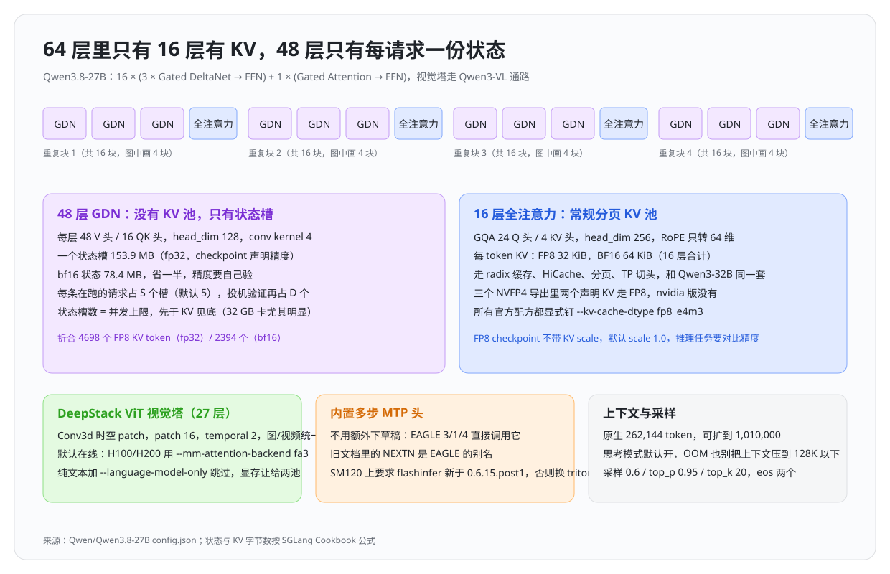
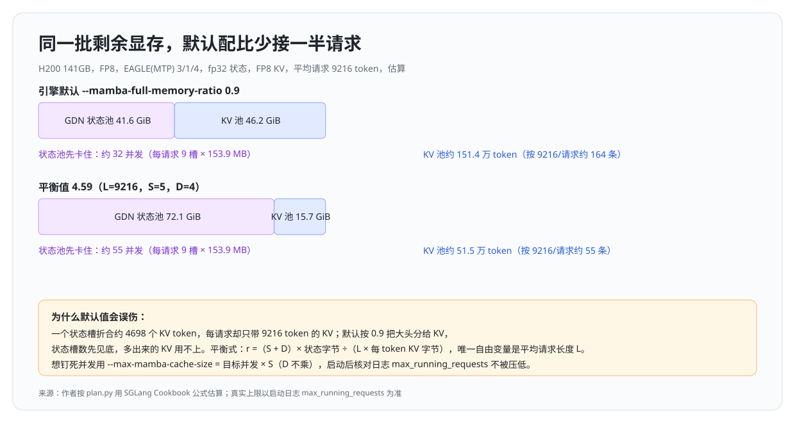
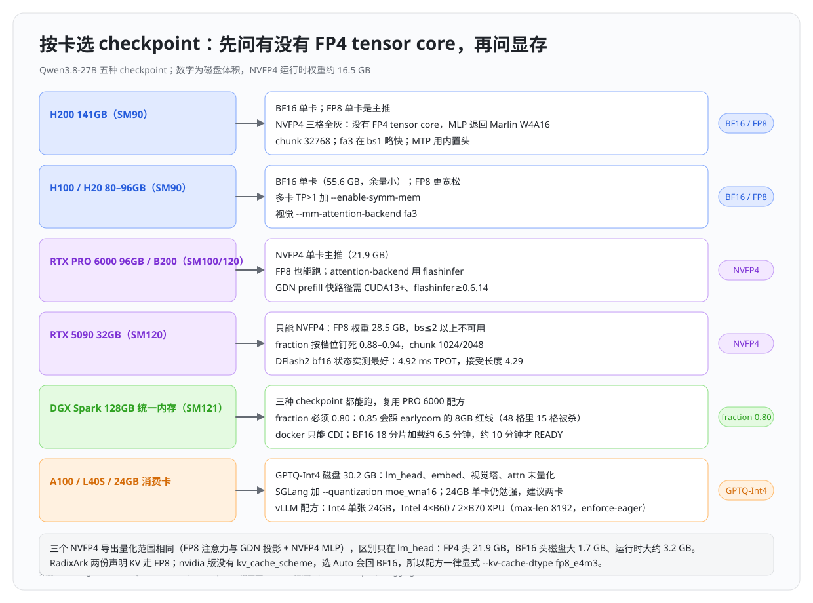
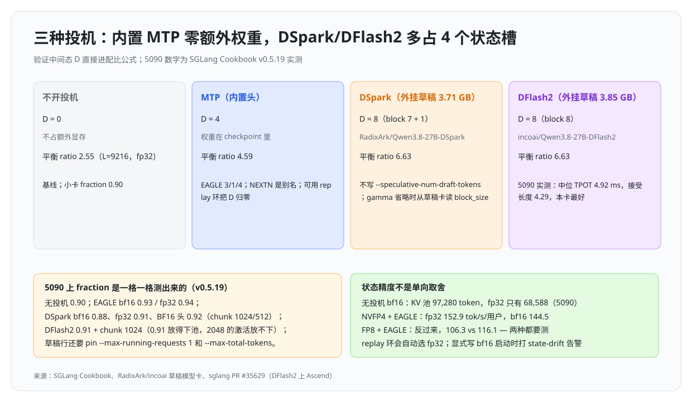

# SGL-24｜实战｜Qwen3.8-27B：混合 GDN 视觉模型的 SGLang 部署

> 🎯 **遇到的问题**：Qwen3.8-27B 是 Qwen3.8 系列的稠密旗舰，视觉语言模型，和同系列 2.4T MoE 共用同一套混合注意力骨干，64 层里有 48 层是 Gated DeltaNet 线性注意力[[1]](https://huggingface.co/Qwen/Qwen3.8-27B)[[2]](https://huggingface.co/Qwen/Qwen3.8-27B/blob/main/config.json)。线性注意力层不存 KV，每条在跑的请求只占一份约 154 MB 的循环状态；剩下 16 层全注意力才按 token 存 KV。
>
> 显存因此分成两个池：一个按请求数算，一个按 token 数算。SGLang 默认的池配比偏向 KV，在这个模型上会不声不响地把并发压到三十几条，KV 池却空着一百多万 token[[3]](https://lmsysorg.mintlify.app/cookbook/autoregressive/Qwen/Qwen3.8-27B)。这一篇把两本账分开算清楚，再按卡型选 checkpoint、按平均请求长度定配比，最后给出视觉、投机和 Agent 接入的完整命令。
>
> **主线**：这一篇把 23 篇末尾的状态槽账单独算透：48 层线性注意力没有 KV，只有每请求一百多 MB 的 GDN 状态；并发上限先由状态槽数决定，再回头给 16 层全注意力的 KV 池分钱。
>
> **读完这一篇**：拿到一张卡，能判断该用 BF16、FP8、NVFP4 还是 GPTQ-Int4，能算出两个池各自放多少、平衡配比是几，写得出从 H200 到 5090、从纯文本到视觉加投机解码的启动命令。服务起得来以后，知道去日志的哪一行核对真实并发，知道 5090 上 fraction 为什么要一格一格测，也知道 HiCache 在混合模型上还有哪些没修的坑。
>
> **数据来源**：结构和 checkpoint 体积取自 Hugging Face 上的 config.json 与权重文件[[2]](https://huggingface.co/Qwen/Qwen3.8-27B/blob/main/config.json)[[4]](https://huggingface.co/Qwen/Qwen3.8-27B-FP8)。配比公式、5090 的 fraction、chunk 和单流速度来自 SGLang Cookbook 的 Qwen3.8-27B 页：这个页面在 SGLang v0.5.19 上逐格实测了 202 个启动组合，每格都跑完整 1319 题 GSM8K，分数 93.18% 到 95.15%[[3]](https://lmsysorg.mintlify.app/cookbook/autoregressive/Qwen/Qwen3.8-27B)。vLLM 的参数对照来自 vLLM Recipes[[5]](https://recipes.vllm.ai/Qwen/Qwen3.8-27B)。两池容量和各卡并发没有逐卡实测，按 config.json、权重体积和 Cookbook 公式推算，正文标为**估算**，最终以启动日志为准。
>
> **代码**：配套实验在 `zero-to-sglang/24-qwen-hybrid-deploy`。`plan.py` 面向 Qwen3.8-27B 与 Qwen3.5-35B-A3B 两个混合 GDN 模型，输出 TP 头整除与安全集、GDN 状态槽加全注意力 KV 的双账容量、以及 MoE 的 EP 专家分配；`test_plan.py` 是 17 个单测，结构数字锚定两份 config.json，并专门校验权重体积缺失时拒绝臆造容量。plan.py 和 test_plan.py 只用标准库，不依赖 GPU、torch 或 sglang 本体，离线就能跑。本目录不含 smoke.py 和 bench.sh：两模型的在线冒烟与压测要对着真实 GPU 服务，属待实机项，不得在离线配套里伪造通过记录。

# 导读 · 结论先行

1. **先认两本账，再谈调参。**48 层 GDN 没有 KV，每条请求占 S + D 个状态槽，一个 fp32 槽 153.9 MB，折合约 4698 个 FP8 KV token；16 层全注意力每 token 只有 32 KiB KV。并发上限先由状态槽决定，32 GB 卡上尤其明显[[3]](https://lmsysorg.mintlify.app/cookbook/autoregressive/Qwen/Qwen3.8-27B)。
2. **配比有公式，别用默认 0.9。**平衡值 r =（S + D）× 状态字节 ÷（L × 每 token KV 字节），L 是平均请求总长度。L 取 9216 时，不开投机 2.55、内置 MTP 4.59、外挂草稿 6.63。H200 FP8 开 MTP，默认配比约 33 并发，平衡值约 57（估算）。
3. **按卡选 checkpoint：先看有没有 FP4 张量核。**Blackwell（SM100/120）主推 NVFP4，运行时权重约 16.5 GB；Hopper 走 FP8，NVFP4 会退回 Marlin W4A16；Ampere/Ada 里 40 GiB 以上的卡（A100 80G、L40S 48G）仍走 FP8（Ada 的 FP8 是 Triton 内核），只有 24 GB 卡放不下 FP8 权重才回落 GPTQ-Int4。5090 只能 NVFP4，FP8 权重磁盘 30.87 GB（Cookbook 按权重张量记约 28.5 GB），32GB 卡上 batch 超过 2 就跑不动。
4. **5090 的 fraction 是一格一格测出来的，不要拍脑袋。**Cookbook 在 v0.5.19 上逐格钉死：无投机 0.90，EAGLE bf16 0.93、fp32 0.94，DFlash2 0.91 加 chunk 1024。DFlash2 bf16 状态是这张卡上最好的单流档，中位 TPOT 4.92 ms，接受长度 4.29。
5. **视觉和工具默认在线。**模型按 Qwen3-VL 路径加载，27 层 DeepStack ViT 默认启用，纯文本加 --language-model-only 跳过。工具 parser 是 qwen3_coder，不是 qwen25 也不是 hermes；思考内容用 qwen3 reasoning parser 分流。



图上半部分是 64 层的真实布局：16 个重复块，每块 3 层 GDN 加 1 层全注意力。下半部分的两本账和两个附加组件，第 2 章逐项算。

**📎 与系列其他文档的分工**：稠密模型单卡部署的通用算法见 [SGL-23｜实战｜Qwen3-32B：单卡到两卡的 SGLang 部署，以及迁到 Qwen3.8-27B](./23-qwen32b-deploy.md)，那一篇管 KV 一本账，这一篇管状态槽加 KV 两本账。显存和带宽的基础算法见 [SGL-02｜上手｜推理账本：显存、KV 与 Roofline](./02-ledger.md)，FP8 与 FP4 的格式见 [SGL-12｜原理｜量化：FP8、INT4 与 KV 量化怎么选](./12-quantization.md)，EAGLE、DSpark 一类投机解码的原理见 [SGL-13｜原理｜投机解码：EAGLE、MTP、NGRAM 怎么选、怎么调](./13-speculative.md)，HiCache 的设计见 [SGL-14｜原理｜HiCache：显存、主机内存、远端存储三层 KV 缓存](./14-hicache.md)，通用参数调优见 [SGL-17｜实战｜参数调优手册：从日志倒推配置](./17-tuning.md)。本篇只讲这个模型的落地：卡怎么分、池怎么算、命令怎么写、日志怎么核。

# 第 1 章 · 部署前先回答的问题

把社区里和 Cookbook 202 格实测中反复出现的问题列在前面，每一类在本篇都有对应的小节。

| 现象或疑问 | 原因 | 对应小节 |
|-|-|-|
| KV 池显示一百多万 token，并发却只有三十几 | 默认 --mamba-full-memory-ratio 0.9 给状态池分少了，状态槽先用完 | 3.2、3.3 |
| H200 上能不能用 NVFP4 | SM90 没有 FP4 张量核，MLP 退回 Marlin W4A16，三格全灰 | 4.1 |
| 5090 上 FP8 checkpoint 能不能跑 | 权重磁盘 30.87 GB（Cookbook 按张量记约 28.5 GB），batch 超过 2 不可用，只能用约 16.5 GB 的 NVFP4 | 4.1、4.4 |
| 5090 上 fraction 写多少 | 逐格实测值，无投机 0.90、EAGLE 0.93/0.94、DFlash2 0.91，不要估算 | 4.4、5.3 |
| 状态用 fp32 还是 bf16 | 不是单向取舍：NVFP4 加 EAGLE 时 fp32 更快，FP8 加 EAGLE 时 bf16 更快，两种都要测 | 3.5 |
| 开了 MTP 还要不要再下草稿模型 | 不用，MTP 头在 checkpoint 里；DSpark、DFlash2 才是外挂草稿 | 5.1、5.2 |
| 工具调用返回在 content 里，tool_calls 为空 | parser 要写 qwen3_coder，qwen25 和 hermes 读的是另一种格式 | 6.2 |
| 纯文本服务为什么还占着视觉塔的显存 | 默认按视觉语言模型加载，加 --language-model-only 才跳过 | 6.1 |
| DGX Spark 上 fraction 0.85 进程被静默杀掉 | 统一内存留给出操作系统的余量低于约 8 GB，撞上 earlyoom 的 SIGTERM 线，要钉 0.80 | 4.5 |
| 开了 HiCache 报非法显存访问，或主机池多占一倍 | 混合模型的两个已知问题，issue 被机器人按无活动关闭，修复 PR 至今未合并 | 8.1 |
| max_running_requests 和目标并发对不上 | 状态池 pin 只乘 S 不乘 D，配比或 --max-mamba-cache-size 要重算 | 3.4、7.2 |

# 第 2 章 · 结构：64 层和两本账

## 2.1 模型结构

SGLang 里这个模型是 [Qwen3_5ForConditionalGeneration](https://github.com/sgl-project/sglang/blob/8fabf5e/python/sglang/srt/models/qwen3_5.py#L2406)，继承 Qwen3-VL 的视觉语言通路，要求 --trust-remote-code。text_config 给出的语言模型结构：64 层 = 16 个重复块 ×（3 层 Gated DeltaNet 加 1 层门控全注意力），即 48 层线性注意力加 16 层全注意力。

hidden 5120，FFN 中间维 17408，词表填充到 248320，原生上下文 262144，可扩到约 101 万[[2]](https://huggingface.co/Qwen/Qwen3.8-27B/blob/main/config.json)。GDN 层是 48 个 V 头、16 个 QK 头，head_dim 128，卷积核宽 4，实现在 [Qwen3_5GatedDeltaNet](https://github.com/sgl-project/sglang/blob/8fabf5e/python/sglang/srt/models/qwen3_5.py#L363)，所在解码层在 [qwen3_5.py:1143](https://github.com/sgl-project/sglang/blob/8fabf5e/python/sglang/srt/models/qwen3_5.py#L1143)。全注意力层是 24 Q 头、4 KV 头的 GQA，head_dim 256，RoPE 只转其中 64 维，解码层在 [qwen3_5.py:1283](https://github.com/sgl-project/sglang/blob/8fabf5e/python/sglang/srt/models/qwen3_5.py#L1283)。

checkpoint 还带一个训练了多步的 MTP 头（mtp_num_hidden_layers 为 1），EAGLE 投机解码直接调用它，不用再下草稿模型。视觉塔是 27 层 DeepStack ViT，hidden 1152，patch 16、时间 patch 2，Conv3d 时空切块，图和视频走统一输入。generation_config 的采样默认 0.6、top_p 0.95、top_k 20，两个 eos，思考模式默认开[[1]](https://huggingface.co/Qwen/Qwen3.8-27B)。

## 2.2 第一本账：GDN 状态槽

48 层 GDN 是线性注意力，时间维被折叠进固定大小的循环状态，状态大小只和结构有关，和请求长度无关。一个状态槽的字节数按固定几何算：48 层 × 48 V 头 × 128 × 128，fp32 每元素 4 字节，bf16 每元素 2 字节，再加一份恒为 bf16 的卷积状态（48 层 × 卷积宽余量 3 ×（2 × 16 × 128 + 48 × 128）× 2 字节）。结果是 fp32 153.9 MB、bf16 78.4 MB，和 Cookbook 给的数字一致。

每条在跑的请求占 S 个状态槽，S 由 --mamba-radix-cache-strategy 决定：extra_buffer 是 5（默认），extra_buffer_lazy 是 4，no_buffer 是 3，关掉 radix 缓存是 1；设 SGLANG_OPT_MAMBA_SKIP_DECODE_LOCK=1 在两个 extra_buffer 策略上再省 1 个。

开投机解码时，验证用的中间态还要占 D 个槽，D 的取值第 5 章算。状态槽是按请求计费的稀缺资源：槽用完，新请求只能排队，和 KV 池还剩多少无关。状态精度参数 --mamba-ssm-dtype 在 [exec\_.py:493](https://github.com/sgl-project/sglang/blob/8fabf5e/python/sglang/srt/arg_groups/fields/exec_.py#L493)，策略参数在 [exec\_.py:515](https://github.com/sgl-project/sglang/blob/8fabf5e/python/sglang/srt/arg_groups/fields/exec_.py#L515)。

## 2.3 第二本账：16 层全注意力的 KV

只有 16 层全注意力存 KV。每 token 的 KV 字节数 = 2（K 和 V）× 16 层 × 4 个 KV 头 × 256：FP8 每元素 1 字节，是 32 KiB（Cookbook 按十进制写 32.8 KB）；BF16 是 64 KiB（65.5 KB）。对比一下，[SGL-23｜实战｜Qwen3-32B：单卡到两卡的 SGLang 部署，以及迁到 Qwen3.8-27B](./23-qwen32b-deploy.md) 的 Qwen3-32B 每 token BF16 KV 是 256 KiB，这个模型的 KV 只有它的四分之一。分页、radix 缓存、HiCache、TP 切头都只作用在这 16 层上，和普通稠密模型同一套机制。

TP 切头有约束：全注意力层断言 total_num_heads % attn_tp == 0（[qwen3_5.py:1313](https://github.com/sgl-project/sglang/blob/8fabf5e/python/sglang/srt/models/qwen3_5.py#L1313)），KV 头能整除就切、不能整除则要求 attn_tp 能被 KV 头整除后每卡复制整头。按头数整除推导，这个模型干净的 TP 集合是 1/2/4/8：TP8 时全注意力 4 个 KV 头走复制（8 能被 4 整除），GDN 的 16 个 K 头、48 个 V 头仍能被 8 整除。配套 plan.py 用同一套整除规则逐档给出 split/replicate 结论；TP8 的融合 kernel 是否退化为非融合路径没有 GPU 日志，标待实机，不写成已验证。

两份 RadixArk 的 NVFP4 checkpoint 在配置里声明 kv_cache_quant_algo 为 FP8，SGLang 的 auto 会自动用 fp8_e4m3 的 KV；nvidia 的导出没有 kv_cache_scheme，选 auto 会退回 BF16，白白多占一倍 KV。

所以 Cookbook 的每条配方都显式钉 --kv-cache-dtype fp8_e4m3，三份导出跑同一个 KV 池[[6]](https://huggingface.co/RadixArk/Qwen3.8-27B-NVFP4)[[7]](https://huggingface.co/nvidia/Qwen3.8-27B-NVFP4)。还有一个精度前提：FP8 checkpoint 不带 KV 校准 scale，SGLang 默认 scale 1.0，推理密集型任务上线前必须和 BF16 KV 对比过再用[[3]](https://lmsysorg.mintlify.app/cookbook/autoregressive/Qwen/Qwen3.8-27B)。

## 2.4 一个槽值多少个 KV token

把两本账换算到同一单位：153.9 MB ÷ 32 KiB ≈ 4698，bf16 状态 ÷ FP8 KV ≈ 2394。也就是说，一条请求的状态槽抵得上将近五千个 token 的 KV，而一条平均 9216 token 的请求只带 9216 个 token 的 KV。状态这笔固定开销和 KV 这笔随长度增长的开销在同一个量级，这正是默认配比失效的根因，第 3 章给公式。

| 量 | fp32 状态 | bf16 状态 |
|-|-|-|
| 一个状态槽 | 153.9 MB | 78.4 MB |
| 每 token KV（FP8） | 32 KiB（Cookbook 32.8 KB） | 32 KiB |
| 一个槽折合 KV token | 4698 | 2394 |
| 默认每请求槽数 S | 5（extra_buffer） | 5 |

# 第 3 章 · 两个池怎么分：配比、S、D 和 pin

## 3.1 权重之外的显存怎么切

加载完权重和固定开销后的剩余显存，由 --mamba-full-memory-ratio 决定两池划分。参数定义在 [schedule.py:220](https://github.com/sgl-project/sglang/blob/8fabf5e/python/sglang/srt/arg_groups/fields/schedule.py#L220)，默认 0.9。SGLang 在 [kv_cache_configurator.py:3352](https://github.com/sgl-project/sglang/blob/8fabf5e/python/sglang/srt/mem_cache/kv_cache_configurator.py#L3352) 附近把剩余显存按 r ÷（1 + r）分给 GDN 状态池，剩下的给 KV 池：配比 0.9 的字面含义是状态池比 KV 池等于 0.9 比 1，即状态池拿不到一半，而不是参数名字面上的九成。

[unified_memory_pool.py:1829](https://github.com/sgl-project/sglang/blob/8fabf5e/python/sglang/srt/mem_cache/unified_memory_pool.py#L1829) 启动时会打一行 mamba_full_memory_ratio governs the total budget only, not the runtime split，说明它只管总预算划分。

这个默认值是给普通 Mamba 模型调的，照搬到 GDN 加全注意力的混合模型上会偏向 KV。Cookbook 的原话是默认值给 KV 池过量供给，在不报错的情况下静默压低并发[[3]](https://lmsysorg.mintlify.app/cookbook/autoregressive/Qwen/Qwen3.8-27B)。开了投机验证时，[kv_cache_configurator.py:3341](https://github.com/sgl-project/sglang/blob/8fabf5e/python/sglang/srt/mem_cache/kv_cache_configurator.py#L3341) 一段还会把 D 个验证中间态联合算进状态预算再解状态槽数，所以 D 必须进配比公式。

## 3.2 平衡配比公式

平衡的含义是两个池在同一个并发数上同时用满。设平均请求总长度 L（输入加输出），每条请求占 S + D 个状态槽，每槽 state_bytes 字节，每 token KV 占 kv_bytes 字节，则：

```text
r = (S + D) × state_bytes ÷ (L × kv_bytes)
```

L 是唯一需要按业务测量的自由变量，取输入加输出的平均总长度。其余全是结构和配置常量。按 L = 9216（Cookbook 实测网格的 8192 进 1024 出）、FP8 KV 算出的几组值：

| 配置 | S + D | 状态精度 | 平衡配比 |
|-|-|-|-|
| extra_buffer，不开投机 | 5 + 0 | fp32 | 2.55 |
| extra_buffer，内置 MTP（EAGLE 3/1/4） | 5 + 4 | fp32 | 4.59 |
| extra_buffer，DSpark / DFlash2 | 5 + 8 | fp32 | 6.63 |
| extra_buffer，不开投机 | 5 + 0 | bf16 | 1.30 |
| extra_buffer_lazy，不开投机 | 4 + 0 | fp32 | 2.04 |
| 关掉 radix，不开投机 | 1 + 0 | fp32 | 0.51 |
| MTP，L 改为 32768 | 5 + 4 | fp32 | 1.29 |
| MTP，L 改为 2048 | 5 + 4 | fp32 | 20.65 |

平均请求越短，状态的固定开销占比越大，配比要越高；长请求为主时配比回落。配比和显存大小无关，同一组业务长度在 5090 和 H200 上是同一个值，变的只是两池的绝对大小。

## 3.3 默认值和平衡值差多少

以 H200 141GB、FP8 权重、内置 MTP、fp32 状态、mem-fraction 0.85、L = 9216 为例，`plan.py` 全程按字节记账（权重的 GB 是 10^9、显存是 2^30，先换算再相减），算出两池合计约 89.9 GiB：

```text
引擎默认 r=0.90：状态池约 42.6 GiB，KV 池约 47.3 GiB
  状态池先卡住：约 33 并发（每请求 9 槽 × 153.9 MB）
  KV 池约 1,550,912 token，按 9216 一条能装约 168 条请求，多出来的全闲置
平衡值 r=4.59：状态池约 73.8 GiB，KV 池约 16.1 GiB
  状态池约 57 并发，KV 池约 527,342 token，约 57 条请求，两池同时见底
```



同一套口径下其他配置的结果（**估算**，H200 FP8，L = 9216）：不开投机时默认约 59 并发，平衡值 2.55 约 90 并发；DSpark 外挂草稿 D = 8（两池合计因草稿权重降到约 86.5 GiB），默认只有约 21 并发，平衡值 6.63 回到约 40。真实上限以启动日志的 max_running_requests 为准，估算通常偏乐观，因为日志口径还包含 padding 槽和投机缓冲。

## 3.4 想钉死并发：--max-mamba-cache-size

不想跟着 L 算配比，可以直接钉状态池大小：--max-mamba-cache-size = 目标并发 × S。注意 D 不乘进去，引擎把投机验证缓冲单独留，把 D 乘进 pin 会过量供给；SGLang_OPT_MAMBA_SKIP_DECODE_LOCK 省掉的那个槽要按实际策略扣。例：H200 上要 32 并发、extra_buffer S = 5，pin 160。起服务后第一件事是看日志里 max_running_requests 有没有被压到目标以下，被压低说明 KV 池或权重把状态预算挤掉了，要回头降 fraction 以外的占用或缩短上下文。

## 3.5 状态精度 fp32 还是 bf16

config.json 声明 mamba_ssm_dtype 为 float32，这是默认值。bf16 把一个槽从 153.9 MB 压到 78.4 MB，省下来的自动让给 KV 池。但速度不是单向取舍，Cookbook 在 5090 上实测：NVFP4 加 EAGLE，fp32 状态 152.9 tok/s/user，bf16 只有 144.5；换成 FP8 加 EAGLE 反过来，bf16 116.1，fp32 106.3。两种量化下结论相反，必须用自己的 checkpoint 各测一遍。bf16 应当作精度门来对待，先在业务题集上和 fp32 对过再上线[[3]](https://lmsysorg.mintlify.app/cookbook/autoregressive/Qwen/Qwen3.8-27B)。

无投机时 bf16 的容量优势在 5090 上很直观：同一 fraction 下 KV 池 97,280 token，fp32 只有 68,588。一个交互细节：开 --enable-linear-replayssm-spec 固定环时，引擎在未显式指定状态精度的情况下自动选 fp32；显式写 bf16 启动日志会打 state-drift 告警，这不是报错，是提醒环上状态会漂移。

## 3.6 策略选择：extra_buffer、lazy 和关 radix

extra_buffer（默认）用 5 个槽换重叠调度和分支点缓存，需要 FLA 内核，只支持 NVIDIA，且 --page-size 要满足和 FLA_CHUNK_SIZE（64）的整除关系，配方统一用 64。extra_buffer_lazy 把每请求代价降到 4 槽，没有精度损失。32 GB 小卡上状态池远早于 KV 见底，Cookbook 明确建议优先降 S：lazy 不够就 --disable-radix-cache 拿到 S = 1，前缀复用可以以后再说。V1 的 no_buffer（S = 3）是 AMD 上的唯一选择，第 8 章给 AMD 的环境变量组合。

# 第 4 章 · 按卡选 checkpoint 和启动命令

## 4.1 五种 checkpoint

| checkpoint | 磁盘体积 | 量化范围 | 运行时权重 |
|-|-|-|-|
| Qwen/Qwen3.8-27B | 55.56 GB | BF16 全精度 | 55.6 GB |
| Qwen/Qwen3.8-27B-FP8 | 30.87 GB | 权重 128×128 分块 FP8，激活动态；lm_head、embed、GDN 卷积与投影不转（Cookbook 按权重张量记约 28.5 GB） | 30.9 GB |
| Qwen/Qwen3.5-27B-GPTQ-Int4（同架构） | 30.24 GB | group 128；lm_head、embed、视觉塔、注意力、MTP 不量化。Qwen 官方仓库以 3.5 命名，3.8 未单独发布该量化版 | 30.2 GB |
| RadixArk/Qwen3.8-27B-NVFP4 | 21.92 GB | NVFP4 W4A4 的 MLP 加 FP8 注意力与 GDN 投影，lm_head 打到 FP4 | 约 16.5 GB |
| RadixArk/...-NVFP4-BF16-LMHead | 23.75 GB | 同上，lm_head 保留 BF16 | 约 19.7 GB |
| nvidia/Qwen3.8-27B-NVFP4 | 21.92 GB | ModelOpt 导出，同一张量化层图、同一个 FP4 头；无 kv_cache_scheme | 约 16.5 GB |

NVFP4 三份导出的量化层图完全相同，区别只在 lm_head 和 KV 声明：BF16 头版本磁盘大 1.7 GB、运行时大约 3.2 GB，是三者里最难塞下的；Cookbook 202 格的所有配方都以 BF16 头版本为基准测，FP4 头格子直接复用它的 pin。nvidia 版在 PRO 6000、DGX Spark 上各重测了 16 个组合，GSM8K 94.01% 到 95.07%，和 RadixArk 版一致[[6]](https://huggingface.co/RadixArk/Qwen3.8-27B-NVFP4)[[7]](https://huggingface.co/nvidia/Qwen3.8-27B-NVFP4)[[8]](https://huggingface.co/RadixArk/Qwen3.8-27B-NVFP4-BF16-LMHead)。

GPTQ-Int4 官方目前挂在同架构的 Qwen3.5-27B-GPTQ-Int4 名下（Qwen3.8 未发布同名仓库），磁盘还有 30 GB，是因为 lm_head、词嵌入、整个视觉塔、注意力和 MTP 头都没量化，SGLang 加载时加 --quantization moe_wna16[[9]](https://huggingface.co/Qwen/Qwen3.5-27B-GPTQ-Int4)。

## 4.2 按卡的决策路径



第一问是有没有 FP4 张量核，第二问才是显存。Blackwell（SM100/120）主推 NVFP4；Hopper（SM90）没有 FP4 张量核，NVFP4 的 MLP 退回 Marlin W4A16 仅权重量化，继续用 FP8；Ampere/Ada 里 40 GiB 以上的卡（A100 80G、L40S 48G）仍选 FP8（SM89 的 Ada 走 Triton 内核），只有 24 GB 卡放不下 FP8 权重才回落 GPTQ-Int4。

配套 `plan.py` 不复刻这套按卡选 checkpoint 的决策，它只提供决策要用的结构账本：tp_head_check 逐档给出全注意力与 GDN 头的 split/replicate 结论，推导安全 TP 集合为 1/2/4/8；具体选哪种 checkpoint 仍按本节的张量核代际判断，plan.py 不替代它。

## 4.3 H200 / H100 / H20：FP8 主推

```bash
# H200 FP8 + 内置 MTP，平衡配比，目标 32 并发
sglang serve Qwen/Qwen3.8-27B-FP8 \
  --trust-remote-code \
  --reasoning-parser qwen3 --tool-call-parser qwen3_coder \
  --context-length 262144 --kv-cache-dtype fp8_e4m3 \
  --mamba-ssm-dtype float32 \
  --mamba-radix-cache-strategy extra_buffer --page-size 64 \
  --mamba-full-memory-ratio 4.59 --max-mamba-cache-size 160 \
  --mem-fraction-static 0.85 --chunked-prefill-size 32768 \
  --speculative-algorithm EAGLE --speculative-num-steps 3 \
  --speculative-eagle-topk 1 --speculative-num-draft-tokens 4 \
  --mm-attention-backend fa3 \
  --host 0.0.0.0 --port 30000
```

H200 用 32768 的 prefill chunk：SM90 的 prefill 足够快，大 chunk 几乎不卡 decode，FlashInfer 的 GDN prefill 后端默认就接上；--attention-backend fa3 在 batch 1 略快，是合法替代。

多卡 TP 大于 1 时加 --enable-symm-mem，NCCL 对称内存只在多卡下有收益。BF16 单卡（55.6 GB 权重）在 H100 80GB 上余量很小，生产取 FP8 或 TP2。视觉后端 H100/H200 用 --mm-attention-backend fa3，B200/B300 用 fa4[[3]](https://lmsysorg.mintlify.app/cookbook/autoregressive/Qwen/Qwen3.8-27B)。

## 4.4 RTX PRO 6000 和 5090：NVFP4 与实测 pin

SM120/SM121 上注意力后端写 --attention-backend flashinfer，trtllm_mha 只支持 SM100。MTP 走 FlashInfer 要求其 prefill plan 接受 uniform_q_len，即 flashinfer 新于 0.6.15.post1，不满足就 --attention-backend triton。

GDN prefill 快路径只在 SM100 上开，要求 CUDA 13 以上、flashinfer 不低于 0.6.14，且验证域是 chunk 不超过 8192 加 bf16 状态；SM120 两种状态精度都走 Triton 线性注意力 prefill，不用额外加开关[[3]](https://lmsysorg.mintlify.app/cookbook/autoregressive/Qwen/Qwen3.8-27B)。

5090 32GB 只能 NVFP4：FP8 checkpoint 磁盘 30.87 GB（Cookbook 按权重张量记约 28.5 GB），Cookbook 明确 batch 超过 2 就不可服务。这张卡的 mem-fraction 没有公式可推，全部是 v0.5.19 逐格实测的钉死值：

| 配置 | bf16 状态 | fp32 状态 | chunk |
|-|-|-|-|
| 不开投机 | 0.90 | 0.90 | 2048 |
| EAGLE（MTP） | 0.93 | 0.94 | 2048 |
| DSpark | 0.88（BF16 头 0.92，chunk 512） | 0.91 | 1024 |
| DFlash2 | 0.91 | 0.895（FP4 头高吞吐档，ratio 钉 10） | 1024 |

DFlash2 这一格 fraction 0.91 放得下两个池，但 2048 chunk 的激活放不下，所以 chunk 钉 1024；外挂草稿行还要自己 pin --max-running-requests 1 和 --max-total-tokens，否则引擎按 127,332 token 的 KV 池自动拆分，草稿权重计入 fraction 后状态池槽位不够。

fp32 状态能不能配外挂草稿取决于 lm_head：BF16 头导出上 DSpark、DFlash2 的 fp32 格子是灰的，头多出的约 3.2 GB 让状态池过不了 prefill 抓图；FP4 头版本把这部分空间还回来，DSpark 0.91、DFlash2 高吞吐档 0.895 加 ratio 10 可服务，只剩 DFlash2 低延迟档不可达。

## 4.5 DGX Spark：统一内存的特殊规矩

DGX Spark 是 SM121、aarch64、128GB CPU/GPU 统一内存，三种 checkpoint 都放得下，配方直接复用 RTX PRO 6000，只改一处：--mem-fraction-static 必须钉 0.80。

0.85 × 128GB 只留给操作系统约 8GB，正好是 DGX OS earlyoom 的 SIGTERM 阈值，第一次长 prefill 或抓图 dip 下去，调度器被 exit code -15 静默杀掉，没有 traceback，journalctl -u earlyoom 能看到记录；Cookbook 的 48 格里 0.85 有 15 格这样被杀，0.80 全部可服务。

- docker 只能走 CDI：--device nvidia.com/gpu=all，没有注册 nvidia runtime。
- nvidia-smi 对显存报 Not Supported，因为和 CPU 统一；重启判断要看 /proc/meminfo 的 MemAvailable。
- BF16 checkpoint 的 18 个分片从 NVMe 加载要约 6.5 分钟，到 READY 约 10 分钟，别把加载慢当成启动卡死。

Cookbook 在 GB10 上对 80 个配置（5 种 checkpoint × 投机 × 服务策略 × 状态精度，含 DFlash2）逐格验证，ISL 8192、OSL 1024、并发 1，全部可服务，GSM8K 93.18% 到 95.15%，fp32 和 bf16 两半各用一台 GB10 跑[[3]](https://lmsysorg.mintlify.app/cookbook/autoregressive/Qwen/Qwen3.8-27B)。

## 4.6 Ampere、Ada、24GB 卡和 Intel XPU

A100 80G、L40S 48G 这一档仍走 FP8：A100（SM80）没有 FP8 张量核，FP8 走 Marlin/CUTLASS 内核，L40S（SM89）的 FP8 走 Triton，不如 Hopper 原生张量核省心但权重放得下。只有 24GB 消费卡（RTX 4090 一类）放不下 30.87 GB 的 FP8 权重，才回落 GPTQ-Int4：SGLang 加 --quantization moe_wna16。

官方的 Int4 仓库挂在同架构的 Qwen3.5-27B-GPTQ-Int4 名下（3.8 未发布同名 GPTQ-Int4），未量化的 lm_head、embed、视觉塔和注意力让磁盘仍有 30.2 GB，24GB 单卡勉强，建议两卡[[9]](https://huggingface.co/Qwen/Qwen3.5-27B-GPTQ-Int4)。vLLM 的 3.8 配方覆盖了 Intel 数据中心 GPU：4 × Arc Pro B60（24GB）或 2 × B70（32GB）XPU 镜像，--enforce-eager 必开[[5]](https://recipes.vllm.ai/Qwen/Qwen3.8-27B)。

plan.py 各卡跑一遍的容量参考（**估算**，默认不开投机、fp32、L = 9216，mem-fraction 大卡 0.85、消费卡 0.90，平衡配比 2.55 下的并发）：

| 卡型 | checkpoint | 两池合计 | 默认 0.9 并发 | 平衡值并发 |
|-|-|-|-|-|
| B200 180GB | NVFP4 | 约 136.2 GiB | 约 89 | 约 136（2.55） |
| H200 141GB | FP8 | 约 89.9 GiB | 约 59 | 约 90（2.55） |
| RTX PRO 6000 96GB | NVFP4 | 约 65.2 GiB | 约 43 | 约 65（2.55） |
| H100 80GB | FP8 | 约 38.3 GiB | 约 25 | 约 38（2.55） |
| H200，开 MTP | FP8 | 约 89.9 GiB | 约 33 | 约 57（4.59） |
| H200，开 DSpark | FP8 | 约 86.5 GiB | 约 21 | 约 40（6.63） |

# 第 5 章 · 投机解码：MTP、DSpark、DFlash2

## 5.1 三种方案的账



内置 MTP 头用 EAGLE 算法调用，3 步、topk 1、4 个草稿 token，权重已在 checkpoint 里，零额外下载；早期文档里的 NEXTN 是 EAGLE 的别名，是同一个实现。DSpark 是外挂的 RadixArk/Qwen3.8-27B-DSpark，权重 3.71 GB；DFlash2 是 incoai/Qwen3.8-27B-DFlash2 块扩散草稿，3.85 GB。三者的验证中间态都进同一个设备状态池，D 直接进 3.2 节的配比公式[[10]](https://huggingface.co/RadixArk/Qwen3.8-27B-DSpark)[[11]](https://huggingface.co/incoai/Qwen3.8-27B-DFlash2)。

| 方案 | 启动参数 | D | 平衡配比（L=9216） |
|-|-|-|-|
| 不开 | 无 | 0 | 2.55 |
| MTP（内置头） | --speculative-algorithm EAGLE --speculative-num-steps 3 --speculative-eagle-topk 1 --speculative-num-draft-tokens 4 | 4 | 4.59 |
| DSpark | --speculative-algorithm DSPARK --speculative-draft-model-path RadixArk/Qwen3.8-27B-DSpark | 8（block 7 + 1） | 6.63 |
| DFlash2 | --speculative-algorithm DFLASH --speculative-draft-model-path incoai/Qwen3.8-27B-DFlash2 --speculative-num-draft-tokens 8 | 8（block 8） | 6.63 |

DSpark 不要写 --speculative-num-draft-tokens：它的验证窗口是 --speculative-dspark-block-size（gamma）加 1，gamma 省略时从草稿 checkpoint 的 block_size 读，这个草稿卡是 7，所以 D = 8；改 gamma 就要按新 D 重算配比。DFlash2 的 8 就是草稿块大小。

版本边界要分清：checkpoint 自带一层 MTP 头（mtp_num_hidden_layers 为 1），但冻结主干 8fabf5e 的自动草稿名单里没有 Qwen3_5 架构，不会像 DeepSeek 那样把内置头自动挂成自投机草稿。4.3 的 EAGLE 命令在 Cookbook 镜像上可用，是因为镜像侧的 SGLang 已接通这条路径。

在冻结主干上照搬，必须显式给 --speculative-draft-model-path 指向同一份 checkpoint（或等后续版本把架构加进自动名单）。这条配方在冻结版本上的实际可用性仍是待实机，不要把 Cookbook 命令当成冻结树的现成能力。

## 5.2 固定环：把 D 归零

加 --enable-linear-replayssm-spec 后，MTP 的草稿验证中间态挪到一个固定大小的环上，不再按请求占槽，D 回到 0，配比退回无投机值。固定环不强制 fp32 状态：冻结源码里只有不显式写 --mamba-ssm-dtype 时引擎才把它解析成 fp32；显式写 bf16 不会被拒绝，只在启动时打一条 state-drift 告警，长序列精度和吞吐要自己验。状态预算极紧的小卡上，这是开投机又不抬配比的唯一办法，代价是环上状态的数值行为要自己验证。

## 5.3 5090 上的实测选择

Cookbook 在 5090 上把每个投机档 fraction 逐格测过（见 4.4 节表格），单流结果最有参考价值的是 DFlash2：bf16 状态、fraction 0.91、chunk 1024，中位 TPOT 4.92 ms，接受长度 4.29，是这张卡上最好的结果。

NVFP4 加 EAGLE 时 fp32 状态 152.9 tok/s/user 对 bf16 的 144.5，FP8 加 EAGLE 反过来 106.3 对 116.1，选状态精度前两种量化各测一次。外挂草稿行务必 pin --max-running-requests 1 和 --max-total-tokens，否则池按默认并发自配，状态槽不够。

## 5.4 昇腾上的 DFlash2

DFlash2 已通过 PR #35629 适配昇腾 NPU：选择器验证在 NPU 上退回 argmax，和 EAGLE、第一代 DFlash 草稿在 NPU 上的行为一致。因此目前只有贪心请求能保证无损验证，要用 temperature 0、top_k 1；非贪心请求会打告警，草稿提议和目标验证都退回贪心，请求的采样分布不再被保持。

PR 里的对照配置是 A3 系列、BF16 目标权重、--tp-size 2、--attention-backend ascend、--mamba-ssm-dtype bfloat16、extra_buffer，基线和 DFlash2 都关 RadixCache 排除前缀命中；评测用零样本 GSM8K、贪心、128 题、并发扫 1 到 16，和 Cookbook 的 202 格协议不同，数字不要直接横比[[12]](https://github.com/sgl-project/sglang/pull/35629)。

# 第 6 章 · 视觉、解析器和 Agent 接入

## 6.1 视觉塔默认在线

模型按 Qwen3-VL 通路加载，27 层 DeepStack ViT 默认启用，图片和视频走同一套 Conv3d 时空 patch。H100/H200 加 --mm-attention-backend fa3，B200/B300 用 fa4。传图特征的传输可以设 SGLANG_USE_CUDA_IPC_TRANSPORT=1，多模态 TTFT 明显改善，但额外显存随图片大小增长，必要时下调 fraction 或 max-running-requests。纯文本服务加 [--language-model-only](https://github.com/sgl-project/sglang/blob/8fabf5e/python/sglang/srt/arg_groups/fields/disagg.py#L140) 跳过整个视觉塔，省下的显存让给两个池。

加载慢的大内存机器可以加 --model-loader-extra-config 传 enable_multithread_load 和 num_threads 64；权重加载阶段容易被看门狗杀掉时把 --watchdog-timeout 提到 1200。上下文不要为了省显存压到 128K 以下：思考模式默认开，输出建议给 32K，复杂题给 81920，上下文太短思考会被截断[[1]](https://huggingface.co/Qwen/Qwen3.8-27B)。

## 6.2 思考分流和工具调用

两个解析器都要写对。--reasoning-parser qwen3 把思考过程拆进 reasoning_content；工具调用用 --tool-call-parser qwen3_coder，它在 [function_call_parser.py:106](https://github.com/sgl-project/sglang/blob/8fabf5e/python/sglang/srt/function_call/function_call_parser.py#L106) 注册，解的是 &lt;tool_call&gt; 里套 &lt;function=&gt; 的嵌套格式。hermes 解析器读裸 JSON，qwen25 读另一种模板，选错不会报错，tool_calls 是空的，函数调用以文本留在 content 里。

这类问题要用在线冒烟暴露：关思考时答案在 content 且 reasoning_content 为空；开思考时 reasoning_content 非空且 content 没有裸 think 标签；工具调用解出 get_weather；图片请求被接受说明视觉塔在线。可复用 [SGL-23｜实战｜Qwen3-32B：单卡到两卡的 SGLang 部署，以及迁到 Qwen3.8-27B](./23-qwen32b-deploy.md) 配套的 smoke.py 对着真实服务跑这四项（待实机），本章离线配套不含该脚本，不伪造通过记录。

采样按模型卡：思考模式 0.6、top_p 0.95、top_k 20，不要贪心，容易重复；非思考 0.7、top_p 0.8、top_k 20。思考开关在请求的 chat_template_kwargs 里给 enable_thinking，也支持 reasoning_effort 调思考深度、preserve_thinking 保留历史消息里的思考上下文。

## 6.3 接 Agent 框架

SGLang 同时开 OpenAI 兼容的 /v1/chat/completions 和 Anthropic 兼容的 /v1/messages，主流 Agent 框架直接接。OpenAI 系（OpenCode 用 @ai-sdk/openai-compatible 写 opencode.json、Pi 注册 custom provider、Hermes 写 config.yaml）指向 http://host:30000/v1。

Claude Code 走 ANTHROPIC_BASE_URL=http://host:30000（不带 /v1，客户端自己拼 /v1/messages）加占位 token。有两个坑：模型 id 默认等于 --model-path 传的全名，不想写全名就用 --served-model-name 起别名；Anthropic 官方说明把 Claude Code 路由到非 Claude 模型不在测试范围内，新特性可能降级。Hermes 框架接 SGLang 时工具 parser 仍要写 qwen3_coder，框架名和 parser 名是两回事[[3]](https://lmsysorg.mintlify.app/cookbook/autoregressive/Qwen/Qwen3.8-27B)。

## 6.4 /v1/decisions 语义端点

还有一个不生成文本的端点 /v1/decisions：给一段输入和若干选择题或判断题，直接返回每个选项的概率（choice 带 probabilities，yes_no 带 yes/no 概率），服务端自动关思考，同一进程照常服务聊天流量，不需要启动开关。分类、路由、工单分派这一类结构化判断用它省掉解析自由文本，也省思考 token。v0.5.22 发行版之前要装 nightly 才有这个端点[[13]](https://docs.sglang.io/docs/supported-models/decision_models)。

# 第 7 章 · 起服务、看日志、压测

## 7.1 用 plan.py 离线核账

```bash
cd zero-to-sglang/24-qwen-hybrid-deploy
# Qwen3.8-27B 稠密：双账容量，开 EAGLE 时平衡配比随报告打印
python3 plan.py --model qwen3.8-27b --gpu h20-96 --avg-len 9216 --spec eagle
# Qwen3.5-35B-A3B MoE：TP 整除 + EP 专家分配（EP8 时 256 专家每 rank 32 个）
python3 plan.py --model qwen3.5-35b-a3b --gpu h200 --ep 8
python3 -m unittest test_plan -v          # 17 个用例
```

配套 plan.py 与本篇的 Cookbook 配方分工不同：它不产出 sglang 启动命令，只把能在 CPU 上算准的三件事（TP 头整除、GDN 状态槽与 KV 双账、MoE 的 EP 分配）做成可复核的离线账本。17 个单测覆盖 config 结构数字（层拆分、递归状态、conv_dim）、TP 安全集与 KV 头复制/切分、EP 均摊与取余、容量公式自洽，以及 35B-A3B 量化 checkpoint 体积缺失时直接跳过容量数字而不是编造。需要 GPU 的启动命令、5090 实测 pin、冒烟与压测仍以本篇正文和 Cookbook 为准，标待实机。

## 7.2 日志核对清单

| 看什么 | 为什么 |
|-|-|
| server_args 最终生效的参数 | 确认 ratio、fraction、chunk、两个 parser、状态精度是不是预期值 |
| mamba_full_memory_ratio governs the total budget only | 确认配比参数被读到；这行只说明语义，不代表拆分正确 |
| max_running_requests | 本篇最重要的一行：状态池算出的真实并发上限，和目标并发对不上就回第 3 章 |
| max_total_num_tokens | KV 池真实 token 数，和 plan.py 的估算对，对不上先查口径差异（padding 槽、投机缓冲），不要把估算当精确值 |
| 草稿模型加载行与 accept len | 开了投机但接受长度一直是 1.0，先查草稿模型有没有真正加载 |
| state-drift 告警 | 固定环配 bf16 状态时出现，确认是预期配置而不是写错精度 |
| FP8 / Marlin / W4A4 内核分发行 | 确认 NVFP4 在 Hopper 上没有静默退回 W4A16，FP8 在 Ada 上走的是 Triton |

运行期再看调度器周期日志（[Decode batch](https://github.com/sgl-project/sglang/blob/8fabf5e/python/sglang/srt/managers/scheduler_components/metrics_reporter.py#L963)）：#running-req、token usage、#queue-req。通用判据沿用 [SGL-17｜实战｜参数调优手册：从日志倒推配置](./17-tuning.md)：token usage 长期大于 0.9 是池打满，队列持续堆积且 usage 不高是准入或配比问题，健康队列的具体长度要按自己的 SLA 和重试策略定，没有通用常数；但这个模型要多看一个数，running-req 是不是贴着 max_running_requests 而 KV token usage 很低：贴着状态上限、KV 却空着，就是配比仍偏向 KV，调高 ratio 或改用 pin。

## 7.3 冒烟和压测

```bash
# 待实机：复用 23 章配套的 smoke.py，对着已起来的服务跑（本章离线目录不含该脚本）
python3 smoke.py --url http://127.0.0.1:30000
# 期望四项：关思考 content 有值且 reasoning_content 空；开思考 reasoning_content 非空；
# 工具调用解出 get_weather；图片请求被接受（视觉塔在线）。任一不符先查两个 parser 与视觉开关
```

压测负载对齐 Cookbook：先 2048 进 256 出预热 16 条，触发 CUDA Graph 和 GDN/FP8 内核的 JIT，再按并发 1、4、8、16、32、64 扫 8192 进 1024 出，每档 8 倍并发条请求，计时前清前缀缓存，固定种子 42，最后汇总吞吐、TTFT、ITL 中位数和接受长度。32GB 卡把并发截到 1、4、8：状态池先见底，更高并发只会被 max_running_requests 挡住排队。压测脚本可沿用 [SGL-23｜实战｜Qwen3-32B：单卡到两卡的 SGLang 部署，以及迁到 Qwen3.8-27B](./23-qwen32b-deploy.md) 的 bench.sh 改造，本章离线配套不内置、也不预填任何结果数字（待实机）。

```bash
# 待实机：压测后人工填表，不要在离线稿里预填吞吐/TTFT/ITL
# 并发  输出 tok/s  TTFT p50 ms  ITL p50 ms  接受长度
#    1        ?            ?           ?         ?
```

判断口径：接受长度开了投机却恒为 1.0，先看启动日志草稿是否加载；混合 GDN 模型 decode 会被大 prefill chunk 卡住，混合负载下 ITL 周期性抬高先查 chunk，消费级卡压到 1024/2048。跨配置比较时沿用 [SGL-23｜实战｜Qwen3-32B：单卡到两卡的 SGLang 部署，以及迁到 Qwen3.8-27B](./23-qwen32b-deploy.md) 的规矩：同一台机器、同一份数据、每轮计时前清缓存，不然 radix 命中让后测的档位占便宜。

# 第 8 章 · HiCache、AMD 和其他引擎

## 8.1 HiCache 在混合模型上的两个未修问题

想给长上下文加主机内存层，开关是 --enable-hierarchical-cache --hicache-ratio 1.5 --hicache-write-policy write_through --hicache-io-backend kernel --hicache-mem-layout page_first；它扩展 radix 缓存，和 --disable-radix-cache 互斥，启动时直接被拒绝。但在 GDN 混合模型上有两个截至 2026 年 10 月底仍未修好的问题：

第一处，--hicache-size 让主机侧的 Mamba 状态池按绝对 GB 数和 KV 主机池等额分配，而不是按比例。Issue #29034 的例子：397B 模型 TP8、ratio 0.1、--hicache-size 20，KV 主机池 20 GB，Mamba 主机池也分到约 20 GB（合理值约 2.86 GB），主机内存白占十几 GB。

这个 issue 在 2026 年 8 月被无活动机器人关闭，配套的修复 PR #29037 在 9 月被关，没有合并；2026 年 10 月 28 日又有人开了 PR #47040，把主机池容量改成只数持久的卷积加时序检查点、排除投机草稿和固定环占用，目前仍是未合并状态[[14]](https://github.com/sgl-project/sglang/issues/29034)[[15]](https://github.com/sgl-project/sglang/pull/29037)[[16]](https://github.com/sgl-project/sglang/pull/47040)。

第二处，同架构的 Qwen3.5-27B 上开 HiCache 会触发非法 CUDA 显存访问（issue 按模型名报告在 #30055），在 2026 年 9 月被无活动机器人关闭，没有修复；3.8 沿用同一个模型类和混合层布局，问题同样存在。今天在这个模型上启用 HiCache，要自己压过再上生产，优先用 --hicache-ratio 而不是 --hicache-size，主机内存按 ratio 留足（1.5 倍设备 KV 池），固定吞吐型负载直接不开，主机层只在长前缀复用的 Agent 负载上划算[[17]](https://github.com/sgl-project/sglang/issues/30055)[[18]](https://docs.sglang.io/docs/advanced_features/hicache_design)。

## 8.2 AMD GPU

MI300X、MI325X、MI355X 走 AITER 路线，V2 的 extra_buffer 不支持，必须用 no_buffer（S = 3）。Cookbook 的 AMD 配方给 page-size 16：SGLANG_USE_AITER=1、SGLANG_USE_AITER_UNIFIED_ATTN=1、AITER_FLYDSL_FORCE=1、SGLANG_MAMBA_SSM_DTYPE=bfloat16，--attention-backend aiter --page-size 16，可选 --enable-aiter-allreduce-fusion。

要注意版本差异：冻结主干 8fabf5e 的 [validate_mamba_no_buffer](https://github.com/sgl-project/sglang/blob/8fabf5e/python/sglang/srt/arg_groups/mamba_hook.py#L156) 对 no_buffer 有一条 page_size 只能是 1（或默认 None）的硬断言，NVIDIA 路径同时要求 --disable-overlap-schedule。

Cookbook 的 page-size 16 是 AITER 专用分支上的取值，照搬主干 NVIDIA 校验会被断言挡住，上 AMD 前必须按实际镜像确认这条分支是否放开。AMD 上状态恒为 bf16，配比要按 bf16 重算（不开投机 1.30 而不是 2.55）。这些环境变量的通用语义和 Qwen3-Next 系列一致，本篇只给本模型的取值[[19]](https://lmsysorg.mintlify.app/cookbook/autoregressive/Qwen/Qwen3.5)。

## 8.3 vLLM 对照

vLLM 0.17.0 起有这个模型的官方配方，思路相近、参数不同。BF16 单张 H200 或多卡 TP；FP8 单张 40GB 以上卡（H100/H200/L40S）；NVFP4 单张 Blackwell，另有 RedHatAI 的 MXFP4 导出；Intel 4×B60 或 2×B70 XPU 需 --enforce-eager。

统一加 VLLM_USE_RUST_FRONTEND=1、--mm-encoder-tp-mode data，工具 parser 同样是 qwen3_coder，MTP 写 --speculative-config 的 method 为 mtp。混合层的状态在 vLLM 里由 hybrid KV cache manager 按层类型分组管理，前缀缓存对 Mamba 段还是实验性的 align 模式[[5]](https://recipes.vllm.ai/Qwen/Qwen3.8-27B)[[20]](https://docs.vllm.ai/en/latest/design/hybrid_kv_cache_manager.html)。

还有一个两边共有的 CUDA Graph 坑：混合模型的 FULL 解码图档位需要封顶，vLLM 通过 PR #34571 合并了上限逻辑，症状是抓图阶段显存暴涨或非法访问；SGLang 对应的旋钮是 --cuda-graph-max-bs-decode，小卡和大 TP 上撞上就把档位显式列小（例如 1 2 4 8）[[21]](https://github.com/vllm-project/vllm/pull/34571)。

# 第 9 章 · 踩坑和我们的看法

## 9.1 踩坑记录

> 💡 **踩过的坑**：**KV 池一百多万 token，并发卡在三十几，日志没有任何报错。**默认 ratio 0.9 给状态池分少了，状态槽先用完。按 3.2 节公式用平均请求长度算平衡值，或直接 --max-mamba-cache-size 钉死，起服务后看 max_running_requests 核对。

> 💡 **踩过的坑**：**5090 上照搬 H200 的 fraction 0.85，启动就 OOM；自己调到 0.92，跑起来又在长 prefill 时被杀。**这张卡每一格都实测过：DFlash2 是 0.91 加 chunk 1024，fraction 放得下池不代表放得下 chunk 激活。pin 直接抄 4.4 节 Cookbook 的实测格，plan.py 不产出 fraction pin，别手估也别指望脚本代填。

> 💡 **踩过的坑**：**DGX Spark 上 fraction 0.85，服务偶发消失，没有 traceback。**是 earlyoom 按统一内存余量杀的进程，exit code -15，journalctl 能查到。钉 0.80，重启判断看 /proc/meminfo 的 MemAvailable，不看 nvidia-smi。

> 💡 **踩过的坑**：**选了 nvidia 的 NVFP4 导出，KV 占用比 RadixArk 版多一倍。**nvidia 版没有 kv_cache_scheme，auto 回 BF16 KV。不管哪份导出，一律显式 --kv-cache-dtype fp8_e4m3。

> 💡 **踩过的坑**：**工具调用时有时无，排查半天以为模型不会调工具。**parser 写成了 hermes 或 qwen25。qwen3_coder 解的是嵌套的 function 标签，选错静默返回空 tool_calls。用 23 章的 smoke.py 跑工具调用那一项，过不了就是这个原因（待实机）。

> 💡 **踩过的坑**：**DSpark 命令里手写了 --speculative-num-draft-tokens 7，配比和实际行为对不上。**DSpark 的窗口是 block_size 加 1 且从草稿卡自动读，不该写这个参数；改 gamma 必须同步改 D 和 ratio。

> 💡 **踩过的坑**：**状态一律切 bf16 省显存，上线后数学题分数掉了。**bf16 是精度门，先过业务题集；而且速度上 fp32 在 NVFP4 加 EAGLE 时反而更快，两种都测再选。

> 💡 **踩过的坑**：**同架构的 Qwen3.5-27B 上开 HiCache 跑一段时间非法显存访问，或主机内存被 Mamba 池吃掉十几 GB。**#30055 和 #29034 两个问题都还没修，机器人关单不等于修好；3.8 与 3.5 共用同一模型类，同样要防。要上就避开 --hicache-size、自己压测，固定长度吞吐服务不开。

## 9.2 我们的看法

这个模型把 [SGL-23｜实战｜Qwen3-32B：单卡到两卡的 SGLang 部署，以及迁到 Qwen3.8-27B](./23-qwen32b-deploy.md) 留下的伏笔兑现了：混合架构下部署的第一问从「每个 token 占多少显存」变成「每条请求固定占多少显存」。48 层线性注意力让长上下文的 KV 账单便宜了四分之三，但账单没有消失，而是换成一张按请求数计费的状态账单，而且这张账单超额时不报错。理解「两本账、一个配比」比记住任何一条启动参数都重要：公式里唯一的业务变量是平均请求长度，剩下的全是可以从 config.json 读出来的常量。

量化路线第一次明显地被张量核代际而不是显存大小决定。Hopper 上的最优解在 Blackwell 上会静默退回慢速内核，反过来 5090 离开 NVFP4 几乎不可服务。Cookbook 用 202 格全量 GSM8K 把「能不能跑」和「跑起来分数掉不掉」一次性回答了，这种逐格实测的方式比给一组推荐参数可靠得多；我们在小卡上直接复用这些钉死值，不做二次估算。

值得警惕的反而是那些被机器人关掉的 issue。开源仓库里「无活动关闭」只代表没有人跟进，不代表问题消失；HiCache 的两个例子说明，在新架构上组合冷门特性时，issue 状态和修复 PR 是否合并必须自己查一遍，不能默认主干已经能用。

# 第 10 章 · 上线前核对

> 📌 **上线前逐条核对**
> - 按 config.json 的几何算过两本账：状态槽 153.9/78.4 MB，KV 32/64 KiB，一个槽折合 4698/2394 token
> - 用 plan.py 按平均请求长度 L 算过平衡 ratio（不开投机 2.55、MTP 4.59、外挂草稿 6.63），没有沿用默认 0.9
> - 钉并发时 --max-mamba-cache-size = 目标并发 × S，D 没有乘进去
> - checkpoint 按张量核代际选：Blackwell 用 NVFP4，Hopper 用 FP8，40 GiB 以上 Ampere/Ada 仍用 FP8，只有 24GB 卡回落 GPTQ-Int4
> - 三份 NVFP4 导出都显式写了 --kv-cache-dtype fp8_e4m3，FP8 KV 已和 BF16 对过精度
> - 5090 的 fraction 和 chunk 用的是实测 pin（0.88–0.94，chunk 1024/2048），外挂草稿 pin 了 max-running-requests 1
> - DGX Spark fraction 钉 0.80，docker 走 CDI，READY 等待时间按 10 分钟预算
> - 状态精度 fp32/bf16 两种都压测过，bf16 过了业务题集，固定环的 state-drift 告警确认是预期
> - --reasoning-parser qwen3 和 --tool-call-parser qwen3_coder 已开启，并用 23 章 smoke.py 的四项在线冒烟全过（待实机）
> - 纯文本服务加了 --language-model-only，视觉服务配了 mm-attention-backend（fa3/fa4）
> - 投机方案确认草稿真正加载，接受长度不是恒为 1.0；昇腾上用贪心温度 0、top_k 1
> - 日志核对过 max_running_requests 不低于目标并发，running-req 贴状态上限时 KV usage 不是空的
> - 压测沿用 23 章 bench.sh 按 8192 进 1024 出扫过并发，每档计时前清了前缀缓存（待实机）
> - 开 HiCache 的话避开了 --hicache-size 并自己压过非法访问；AMD 用 no_buffer 加 AITER 环境变量，ratio 按 bf16 重算
> - 上下文没有压到 128K 以下，思考输出预算给足；CUDA Graph 抓图异常时封了 --cuda-graph-max-bs-decode

> 🔑 **学到的**：Qwen3.8-27B 的 64 层里 48 层是 Gated DeltaNet，只有每请求一份的状态槽（fp32 153.9 MB、bf16 78.4 MB），16 层全注意力才有 KV（FP8 每 token 32 KiB）。一个状态槽折合 4698 个 KV token，默认 --mamba-full-memory-ratio 0.9 把显存偏向 KV，H200 FP8 开 MTP 时只有约 33 并发，按 r =（S + D）× 状态字节 ÷（L × KV 字节）取 4.59 能到约 57。S 默认 5，MTP 的 D 是 4、外挂草稿是 8，固定环可以把 D 归零（但不强制 fp32，显式 bf16 仅告警）。checkpoint 按张量核代际选：Blackwell 用约 16.5 GB 的 NVFP4，Hopper 用 FP8，40 GiB 以上的 Ampere/Ada 仍走 FP8、只有 24GB 卡回落 GPTQ-Int4（官方 Int4 仓库挂在同架构的 Qwen3.5-27B 名下）；5090 只能 NVFP4，fraction 用 v0.5.19 逐格实测的 0.88–0.94，DFlash2 bf16 加 chunk 1024 是单流最优档（TPOT 4.92 ms、接受长度 4.29）。DGX Spark 钉 fraction 0.80 防 earlyoom。视觉塔默认在线，纯文本加 --language-model-only；parser 是 qwen3 加 qwen3_coder。HiCache 在这个模型上有两个未修复的主机池问题，启用前自己压测。

这一篇和 [SGL-23｜实战｜Qwen3-32B：单卡到两卡的 SGLang 部署，以及迁到 Qwen3.8-27B](./23-qwen32b-deploy.md) 是稠密模型部署的上下篇：那一篇只有 KV 一本账，这一篇是状态槽加 KV 两本账，plan.py 的结构和 23 篇一致，只是多了状态池、配比和投机中间态。和 [SGL-22｜实战｜DeepSeek-V4.1-Flash：消费级显卡与 H20 上的 SGLang 部署](./22-dsv41-deploy.md) 的对照也还在：大 MoE 难在权重放不下，这个模型难在固定状态和 KV 的配比，做法都是先按访问模式拆显存，再按卡型分档，最后用日志和压测验证。

# 参考文献

按正文首次引用顺序编号，资料截至 2026 年 10 月底。源码以 sgl-project/sglang 主干提交 8fabf5e（2026 年 10 月 28 日）和 v0.5.19/v0.5.22 发行版为准。结构、checkpoint 体积与字段取自 Hugging Face 上 Qwen、RadixArk、nvidia、incoai 的 Qwen3.8-27B 模型卡和 config.json。

GPTQ-Int4 权重官方只发布了同架构的 Qwen3.5-27B-GPTQ-Int4。配比公式、状态槽与 KV 字节数、5090/ PRO 6000 / DGX Spark 的 fraction 和 chunk 钉死值、单流速度、202 格 GSM8K 验证（93.18%–95.15%）、Agent 接入与 /v1/decisions 用法，来自 SGLang Cookbook 的 Qwen3.8-27B 页。

vLLM 参数、硬件下限与 Intel XPU 配方来自 vLLM Recipes 的 Qwen3.8-27B 页。HiCache 两个问题的 issue 与 PR 状态（#29034、#30055 被无活动机器人关闭，#29037 未合，#47040 2026 年 10 月仍开放）取自 GitHub 页面。昇腾 DFlash2 的限制取自 PR #35629。各卡型两池容量与并发数为作者按 plan.py 用上述公式推算，没有逐卡实测，真实上限以启动日志 max_running_requests 和两池行为准；卡型带宽与显存取自厂商公开规格。

[1] Qwen. Qwen3.8-27B 模型卡. Hugging Face [https://huggingface.co/Qwen/Qwen3.8-27B](https://huggingface.co/Qwen/Qwen3.8-27B)

[2] Qwen. Qwen3.8-27B config.json. Hugging Face [https://huggingface.co/Qwen/Qwen3.8-27B/blob/main/config.json](https://huggingface.co/Qwen/Qwen3.8-27B/blob/main/config.json)

[3] SGLang Cookbook. Qwen3.8-27B [https://lmsysorg.mintlify.app/cookbook/autoregressive/Qwen/Qwen3.8-27B](https://lmsysorg.mintlify.app/cookbook/autoregressive/Qwen/Qwen3.8-27B)

[4] Qwen. Qwen3.8-27B-FP8 模型卡. Hugging Face [https://huggingface.co/Qwen/Qwen3.8-27B-FP8](https://huggingface.co/Qwen/Qwen3.8-27B-FP8)

[5] vLLM Recipes. Qwen3.8-27B [https://recipes.vllm.ai/Qwen/Qwen3.8-27B](https://recipes.vllm.ai/Qwen/Qwen3.8-27B)

[6] RadixArk. Qwen3.8-27B-NVFP4（FP4 lm_head）. Hugging Face [https://huggingface.co/RadixArk/Qwen3.8-27B-NVFP4](https://huggingface.co/RadixArk/Qwen3.8-27B-NVFP4)

[7] nvidia. Qwen3.8-27B-NVFP4（ModelOpt 导出）. Hugging Face [https://huggingface.co/nvidia/Qwen3.8-27B-NVFP4](https://huggingface.co/nvidia/Qwen3.8-27B-NVFP4)

[8] RadixArk. Qwen3.8-27B-NVFP4-BF16-LMHead. Hugging Face [https://huggingface.co/RadixArk/Qwen3.8-27B-NVFP4-BF16-LMHead](https://huggingface.co/RadixArk/Qwen3.8-27B-NVFP4-BF16-LMHead)

[9] Qwen. Qwen3.5-27B-GPTQ-Int4 模型卡. Hugging Face [https://huggingface.co/Qwen/Qwen3.5-27B-GPTQ-Int4](https://huggingface.co/Qwen/Qwen3.5-27B-GPTQ-Int4)

[10] RadixArk. Qwen3.8-27B-DSpark 草稿模型. Hugging Face [https://huggingface.co/RadixArk/Qwen3.8-27B-DSpark](https://huggingface.co/RadixArk/Qwen3.8-27B-DSpark)

[11] incoai. Qwen3.8-27B-DFlash2 草稿模型. Hugging Face [https://huggingface.co/incoai/Qwen3.8-27B-DFlash2](https://huggingface.co/incoai/Qwen3.8-27B-DFlash2)

[12] sgl-project/sglang. PR #35629: adapt DFlash2 speculative decoding to Ascend NPUs [https://github.com/sgl-project/sglang/pull/35629](https://github.com/sgl-project/sglang/pull/35629)

[13] SGLang 文档. Decision models [https://docs.sglang.io/docs/supported-models/decision_models](https://docs.sglang.io/docs/supported-models/decision_models)

[14] sgl-project/sglang. Issue #29034: --hicache-size over-allocates Mamba host cache for hybrid Mamba models [https://github.com/sgl-project/sglang/issues/29034](https://github.com/sgl-project/sglang/issues/29034)

[15] sgl-project/sglang. PR #29037: scale mamba host pool proportionally when --hicache-size is set（未合并） [https://github.com/sgl-project/sglang/pull/29037](https://github.com/sgl-project/sglang/pull/29037)

[16] sgl-project/sglang. PR #47040: hicache — size Mamba host share by persistent checkpoints（未合并） [https://github.com/sgl-project/sglang/pull/47040](https://github.com/sgl-project/sglang/pull/47040)

[17] sgl-project/sglang. Issue #30055: illegal CUDA memory access with Qwen3.5 + HiCache（机器人关闭） [https://github.com/sgl-project/sglang/issues/30055](https://github.com/sgl-project/sglang/issues/30055)

[18] SGLang 文档. HiCache Design [https://docs.sglang.io/docs/advanced_features/hicache_design](https://docs.sglang.io/docs/advanced_features/hicache_design)

[19] SGLang Cookbook. Qwen3.5 [https://lmsysorg.mintlify.app/cookbook/autoregressive/Qwen/Qwen3.5](https://lmsysorg.mintlify.app/cookbook/autoregressive/Qwen/Qwen3.5)

[20] vLLM Docs. Hybrid KV Cache Manager [https://docs.vllm.ai/en/latest/design/hybrid_kv_cache_manager.html](https://docs.vllm.ai/en/latest/design/hybrid_kv_cache_manager.html)

[21] vllm-project/vllm. PR #34571: cap FULL decode cudagraph sizes for Mamba/hybrid models [https://github.com/vllm-project/vllm/pull/34571](https://github.com/vllm-project/vllm/pull/34571)

---

上一章：[SGL-23｜实战｜Qwen3-32B：单卡到两卡的 SGLang 部署，以及迁到 Qwen3.8-27B](./23-qwen32b-deploy.md) · [目录](./README.md)
