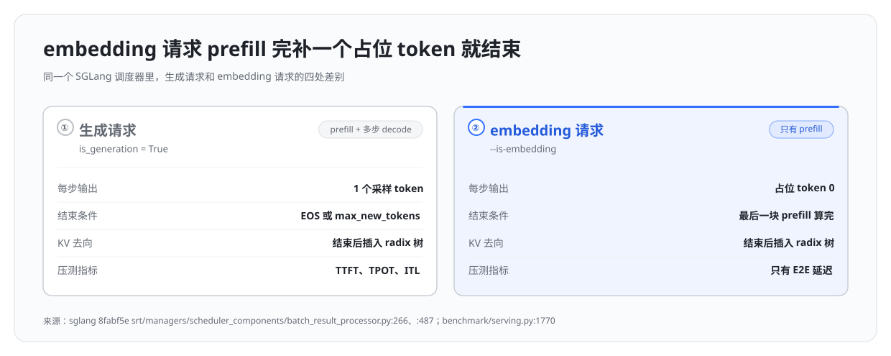
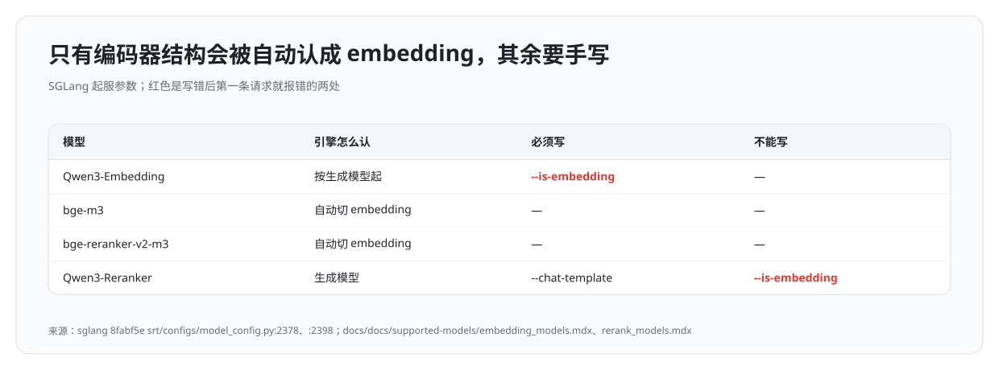
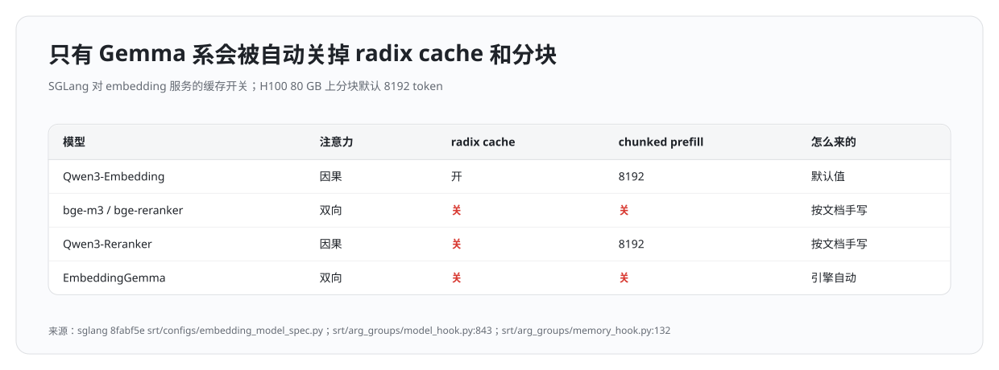
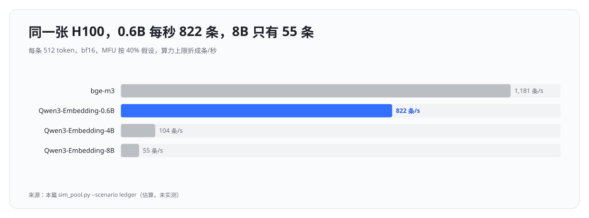
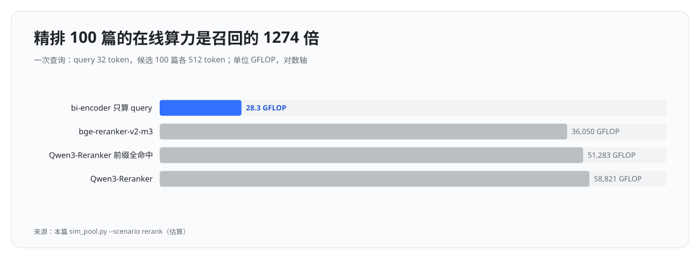
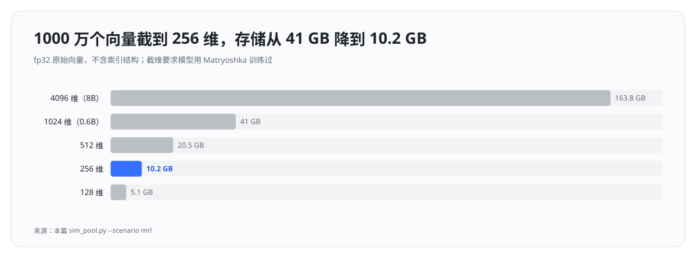

# SGL-25｜专题｜Embedding 与 Rerank 服务：只有 prefill 的引擎怎么配

> 🎯 **一句话结论**：在 SGLang 上起 embedding 和 rerank 服务，难点在起服参数，不在调度。引擎只替你做 2 个决定：编码器结构自动切 embedding 模式，Gemma 系自动关 radix cache 和分块；其余都要照文档手写，写错了要到第一条请求才报错。算力账和 vLLM 一样，精排 100 篇的在线算力是召回的 1274 倍，但 SGLang 文档给 Qwen3-Reranker 的命令关掉了 radix cache，共享前缀这部分收益默认拿不到。本篇的吞吐数字是 Roofline 估算加源码推导，没有在 GPU 上实测。
>
> **这篇文档解决什么问题**：RAG 系统里除了生成模型，还要跑把文本变成向量的 embedding 模型和给候选文档打分的 rerank 模型。SGLang 用同一个调度器服务它们，但 Qwen3-Embedding、bge-m3、bge-reranker-v2-m3、Qwen3-Reranker 这四类模型的起法各不相同，有的要加 `--is-embedding`，有的绝对不能加。本篇把每一种起法落到源码行号上，再算清楚一步的时间和一次查询的在线算力。

> 💡 **使用方式**：第 1 章讲 embedding 请求在调度器里怎么走。第 2–3 章是起服参数和缓存开关，只想把服务起起来的话看这两章和第 8 章。第 4 章算一步的时间和吞吐上限，第 5 章算召回和精排的在线算力，第 6 章讲截维。第 7 章对照 vLLM，vLLM 侧的细节见 VLLM-26。

> 💻 **代码**：[25-embedding-rerank](../25-embedding-rerank)。sim_pool.py 有 4 个场景：models 列出六个模型的结构、池化方式和两家的起服参数；ledger 算一步的时间；rerank 算一次查询的在线算力；mrl 算截维后的存储，以及两家对 `dimensions` 的校验和声明方式。pool_client.py 是只用标准库的客户端，覆盖 embed、search、rerank 和压测，补上 SGLang 没有的 rerank 压测。16 个单测钉住参数量、起服参数、rerank 的 token 账，并让客户端对着本地假服务端核对两家的响应格式。serve_pool.sh 是真机实验，含 `--prefill-only-disable-kv-cache` 的起法。

# 导读 · 先给结论

1. **embedding 请求 prefill 完就结束。**调度器走 `is_generation` 为假的分支，最后一块 prefill 算完后补一个占位 token 0，请求随即结束。`sglang.bench_serving --backend sglang-embedding` 只报端到端延迟和吞吐，不报 TTFT、TPOT、ITL。
2. **Qwen3-Embedding 必须加 `--is-embedding`，Qwen3-Reranker 必须不加。**Qwen3-Embedding 的 config.json 写的是 Qwen3ForCausalLM，不加就按生成模型起。Qwen3-Reranker 靠生成模式算 yes 和 no 的概率，加了反而报错，还要配 `--chat-template`。bge 系列是 XLM-R 编码器，引擎自动切 embedding 模式。
3. **只有 Gemma 系会被自动关掉 radix cache 和分块。**bge 系列是双向注意力，文档命令手动加 `--disable-radix-cache --chunked-prefill-size -1`；Qwen3-Embedding 两样都按默认开着，H100 80 GB 上每块 8192 token。
4. **不写 KV 省的是显存，不是时间。**`--prefill-only-disable-kv-cache` 跳过 paged KV 的物理分配，但调度器的准入账不变。按 Qwen3-Embedding-0.6B 满速估算，KV 写入只占 HBM 带宽的 1.4%。
5. **精排的在线算力是召回的上千倍。**一次查询带 100 篇 512 token 的候选，bi-encoder 在线 28.3 GFLOP，bge-reranker-v2-m3 要 36,050 GFLOP，差 1274 倍。Qwen3-Reranker 的共享前缀最多能省 7,920 个 token，但要去掉文档命令里的 `--disable-radix-cache`。
6. **截维要先在 config 里声明。**请求带 `dimensions` 时，模型 config 里没有 `is_matryoshka` 或 `matryoshka_dimensions` 就直接拒绝。Qwen3-Embedding 的 config.json 两个都没有，起服时要加 `--json-model-override-args '{"is_matryoshka": true}'`。这是给引擎的声明，引擎不会验证模型是否真的训练过 MRL。

# 第 1 章 · 请求路径：prefill 完补一个占位 token 就结束



## 1.1 调度器里的分支

embedding 请求和生成请求走同一个调度器。处理 prefill 结果时，`process_batch_result_prefill` 先看 `is_generation`（`srt/managers/scheduler_components/batch_result_processor.py:266`），embedding 和 reward 模型走 else 分支：把池化结果写进 `req.embedding`，如果这个请求的分块都算完了，就追加一个占位 token 0，调用 `update_finish_state` 把它标成结束（`:487`，注释是 “Dummy output token for embedding models”）。还有分块没算完的请求只把计数减一，下一步接着算。

结束时调用 `release_kv_cache(req, tree_cache, checkpoint=True)`：KV 不是直接释放，而是插进 radix 树。开着 radix cache 时，后来的请求能复用这段前缀；关着时，这一步就是普通的释放。

## 1.2 接口和压测

embedding 模式暴露 `/v1/embeddings`（OpenAI 兼容）和 `/encode`，分类模型走 `/classify` 和 `/v1/classify`，rerank 走 `/v1/rerank`（`srt/entrypoints/http_server.py` 的 993、1006、1883、1899、2102 行）。`/v1/rerank` 直接返回一个列表，每项是 `{"index", "score"}`（`srt/entrypoints/openai/protocol.py:1729`），和 vLLM 包在 `results` 里的格式不同。

压测用 `sglang.bench_serving --backend sglang-embedding`，它打 `/v1/embeddings`（`benchmark/serving.py:981`、`:999`）。对 embedding 后端，输出里跳过生成 token 数和 TTFT、TPOT、ITL 三组（`:1770` 前的判断），只剩每秒请求数、输入 token 吞吐和端到端延迟分位数。SGLang 没有 rerank 的压测后端，本章用 pool_client.py 的 `bench --rerank-docs` 补上。

> 🔁 **回到主线**：embedding 请求在 prefill 之后就结束，调度上没有新东西，生成模型调参里围绕 decode 的那一半旋钮全部失效。真正要操心的是起服时引擎有没有把模型认对，这是下一章的内容。

# 第 2 章 · 起服：引擎替你决定的和要手写的



## 2.1 引擎怎么判断是不是生成模型

`is_generation_model`（`srt/configs/model_config.py:2378`）先看 `--is-embedding`，再查一份非生成架构的名单：XLMRobertaModel 和 XLMRobertaForSequenceClassification 都在名单上（`:2398`），所以 bge-m3 和 bge-reranker-v2-m3 自动按 embedding 模式起，日志里会打 “Embedding architecture detected: enabling embedding mode automatically.”（`srt/arg_groups/model_hook.py:841`）。Qwen3ForCausalLM 不在名单上，Qwen3-Embedding 不加 `--is-embedding` 就按生成模型起，调 `/v1/embeddings` 时返回 400。SGLang 文档的说法是 “Decoder-style embedding models require `--is-embedding`”（`docs/docs/supported-models/embedding_models.mdx:8`）。

池化方式写在模型实现里：Qwen3 是 `Pooler(pooling_type=PoolingType.LAST, normalize=True)`（`srt/models/qwen3.py:594`），取最后一个 token 并做 L2 归一化；XLM-R 编码器取 CLS。

## 2.2 四类模型的起法

| 模型 | 结构 | SGLang 起服参数（`python3 -m sglang.launch_server --model-path ...` 之后） |
|-|-|-|
| Qwen3-Embedding-0.6B / 4B / 8B | Qwen3ForCausalLM，因果注意力，LAST 池化，矩阵乘参数 440M / 3633M / 6946M | `--is-embedding` |
| bge-m3 | XLMRobertaModel，双向注意力，CLS 池化，302M | `--attention-backend triton --disable-radix-cache --chunked-prefill-size -1` |
| bge-reranker-v2-m3 | XLMRobertaForSequenceClassification，cross-encoder，302M | `--is-embedding --attention-backend triton --disable-radix-cache --chunked-prefill-size -1`（照抄 rerank_models.mdx） |
| Qwen3-Reranker-0.6B | Qwen3ForCausalLM，用 yes / no 两个 token 的概率打分，440M | `--trust-remote-code --disable-radix-cache --chat-template examples/chat_template/qwen3_reranker.jinja`，不加 `--is-embedding` |

矩阵乘参数按 config.json 逐项累加，只算注意力投影和 MLP，不含词表 embedding。bge-reranker-v2-m3 的架构已经在自动识别的名单上，文档命令里的 `--is-embedding` 是冗余的，照抄不会出错。

## 2.3 Qwen3-Reranker 为什么不能加 --is-embedding

SGLang 没有像 vLLM 那样把 Qwen3-Reranker 改成分类头，而是保留生成模型，靠打分接口取下一个 token 的概率。`/v1/rerank` 收到请求后先认后端：模板里出现 `answer can only be "yes" or "no"` 这类文字，就走 decoder 打分（`srt/entrypoints/openai/serving_rerank.py:57`、`:88`）。decoder 打分路径先检查服务是不是生成模式，不是就直接报错，提示 “Please relaunch without --is-embedding”（`:365`）；然后对每个 (query, 文档) 渲染模板，调用 `score_prompts` 只取 yes 和 no 两个 token 的概率（`:381`），分数是 P(yes) / (P(yes) + P(no))（`:114`）。

所以 `--chat-template` 也是必需的：没有它，引擎认不出这是 decoder reranker，会退回 cross-encoder 路径，返回 400。代价方面，即使在最后一个位置算整张 lm_head，每个句对也只多 2 × 1024 × 151,669 ≈ 0.31 GFLOP，100 个句对共 31.1 GFLOP，不到第 5 章总量的 0.06%。

> 🔁 **回到主线**：四类模型里，引擎只自动认出了 bge 系列；Qwen3-Embedding 要加 `--is-embedding`，Qwen3-Reranker 要不加并配模板，两处写反都要到第一条请求才报错。模型认对以后，下一个问题是 radix cache 和分块开着还是关着，这由注意力方向决定，但 SGLang 大多不替你决定。

# 第 3 章 · 缓存与分块：只有 Gemma 系会被自动关掉



## 3.1 谁来关这两个开关

双向注意力的模型不能分块，也不能复用前缀：每个 token 都要看到整条输入，前缀的 KV 也依赖后面的内容。SGLang 用 `EmbeddingModelSpec` 描述每种 embedding 架构，其中 `safe_disable_radix_cache` 和 `safe_disable_chunked_prefill` 为真的才会在启动时被自动关掉（`srt/arg_groups/model_hook.py:843` 起）。在 `srt/configs/embedding_model_spec.py` 里，只有 EmbeddingGemma 和 EmbeddingGemma2 两个 spec 把这两项设成真；XLM-R、BERT 这些编码器的 spec 没有设。所以 bge 系列的文档命令要手动加 `--disable-radix-cache --chunked-prefill-size -1`，这两项不是可选优化。不加时会发生什么，本篇没有验证。

因果注意力配 LAST 池化的 Qwen3-Embedding，两样都可以开，SGLang 也按默认开着。Qwen3-Reranker 同样是因果注意力，前缀复用在原理上成立，但文档命令带了 `--disable-radix-cache`，第 5 章会算这样做丢了多少。

## 3.2 每步塞多少 token

每步新进的 prefill token 受两个预算约束：`max_prefill_tokens` 默认 16384（`srt/arg_groups/fields/schedule.py:81`），以及 `chunked_prefill_size`。两者都在 PrefillAdder 里逐个请求扣减，任一用完就停止加请求（`srt/managers/schedule_policy.py:900`、`:953`）。`chunked_prefill_size` 的默认值按显存分档（`srt/arg_groups/memory_hook.py:89` 起，80 GB 卡落在 `:132` 那一档）：

| 单卡显存 | chunked_prefill_size | 典型卡 |
|-|-|-|
| 小于 20 GB | 2048 | T4、4080 |
| 20–60 GB | 4096 | A10、L40S |
| 60–160 GB | 8192 | A100 80 GB、H100、H200 |
| 160 GB 及以上 | 16384 | B200 |

和 vLLM 有一处不同：SGLang 不区分 A100 和 H100，80 GB 的卡都是 8192；vLLM 在 A100 上是 2048。关掉分块（`-1`）后，每步只剩 `max_prefill_tokens` 一个上限，bge-m3 一步最多能放 16384 个 token，即 32 条 512 token 的输入。算力受限时，一步放多少条只改变单步时间，不改变每秒条数。

## 3.3 不写 KV：省显存，不省时间

`--prefill-only-disable-kv-cache` 让 embedding 模式不分配 paged KV 的物理显存，注意力直接用当前这一步的 K 和 V 算，不读也不写缓存（`srt/mem_cache/memory_pool.py:3510` 的 NoOpMHATokenToKVPool）。它有 6 个前提条件，缺一项启动时就报错（`srt/mem_cache/kv_cache_configurator.py:812`）：`--is-embedding`、`--chunked-prefill-size -1`、`--disable-radix-cache`、FA3 或 FA4 的 prefill 后端、KV 不能是 FP4、不开 context parallel。

参数说明里写得很清楚：“Scheduler admission accounting is unchanged”。调度器仍按原来的 KV 池容量决定放多少请求，所以它不会让一步放进更多条。它省下的是两样东西：KV 池那块显存，以及写 KV 的带宽。后者很小：Qwen3-Embedding-0.6B 每条 512 token 的输入写 56.0 MiB KV，按第 4 章的 822 条/秒算，约 48 GB/s，是 H100 HBM 带宽的 1.4%。所以这个开关的价值在显存紧张、要和别的模型共卡时，而不在提速。

> 🔁 **回到主线**：bge 系列的两个开关要手动关，Qwen3-Embedding 按默认开着，80 GB 卡上每步预算 8192 token；不写 KV 只省显存。开关定了，剩下能算的是这一步要花多少时间、一张卡每秒能处理多少条，这是下一章的账本。

# 第 4 章 · 账本：一步的时间和吞吐上限



账本的算法和引擎无关，和 VLLM-26 第 4 章是同一套数：前向一次，每个 token 的 FLOP 是 2 × 矩阵乘参数，加注意力 4 × 层数 × 头数 × head_dim × 可见长度，因果注意力平均可见 (L+1)/2，双向可见 L。输入 512 token 时：

| 模型 | GFLOP / token | 每步读权重 | 上限（条/秒） | 8192 token 一步 |
|-|-|-|-|-|
| Qwen3-Embedding-0.6B | 0.94 | 0.88 GB，0.26 ms | 822 | 19.46 ms |
| Qwen3-Embedding-4B | 7.42 | 7.27 GB，2.17 ms | 104 | 153.61 ms |
| Qwen3-Embedding-8B | 14.04 | 13.89 GB，4.15 ms | 55 | 290.80 ms |
| bge-m3 | 0.65 | 0.60 GB，0.18 ms | 1,181 | 13.55 ms |

口径：H100 SXM，BF16 稠密峰值 989 TFLOPS，HBM 3.35 TB/s；MFU 按 40% 假设；8192 token 即 16 条 512 token 的输入。上限只算算力，不含排队、tokenize 和网络。sim_pool.py 的 ledger 场景按 vLLM 的预算排批，没有移植 SGLang 的 PrefillAdder；在 H100 上两家的预算都是 8192，结果一致。

以 Qwen3-Embedding-0.6B 为例：读一遍 0.88 GB 权重要 0.26 ms，这段时间在 40% MFU 下能算 111 个 token 的前向。一步超过 111 个 token 就进入算力区，而一条 embedding 输入就有几百个 token，所以几乎每一步都受算力限制。bge-m3 的每 token 运算量比 Qwen3-Embedding-0.6B 少三成，上限高出 44%；8B 的上限只有 0.6B 的 1/15，换模型前先确认召回指标的提升值这个价。

> 🔁 **回到主线**：embedding 请求的成本几乎全是 prefill 的算力，可以按 token 数线性地算，两家引擎在这一层没有差别。按这个账去看一个检索系统，钱花在哪一步，就看每次查询在线要过模型多少个 token，这是下一章召回和精排的分工问题。

# 第 5 章 · 召回与精排：SGLang 默认拿不到共享前缀



## 5.1 一次查询的账

设一次查询的 query 有 32 个 token，候选文档 100 篇，每篇 512 token：

| 做法 | 在线 token | GFLOP | 算力下限 |
|-|-|-|-|
| bi-encoder（Qwen3-Embedding-0.6B），只算 query | 32 | 28.3 | 0.072 ms |
| cross-encoder（bge-reranker-v2-m3） | 54,800 | 36,050 | 91.128 ms |
| Qwen3-Reranker-0.6B，按文档命令（关 radix cache） | 61,800 | 58,821 | 148.688 ms |
| Qwen3-Reranker-0.6B，开 radix cache 且前缀全部命中 | 53,880 | 51,283 | 129.633 ms |

bi-encoder 的文档向量在入库时离线算好，查询时只算 query 的向量再做 100 次点积。cross-encoder 要把每个 (query, 文档) 对整段过一遍模型，XLM-R 的句对每对 32 + 512 + 4 = 548 个 token，100 对是 54,800 个，和召回差 1274 倍。所以检索系统先用向量召回几百篇，再只对前几十篇精排。

## 5.2 关掉 radix cache 丢了多少

Qwen3-Reranker 的模板在 query 之前有 61 个 token，query 和文档之间 4 个，文档之后 9 个（用 Qwen3 tokenizer 对默认 instruction 数出来的）。同一次查询的 100 个句对共享前 93 个 token（61 + 32），按 16 token 一页能复用 80 个，100 对共省 7,920 个 token，算力下限从 148.688 ms 降到 129.633 ms，约 13%。

SGLang 文档给 Qwen3-Reranker 的命令带 `--disable-radix-cache`，这时一个 token 都不复用，表里第三行就是 SGLang 的默认情况。想拿回这 13%，要去掉这个开关，并自己验证两件事：打分和关着时一致；命中率接近上限。命中率可以开 `--enable-metrics` 后看 `sglang:cache_hit_rate`（`srt/observability/metrics_collector.py:389`）。第四行是上限：前缀块要先算完并留在树里，后面的句对才能命中。

> 🔁 **回到主线**：在线算力的大头在精排；SGLang 上 Qwen3-Reranker 的共享前缀默认被关掉，最多 13% 的收益要自己验证后才能拿。召回的在线成本可以忽略，它的成本挪到了离线：每篇文档的向量存多少维，直接决定向量库的大小，这是下一章的截维问题。

# 第 6 章 · 截维：dimensions 要先在 config 里声明



## 6.1 存储账

1000 万个 fp32 向量的原始存储：Qwen3-Embedding-8B 输出 4096 维，163.8 GB；0.6B 和 bge-m3 输出 1024 维，41.0 GB；截到 512 维是 20.5 GB，256 维 10.2 GB，128 维 5.1 GB。这还没算 HNSW 之类的索引结构。截维的前提是模型训练时用过 Matryoshka 表示学习（MRL），前几维已经携带主要信息；没训练过的模型截维后召回会明显变差。

## 6.2 SGLang 怎么处理 dimensions

请求带 `dimensions` 时，tokenizer_manager 依次检查（`srt/managers/tokenizer_manager.py:1485`）：模型是否声明支持 Matryoshka，没有就拒绝，错误信息是 “does not support matryoshka representation, changing output dimensions will lead to poor results”；取值是否大于 0；config 里有 `matryoshka_dimensions` 时是否在列表里；是否超过 hidden_size。是否声明看 config 里的 `matryoshka_dimensions` 或 `is_matryoshka`（`srt/configs/model_config.py:919`）。通过之后，池化结果先截取前 `dimensions` 维，再做 L2 归一化（`srt/layers/pooler.py:258`），截出来的向量仍是单位长度，可以直接算余弦相似度。

Qwen3-Embedding 的模型卡说支持自定义输出维度，但 config.json 里这两个字段都没有，SGLang 也没有为它单独补。所以要在起服时加 `--json-model-override-args '{"is_matryoshka": true}'`，或者用 `matryoshka_dimensions` 限定允许的几档。这一点两家一致：vLLM 用 `--hf-overrides` 补同一个字段。声明只是告诉引擎「可以截」，引擎不会验证模型是否真的训练过 MRL，上线前要用自己的评测集比较截维前后的召回。

> 🔁 **回到主线**：截到 256 维能把离线存储降到四分之一，但 SGLang 要先在 config 里声明 Matryoshka 才放行，声明前该不该截由你的评测集决定。到这里，SGLang 侧的起服、开关、账本和截维都有了结论。vLLM 服务同样的模型时取舍不同，下一章逐项对照，避免把一家的参数照抄到另一家。

# 第 7 章 · 对照 vLLM：同一个模型，两套起法

| 项目 | SGLang（8fabf5e） | vLLM（0d6f92a） |
|-|-|-|
| Qwen3-Embedding | 必须 `--is-embedding` | `--runner pooling`，也能靠 sentence-transformers 的 modules.json 自动识别 |
| bge 系列 | 自动切 embedding 模式；分块和 radix cache 要手动关 | 自动识别；双向模型自动关分块和前缀复用 |
| Qwen3-Reranker | 保留生成模型，取 yes / no 的概率；不加 `--is-embedding`，配模板 | 用 `--hf-overrides` 改成 Qwen3ForSequenceClassification，lm_head 折成一行 |
| 每步预算（80 GB 卡） | 8192，A100 和 H100 相同 | H100 8192，A100 2048 |
| 省掉 KV | `--prefill-only-disable-kv-cache`，只省显存 | 无对应开关 |
| 截维 | config 要声明 Matryoshka，起服用 `--json-model-override-args` 补；先截维再归一化 | config 要声明 Matryoshka，起服用 `--hf-overrides` 补 |
| rerank 接口 | `/v1/rerank`，返回列表 `[{"index", "score"}]` | `/rerank` 等，返回 `{"results": [{"index", "relevance_score"}]}` |
| 压测 | `sglang.bench_serving --backend sglang-embedding`；没有 rerank 后端 | `vllm bench serve` 有 openai-embeddings 和 vllm-rerank 两个后端 |

两处最容易照抄出错。第一，Qwen3-Embedding 在 SGLang 上要 `--is-embedding`，Qwen3-Reranker 要不加；把 vLLM 的 `--runner pooling` 思路搬过来给 reranker 加上 `--is-embedding`，SGLang 会在第一条 rerank 请求时报错。第二，两家的 rerank 响应格式不同，客户端要兼容两种，pool_client.py 的 `parse_rerank` 就是这么做的。

> 🔁 **回到主线**：两家对同一个模型的认法、缓存开关和截维的声明方式都不同，参数不能互相照抄，但第 4–5 章的算力账两家通用。账本里的数都是估算，最后一章给出在真机上核对它们的命令。

# 第 8 章 · 真机实验

先在 CPU 上跑账本和单测，确认第 4–6 章的数能复现：

```bash
python3 sim_pool.py --scenario models
python3 sim_pool.py --scenario ledger --model qwen3-emb-0.6b --doc-len 512
python3 sim_pool.py --scenario rerank --docs 100 --query-len 32 --doc-len 512
python3 sim_pool.py --scenario mrl --vectors 10000000
python3 test_sim_pool.py
```

再上 GPU。一个终端起服务，另一个终端跑客户端和压测；`emb_nokv` 是同一个模型加上不写 KV 的起法，压两遍对比；`rr_qwen` 要把 SGLang 源码克隆到 `$SGLANG_SRC`，用里面的模板。以下命令没有在 GPU 上实跑过：

```bash
bash serve_pool.sh emb
bash serve_pool.sh client
bash serve_pool.sh bench_emb 512
bash serve_pool.sh emb_nokv
bash serve_pool.sh bench_emb 512
bash serve_pool.sh rr_bge
bash serve_pool.sh bench_rr 100
bash serve_pool.sh rr_qwen
bash serve_pool.sh bench_rr 100
```

要核对的五件事：

1. `bench_emb` 在 request-rate inf 下的吞吐，和第 4 章的 822 条/秒相比，反推实际 MFU。
2. `emb` 和 `emb_nokv` 两次压测的吞吐差，验证第 3 章「不写 KV 不省时间」的判断；同时看启动日志里 KV 池占用的显存差。
3. Qwen3-Embedding 不加 `--is-embedding` 起服，调 `/v1/embeddings` 是否返回 400；Qwen3-Reranker 加上 `--is-embedding`，调 `/v1/rerank` 是否报 “not in generation mode”。
4. 去掉 `emb` 里的 `--json-model-override-args`，带 `dimensions` 的请求是否被拒绝。
5. 去掉 `rr_qwen` 的 `--disable-radix-cache`、加 `--enable-metrics` 再压一遍，看 `sglang:cache_hit_rate` 和打分是否与关着时一致。

> 🔁 **回到主线**：真机数字回来以后，先用吞吐反推 MFU，替换第 4 章的 40% 假设；再用两组对照实验确认两个判断：不写 KV 只省显存，打开 radix cache 能拿回 Qwen3-Reranker 最多 13% 的算力。起服参数一次定死，召回和精排的分工持续省算力，实测只是把这几笔账的系数换成真值。

> 📌 **核对清单**
> - 压测只看端到端延迟和每秒条数，`bench_serving` 对 embedding 后端不报 TTFT 和 TPOT。
> - Qwen3-Embedding 加 `--is-embedding`；Qwen3-Reranker 不加，并配 `--chat-template`。
> - bge 系列手动加 `--disable-radix-cache --chunked-prefill-size -1`，引擎不会替你关。
> - 知道 80 GB 卡上每步预算是 8192 token，关掉分块后上限是 `max_prefill_tokens` 16384。
> - `--prefill-only-disable-kv-cache` 用在显存紧张时，不指望它提速。
> - 精排只对召回的前几十篇做；想拿 Qwen3-Reranker 的前缀收益，先验证打分不变。
> - 截维前用自己的评测集确认模型训练过 MRL，再用 `--json-model-override-args` 声明 `is_matryoshka`。

# 诚实清单

1. 第 4–5 章的吞吐和延迟全部是 Roofline 估算，MFU 40% 是假设值，没有在 GPU 上实测。验证方法见第 8 章第 1 条。
2. bge 系列不手动关 radix cache 和分块时会发生什么，本篇没有验证，只照文档命令关掉。
3. 「不写 KV 只省显存」是按参数说明和 KV 写入带宽估算的结论，吞吐差没有实测。
4. Qwen3-Reranker 去掉 `--disable-radix-cache` 后打分是否不变、命中率能到多少，没有实测；13% 是上限。
5. serve_pool.sh 的命令按 8fabf5e 的源码和文档写成，没有在 GPU 上跑过；SGLang 版本变化后参数名可能变。
6. Qwen3-Reranker 在最后一个位置是否真的算整张 lm_head 没有逐行核实；0.31 GFLOP 每对是按整张算的上限。
7. 模型结构取自 Hugging Face main 分支的 config.json，2026 年 11 月 19 日读取。

# 修订记录

| 版本 | 日期 | 变更 |
|-|-|-|
| v1 | 2026-11-20 | 首版。源码基线 sglang 8fabf5e、vllm 0d6f92a；账本由 sim_pool.py 生成，16 个单测通过；GPU 实验未跑。 |

# 参考文献

源码以 sgl-project/sglang 主干提交 8fabf5e 为准，vLLM 对照以 vllm-project/vllm 主干 0d6f92a 为准。

[1] sgl-project. srt/managers/scheduler_components/batch_result_processor.py. GitHub (8fabf5e) [https://github.com/sgl-project/sglang/blob/8fabf5e/python/sglang/srt/managers/scheduler_components/batch_result_processor.py](https://github.com/sgl-project/sglang/blob/8fabf5e/python/sglang/srt/managers/scheduler_components/batch_result_processor.py)

[2] sgl-project. srt/configs/model_config.py. GitHub (8fabf5e) [https://github.com/sgl-project/sglang/blob/8fabf5e/python/sglang/srt/configs/model_config.py](https://github.com/sgl-project/sglang/blob/8fabf5e/python/sglang/srt/configs/model_config.py)

[3] sgl-project. srt/configs/embedding_model_spec.py. GitHub (8fabf5e) [https://github.com/sgl-project/sglang/blob/8fabf5e/python/sglang/srt/configs/embedding_model_spec.py](https://github.com/sgl-project/sglang/blob/8fabf5e/python/sglang/srt/configs/embedding_model_spec.py)

[4] sgl-project. srt/arg_groups/memory_hook.py. GitHub (8fabf5e) [https://github.com/sgl-project/sglang/blob/8fabf5e/python/sglang/srt/arg_groups/memory_hook.py](https://github.com/sgl-project/sglang/blob/8fabf5e/python/sglang/srt/arg_groups/memory_hook.py)

[5] sgl-project. srt/mem_cache/kv_cache_configurator.py. GitHub (8fabf5e) [https://github.com/sgl-project/sglang/blob/8fabf5e/python/sglang/srt/mem_cache/kv_cache_configurator.py](https://github.com/sgl-project/sglang/blob/8fabf5e/python/sglang/srt/mem_cache/kv_cache_configurator.py)

[6] sgl-project. srt/entrypoints/openai/serving_rerank.py. GitHub (8fabf5e) [https://github.com/sgl-project/sglang/blob/8fabf5e/python/sglang/srt/entrypoints/openai/serving_rerank.py](https://github.com/sgl-project/sglang/blob/8fabf5e/python/sglang/srt/entrypoints/openai/serving_rerank.py)

[7] SGLang Docs. Embedding Models (8fabf5e) [https://github.com/sgl-project/sglang/blob/8fabf5e/docs/docs/supported-models/embedding_models.mdx](https://github.com/sgl-project/sglang/blob/8fabf5e/docs/docs/supported-models/embedding_models.mdx)

[8] SGLang Docs. Rerank Models (8fabf5e) [https://github.com/sgl-project/sglang/blob/8fabf5e/docs/docs/supported-models/rerank_models.mdx](https://github.com/sgl-project/sglang/blob/8fabf5e/docs/docs/supported-models/rerank_models.mdx)

[9] Qwen. Qwen3-Embedding-0.6B. Hugging Face [https://huggingface.co/Qwen/Qwen3-Embedding-0.6B](https://huggingface.co/Qwen/Qwen3-Embedding-0.6B)

[10] Qwen. Qwen3-Reranker-0.6B. Hugging Face [https://huggingface.co/Qwen/Qwen3-Reranker-0.6B](https://huggingface.co/Qwen/Qwen3-Reranker-0.6B)

[11] BAAI. bge-m3. Hugging Face [https://huggingface.co/BAAI/bge-m3](https://huggingface.co/BAAI/bge-m3)

[12] BAAI. bge-reranker-v2-m3. Hugging Face [https://huggingface.co/BAAI/bge-reranker-v2-m3](https://huggingface.co/BAAI/bge-reranker-v2-m3)

[13] Kusupati A, et al. Matryoshka Representation Learning. NeurIPS (2022) [https://arxiv.org/abs/2205.13147](https://arxiv.org/abs/2205.13147)

[14] sgl-project. srt/managers/tokenizer_manager.py. GitHub (8fabf5e) [https://github.com/sgl-project/sglang/blob/8fabf5e/python/sglang/srt/managers/tokenizer_manager.py](https://github.com/sgl-project/sglang/blob/8fabf5e/python/sglang/srt/managers/tokenizer_manager.py)

[15] vllm-project. vllm/pooling_params.py. GitHub (0d6f92a) [https://github.com/vllm-project/vllm/blob/0d6f92a/vllm/pooling_params.py](https://github.com/vllm-project/vllm/blob/0d6f92a/vllm/pooling_params.py)

---

上一章：[SGL-24｜实战｜Qwen3.8-27B：混合 GDN 视觉模型的 SGLang 部署](./24-qwen38-27b-deploy.md) · [目录](./README.md)
