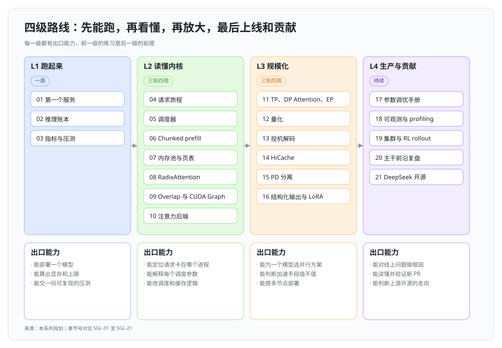
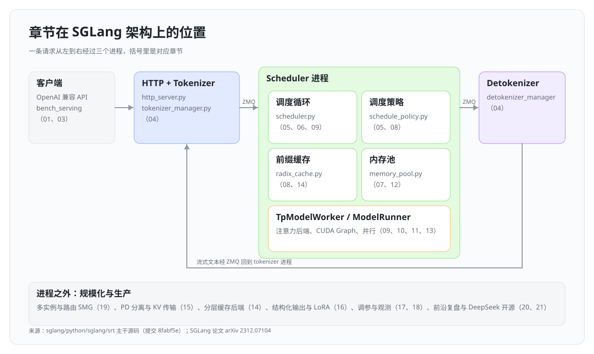
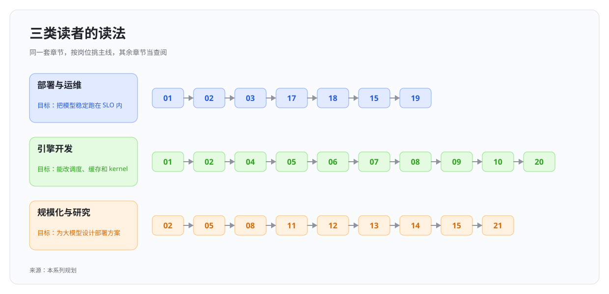

# Zero To SGLang

> 本目录是「从 0 开始 SGLang」系列文档的 Markdown 版，共 25 章，由飞书原文转换，正文与原文一致，画板导出为图片放在 `assets/`。配套代码在仓库根目录，每章一个目录。

> 🎯 **遇到的问题**：这套手册想把 SGLang 从“能启动”学到“能改内核、能扛线上流量”。本篇是 25 章的入口和路线图，列出每章读完交付什么、练习代码放在哪。
>
> **怎么读**：先看导读和路线图，再到第 3 章按岗位挑一条主线。每读完一章，跑通对应目录的练习，再用第 5 章的验收题自测，其余章节当查阅手册。文中版本、价格和基准分数核对于 2026 年 10 月 28 日。
>
> **代码**：[zero-to-sglang](../README.md)，每章一个目录。CPU 模拟器和 GPU 脚本分开放，没有 GPU 也能做完大部分内核章节的练习。

# 导读 · 结论先行

1. **SGLang 的性能主要来自调度和缓存，kernel 排第二。**RadixAttention 让共享前缀的请求复用 KV，零开销调度把 CPU 准备工作藏到 GPU 计算后面，cache-aware 路由把命中率扩展到多实例。论文在多类 LLM 程序上测到最高 6.4 倍吞吐[[1]](https://arxiv.org/abs/2312.07104)，v0.4 的零开销调度器再带来 1.1 倍吞吐，cache-aware 负载均衡最高 1.9 倍吞吐、命中率提高 3.8 倍[[2]](https://www.lmsys.org/blog/2024-12-04-sglang-v0-4/)。
2. **先算账，后读源码。**算不出一张卡能放多少 token 的 KV、decode 为什么受显存带宽限制，读调度器时只能看到一堆 if。所以推理账本排在源码章节之前，Roofline 是全系列的公共语言[[3]](https://arxiv.org/abs/2402.16363)[[4]](https://arxiv.org/abs/2404.14294)。
3. **读源码从 mini-sglang 起步，再切到主干。**主干 srt 目录约 38 万行，scheduler.py 一个文件 6494 行。mini-sglang 约 8 千行（README 口径是 5 千行 Python），保留了 radix cache、chunked prefill、overlap 调度和 TP 的骨架[[5]](https://github.com/sgl-project/mini-sglang)。每章先在 mini 版上看清结构，再去主干找同名逻辑。
4. **规模化的问题都可以归结为资源拆分。**TP、DP Attention、EP 拆的是算力和显存，PD 分离拆的是 prefill 和 decode 两种负载，HiCache 拆的是 KV 的存放层级。判断标准是同一个：拆完以后瓶颈移到了哪里[[6]](https://arxiv.org/abs/2401.09670)[[7]](https://www.lmsys.org/blog/2025-05-05-large-scale-ep/)[[8]](https://www.lmsys.org/blog/2025-09-10-sglang-hicache/)。
5. **生产能力靠指标和压测说话。**每一次调参都要在 TTFT、TPOT、吞吐和 token usage 上看到可复现的变化，看不到就不改[[9]](https://docs.sglang.io/docs/advanced_features/hyperparameter_tuning)[[10]](https://docs.sglang.io/docs/developer_guide/bench_serving)。
6. **系列的出口是能独立读懂主干的新改动。**上游每月合进两千多个提交，学完的标准是：拿到一个新 PR，能说清它原来卡在哪、引入了什么机制、代价落在哪个负载上，并用一份可复现的 benchmark 验证[[11]](https://docs.sglang.io/docs/developer_guide/contribution_guide)。



**📎 与系列其他文档的分工**：本系列自成一体。原理只讲到能读懂实现为止，篇幅留给源码、参数和运维。每篇第 2 章末尾有一节「vLLM 怎么做」，把同一个问题在另一个主流引擎里的解法摆在旁边：两边选择相同，说明是问题本身决定的；选择不同，就能看清代价各自落在哪里。

# 第 1 章 · 先进在哪，系列怎么组织

## 1.1 先进在哪

SGLang 的论文把它定义成一门前端语言加一个运行时。前端提供生成和并行控制的原语，运行时用 RadixAttention 复用 KV cache，用压缩有限状态机加速结构化输出[[1]](https://arxiv.org/abs/2312.07104)。出发点是把一个 LLM 程序当整体来跑：多次调用共享的前缀、固定格式的输出、并行的分支，都是运行时能利用的结构。下表列出它在这条思路上走出的几步，倍数都是 SGLang 团队在特定模型和负载上测的。

| 维度 | SGLang 的做法 | 带来什么 |
|-|-|-|
| 前缀复用 | 请求结束后，prompt 和生成结果的 KV 都留在一棵基数树里，按 LRU 逐出叶子，配合缓存感知调度提高命中率[[12]](https://www.lmsys.org/blog/2024-01-17-sglang/) | 多轮对话、few-shot、agent 这类共享前缀的负载少算重复的 prefill，论文在多类 LLM 程序上测到最高 6.4 倍吞吐[[1]](https://arxiv.org/abs/2312.07104) |
| 结构化输出 | 压缩有限状态机，把只有一条出路的转移合并，一步解码多个 token[[13]](https://www.lmsys.org/blog/2024-02-05-compressed-fsm/)；v0.4 起接入 xgrammar[[2]](https://www.lmsys.org/blog/2024-12-04-sglang-v0-4/) | 团队博客口径：比 outlines + vLLM 等组合延迟最多降 2 倍、吞吐最多升 2.5 倍[[13]](https://www.lmsys.org/blog/2024-02-05-compressed-fsm/)，xgrammar 版本最多快 10 倍[[2]](https://www.lmsys.org/blog/2024-12-04-sglang-v0-4/) |
| CPU 调度开销 | 调度器提前一个 batch 准备元数据，基数树操作等 CPU 工作和 GPU 计算重叠[[2]](https://www.lmsys.org/blog/2024-12-04-sglang-v0-4/) | 吞吐比上一版高 1.1 倍，比其他基线高 1.3 倍，小模型和大 TP 时最明显[[2]](https://www.lmsys.org/blog/2024-12-04-sglang-v0-4/) |
| 多实例路由 | 负载均衡器预测每个 worker 的前缀命中率，把请求发给命中最高的[[2]](https://www.lmsys.org/blog/2024-12-04-sglang-v0-4/) | 最高 1.9 倍吞吐、命中率提高 3.8 倍，worker 越多收益越大[[2]](https://www.lmsys.org/blog/2024-12-04-sglang-v0-4/) |
| 大规模部署 | PD 分离加大规模 EP，接入 DeepEP、DeepGEMM 和 EPLB[[7]](https://www.lmsys.org/blog/2025-05-05-large-scale-ep/)；HiCache 把基数树扩到 CPU 内存、磁盘和远端存储[[8]](https://www.lmsys.org/blog/2025-09-10-sglang-hicache/) | 12 节点 96 张 H100、2000 token 输入时，每节点 52.3k 输入、22.3k 输出 token/s，博客称是首个接近 DeepSeek 官方吞吐的开源方案[[7]](https://www.lmsys.org/blog/2025-05-05-large-scale-ep/) |
| 确定性与 RL | 接入 batch-invariant 算子，同时兼容 chunked prefill、CUDA Graph 和 radix cache[[14]](https://www.lmsys.org/blog/2025-09-22-sglang-deterministic/)；slime 用它做 rollout[[15]](https://github.com/THUDM/slime) | 开 CUDA Graph 后确定性模式的额外开销降到 34.35%，和 slime 合作做到 RL 训练 100% 可复现[[14]](https://www.lmsys.org/blog/2025-09-22-sglang-deterministic/) |
| 硬件覆盖 | README 列出 NVIDIA B200 到 RTX 系列、AMD MI300X 到 MI355X、Intel、TPU、NPU、CPU 和 Apple Silicon[[16]](https://github.com/sgl-project/sglang) | 换硬件时调度和缓存的读法不变，后端和 kernel 按平台选 |

放在 vLLM 旁边看更清楚。vLLM 起家靠 PagedAttention 解决 KV 显存碎片[[17]](https://arxiv.org/abs/2309.06180)，它的 README 现在同样列出前缀缓存、chunked prefill、xgrammar 结构化输出、PD 分离和专家并行，硬件插件覆盖 TPU、Gaudi、昇腾等[[18]](https://github.com/vllm-project/vllm)，两家的功能清单已经很接近。

差别留在路线上：vLLM 的前缀缓存按 KV 块算哈希，一块的哈希由父块哈希和块内 token 决定[[19]](https://docs.vllm.ai/en/latest/design/prefix_caching.html)；SGLang 用一棵基数树统一管前缀匹配、逐出和调度[[12]](https://www.lmsys.org/blog/2024-01-17-sglang/)，后来的 HiCache 和缓存感知路由都长在这棵树上[[2]](https://www.lmsys.org/blog/2024-12-04-sglang-v0-4/)[[8]](https://www.lmsys.org/blog/2025-09-10-sglang-hicache/)。每篇第 2 章末尾的「vLLM 怎么做」就是对着这类差别写的。

对学习者，SGLang 值得读的地方是这些机制都在一套能读完的代码里。调度、缓存、并行、PD 分离、结构化输出各有独立模块，mini-sglang 用 README 口径约 5 千行 Python 保留了骨架[[5]](https://github.com/sgl-project/mini-sglang)。DeepSeek 推理系统的开源复现、slime 这类 RL 框架的 rollout、多家硬件的接入，最后都落到这些模块上[[7]](https://www.lmsys.org/blog/2025-05-05-large-scale-ep/)[[15]](https://github.com/THUDM/slime)[[16]](https://github.com/sgl-project/sglang)，[SGL-21｜前沿｜DeepSeek 开源如何改写 SGLang：从 kernel 到 DeepInfer](./21-deepseek.md) 讲的就是一家模型方怎样一步步改写它。读懂它，再看其他引擎和新论文就有了参照。

短板也要说清。上面的倍数大多来自 SGLang 团队自己的博客，换了模型、负载和硬件就得重测，3.3 节的踩坑说的就是这件事。主干每月合进两千多个提交，文件经常搬家改名，旧教程的行号很快失效（见 1.5 节）。生态里也有它没覆盖到的地方，例如 verl 在 AMD ROCm 上验证过的推理引擎是 vLLM，SGLang 支持仍在推进[[20]](https://github.com/verl-project/verl)。选型时按自己的模型和负载压测，不按名气。

## 1.2 四级路线

二十三章分成四级，每一级有明确的出口能力，前一级的练习是后一级的输入。章节顺序参考了 Datawhale 与 SGLang 团队合编的 zero-to-sglang 课程（概念、手写 mini 引擎、真实引擎前沿、部署与贡献四段）[[21]](https://github.com/datawhalechina/zero-to-sglang)，本系列把手写引擎换成对照 mini-sglang 和主干源码的模拟器练习，并补上调参、观测、集群和 RL 四章生产内容。

- **L1 跑起来（约一周，01 至 03）**：部署一个模型，用 OpenAI 兼容接口打通请求。算出一张卡的权重、KV 和激活各占多少。交一份写清负载、并发和版本的压测报告。
- **L2 读懂内核（三到四周，04 至 10）**：沿一条请求的路径读完 tokenizer、scheduler、detokenizer 三个进程；把调度循环、chunked prefill、内存池、基数树、overlap 与 CUDA Graph、注意力后端逐个拆开。这一级的练习大多在 CPU 上做，用模拟器复现主干的关键数据结构。
- **L3 规模化（三到四周，11 至 16）**：多卡并行、量化、投机解码、分层缓存、PD 分离、结构化输出与 LoRA。每章回答同一个问题：这项技术在什么负载下值得开，代价落在哪里。
- **L4 生产与贡献（持续，17 至 25）**：参数调优手册、可观测与 profiling、集群路由与 RL rollout、42 天主干前沿复盘、DeepSeek 开源对 SGLang 的影响，DeepSeek-V4.1-Flash 从消费级显卡到 H20 的部署实战，Qwen3-32B 从单卡到两卡的部署和迁到 Qwen3.8-27B 的配比，以及 Qwen3.8-27B 混合 GDN 视觉模型按状态槽和 KV 两本账部署，以及 embedding 与 rerank 这类只有 prefill 的服务怎么配。这一级没有终点，章节会随上游版本更新。

## 1.3 章节落在架构上的位置

SGLang Runtime（SRT）把一次推理拆到三个进程里：HTTP 服务与 TokenizerManager 负责接入和分词，Scheduler 负责组 batch、管 KV 和驱动模型前向，DetokenizerManager 把 token 流转回文本。进程之间用 ZMQ 传消息，消息结构定义在 [io_struct.py](https://github.com/sgl-project/sglang/blob/8fabf5e/python/sglang/srt/managers/io_struct.py)[[1]](https://arxiv.org/abs/2312.07104)[[16]](https://github.com/sgl-project/sglang)。这样拆的好处是分词和反分词的 CPU 开销不挡在 GPU 前面，代价是一条请求要跨三次进程边界，这正是 SGL-04 要讲清的部分。



图里每个方框后面括号中的数字是对应章节。Scheduler 进程是全系列的重心，05 至 10 章都在拆它：调度循环、调度策略、前缀缓存、内存池和模型执行器。进程之外的部分属于规模化与生产，路由、PD 分离、分层缓存后端都在 L3 和 L4 展开。

## 1.4 每章的固定结构

每章按同一套骨架写，方便横向对照和日后增补：

1. **问题**：这一章解决什么具体问题，不解决会在线上看到什么现象。
2. **原理**：对应的论文或官方设计文档，只讲和实现有关的部分，附公式和账本。
3. **vLLM 怎么做**：同一个问题在 vLLM 里的做法、默认值和差异的代价，放在第 2 章末尾，迁移和对比时直接查。
4. **源码走读**：给出文件路径、类名和函数名，按调用顺序读。行号随上游变化太快，正文不写行号。
5. **动手**：配套目录里的模拟器或脚本，标明 CPU 还是 GPU，给出期望输出。
6. **调参与误区**：相关启动参数、默认值、什么时候改，以及常见的错误理解。
7. **上线前核对清单**：能直接抄进部署 checklist 的条目。

## 1.5 版本基线

源码以 sgl-project/sglang 主干提交 8fabf5e（2026 年 10 月 28 日）为准，发行版对照 v0.5.22（2026 年 10 月 19 日）[[22]](https://github.com/sgl-project/sglang/releases/tag/v0.5.22)。几个和旧教程不一致的地方，我们是踩过才知道的：

- 启动命令换成了 `sglang serve MODEL_PATH`，旧的 `python -m sglang.launch_server` 仍可用[[23]](https://docs.sglang.io/docs/get-started/install)。
- 官方镜像和 wheel 只发 CUDA 13 版本，v0.5.19 是最后一个带 CUDA 12 的发行版，驱动要先升级。
- `--enable-dp-attention` 已标记弃用，改用 `--attn-dp-size` 指定注意力数据并行度[[24]](https://docs.sglang.io/docs/advanced_features/server_arguments)。
- 压测入口从 `sglang.bench_serving` 迁到 `sglang.benchmark.serving`，旧路径会打弃用告警。

> 💡 **踩过的坑**：我们曾拿着一年前的博客或教程对照主干读源码。SGLang 每周合入大量改动，文件会拆分和改名，例如 CUDA Graph runner 已拆进 model_executor/runner/，内存分配器拆进 mem_cache/allocator/。现在读源码时以类名和函数名为锚点，用 grep 定位，不按旧文章里的行号找。

# 第 2 章 · 二十五章清单

下面四张表是系列的完整目录。源码列只写文件名，链接固定到提交 8fabf5e 的完整路径；练习列是配套仓库里的目录名，随章节发布逐个填满。

## 2.1 L1 跑起来

| 章节 | 回答的问题 | 主要源码 | 论文与实践依据 | 练习 |
|---|---|---|---|---|
| [SGL-01｜上手｜第一个服务：安装、启动、发请求和读懂启动日志](./01-first-server.md) | 怎么装、怎么起服务、怎么用 OpenAI 接口和原生接口发请求，启动日志里每一行在说什么 | [http_server.py](https://github.com/sgl-project/sglang/blob/8fabf5e/python/sglang/srt/entrypoints/http_server.py)，[server_args.py](https://github.com/sgl-project/sglang/blob/8fabf5e/python/sglang/srt/server_args.py) | [[23]](https://docs.sglang.io/docs/get-started/install)[[25]](https://docs.sglang.io/)[[26]](https://docs.sglang.io/cookbook/intro) | [01-first-server](../01-first-server) |
| [SGL-02｜上手｜推理账本：显存、KV 与 Roofline](./02-ledger.md) | 权重、KV、激活各占多少显存，prefill 和 decode 分别受什么限制，一张卡最多能并发多少请求 | [pool_configurator.py](https://github.com/sgl-project/sglang/blob/8fabf5e/python/sglang/srt/model_executor/pool_configurator.py)，[memory_pool.py](https://github.com/sgl-project/sglang/blob/8fabf5e/python/sglang/srt/mem_cache/memory_pool.py) | [[3]](https://arxiv.org/abs/2402.16363)[[17]](https://arxiv.org/abs/2309.06180)[[27]](https://arxiv.org/abs/2305.13245)[[28]](https://arxiv.org/abs/2405.04434) | [02-ledger](../02-ledger) |
| [SGL-03｜上手｜指标与压测：TTFT、TPOT、ITL 与 goodput](./03-bench.md) | TTFT、TPOT、ITL、goodput 怎么定义和测量；怎么设计负载、读百分位，写出可复现的报告 | [benchmark/serving.py](https://github.com/sgl-project/sglang/blob/8fabf5e/python/sglang/benchmark/serving.py)，[metrics_reporter.py](https://github.com/sgl-project/sglang/blob/8fabf5e/python/sglang/srt/managers/scheduler_components/metrics_reporter.py) | [[10]](https://docs.sglang.io/docs/developer_guide/bench_serving)[[6]](https://arxiv.org/abs/2401.09670) | [03-bench](../03-bench) |

## 2.2 L2 读懂内核

| 章节 | 回答的问题 | 主要源码 | 论文与实践依据 | 练习 |
|---|---|---|---|---|
| [SGL-04｜原理｜请求旅程：从 HTTP 到流式返回](./04-request-path.md) | 一条请求从 HTTP 进来到流式返回，经过哪些进程、哪些队列、哪些数据结构 | [tokenizer_manager.py](https://github.com/sgl-project/sglang/blob/8fabf5e/python/sglang/srt/managers/tokenizer_manager.py)，[detokenizer_manager.py](https://github.com/sgl-project/sglang/blob/8fabf5e/python/sglang/srt/managers/detokenizer_manager.py)，[io_struct.py](https://github.com/sgl-project/sglang/blob/8fabf5e/python/sglang/srt/managers/io_struct.py) | [[1]](https://arxiv.org/abs/2312.07104)[[5]](https://github.com/sgl-project/mini-sglang) | [04-request-path](../04-request-path) |
| [SGL-05｜原理｜调度器：waiting、running 与 KV 预算](./05-scheduler.md) | 事件循环每一轮做什么，waiting、running 队列怎么流转，lpm、dfs-weight、fcfs 策略各适合什么负载，KV 不够时怎么 retract | [scheduler.py](https://github.com/sgl-project/sglang/blob/8fabf5e/python/sglang/srt/managers/scheduler.py)，[schedule_policy.py](https://github.com/sgl-project/sglang/blob/8fabf5e/python/sglang/srt/managers/schedule_policy.py)，[schedule_batch.py](https://github.com/sgl-project/sglang/blob/8fabf5e/python/sglang/srt/managers/schedule_batch.py) | [[29]](https://www.usenix.org/conference/osdi22/presentation/yu)[[17]](https://arxiv.org/abs/2309.06180)[[1]](https://arxiv.org/abs/2312.07104)[[30]](https://arxiv.org/abs/2406.03243) | [05-scheduler](../05-scheduler) |
| [SGL-06｜原理｜Chunked prefill：切块大小、mixed chunk 与 TTFT / ITL 的取舍](./06-chunked-prefill.md) | 长 prompt 为什么会卡住 decode，切块大小怎么影响 TTFT 和 ITL，PrefillAdder 怎么在预算里装请求 | [schedule_policy.py 中的 PrefillAdder](https://github.com/sgl-project/sglang/blob/8fabf5e/python/sglang/srt/managers/schedule_policy.py) | [[31]](https://arxiv.org/abs/2308.16369)[[32]](https://arxiv.org/abs/2403.02310)[[33]](https://arxiv.org/abs/2401.08671) | [06-chunked-prefill](../06-chunked-prefill) |
| [SGL-07｜原理｜内存池与页表：req_to_token、token_to_kv 与 page size](./07-memory-pool.md) | req_to_token 和 token_to_kv 两级映射，page size 取 1 和取 16 的差别，分配、释放、碎片 | [memory_pool.py](https://github.com/sgl-project/sglang/blob/8fabf5e/python/sglang/srt/mem_cache/memory_pool.py)，[paged.py](https://github.com/sgl-project/sglang/blob/8fabf5e/python/sglang/srt/mem_cache/allocator/paged.py) | [[17]](https://arxiv.org/abs/2309.06180)[[34]](https://arxiv.org/abs/2405.04437) | [07-memory-pool](../07-memory-pool) |
| [SGL-08｜原理｜RadixAttention：基数树的匹配、插入、加锁与驱逐](./08-radix-attention.md) | 基数树怎么匹配、插入、加锁、驱逐，前缀命中率怎么影响吞吐，缓存感知调度为什么要和树配合 | [radix_cache.py](https://github.com/sgl-project/sglang/blob/8fabf5e/python/sglang/srt/mem_cache/radix_cache.py)，[radix_attention.py](https://github.com/sgl-project/sglang/blob/8fabf5e/python/sglang/srt/layers/radix_attention.py) | [[1]](https://arxiv.org/abs/2312.07104)[[12]](https://www.lmsys.org/blog/2024-01-17-sglang/)[[35]](https://arxiv.org/abs/2402.05099)[[36]](https://arxiv.org/abs/2407.00023) | [08-radix-attention](../08-radix-attention) |
| [SGL-09｜原理｜Overlap 调度与 CUDA Graph：把 CPU 开销藏到 GPU 后面](./09-overlap-cudagraph.md) | CPU 调度开销有多大，overlap 调度怎么把下一批的准备藏到当前批的前向后面，CUDA Graph 捕获哪些 batch size | [overlap_utils.py](https://github.com/sgl-project/sglang/blob/8fabf5e/python/sglang/srt/managers/overlap_utils.py)，[decode_cuda_graph_runner.py](https://github.com/sgl-project/sglang/blob/8fabf5e/python/sglang/srt/model_executor/runner/decode_cuda_graph_runner.py) | [[2]](https://www.lmsys.org/blog/2024-12-04-sglang-v0-4/)[[37]](https://arxiv.org/abs/2408.12757) | [09-overlap-cudagraph](../09-overlap-cudagraph) |
| [SGL-10｜原理｜注意力后端：FlashInfer、FA3、Triton、TRTLLM 怎么选、怎么接进 CUDA Graph](./10-attention-backend.md) | FlashInfer、FA3、Triton、TRTLLM、FlashMLA 各自适合什么硬件和模型，后端接口长什么样，怎么选 | [flashinfer_backend.py](https://github.com/sgl-project/sglang/blob/8fabf5e/python/sglang/srt/layers/attention/flashinfer_backend.py)，[flashattention_backend.py](https://github.com/sgl-project/sglang/blob/8fabf5e/python/sglang/srt/layers/attention/flashattention_backend.py) | [[38]](https://arxiv.org/abs/2307.08691)[[39]](https://arxiv.org/abs/2407.08608)[[40]](https://arxiv.org/abs/2501.01005)[[41]](https://github.com/deepseek-ai/FlashMLA)[[42]](https://docs.sglang.io/docs/advanced_features/attention_backend) | [10-attention-backend](../10-attention-backend) |

## 2.3 L3 规模化

| 章节 | 回答的问题 | 主要源码 | 论文与实践依据 | 练习 |
|---|---|---|---|---|
| [SGL-11｜原理｜并行：TP、DP Attention、EP 怎么组合](./11-parallelism.md) | 一个模型该用哪种并行组合，DP Attention 为什么适合 MLA，大规模 EP 的通信怎么做 | [dp_attention.py](https://github.com/sgl-project/sglang/blob/8fabf5e/python/sglang/srt/layers/dp_attention.py)，[deepep.py](https://github.com/sgl-project/sglang/blob/8fabf5e/python/sglang/srt/layers/moe/token_dispatcher/deepep.py) | [[43]](https://arxiv.org/abs/1909.08053)[[44]](https://arxiv.org/abs/2006.16668)[[45]](https://arxiv.org/abs/2412.19437)[[46]](https://github.com/deepseek-ai/DeepEP)[[7]](https://www.lmsys.org/blog/2025-05-05-large-scale-ep/)[[47]](https://docs.sglang.io/docs/advanced_features/expert_parallelism) | [11-parallelism](../11-parallelism) |
| [SGL-12｜原理｜量化：FP8、INT4 与 KV 量化怎么选](./12-quantization.md) | 权重量化、激活量化、KV 量化分别省什么，FP8、INT4、AWQ、GPTQ 在 SGLang 里怎么开，精度怎么验 | [layers/quantization/](https://github.com/sgl-project/sglang/blob/8fabf5e/python/sglang/srt/layers/quantization/__init__.py)，[kv_cache_dtype.py](https://github.com/sgl-project/sglang/blob/8fabf5e/python/sglang/srt/mem_cache/kv_cache_dtype.py) | [[48]](https://arxiv.org/abs/2210.17323)[[49]](https://arxiv.org/abs/2306.00978)[[50]](https://arxiv.org/abs/2211.10438)[[51]](https://arxiv.org/abs/2209.05433)[[52]](https://arxiv.org/abs/2402.02750)[[53]](https://docs.sglang.io/docs/advanced_features/quantization) | [12-quantization](../12-quantization) |
| [SGL-13｜原理｜投机解码：EAGLE、MTP、NGRAM 怎么选、怎么调](./13-speculative.md) | 接受率和加速比的关系，EAGLE 系列在 SGLang 里的实现，草稿模型怎么训练 | [eagle_worker_v2.py](https://github.com/sgl-project/sglang/blob/8fabf5e/python/sglang/srt/speculative/eagle_worker_v2.py)，[eagle_draft_cuda_graph_runner.py](https://github.com/sgl-project/sglang/blob/8fabf5e/python/sglang/srt/speculative/eagle_draft_cuda_graph_runner.py) | [[54]](https://arxiv.org/abs/2211.17192)[[55]](https://arxiv.org/abs/2401.15077)[[56]](https://arxiv.org/abs/2503.01840)[[57]](https://www.lmsys.org/blog/2025-07-25-spec-forge/)[[58]](https://docs.sglang.io/docs/advanced_features/speculative_decoding) | [13-speculative](../13-speculative) |
| [SGL-14｜原理｜HiCache：显存、主机内存、远端存储三层 KV 缓存](./14-hicache.md) | GPU、CPU、远端存储三级 KV 怎么搬，预取和回写策略，什么负载值得开 | [cache_controller.py](https://github.com/sgl-project/sglang/blob/8fabf5e/python/sglang/srt/managers/cache_controller.py)，[memory_pool_host.py](https://github.com/sgl-project/sglang/blob/8fabf5e/python/sglang/srt/mem_cache/memory_pool_host.py)，[hicache_storage.py](https://github.com/sgl-project/sglang/blob/8fabf5e/python/sglang/srt/mem_cache/hicache_storage.py) | [[8]](https://www.lmsys.org/blog/2025-09-10-sglang-hicache/)[[59]](https://docs.sglang.io/docs/advanced_features/hicache_design)[[60]](https://arxiv.org/abs/2407.00079)[[61]](https://github.com/deepseek-ai/3FS) | [14-hicache](../14-hicache) |
| [SGL-15｜原理｜PD 分离：prefill 和 decode 拆到两组卡上](./15-pd-disagg.md) | prefill 和 decode 为什么要拆开，KV 怎么跨机传，P、D 比例怎么定 | [prefill.py](https://github.com/sgl-project/sglang/blob/8fabf5e/python/sglang/srt/disaggregation/prefill.py)，[decode.py](https://github.com/sgl-project/sglang/blob/8fabf5e/python/sglang/srt/disaggregation/decode.py)，[conn.py](https://github.com/sgl-project/sglang/blob/8fabf5e/python/sglang/srt/disaggregation/mooncake/conn.py) | [[6]](https://arxiv.org/abs/2401.09670)[[62]](https://arxiv.org/abs/2311.18677)[[60]](https://arxiv.org/abs/2407.00079)[[63]](https://docs.sglang.io/docs/advanced_features/pd_disaggregation)[[64]](https://github.com/ai-dynamo/nixl) | [15-pd-disagg](../15-pd-disagg) |
| [SGL-16｜原理｜结构化输出与多 LoRA：约束解码和 adapter 批处理的代价](./16-structured-lora.md) | 语法约束怎么变成 token mask 而不拖慢 decode；多 LoRA 怎么共享一个底座批量服务 | [xgrammar_backend.py](https://github.com/sgl-project/sglang/blob/8fabf5e/python/sglang/srt/constrained/xgrammar_backend.py)，[lora_manager.py](https://github.com/sgl-project/sglang/blob/8fabf5e/python/sglang/srt/lora/lora_manager.py) | [[65]](https://arxiv.org/abs/2411.15100)[[66]](https://arxiv.org/abs/2307.09702)[[13]](https://www.lmsys.org/blog/2024-02-05-compressed-fsm/)[[67]](https://arxiv.org/abs/2311.03285)[[68]](https://arxiv.org/abs/2310.18547) | [16-structured-lora](../16-structured-lora) |

## 2.4 L4 生产与贡献

| 章节 | 回答的问题 | 主要源码 | 论文与实践依据 | 练习 |
|---|---|---|---|---|
| [SGL-17｜实战｜参数调优手册：从日志倒推配置](./17-tuning.md) | 从启动日志和运行日志读出瓶颈；mem-fraction-static、chunked-prefill-size、max-running-requests、schedule-conservativeness 等参数的调整顺序 | [server_args.py](https://github.com/sgl-project/sglang/blob/8fabf5e/python/sglang/srt/server_args.py)，[pool_configurator.py](https://github.com/sgl-project/sglang/blob/8fabf5e/python/sglang/srt/model_executor/pool_configurator.py) | [[9]](https://docs.sglang.io/docs/advanced_features/hyperparameter_tuning)[[24]](https://docs.sglang.io/docs/advanced_features/server_arguments)[[26]](https://docs.sglang.io/cookbook/intro) | [17-tuning](../17-tuning) |
| [SGL-18｜实战｜可观测与 profiling：从指标到 kernel](./18-observability.md) | 要盯哪些指标，怎么抓 torch profiler 和 nsys trace，怎么从 trace 里找到慢的那一步 | [metrics_reporter.py](https://github.com/sgl-project/sglang/blob/8fabf5e/python/sglang/srt/managers/scheduler_components/metrics_reporter.py)，[profiler.py](https://github.com/sgl-project/sglang/blob/8fabf5e/python/sglang/profiler.py) | [[69]](https://docs.sglang.io/docs/advanced_features/observability)[[70]](https://docs.sglang.io/docs/developer_guide/benchmark_and_profiling) | [18-observability](../18-observability) |
| [SGL-19｜实战｜集群与 RL rollout：路由、权重同步与长尾](./19-cluster-rl.md) | 多实例怎么路由，RBG 怎么编排角色，SGLang 作为 RL rollout 引擎要提供哪些接口，怎么保证确定性 | [sgl-model-gateway/](https://github.com/sgl-project/sglang/blob/8fabf5e/sgl-model-gateway/README.md)，[engine.py](https://github.com/sgl-project/sglang/blob/8fabf5e/python/sglang/srt/entrypoints/engine.py) | [[71]](https://github.com/smg-project/smg)[[72]](https://github.com/sgl-project/rbg)[[73]](https://arxiv.org/abs/2409.19256)[[15]](https://github.com/THUDM/slime)[[20]](https://github.com/verl-project/verl)[[74]](https://docs.sglang.io/docs/advanced_features/sglang_for_rl)[[14]](https://www.lmsys.org/blog/2025-09-22-sglang-deterministic/) | [19-cluster-rl](../19-cluster-rl) |
| [SGL-20｜前沿｜42 天主干复盘：缓存寻址、PD 状态与投机解码的组合边界](./20-contrib.md) | 42 天主干改动收敛成三条主线：统一寻址、状态协议、按负载选策略，每个新开关的前提和代价，同期 vLLM 的对应做法 | [tree_core_registry.py](https://github.com/sgl-project/sglang/blob/8fabf5e/python/sglang/srt/mem_cache/unified_cache/tree_core_registry.py)，[role_switch.py](https://github.com/sgl-project/sglang/blob/8fabf5e/python/sglang/srt/disaggregation/role_switch.py) | [[11]](https://docs.sglang.io/docs/developer_guide/contribution_guide)[[16]](https://github.com/sgl-project/sglang) | [20-contrib](../20-contrib) |
| [SGL-21｜前沿｜DeepSeek 开源如何改写 SGLang：从 kernel 到 DeepInfer](./21-deepseek.md) | 两年里 DeepSeek 的模型、kernel 和 DeepInfer 怎样一步步改写 SGLang，每个组件在 SGLang 里落到哪个开关，复测 DeepInfer 时该对齐什么 | [deepseek_v2.py](https://github.com/sgl-project/sglang/blob/8fabf5e/python/sglang/srt/models/deepseek_v2.py)，[layers/moe/](https://github.com/sgl-project/sglang/blob/8fabf5e/python/sglang/srt/layers/moe/) | [[75]](https://github.com/deepseek-ai/open-infra-index)[[76]](https://www.lmsys.org/blog/2026-10-24-dsv41-deepinfer) | [21-deepseek](../21-deepseek) |
| [SGL-22｜实战｜DeepSeek-V4.1-Flash：消费级显卡与 H20 上的 SGLang 部署](./22-dsv41-deploy.md) | 一台机器落在哪一档：16 GB 消费级卡怎样靠 KT-Kernel 和主机内存跑起 510 GB 的模型，H20 上 Engram 放置和 DSpark 怎么取舍，估算和实测怎么对照 | [engram_config.py](https://github.com/sgl-project/sglang/blob/8fabf5e/python/sglang/srt/arg_groups/engram_config.py)，[flashmla_backend.py](https://github.com/sgl-project/sglang/blob/8fabf5e/python/sglang/srt/layers/attention/flashmla_backend.py) | [[77]](https://docs.sglang.io/cookbook/autoregressive/DeepSeek/DeepSeek-V4_1)[[78]](https://github.com/kvcache-ai/ktransformers/blob/main/doc/en/DeepSeek-V4-Flash.md) | [22-dsv41-deploy](../22-dsv41-deploy) |
| [SGL-23｜实战｜Qwen3-32B：单卡到两卡的 SGLang 部署，以及迁到 Qwen3.8-27B](./23-qwen32b-deploy.md) | 一张卡该用 FP8 还是 AWQ、单卡还是两卡：复算默认 mem_fraction_static 和 KV 容量，按架构选内核，EAGLE3 什么时候开，迁到 Qwen3.8-27B 后状态槽和 KV 怎么配比 | [memory_hook.py](https://github.com/sgl-project/sglang/blob/8fabf5e/python/sglang/srt/arg_groups/memory_hook.py)，[kv_cache_configurator.py](https://github.com/sgl-project/sglang/blob/8fabf5e/python/sglang/srt/mem_cache/kv_cache_configurator.py) | [[79]](https://huggingface.co/Qwen/Qwen3-32B)[[80]](https://docs.sglang.io/cookbook/autoregressive/Qwen/Qwen3)[[81]](https://lmsysorg.mintlify.app/cookbook/autoregressive/Qwen/Qwen3.8-27B) | [23-qwen32b-deploy](../23-qwen32b-deploy) |
| [SGL-24｜实战｜Qwen3.8-27B：混合 GDN 视觉模型的 SGLang 部署](./24-qwen38-27b-deploy.md) | 混合 GDN 视觉模型怎么分两本账：48 层线性注意力只按请求占状态槽、16 层全注意力按 token 占 KV，平衡配比怎么算，按张量核代际选 checkpoint，5090 和 DGX Spark 的实测钉死值，视觉、工具与投机解码怎么接 | [qwen3_5.py](https://github.com/sgl-project/sglang/blob/8fabf5e/python/sglang/srt/models/qwen3_5.py)，[kv_cache_configurator.py](https://github.com/sgl-project/sglang/blob/8fabf5e/python/sglang/srt/mem_cache/kv_cache_configurator.py)，[unified_memory_pool.py](https://github.com/sgl-project/sglang/blob/8fabf5e/python/sglang/srt/mem_cache/unified_memory_pool.py) | [[82]](https://huggingface.co/Qwen/Qwen3.8-27B)[[81]](https://lmsysorg.mintlify.app/cookbook/autoregressive/Qwen/Qwen3.8-27B)[[83]](https://recipes.vllm.ai/Qwen/Qwen3.8-27B) | `24-qwen-hybrid-deploy` |
| [SGL-25｜专题｜Embedding 与 Rerank 服务：只有 prefill 的引擎怎么配](./25-embedding-rerank.md) | embedding 请求 prefill 完怎么结束；Qwen3-Embedding 为什么必须加 <code>--is-embedding</code>、Qwen3-Reranker 为什么必须不加；bge 系列的 radix cache 和分块为什么要手动关；<code>--prefill-only-disable-kv-cache</code> 省的是显存还是时间；精排 100 篇的在线算力为什么是召回的 1274 倍；<code>dimensions</code> 截维怎么声明 | [batch_result_processor.py](https://github.com/sgl-project/sglang/blob/8fabf5e/python/sglang/srt/managers/scheduler_components/batch_result_processor.py)，[embedding_model_spec.py](https://github.com/sgl-project/sglang/blob/8fabf5e/python/sglang/srt/configs/embedding_model_spec.py)，[serving_rerank.py](https://github.com/sgl-project/sglang/blob/8fabf5e/python/sglang/srt/entrypoints/openai/serving_rerank.py)，[kv_cache_configurator.py](https://github.com/sgl-project/sglang/blob/8fabf5e/python/sglang/srt/mem_cache/kv_cache_configurator.py) | [[8]](https://github.com/sgl-project/sglang/blob/8fabf5e/docs/docs/supported-models/rerank_models.mdx)[[9]](https://huggingface.co/Qwen/Qwen3-Embedding-0.6B)[[13]](https://arxiv.org/abs/2205.13147) | [25-embedding-rerank](../25-embedding-rerank) |

> 🔑 **学到的**：四级共二十五章。L1 三章交付“能跑、能算、能测”，L2 七章交付“能读懂和修改 Scheduler 进程”，L3 六章交付“能为一个模型设计多卡部署方案”，L4 九章交付“能对线上问题做根因，能独立读懂和验证主干的新改动，能判断上游模型方的开源会把引擎推向哪里，并能把超大 MoE、稠密模型和混合架构模型落到手头的硬件上”。

# 第 3 章 · 三条读法

同一套章节，不同岗位关心的深度不同。下图给出三条主线，主线以外的章节按需查阅。



## 3.1 部署与运维

目标是把模型稳定跑在 SLO 之内。主线是 01、02、03 打底，直接跳到 17 调参和 18 观测，再按需补 15 PD 分离、19 集群路由和 22 至 24 三篇部署实战；要上检索服务的再读 25。内核章节里 05 调度器和 07 内存池至少读概念部分，因为大多数调参动作改的就是这两处的行为。

## 3.2 引擎开发

目标是能改调度、缓存和 kernel 接入。主线是 01、02 之后把 04 到 10 全部读完，最后用 20 的前沿复盘检验自己能不能读懂新 PR。这条线最长，也最依赖配套模拟器：先用 CPU 上的小实现把数据结构跑通，再去主干对照，比直接读 6494 行的 scheduler.py 快得多。

## 3.3 规模化与研究

目标是为一个大模型设计部署方案，或者评估一项新技术值不值得做。主线是 02 账本、05 调度和 08 前缀缓存打底，然后读完 L3 的 11 到 15，然后用 21 看一家模型方的开源怎样把这些技术串成一套部署，最后用 22 到 24 把一个 510 GB 的 MoE、一个 32B 的稠密模型和一个混合 GDN 视觉模型落到手头的卡上。读每一章时带着同一张表：技术名、前提条件、收益口径、额外成本、和其他技术是否冲突。

> 💡 **踩过的坑**：我们研究岗跳过 L1 直接读 PD 分离和大规模 EP。没有亲手压测过单机，就无法判断博客里的数字在自己的负载下能不能复现。大规模 EP 博客的每节点 52.3k 输入 token/s 是 12 个节点、2000 token 输入、特定 batch 下测得的，换了负载就得重测。

# 第 4 章 · 起步前的准备

## 4.1 前置知识

- **Python 与 PyTorch**：能读懂 nn.Module、张量形状变换和 torch.distributed 的基本调用。
- **Transformer 推理**：知道自回归生成、KV cache、prefill 和 decode 的区别。不熟的先读 [SGL-02｜上手｜推理账本：显存、KV 与 Roofline](./02-ledger.md) 第 2 章，那里从一次前向的读写量讲起。
- **GPU 基础**：知道 HBM 带宽、SM、kernel launch 开销是什么。[SGL-02｜上手｜推理账本：显存、KV 与 Roofline](./02-ledger.md) 的 Roofline 一节和 [SGL-09｜原理｜Overlap 调度与 CUDA Graph：把 CPU 开销藏到 GPU 后面](./09-overlap-cudagraph.md) 的 CPU 开销一节会把用到的部分补齐。
- **注意力变体**：MHA、GQA、MLA 的 KV 形状差异直接决定显存账[[84]](https://arxiv.org/abs/1911.02150)[[27]](https://arxiv.org/abs/2305.13245)[[28]](https://arxiv.org/abs/2405.04434)，[SGL-02｜上手｜推理账本：显存、KV 与 Roofline](./02-ledger.md) 会把它们换算成每 token 字节数。

## 4.2 硬件

| 阶段 | 最低配置 | 说明 |
|-|-|-|
| L1 | 单卡 24 GB 以上的 NVIDIA GPU | 8B 级模型 BF16 权重约 16 GB，余下空间给 KV 和 CUDA Graph；没有卡也可以租按小时计费的云实例 |
| L2 | CPU 即可 | 配套模拟器纯 Python 或 numpy 实现；对照主干行为时再用 L1 的卡 |
| L3 | 单机 8 卡，部分章节两机 | TP、EP、PD 分离需要多卡；量化和投机解码单卡可做 |
| L4 | 与线上环境一致 | 调参和 profiling 的结论只在目标硬件上成立 |

SGLang 支持 NVIDIA、AMD、TPU、Intel、Apple、昇腾和摩尔线程等平台[[25]](https://docs.sglang.io/)，本系列以 NVIDIA 为主线，其他平台的差异集中写在 10 章和 12 章。

## 4.3 安装

官方推荐两种方式：Docker 镜像，或者用 uv 装 wheel。两种都要求 CUDA 13 兼容的驱动[[23]](https://docs.sglang.io/docs/get-started/install)。

```bash
# 方式一：官方镜像
docker run -it --gpus all --shm-size 32g --ipc=host -p 30000:30000 \
  -v ~/.cache/huggingface:/root/.cache/huggingface \
  lmsysorg/sglang:latest bash

# 方式二：uv 安装（Python 3.11 及以上）
uv venv --python 3.12 && source .venv/bin/activate
uv pip install --prerelease=allow sglang

# 起服务并验证
sglang serve Qwen/Qwen3-8B --host 0.0.0.0 --port 30000
curl -s http://127.0.0.1:30000/v1/models
```

## 4.4 配套仓库

配套代码在 [zero-to-sglang](../README.md)。目录按章编号，每个目录自带 README，写明运行方式、依赖和期望输出。

```text
zero-to-sglang/
├── README.md            # 总览与运行约定
├── common/              # 共用工具：模型配置表、计时、绘图
├── 01-first-server/     # serve.sh、smoke_test.py（GPU）
├── 02-ledger/           # 显存与 Roofline 计算器（CPU）
├── 03-bench/            # 压测脚本（GPU）与结果统计（CPU）
├── 04-request-path/ … 10-attention-backend/   # L2：CPU 模拟器 + 主干对照
├── 11-parallelism/ … 16-structured-lora/      # L3：账本、模拟器、部署脚本
└── 17-tuning/ … 25-embedding-rerank/               # L4：调参清单、指标解析、读 PR 工具、部署脚本
```

约定：文件名以 sim\_ 开头的是 CPU 模拟器，以 gpu\_ 开头的需要 GPU，以 .sh 结尾的是启动或压测脚本。所有脚本在文件头注明对应的 SGLang 版本。

# 第 5 章 · 学习节奏、验收和下一步

## 5.1 节奏

按每周 8 到 10 小时估算，完整走一遍约十周。L2 和 L3 可以交叉着读，例如读完 08 RadixAttention 后插入 14 HiCache，两章讲的是同一棵树的上下两层。

| 周次 | 章节 | 本周交付 |
|-|-|-|
| 第 1 周 | 01、02、03 | 一个能用的服务、一张显存账、一份压测报告 |
| 第 2 周 | 04、05 | 请求路径图和调度模拟器 |
| 第 3 周 | 06、07 | chunked prefill 对比实验、页式分配器 |
| 第 4 周 | 08、09 | 基数树实现、overlap 时间线 |
| 第 5 周 | 10、11 | 后端选择表、并行方案账本 |
| 第 6 周 | 12、13 | 量化精度对比、投机解码收益估算 |
| 第 7 周 | 14、15 | 分层缓存与 PD 分离的模拟对比 |
| 第 8 周 | 16、17 | 结构化输出开销实测、一份调参记录 |
| 第 9 至 10 周 | 18 至 25 | 一份 profile 分析、一个路由模拟、一份新 PR 的复现报告、一份 V4.1-Flash、Qwen3-32B 或 Qwen3.8-27B 的部署压测记录，或一份 embedding / rerank 服务的压测记录 |

## 5.2 每级验收

| 级别 | 验收题 | 交付物 |
|-|-|-|
| L1 | 给定模型和显卡，算出最大并发 token 数，再用启动日志里的 max_total_num_tokens 验证，误差在 10% 以内 | 计算表、启动日志截取、压测报告 |
| L2 | 在不看源码的情况下画出调度循环一轮的流程，并解释一个请求被 retract 的完整原因链 | 流程图、模拟器跑出的复现案例 |
| L3 | 给一个 MoE 模型和一组 SLO，写出并行方式、是否 PD 分离、是否开投机解码和量化的方案，附账本 | 部署方案文档、关键数字的出处 |
| L4 | 对一次线上延迟抖动给出根因，或挑一个窗口内的新 PR，复现它的收益并写清前提与代价 | trace 截图、PR 链接或草稿 |

> 📌 <p><b>开始前核对</b></p><ul><li>有一张可用的 GPU，或者确认先走 CPU 练习路线</li><li>已克隆配套仓库，并能在本地跑通 02-ledger 的计算器</li><li>已在第 3 章选定一条主线，并把主线章节排进日程</li><li>讲得清 prefill 和 decode 的区别，讲不清就先读 [SGL-02｜上手｜推理账本：显存、KV 与 Roofline](./02-ledger.md) 第 2 章</li></ul>

下一步：从 SGL-01 开始。每章发布后会在本页第 2 章的表格里换成文档链接。

# 参考文献

按正文首次引用顺序编号，资料截至 2026 年 10 月底。源码以 sgl-project/sglang 主干提交 8fabf5e（2026 年 10 月 28 日）和 v0.5.22 发行版为准。

[1] Zheng L, et al. SGLang: Efficient Execution of Structured Language Model Programs. NeurIPS (2024) [https://arxiv.org/abs/2312.07104](https://arxiv.org/abs/2312.07104)

[2] LMSYS. SGLang v0.4: Zero-Overhead Batch Scheduler, Cache-Aware Load Balancer, Faster Structured Outputs. LMSYS Blog (2024-12-04) [https://www.lmsys.org/blog/2024-12-04-sglang-v0-4/](https://www.lmsys.org/blog/2024-12-04-sglang-v0-4/)

[3] Yuan Z, et al. LLM Inference Unveiled: Survey and Roofline Model Insights. arXiv (2024) [https://arxiv.org/abs/2402.16363](https://arxiv.org/abs/2402.16363)

[4] Zhou Z, et al. A Survey on Efficient Inference for Large Language Models. arXiv (2024) [https://arxiv.org/abs/2404.14294](https://arxiv.org/abs/2404.14294)

[5] sgl-project. Mini-SGLang. GitHub [https://github.com/sgl-project/mini-sglang](https://github.com/sgl-project/mini-sglang)

[6] Zhong Y, et al. DistServe: Disaggregating Prefill and Decoding for Goodput-optimized Large Language Model Serving. OSDI (2024) [https://arxiv.org/abs/2401.09670](https://arxiv.org/abs/2401.09670)

[7] LMSYS. Deploying DeepSeek with PD Disaggregation and Large-Scale Expert Parallelism on 96 H100 GPUs. LMSYS Blog (2025-05-05) [https://www.lmsys.org/blog/2025-05-05-large-scale-ep/](https://www.lmsys.org/blog/2025-05-05-large-scale-ep/)

[8] LMSYS. SGLang HiCache: Fast Hierarchical KV Caching with Your Favorite Storage Backends. LMSYS Blog (2025-09-10) [https://www.lmsys.org/blog/2025-09-10-sglang-hicache/](https://www.lmsys.org/blog/2025-09-10-sglang-hicache/)

[9] SGLang 文档. Hyperparameter Tuning [https://docs.sglang.io/docs/advanced_features/hyperparameter_tuning](https://docs.sglang.io/docs/advanced_features/hyperparameter_tuning)

[10] SGLang 文档. Bench Serving Guide [https://docs.sglang.io/docs/developer_guide/bench_serving](https://docs.sglang.io/docs/developer_guide/bench_serving)

[11] SGLang 文档. Contribution Guide [https://docs.sglang.io/docs/developer_guide/contribution_guide](https://docs.sglang.io/docs/developer_guide/contribution_guide)

[12] LMSYS. Fast and Expressive LLM Inference with RadixAttention and SGLang. LMSYS Blog (2024-01-17) [https://www.lmsys.org/blog/2024-01-17-sglang/](https://www.lmsys.org/blog/2024-01-17-sglang/)

[13] LMSYS. Fast JSON Decoding for Local LLMs with Compressed Finite State Machine. LMSYS Blog (2024-02-05) [https://www.lmsys.org/blog/2024-02-05-compressed-fsm/](https://www.lmsys.org/blog/2024-02-05-compressed-fsm/)

[14] LMSYS. Towards Deterministic Inference in SGLang and Reproducible RL Training. LMSYS Blog (2025-09-22) [https://www.lmsys.org/blog/2025-09-22-sglang-deterministic/](https://www.lmsys.org/blog/2025-09-22-sglang-deterministic/)

[15] THUDM. slime. GitHub [https://github.com/THUDM/slime](https://github.com/THUDM/slime)

[16] sgl-project. SGLang 源码仓库. GitHub [https://github.com/sgl-project/sglang](https://github.com/sgl-project/sglang)

[17] Kwon W, et al. Efficient Memory Management for Large Language Model Serving with PagedAttention. SOSP (2023) [https://arxiv.org/abs/2309.06180](https://arxiv.org/abs/2309.06180)

[18] vllm-project/vllm. README. GitHub [https://github.com/vllm-project/vllm](https://github.com/vllm-project/vllm)

[19] vLLM 文档. Automatic Prefix Caching [https://docs.vllm.ai/en/latest/design/prefix_caching.html](https://docs.vllm.ai/en/latest/design/prefix_caching.html)

[20] verl-project. verl. GitHub [https://github.com/verl-project/verl](https://github.com/verl-project/verl)

[21] datawhalechina. zero-to-sglang. GitHub [https://github.com/datawhalechina/zero-to-sglang](https://github.com/datawhalechina/zero-to-sglang)

[22] sgl-project. SGLang v0.5.22 发行说明. GitHub (2026-10-19) [https://github.com/sgl-project/sglang/releases/tag/v0.5.22](https://github.com/sgl-project/sglang/releases/tag/v0.5.22)

[23] SGLang 文档. Install [https://docs.sglang.io/docs/get-started/install](https://docs.sglang.io/docs/get-started/install)

[24] SGLang 文档. Server Arguments [https://docs.sglang.io/docs/advanced_features/server_arguments](https://docs.sglang.io/docs/advanced_features/server_arguments)

[25] SGLang 官方文档. docs.sglang.io [https://docs.sglang.io/](https://docs.sglang.io/)

[26] SGLang Cookbook [https://docs.sglang.io/cookbook/intro](https://docs.sglang.io/cookbook/intro)

[27] Ainslie J, et al. GQA: Training Generalized Multi-Query Transformer Models from Multi-Head Checkpoints. EMNLP (2023) [https://arxiv.org/abs/2305.13245](https://arxiv.org/abs/2305.13245)

[28] DeepSeek-AI. DeepSeek-V2: A Strong, Economical, and Efficient Mixture-of-Experts Language Model. arXiv (2024) [https://arxiv.org/abs/2405.04434](https://arxiv.org/abs/2405.04434)

[29] Yu G-I, et al. Orca: A Distributed Serving System for Transformer-Based Generative Models. OSDI (2022) [https://www.usenix.org/conference/osdi22/presentation/yu](https://www.usenix.org/conference/osdi22/presentation/yu)

[30] Sun B, et al. Llumnix: Dynamic Scheduling for Large Language Model Serving. OSDI (2024) [https://arxiv.org/abs/2406.03243](https://arxiv.org/abs/2406.03243)

[31] Agrawal A, et al. SARATHI: Efficient LLM Inference by Piggybacking Decodes with Chunked Prefills. arXiv (2023) [https://arxiv.org/abs/2308.16369](https://arxiv.org/abs/2308.16369)

[32] Agrawal A, et al. Taming Throughput-Latency Tradeoff in LLM Inference with Sarathi-Serve. OSDI (2024) [https://arxiv.org/abs/2403.02310](https://arxiv.org/abs/2403.02310)

[33] Holmes C, et al. DeepSpeed-FastGen: High-throughput Text Generation for LLMs via MII and DeepSpeed-Inference. arXiv (2024) [https://arxiv.org/abs/2401.08671](https://arxiv.org/abs/2401.08671)

[34] Prabhu R, et al. vAttention: Dynamic Memory Management for Serving LLMs without PagedAttention. ASPLOS (2025) [https://arxiv.org/abs/2405.04437](https://arxiv.org/abs/2405.04437)

[35] Juravsky J, et al. Hydragen: High-Throughput LLM Inference with Shared Prefixes. arXiv (2024) [https://arxiv.org/abs/2402.05099](https://arxiv.org/abs/2402.05099)

[36] Srivatsa V, et al. Preble: Efficient Distributed Prompt Scheduling for LLM Serving. arXiv (2024) [https://arxiv.org/abs/2407.00023](https://arxiv.org/abs/2407.00023)

[37] Zhu K, et al. NanoFlow: Towards Optimal Large Language Model Serving Throughput. arXiv (2024) [https://arxiv.org/abs/2408.12757](https://arxiv.org/abs/2408.12757)

[38] Dao T. FlashAttention-2: Faster Attention with Better Parallelism and Work Partitioning. ICLR (2024) [https://arxiv.org/abs/2307.08691](https://arxiv.org/abs/2307.08691)

[39] Shah J, et al. FlashAttention-3: Fast and Accurate Attention with Asynchrony and Low-precision. NeurIPS (2024) [https://arxiv.org/abs/2407.08608](https://arxiv.org/abs/2407.08608)

[40] Ye Z, et al. FlashInfer: Efficient and Customizable Attention Engine for LLM Inference Serving. MLSys (2025) [https://arxiv.org/abs/2501.01005](https://arxiv.org/abs/2501.01005)

[41] deepseek-ai. FlashMLA. GitHub [https://github.com/deepseek-ai/FlashMLA](https://github.com/deepseek-ai/FlashMLA)

[42] SGLang 文档. Attention Backend [https://docs.sglang.io/docs/advanced_features/attention_backend](https://docs.sglang.io/docs/advanced_features/attention_backend)

[43] Shoeybi M, et al. Megatron-LM: Training Multi-Billion Parameter Language Models Using Model Parallelism. arXiv (2019) [https://arxiv.org/abs/1909.08053](https://arxiv.org/abs/1909.08053)

[44] Lepikhin D, et al. GShard: Scaling Giant Models with Conditional Computation and Automatic Sharding. ICLR (2021) [https://arxiv.org/abs/2006.16668](https://arxiv.org/abs/2006.16668)

[45] DeepSeek-AI. DeepSeek-V3 Technical Report. arXiv (2024) [https://arxiv.org/abs/2412.19437](https://arxiv.org/abs/2412.19437)

[46] deepseek-ai. DeepEP: an efficient expert-parallel communication library. GitHub [https://github.com/deepseek-ai/DeepEP](https://github.com/deepseek-ai/DeepEP)

[47] SGLang 文档. Expert Parallelism [https://docs.sglang.io/docs/advanced_features/expert_parallelism](https://docs.sglang.io/docs/advanced_features/expert_parallelism)

[48] Frantar E, et al. GPTQ: Accurate Post-Training Quantization for Generative Pre-trained Transformers. ICLR (2023) [https://arxiv.org/abs/2210.17323](https://arxiv.org/abs/2210.17323)

[49] Lin J, et al. AWQ: Activation-aware Weight Quantization for LLM Compression and Acceleration. MLSys (2024) [https://arxiv.org/abs/2306.00978](https://arxiv.org/abs/2306.00978)

[50] Xiao G, et al. SmoothQuant: Accurate and Efficient Post-Training Quantization for Large Language Models. ICML (2023) [https://arxiv.org/abs/2211.10438](https://arxiv.org/abs/2211.10438)

[51] Micikevicius P, et al. FP8 Formats for Deep Learning. arXiv (2022) [https://arxiv.org/abs/2209.05433](https://arxiv.org/abs/2209.05433)

[52] Liu Z, et al. KIVI: A Tuning-Free Asymmetric 2bit Quantization for KV Cache. ICML (2024) [https://arxiv.org/abs/2402.02750](https://arxiv.org/abs/2402.02750)

[53] SGLang 文档. Quantization [https://docs.sglang.io/docs/advanced_features/quantization](https://docs.sglang.io/docs/advanced_features/quantization)

[54] Leviathan Y, et al. Fast Inference from Transformers via Speculative Decoding. ICML (2023) [https://arxiv.org/abs/2211.17192](https://arxiv.org/abs/2211.17192)

[55] Li Y, et al. EAGLE: Speculative Sampling Requires Rethinking Feature Uncertainty. ICML (2024) [https://arxiv.org/abs/2401.15077](https://arxiv.org/abs/2401.15077)

[56] Li Y, et al. EAGLE-3: Scaling up Inference Acceleration of Large Language Models via Training-Time Test. arXiv (2025) [https://arxiv.org/abs/2503.01840](https://arxiv.org/abs/2503.01840)

[57] LMSYS. SpecForge: Accelerating Speculative Decoding Training for SGLang. LMSYS Blog (2025-07-25) [https://www.lmsys.org/blog/2025-07-25-spec-forge/](https://www.lmsys.org/blog/2025-07-25-spec-forge/)

[58] SGLang 文档. Speculative Decoding [https://docs.sglang.io/docs/advanced_features/speculative_decoding](https://docs.sglang.io/docs/advanced_features/speculative_decoding)

[59] SGLang 文档. HiCache Design [https://docs.sglang.io/docs/advanced_features/hicache_design](https://docs.sglang.io/docs/advanced_features/hicache_design)

[60] Qin R, et al. Mooncake: A KVCache-centric Disaggregated Architecture for LLM Serving. FAST (2025) [https://arxiv.org/abs/2407.00079](https://arxiv.org/abs/2407.00079)

[61] deepseek-ai. 3FS. GitHub [https://github.com/deepseek-ai/3FS](https://github.com/deepseek-ai/3FS)

[62] Patel P, et al. Splitwise: Efficient Generative LLM Inference Using Phase Splitting. ISCA (2024) [https://arxiv.org/abs/2311.18677](https://arxiv.org/abs/2311.18677)

[63] SGLang 文档. PD Disaggregation [https://docs.sglang.io/docs/advanced_features/pd_disaggregation](https://docs.sglang.io/docs/advanced_features/pd_disaggregation)

[64] ai-dynamo. NIXL. GitHub [https://github.com/ai-dynamo/nixl](https://github.com/ai-dynamo/nixl)

[65] Dong Y, et al. XGrammar: Flexible and Efficient Structured Generation Engine for Large Language Models. MLSys (2025) [https://arxiv.org/abs/2411.15100](https://arxiv.org/abs/2411.15100)

[66] Willard B T, Louf R. Efficient Guided Generation for Large Language Models. arXiv (2023) [https://arxiv.org/abs/2307.09702](https://arxiv.org/abs/2307.09702)

[67] Sheng Y, et al. S-LoRA: Serving Thousands of Concurrent LoRA Adapters. MLSys (2024) [https://arxiv.org/abs/2311.03285](https://arxiv.org/abs/2311.03285)

[68] Chen L, et al. Punica: Multi-Tenant LoRA Serving. MLSys (2024) [https://arxiv.org/abs/2310.18547](https://arxiv.org/abs/2310.18547)

[69] SGLang 文档. Observability [https://docs.sglang.io/docs/advanced_features/observability](https://docs.sglang.io/docs/advanced_features/observability)

[70] SGLang 文档. Benchmark and Profiling [https://docs.sglang.io/docs/developer_guide/benchmark_and_profiling](https://docs.sglang.io/docs/developer_guide/benchmark_and_profiling)

[71] smg-project. SMG. GitHub [https://github.com/smg-project/smg](https://github.com/smg-project/smg)

[72] sgl-project. RoleBasedGroup (RBG). GitHub [https://github.com/sgl-project/rbg](https://github.com/sgl-project/rbg)

[73] Sheng G, et al. HybridFlow: A Flexible and Efficient RLHF Framework. EuroSys (2025) [https://arxiv.org/abs/2409.19256](https://arxiv.org/abs/2409.19256)

[74] SGLang 文档. SGLang for RL [https://docs.sglang.io/docs/advanced_features/sglang_for_rl](https://docs.sglang.io/docs/advanced_features/sglang_for_rl)

[75] deepseek-ai. open-infra-index: Open Source Week (2025-02). GitHub [https://github.com/deepseek-ai/open-infra-index](https://github.com/deepseek-ai/open-infra-index)

[76] LMSYS. More Than DeepInfer: SGLang on DeepSeek-V4.1. LMSYS Blog (2026-10-24) [https://www.lmsys.org/blog/2026-10-24-dsv41-deepinfer](https://www.lmsys.org/blog/2026-10-24-dsv41-deepinfer)

[77] SGLang Cookbook. DeepSeek-V4.1 [https://docs.sglang.io/cookbook/autoregressive/DeepSeek/DeepSeek-V4_1](https://docs.sglang.io/cookbook/autoregressive/DeepSeek/DeepSeek-V4_1)

[78] kvcache-ai/ktransformers. Running DeepSeek-V4-Flash with SGLang and KT-Kernel [https://github.com/kvcache-ai/ktransformers/blob/main/doc/en/DeepSeek-V4-Flash.md](https://github.com/kvcache-ai/ktransformers/blob/main/doc/en/DeepSeek-V4-Flash.md)

[79] Qwen. Qwen3-32B 模型卡. Hugging Face [https://huggingface.co/Qwen/Qwen3-32B](https://huggingface.co/Qwen/Qwen3-32B)

[80] SGLang Cookbook. Qwen3 [https://docs.sglang.io/cookbook/autoregressive/Qwen/Qwen3](https://docs.sglang.io/cookbook/autoregressive/Qwen/Qwen3)

[81] SGLang Cookbook. Qwen3.8-27B [https://lmsysorg.mintlify.app/cookbook/autoregressive/Qwen/Qwen3.8-27B](https://lmsysorg.mintlify.app/cookbook/autoregressive/Qwen/Qwen3.8-27B)

[82] Qwen. Qwen3.8-27B 模型卡. Hugging Face [https://huggingface.co/Qwen/Qwen3.8-27B](https://huggingface.co/Qwen/Qwen3.8-27B)

[83] vLLM Recipes. Qwen3.8-27B [https://recipes.vllm.ai/Qwen/Qwen3.8-27B](https://recipes.vllm.ai/Qwen/Qwen3.8-27B)

[84] Shazeer N. Fast Transformer Decoding: One Write-Head is All You Need. arXiv (2019) [https://arxiv.org/abs/1911.02150](https://arxiv.org/abs/1911.02150)

---

## 章节列表

- [SGL-01｜上手｜第一个服务：安装、启动、发请求和读懂启动日志](./01-first-server.md)
- [SGL-02｜上手｜推理账本：显存、KV 与 Roofline](./02-ledger.md)
- [SGL-03｜上手｜指标与压测：TTFT、TPOT、ITL 与 goodput](./03-bench.md)
- [SGL-04｜原理｜请求旅程：从 HTTP 到流式返回](./04-request-path.md)
- [SGL-05｜原理｜调度器：waiting、running 与 KV 预算](./05-scheduler.md)
- [SGL-06｜原理｜Chunked prefill：切块大小、mixed chunk 与 TTFT / ITL 的取舍](./06-chunked-prefill.md)
- [SGL-07｜原理｜内存池与页表：req_to_token、token_to_kv 与 page size](./07-memory-pool.md)
- [SGL-08｜原理｜RadixAttention：基数树的匹配、插入、加锁与驱逐](./08-radix-attention.md)
- [SGL-09｜原理｜Overlap 调度与 CUDA Graph：把 CPU 开销藏到 GPU 后面](./09-overlap-cudagraph.md)
- [SGL-10｜原理｜注意力后端：FlashInfer、FA3、Triton、TRTLLM 怎么选、怎么接进 CUDA Graph](./10-attention-backend.md)
- [SGL-11｜原理｜并行：TP、DP Attention、EP 怎么组合](./11-parallelism.md)
- [SGL-12｜原理｜量化：FP8、INT4 与 KV 量化怎么选](./12-quantization.md)
- [SGL-13｜原理｜投机解码：EAGLE、MTP、NGRAM 怎么选、怎么调](./13-speculative.md)
- [SGL-14｜原理｜HiCache：显存、主机内存、远端存储三层 KV 缓存](./14-hicache.md)
- [SGL-15｜原理｜PD 分离：prefill 和 decode 拆到两组卡上](./15-pd-disagg.md)
- [SGL-16｜原理｜结构化输出与多 LoRA：约束解码和 adapter 批处理的代价](./16-structured-lora.md)
- [SGL-17｜实战｜参数调优手册：从日志倒推配置](./17-tuning.md)
- [SGL-18｜实战｜可观测与 profiling：从指标到 kernel](./18-observability.md)
- [SGL-19｜实战｜集群与 RL rollout：路由、权重同步与长尾](./19-cluster-rl.md)
- [SGL-20｜前沿｜42 天主干复盘：缓存寻址、PD 状态与投机解码的组合边界](./20-contrib.md)
- [SGL-21｜前沿｜DeepSeek 开源如何改写 SGLang：从 kernel 到 DeepInfer](./21-deepseek.md)
- [SGL-22｜实战｜DeepSeek-V4.1-Flash：消费级显卡与 H20 上的 SGLang 部署](./22-dsv41-deploy.md)
- [SGL-23｜实战｜Qwen3-32B：单卡到两卡的 SGLang 部署，以及迁到 Qwen3.8-27B](./23-qwen32b-deploy.md)
- [SGL-24｜实战｜Qwen3.8-27B：混合 GDN 视觉模型的 SGLang 部署](./24-qwen38-27b-deploy.md)
- [SGL-25｜专题｜Embedding 与 Rerank 服务：只有 prefill 的引擎怎么配](./25-embedding-rerank.md)
